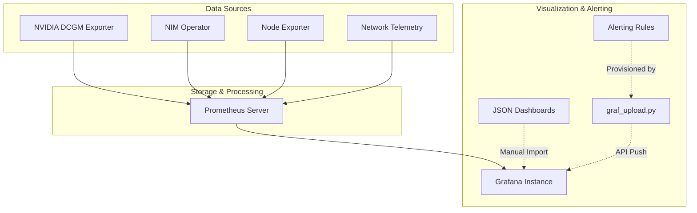
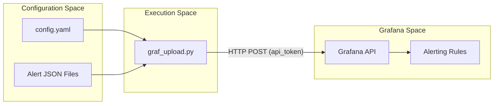

<!-- source: DeepWiki mcp.deepwiki.com · repo NVIDIA/enterprise-ras · page 8 Observability Reference Architecture · fetched 2026-10-26 -->

# Observability Reference Architecture

Relevant source files

The following files were used as context for generating this wiki page:

- [Observability RA/README.md](Observability RA/README.md)

The **Observability Reference Architecture (RA)** provides a standardized, production-ready framework for monitoring enterprise AI and HPC environments. It focuses on high-visibility data pipelines and pre-configured visualization for clusters running NVIDIA accelerated hardware. By integrating telemetry from **NVIDIA Data Center GPU Manager (DCGM)**, **NVIDIA NIMs**, and standard infrastructure exporters, it enables rapid troubleshooting and health assessment of clusters under heavy AI workloads [Observability RA/README.md:1-5]().

This architecture is designed to be modular, allowing users to leverage the provided Grafana dashboards and Prometheus alerting rules regardless of their specific data center provisioning software [Observability RA/README.md:3-3]().

### Core Components and Telemetry Sources

The Observability RA aggregates data from several key sources to provide a holistic view of the cluster:

| Component | Telemetry Source | Metrics Provided |
| :--- | :--- | :--- |
| **GPU** | DCGM Exporter | Power, temperature, SM utilization, memory clock, XID errors. |
| **Network** | NVUE / NetQ / Prometheus | NVLink/NVSwitch status, BGP/EVPN peering, interface throughput, error counts. |
| **Compute** | Node Exporter | CPU utilization, memory pressure, disk I/O, filesystem health. |
| **AI Services** | NIM Operator | Inference latency, throughput, model-specific health metrics. |
| **Orchestration** | Kube-State-Metrics | Pod health, node readiness, resource quotas. |

### System Integration Architecture

The following diagram illustrates how the Observability RA components interact to move data from hardware to visualization.

**Observability Data Pipeline**

**Sources:** [Observability RA/README.md:1-25]()

### Visualization via Grafana Dashboards
The RA includes five specialized Grafana dashboards designed to cover every layer of the AI infrastructure. These dashboards utilize specific PromQL patterns to filter by metric namespaces and provide drill-down capabilities for individual nodes or switches.

Key dashboards include:
*   **GPU Dashboard:** Focused on DCGM metrics for real-time performance monitoring.
*   **Network Dashboard:** Detailed views of NVSwitch, NVLink, and BGP/EVPN fabric health.
*   **Kubernetes & NIMs:** Monitoring for containerized AI workloads and inference services.

For detailed documentation on metric namespaces and the import procedure, see **[Grafana Dashboards (#8.1)](#)**.

### Automated Alerting and Provisioning
To ensure operational stability, the RA provides a suite of alerting rules that trigger on critical hardware and network failures (e.g., `network_port_down`, `gpu_alert_temp`). 

These alerts are not managed manually; instead, they are provisioned using the `graf_upload.py` script. This script uses a `config.yaml` file to define the Grafana API endpoint and the specific JSON alert files to be uploaded, ensuring an idempotent and repeatable deployment process [Observability RA/README.md:15-25]().

**Alert Provisioning Workflow**

**Sources:** [Observability RA/README.md:19-25]()

For a full reference of available alert rules and the schema for `config.yaml`, see **[Alerting Rules and graf_upload.py (#8.2)](#)**.

---

