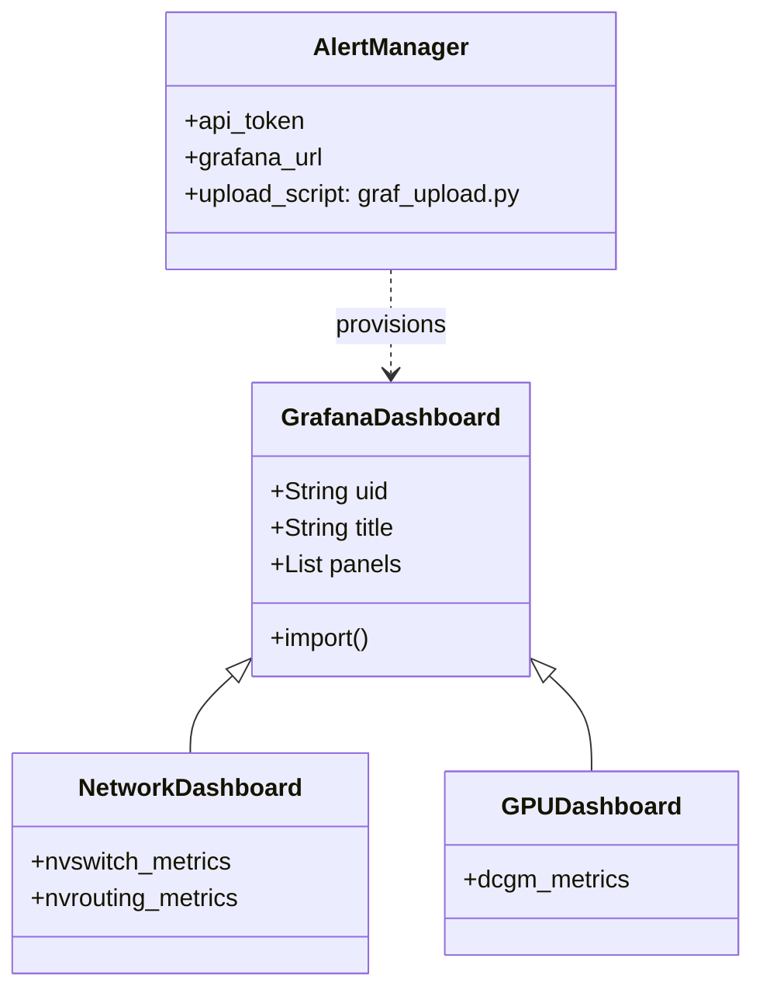

<!-- source: DeepWiki mcp.deepwiki.com · repo NVIDIA/enterprise-ras · page 8.1 Grafana Dashboards · fetched 2026-10-26 -->

# Grafana Dashboards

<details>
<summary>Relevant source files</summary>

The following files were used as context for generating this wiki page:

- [Observability RA/README.md](Observability RA/README.md)
- [Observability RA/dashboards/.DS_Store](Observability RA/dashboards/.DS_Store)
- [Observability RA/dashboards/Network Dashboard.json](Observability RA/dashboards/Network Dashboard.json)

</details>


The Observability Reference Architecture (RA) provides a suite of five pre-built Grafana dashboards designed to offer comprehensive visibility into the health and performance of enterprise AI clusters. These dashboards aggregate telemetry from multiple sources, including NVIDIA Data Center GPU Manager (DCGM), Prometheus Node Exporter, and NVIDIA network switches, to facilitate real-time monitoring and accelerated troubleshooting of AI workloads [Observability RA/README.md:1-3]().

## Dashboard Architecture and Data Flow

The observability stack follows a standard pipeline where various exporters collect telemetry and expose it to a centralized Prometheus instance, which then serves as the data source for Grafana [Observability RA/README.md:3]().

### Data Pipeline Overview
Title: Observability Data Flow
```mermaid
graph TD
    subgraph "Data Sources"
        [DCGM_Exporter] -- "GPU Metrics" --> P["Prometheus"]
        [Node_Exporter] -- "CPU/Storage Metrics" --> P
        [NV_Network_Exporter] -- "Switch/Routing Metrics" --> P
        [K8s_Metrics_Server] -- "Cluster Stats" --> P
        [NIM_Operator] -- "Inference Metrics" --> P
    end

    subgraph "Visualization"
        P -- "PromQL Queries" --> G["Grafana"]
        G -- "Dashboard JSONs" --> [Network_Dashboard]
        G -- "Dashboard JSONs" --> [GPU_Dashboard]
        G -- "Dashboard JSONs" --> [CPU_Storage_Dashboard]
        G -- "Dashboard JSONs" --> [K8s_Global_Dashboard]
        G -- "Dashboard JSONs" --> [NIMs_Dashboard]
    end
```
Sources: [Observability RA/README.md:1-5]()

## 1. Network Dashboard
The Network Dashboard focuses on the health of the fabric, covering physical interfaces, routing protocols, and switch availability. It utilizes specific metric namespaces like `nvswitch` and `nvrouting` [Observability RA/dashboards/Network Dashboard.json:166-181]().

### Key Metrics and PromQL Patterns
*   **Switch Availability**: Monitors the `up` metric to distinguish between reachable and unreachable switches [Observability RA/dashboards/Network Dashboard.json:81-92]().
    *   Query: `sum by () (max by (net.host.name) (up))`
*   **Interface Throughput**: Tracks octet counts across physical interfaces [Observability RA/dashboards/Network Dashboard.json:166]().
    *   Namespace: `nvswitch_interface_tc_tx_octet`
*   **Routing State**: Monitors BGP peer states to ensure fabric connectivity [Observability RA/dashboards/Network Dashboard.json:181]().
    *   Namespace: `nvrouting_bgp_peer_state`
*   **Link Status**: Specifically monitors operational states for critical links like `swp1s0` [Observability RA/dashboards/Network Dashboard.json:197]().

## 2. GPU Dashboard (DCGM)
This dashboard leverages the NVIDIA Data Center GPU Manager (DCGM) to provide low-level hardware telemetry. It is critical for identifying performance bottlenecks or hardware failures during large-scale training jobs.

*   **Metric Namespace**: Primarily uses the `DCGM_FI_*` prefix.
*   **Capabilities**: Monitoring of GPU utilization, memory usage, temperature, power draw, and XID errors.

## 3. CPU & Storage Dashboard
Utilizing the Prometheus Node Exporter, this dashboard tracks the resource consumption of the host systems (head nodes and compute nodes).

*   **CPU**: Per-core utilization, load averages, and context switching.
*   **Storage**: Disk I/O throughput (read/write), IOPS, and filesystem capacity.
*   **Memory**: RAM utilization and swap usage.

## 4. Kubernetes Global Dashboard
For clusters managed via Kubernetes, this dashboard provides an aggregate view of the orchestration layer.

*   **Resource Quotas**: Monitoring of CPU/Memory requests vs. limits.
*   **Pod Health**: Tracking of pending, failing, or crashing pods across namespaces.
*   **Node Status**: Readiness of K8s worker nodes.

## 5. NIMs Dashboard
Specifically designed for NVIDIA Inference Microservices (NIMs), this dashboard monitors the performance of deployed AI models.

*   **Inference Latency**: Time to First Token (TTFT) and Inter-Token Latency (ITL).
*   **Throughput**: Requests per second and tokens per second.
*   **Model Health**: Error rates and instance availability via the NIM Operator [Observability RA/README.md:3]().

## Implementation and Import Procedure

Dashboards are defined as JSON files and can be imported manually or programmatically.

### Manual Import Process
1.  Download the desired dashboard JSON from the `Observability RA/dashboards/` directory [Observability RA/README.md:9]().
2.  In Grafana, navigate to **Dashboards > New > Import** [Observability RA/README.md:11]().
3.  Upload the JSON file and select the Prometheus data source [Observability RA/README.md:12-13]().

### Programmatic Mapping
Title: Dashboard Entity Mapping

Sources: [Observability RA/README.md:7-25](), [Observability RA/dashboards/Network Dashboard.json:1-100]()

### Prerequisites for Full Functionality
To ensure dashboards display data correctly, the following must be configured:
*   **Prometheus UID**: The dashboards often reference a specific datasource UID (e.g., `bf5tx99atauwwe`) which may need to be updated to match the local environment [Observability RA/dashboards/Network Dashboard.json:27]().
*   **Scrape Intervals**: Standardized at `1m` for network and routing stats to balance granularity and storage [Observability RA/dashboards/Network Dashboard.json:169-185]().

Sources:
- [Observability RA/README.md:1-28]()
- [Observability RA/dashboards/Network Dashboard.json:1-218]()

---

