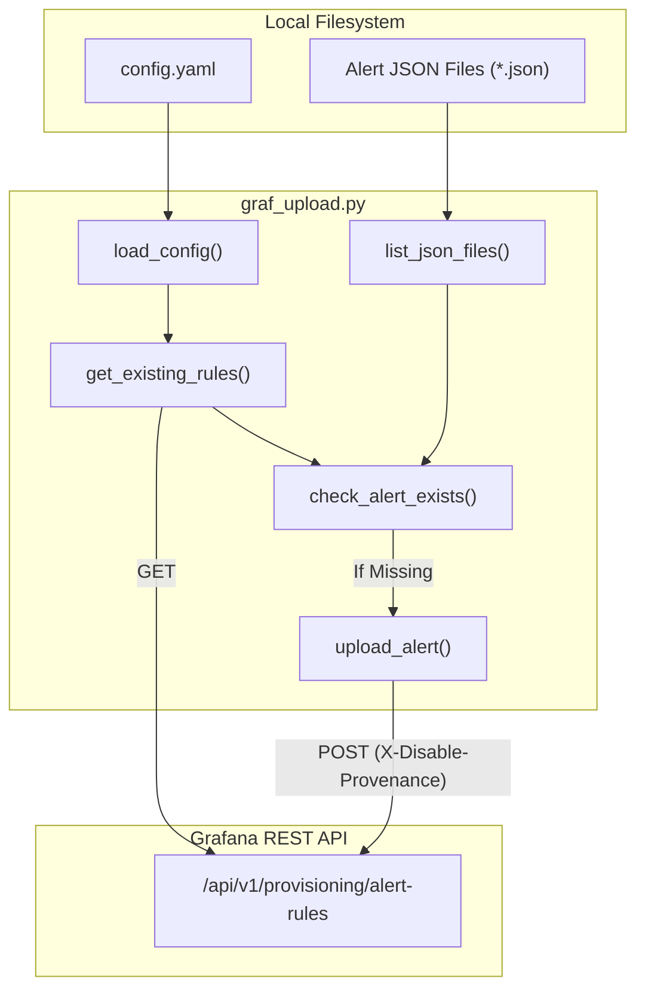
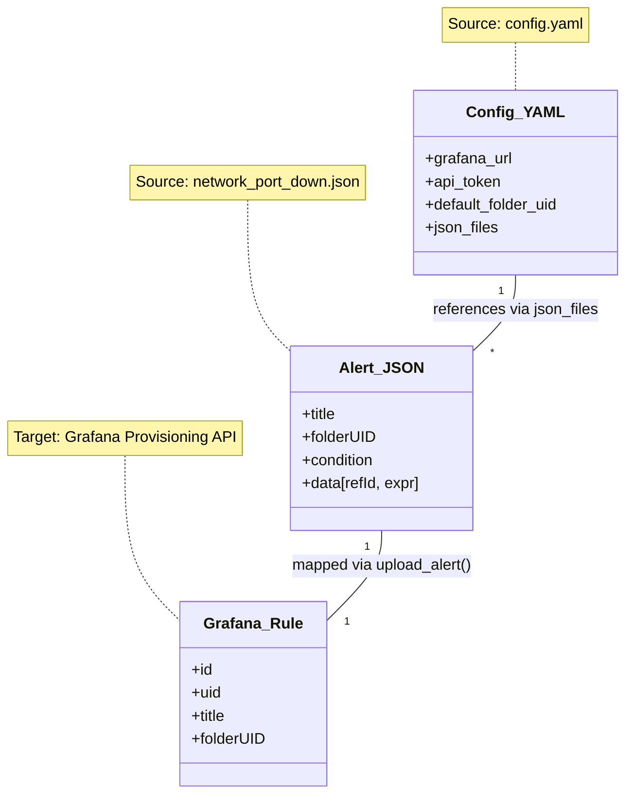

<!-- source: DeepWiki mcp.deepwiki.com · repo NVIDIA/enterprise-ras · page 8.2 Alerting Rules and graf_upload.py · fetched 2026-10-26 -->

# Alerting Rules and graf_upload.py

Relevant source files

The following files were used as context for generating this wiki page:

- [Observability RA/.DS_Store](Observability RA/.DS_Store)
- [Observability RA/alerting/config.yaml](Observability RA/alerting/config.yaml)
- [Observability RA/alerting/disk_write_time.json](Observability RA/alerting/disk_write_time.json)
- [Observability RA/alerting/gpu_alert_pwr.json](Observability RA/alerting/gpu_alert_pwr.json)
- [Observability RA/alerting/gpu_alert_temp.json](Observability RA/alerting/gpu_alert_temp.json)
- [Observability RA/alerting/graf_upload.py](Observability RA/alerting/graf_upload.py)
- [Observability RA/alerting/network_bgp_peer_state_change.json](Observability RA/alerting/network_bgp_peer_state_change.json)
- [Observability RA/alerting/network_port_down.json](Observability RA/alerting/network_port_down.json)
- [Observability RA/alerting/network_unreachable_switch.json](Observability RA/alerting/network_unreachable_switch.json)

This page documents the alerting infrastructure within the Observability Reference Architecture (RA). It covers the collection of pre-defined alert rules for network, GPU, and Kubernetes monitoring, as well as the `graf_upload.py` utility used to provision these rules into Grafana via its REST API.

## Alerting Rule Definitions

The repository provides a set of JSON-formatted alert rules compatible with the Grafana Alerting (unified alerting) engine. These rules target specific performance and availability thresholds across the AI/HPC stack.

### Network Alerts
These alerts focus on the health of the Spectrum switch fabric, monitoring interface states, BGP peering, and overall switch reachability.

| Alert Title | Metric / Expression | Trigger Condition |
| :--- | :--- | :--- |
| **Network - Switch Port Down** | `nvswitch_interface_oper_state == 2` | Triggered when any switch interface operational state is DOWN [Observability RA/alerting/network_port_down.json:17-17](). |
| **Network - BGP Peer State Change** | `(nvrouting_bgp_peer_state{state="Established"} == 0)` | Triggered when a BGP peer leaves the "Established" state, provided it was established in the last 5 minutes [Observability RA/alerting/network_bgp_peer_state_change.json:17-17](). |
| **Network - Unreachable Switch** | `1 - max by (net_host_name) (up)` | Triggered when a switch is unreachable (`up == 0`) for at least 1 minute [Observability RA/alerting/network_unreachable_switch.json:17-17](). |

### GPU and System Alerts
Utilizes NVIDIA DCGM and Node Exporter metrics to monitor hardware health.

*   **GPU Power (`gpu_alert_pwr.json`)**: Triggers if `DCGM_FI_DEV_POWER_USAGE` exceeds 70W [Observability RA/alerting/gpu_alert_pwr.json:17-47]().
*   **GPU Temperature (`gpu_alert_temp.json`)**: Triggers if `DCGM_FI_DEV_GPU_TEMP` exceeds 80C [Observability RA/alerting/gpu_alert_temp.json:17-48]().
*   **Disk Write Time (`disk_write_time.json`)**: Monitors `node_disk_write_time_seconds_total` for values greater than 10 [Observability RA/alerting/disk_write_time.json:17-48]().

### Kubernetes Alerts
The system includes several Kubernetes-specific alerts (referenced in `config.yaml` but implementation details reside in respective JSON files):
*   `k8s_kubelet_down.json`, `k8s_apiserver_down.json`, `k8s_node_down.json` [Observability RA/alerting/config.yaml:12-16]().
*   Namespace resource monitoring: `k8s_cpu_namespace.json`, `k8s_mem_namespace.json` [Observability RA/alerting/config.yaml:17-18]().

**Sources:** [Observability RA/alerting/network_port_down.json:1-81](), [Observability RA/alerting/network_bgp_peer_state_change.json:1-81](), [Observability RA/alerting/network_unreachable_switch.json:1-81](), [Observability RA/alerting/config.yaml:5-25]()

---

## graf_upload.py Provisioning Script

The `graf_upload.py` script is a Python-based automation tool designed to idempotently upload alert rules to a Grafana instance.

### Key Functions and Logic
*   **`load_config(filepath)`**: Reads the `config.yaml` to retrieve the Grafana URL, API token, and the list of files to upload [Observability RA/alerting/graf_upload.py:11-13]().
*   **`get_existing_rules(grafana_url, api_token)`**: Queries the Grafana Provisioning API (`/api/v1/provisioning/alert-rules`) to fetch currently configured rules [Observability RA/alerting/graf_upload.py:30-47]().
*   **`check_alert_exists(existing_rules, title, folderUID)`**: Performs an idempotent check by comparing the `title` and `folderUID` of local JSON files against the rules already present in Grafana [Observability RA/alerting/graf_upload.py:49-54]().
*   **`upload_alert(...)`**: Executes the HTTP POST request to create the alert rule. It includes the `X-Disable-Provenance` header if configured, allowing users to edit the provisioned rules manually in the Grafana UI after upload [Observability RA/alerting/graf_upload.py:56-74]().
*   **`inject_folder_uid(data, folder_uid)`**: Dynamically updates the `folderUID` field within the JSON payload before transmission [Observability RA/alerting/graf_upload.py:22-28]().

### Configuration Schema (config.yaml)
The script behavior is governed by `config.yaml`:
*   `grafana_url`: The base URL of the Grafana service [Observability RA/alerting/config.yaml:1-1]().
*   `api_token`: Service account or API token with editor/admin permissions [Observability RA/alerting/config.yaml:2-2]().
*   `default_folder_uid`: The target folder in Grafana where alerts will be placed [Observability RA/alerting/config.yaml:4-4]().
*   `json_files`: Explicit list of JSON files to process [Observability RA/alerting/config.yaml:5-21]().
*   `json_folder`: (Optional) Directory path to glob all `.json` files [Observability RA/alerting/graf_upload.py:17-20]().

**Sources:** [Observability RA/alerting/graf_upload.py:1-149](), [Observability RA/alerting/config.yaml:1-26]()

---

## Data Flow and Implementation

The following diagrams illustrate the relationship between the configuration files, the upload utility, and the Grafana API.

### Alert Provisioning Pipeline
This diagram shows how `graf_upload.py` processes local JSON entities and interacts with the Grafana service.

Title: Alert Upload Logic Flow

**Sources:** [Observability RA/alerting/graf_upload.py:15-20](), [Observability RA/alerting/graf_upload.py:30-31](), [Observability RA/alerting/graf_upload.py:56-63](), [Observability RA/alerting/graf_upload.py:95-122]()

### Entity Mapping: Code to Grafana
This diagram bridges the natural language concepts of "Alerts" and "Folders" to the specific code entities and JSON fields used by the system.

Title: Alert Entity Mapping

**Sources:** [Observability RA/alerting/config.yaml:1-8](), [Observability RA/alerting/network_port_down.json:3-9](), [Observability RA/alerting/graf_upload.py:128-136]()

---

## Idempotency and Provenance

### Idempotent Uploads
The script maintains idempotency by fetching the list of existing rules before attempting any uploads [Observability RA/alerting/graf_upload.py:95-96](). It matches local files to remote rules using the combination of `title` and `folderUID` [Observability RA/alerting/graf_upload.py:49-54](). If a match is found, the upload is skipped to avoid creating duplicate alerts [Observability RA/alerting/graf_upload.py:120-122]().

### Provenance Management
By default, Grafana rules created via the Provisioning API are "read-only" in the UI (marked as provisioned). The `graf_upload.py` script sets the `X-Disable-Provenance: true` HTTP header [Observability RA/alerting/graf_upload.py:62-63](). This allows the rules to be treated as if they were created manually, enabling administrators to tweak thresholds or notification policies directly in the Grafana dashboard without being blocked by provisioning locks.

**Sources:** [Observability RA/alerting/graf_upload.py:49-74](), [Observability RA/alerting/graf_upload.py:120-134]()

---

