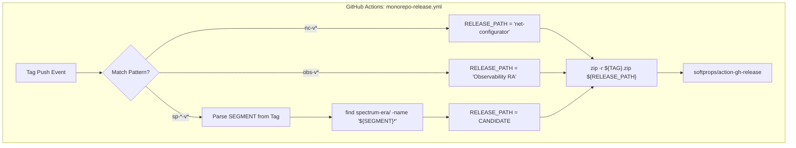

<!-- source: DeepWiki mcp.deepwiki.com · repo NVIDIA/enterprise-ras · page 9 CI/CD and Release Management · fetched 2026-10-26 -->

# CI/CD and Release Management

<details>
<summary>Relevant source files</summary>

The following files were used as context for generating this wiki page:

- [.github/workflows/monorepo-release.yml](.github/workflows/monorepo-release.yml)
- [spectrum-era/2-4-3-200/license](spectrum-era/2-4-3-200/license)
- [spectrum-era/README.md](spectrum-era/README.md)
- [spectrum-era/license](spectrum-era/license)

</details>


This section documents the automation workflows used to package, version, and release the Enterprise Reference Architecture (ERA) components. The repository utilizes GitHub Actions to manage a monorepo structure, allowing independent releases for the `net-configurator` tool, the `Observability RA`, and the legacy `spectrum-era` reference configurations.

## Release Workflow Overview

The release process is driven by GitHub Actions tags. When a tag matching specific patterns is pushed to the repository, a workflow automatically identifies the relevant subdirectory, packages it into a ZIP archive, and creates a GitHub Release.

### Tagging Conventions

The workflow distinguishes between components based on the tag prefix:

| Component | Tag Pattern | Target Directory |
| :--- | :--- | :--- |
| **net-configurator** | `nc-v*` | `net-configurator/` |
| **Observability RA** | `obs-v*` | `Observability RA/` |
| **spectrum-era** | `sp-<arch>-v*` | `spectrum-era/<arch>-<bandwidth>/` |

For `spectrum-era`, the workflow performs a dynamic lookup. For example, a tag like `sp-2-4-3-v3.0.0` is parsed to find a matching subdirectory in `spectrum-era/` that begins with the segment `2-4-3` (e.g., `2-4-3-200`).

### Release Automation Logic

The following diagram illustrates how the `Monorepo Folder Release` workflow processes incoming tags to resolve the correct filesystem path.

**Release Path Resolution Logic**

**Sources:**
- [.github/workflows/monorepo-release.yml:3-9]()
- [.github/workflows/monorepo-release.yml:25-60]()
- [spectrum-era/README.md:15-17]()

For details, see [Monorepo Release Workflow](#9.1).

## Artifact Distribution

Releases are distributed as standalone ZIP files containing the specific component requested. This allows partners to consume a stable version of a specific architecture or tool without cloning the entire monorepo.

### Download Methods
Users can obtain releases via the GitHub Web UI or programmatically using `cURL`:
```bash
curl -LO https://github.com/NVIDIA/enterprise-ras/releases/tag/<release-tag>.zip
```

**Sources:**
- [spectrum-era/README.md:12-13]()
- [.github/workflows/monorepo-release.yml:65-75]()

## Version Compatibility and Maintenance

As the ERA evolves, maintaining compatibility between the automation templates and the underlying Network User Experience (NVUE) API in Cumulus Linux is critical.

### NVUE Versioning
The repository manages breaking changes in NVUE, such as the transition from `enable on/off` syntax to `state enabled/disabled` introduced in newer Cumulus Linux versions (e.g., 5.15+). The `net-configurator` tool handles these variations through the `VERSIONS` section in the Excel template, ensuring that generated configurations match the target switch OS version.

For details, see [NVUE Version Compatibility](#9.2).

### Deprecation Notice
The `spectrum-era` directory is currently deprecated and maintained for historical reference only. Active development and new architecture releases are focused on the `net-configurator` framework.

**Sources:**
- [spectrum-era/README.md:6-6]()

---

## Child Pages
- **[Monorepo Release Workflow](#9.1)**: Details the `.github/workflows/monorepo-release.yml` pipeline, trigger conditions, and tag parsing logic.
- **[NVUE Version Compatibility](#9.2)**: Documents the migration paths for Cumulus Linux versions and the template compatibility matrix.

---

