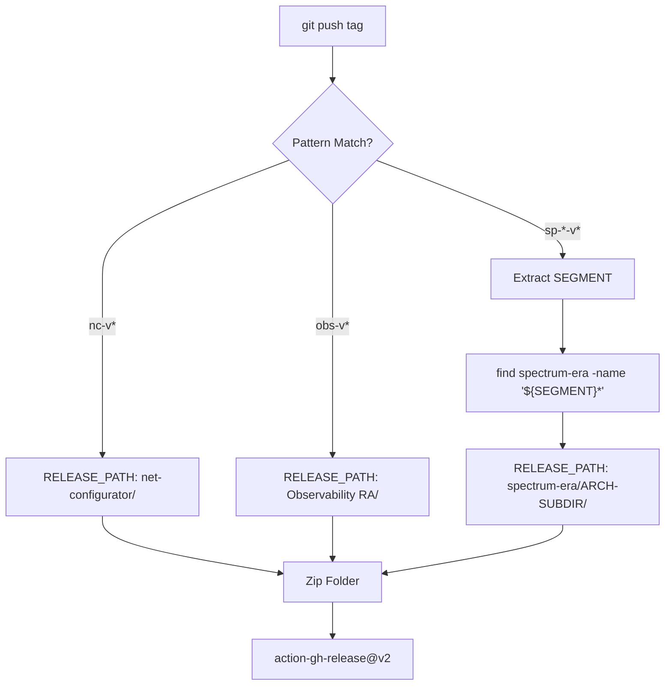
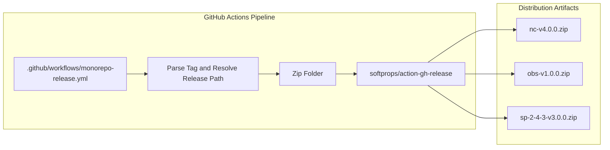

<!-- source: DeepWiki mcp.deepwiki.com · repo NVIDIA/enterprise-ras · page 9.1 Monorepo Release Workflow · fetched 2026-10-26 -->

# Monorepo Release Workflow

<details>
<summary>Relevant source files</summary>

The following files were used as context for generating this wiki page:

- [.github/workflows/monorepo-release.yml](.github/workflows/monorepo-release.yml)
- [license](license)

</details>


The **Monorepo Release Workflow** provides a standardized mechanism for packaging and distributing specific components of the NVIDIA Enterprise Reference Architecture (ERA) repository. Rather than releasing the entire monorepo as a single unit, this workflow allows for granular versioning of the active deployment tools, observability frameworks, and individual legacy architecture configurations.

### Pipeline Trigger Conditions

The release pipeline is implemented in `.github/workflows/monorepo-release.yml` and is triggered exclusively by the creation of specific git tags. The workflow filters tags based on three distinct patterns to determine which component should be packaged:

| Tag Pattern | Target Component | Example Tag |
|:---|:---|:---|
| `nc-v*` | `net-configurator` (Active Tool) | `nc-v4.0.0` |
| `obs-v*` | `Observability RA` | `obs-v1.0.0` |
| `sp-*-v*` | Specific `spectrum-era` architecture | `sp-2-4-3-v3.0.0` |

**Sources:**
- [.github/workflows/monorepo-release.yml:3-9]()

---

### Tag Parsing and Path Resolution

When a tag is pushed, the workflow executes a shell script within the `Parse Tag and Resolve Release Path` step to map the tag string to a physical directory in the repository.

#### Resolution Logic
1.  **Observability RA**: If the tag starts with `obs-v`, the `RELEASE_PATH` is set to the `Observability RA` directory [.github/workflows/monorepo-release.yml:25-31]().
2.  **Net-Configurator**: If the tag starts with `nc-v`, the `RELEASE_PATH` is set to the `net-configurator` directory [.github/workflows/monorepo-release.yml:33-39]().
3.  **Spectrum-ERA (Legacy)**: If the tag follows the `sp-*-v*` pattern, the script extracts the architecture segment (e.g., `2-4-3`) and performs a directory search within the `spectrum-era/` folder to find a matching subdirectory (e.g., `spectrum-era/2-4-3-200`) [.github/workflows/monorepo-release.yml:41-60]().

#### Tag to Path Mapping Diagram
This diagram illustrates how the `monorepo-release.yml` logic associates external tag strings with internal filesystem paths.



**Sources:**
- [.github/workflows/monorepo-release.yml:19-64]()

---

### Release Artifact Packaging

Once the path is resolved, the workflow packages the target directory into a compressed ZIP archive. The archive name is derived directly from the tag name (e.g., `nc-v4.0.0.zip`).

#### Implementation Detail
The `Zip Folder` step uses the standard `zip` utility to recursively capture the resolved directory:
```bash
zip -r "${{ steps.info.outputs.tag }}.zip" "${{ steps.info.outputs.path }}/"
```
The resulting artifact is then uploaded to GitHub Releases using the `softprops/action-gh-release@v2` action, which creates a formal release entry associated with the pushed tag.

**Sources:**
- [.github/workflows/monorepo-release.yml:65-75]()

---

### Partner Download and Distribution

Partners and automated systems can consume these releases via the GitHub Web UI or programmatically using `cURL`. Because the releases are tagged by architecture and tool, users can download only the specific components relevant to their deployment.

#### Data Flow: Release to Consumer
This diagram maps the CI/CD entities to the final distribution artifacts.



#### Example cURL Download
To download a specific version of the `net-configurator` tool programmatically:
```bash
VERSION="nc-v4.0.0"
curl -L -O "https://github.com/NVIDIA/enterprise-ras/releases/download/${VERSION}/${VERSION}.zip"
```

**Sources:**
- [.github/workflows/monorepo-release.yml:70-73]()
- [license:1-20]()

---

