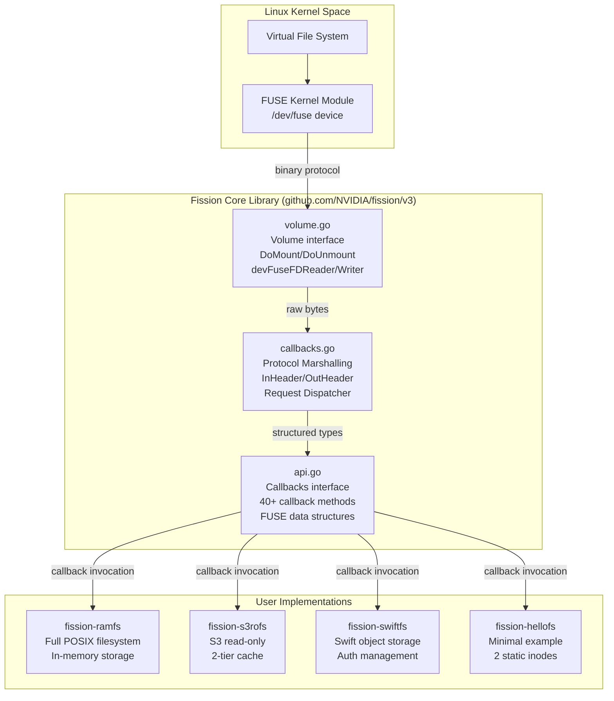
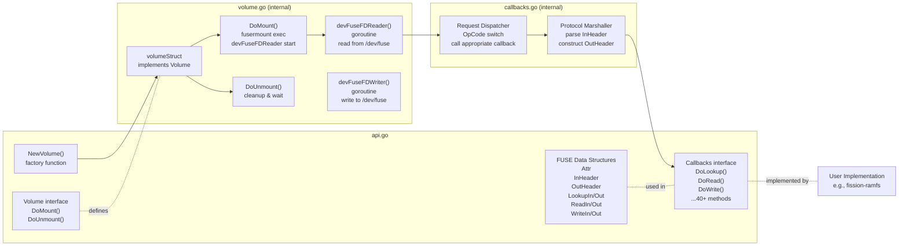
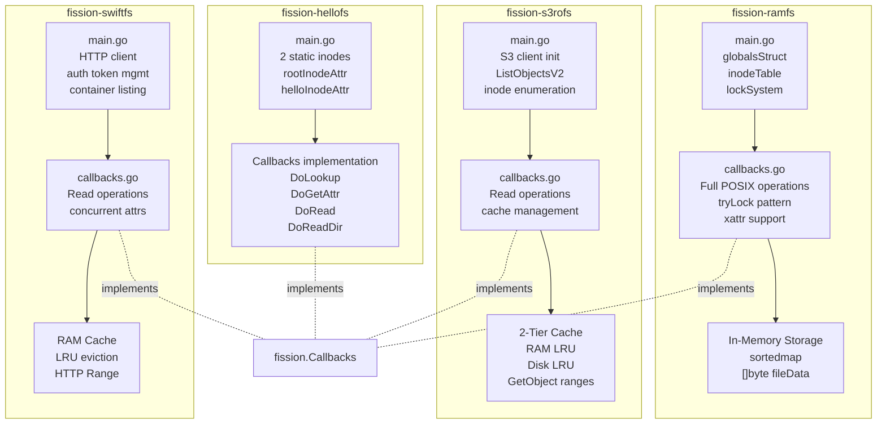
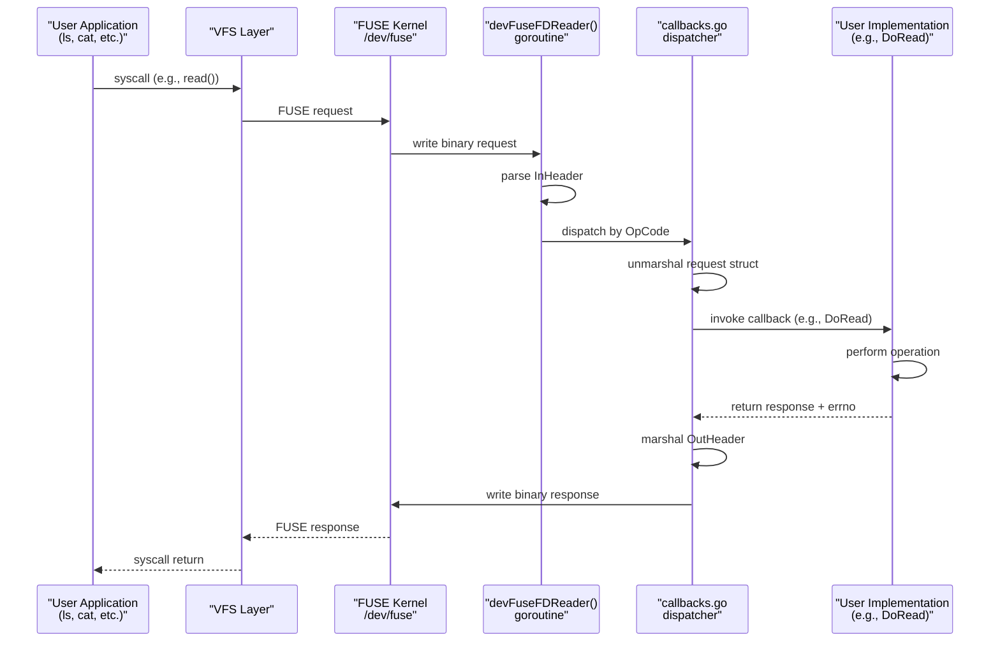
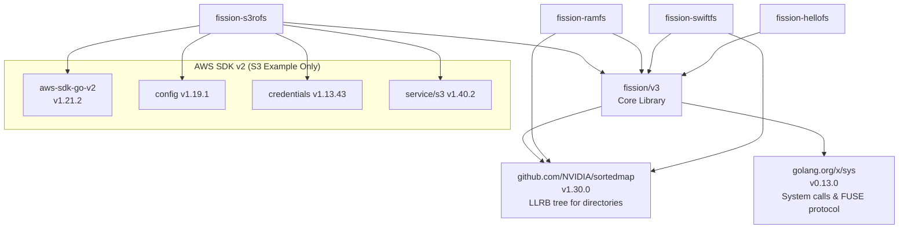

<!-- source: DeepWiki mcp.deepwiki.com · repo NVIDIA/fission · page 1 Overview · fetched 2026-10-26 -->

# Overview

<details>
<summary>Relevant source files</summary>

The following files were used as context for generating this wiki page:

- [api.go](api.go)
- [examples/fission-hellofs/main.go](examples/fission-hellofs/main.go)
- [go.mod](go.mod)
- [go.sum](go.sum)

</details>


## Purpose and Scope

The **fission** repository is a Go library that provides a high-level abstraction for building FUSE (Filesystem in Userspace) filesystems. It handles the low-level FUSE protocol communication with the Linux kernel, exposing an idiomatic Go callback interface that developers implement to create custom filesystems. The library manages `/dev/fuse` device communication, protocol marshalling, and goroutine lifecycle, allowing filesystem implementers to focus on business logic rather than FUSE protocol details.

This document provides a high-level overview of the fission architecture, its core components, and example implementations. For detailed information about specific subsystems, see:
- Core library internals: [Core Library](#2)
- Example filesystem implementations: [Example Implementations](#3)
- Build and development setup: [Development and Build Setup](#5)

**Sources:** [api.go:1-96](), [go.mod:1-11]()

---

## Repository Purpose

Fission solves the complexity of implementing FUSE filesystems by:

1. **Abstracting FUSE protocol details**: Handles binary protocol parsing, struct marshalling, and kernel communication
2. **Providing type-safe interfaces**: 40+ callback methods with structured Go types instead of raw byte buffers
3. **Managing lifecycle**: Automatic goroutine management, buffer pooling, and mount/unmount coordination
4. **Enabling rapid development**: Example implementations demonstrate patterns from minimal (hellofs) to production-ready (s3rofs)

The library is designed as a **reusable core** with **pluggable implementations**. Users implement the `Callbacks` interface to define filesystem behavior, while fission handles all FUSE protocol mechanics.

**Sources:** [api.go:30-83](), [examples/fission-hellofs/main.go:1-273]()

---

## High-Level Architecture



**Fission Architecture**: The library operates as a three-layer translation stack between the Linux kernel's FUSE module and user filesystem implementations. The `volume.go` layer handles device I/O, `callbacks.go` performs protocol marshalling, and `api.go` defines the callback contract.

**Sources:** [api.go:11-95](), Diagram 1, Diagram 2

---

## Core Components and Code Mapping



**Code Entity Mapping**: This diagram shows the relationship between the public API surface and internal implementation. Users interact only with `Volume` and `Callbacks` interfaces from `api.go`, while `volume.go` and `callbacks.go` provide the internal machinery.

| Component | File | Key Types/Functions | Visibility |
|-----------|------|---------------------|------------|
| **Public API** | `api.go` | `Volume`, `Callbacks`, `NewVolume()` | Exported |
| **Data Structures** | `api.go` | `Attr`, `InHeader`, `OutHeader`, 40+ request/response structs | Exported |
| **Volume Management** | `volume.go` | `volumeStruct`, `DoMount()`, `DoUnmount()`, `devFuseFDReader()` | Internal |
| **Protocol Layer** | `callbacks.go` | Request dispatcher, marshalling functions | Internal |

**Sources:** [api.go:11-1203](), Diagram 1

---

## Example Implementations Comparison

The repository includes four example implementations that demonstrate different filesystem patterns:

| Implementation | Purpose | Storage Backend | Operations | Complexity |
|----------------|---------|-----------------|------------|------------|
| **fission-hellofs** | Learning example | Static hardcoded data | Read-only, 2 inodes | Minimal |
| **fission-ramfs** | Full POSIX filesystem | In-memory (volatile) | Read/write, xattr, locking | High |
| **fission-s3rofs** | Cloud storage frontend | Amazon S3 | Read-only, cached | Medium |
| **fission-swiftfs** | Object storage frontend | OpenStack Swift | Read-only, cached | Medium |



**Implementation Patterns**: Each example filesystem implements the `fission.Callbacks` interface but uses different storage backends and concurrency strategies. The hellofs example demonstrates the minimum viable implementation, while ramfs shows a full-featured POSIX filesystem with sophisticated locking.

**Sources:** [examples/fission-hellofs/main.go:1-273](), Diagram 3

---

## FUSE Request Flow



**Request Processing Pipeline**: When a user application performs a filesystem operation, the request flows through the kernel to fission's reader goroutine, which dispatches it to the appropriate callback. The response follows the reverse path back to the application.

**Sources:** [api.go:17-27](), Diagram 2

---

## Key Features

### Protocol Version Support

Fission supports FUSE protocol versions 7.17 through 7.44 (Linux kernels 3.1 through 6.16), with automatic version negotiation during mount via the `DoInit()` callback.

**Sources:** [api.go:97-134]()

### Operation Coverage

The library exposes 40+ FUSE operations through the `Callbacks` interface:

| Category | Operations |
|----------|------------|
| **Inode Operations** | `DoLookup`, `DoGetAttr`, `DoSetAttr`, `DoReadLink`, `DoAccess`, `DoStatX` |
| **File Operations** | `DoOpen`, `DoRead`, `DoWrite`, `DoRelease`, `DoFSync`, `DoFAllocate`, `DoLSeek` |
| **Directory Operations** | `DoOpenDir`, `DoReadDir`, `DoReadDirPlus`, `DoReleaseDir`, `DoFSyncDir` |
| **Namespace Operations** | `DoMkNod`, `DoMkDir`, `DoUnlink`, `DoRmDir`, `DoRename`, `DoRename2`, `DoLink`, `DoSymLink`, `DoCreate` |
| **Extended Attributes** | `DoSetXAttr`, `DoGetXAttr`, `DoListXAttr`, `DoRemoveXAttr` |
| **File Locking** | `DoGetLK`, `DoSetLK`, `DoSetLKW` |
| **Lifecycle** | `DoInit`, `DoDestroy`, `DoForget`, `DoBatchForget`, `DoInterrupt` |
| **Special** | `DoStatFS`, `DoFlush`, `DoBMap`, `DoPoll` |

Not all implementations need to support all operations. Read-only filesystems like s3rofs implement only read operations and return `syscall.ENOSYS` for write operations.

**Sources:** [api.go:40-83]()

### Concurrency and Buffer Management

- **Goroutine Management**: `devFuseFDReader()` spawns per-request handler goroutines, coordinated via `sync.WaitGroup`
- **Buffer Pooling**: `sync.Pool` for read buffers reduces GC pressure in high-throughput scenarios
- **Thread Safety**: User implementations are responsible for their own locking; fission callbacks may be invoked concurrently

**Sources:** Diagram 5

### Mount Options

The `NewVolume()` factory function accepts configuration parameters:

```go
NewVolume(
    volumeName string,           // Displayed in mount output
    mountpointDirPath string,    // Where to mount
    fuseSubtype string,          // Filesystem type suffix (e.g., "fission.ramfs")
    maxRead uint32,              // Maximum read size (typically 1MiB)
    maxWrite uint32,             // Maximum write size (0 = read-only)
    defaultPermissions bool,     // Enable kernel permission checking
    allowOther bool,             // Allow non-owner access
    callbacks Callbacks,         // User implementation
    logger *log.Logger,          // For debugging
    errChan chan error,          // Mount lifecycle errors
)
```

**Sources:** [api.go:85-95](), [examples/fission-hellofs/main.go:249]()

---

## Dependencies



**Dependency Graph**: The core library has minimal dependencies (sortedmap for directory management and golang.org/x/sys for syscalls). Example implementations add dependencies as needed (e.g., AWS SDK for S3 integration).

| Package | Version | Purpose | Used By |
|---------|---------|---------|---------|
| `github.com/NVIDIA/sortedmap` | v1.30.0 | LLRB tree for ordered directory entries | Core, ramfs, s3rofs, swiftfs |
| `golang.org/x/sys` | v0.13.0 | Linux syscalls, FUSE protocol constants | Core |
| `github.com/aws/aws-sdk-go-v2` | v1.21.2 | AWS SDK core framework | s3rofs only |
| `github.com/aws/aws-sdk-go-v2/service/s3` | v1.40.2 | S3 client for GetObject/ListObjects | s3rofs only |

**Sources:** [go.mod:1-30](), [go.sum:1-52](), Diagram 4

---

## Getting Started

To use fission in your project:

1. **Import the library**:
   ```go
   import "github.com/NVIDIA/fission/v3"
   ```

2. **Implement the `Callbacks` interface**: Define filesystem behavior by implementing callback methods for the operations you support.

3. **Create a `Volume`**: Call `fission.NewVolume()` with your callbacks and configuration.

4. **Mount the filesystem**: Invoke `volume.DoMount()` to begin handling requests.

5. **Handle signals**: Wait for termination signals, then call `volume.DoUnmount()` to cleanly unmount.

The `fission-hellofs` example demonstrates this pattern with minimal code (approximately 600 lines including boilerplate), showing only the essential operations for a read-only filesystem with static content.

**Sources:** [examples/fission-hellofs/main.go:75-273]()

---

