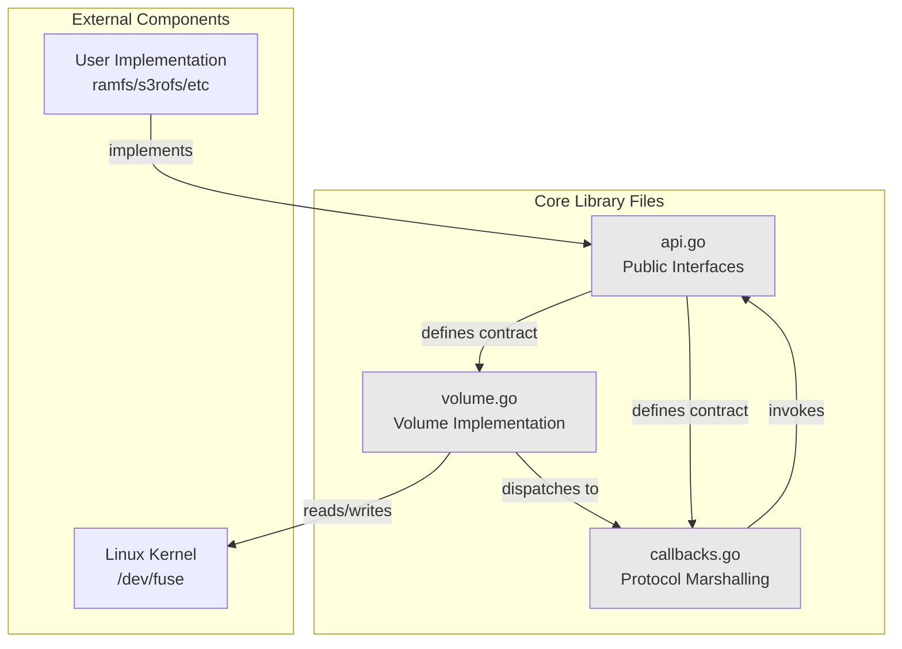
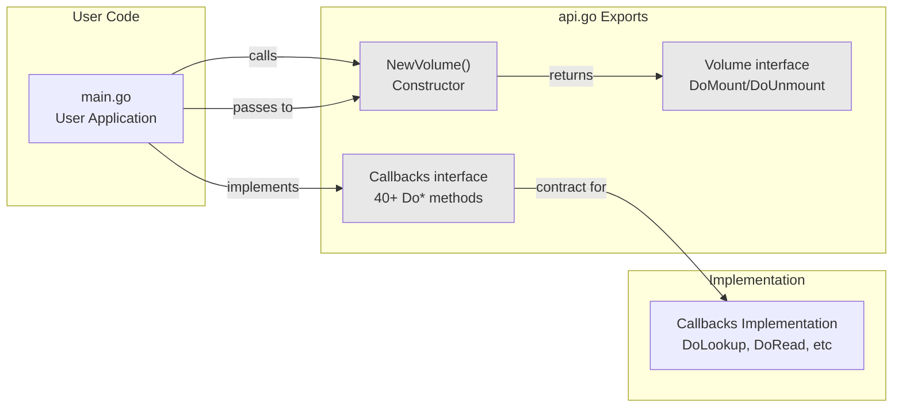
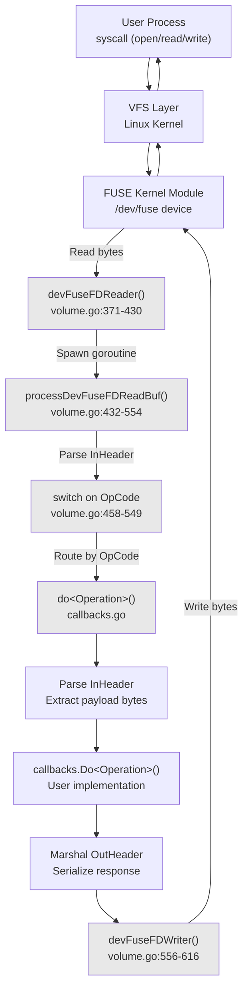
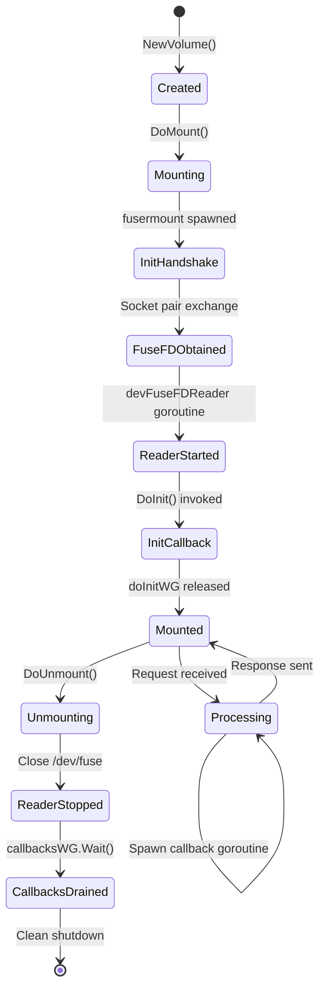
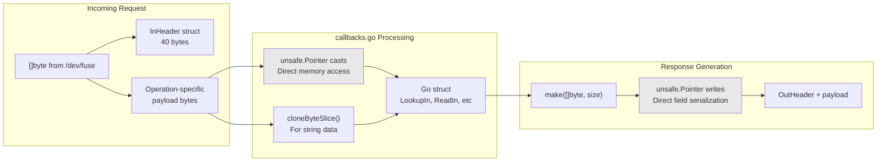
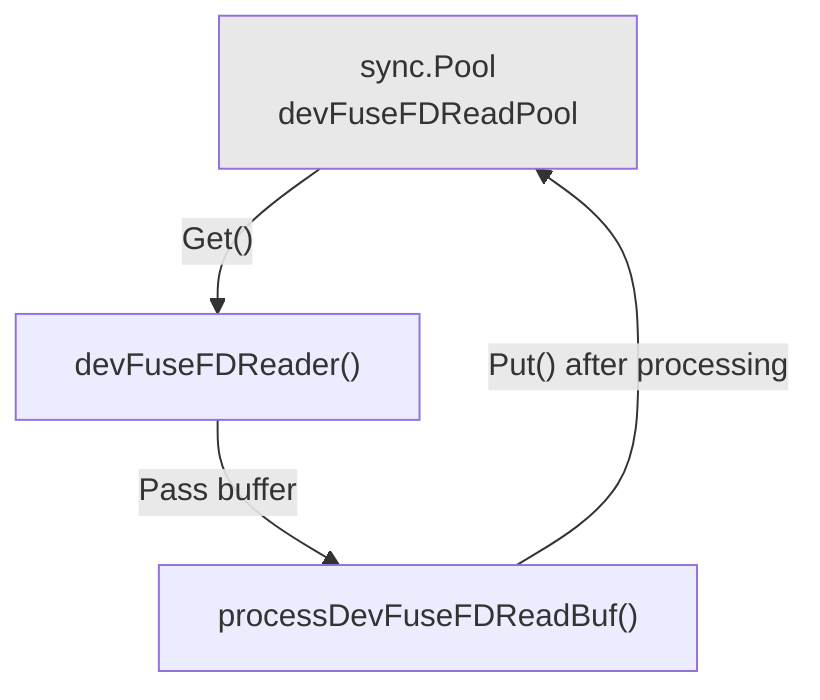
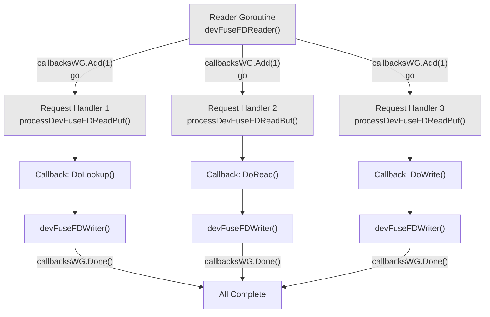
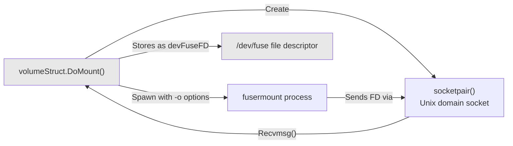

<!-- source: DeepWiki mcp.deepwiki.com · repo NVIDIA/fission · page 2 Core Library · fetched 2026-10-26 -->

# Core Library

<details>
<summary>Relevant source files</summary>

The following files were used as context for generating this wiki page:

- [api.go](api.go)
- [callbacks.go](callbacks.go)
- [volume.go](volume.go)

</details>


The Core Library is the foundation of the fission FUSE filesystem framework. It consists of three tightly-integrated components that abstract the Linux FUSE protocol into idiomatic Go interfaces. This page provides an overview of how these components work together to enable filesystem implementations.

For detailed documentation of the interfaces and data structures, see [API Design and Interfaces](#2.1). For mount/unmount mechanics and `/dev/fuse` communication, see [Volume Management and Lifecycle](#2.2). For protocol translation details, see [Protocol Marshalling and Request Handling](#2.3).

## Architecture Overview

The Core Library consists of three Go source files that provide distinct layers of abstraction:



**Sources:** [api.go:1-1203](), [volume.go:1-628](), [callbacks.go:1-1781]()

### Component Responsibilities

| Component | Primary Responsibility | Key Types/Functions |
|-----------|----------------------|---------------------|
| `api.go` | Defines public interfaces and FUSE data structures | `Volume`, `Callbacks`, `InHeader`, `OutHeader`, `Attr`, all `*In` and `*Out` structs |
| `volume.go` | Manages FUSE volume lifecycle and `/dev/fuse` I/O | `volumeStruct`, `DoMount()`, `DoUnmount()`, `devFuseFDReader()`, `devFuseFDWriter()` |
| `callbacks.go` | Translates between binary FUSE protocol and Go types | `doLookup()`, `doRead()`, `doWrite()`, `marshalAttr()`, and 40+ protocol handlers |

**Sources:** [api.go:11-95](), [volume.go:19-39](), [callbacks.go:12-1781]()

## Public API Surface

The library exposes two primary interfaces that user implementations must understand:



**Sources:** [api.go:17-28](), [api.go:39-83](), [api.go:92-95]()

### Volume Interface

The `Volume` interface provides lifecycle control:

- **`DoMount()`** - Initiates the FUSE mount process, spawns reader goroutines, and begins servicing requests
- **`DoUnmount()`** - Unmounts the filesystem and cleanly shuts down all goroutines

**Sources:** [api.go:17-28]()

### Callbacks Interface

The `Callbacks` interface declares 40+ methods corresponding to FUSE operations. Each method follows the pattern:

```
Do<Operation>(inHeader *InHeader, <operation>In *<Operation>In) (<operation>Out *<Operation>Out, errno syscall.Errno)
```

Examples include:
- `DoLookup()` - Path name lookup
- `DoRead()` - File read operations
- `DoWrite()` - File write operations
- `DoReadDir()` - Directory listing

**Sources:** [api.go:39-83]()

## Request Processing Pipeline

When a user application (e.g., `cat /mnt/fission/file.txt`) triggers a filesystem operation, the request flows through the Core Library in a well-defined path:



**Sources:** [volume.go:371-430](), [volume.go:432-554](), [callbacks.go:31-61](), [volume.go:556-616]()

### Detailed Flow

1. **Read Loop** - `devFuseFDReader()` continuously reads from `/dev/fuse` file descriptor
2. **Dispatch** - Each read spawns a goroutine calling `processDevFuseFDReadBuf()` with a buffer from the `sync.Pool`
3. **OpCode Routing** - `InHeader.OpCode` determines which `do*()` function in `callbacks.go` handles the request
4. **Unmarshalling** - The `do*()` function parses the binary payload into Go structs using `unsafe.Pointer` casts
5. **Callback Invocation** - The corresponding `Callbacks.Do*()` method is called with structured Go types
6. **Response Marshalling** - The response is serialized back into binary format
7. **Write** - `devFuseFDWriter()` sends the response via `syscall.Writev()`

**Sources:** [volume.go:371-430](), [volume.go:432-554](), [volume.go:556-616]()

## Volume Lifecycle Management

The `volumeStruct` manages the complete lifecycle of a FUSE mount:



**Sources:** [volume.go:90-291](), [volume.go:293-325](), [volume.go:371-430]()

### Critical Synchronization Points

The `volumeStruct` uses multiple `sync.WaitGroup` instances to coordinate goroutine lifecycles:

| WaitGroup | Purpose | Set By | Waited By |
|-----------|---------|--------|-----------|
| `doInitWG` | Ensures mount completes before returning from `DoMount()` | [volume.go:229]() | [volume.go:285]() |
| `devFuseFDReaderWG` | Tracks the reader goroutine lifecycle | [volume.go:276]() | [volume.go:319]() |
| `callbacksWG` | Tracks all callback handler goroutines | [volume.go:427]() | [volume.go:404]() |

**Sources:** [volume.go:34-38](), [volume.go:229](), [volume.go:276](), [volume.go:319](), [volume.go:404](), [volume.go:427]()

## Protocol Marshalling Strategy

The `callbacks.go` file implements a zero-allocation marshalling strategy using `unsafe.Pointer` for performance:



**Sources:** [callbacks.go:31-61](), [callbacks.go:447-481](), [volume.go:618-627]()

### Example: DoLookup Protocol Handling

The `doLookup()` function demonstrates the complete marshalling pattern:

**Unmarshalling (bytes → Go):**
```
devFuseFDReadBufPayload []byte → LookupIn struct
```
[callbacks.go:39-41]()

**User Callback:**
```
volume.callbacks.DoLookup(inHeader, lookupIn) → (lookupOut *LookupOut, errno syscall.Errno)
```
[callbacks.go:43]()

**Marshalling (Go → bytes):**
```
LookupOut struct → []byte with EntryOut + Attr fields
```
[callbacks.go:49-58]()

**Send Response:**
```
volume.devFuseFDWriter(inHeader, errno, outPayload)
```
[callbacks.go:60]()

**Sources:** [callbacks.go:31-61]()

## Memory Management

The Core Library employs several strategies to minimize allocations:

### Buffer Pooling

The `devFuseFDReadPool` reuses buffers for reading from `/dev/fuse`:



Each buffer is sized to accommodate the largest possible FUSE request:
```
devFuseFDReadSize = InHeaderSize + WriteInFixedPortionSize + maxWrite
```

**Sources:** [volume.go:30-31](), [volume.go:59-62](), [volume.go:80-85](), [volume.go:361-369]()

### Direct Memory Access

The `callbacks.go` functions avoid intermediate allocations by casting directly to struct types:

```go
inHeader = &InHeader{
    Len:    *(*uint32)(unsafe.Pointer(&devFuseFDReadBuf[0])),
    OpCode: *(*uint32)(unsafe.Pointer(&devFuseFDReadBuf[4])),
    // ... direct memory reads
}
```

**Sources:** [volume.go:447-456]()

Similarly, response marshalling writes directly to byte slices without intermediate structs:

```go
*(*uint64)(unsafe.Pointer(&outPayload[0])) = lookupOut.EntryOut.NodeID
*(*uint64)(unsafe.Pointer(&outPayload[8])) = lookupOut.EntryOut.Generation
```

**Sources:** [callbacks.go:51-56]()

## Concurrency Model

The Core Library uses a fork-join concurrency pattern:



**Sources:** [volume.go:427-428](), [volume.go:443](), [volume.go:404]()

### Shutdown Coordination

During unmount, the library ensures clean shutdown:

1. `DoUnmount()` calls `fusermount -u` which triggers kernel teardown
2. Kernel closes the `/dev/fuse` file descriptor
3. `devFuseFDReader()` receives read error and exits its loop
4. Reader waits for all spawned handlers via `callbacksWG.Wait()`
5. Reader signals completion via `errChan`

**Sources:** [volume.go:293-325](), [volume.go:404-419]()

## Error Handling

All FUSE operations return errors as `syscall.Errno` values, which map directly to Linux error codes:

| Operation Result | Errno | Library Action |
|------------------|-------|----------------|
| Success | `0` | Marshal response, send via `devFuseFDWriter()` |
| Operation-specific error | `syscall.ENOENT`, `syscall.EINVAL`, etc. | Send error response with no payload |
| Unsupported operation | `syscall.ENOSYS` | Logged and sent as error |

**Sources:** [volume.go:556-616](), [volume.go:567-569]()

## Integration Points

### Fusermount Integration

The library spawns the `fusermount` utility to perform the actual mount:



**Sources:** [volume.go:129-274]()

### Kernel Version Negotiation

The `doInit()` callback negotiates FUSE protocol version with the kernel:

- Kernel sends `InitIn` with its supported major/minor version
- Library validates major == 7
- Library responds with compatible minor version (17-44+)
- Response structure varies based on negotiated version

**Sources:** [callbacks.go:791-1044](), [api.go:97-134]()

## Usage Pattern

Typical usage of the Core Library:

```go
// 1. Implement Callbacks interface
type myFS struct { /* ... */ }
func (fs *myFS) DoLookup(...) { /* ... */ }
// ... implement all 40+ methods

// 2. Create Volume
volume := fission.NewVolume(
    "myfs",              // volume name
    "/mnt/myfs",         // mount point
    "myfs",              // FUSE subtype
    1024*1024,           // maxRead
    1024*1024,           // maxWrite
    false,               // defaultPermissions
    false,               // allowOther
    &myFS{},             // callbacks implementation
    logger,              // log.Logger
    errChan,             // chan error
)

// 3. Mount
err := volume.DoMount()

// 4. Handle errors from errChan
go func() {
    err := <-errChan
    // Handle shutdown
}()

// 5. Unmount when done
err = volume.DoUnmount()
```

**Sources:** [api.go:92-95](), [volume.go:51-88]()

---

