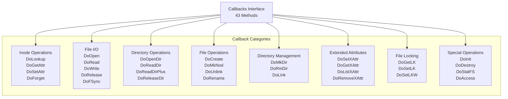
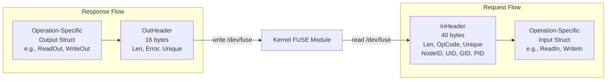
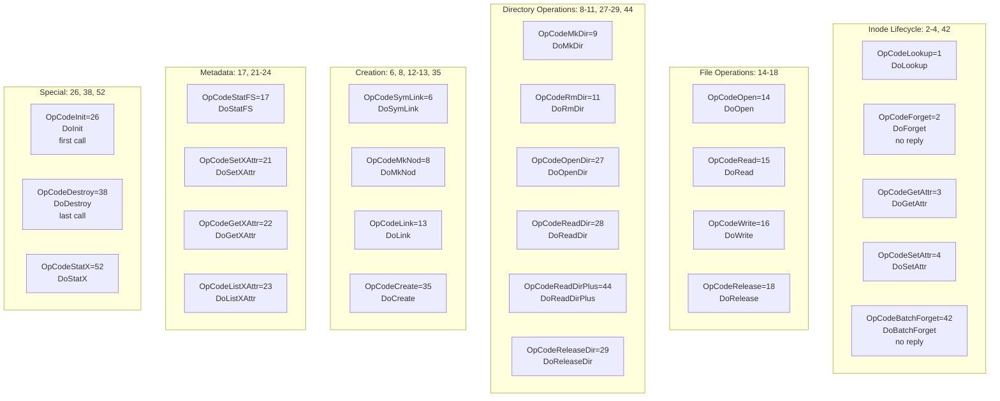
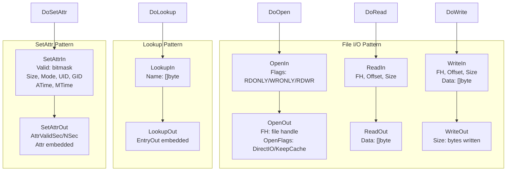
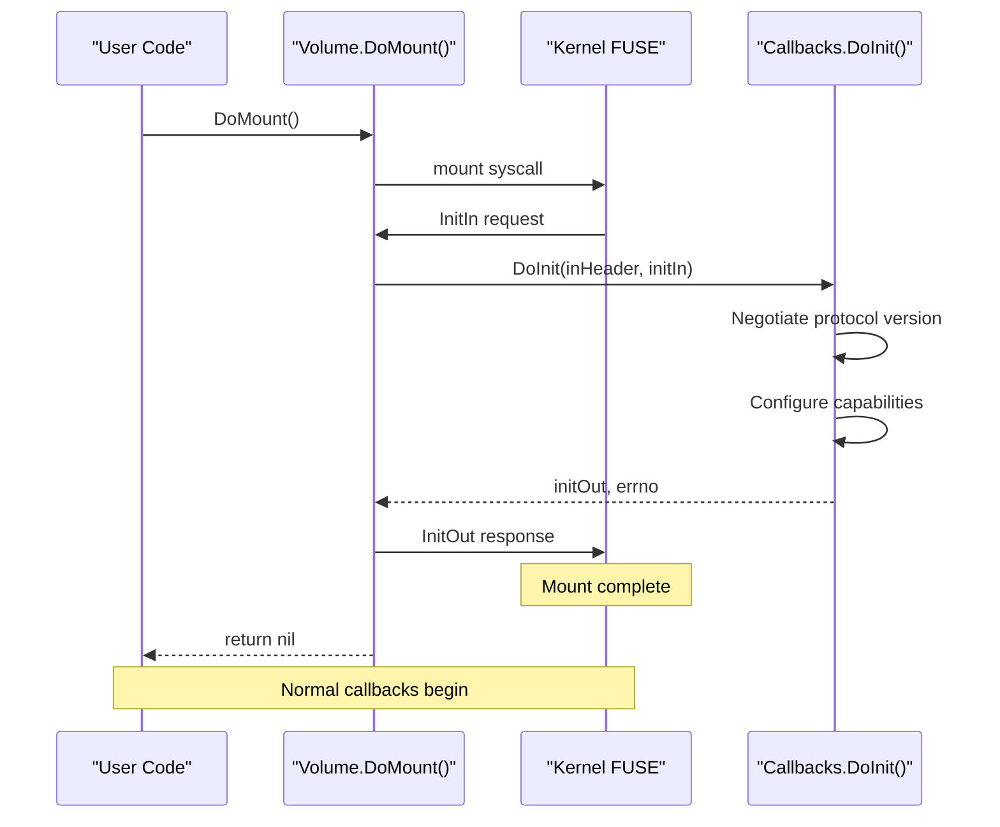
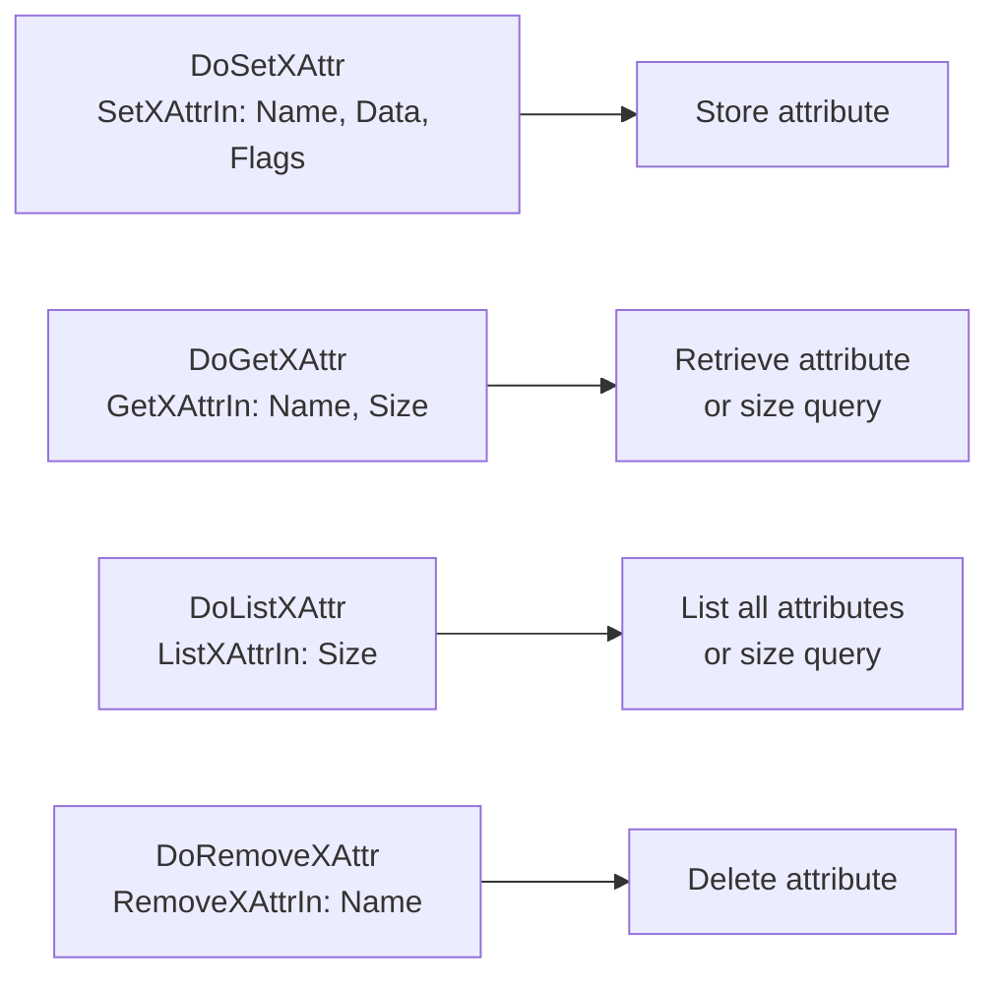
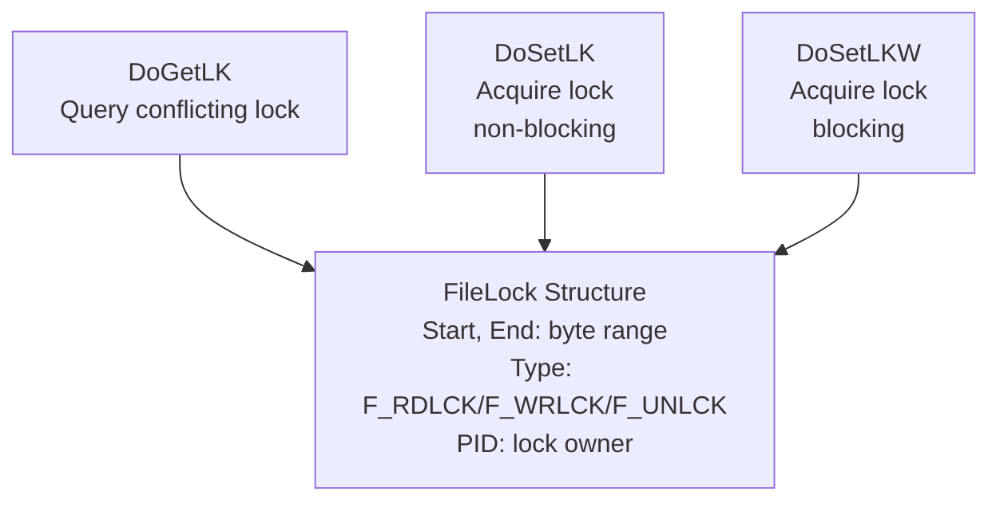
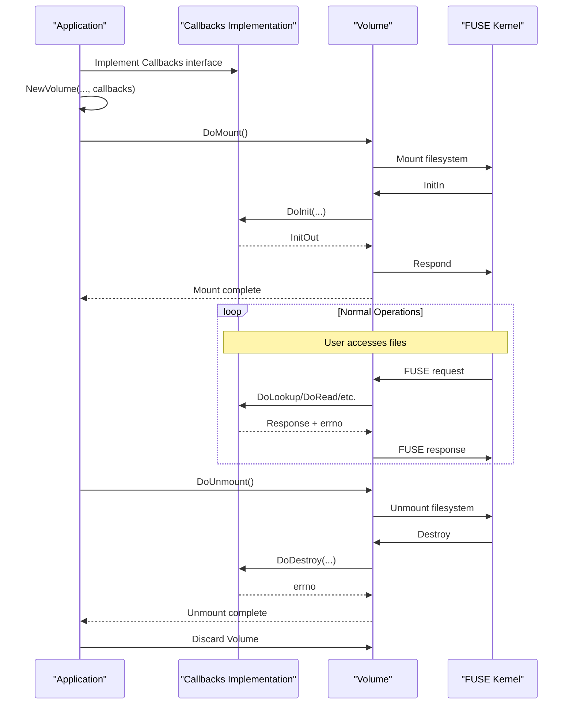

<!-- source: DeepWiki mcp.deepwiki.com · repo NVIDIA/fission · page 2.1 API Design and Interfaces · fetched 2026-10-26 -->

# API Design and Interfaces

<details>
<summary>Relevant source files</summary>

The following files were used as context for generating this wiki page:

- [api.go](api.go)

</details>


## Purpose and Scope

This document describes the public API of the fission library as defined in [api.go](). It covers the two primary interfaces (`Volume` and `Callbacks`), the data structures used for FUSE protocol communication, operation types, and the contract between the library and filesystem implementations.

For information about how the `Volume` interface is implemented internally, see [Volume Management and Lifecycle](#2.2). For details on how callbacks are dispatched and marshalled, see [Protocol Marshalling and Request Handling](#2.3). For concrete examples of implementing the `Callbacks` interface, see [Example Implementations](#3).

---

## Core Interfaces

The fission library defines two fundamental interfaces that form the contract between the library and user code:

### Volume Interface

The `Volume` interface represents a mounted FUSE filesystem instance. It provides lifecycle management methods:

```go
type Volume interface {
    DoMount() (err error)
    DoUnmount() (err error)
}
```

| Method | Purpose | When to Call |
|--------|---------|--------------|
| `DoMount()` | Initiates the FUSE mount and begins receiving callbacks | Once after obtaining a `Volume` from `NewVolume()` |
| `DoUnmount()` | Performs FUSE unmount and stops all callbacks | Once before discarding the `Volume` instance |

**Sources:** [api.go:17-28]()

### Callbacks Interface

The `Callbacks` interface declares 43 methods that correspond to FUSE operations. User implementations must provide all methods, though many can return `syscall.ENOSYS` if unsupported:



**Return Value Contract:**

Methods fall into three categories:

| Return Signature | Behavior | Examples |
|------------------|----------|----------|
| `(outStruct, errno)` | Return data on success (`errno=0`), error code on failure | `DoLookup`, `DoRead`, `DoGetAttr` |
| `(errno)` | Return error code only | `DoUnlink`, `DoRmDir`, `DoFlush` |
| No return value | Fire-and-forget notifications | `DoForget`, `DoInterrupt`, `DoBatchForget` |

**Important:** When returning an error (`errno != 0`), the output struct pointer must be `nil` as it will not be written to `/dev/fuse`.

**Sources:** [api.go:30-83]()

### NewVolume Factory Function

The `NewVolume` function creates a `Volume` instance:

```go
func NewVolume(
    volumeName string,
    mountpointDirPath string,
    fuseSubtype string,
    maxRead uint32,
    maxWrite uint32,
    defaultPermissions bool,
    allowOther bool,
    callbacks Callbacks,
    logger *log.Logger,
    errChan chan error,
) (volume Volume)
```

| Parameter | Purpose |
|-----------|---------|
| `volumeName` | Human-readable identifier for the filesystem |
| `mountpointDirPath` | Directory where filesystem will be mounted |
| `fuseSubtype` | Filesystem type suffix (appears as `fuse.{fuseSubtype}`) |
| `maxRead` | Maximum read request size in bytes |
| `maxWrite` | Maximum write request size in bytes; configures buffer pool |
| `defaultPermissions` | If `true`, kernel performs permission checks |
| `allowOther` | If `true`, non-root users can access the mount |
| `callbacks` | Implementation of the `Callbacks` interface |
| `logger` | Logger for internal library messages |
| `errChan` | Channel to receive fatal errors from the mount |

**Special Note on `maxWrite`:** This value configures the buffer pool used for `/dev/fuse` communication. The `DoInit()` callback can return a different `MaxWrite` in `InitOut`, but the original value passed to `NewVolume()` determines buffer sizing.

**Sources:** [api.go:85-95]()

---

## Request and Response Headers

All FUSE operations use common header structures to carry metadata:



### InHeader Structure

Every request from the kernel begins with an `InHeader`:

| Field | Type | Purpose |
|-------|------|---------|
| `Len` | `uint32` | Total request size (header + payload) |
| `OpCode` | `uint32` | Operation type (see [Operation Types](#operation-types-and-opcodes)) |
| `Unique` | `uint64` | Request identifier for matching responses |
| `NodeID` | `uint64` | Inode number being operated on |
| `UID` | `uint32` | User ID of requesting process |
| `GID` | `uint32` | Group ID of requesting process |
| `PID` | `uint32` | Process ID of requesting process |
| `Padding` | `uint32` | Alignment padding |

**Sources:** [api.go:473-484]()

### OutHeader Structure

Every response to the kernel begins with an `OutHeader`:

| Field | Type | Purpose |
|-------|------|---------|
| `Len` | `uint32` | Total response size (automatically computed) |
| `Error` | `int32` | Error code (0 for success, negative errno for error) |
| `Unique` | `uint64` | Must match the request's `Unique` field |

**Sources:** [api.go:486-492]()

---

## Operation Types and OpCodes

The `OpCode` field in `InHeader` determines which callback method is invoked. The library supports 42 operation types:



### OpCode Categories

| Range | Category | Example Operations |
|-------|----------|-------------------|
| 1-4 | Inode lifecycle | Lookup, Forget, GetAttr, SetAttr |
| 5-13 | File/directory creation | SymLink, MkNod, MkDir, Unlink, RmDir, Rename, Link |
| 14-18 | File I/O | Open, Read, Write, StatFS, Release |
| 20-30 | Metadata and directories | FSync, XAttr operations, Flush, Init, OpenDir, ReadDir |
| 31-46 | Advanced operations | Locking, Access, Create, Interrupt, FAllocate, ReadDirPlus, Rename2, LSeek |
| 52 | Extended stat | StatX |

**Unsupported Operations:** `OpCodeIoCtl` (39), `OpCodeNotifyReply` (41), `OpCodeCopyFileRange` (47), `OpCodeSetupMapping` (48), `OpCodeRemoveMapping` (49), `OpCodeSyncFS` (50), `OpCodeTmpFile` (51), `OpCodeCuseInit` (4096)

**Sources:** [api.go:417-471]()

---

## Core Data Structures

### Attr: File Attributes

The `Attr` structure represents POSIX file attributes (88 bytes):

| Field | Type | Description |
|-------|------|-------------|
| `Ino` | `uint64` | Inode number |
| `Size` | `uint64` | File size in bytes |
| `Blocks` | `uint64` | Number of 512-byte blocks allocated |
| `ATimeSec`, `ATimeNSec` | `uint64`, `uint32` | Access time |
| `MTimeSec`, `MTimeNSec` | `uint64`, `uint32` | Modification time |
| `CTimeSec`, `CTimeNSec` | `uint64`, `uint32` | Status change time |
| `Mode` | `uint32` | File type and permissions (use `syscall.S_*` constants) |
| `NLink` | `uint32` | Number of hard links |
| `UID`, `GID` | `uint32`, `uint32` | Owner user and group IDs |
| `RDev` | `uint32` | Device ID (for special files) |
| `BlkSize` | `uint32` | Preferred block size for I/O |

**Common Mode Values:**
- `syscall.S_IFDIR | 0755` - Directory with rwxr-xr-x permissions
- `syscall.S_IFREG | 0644` - Regular file with rw-r--r-- permissions
- `syscall.S_IFLNK | 0777` - Symbolic link

**Sources:** [api.go:136-155]()

### EntryOut: Inode Entry Information

Many callbacks return `EntryOut` (or embed it) to provide inode information:

| Field | Type | Purpose |
|-------|------|---------|
| `NodeID` | `uint64` | Inode number (must be unique per filesystem) |
| `Generation` | `uint64` | Inode generation number (for NFS exports) |
| `EntryValidSec`, `EntryValidNSec` | `uint64`, `uint32` | How long kernel can cache this entry |
| `AttrValidSec`, `AttrValidNSec` | `uint64`, `uint32` | How long kernel can cache attributes |
| `Attr` | `Attr` | Embedded file attributes |

**Cache Validity:** Setting validity times to large values (e.g., `math.MaxInt64`) enables aggressive kernel caching, reducing callback frequency. Setting to `0` disables caching.

**Sources:** [api.go:378-388]()

### DirEnt: Directory Entry

Directory listings use `DirEnt` structures:

| Field | Type | Purpose |
|-------|------|---------|
| `Ino` | `uint64` | Inode number of entry |
| `Off` | `uint64` | Offset of the *next* entry (must be unique) |
| `NameLen` | `uint32` | Length of `Name` (automatically computed) |
| `Type` | `uint32` | File type (`syscall.DT_REG`, `DT_DIR`, etc.) |
| `Name` | `[]byte` | Entry name (no null terminator) |

**Alignment:** Each `DirEnt` must be aligned to an 8-byte boundary. The serialization layer handles this automatically.

**Sources:** [api.go:397-414]()

---

## Operation-Specific Structures

Each operation has corresponding input and output structures. Here are key examples:



### Read Operation

```go
// DoRead signature
DoRead(inHeader *InHeader, readIn *ReadIn) (readOut *ReadOut, errno syscall.Errno)

// ReadIn fields
type ReadIn struct {
    FH        uint64  // File handle from OpenOut
    Offset    uint64  // Byte offset to read from
    Size      uint32  // Number of bytes to read
    ReadFlags uint32  // Flags (e.g., ReadLockOwner)
    LockOwner uint64  // Lock owner ID
    Flags     uint32  // Original open flags
    Padding   uint32
}

// ReadOut fields
type ReadOut struct {
    Data []byte  // File data (len must be <= Size from ReadIn)
}
```

**Sources:** [api.go:646-660]()

### Write Operation

```go
// DoWrite signature
DoWrite(inHeader *InHeader, writeIn *WriteIn) (writeOut *WriteOut, errno syscall.Errno)

// WriteIn fields
type WriteIn struct {
    FH         uint64  // File handle from OpenOut
    Offset     uint64  // Byte offset to write to
    Size       uint32  // Number of bytes to write (== len(Data))
    WriteFlags uint32  // Cache, LockOwner, or KillPriv flags
    LockOwner  uint64  // Lock owner ID
    Flags      uint32  // Original open flags
    Padding    uint32
    Data       []byte  // Data to write
}

// WriteOut fields
type WriteOut struct {
    Size    uint32  // Number of bytes actually written
    Padding uint32
}
```

**Sources:** [api.go:662-680]()

### Lookup Operation

```go
// DoLookup signature
DoLookup(inHeader *InHeader, lookupIn *LookupIn) (lookupOut *LookupOut, errno syscall.Errno)

// LookupIn fields
type LookupIn struct {
    Name []byte  // Name to look up in directory (inHeader.NodeID)
}

// LookupOut fields (embeds EntryOut)
type LookupOut struct {
    EntryOut  // NodeID, Generation, validity times, Attr
}
```

**Sources:** [api.go:494-502]()

### SetAttr Operation

The `SetAttrIn.Valid` bitmask determines which fields to update:

| Bit Constant | Field to Update |
|--------------|-----------------|
| `SetAttrInValidMode` | `Mode` |
| `SetAttrInValidUID` | `UID` |
| `SetAttrInValidGID` | `GID` |
| `SetAttrInValidSize` | `Size` (truncate/extend) |
| `SetAttrInValidATime` | `ATimeSec`, `ATimeNSec` |
| `SetAttrInValidMTime` | `MTimeSec`, `MTimeNSec` |
| `SetAttrInValidFH` | Use file handle instead of inode |
| `SetAttrInValidATimeNow` | Set atime to current time |
| `SetAttrInValidMTimeNow` | Set mtime to current time |

**Sources:** [api.go:231-244](), [api.go:527-556]()

---

## Initialization and DoInit

The `DoInit` callback is special—it's the first callback invoked after mounting:



### InitIn: Kernel Capabilities

| Field | Type | Purpose |
|-------|------|---------|
| `Major`, `Minor` | `uint32` | FUSE protocol version (see [Version History](#fuse-protocol-version-history)) |
| `MaxReadAhead` | `uint32` | Kernel's maximum readahead size |
| `Flags` | `uint32` | Kernel-supported capabilities (bitmask) |
| `Flags2` | `uint32` | Extended capabilities (FUSE 7.36+) |

### InitOut: Filesystem Capabilities

| Field | Type | Purpose |
|-------|------|---------|
| `Major`, `Minor` | `uint32` | Protocol version to use (typically echo kernel's) |
| `MaxReadAhead` | `uint32` | Filesystem's maximum readahead |
| `Flags` | `uint32` | Capabilities filesystem supports |
| `MaxBackground` | `uint16` | Max concurrent background requests |
| `CongestionThreshhold` | `uint16` | When to start throttling |
| `MaxWrite` | `uint32` | **Maximum write size** (critical!) |
| `TimeGran` | `uint32` | Timestamp granularity in nanoseconds |
| `MaxPages` | `uint16` | Max pages for splicing |

**Critical Note:** The `MaxWrite` value returned by `DoInit` should match the value passed to `NewVolume()`. The buffer pool is pre-sized based on the `NewVolume()` parameter, so returning a different value will not resize the pool.

**Sources:** [api.go:788-954]()

### Common Init Flags

| Flag Constant | Purpose |
|---------------|---------|
| `InitFlagsAsyncRead` | Enable asynchronous read operations |
| `InitFlagsBigWrites` | Support writes larger than 4KB |
| `InitFlagsDoReadDirPlus` | Enable `DoReadDirPlus` optimization |
| `InitFlagsReaddirplusAuto` | Kernel adaptively uses ReadDirPlus |
| `InitFlagsParallelDirops` | Allow concurrent directory operations |
| `InitFlagsWritebackCache` | Enable write-back page cache |
| `InitFlagsExplicitInvalData` | Explicit data invalidation support |

**Sources:** [api.go:271-315]()

---

## FUSE Protocol Version History

The fission library includes comprehensive version history mapping Linux kernel versions to FUSE protocol versions:

| Kernel Version | FUSE Version | Key Changes |
|----------------|--------------|-------------|
| 3.1 - 3.6 | 7.17 - 7.20 | `fuse.h` in `include/linux/` |
| 3.9+ | 7.21+ | `fuse.h` moved to `include/uapi/linux/` |
| 4.5 | 7.24 | Added `InitFlagsWritebackCache` |
| 4.9 | 7.26 | Added `InitFlagsParallelDirops` |
| 5.2 - 5.4 | 7.31a/b | Added `MapAlignment` field |
| 5.11 | 7.33 | Added `InitFlagsExplicitInvalData` |
| 6.9 | 7.40 | Added `MaxStackDepth` |
| 6.15 | 7.43 | Current version (includes `RequestTimeout`) |

**Note:** Distributions may modify these mappings. The library supports protocol negotiation via the `DoInit` handshake.

**Sources:** [api.go:97-134]()

---

## Data Structure Size Constants

The library defines size constants for all structures to aid in buffer management:

| Constant | Value | Structure |
|----------|-------|-----------|
| `InHeaderSize` | 40 | `InHeader` |
| `OutHeaderSize` | 16 | `OutHeader` |
| `AttrSize` | 88 | `Attr` |
| `EntryOutSize` | 128 | `EntryOut` (40 + 88) |
| `DirEntFixedPortionSize` | 24 | `DirEnt` (excluding name) |
| `DirEntAlignment` | 8 | Alignment boundary for directory entries |
| `InitOutSize` | 64 | `InitOut` |

**Usage Pattern:** These constants are used by the marshalling layer to allocate buffers and validate message sizes.

**Sources:** [api.go:136](), [api.go:473](), [api.go:486](), [api.go:378](), [api.go:399](), [api.go:937]()

---

## Flag Constants Reference

### Open Flags (Request)

| Constant | Value | Purpose |
|----------|-------|---------|
| `FOpenRequestRDONLY` | `O_RDONLY` | Open for reading only |
| `FOpenRequestWRONLY` | `O_WRONLY` | Open for writing only |
| `FOpenRequestRDWR` | `O_RDWR` | Open for reading and writing |
| `FOpenRequestAPPEND` | `O_APPEND` | Append mode |
| `FOpenRequestCREAT` | `O_CREAT` | Create if not exists |
| `FOpenRequestTRUNC` | `O_TRUNC` | Truncate to zero length |

**Sources:** [api.go:251-260]()

### Open Flags (Response)

| Constant | Bit Position | Purpose |
|----------|--------------|---------|
| `FOpenResponseDirectIO` | 0 | Bypass page cache (direct I/O) |
| `FOpenResponseKeepCache` | 1 | Don't invalidate page cache on open |
| `FOpenResponseNonSeekable` | 2 | File cannot be seeked |
| `FOpenResponseCacheDir` | 3 | Cache directory contents |
| `FOpenResponseStream` | 4 | Stream-like file (no seeking) |

**Sources:** [api.go:262-268]()

---

## Extended Attributes (XAttr) Operations

The `Callbacks` interface supports full extended attributes:



### SetXAttr Flags

| Constant | Value | Purpose |
|----------|-------|---------|
| `SetXAttrInCreate` | 1 | Fail if attribute exists |
| `SetXAttrInReplace` | 2 | Fail if attribute doesn't exist |

### Size Query Pattern

Both `DoGetXAttr` and `DoListXAttr` support a two-call pattern:
1. **Size Query:** Input `Size == 0` → Return only size in output
2. **Data Retrieval:** Input `Size >= required` → Return full data

**Sources:** [api.go:705-750]()

---

## File Locking Operations

The library supports POSIX file locks and flock-style locks:



### FileLock Structure

| Field | Type | Purpose |
|-------|------|---------|
| `Start` | `uint64` | Starting byte offset |
| `End` | `uint64` | Ending byte offset (use `math.MaxUint64` for EOF) |
| `Type` | `uint32` | `syscall.F_RDLCK`, `F_WRLCK`, or `F_UNLCK` |
| `PID` | `uint32` | Process ID holding the lock |

**Sources:** [api.go:222-229](), [api.go:1004-1038]()

---

## API Usage Pattern

The standard usage pattern for the fission API:



### Implementation Checklist

1. **Implement all `Callbacks` methods**
   - Return `syscall.ENOSYS` for unsupported operations
   - Ensure `DoInit` returns compatible protocol version
   - Implement at minimum: `DoLookup`, `DoGetAttr`, `DoOpen`, `DoRead`, `DoReadDir`

2. **Create a `Volume`**
   - Call `NewVolume()` with appropriate `maxRead`/`maxWrite`
   - Provide error channel for async notifications
   - Set `allowOther` appropriately for multi-user access

3. **Mount the filesystem**
   - Call `DoMount()` (blocks until unmount or error)
   - Handle errors from the error channel

4. **Unmount cleanly**
   - Call `DoUnmount()` before exiting
   - Wait for all in-flight callbacks to complete

**Sources:** [api.go:85-95]()

---

## Summary of Key Interfaces and Types

| Interface/Type | Purpose | Defined At |
|----------------|---------|------------|
| `Volume` | Filesystem lifecycle management | [api.go:17-28]() |
| `Callbacks` | FUSE operation handlers | [api.go:39-83]() |
| `NewVolume()` | Volume factory function | [api.go:92-95]() |
| `InHeader` | Request metadata | [api.go:475-484]() |
| `OutHeader` | Response metadata | [api.go:488-492]() |
| `Attr` | File attributes (88 bytes) | [api.go:138-155]() |
| `EntryOut` | Inode entry information | [api.go:380-388]() |
| `DirEnt` | Directory entry | [api.go:401-407]() |
| `InitIn`/`InitOut` | Protocol negotiation | [api.go:789-954]() |
| `ReadIn`/`ReadOut` | Read operations | [api.go:647-660]() |
| `WriteIn`/`WriteOut` | Write operations | [api.go:664-680]() |
| `LookupIn`/`LookupOut` | Name resolution | [api.go:494-502]() |

**Sources:** [api.go:1-1203]()

---

