<!-- source: DeepWiki mcp.deepwiki.com · repo NVIDIA/fission · page 2.2 Volume Management and Lifecycle · fetched 2026-10-26 -->

# Volume Management and Lifecycle

Relevant source files

The following files were used as context for generating this wiki page:

- [api.go](api.go)
- [volume.go](volume.go)

## Purpose and Scope

This document describes the implementation of FUSE volume management in the fission library, specifically the `volumeStruct` type and its lifecycle. It covers the mount and unmount processes, communication with the Linux `/dev/fuse` device, goroutine coordination, and buffer management. 

For information about the interfaces that `volumeStruct` implements, see [API Design and Interfaces](#2.1). For details on how raw FUSE protocol bytes are parsed and dispatched to callbacks, see [Protocol Marshalling and Request Handling](#2.3).

## Volume Structure and State

The `volumeStruct` type is the core implementation of the `Volume` interface. It maintains all state necessary for a mounted FUSE filesystem.

### Structure Fields

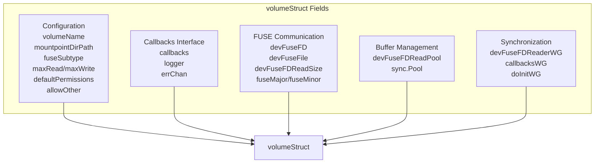

**Sources:** [volume.go:19-39]()

| Field Group | Key Fields | Purpose |
|------------|------------|---------|
| **Configuration** | `volumeName`, `mountpointDirPath`, `fuseSubtype` | Mount point identification and filesystem type |
| **I/O Parameters** | `maxRead`, `maxWrite` | Buffer sizing for FUSE protocol messages |
| **Permissions** | `defaultPermissions`, `allowOther` | Access control configuration |
| **Callbacks** | `callbacks`, `logger`, `errChan` | User implementation interface and error signaling |
| **Device** | `devFuseFD`, `devFuseFile` | File descriptor for `/dev/fuse` communication |
| **Buffer Pool** | `devFuseFDReadPool`, `devFuseFDReadSize` | Memory-efficient buffer reuse via `sync.Pool` |
| **Synchronization** | `devFuseFDReaderWG`, `callbacksWG`, `doInitWG` | Goroutine lifecycle coordination |

### Initialization

The `newVolume()` function creates a `volumeStruct` instance and configures the buffer pool:

**Sources:** [volume.go:51-88]()

**Buffer Size Calculation:**
- Minimum size: `devFuseFDReadSizeMin` (8192 bytes)
- Calculated size: `InHeaderSize + WriteInFixedPortionSize + maxWrite`
- The size accounts for the largest possible FUSE message (write operations)

**Buffer Pool Initialization:**
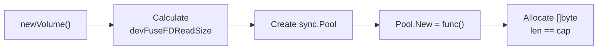

**Sources:** [volume.go:56-86]()

The `sync.Pool` reduces GC pressure by reusing read buffers across requests. Each buffer is allocated to exactly `devFuseFDReadSize` bytes with `len == cap`.

## Mount Process

The `DoMount()` method orchestrates the FUSE mount operation through coordination with the `fusermount` utility.

### Mount Sequence Overview

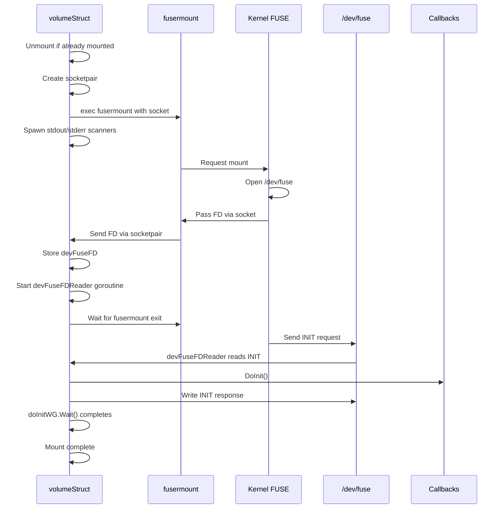

**Sources:** [volume.go:90-291]()

### Fusermount Integration

The mount process uses the external `fusermount` utility to interface with the kernel:

**Sources:** [volume.go:120-127]()

**Pre-flight Unmount:** Before attempting to mount, `DoMount()` unconditionally calls `fusermount -u` to clean up any stale mount at the target path. Errors are ignored.

### Mount Options Construction

The function builds a comma-separated mount options string:

**Sources:** [volume.go:158-191]()

| Option | Source | Example |
|--------|--------|---------|
| `rootmode` | Hardcoded as `S_IFDIR` | `rootmode=40000` |
| `user_id` | `syscall.Geteuid()` | `user_id=1000` |
| `group_id` | `syscall.Getegid()` | `group_id=1000` |
| `fsname` | `volumeName` parameter | `fsname=myfs` |
| `max_read` | `maxRead` parameter | `max_read=131072` |
| `ro` / `rw` | `maxWrite == 0` ? ro : rw | `rw` |
| `default_permissions` | `defaultPermissions` flag | `default_permissions` |
| `allow_other` | `allowOther` flag | `allow_other` |
| `subtype` | `fuseSubtype` parameter | `subtype=ramfs` |

### Socket Pair Communication

File descriptor passing occurs via a Unix domain socket pair:

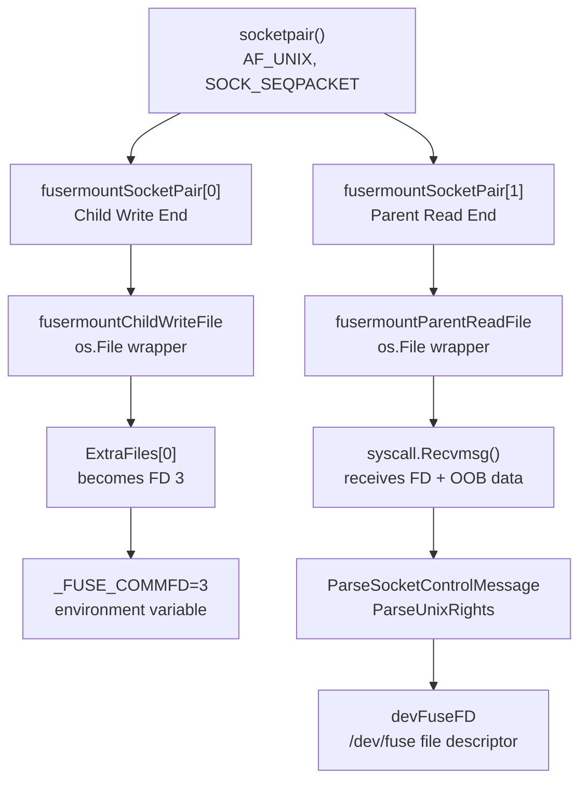

**Sources:** [volume.go:129-274]()

**Key Steps:**
1. Create `SOCK_SEQPACKET` socket pair for reliable message delivery
2. Wrap socket ends as `os.File` objects
3. Pass child end as FD 3 via `exec.Cmd.ExtraFiles`
4. Set environment variable `_FUSE_COMMFD=3` for fusermount
5. Block on `syscall.Recvmsg()` waiting for out-of-band data
6. Parse control message to extract `/dev/fuse` file descriptor

### Pipe Monitoring

Two goroutines monitor fusermount's stdout and stderr:

**Sources:** [volume.go:211-237](), [volume.go:327-359]()

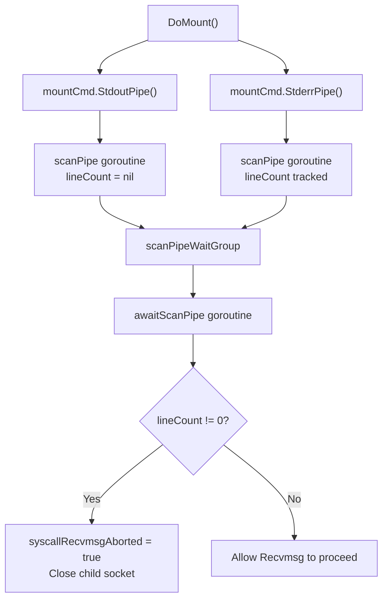

**Sources:** [volume.go:327-359]()

If fusermount writes to stderr (indicating an error), `awaitScanPipe()` sets `syscallRecvmsgAborted` and closes the child socket file descriptor to interrupt the `Recvmsg()` call.

### Init Handshake

After receiving the `/dev/fuse` file descriptor, the volume must complete the FUSE init protocol:

**Sources:** [volume.go:229](), [volume.go:285]()

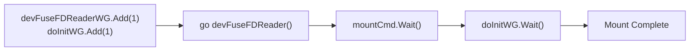

The `doInitWG` WaitGroup blocks `DoMount()` from returning until the INIT request is received and processed. This ensures the filesystem is fully initialized before user code proceeds.

**Sources:** [volume.go:276-290]()

## /dev/fuse Communication

The volume communicates with the kernel FUSE module through `/dev/fuse` using raw file descriptor operations.

### Reader Goroutine Lifecycle

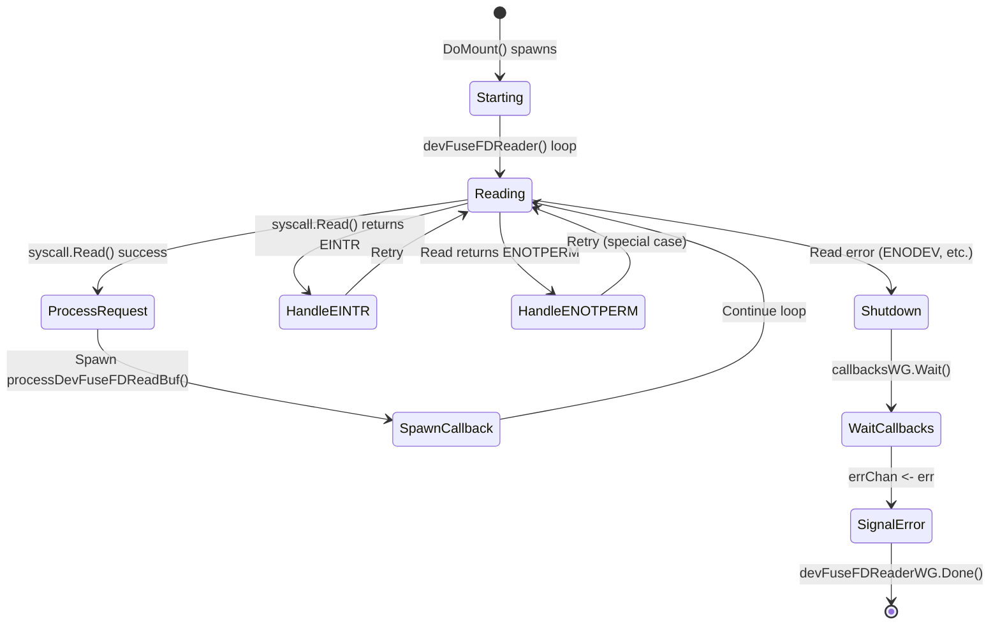

**Sources:** [volume.go:371-430]()

**Error Handling Strategy:**
- `EINTR` (interrupted system call): Retry immediately via `goto RetrySyscallRead`
- `ENOTPERM` (operation not permitted): Continue loop to retry
- `ENODEV` (no such device): Clean shutdown, signal `nil` on `errChan`
- `ENOTSUP` (operation not supported by device): Clean shutdown, signal `nil` on `errChan`
- Other errors: Log and signal error on `errChan`

### Buffer Pool Operations

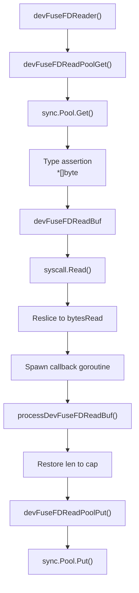

**Sources:** [volume.go:361-369](), [volume.go:380-382](), [volume.go:432-443](), [volume.go:551-553]()

**Key Implementation Details:**
- Buffers retrieved from pool have `len == cap`
- After `syscall.Read()`, buffer is resliced to actual bytes read: `devFuseFDReadBuf[:bytesRead]`
- Before returning to pool, buffer is restored: `*devFuseFDReadBufPtr = (*devFuseFDReadBufPtr)[:cap(*devFuseFDReadBufPtr)]`

### Request Dispatch

The `processDevFuseFDReadBuf()` function parses the FUSE header and dispatches to the appropriate handler:

**Sources:** [volume.go:432-554]()

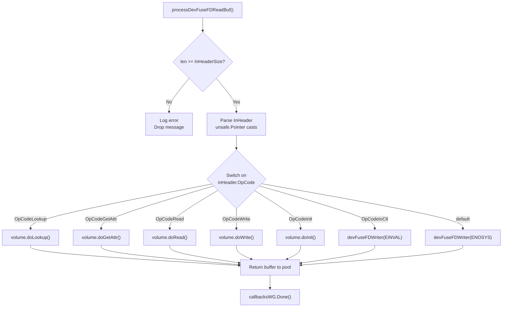

**Sources:** [volume.go:447-553]()

**Header Parsing:** The `InHeader` struct is populated using `unsafe.Pointer` casts to directly interpret bytes as Go types, avoiding allocation.

**OpCode Dispatch:** A large switch statement routes to 40+ operation handlers. Each handler (covered in [Protocol Marshalling and Request Handling](#2.3)) parses operation-specific data and invokes the user's `Callbacks` implementation.

**Unsupported Operations:**
- `OpCodeIoCtl`: Always returns `EINVAL`
- Unrecognized opcodes: Return `ENOSYS`

### Response Writing

The `devFuseFDWriter()` method writes responses back to `/dev/fuse`:

**Sources:** [volume.go:556-616]()

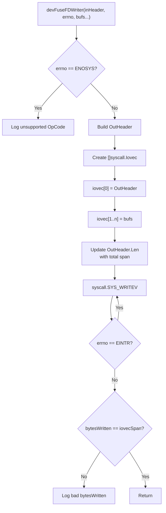

**Sources:** [volume.go:556-616]()

**Iovec Construction:**
1. First element: `OutHeader` with `Len`, `Error` (negated errno), and `Unique`
2. Subsequent elements: Optional data buffers (e.g., file data, directory entries)
3. `OutHeader.Len` is updated with the sum of all buffer lengths

**Write Retry:** If `SYS_WRITEV` returns `EINTR`, the operation is retried via `goto RetrySyscallWriteV`.

## Unmount Process

The `DoUnmount()` method cleanly tears down the FUSE mount:

**Sources:** [volume.go:293-325]()

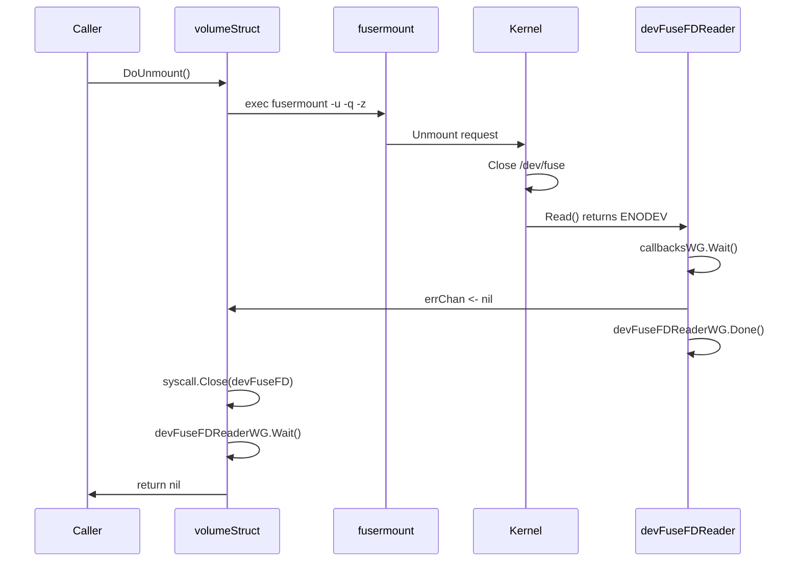

**Sources:** [volume.go:293-325]()

**Fusermount Flags:**
- `-u`: Unmount
- `-q`: Quiet (suppress messages)
- `-z`: Lazy unmount (detach even if busy)

**Shutdown Sequence:**
1. Execute `fusermount -u` to request kernel unmount
2. Kernel closes `/dev/fuse`, causing reader's `syscall.Read()` to fail
3. Reader goroutine waits for all callback goroutines (`callbacksWG.Wait()`)
4. Reader signals `errChan` and exits
5. `DoUnmount()` closes `devFuseFD` explicitly
6. `DoUnmount()` waits for reader goroutine (`devFuseFDReaderWG.Wait()`)

## Goroutine Lifecycle Management

The volume uses three `sync.WaitGroup` instances to coordinate goroutine lifecycles:

### WaitGroup Architecture

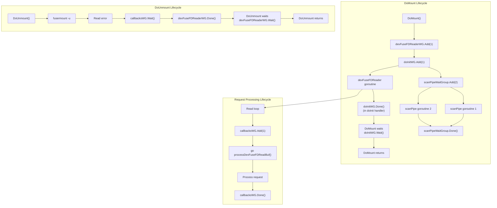

**Sources:** [volume.go:34](), [volume.go:35](), [volume.go:38]()

### WaitGroup Purposes

| WaitGroup | Purpose | Add Location | Done Location | Wait Location |
|-----------|---------|--------------|---------------|---------------|
| `devFuseFDReaderWG` | Track reader goroutine lifetime | [volume.go:276]() | [volume.go:405]() | [volume.go:319]() |
| `callbacksWG` | Track all callback goroutines | [volume.go:427]() | [volume.go:553]() | [volume.go:404]() |
| `doInitWG` | Synchronize INIT handshake | [volume.go:229]() | See [Protocol Marshalling](#2.3) | [volume.go:285]() |

**Sources:** [volume.go:276](), [volume.go:319](), [volume.go:404-405](), [volume.go:427](), [volume.go:553]()

### Fork-Join Pattern

The volume implements a fork-join concurrency model:

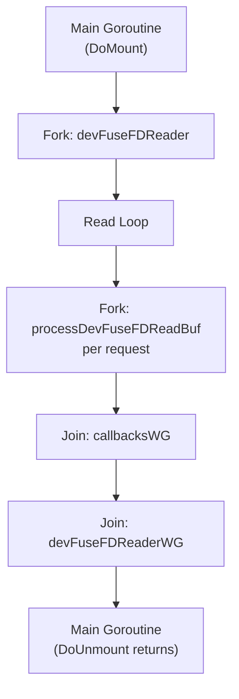

**Sources:** [volume.go:276-277](), [volume.go:319](), [volume.go:404-405](), [volume.go:427-428]()

**Guarantees:**
- Reader goroutine exits only after all callback goroutines complete
- `DoUnmount()` returns only after reader goroutine exits
- No goroutines leak after unmount

### Error Channel Signaling

The `errChan` provides asynchronous error notification:

**Sources:** [volume.go:29](), [volume.go:407-417]()

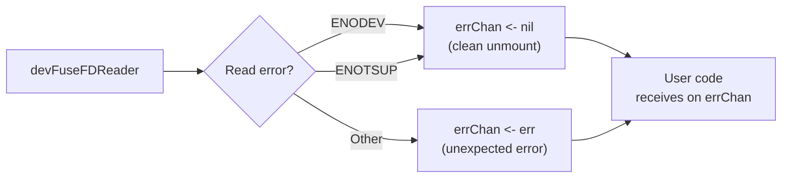

**Sources:** [volume.go:407-417]()

**Error Interpretation:**
- `nil`: Expected shutdown from `DoUnmount()`
- Non-`nil`: Unexpected error (e.g., kernel module removed)

User code should monitor `errChan` to detect filesystem shutdown and react appropriately (e.g., retry mounting).

## Helper Functions

### cloneByteSlice

A utility function for safely copying byte slices with optional null terminator trimming:

**Sources:** [volume.go:618-627]()

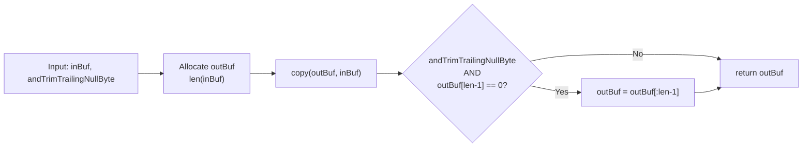

**Sources:** [volume.go:618-627]()

This is used throughout the protocol handlers to safely copy filename and xattr data from read buffers (which are returned to the pool) into persistent storage.

---

## Summary

The volume management system provides a robust foundation for FUSE filesystem implementations:

- **Mount orchestration** via fusermount with socket-based file descriptor passing
- **Efficient I/O** through buffer pooling and vectored writes
- **Reliable concurrency** using WaitGroups for fork-join coordination
- **Clean shutdown** with proper goroutine cleanup and error signaling

The design separates concerns cleanly: this layer handles only device communication and lifecycle, while [Protocol Marshalling](#2.3) handles message parsing and [API Design](#2.1) defines the callback interface.

---

