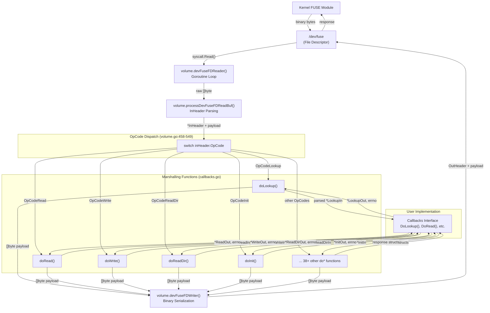
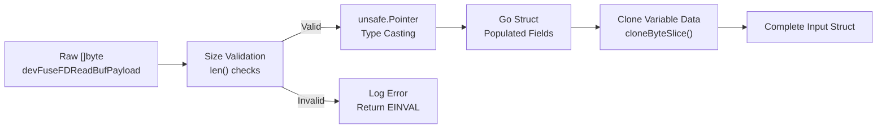
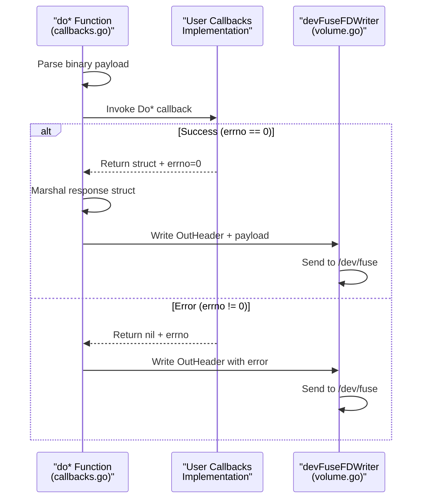
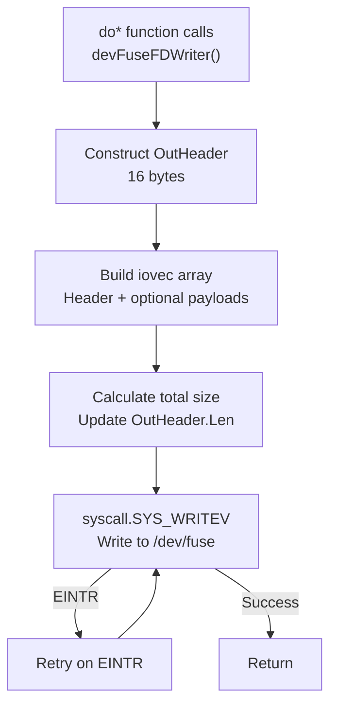
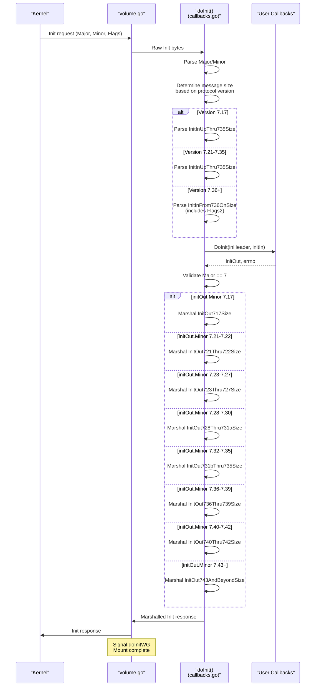
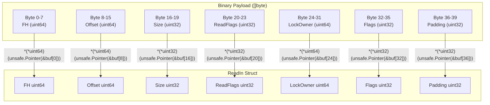

<!-- source: DeepWiki mcp.deepwiki.com · repo NVIDIA/fission · page 2.3 Protocol Marshalling and Request Handling · fetched 2026-10-26 -->

# Protocol Marshalling and Request Handling

<details>
<summary>Relevant source files</summary>

The following files were used as context for generating this wiki page:

- [api.go](api.go)
- [callbacks.go](callbacks.go)
- [volume.go](volume.go)

</details>


## Purpose and Scope

This document describes the protocol marshalling layer implemented in `callbacks.go`, which translates between the binary FUSE protocol and idiomatic Go data structures. This layer sits between the low-level `/dev/fuse` communication managed by `volume.go` (see [Volume Management and Lifecycle](#2.2)) and the high-level `Callbacks` interface defined in `api.go` (see [API Design and Interfaces](#2.1)).

The marshalling layer performs three critical functions:
1. **Parsing**: Converts raw byte streams from the kernel into structured Go types
2. **Dispatching**: Routes requests to the appropriate callback method based on OpCode
3. **Serialization**: Converts Go responses back into FUSE wire format

This page focuses specifically on the binary protocol translation mechanics. For the API contract and data structures, see [API Design and Interfaces](#2.1). For the lifecycle and goroutine management, see [Volume Management and Lifecycle](#2.2).

## Request Flow Architecture

The following diagram shows how a FUSE request flows through the marshalling layer:



**Sources**: [volume.go:371-430](), [volume.go:432-554](), [callbacks.go:31-1780]()

## OpCode Dispatching

Requests are dispatched based on the `OpCode` field in the `InHeader` structure. The dispatching logic uses a switch statement that maps each FUSE operation code to its corresponding marshalling function.

### Dispatch Table

The following table shows the OpCode-to-function mapping:

| OpCode Constant | Value | Function | Requires Response |
|----------------|-------|----------|-------------------|
| `OpCodeLookup` | 1 | `doLookup()` | Yes |
| `OpCodeForget` | 2 | `doForget()` | No |
| `OpCodeGetAttr` | 3 | `doGetAttr()` | Yes |
| `OpCodeSetAttr` | 4 | `doSetAttr()` | Yes |
| `OpCodeReadLink` | 5 | `doReadLink()` | Yes |
| `OpCodeSymLink` | 6 | `doSymLink()` | Yes |
| `OpCodeMkNod` | 8 | `doMkNod()` | Yes |
| `OpCodeMkDir` | 9 | `doMkDir()` | Yes |
| `OpCodeUnlink` | 10 | `doUnlink()` | Yes |
| `OpCodeRmDir` | 11 | `doRmDir()` | Yes |
| `OpCodeRename` | 12 | `doRename()` | Yes |
| `OpCodeLink` | 13 | `doLink()` | Yes |
| `OpCodeOpen` | 14 | `doOpen()` | Yes |
| `OpCodeRead` | 15 | `doRead()` | Yes |
| `OpCodeWrite` | 16 | `doWrite()` | Yes |
| `OpCodeStatFS` | 17 | `doStatFS()` | Yes |
| `OpCodeRelease` | 18 | `doRelease()` | Yes |
| `OpCodeFSync` | 20 | `doFSync()` | Yes |
| `OpCodeSetXAttr` | 21 | `doSetXAttr()` | Yes |
| `OpCodeGetXAttr` | 22 | `doGetXAttr()` | Yes |
| `OpCodeListXAttr` | 23 | `doListXAttr()` | Yes |
| `OpCodeRemoveXAttr` | 24 | `doRemoveXAttr()` | Yes |
| `OpCodeFlush` | 25 | `doFlush()` | Yes |
| `OpCodeInit` | 26 | `doInit()` | Yes |
| `OpCodeOpenDir` | 27 | `doOpenDir()` | Yes |
| `OpCodeReadDir` | 28 | `doReadDir()` | Yes |
| `OpCodeReleaseDir` | 29 | `doReleaseDir()` | Yes |
| `OpCodeFSyncDir` | 30 | `doFSyncDir()` | Yes |
| `OpCodeGetLK` | 31 | `doGetLK()` | Yes |
| `OpCodeSetLK` | 32 | `doSetLK()` | Yes |
| `OpCodeSetLKW` | 33 | `doSetLKW()` | Yes |
| `OpCodeAccess` | 34 | `doAccess()` | Yes |
| `OpCodeCreate` | 35 | `doCreate()` | Yes |
| `OpCodeInterrupt` | 36 | `doInterrupt()` | No |
| `OpCodeBMap` | 37 | `doBMap()` | Yes |
| `OpCodeDestroy` | 38 | `doDestroy()` | Yes |
| `OpCodeIoCtl` | 39 | Returns `EINVAL` | Unsupported |
| `OpCodePoll` | 40 | `doPoll()` | Yes |
| `OpCodeBatchForget` | 42 | `doBatchForget()` | No |
| `OpCodeFAllocate` | 43 | `doFAllocate()` | Yes |
| `OpCodeReadDirPlus` | 44 | `doReadDirPlus()` | Yes |
| `OpCodeRename2` | 45 | `doRename2()` | Yes |
| `OpCodeLSeek` | 46 | `doLSeek()` | Yes |
| `OpCodeStatX` | 52 | `doStatX()` | Yes |

**Note**: Operations marked as "No" for "Requires Response" do not send data back to the kernel. `OpCodeForget`, `OpCodeInterrupt`, and `OpCodeBatchForget` are fire-and-forget operations used for resource management.

**Sources**: [volume.go:458-549](), [api.go:417-471]()

## Binary Protocol Parsing

All marshalling functions follow a consistent pattern for parsing binary FUSE protocol messages using Go's `unsafe.Pointer` mechanism.

### Parsing Pattern



### Example: doRead Parsing

The `doRead` function demonstrates the typical parsing flow:

1. **Size Validation** [callbacks.go:456-460]():
```go
if len(devFuseFDReadBufPayload) != ReadInSize {
    volume.logger.Printf("Call to doRead() with bad len...")
    volume.devFuseFDWriter(inHeader, syscall.EINVAL)
    return
}
```

2. **Fixed-Size Field Parsing** [callbacks.go:462-470]():
```go
readIn = &ReadIn{
    FH:        *(*uint64)(unsafe.Pointer(&devFuseFDReadBufPayload[0])),
    Offset:    *(*uint64)(unsafe.Pointer(&devFuseFDReadBufPayload[8])),
    Size:      *(*uint32)(unsafe.Pointer(&devFuseFDReadBufPayload[16])),
    ReadFlags: *(*uint32)(unsafe.Pointer(&devFuseFDReadBufPayload[20])),
    LockOwner: *(*uint64)(unsafe.Pointer(&devFuseFDReadBufPayload[24])),
    Flags:     *(*uint32)(unsafe.Pointer(&devFuseFDReadBufPayload[32])),
    Padding:   *(*uint32)(unsafe.Pointer(&devFuseFDReadBufPayload[36])),
}
```

This pattern uses `unsafe.Pointer` to directly cast byte slices to the appropriate integer types, matching the FUSE protocol's C struct layout.

**Sources**: [callbacks.go:448-481]()

### Variable-Length Data Handling

Some FUSE messages contain variable-length fields like filenames or file data. The library handles these in two ways:

#### Simple Variable Data (Single Field)

For operations with a single variable-length field at the end, the data is simply sliced and cloned:

```go
// Example from doLookup
lookupIn = &LookupIn{
    Name: cloneByteSlice(devFuseFDReadBufPayload, true),
}
```

The `cloneByteSlice` function [volume.go:618-627]() creates a copy of the byte slice and optionally trims trailing null bytes (required by the FUSE protocol for string fields).

#### Multiple Variable Fields (Separated by Null Bytes)

Operations like `doRename` have multiple variable-length fields separated by null bytes:

```go
oldNameNewNameSplit = bytes.SplitN(
    devFuseFDReadBufPayload[RenameInFixedPortionSize:], 
    []byte{0}, 
    2
)
if len(oldNameNewNameSplit) != 2 {
    volume.logger.Printf("Call to doRename() with bad devFuseFDReadBufPayload")
    volume.devFuseFDWriter(inHeader, syscall.EINVAL)
    return
}

renameIn = &RenameIn{
    NewDir:  *(*uint64)(unsafe.Pointer(&devFuseFDReadBufPayload[0])),
    OldName: cloneByteSlice(oldNameNewNameSplit[0], false),
    NewName: cloneByteSlice(oldNameNewNameSplit[1], true),
}
```

**Sources**: [callbacks.go:31-61](), [callbacks.go:344-373](), [volume.go:618-627]()

## Callback Invocation Pattern

After parsing the request, each `do*` function invokes the corresponding method on the user's `Callbacks` interface implementation.

### Standard Invocation Flow



### Example: doGetAttr Implementation

The `doGetAttr` function [callbacks.go:80-115]() shows the standard pattern:

1. Parse the request
2. Invoke the user callback
3. Check for errors
4. Marshal the response if successful
5. Write to `/dev/fuse`

```go
getAttrOut, errno = volume.callbacks.DoGetAttr(inHeader, getAttrIn)
if errno != 0 {
    volume.devFuseFDWriter(inHeader, errno)
    return
}

// Marshal response...
outPayload = make([]byte, GetAttrOutSize)
*(*uint64)(unsafe.Pointer(&outPayload[0])) = getAttrOut.AttrValidSec
// ... more marshalling ...

volume.devFuseFDWriter(inHeader, 0, outPayload)
```

**Note**: If the callback returns a non-zero `errno`, the response struct is ignored and only the error code is sent to the kernel.

**Sources**: [callbacks.go:80-115](), [callbacks.go:414-446]()

## Response Serialization

Response marshalling converts Go structs back into the binary FUSE protocol format using `unsafe.Pointer` operations.

### marshallAttr Helper Function

The `marshalAttr` helper function [callbacks.go:12-29]() is used extensively to serialize the `Attr` struct, which appears in many response types:

```go
func marshalAttr(attr *Attr, outPayload []byte, outPayloadOffset uint32) {
    *(*uint64)(unsafe.Pointer(&outPayload[outPayloadOffset+0])) = attr.Ino
    *(*uint64)(unsafe.Pointer(&outPayload[outPayloadOffset+8])) = attr.Size
    *(*uint64)(unsafe.Pointer(&outPayload[outPayloadOffset+16])) = attr.Blocks
    // ... continues for all 88 bytes of Attr ...
}
```

This function writes the 88-byte `Attr` structure at any offset within the output payload.

### Output Writing via devFuseFDWriter

The `devFuseFDWriter` function [volume.go:556-616]() is the final step in response serialization:



The `OutHeader` contains three fields:
- `Len`: Total size of the message (header + payload)
- `Error`: Negated errno (e.g., `-ENOENT`)
- `Unique`: Request identifier from `InHeader` for matching

**Sources**: [callbacks.go:12-29](), [volume.go:556-616]()

### Complex Response Types

Some operations return complex nested structures that require careful marshalling.

#### Example: doReadDir

`doReadDir` [callbacks.go:1080-1156]() demonstrates marshalling an array of variable-length `DirEnt` structures:

1. **Allocation**: Pre-allocate buffer to maximum size requested by kernel
2. **Iteration**: Loop through each `DirEnt` returned by callback
3. **Alignment**: Ensure each entry is aligned to 8-byte boundary
4. **Overflow Check**: Stop if response would exceed requested size
5. **Trim**: Reduce buffer to actual size used

```go
outPayload = make([]byte, readDirIn.Size)
outPayloadOffset = 0

for dirEntIndex = range len(readDirOut.DirEnt) {
    dirEnt = &readDirOut.DirEnt[dirEntIndex]
    
    nameLenAligned = (uint32(len(dirEnt.Name)) + (DirEntAlignment - 1)) & ^uint32(DirEntAlignment-1)
    dirEntPayloadSize = DirEntFixedPortionSize + nameLenAligned
    
    if (outPayloadOffset + dirEntPayloadSize) > readDirIn.Size {
        // Exceeded buffer - truncate
        outPayload = outPayload[:outPayloadOffset]
        volume.devFuseFDWriter(inHeader, 0, outPayload)
        return
    }
    
    // Marshal fixed portion
    *(*uint64)(unsafe.Pointer(&outPayload[outPayloadOffset+0])) = dirEnt.Ino
    // ... marshal other fields ...
    
    // Copy name
    copy(outPayload[outPayloadOffset:], dirEnt.Name)
    
    // Add padding to alignment
    for paddingIndex = uint32(len(dirEnt.Name)); paddingIndex < nameLenAligned; paddingIndex++ {
        outPayload[outPayloadOffset] = 0
        outPayloadOffset++
    }
}
```

The `DirEntAlignment` constant (value 8) ensures each directory entry starts on an 8-byte boundary, as required by the FUSE protocol.

**Sources**: [callbacks.go:1080-1156](), [callbacks.go:1544-1631]()

## Protocol Version Negotiation

The `doInit` function [callbacks.go:791-1044]() handles FUSE protocol version negotiation, which is critical for compatibility across different kernel versions.

### Init Handshake Flow



### Version-Specific Parsing

The `doInit` function supports multiple protocol versions [callbacks.go:816-873]():

**For kernel version 7.17**:
```go
case volume.fuseMinor == 17:
    if len(devFuseFDReadBufPayload) != InitInUpThru735Size {
        volume.devFuseFDWriter(inHeader, syscall.EINVAL)
        return
    }
    initIn = &InitIn{
        Major:        volume.fuseMajor,
        Minor:        volume.fuseMinor,
        MaxReadAhead: *(*uint32)(unsafe.Pointer(&devFuseFDReadBufPayload[8])),
        Flags:        *(*uint32)(unsafe.Pointer(&devFuseFDReadBufPayload[12])),
        Flags2:       0, // Not present in this version
    }
```

**For kernel version 7.36+**:
```go
case volume.fuseMinor >= 36:
    if len(devFuseFDReadBufPayload) != InitInFrom736OnSize {
        volume.devFuseFDWriter(inHeader, syscall.EINVAL)
        return
    }
    initIn = &InitIn{
        Major:        volume.fuseMajor,
        Minor:        volume.fuseMinor,
        MaxReadAhead: *(*uint32)(unsafe.Pointer(&devFuseFDReadBufPayload[8])),
        Flags:        *(*uint32)(unsafe.Pointer(&devFuseFDReadBufPayload[12])),
        Flags2:       *(*uint32)(unsafe.Pointer(&devFuseFDReadBufPayload[16])),
    }
```

### Version-Specific Serialization

The response marshalling also varies by protocol version [callbacks.go:888-1039](). Each version range has a different `InitOut` struct size with different fields. The function marshals only the fields that exist in the negotiated protocol version.

For example, version 7.28 introduced the `MaxPages` field:
```go
case (initOut.Minor >= 28) && (initOut.Minor <= 30):
    outPayload = make([]byte, InitOut728Thru731aSize)
    // ... marshal common fields ...
    *(*uint16)(unsafe.Pointer(&outPayload[28])) = initOut.MaxPages
    *(*uint16)(unsafe.Pointer(&outPayload[30])) = 0  // padding
    // ... zero out spare fields ...
```

**Important**: The `doInitWG` wait group [callbacks.go:799]() ensures that `DoMount()` does not return until the Init handshake completes. This synchronization is critical because the mount is not usable until protocol negotiation finishes.

**Sources**: [callbacks.go:791-1044](), [api.go:97-135]()

## Special Cases and Edge Conditions

### Operations Without Responses

Three operations do not send responses back to the kernel:

1. **OpCodeForget** [callbacks.go:63-78](): Notifies the filesystem to decrement reference count on an inode
2. **OpCodeInterrupt** [callbacks.go:1376-1392](): Requests cancellation of a pending operation
3. **OpCodeBatchForget** [callbacks.go:1478-1517](): Batch version of Forget for efficiency

These functions do not call `devFuseFDWriter` after invoking the callback:

```go
func (volume *volumeStruct) doForget(inHeader *InHeader, devFuseFDReadBufPayload []byte) {
    // ... parse forgetIn ...
    volume.callbacks.DoForget(inHeader, forgetIn)
    // No response sent
}
```

### Conditional Response Sizes

Some operations have conditional response formats based on the request parameters.

#### GetXAttr

`doGetXAttr` [callbacks.go:658-694]() returns either:
- **Size-only response** (8 bytes) when `getXAttrIn.Size == 0`
- **Data response** (variable size) when `getXAttrIn.Size != 0`

```go
if getXAttrIn.Size == 0 {
    outPayload = make([]byte, GetXAttrOutSizeOnlySize)
    *(*uint32)(unsafe.Pointer(&outPayload[0])) = getXAttrOut.Size
    *(*uint32)(unsafe.Pointer(&outPayload[4])) = getXAttrOut.Padding
} else {
    outPayload = getXAttrOut.Data
}
```

This two-phase approach lets applications query the attribute size first, then request the actual data.

#### ListXAttr

Similarly, `doListXAttr` [callbacks.go:696-750]() has two modes:
- **Size query**: Returns total size needed for all attribute names
- **Data query**: Returns null-separated list of attribute names

### Alignment Requirements

Directory entries must be aligned to 8-byte boundaries as specified by `DirEntAlignment`:

```go
nameLenAligned = (uint32(len(dirEnt.Name)) + (DirEntAlignment - 1)) & ^uint32(DirEntAlignment-1)
```

This formula rounds up to the next 8-byte boundary. The padding bytes are explicitly zeroed [callbacks.go:1147-1150]():

```go
for paddingIndex = uint32(len(dirEnt.Name)); paddingIndex < nameLenAligned; paddingIndex++ {
    outPayload[outPayloadOffset] = 0
    outPayloadOffset++
}
```

**Sources**: [callbacks.go:63-78](), [callbacks.go:658-694](), [callbacks.go:696-750](), [callbacks.go:1080-1156]()

## Error Handling and Validation

Each marshalling function performs extensive validation before processing requests.

### Size Validation Pattern

Every `do*` function validates the payload size matches the expected struct size:

```go
if len(devFuseFDReadBufPayload) != ExpectedInSize {
    volume.logger.Printf("Call to do*() with bad len(devFuseFDReadBufPayload) == %v", 
                         len(devFuseFDReadBufPayload))
    volume.devFuseFDWriter(inHeader, syscall.EINVAL)
    return
}
```

For variable-length messages, the function checks the minimum size:

```go
if len(devFuseFDReadBufPayload) < FixedPortionSize {
    volume.logger.Printf("Call to do*() with bad len...")
    volume.devFuseFDWriter(inHeader, syscall.EINVAL)
    return
}
```

### Content Validation

Some operations perform additional semantic validation:

**doWrite** [callbacks.go:508-512]() verifies the data size matches the declared size:
```go
if len(writeIn.Data) != int(writeIn.Size) {
    volume.logger.Printf("Call to doWrite() with bad Size == %v expected %v", 
                         writeIn.Size, len(writeIn.Data))
    volume.devFuseFDWriter(inHeader, syscall.EINVAL)
    return
}
```

**doRename** [callbacks.go:357-362]() ensures null-separated fields are present:
```go
oldNameNewNameSplit = bytes.SplitN(devFuseFDReadBufPayload[RenameInFixedPortionSize:], []byte{0}, 2)
if len(oldNameNewNameSplit) != 2 {
    volume.logger.Printf("Call to doRename() with bad devFuseFDReadBufPayload")
    volume.devFuseFDWriter(inHeader, syscall.EINVAL)
    return
}
```

### Error Response

When validation fails or the callback returns an error, only the `OutHeader` is sent with the error code:

```go
errno = volume.callbacks.DoSomeOperation(inHeader, someIn)
if errno != 0 {
    volume.devFuseFDWriter(inHeader, errno)
    return
}
```

The `devFuseFDWriter` function [volume.go:556-616]() constructs an `OutHeader` with:
- `Len`: 16 (size of OutHeader)
- `Error`: `-int32(errno)` (negated errno)
- `Unique`: Copied from `InHeader.Unique`

**Sources**: [callbacks.go:88-92](), [callbacks.go:456-460](), [callbacks.go:508-512](), [callbacks.go:357-362]()

## Data Structure Binary Layout

The following diagram illustrates how binary data is mapped to Go structs using `unsafe.Pointer`:



This direct memory mapping avoids copying and parsing overhead, making the marshalling layer extremely efficient.

### Multi-Field Layout Example

For structures with variable-length data, the layout is more complex:

```
RenameIn Binary Layout:
+------------------+
| NewDir (8 bytes) |  Offset 0-7: uint64
+------------------+
| OldName          |  Variable length
| (null-terminated)|
+------------------+
| NewName          |  Variable length
| (null-terminated)|
+------------------+
```

The parsing splits on null bytes to extract the two variable-length fields [callbacks.go:357-368]().

**Sources**: [callbacks.go:462-470](), [callbacks.go:344-373]()

## Performance Considerations

### Zero-Copy Operations

The marshalling layer uses several techniques to minimize copying:

1. **Direct pointer casting**: `unsafe.Pointer` allows reading binary data without intermediate parsing
2. **Slice referencing**: Response data like `ReadOut.Data` is passed by reference, not copied
3. **In-place marshalling**: Output buffers are allocated once and written directly

### Buffer Pooling

The `volume.go` layer uses a `sync.Pool` [volume.go:80-86]() to recycle read buffers:

```go
volume.devFuseFDReadPool = sync.Pool{
    New: func() interface{} {
        buf := make([]byte, volume.devFuseFDReadSize)
        return &buf
    },
}
```

After each request is processed, the buffer is returned to the pool [volume.go:551-553]():

```go
*devFuseFDReadBufPtr = devFuseFDReadBuf
volume.devFuseFDReadPoolPut(devFuseFDReadBufPtr)
```

This reduces GC pressure in high-throughput scenarios.

### Vectored I/O

The `devFuseFDWriter` uses `syscall.SYS_WRITEV` [volume.go:601-605]() to send the `OutHeader` and payload in a single system call:

```go
iovec = make([]syscall.Iovec, 1, len(bufs)+1)
iovec[0] = syscall.Iovec{Base: &outHeader[0], Len: uint64(OutHeaderSize)}

for _, buf = range bufs {
    if len(buf) != 0 {
        iovec = append(iovec, syscall.Iovec{Base: &buf[0], Len: uint64(len(buf))})
    }
}
```

This avoids allocating and copying data into a single contiguous buffer.

**Sources**: [volume.go:80-86](), [volume.go:366-369](), [volume.go:551-553](), [volume.go:581-605]()

## Summary

The protocol marshalling layer in `callbacks.go` provides:

- **Binary-to-Go translation** using `unsafe.Pointer` for zero-copy efficiency
- **OpCode-based dispatching** routing 40+ operation types to handlers
- **Bidirectional marshalling** for both requests and responses
- **Version negotiation** supporting FUSE protocol 7.17 through 7.44+
- **Extensive validation** catching malformed messages before user callbacks
- **Special handling** for variable-length data, alignment, and no-response operations

This layer isolates users from the complexity of the binary FUSE protocol while maintaining high performance through direct memory operations and buffer pooling.

---

