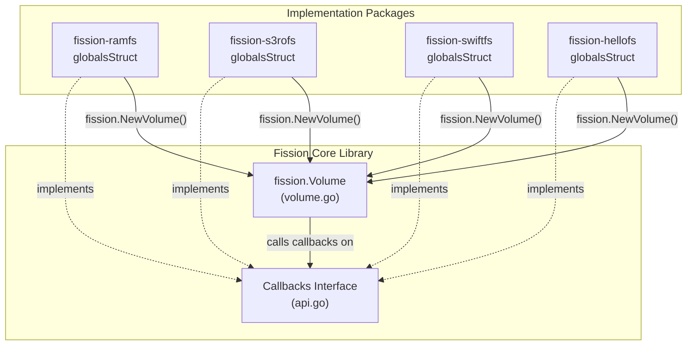
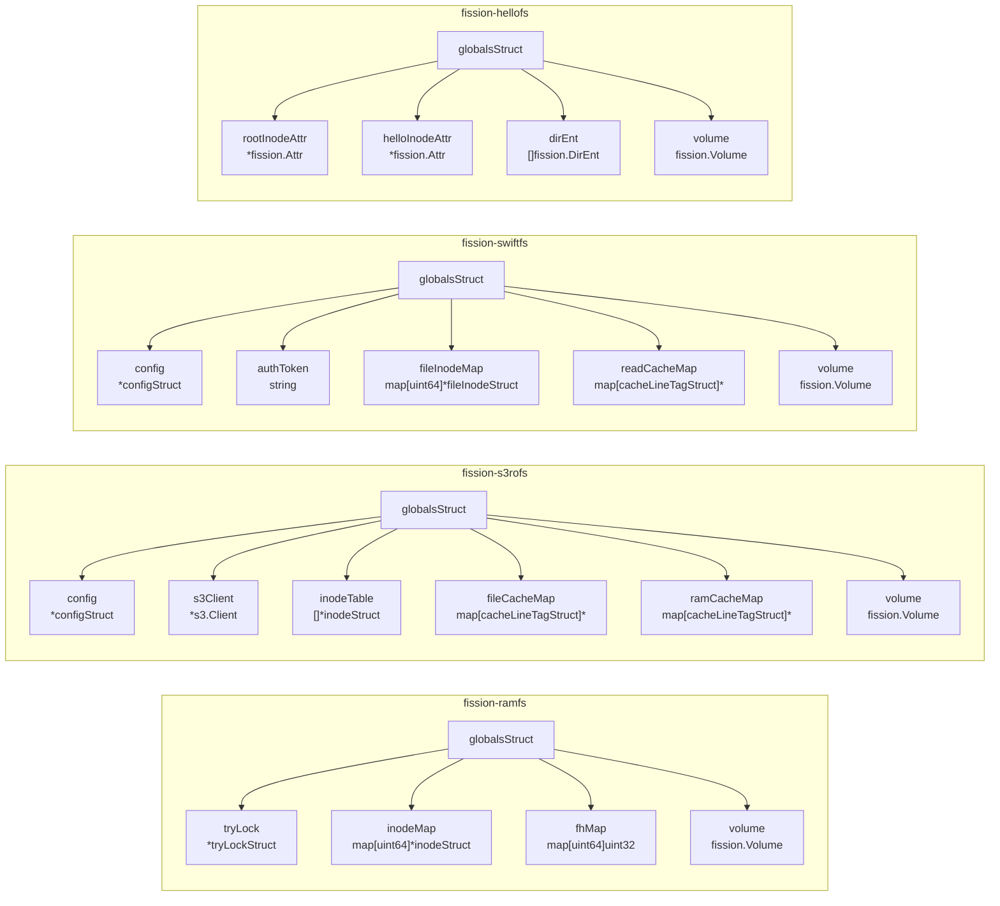
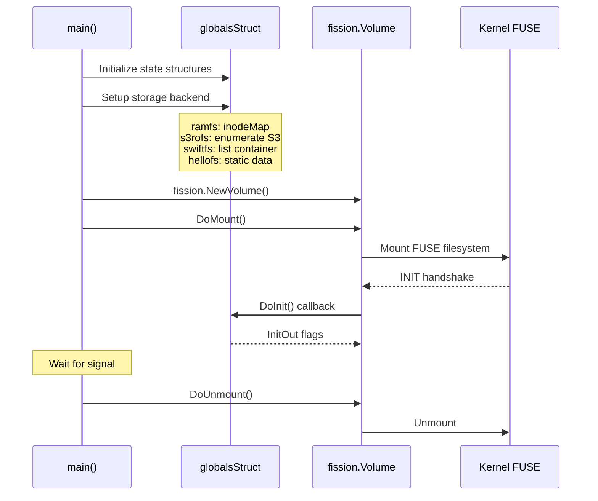
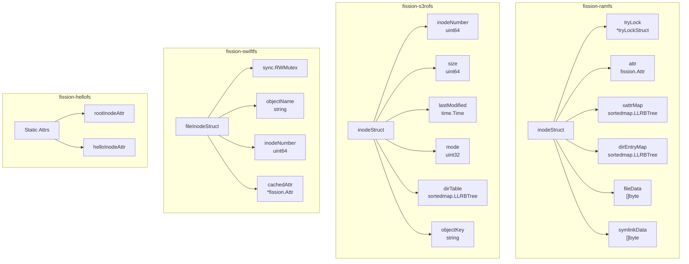
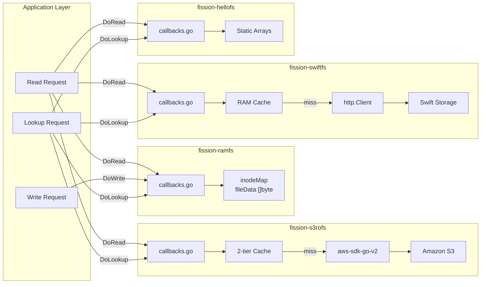
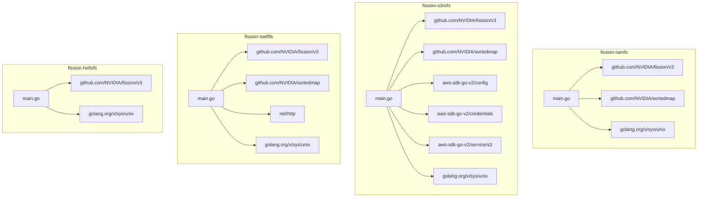
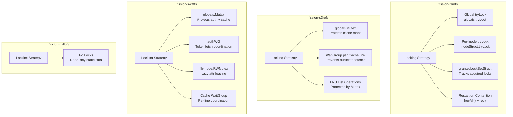
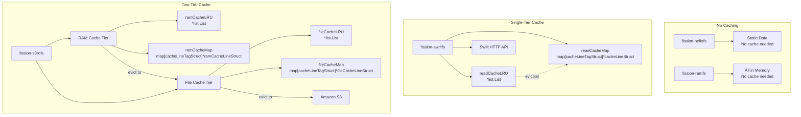
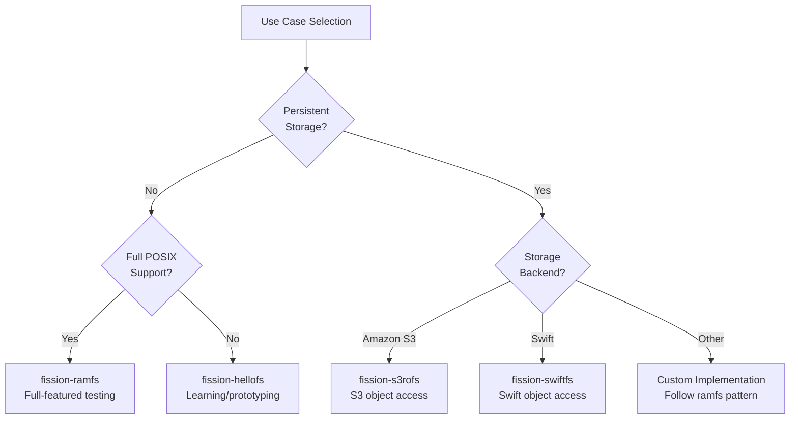

<!-- source: DeepWiki mcp.deepwiki.com · repo NVIDIA/fission · page 3 Example Implementations · fetched 2026-10-26 -->

# Example Implementations

<details>
<summary>Relevant source files</summary>

The following files were used as context for generating this wiki page:

- [examples/fission-hellofs/main.go](examples/fission-hellofs/main.go)
- [examples/fission-ramfs/main.go](examples/fission-ramfs/main.go)
- [examples/fission-s3rofs/main.go](examples/fission-s3rofs/main.go)
- [examples/fission-swiftfs/main.go](examples/fission-swiftfs/main.go)

</details>


## Purpose and Scope

This document provides an overview of the four example filesystem implementations included in the fission repository. Each example demonstrates different patterns for implementing the `Callbacks` interface (see [API Design and Interfaces](#2.1)) and showcases various use cases from minimal learning examples to production-ready cloud storage filesystems.

For detailed documentation on individual implementations, see:
- [fission-ramfs](#3.1) - Full-featured read-write filesystem
- [fission-s3rofs](#3.2) - S3-backed read-only filesystem  
- [fission-swiftfs](#3.3) - Swift object storage filesystem
- [fission-hellofs](#3.4) - Minimal example

For information about the core library these implementations use, see [Core Library](#2).

---

## Implementation Comparison

The following table summarizes the key characteristics of each example implementation:

| Implementation | Storage Backend | Read/Write | Persistence | Cache Strategy | Primary Use Case |
|---------------|----------------|------------|-------------|----------------|------------------|
| fission-ramfs | In-memory maps | Read-Write | Volatile | None (all in RAM) | Full POSIX filesystem testing |
| fission-s3rofs | Amazon S3 | Read-Only | Persistent | 2-tier (RAM + Disk) | Cloud object storage access |
| fission-swiftfs | Swift Storage | Read-Only | Persistent | 1-tier (RAM only) | OpenStack Swift access |
| fission-hellofs | Static data | Read-Only | Static | None | Learning the API |

### Lines of Code

| Implementation | Main File LOC | Callbacks File LOC | Total Complexity |
|---------------|--------------|-------------------|------------------|
| fission-ramfs | ~356 | ~2000+ | Highest |
| fission-s3rofs | ~510 | ~800+ | High |
| fission-swiftfs | ~572 | ~700+ | Medium |
| fission-hellofs | ~296 | ~200+ | Lowest |

**Sources:** [examples/fission-ramfs/main.go](), [examples/fission-s3rofs/main.go](), [examples/fission-swiftfs/main.go](), [examples/fission-hellofs/main.go]()

---

## Architecture Overview

### Interface Implementation Pattern

All four implementations follow the same architectural pattern: they implement the `Callbacks` interface and delegate lifecycle management to the core library's `Volume`.



**Sources:** [examples/fission-ramfs/main.go:89-105](), [examples/fission-s3rofs/main.go:129-143](), [examples/fission-swiftfs/main.go:100-118](), [examples/fission-hellofs/main.go:59-71]()

---

## Global State Structure Comparison

Each implementation maintains its state in a `globalsStruct` but with different contents based on requirements.

### State Structure Diagram



**Sources:** [examples/fission-ramfs/main.go:89-105](), [examples/fission-s3rofs/main.go:129-143](), [examples/fission-swiftfs/main.go:100-118](), [examples/fission-hellofs/main.go:59-71]()

---

## Initialization Patterns

### Mount Initialization Flow



### Initialization Code Locations

| Implementation | Volume Creation | DoMount | Cleanup |
|---------------|----------------|---------|---------|
| fission-ramfs | [main.go:197]() | [main.go:199]() | [main.go:216]() |
| fission-s3rofs | [main.go:447]() | [main.go:449]() | [main.go:465]() |
| fission-swiftfs | [main.go:406]() | [main.go:408]() | [main.go:425]() |
| fission-hellofs | [main.go:249]() | [main.go:251]() | [main.go:268]() |

**Sources:** [examples/fission-ramfs/main.go:197-220](), [examples/fission-s3rofs/main.go:447-476](), [examples/fission-swiftfs/main.go:406-429](), [examples/fission-hellofs/main.go:249-272]()

---

## Data Structure Patterns

### Inode Representation

Each implementation uses different strategies for representing filesystem inodes:



**Sources:** [examples/fission-ramfs/main.go:73-80](), [examples/fission-s3rofs/main.go:100-108](), [examples/fission-swiftfs/main.go:81-86](), [examples/fission-hellofs/main.go:66-67]()

---

## Storage Backend Integration

### Backend Access Patterns



**Sources:** [examples/fission-ramfs/callbacks.go](), [examples/fission-s3rofs/callbacks.go](), [examples/fission-swiftfs/callbacks.go](), [examples/fission-hellofs/callbacks.go]()

---

## Callback Implementation Coverage

The following table shows which FUSE callbacks are implemented in each example:

| Callback Category | ramfs | s3rofs | swiftfs | hellofs |
|------------------|-------|--------|---------|---------|
| **Init/Destroy** | ✓ | ✓ | ✓ | ✓ |
| DoInit | ✓ | ✓ | ✓ | ✓ |
| DoDestroy | ✓ | ✓ | ✓ | ✓ |
| **Lookup/Stat** | ✓ | ✓ | ✓ | ✓ |
| DoLookup | ✓ | ✓ | ✓ | ✓ |
| DoGetAttr | ✓ | ✓ | ✓ | ✓ |
| DoSetAttr | ✓ | - | - | - |
| **File I/O** | ✓ | ✓ | ✓ | ✓ |
| DoOpen | ✓ | ✓ | ✓ | ✓ |
| DoRead | ✓ | ✓ | ✓ | ✓ |
| DoWrite | ✓ | - | - | - |
| DoRelease | ✓ | ✓ | ✓ | ✓ |
| **Directory Ops** | ✓ | ✓ | ✓ | ✓ |
| DoReadDir | ✓ | ✓ | ✓ | ✓ |
| DoReadDirPlus | ✓ | ✓ | ✓ | ✓ |
| DoMkDir | ✓ | - | - | - |
| DoRmDir | ✓ | - | - | - |
| **Creation** | ✓ | - | - | - |
| DoCreate | ✓ | - | - | - |
| DoMkNod | ✓ | - | - | - |
| DoSymlink | ✓ | - | - | - |
| **Deletion** | ✓ | - | - | - |
| DoUnlink | ✓ | - | - | - |
| **Extended Attrs** | ✓ | - | - | - |
| DoGetXAttr | ✓ | - | - | - |
| DoSetXAttr | ✓ | - | - | - |
| DoListXAttr | ✓ | - | - | - |
| DoRemoveXAttr | ✓ | - | - | - |
| **Links** | ✓ | - | - | - |
| DoLink | ✓ | - | - | - |
| DoRename | ✓ | - | - | - |
| **Other** | ✓ | ✓ | ✓ | ✓ |
| DoStatFS | ✓ | ✓ | ✓ | ✓ |
| DoFlush | ✓ | ✓ | ✓ | ✓ |
| DoFSync | ✓ | ✓ | ✓ | ✓ |
| DoAccess | ✓ | ✓ | ✓ | ✓ |

✓ = Implemented, - = Returns `syscall.ENOSYS` or similar

**Sources:** [examples/fission-ramfs/callbacks.go](), [examples/fission-s3rofs/callbacks.go](), [examples/fission-swiftfs/callbacks.go](), [examples/fission-hellofs/callbacks.go]()

---

## Configuration and Dependencies

### External Dependencies by Implementation



### Configuration Methods

| Implementation | Config Source | Key Parameters |
|---------------|--------------|----------------|
| fission-ramfs | Command-line args | `<mount_point>` |
| fission-s3rofs | JSON config file | `S3Endpoint`, `S3Bucket`, `S3Prefix`, cache settings |
| fission-swiftfs | JSON config file | `ContainerURL`, `AuthURL`, `AuthToken`, cache settings |
| fission-hellofs | Command-line args | `<mount_point>` |

**Sources:** [examples/fission-ramfs/main.go:119-122](), [examples/fission-s3rofs/main.go:82-98](), [examples/fission-swiftfs/main.go:62-73](), [examples/fission-hellofs/main.go:83-86]()

---

## Concurrency Models

### Locking Strategy Comparison



**Sources:** [examples/fission-ramfs/main.go:65-71](), [examples/fission-ramfs/main.go:234-309](), [examples/fission-s3rofs/main.go:129-143](), [examples/fission-swiftfs/main.go:81-86](), [examples/fission-swiftfs/main.go:100-118]()

---

## Init Flags Configuration

Each implementation declares which FUSE features it supports via `InitOut` flags returned from `DoInit()`:

### Init Flags by Implementation

| Flag | ramfs | s3rofs | swiftfs | hellofs | Purpose |
|------|-------|--------|---------|---------|---------|
| `InitFlagsAsyncRead` | ✓ | ✓ | ✓ | ✓ | Enable async reads |
| `InitFlagsFileOps` | ✓ | ✓ | ✓ | ✓ | File handle operations |
| `InitFlagsAtomicOTrunc` | ✓ | - | - | ✓ | Atomic open+truncate |
| `InitFlagsBigWrites` | ✓ | - | - | - | Large write support |
| `InitFlagsAutoInvalData` | ✓ | - | - | ✓ | Auto invalidate data |
| `InitFlagsDoReadDirPlus` | ✓ | ✓ | ✓ | ✓ | ReadDirPlus support |
| `InitFlagsReaddirplusAuto` | ✓ | ✓ | ✓ | ✓ | Auto ReadDirPlus |
| `InitFlagsParallelDirops` | ✓ | ✓ | ✓ | ✓ | Parallel dir ops |
| `InitFlagsMaxPages` | ✓ | ✓ | ✓ | ✓ | Max pages support |
| `InitFlagsExplicitInvalData` | ✓ | ✓ | ✓ | ✓ | Explicit invalidation |
| `InitFlagsNoOpendirSupport` | - | ✓ | ✓ | - | No DoOpenDir needed |

**Constants:**
- ramfs: [main.go:25-35]()
- s3rofs: [main.go:37-45]()
- swiftfs: [main.go:31-39]()
- hellofs: [main.go:22-32]()

**Sources:** [examples/fission-ramfs/main.go:25-35](), [examples/fission-s3rofs/main.go:37-45](), [examples/fission-swiftfs/main.go:31-39](), [examples/fission-hellofs/main.go:22-32]()

---

## Cache Architecture

### Cache Type and Strategy



### Cache Line Structure

| Implementation | Tag Structure | Content Storage | Synchronization |
|---------------|--------------|-----------------|-----------------|
| s3rofs | `inodeNumber` + `lineNumber` | RAM: `[]byte`, File: file path | `sync.WaitGroup` per line |
| swiftfs | `inodeNumber` + `lineNumber` | RAM: `[]byte` | `sync.WaitGroup` per line |

**Sources:** [examples/fission-s3rofs/main.go:110-127](), [examples/fission-swiftfs/main.go:88-98]()

---

## Use Case Summary

### When to Use Each Implementation



### Recommended Starting Point by Goal

| Goal | Start With | Reason |
|------|-----------|--------|
| Learn the fission API | hellofs | Minimal code, clear structure |
| Implement read-write filesystem | ramfs | Complete example with all operations |
| Add S3 backend | s3rofs | Two-tier cache pattern, enumeration strategy |
| Add HTTP-based storage | swiftfs | Authentication, single-tier cache |
| Test FUSE operations | ramfs | Supports all POSIX operations |
| Mount existing data | s3rofs or swiftfs | Read-only, efficient caching |

**Sources:** [examples/fission-hellofs/main.go](), [examples/fission-ramfs/main.go](), [examples/fission-s3rofs/main.go](), [examples/fission-swiftfs/main.go]()

---

## Command-Line Usage

### Invocation Examples

**fission-ramfs:**
```bash
./fission-ramfs /mnt/ramfs
```

**fission-s3rofs:**
```bash
./fission-s3rofs config.json
```

Where `config.json` contains S3 credentials, bucket, prefix, and cache configuration.

**fission-swiftfs:**
```bash
./fission-swiftfs config.json
```

Where `config.json` contains Swift URL, authentication, and cache configuration.

**fission-hellofs:**
```bash
./fission-hellofs /mnt/hellofs
```

### Signal Handling

All implementations handle the same termination signals:

- `SIGINT` (Ctrl+C)
- `SIGTERM` (kill command)
- `SIGHUP` (terminal hangup)

**Signal handling code:** [examples/fission-ramfs/main.go:205-214](), [examples/fission-s3rofs/main.go:454-463](), [examples/fission-swiftfs/main.go:414-423](), [examples/fission-hellofs/main.go:257-266]()

**Sources:** [examples/fission-ramfs/main.go:205-214](), [examples/fission-s3rofs/main.go:171-198](), [examples/fission-swiftfs/main.go:145-165](), [examples/fission-hellofs/main.go:83-86]()

---

