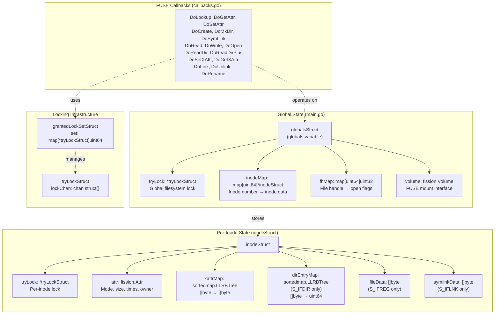
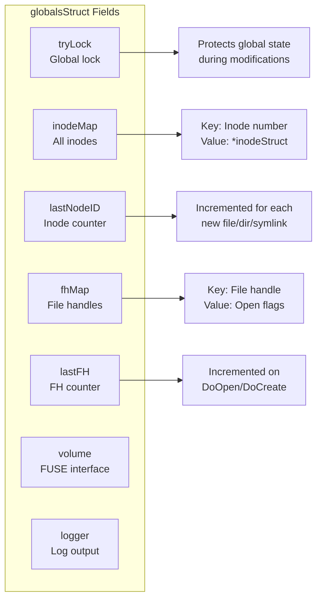
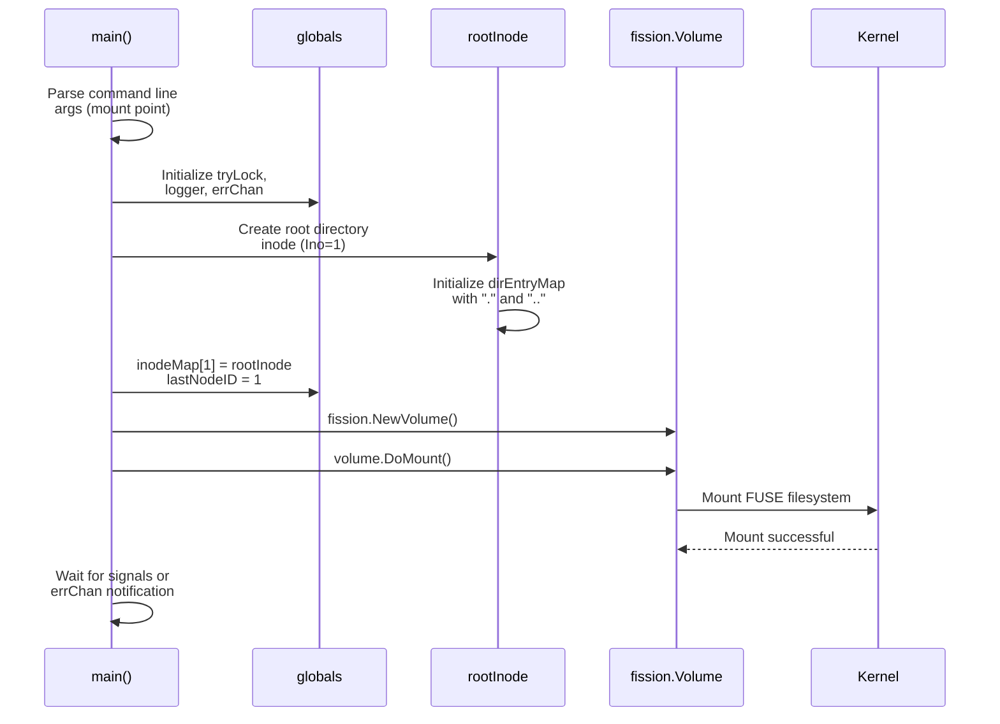
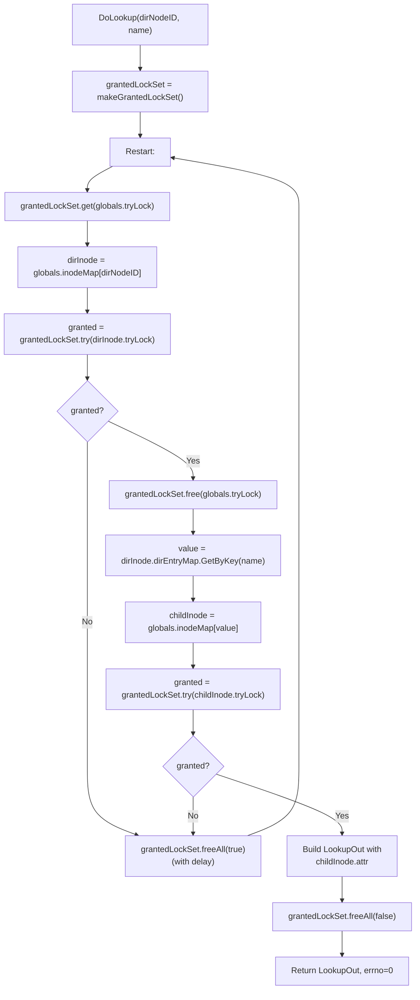
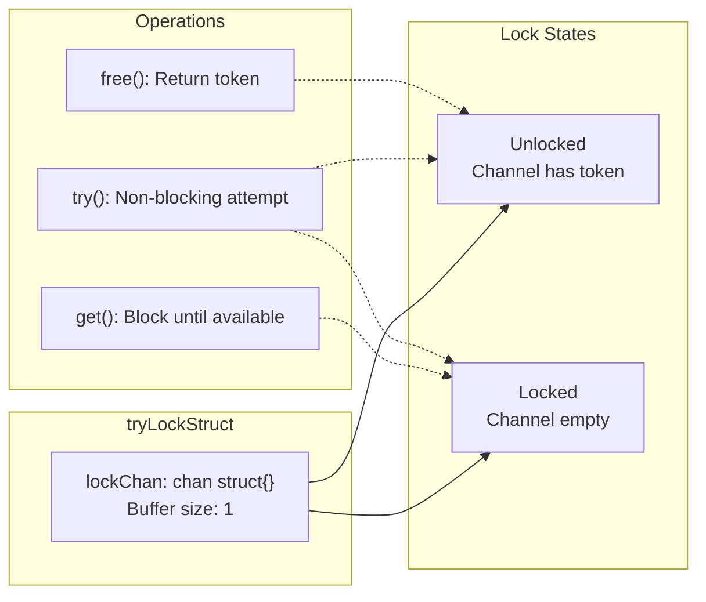
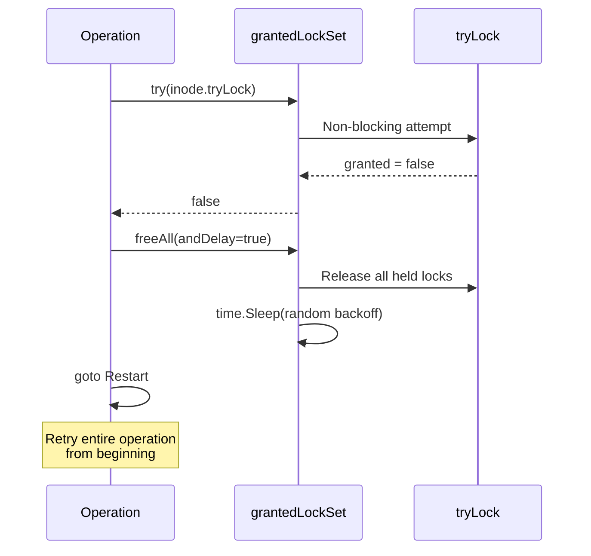
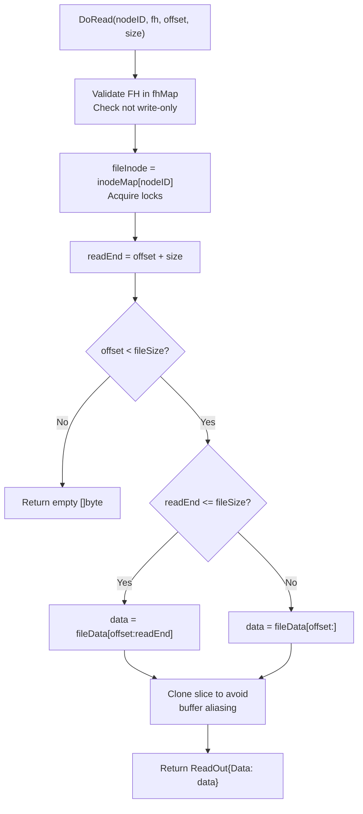
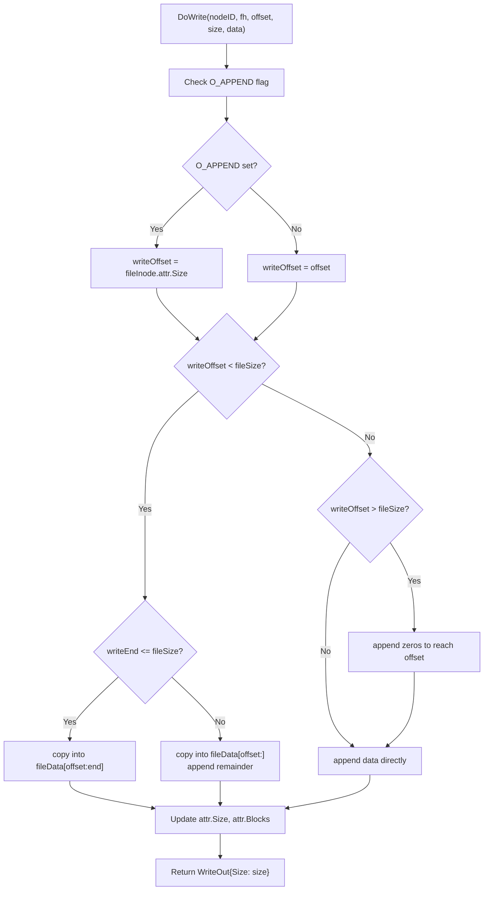
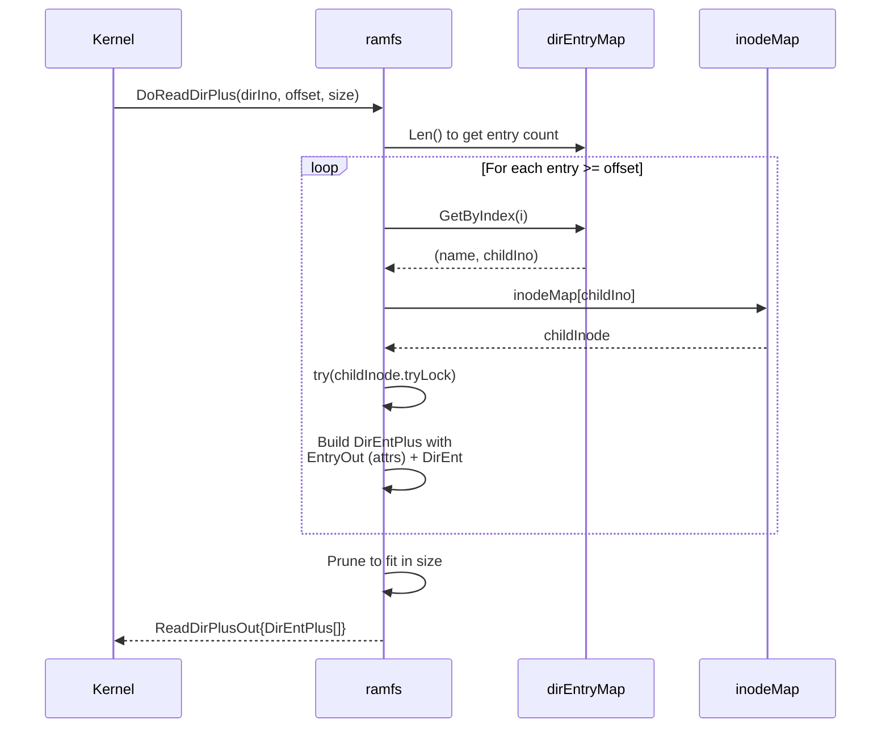
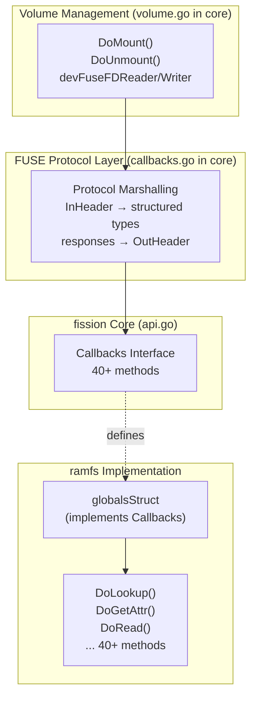

<!-- source: DeepWiki mcp.deepwiki.com · repo NVIDIA/fission · page 3.1 fission-ramfs: Full-Featured In-Memory Filesystem · fetched 2026-10-26 -->

# fission-ramfs: Full-Featured In-Memory Filesystem

<details>
<summary>Relevant source files</summary>

The following files were used as context for generating this wiki page:

- [examples/fission-ramfs/callbacks.go](examples/fission-ramfs/callbacks.go)
- [examples/fission-ramfs/main.go](examples/fission-ramfs/main.go)

</details>


## Purpose and Scope

This document provides a comprehensive guide to `fission-ramfs`, the most complete example filesystem implementation in the fission repository. It demonstrates a full read-write POSIX-compliant filesystem with support for directories, regular files, symbolic links, hard links, and extended attributes. All data is stored in volatile memory with no persistence.

For detailed information about specific subsystems:
- Architecture and state management: see [RAMFS Architecture and State Management](#3.1.1)
- Concurrency control mechanisms: see [RAMFS Concurrency and Locking](#3.1.2)
- Individual file operations: see [RAMFS File and Directory Operations](#3.1.3)

For comparison with other filesystem examples, see [Example Implementations](#3).

**Sources:** [examples/fission-ramfs/main.go:1-356](), [examples/fission-ramfs/callbacks.go:1-2495]()

## Overview

`fission-ramfs` is located in `examples/fission-ramfs/` and consists of two primary files:
- `main.go` - Initialization, global state, and locking infrastructure
- `callbacks.go` - Implementation of all FUSE operations

### Supported Features

| Feature | Support Level | Notes |
|---------|--------------|-------|
| Regular Files | Full read/write | Zero-copy byte slice operations |
| Directories | Full support | Recursive creation and removal |
| Symbolic Links | Full support | Arbitrary target paths |
| Hard Links | Full support | Reference counting with `NLink` |
| Extended Attributes | Full support | Arbitrary key-value pairs |
| POSIX Permissions | Full support | Owner/group/other RWX bits |
| Access Control | Full support | UID/GID-based permission checks |
| File Locking | Not implemented | Returns `ENOSYS` |
| Direct I/O | Enabled | Bypasses kernel page cache |

**Sources:** [examples/fission-ramfs/callbacks.go:25-43](), [examples/fission-ramfs/main.go:22-63]()

## Architecture: Code Entity Mapping

The following diagram maps high-level concepts to the actual code structures used in `fission-ramfs`:



**Sources:** [examples/fission-ramfs/main.go:65-107](), [examples/fission-ramfs/main.go:73-80]()

## Core Data Structures

### globalsStruct

The `globalsStruct` holds all filesystem-wide state and is instantiated as a single global variable `globals`:



**Sources:** [examples/fission-ramfs/main.go:89-105]()

### inodeStruct

Each file, directory, or symlink is represented by an `inodeStruct`:

| Field | Type | Purpose | Used For |
|-------|------|---------|----------|
| `tryLock` | `*tryLockStruct` | Per-inode concurrency control | All inode types |
| `attr` | `fission.Attr` | POSIX metadata (mode, size, times) | All inode types |
| `xattrMap` | `sortedmap.LLRBTree` | Extended attributes (name → value) | All inode types |
| `dirEntryMap` | `sortedmap.LLRBTree` | Directory entries (name → inode#) | `S_IFDIR` only |
| `fileData` | `[]byte` | File contents | `S_IFREG` only |
| `symlinkData` | `[]byte` | Symlink target path | `S_IFLNK` only |

The `attr.Mode` field determines which type-specific fields are valid:
- `(attr.Mode & syscall.S_IFMT) == syscall.S_IFDIR` → use `dirEntryMap`
- `(attr.Mode & syscall.S_IFMT) == syscall.S_IFREG` → use `fileData`
- `(attr.Mode & syscall.S_IFMT) == syscall.S_IFLNK` → use `symlinkData`

**Sources:** [examples/fission-ramfs/main.go:73-80]()

### Initialization Sequence

The following diagram shows how ramfs initializes at startup:



**Sources:** [examples/fission-ramfs/main.go:109-221]()

## FUSE Operation Implementation

All FUSE callbacks are implemented as methods on `*globalsStruct`. The general pattern for each operation is:

1. Create a `grantedLockSetStruct` to track acquired locks
2. Acquire the global `tryLock` 
3. Look up relevant inodes in `inodeMap`
4. Attempt to acquire per-inode locks using `tryLock.try()`
5. If lock acquisition fails, release all locks and `goto Restart`
6. Perform the operation
7. Release all locks via `grantedLockSet.freeAll(false)`

### Example: DoLookup Operation Flow



**Sources:** [examples/fission-ramfs/callbacks.go:14-108]()

### Implemented Operations

The following table shows all implemented FUSE operations and their behaviors:

| Operation | Function | Primary Purpose | Returns Data |
|-----------|----------|----------------|--------------|
| `DoLookup` | Resolve name in directory | Returns inode attributes | `LookupOut` |
| `DoGetAttr` | Get inode attributes | Returns size, mode, times | `GetAttrOut` |
| `DoSetAttr` | Modify inode attributes | Updates mode, size, times, owner | `SetAttrOut` |
| `DoReadLink` | Read symlink target | Returns target path | `ReadLinkOut` |
| `DoSymLink` | Create symlink | Allocates new inode | `SymLinkOut` |
| `DoMkDir` | Create directory | Allocates new inode with "." and ".." | `MkDirOut` |
| `DoUnlink` | Remove file | Decrements `NLink`, deletes if 0 | errno |
| `DoRmDir` | Remove directory | Checks empty (only "." and "..") | errno |
| `DoRename` | Move/rename entry | Handles cross-directory moves | errno |
| `DoLink` | Create hard link | Increments `NLink` | `LinkOut` |
| `DoOpen` | Open file | Allocates file handle, handles `O_TRUNC` | `OpenOut` |
| `DoRead` | Read file data | Returns slice of `fileData` | `ReadOut` |
| `DoWrite` | Write file data | Modifies `fileData`, handles `O_APPEND` | `WriteOut` |
| `DoRelease` | Close file | Releases file handle, may delete inode | errno |
| `DoOpenDir` | Open directory | Validation only | `OpenDirOut` |
| `DoReadDir` | Read directory entries | Returns paginated entry list | `ReadDirOut` |
| `DoReadDirPlus` | Read directory with attrs | Returns entries + attributes | `ReadDirPlusOut` |
| `DoReleaseDir` | Close directory | May delete inode if `NLink==0` | errno |
| `DoSetXAttr` | Set extended attribute | Updates or creates xattr | errno |
| `DoGetXAttr` | Get extended attribute | Returns xattr value | `GetXAttrOut` |
| `DoListXAttr` | List all xattrs | Returns xattr names | `ListXAttrOut` |
| `DoRemoveXAttr` | Remove extended attribute | Deletes xattr | errno |
| `DoCreate` | Atomic create+open | Allocates inode and file handle | `CreateOut` |
| `DoAccess` | Check permissions | Validates based on UID/GID/mode | errno |

**Sources:** [examples/fission-ramfs/callbacks.go:14-2274]()

## Lock-Based Concurrency Control

The ramfs implementation uses a sophisticated locking strategy to allow concurrent operations while preventing deadlocks:

### tryLockStruct Design



The `tryLockStruct` uses a buffered channel with capacity 1. When a token is in the channel, the lock is available. When the channel is empty, the lock is held.

**Key Implementation Details:**
- `makeTryLock()` creates a lock with the token pre-inserted (unlocked state)
- `grantedLockSet.get()` blocks until lock is available
- `grantedLockSet.try()` returns immediately with success/failure
- On `try()` failure, all locks are released and operation restarts after random backoff

**Sources:** [examples/fission-ramfs/main.go:65-71](), [examples/fission-ramfs/main.go:223-309]()

### Restart Pattern

When a lock cannot be acquired, the operation follows this pattern:



The random backoff duration is between `tryLockBackoffMin` (100μs) and `tryLockBackoffMax` (300μs) to reduce contention.

**Sources:** [examples/fission-ramfs/callbacks.go:26-40](), [examples/fission-ramfs/main.go:52-53](), [examples/fission-ramfs/main.go:294-309]()

## File I/O Implementation

### Read Operation

The `DoRead` operation demonstrates zero-copy semantics:



**Sources:** [examples/fission-ramfs/callbacks.go:964-1030]()

### Write Operation

The `DoWrite` operation handles three cases:

1. **Overwrite within file**: Copy data into existing `fileData` slice
2. **Extend file**: Overwrite + append new data
3. **Write beyond EOF**: Append zeros to reach offset, then append data



**Sources:** [examples/fission-ramfs/callbacks.go:1032-1119]()

## Directory Operations

### DoMkDir Implementation

Creating a directory involves several steps to maintain POSIX semantics:

1. Validate parent is a directory
2. Check name doesn't exist
3. Allocate new inode with `S_IFDIR` mode
4. Initialize `dirEntryMap` with "." (self) and ".." (parent)
5. Increment parent's `NLink` (for the ".." entry)
6. Add entry to parent's `dirEntryMap`

**Sources:** [examples/fission-ramfs/callbacks.go:466-611]()

### DoReadDirPlus Optimization

The `DoReadDirPlus` operation is an optimized version of `DoReadDir` that returns both directory entries and their attributes in a single call. This reduces round-trips:



This operation locks each child inode to safely read its attributes. If any lock cannot be acquired, all locks are released and the operation restarts.

**Sources:** [examples/fission-ramfs/callbacks.go:2097-2259]()

## Extended Attributes (xattrs)

Each inode has an `xattrMap` (a `sortedmap.LLRBTree`) that stores extended attributes as byte slices:

| Operation | Implementation | Notes |
|-----------|----------------|-------|
| Set | `xattrMap.PatchByKey()` or `Put()` | Creates if not exists, updates if exists |
| Get | `xattrMap.GetByKey()` | Returns `ENODATA` if not found |
| List | Iterate via `GetByIndex()` | Returns names only, null-terminated |
| Remove | `xattrMap.DeleteByKey()` | Returns `ENOENT` if not found |

The xattr operations follow the standard FUSE xattr protocol, including two-phase queries where the first call with `Size=0` returns the required buffer size.

**Sources:** [examples/fission-ramfs/callbacks.go:1228-1472]()

## Hard Link Reference Counting

The ramfs implementation maintains proper reference counting for hard links:

- **DoLink**: Increments `NLink` on target inode, adds new directory entry
- **DoUnlink**: Decrements `NLink`, deletes inode from `inodeMap` only if `NLink==0`
- **DoRelease**: After closing file, checks `NLink==0` to handle unlinked-but-open files

This correctly implements UNIX semantics where an inode persists as long as either:
1. At least one directory entry references it (`NLink > 0`), OR
2. At least one file descriptor is open to it (tracked via `fhMap`)

**Sources:** [examples/fission-ramfs/callbacks.go:803-911](), [examples/fission-ramfs/callbacks.go:613-698](), [examples/fission-ramfs/callbacks.go:1143-1190]()

## Performance Characteristics

| Aspect | Performance | Explanation |
|--------|-------------|-------------|
| Read latency | ~10μs | In-memory byte slice access |
| Write latency | ~10μs | Direct slice modification |
| Directory lookup | O(log N) | LLRB tree search in `dirEntryMap` |
| Lock contention | Optimistic | Retry with backoff on failure |
| Memory usage | Linear in data | No compression or deduplication |
| Scalability | Good for reads | Global lock limits write concurrency |

The use of `sortedmap.LLRBTree` provides O(log N) directory operations, while the restart-based locking enables high concurrency for non-conflicting operations.

**Sources:** [examples/fission-ramfs/main.go:158-159](), [examples/fission-ramfs/callbacks.go:26-40]()

## Usage Example

```bash
# Build the ramfs binary
cd examples/fission-ramfs
go build

# Create a mount point
mkdir /tmp/ramfs-mount

# Mount the filesystem
./fission-ramfs /tmp/ramfs-mount

# Use the filesystem
echo "Hello, RAMFS!" > /tmp/ramfs-mount/test.txt
cat /tmp/ramfs-mount/test.txt
mkdir /tmp/ramfs-mount/subdir
ln -s test.txt /tmp/ramfs-mount/link

# Unmount (send signal to process)
# The filesystem will unmount on SIGINT, SIGTERM, or SIGHUP
```

The ramfs process logs all activity to stdout and remains in the foreground until terminated by a signal.

**Sources:** [examples/fission-ramfs/main.go:109-221](), [examples/fission-ramfs/main.go:205-220]()

## Limitations

The following FUSE operations are explicitly not implemented and return `ENOSYS`:

- **DoMkNod**: Special device node creation (block/char devices, FIFOs, sockets)
- **DoGetLK, DoSetLK, DoSetLKW**: POSIX advisory file locking
- **DoBMap**: Block mapping for direct I/O to block devices
- **DoPoll**: Poll/epoll support for asynchronous I/O
- **DoFAllocate**: `fallocate()` for pre-allocating space
- **DoLSeek**: `lseek()` with `SEEK_DATA`/`SEEK_HOLE`
- **DoStatX**: Extended `stat()` with additional fields
- **DoDestroy**: Filesystem shutdown notification

The `DoStatFS` operation is implemented but returns all-zero statistics (TODO comment indicates incomplete implementation).

**Sources:** [examples/fission-ramfs/callbacks.go:461-464](), [examples/fission-ramfs/callbacks.go:1786-1798](), [examples/fission-ramfs/callbacks.go:1121-1141]()

## Relationship to Core Library

The ramfs implementation demonstrates all aspects of the fission library's callback interface:



The ramfs `globalsStruct` implements every method defined in the `fission.Callbacks` interface, making it a complete reference implementation for building new filesystems.

**Sources:** [examples/fission-ramfs/main.go:89-105](), [examples/fission-ramfs/callbacks.go:14-2274]()

---

For implementation details on specific subsystems, refer to:
- [RAMFS Architecture and State Management](#3.1.1)
- [RAMFS Concurrency and Locking](#3.1.2)
- [RAMFS File and Directory Operations](#3.1.3)

---

