<!-- source: DeepWiki mcp.deepwiki.com · repo NVIDIA/fission · page 3.2 fission-s3rofs: S3-Backed Read-Only Filesystem · fetched 2026-10-26 -->

# fission-s3rofs: S3-Backed Read-Only Filesystem

<details>
<summary>Relevant source files</summary>

The following files were used as context for generating this wiki page:

- [examples/fission-s3rofs/callbacks.go](examples/fission-s3rofs/callbacks.go)
- [examples/fission-s3rofs/main.go](examples/fission-s3rofs/main.go)

</details>


## Purpose and Scope

This page documents the `fission-s3rofs` example implementation, which provides a read-only FUSE filesystem backed by Amazon S3 object storage. The filesystem enumerates all S3 objects at mount time to construct an in-memory directory tree, then serves file reads through a sophisticated two-tier caching system (RAM + optional disk cache) that optimizes network access via HTTP Range requests.

This page covers the overall architecture, configuration, initialization, inode management, and FUSE operation implementations. For detailed information about specific subsystems, see:
- **S3 integration and filesystem setup**: [3.2.1](#3.2.1)
- **Two-tier caching strategy**: [3.2.2](#3.2.2)

Related implementations with different design patterns:
- **Full read-write in-memory filesystem**: [3.1](#3.1)
- **Swift-backed filesystem with authentication**: [3.3](#3.3)

---

## System Architecture

The `fission-s3rofs` implementation demonstrates a cloud-optimized read-only filesystem that prioritizes performance through aggressive caching while maintaining consistency with the S3 backend state captured at mount time.

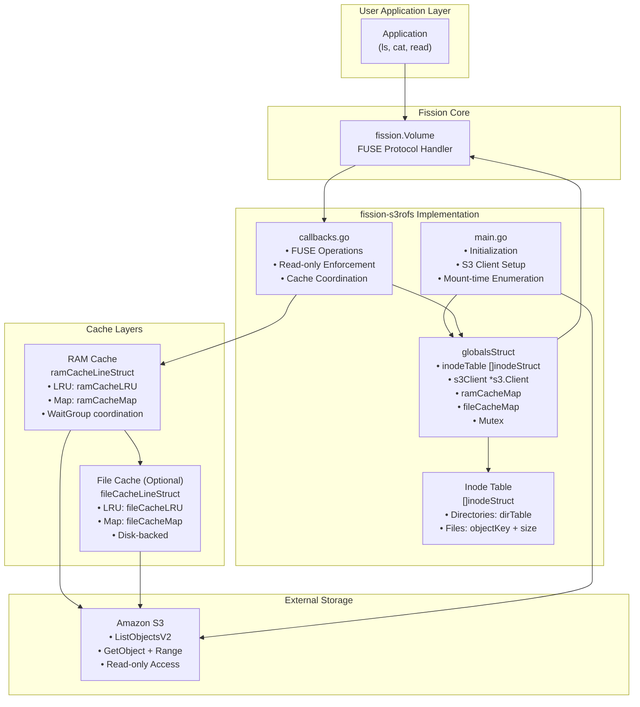

**System Flow:**
1. **Mount time**: `main.go` enumerates all S3 objects via `ListObjectsV2` and constructs the complete inode table
2. **Runtime**: FUSE operations dispatch through `callbacks.go` to query the in-memory inode table
3. **File reads**: Cache-line-based fetching with LRU eviction; S3 Range requests fetch only needed data
4. **Concurrency**: `sync.Mutex` on `globalsStruct` protects cache maps; `sync.WaitGroup` per cache line prevents duplicate fetches

**Sources:** [examples/fission-s3rofs/main.go:1-510](), [examples/fission-s3rofs/callbacks.go:1-937]()

---

## Key Data Structures

The filesystem state is managed through several interconnected structures that separate concerns between configuration, inode metadata, and caching.

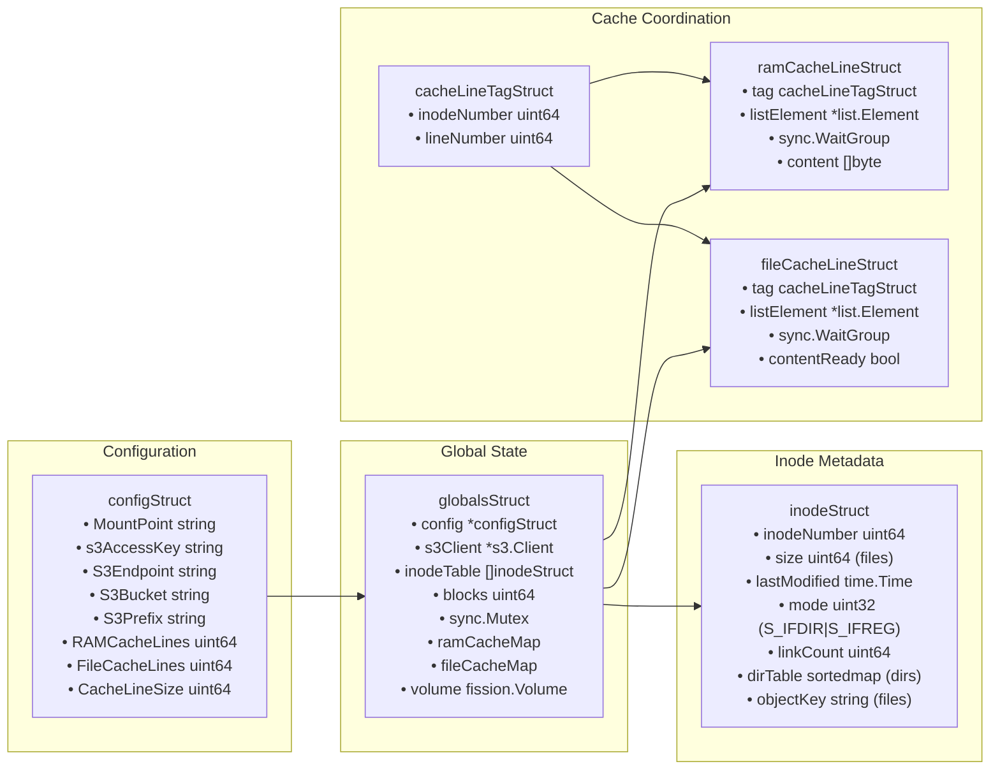

**Structure Relationships:**

| Structure | Purpose | Key Fields | Usage Pattern |
|-----------|---------|------------|---------------|
| `configStruct` | User configuration | S3 credentials, bucket, prefix, cache sizes | Read at startup, immutable |
| `globalsStruct` | Global filesystem state | Inode table, S3 client, cache structures | Singleton, mutex-protected |
| `inodeStruct` | File/directory metadata | Mode, size, dirTable (dirs), objectKey (files) | Indexed by `inodeNumber - 1` |
| `cacheLineTagStruct` | Cache line identifier | Inode number + line number | Map key for cache lookups |
| `ramCacheLineStruct` | RAM cache entry | Content bytes + WaitGroup | LRU-managed, nil content during fetch |
| `fileCacheLineStruct` | Disk cache entry | Ready flag + WaitGroup | Fallback for RAM overflow |

**Sources:** [examples/fission-s3rofs/main.go:82-143]()

---

## Configuration and Initialization

The filesystem is configured via a JSON file that specifies S3 credentials, endpoint, bucket, prefix, and cache parameters.

### Configuration Structure

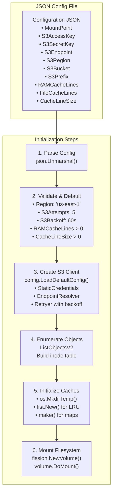

**Configuration Fields:**

| Field | Type | Required | Default | Description |
|-------|------|----------|---------|-------------|
| `MountPoint` | string | Yes | - | Directory path for mount |
| `S3AccessKey` | string | No | ENV | AWS access key (masked in logs) |
| `S3SecretKey` | string | No | ENV | AWS secret key (masked in logs) |
| `S3Endpoint` | string | Yes | - | S3 endpoint URL |
| `S3Region` | string | No | "us-east-1" | AWS region |
| `S3Attempts` | uint64 | No | 5 | Max retry attempts |
| `S3Backoff` | uint64 | No | 60 | Max backoff delay (seconds) |
| `S3Bucket` | string | Yes | - | S3 bucket name |
| `S3Prefix` | string | Yes | - | Object key prefix (directory) |
| `RAMCacheLines` | uint64 | Yes | - | Number of cache lines in RAM (must be > 0) |
| `FileCacheLines` | uint64 | No | 0 | Number of cache lines on disk (0 = disabled) |
| `CacheLineSize` | uint64 | Yes | - | Size of each cache line in bytes |

**Sources:** [examples/fission-s3rofs/main.go:82-98](), [examples/fission-s3rofs/main.go:171-256]()

### AWS SDK Configuration

The S3 client is configured with static credentials, custom endpoint resolution, and exponential backoff retry logic:

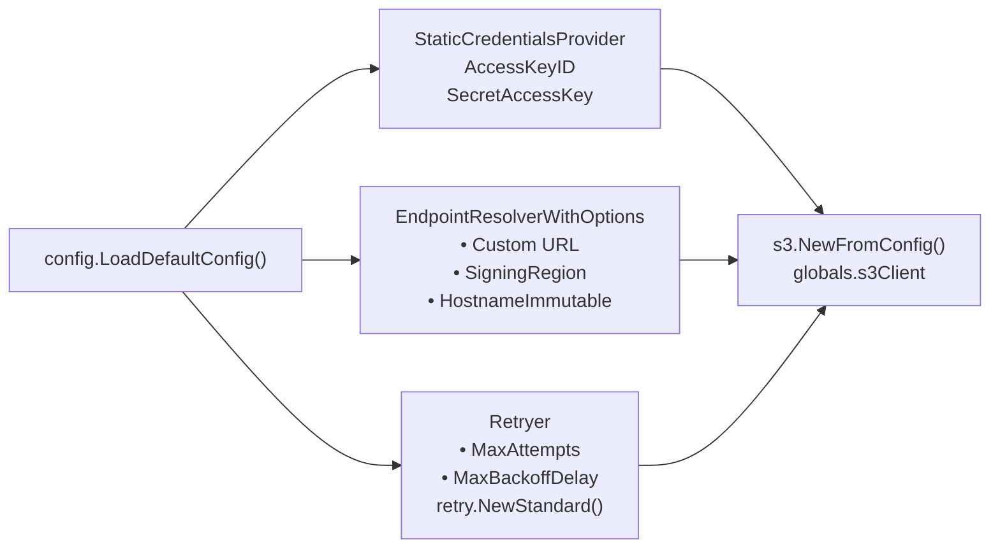

**Sources:** [examples/fission-s3rofs/main.go:289-313]()

---

## Inode Structure and Table Organization

The filesystem maintains all metadata in an in-memory inode table constructed during mount. Each inode represents either a directory or a regular file.

### Inode Dual-Mode Design

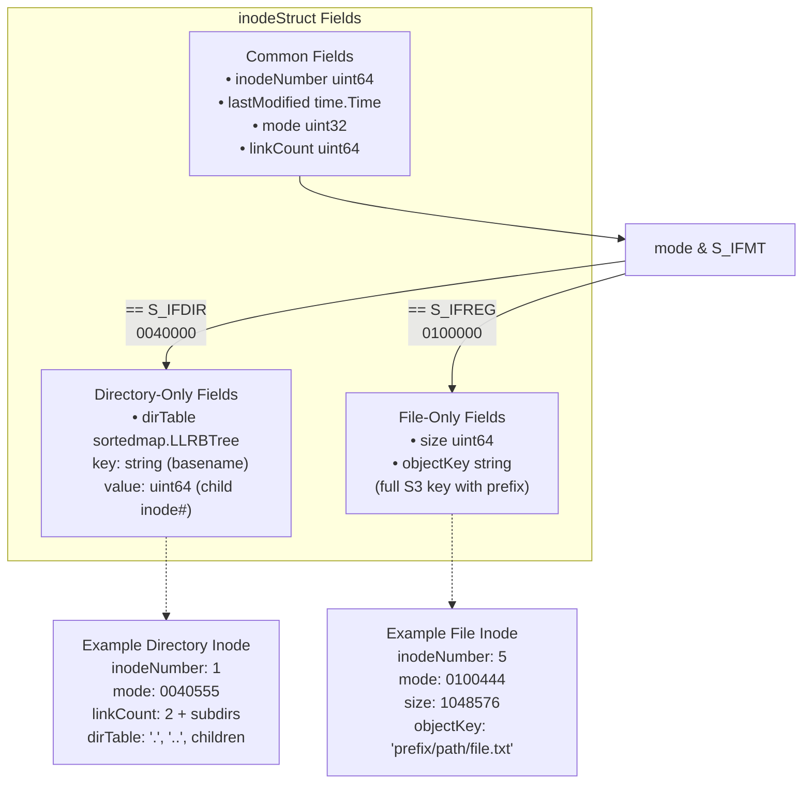

**Inode Field Usage:**

| Field | Type | Directories | Files | Description |
|-------|------|-------------|-------|-------------|
| `inodeNumber` | uint64 | ✓ | ✓ | Unique ID (1-based, index = num - 1) |
| `size` | uint64 | - | ✓ | File size in bytes |
| `lastModified` | time.Time | ✓ | ✓ | Converted to {A\|M\|C}Time attrs |
| `mode` | uint32 | ✓ | ✓ | File type + permissions |
| `linkCount` | uint64 | ✓ | ✓ | Dirs: 2 + subdirs; Files: 1 |
| `dirTable` | sortedmap.LLRBTree | ✓ | - | Ordered directory entries |
| `objectKey` | string | - | ✓ | Full S3 key (includes prefix) |

**Sources:** [examples/fission-s3rofs/main.go:100-108]()

### Directory Entry Resolution

Directories use `sortedmap.LLRBTree` for O(log n) lookups with sorted iteration:

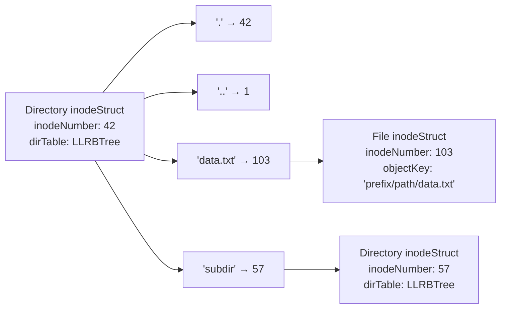

The `sortedmap` library (see [4.2](#4.2)) provides ordered key-value storage using left-leaning red-black trees, enabling efficient sorted directory listings required by `DoReadDir` and `DoReadDirPlus`.

**Sources:** [examples/fission-s3rofs/main.go:269-285]()

---

## Mount-Time Object Enumeration

Unlike traditional filesystems that populate metadata on demand, `fission-s3rofs` enumerates **all S3 objects at mount time** to construct the complete directory tree. This design choice optimizes runtime performance at the cost of mount latency and memory usage.

### Enumeration Process Flow

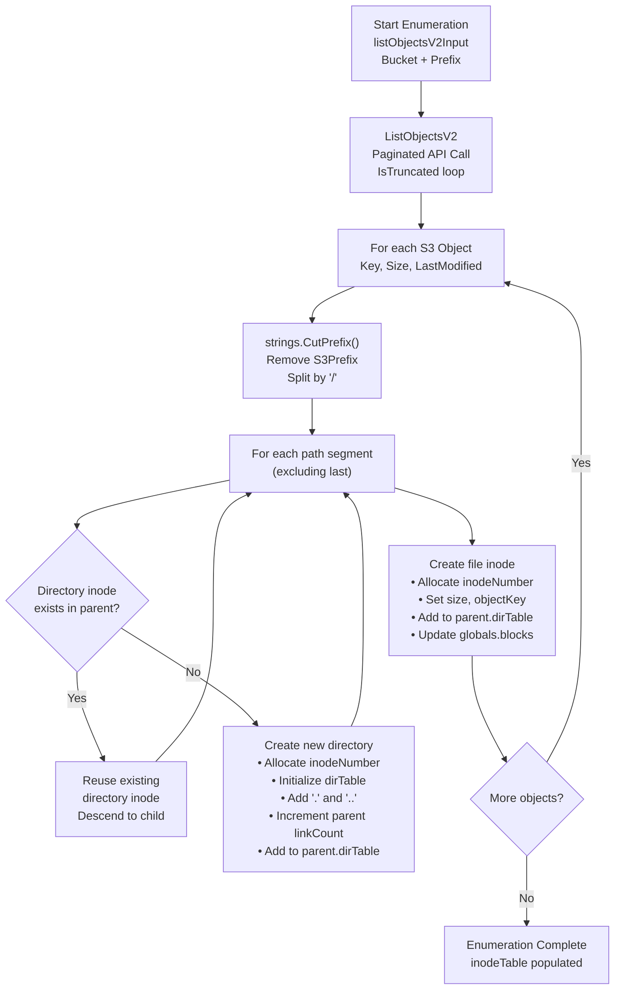

**Enumeration Algorithm Details:**

1. **Pagination Loop**: Repeatedly call `ListObjectsV2` with continuation tokens until `IsTruncated == false` [examples/fission-s3rofs/main.go:324-330]()

2. **Object Key Processing**: For S3 key `prefix/dir1/dir2/file.txt`:
   - Cut prefix to get `dir1/dir2/file.txt`
   - Split into `["dir1", "dir2", "file.txt"]`
   - Process path segments sequentially

3. **Directory Creation**: When encountering a new directory segment:
   - Allocate new `inodeNumber = len(inodeTable) + 1`
   - Create `dirTable` with `.` (self) and `..` (parent) entries
   - Increment parent's `linkCount` (directory hard link count)
   - Add to parent's `dirTable` with basename as key

4. **File Creation**: For the final path segment:
   - Create file inode with S3 object's `Size` and `LastModified`
   - Store full `objectKey` (with prefix) for future `GetObject` calls
   - Update `globals.blocks` for `DoStatFS` reporting

**Sources:** [examples/fission-s3rofs/main.go:315-425]()

### Root Directory Initialization

Before enumeration, the root directory (inode #1) is pre-created with self-referential `.` and `..` entries:

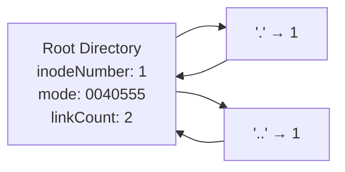

**Sources:** [examples/fission-s3rofs/main.go:262-287]()

---

## FUSE Operations Implementation

The `callbacks.go` file implements the `fission.Callbacks` interface with a read-only subset of FUSE operations. Most write operations return `syscall.ENOSYS` (function not implemented).

### Supported vs Unsupported Operations

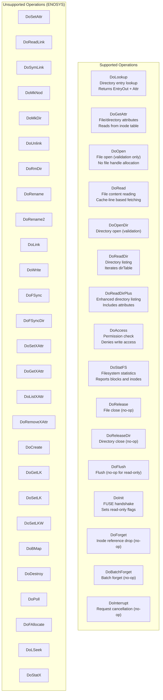

**Sources:** [examples/fission-s3rofs/callbacks.go:72-936]()

### DoLookup: Directory Entry Resolution

Translates a name within a parent directory to an inode number and attributes:

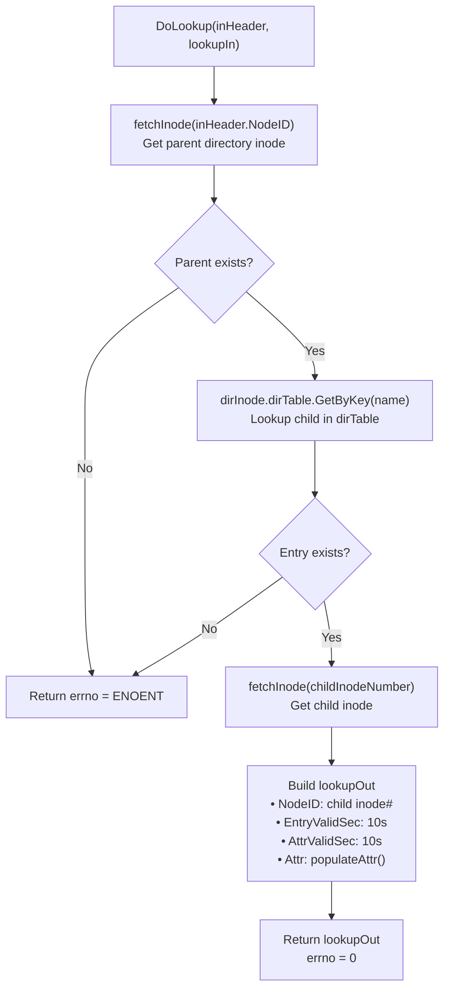

The `fetchInode` helper validates and retrieves inodes by number: [examples/fission-s3rofs/callbacks.go:62-70]()

**Sources:** [examples/fission-s3rofs/callbacks.go:72-122]()

### DoGetAttr: Attribute Retrieval

Returns inode attributes by converting in-memory metadata to FUSE `Attr` structure:

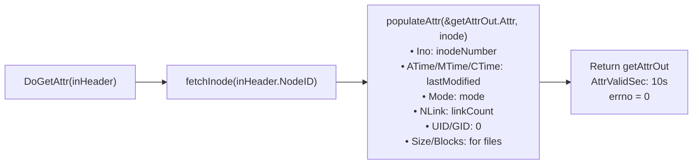

The `populateAttr` helper handles directory vs file attribute differences: [examples/fission-s3rofs/callbacks.go:31-60]()

**Sources:** [examples/fission-s3rofs/callbacks.go:127-147]()

### DoRead: Cache-Line-Based File Reading

File reads are the most complex operation, involving cache lookups, LRU management, and S3 Range fetches:

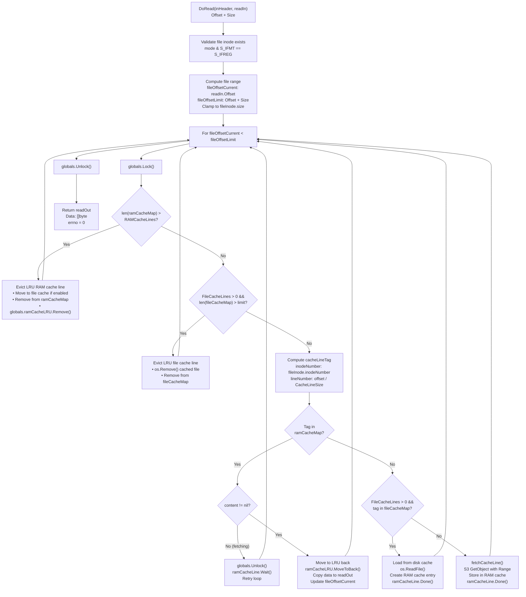

**Key Design Aspects:**

1. **Cache Line Granularity**: Files are divided into fixed-size cache lines (`globals.config.CacheLineSize`). Each read may span multiple cache lines.

2. **LRU Eviction**: When cache limits are exceeded, the least-recently-used line is evicted from the front of the LRU list [examples/fission-s3rofs/callbacks.go:305-386]()

3. **WaitGroup Coordination**: Multiple concurrent reads for the same cache line wait on a `sync.WaitGroup` instead of fetching duplicates [examples/fission-s3rofs/callbacks.go:393-395]()

4. **Two-Tier Fallback**: RAM cache overflow moves to file cache (if enabled); file cache overflow is evicted [examples/fission-s3rofs/callbacks.go:315-349]()

5. **S3 Range Requests**: Only the needed byte range is fetched via `GetObject` with `Range: bytes=X-Y` header [examples/fission-s3rofs/callbacks.go:219-256]()

**Sources:** [examples/fission-s3rofs/callbacks.go:258-477]()

### DoReadDir and DoReadDirPlus: Directory Listings

Both operations iterate the `dirTable` sorted map to return directory entries:

```mermaid
graph LR
    DoReadDirPlus["DoReadDirPlus(inHeader, readDirPlusIn)"]
    
    FetchDir["fetchInode(inHeader.NodeID)<br/>Validate S_IFDIR"]
    
    ComputeCapacity["Compute max entries<br/>Size / DirEntPlusMinSize"]
    
    GetTableLen["dirTable.Len()<br/>Check offset bounds"]
    
    IterateEntries["For each entry from offset<br/>dirTable.GetByIndex()"]
    
    ComputeEntrySize["Compute padded size<br/>Fixed + NameLen + Alignment"]
    
    CheckFit{"Entry fits<br/>in Size?"}
    
    FetchChild["fetchInode(childInodeNumber)<br/>Get child inode"]
    
    BuildDirEntPlus["Build DirEntPlus<br/>• EntryOut: NodeID, Attr<br/>• DirEnt: Ino, Off, Name, Type"]
    
    AppendEntry["Append to readDirPlusOut"]
    
    ReturnEntries["Return readDirPlusOut<br/>errno = 0"]
    
    DoReadDirPlus --> FetchDir
    FetchDir --> ComputeCapacity
    ComputeCapacity --> GetTableLen
    GetTableLen --> IterateEntries
    IterateEntries --> ComputeEntrySize
    ComputeEntrySize --> CheckFit
    CheckFit -->|"No"| ReturnEntries
    CheckFit -->|"Yes"| FetchChild
    FetchChild --> BuildDirEntPlus
    BuildDirEntPlus --> AppendEntry
    AppendEntry --> IterateEntries
```

**DoReadDir vs DoReadDirPlus:**
- `DoReadDir`: Returns `DirEnt` (inode number, name, type) [examples/fission-s3rofs/callbacks.go:600-709]()
- `DoReadDirPlus`: Returns `DirEntPlus` (includes full `EntryOut` with attributes) [examples/fission-s3rofs/callbacks.go:800-921]()

The `DoReadDirPlus` variant is preferred by modern Linux kernels as it reduces subsequent `DoLookup` calls.

**Sources:** [examples/fission-s3rofs/callbacks.go:600-709](), [examples/fission-s3rofs/callbacks.go:800-921]()

### DoAccess: Read-Only Permission Enforcement

Checks access permissions and enforces read-only semantics:

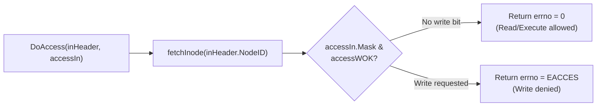

The constant `accessWOK = syscall.S_IWOTH` represents the write permission bit [examples/fission-s3rofs/main.go:69-71]()

**Sources:** [examples/fission-s3rofs/callbacks.go:750-767]()

### DoInit: FUSE Initialization Handshake

Negotiates FUSE capabilities and signals read-only mode:

**Init Flags Set:**
- `InitFlagsAsyncRead`: Enable async read-ahead
- `InitFlagsFileOps`: File-level operations supported
- `InitFlagsDoReadDirPlus`: Support enhanced directory listing
- `InitFlagsReaddirplusAuto`: Kernel auto-uses DoReadDirPlus
- `InitFlagsParallelDirops`: Concurrent directory operations allowed
- `InitFlagsMaxPages`: Support multi-page (up to 256 pages = 1MB) transfers
- `InitFlagsNoOpendirSupport`: No separate opendir implementation needed
- `InitFlagsExplicitInvalData`: Explicit data invalidation

The `maxWrite = 0` signal indicates the volume is read-only [examples/fission-s3rofs/main.go:52]()

**Sources:** [examples/fission-s3rofs/callbacks.go:553-573](), [examples/fission-s3rofs/main.go:37-52]()

---

## Cache Architecture Overview

The two-tier caching system optimizes S3 access patterns by keeping frequently-accessed data in RAM with a disk-backed second tier for overflow.

### Cache Hierarchy

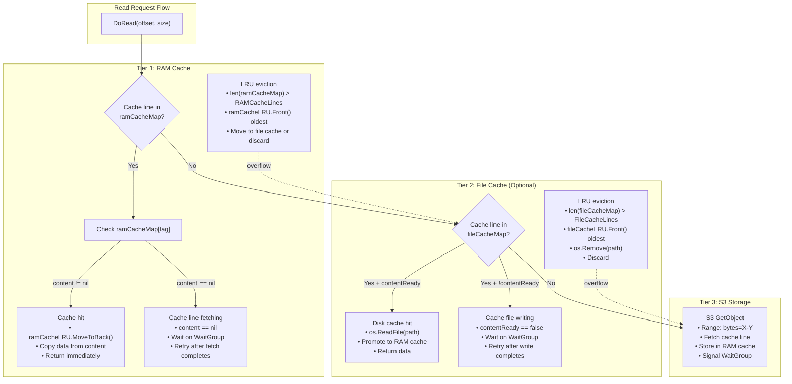

**Cache Sizing Strategy:**

| Cache Tier | Configuration | Size Formula | Eviction |
|------------|---------------|--------------|----------|
| RAM Cache | `RAMCacheLines` (required > 0) | `RAMCacheLines * CacheLineSize` bytes | LRU from front of `ramCacheLRU` |
| File Cache | `FileCacheLines` (optional, 0 = disabled) | `FileCacheLines * CacheLineSize` bytes | LRU from front of `fileCacheLRU` + disk cleanup |

**Concurrency Pattern:**

1. **Global Mutex**: `globals.sync.Mutex` protects all cache map and LRU list modifications
2. **Per-Line WaitGroup**: Each `ramCacheLineStruct` and `fileCacheLineStruct` has an embedded `sync.WaitGroup`:
   - Incremented before marking `content = nil` (RAM) or `contentReady = false` (file)
   - Decremented after population completes
   - Other goroutines `Wait()` on it to avoid duplicate fetches

**Sources:** [examples/fission-s3rofs/main.go:110-127](), [examples/fission-s3rofs/callbacks.go:300-472]()

### fetchCacheLine: S3 Range Request

The core cache miss handler fetches a single cache line from S3:

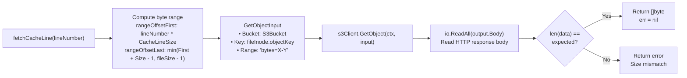

**Range Request Optimization:**

The S3 `Range` header allows fetching only the required bytes, reducing bandwidth and latency. For a 1GB file with 1MB cache lines:
- Full object fetch: 1GB transfer
- Range fetch (single line): 1MB transfer

This is especially important for large objects where only a small portion is accessed.

**Sources:** [examples/fission-s3rofs/callbacks.go:219-256]()

---

## Configuration Example

Here is a complete configuration file example:

```json
{
  "MountPoint": "/mnt/s3data",
  "S3AccessKey": "",
  "S3SecretKey": "",
  "S3Endpoint": "https://s3.us-west-2.amazonaws.com",
  "S3Region": "us-west-2",
  "S3Attempts": 10,
  "S3Backoff": 120,
  "S3Bucket": "my-data-bucket",
  "S3Prefix": "dataset/v1/",
  "FileCacheLines": 1000,
  "RAMCacheLines": 100,
  "CacheLineSize": 1048576
}
```

**Cache Configuration Analysis:**

With the above settings:
- **RAM Cache**: 100 lines × 1MB = 100MB memory
- **File Cache**: 1000 lines × 1MB = 1GB disk space (in temp directory)
- **Total**: Up to 1.1GB of cached data (100MB RAM + 1GB disk)

**Tuning Guidelines:**

| Workload | RAMCacheLines | FileCacheLines | CacheLineSize |
|----------|---------------|----------------|---------------|
| Sequential reads | Small (10-50) | Large (1000+) | Large (4MB-16MB) |
| Random access | Large (100-500) | Medium (100-500) | Small (256KB-1MB) |
| Memory-constrained | Small (10-20) | Large (1000+) | Medium (1MB) |
| Disk-constrained | Large (200-1000) | 0 (disabled) | Medium (1MB) |

**Sources:** [examples/fission-s3rofs/main.go:82-98](), [examples/fission-s3rofs/main.go:171-198]()

---

## Constants and Defaults

The filesystem uses several compile-time constants for FUSE behavior:

| Constant | Value | Description |
|----------|-------|-------------|
| `maxPages` | 256 | Max pages per transfer (256 × 4KB = 1MB) |
| `maxRead` | 1048576 | Max read size (1MB) |
| `maxWrite` | 0 | Indicates read-only (no writes allowed) |
| `attrBlkSize` | 512 | Block size reported in attributes |
| `entryValidSec` | 10 | Directory entry cache validity (seconds) |
| `attrValidSec` | 10 | Attribute cache validity (seconds) |
| `dirMode` | 0040555 | Directory permissions (dr-xr-xr-x) |
| `fileMode` | 0100444 | File permissions (-r--r--r--) |
| `attrUID` | 0 | Owner UID (root) |
| `attrGID` | 0 | Owner GID (root) |

**Sources:** [examples/fission-s3rofs/main.go:32-79]()

---

## Error Handling and Logging

All errors are logged and result in process termination via `globals.logger.Fatalf()`. This fail-fast approach ensures data consistency by preventing operation on corrupted state:

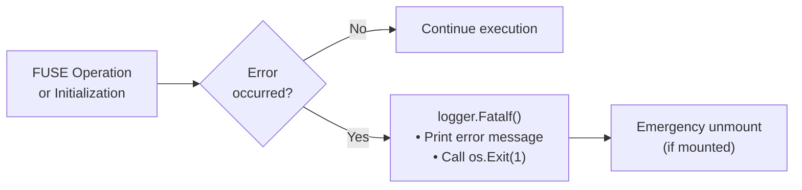

**Common Fatal Error Scenarios:**

1. **Configuration errors**: Invalid JSON, missing required fields, invalid cache sizes
2. **S3 errors**: Connection failures, authentication errors, ListObjectsV2 failures
3. **FUSE mount errors**: Mount point doesn't exist, permission denied, already mounted
4. **Cache errors**: TempDir creation failure, disk full during file cache writes
5. **Invariant violations**: Inode table corruption, dirTable operation failures

The `errChan` receives errors from the background `/dev/fuse` reader goroutine, allowing the main goroutine to detect unexpected FUSE disconnections [examples/fission-s3rofs/main.go:457-463]()

**Sources:** [examples/fission-s3rofs/main.go:201-476]()

---

## Shutdown and Cleanup

Graceful shutdown is triggered by signals (SIGINT, SIGTERM, SIGHUP):

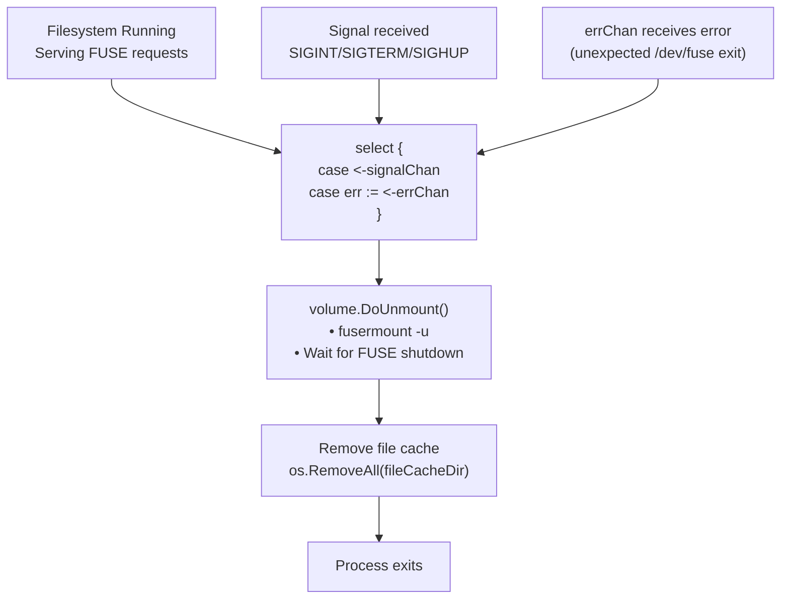

**Cleanup Steps:**

1. **FUSE Unmount**: `volume.DoUnmount()` executes `fusermount -u` to disconnect the kernel FUSE connection [examples/fission-s3rofs/main.go:465-468]()
2. **File Cache Removal**: `os.RemoveAll(globals.fileCacheDir)` deletes the temporary directory and all cached files [examples/fission-s3rofs/main.go:470-475]()
3. **Exit**: Process terminates cleanly

**Note:** RAM cache cleanup is handled automatically by Go's garbage collector once the process exits.

**Sources:** [examples/fission-s3rofs/main.go:454-476]()

---

## Performance Characteristics

The `fission-s3rofs` design makes specific performance tradeoffs:

| Aspect | Characteristics | Implications |
|--------|-----------------|--------------|
| **Mount Time** | O(N) where N = object count | Slow mounts for large buckets; all ListObjectsV2 calls upfront |
| **Memory Usage** | O(N) where N = object count | One inode per object/directory; grows with dataset size |
| **Lookup Performance** | O(log M) where M = directory size | LLRB tree lookups in dirTable |
| **Read Performance** | O(1) for cached; O(network) for cache miss | LRU cache minimizes S3 fetches |
| **Cache Eviction** | O(1) LRU removal | Linked list front/back operations |
| **Concurrency** | Single global mutex | Simple but may bottleneck under high concurrency |
| **Consistency** | Snapshot at mount time | Changes to S3 after mount not visible |

**Scalability Limits:**

- **Object Count**: Tested with millions of objects; limited by available RAM for inode table
- **File Size**: No limit; cache line granularity allows efficient large file access
- **Concurrent Readers**: Good; cache contention is the main bottleneck
- **Directory Size**: O(log N) lookups scale well; large flat directories perform better than traditional filesystems

**Sources:** [examples/fission-s3rofs/main.go:315-425](), [examples/fission-s3rofs/callbacks.go:258-477]()

---

## Comparison with fission-swiftfs

Both `fission-s3rofs` and `fission-swiftfs` (see [3.3](#3.3)) provide read-only cloud storage filesystems, but differ in several key aspects:

| Feature | fission-s3rofs | fission-swiftfs |
|---------|----------------|-----------------|
| **Backend** | Amazon S3 | OpenStack Swift |
| **Authentication** | Static credentials | Token-based (3 modes) |
| **Mount Enumeration** | Full object list (ListObjectsV2) | Full object list (container listing) |
| **Cache Tiers** | 2 (RAM + disk) | 1 (RAM only) |
| **Cache Eviction** | LRU with WaitGroup | LRU with WaitGroup |
| **Attribute Fetching** | Eager (at mount) | Lazy (on DoGetAttr) |
| **Range Requests** | S3 GetObject Range header | HTTP Range header |
| **Retry Logic** | AWS SDK built-in | Custom 401 retry loop |
| **Token Refresh** | N/A | Automatic on 401 response |

Both implementations share the read-only design pattern and cache-line-based optimization strategy, demonstrating the versatility of the fission library for different cloud storage backends.

**Sources:** [examples/fission-s3rofs/main.go:1-510](), [examples/fission-s3rofs/callbacks.go:1-937]()

---

