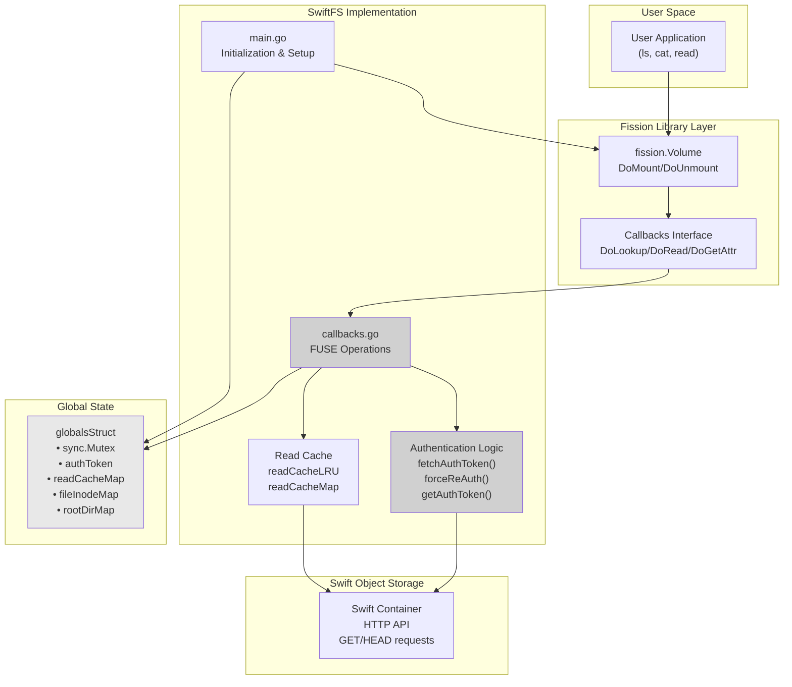
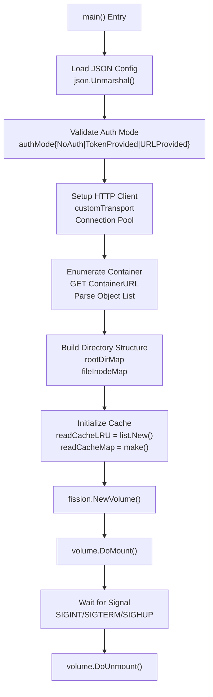
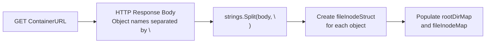
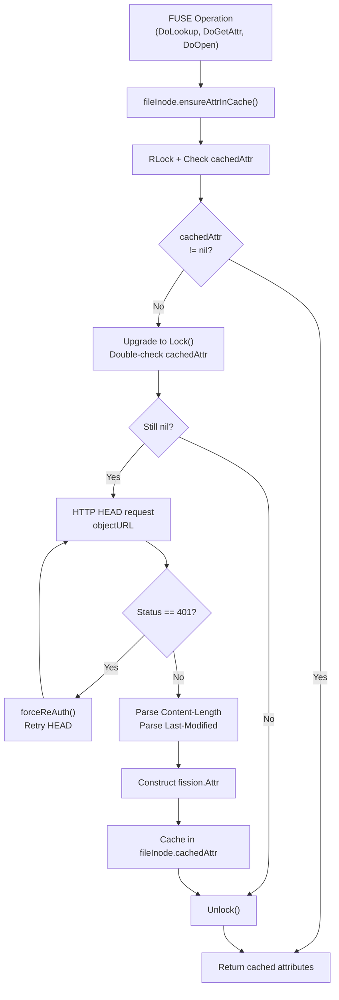
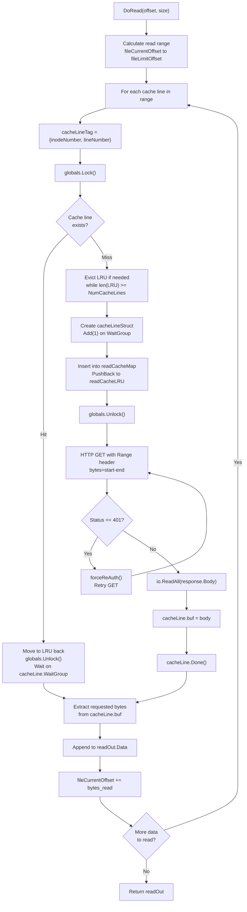
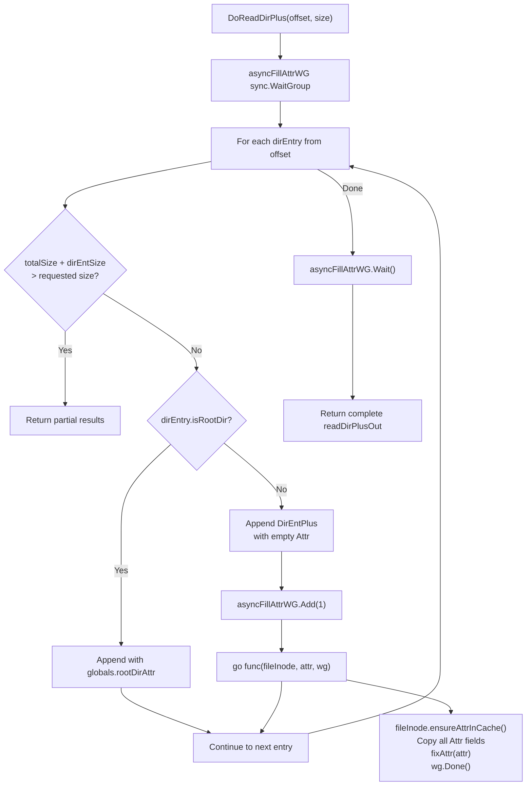
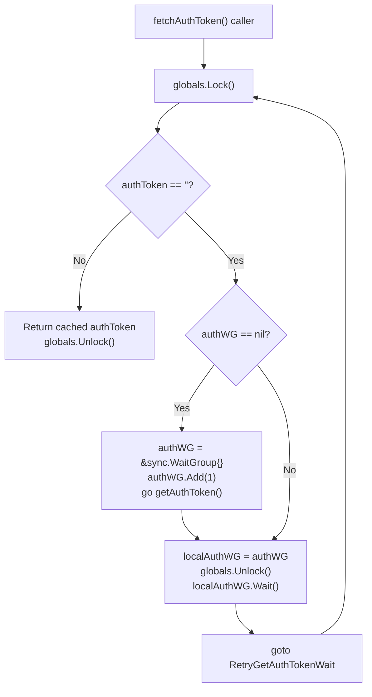
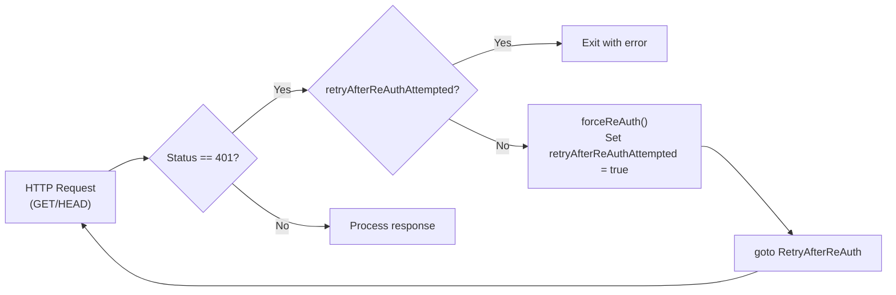
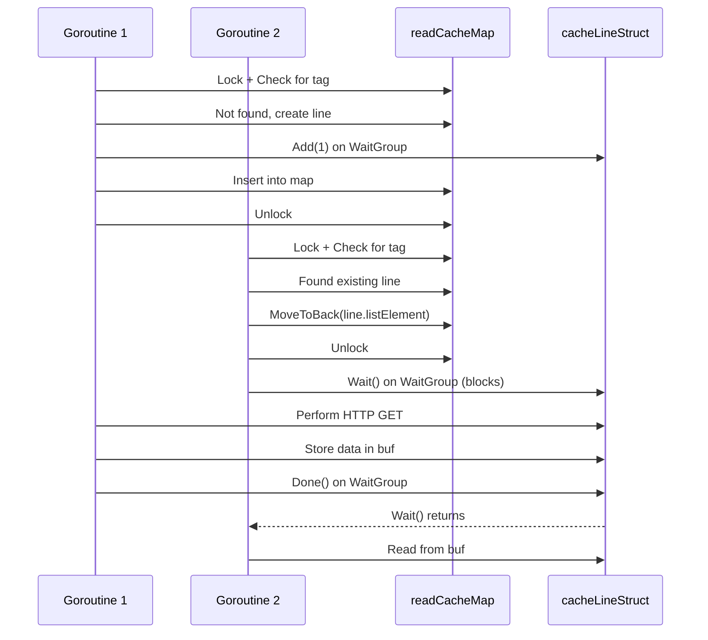

<!-- source: DeepWiki mcp.deepwiki.com · repo NVIDIA/fission · page 3.3 fission-swiftfs: Swift Object Storage Filesystem · fetched 2026-10-26 -->

# fission-swiftfs: Swift Object Storage Filesystem

<details>
<summary>Relevant source files</summary>

The following files were used as context for generating this wiki page:

- [examples/fission-swiftfs/callbacks.go](examples/fission-swiftfs/callbacks.go)
- [examples/fission-swiftfs/main.go](examples/fission-swiftfs/main.go)

</details>


## Purpose and Scope

This document describes **fission-swiftfs**, a read-only FUSE filesystem implementation that mounts OpenStack Swift object storage containers. The filesystem enumerates all objects at mount time to construct a flat directory structure, implements single-tier RAM caching for read operations, and supports three authentication modes for Swift API access. For detailed information on authentication mechanisms, see [SwiftFS Authentication and Token Management](#3.3.1). For cache implementation details, see [SwiftFS Cache and Concurrent Operations](#3.3.2).

**Sources:** [examples/fission-swiftfs/main.go:1-572](), [examples/fission-swiftfs/callbacks.go:1-969]()

---

## System Architecture

### High-Level Design

The fission-swiftfs implementation follows a read-only filesystem pattern where all objects in a Swift container are exposed as files in a single flat directory. The system performs object enumeration once at mount time and caches file attributes lazily on first access.



**Diagram: fission-swiftfs System Architecture**

**Sources:** [examples/fission-swiftfs/main.go:100-118](), [examples/fission-swiftfs/callbacks.go:1-19]()

---

## Configuration and Initialization

### Configuration Structure

The filesystem is configured via a JSON file that defines the mount point, Swift container URL, authentication parameters, HTTP client settings, and cache parameters.

| Configuration Field | Type | Purpose |
|-------------------|------|---------|
| `MountPoint` | string | Path to empty directory for mounting |
| `ContainerURL` | string | Swift container URL (account/container) |
| `AuthURL` | string | Swift authentication endpoint (optional) |
| `AuthUser` | string | Authentication username (optional) |
| `AuthKey` | string | Authentication key/password (optional) |
| `AuthToken` | string | Pre-obtained auth token (optional) |
| `SwiftTimeout` | string | HTTP client timeout (time.Duration format) |
| `SwiftConnectionPoolSize` | uint64 | Max HTTP connections to Swift |
| `NumCacheLines` | uint64 | Number of cache lines to enable |
| `CacheLineSize` | uint64 | Maximum size of each cache line |

**Sources:** [examples/fission-swiftfs/main.go:62-73]()

### Initialization Flow



**Diagram: Initialization Sequence**

The initialization process performs all object enumeration at mount time, creating a complete directory listing before the filesystem becomes available.

**Sources:** [examples/fission-swiftfs/main.go:122-430]()

### Object Enumeration

At mount time, the system performs a GET request to the container URL to retrieve all object names:



**Diagram: Container Object Enumeration**

Each object name becomes a `dirEntryStruct` in the `rootDirMap` (a sorted B-tree) and a `fileInodeStruct` in the `fileInodeMap` (a hash map). The filesystem assigns sequential inode numbers starting from 2 (inode 1 is reserved for the root directory).

**Sources:** [examples/fission-swiftfs/main.go:250-397]()

---

## Key Data Structures

### globalsStruct

The `globalsStruct` contains all filesystem state and is protected by a `sync.Mutex`:

```mermaid
graph TB
    globalsStruct["globalsStruct"]
    
    subgraph "Synchronization"
        Mutex["sync.Mutex<br/>Protects authToken & cache"]
        AuthWG["authWG *sync.WaitGroup<br/>Token fetch coordination"]
    end
    
    subgraph "Configuration"
        Config["config *configStruct"]
        AuthMode["authMode uint8"]
        AuthToken["authToken string"]
    end
    
    subgraph "Swift Client"
        HTTPClient["httpClient *http.Client"]
        Timeout["swiftTimeout time.Duration"]
    end
    
    subgraph "Filesystem State"
        RootDirAttr["rootDirAttr *fission.Attr"]
        RootDirMap["rootDirMap sortedmap.LLRBTree"]
        FileInodeMap["fileInodeMap map[uint64]*fileInodeStruct"]
    end
    
    subgraph "Cache State"
        ReadCacheLRU["readCacheLRU *list.List"]
        ReadCacheMap["readCacheMap map[cacheLineTagStruct]*cacheLineStruct"]
    end
    
    subgraph "Volume"
        Volume["volume fission.Volume"]
        ErrChan["errChan chan error"]
    end
    
    globalsStruct --> Mutex
    globalsStruct --> AuthWG
    globalsStruct --> Config
    globalsStruct --> AuthMode
    globalsStruct --> AuthToken
    globalsStruct --> HTTPClient
    globalsStruct --> Timeout
    globalsStruct --> RootDirAttr
    globalsStruct --> RootDirMap
    globalsStruct --> FileInodeMap
    globalsStruct --> ReadCacheLRU
    globalsStruct --> ReadCacheMap
    globalsStruct --> Volume
    globalsStruct --> ErrChan
```

**Diagram: globalsStruct Data Structure**

**Sources:** [examples/fission-swiftfs/main.go:100-118]()

### fileInodeStruct

Each file object is represented by a `fileInodeStruct` with lazy attribute loading:

| Field | Type | Purpose |
|-------|------|---------|
| `sync.RWMutex` | embedded | Protects `cachedAttr` |
| `objectName` | string | Swift object name (1:1 mapping, no hard links) |
| `inodeNumber` | uint64 | FUSE inode number |
| `cachedAttr` | *fission.Attr | Lazily loaded file attributes (nil until first access) |

The `RWMutex` allows concurrent reads of cached attributes while ensuring exclusive access during the initial HEAD request.

**Sources:** [examples/fission-swiftfs/main.go:81-86]()

### cacheLineStruct

Cache lines use embedded `sync.WaitGroup` to prevent duplicate fetches:

| Field | Type | Purpose |
|-------|------|---------|
| `sync.WaitGroup` | embedded | Coordinates concurrent access to the same cache line |
| `listElement` | *list.Element | Position in LRU list |
| `tag` | cacheLineTagStruct | Cache key (inodeNumber + lineNumber) |
| `buf` | []byte | Cached data (length ≤ CacheLineSize) |

When multiple goroutines request the same cache line, only the first performs the HTTP GET. Others wait on the WaitGroup until data is available.

**Sources:** [examples/fission-swiftfs/main.go:93-98](), [examples/fission-swiftfs/callbacks.go:391-492]()

---

## Filesystem Operations

### Read-Only Operation Set

The filesystem implements a minimal set of operations for read-only access:

| Operation | Implementation | Notes |
|-----------|---------------|-------|
| `DoLookup` | Full | Returns attributes for named file |
| `DoGetAttr` | Full | Returns inode attributes (lazy load for files) |
| `DoOpen` | Full | Sets `FOpenResponseDirectIO` flag |
| `DoRead` | Full | Cache-based with HTTP Range requests |
| `DoReadDir` | Full | Enumerates directory entries |
| `DoReadDirPlus` | Full | Enumerates with concurrent attribute fetching |
| `DoAccess` | Full | Validates permissions (read/execute only) |
| `DoStatFS` | Partial | Returns zeroed statistics (TODO: implement) |
| All write ops | ENOSYS | `DoWrite`, `DoMkDir`, `DoUnlink`, etc. |

**Sources:** [examples/fission-swiftfs/callbacks.go:147-969]()

### Lazy Attribute Loading

File attributes are loaded on-demand via HEAD requests to avoid unnecessary network calls during directory enumeration:



**Diagram: Lazy Attribute Loading Flow**

The double-check pattern after lock upgrade prevents race conditions when multiple goroutines request attributes simultaneously.

**Sources:** [examples/fission-swiftfs/callbacks.go:26-145]()

### Read Operation with Range Requests

The `DoRead` implementation uses cache lines aligned to `CacheLineSize` boundaries:



**Diagram: DoRead Cache-Based Implementation**

The Range header format is `bytes=start-end` (inclusive), requesting exactly one cache line worth of data per HTTP GET. Cache lines are evicted from the front of the LRU list when capacity is exceeded.

**Sources:** [examples/fission-swiftfs/callbacks.go:344-512]()

### Concurrent Directory Listing

`DoReadDirPlus` optimizes attribute fetching by spawning goroutines for concurrent HEAD requests:



**Diagram: DoReadDirPlus Concurrent Attribute Fetching**

This concurrent approach significantly reduces latency for `ls -l` operations by parallelizing HEAD requests for all files in the directory. Each goroutine writes directly to its assigned `Attr` struct in the output slice, avoiding synchronization overhead.

**Sources:** [examples/fission-swiftfs/callbacks.go:790-953]()

---

## Authentication Modes

The filesystem supports three authentication modes, configured at startup:

| Mode | Constant | Configuration Requirements | Token Management |
|------|----------|---------------------------|------------------|
| No Auth | `authModeNoAuthNeeded` | No auth fields provided | None |
| Token Provided | `authModeTokenProvided` | Only `AuthToken` provided | Static token from config |
| URL Provided | `authModeURLProvided` | `AuthURL`, `AuthUser`, `AuthKey` provided | Dynamic fetch and refresh |

**Sources:** [examples/fission-swiftfs/main.go:57-60](), [examples/fission-swiftfs/main.go:181-203]()

### Token Fetch Coordination

For `authModeURLProvided`, the `fetchAuthToken()` function ensures only one goroutine performs token fetching at a time:



**Diagram: Token Fetch Coordination Pattern**

This pattern prevents thundering herd problems when multiple FUSE operations need authentication simultaneously. Only the first caller spawns `getAuthToken()`; others wait on the WaitGroup.

**Sources:** [examples/fission-swiftfs/main.go:432-461]()

### Retry-on-401 Pattern

All HTTP operations that receive `http.StatusUnauthorized` trigger re-authentication:



**Diagram: Retry-on-401 Authentication Pattern**

This pattern allows the filesystem to automatically recover from expired tokens without requiring remount. The `retryAfterReAuthAttempted` flag prevents infinite retry loops.

**Sources:** [examples/fission-swiftfs/callbacks.go:58-103](), [examples/fission-swiftfs/callbacks.go:430-484](), [examples/fission-swiftfs/main.go:463-478]()

---

## Cache Implementation

### Cache Line Alignment

Reads are served from cache lines aligned to `CacheLineSize` boundaries:

```
Object: [----------------------------- File Content ---------------------------------]
        0                                                                       Size

Cache Lines:
        [---Line 0---][---Line 1---][---Line 2---][---Line 3---][---Line 4---]
        0             CacheLineSize  2*CLS          3*CLS          4*CLS

Read Request (offset=1500, size=5000):
                [--- Requested Range ---]
        Line 0: [partial]
        Line 1: [complete]
        Line 2: [complete]
        Line 3: [partial]
```

Each cache line's `lineNumber` is calculated as `offset / CacheLineSize`. The HTTP Range request fetches `bytes=lineStart-lineEnd` (inclusive).

**Sources:** [examples/fission-swiftfs/callbacks.go:391-508]()

### LRU Eviction

The cache uses a doubly-linked list (`container/list`) for LRU tracking:

| Operation | List Method | Purpose |
|-----------|-------------|---------|
| Cache Hit | `MoveToBack(element)` | Mark as most recently used |
| Cache Miss | `PushBack(cacheLine)` | Add new entry as MRU |
| Eviction | `Remove(Front())` | Remove least recently used |

The back of the list is the most recently used (MRU), and the front is the least recently used (LRU). When `len(readCacheLRU) >= NumCacheLines`, entries are removed from the front.

**Sources:** [examples/fission-swiftfs/callbacks.go:399-416]()

### WaitGroup Coordination

The embedded `sync.WaitGroup` in `cacheLineStruct` prevents duplicate fetches:



**Diagram: WaitGroup-Based Concurrent Fetch Prevention**

This ensures that when multiple goroutines need the same cache line simultaneously, only one performs the expensive HTTP GET operation.

**Sources:** [examples/fission-swiftfs/callbacks.go:395-492]()

---

## Constants and Flags

### FUSE Init Flags

The `DoInit` callback returns read-only flags optimized for Swift access:

```go
initOutFlagsReadOnly = 
    fission.InitFlagsAsyncRead |         // Enable async read operations
    fission.InitFlagsFileOps |           // File operations supported
    fission.InitFlagsDoReadDirPlus |     // DoReadDirPlus implemented
    fission.InitFlagsReaddirplusAuto |   // Auto-use ReadDirPlus
    fission.InitFlagsParallelDirops |    // Allow concurrent directory ops
    fission.InitFlagsMaxPages |          // Support maxPages parameter
    fission.InitFlagsNoOpendirSupport |  // No OpenDir handle tracking
    fission.InitFlagsExplicitInvalData   // Explicit data invalidation
```

**Sources:** [examples/fission-swiftfs/main.go:31-39]()

### File Mode Constants

| Constant | Value | Description |
|----------|-------|-------------|
| `dirMode` | `S_IFDIR \| 0555` | Directory: read and execute for all |
| `fileMode` | `S_IFREG \| 0444` | Regular file: read-only for all |
| `maxRead` | `1048576` (1 MiB) | Maximum read request size |
| `maxWrite` | `0` | Indicates read-only mount |
| `attrBlkSize` | `512` | Block size for attribute reporting |

**Sources:** [examples/fission-swiftfs/main.go:44-56]()

---

## Error Handling

The implementation uses a fail-fast approach for critical errors:

| Error Type | Handling |
|-----------|----------|
| Configuration errors | `fmt.Printf() + os.Exit(1)` during init |
| HTTP client errors | `fmt.Printf() + os.Exit(1)` |
| Authentication failures | `fmt.Printf() + os.Exit(1)` after one retry |
| FUSE operation errors | Return appropriate `syscall.Errno` |
| Unsupported operations | Return `syscall.ENOSYS` |

**Sources:** [examples/fission-swiftfs/main.go:168-180](), [examples/fission-swiftfs/callbacks.go:62-108]()

---

## Usage Pattern

Typical invocation:

```bash
./fission-swiftfs config.json
```

Where `config.json` contains:

```json
{
  "MountPoint": "/mnt/swift",
  "ContainerURL": "http://swift.example.com:8080/v1/AUTH_account/container",
  "AuthURL": "http://swift.example.com:8080/auth/v1.0",
  "AuthUser": "account:user",
  "AuthKey": "password",
  "SwiftTimeout": "30s",
  "SwiftConnectionPoolSize": 64,
  "NumCacheLines": 1024,
  "CacheLineSize": 65536
}
```

The filesystem remains mounted until receiving SIGINT, SIGTERM, or SIGHUP.

**Sources:** [examples/fission-swiftfs/main.go:145-166](), [examples/fission-swiftfs/main.go:414-429]()

---

