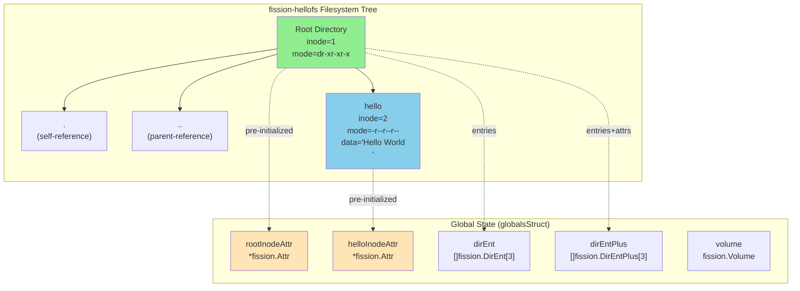
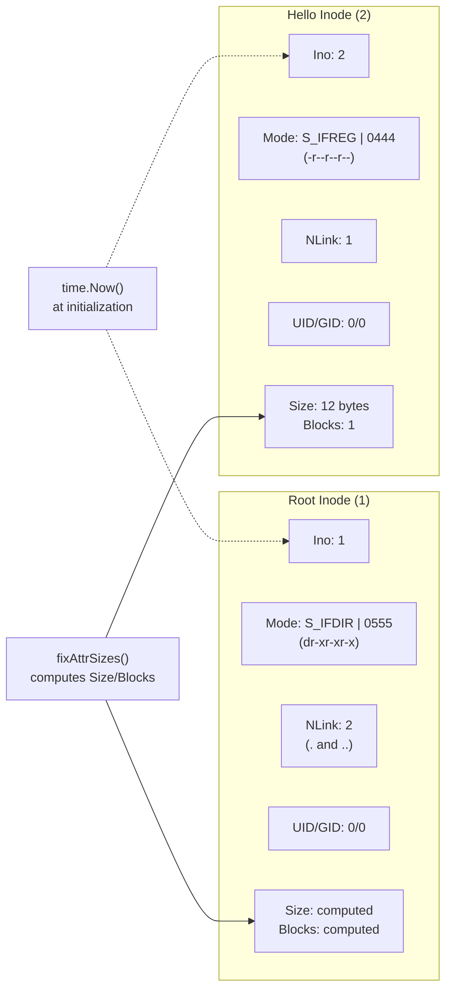
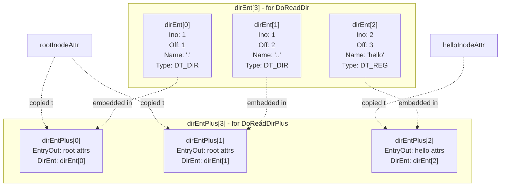
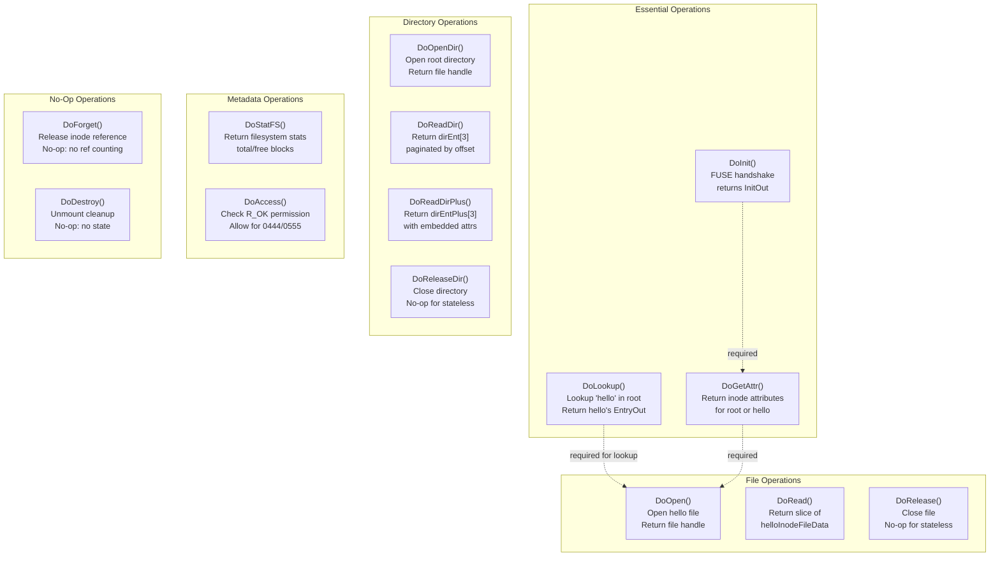
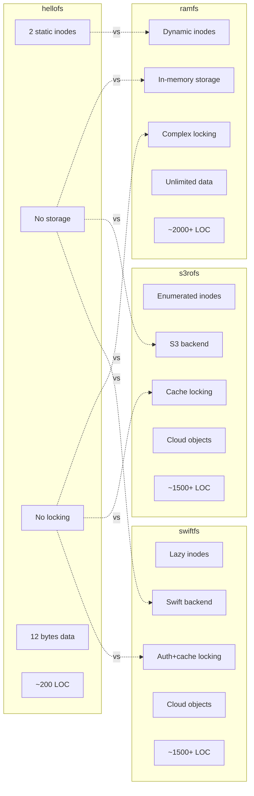

<!-- source: DeepWiki mcp.deepwiki.com · repo NVIDIA/fission · page 3.4 fission-hellofs: Minimal Example · fetched 2026-10-26 -->

# fission-hellofs: Minimal Example

<details>
<summary>Relevant source files</summary>

The following files were used as context for generating this wiki page:

- [api.go](api.go)
- [examples/fission-hellofs/main.go](examples/fission-hellofs/main.go)

</details>


## Purpose and Scope

This page documents `fission-hellofs`, the simplest possible FUSE filesystem implementation in the fission repository. It serves as a learning tool to understand the minimum requirements for implementing the `Callbacks` interface and demonstrates the core concepts without the complexity of real storage backends, caching, or concurrency management.

For full-featured filesystem implementations, see [fission-ramfs: Full-Featured In-Memory Filesystem](#3.1), [fission-s3rofs: S3-Backed Read-Only Filesystem](#3.2), or [fission-swiftfs: Swift Object Storage Filesystem](#3.3). For details on the `Callbacks` interface itself, see [API Design and Interfaces](#2.1).

**Sources:** [examples/fission-hellofs/main.go:1-296]()

---

## Architecture Overview

`fission-hellofs` presents the absolute minimum filesystem structure: a root directory containing a single file with static content. No dynamic state, no storage backend, and no concurrency primitives are required.

### Filesystem Structure Diagram



**Key Characteristics:**
- **2 inodes total**: root directory (`rootInodeIno=1`) and hello file (`helloInodeIno=2`)
- **Read-only**: `maxWrite=0` prevents all write operations
- **Static data**: All attributes and content are hardcoded at initialization
- **No storage backend**: Data exists only as byte slices in memory

**Sources:** [examples/fission-hellofs/main.go:19-56](), [examples/fission-hellofs/main.go:59-71]()

---

## Static Data Structures

The filesystem's entire state is pre-initialized in the `globalsStruct` and never modified during runtime.

### globalsStruct Definition

| Field | Type | Purpose |
|-------|------|---------|
| `programPath` | `string` | Executable path (from `os.Args[0]`) |
| `mountPoint` | `string` | Mount point directory path |
| `programName` | `string` | Base name of executable |
| `volumeName` | `string` | Volume name (base name of mount point) |
| `logger` | `*log.Logger` | Logging output |
| `errChan` | `chan error` | Error channel for volume lifecycle |
| `rootInodeAttr` | `*fission.Attr` | Pre-initialized root directory attributes |
| `helloInodeAttr` | `*fission.Attr` | Pre-initialized hello file attributes |
| `dirEnt` | `[]fission.DirEnt` | Directory entries for `DoReadDir` |
| `dirEntPlus` | `[]fission.DirEntPlus` | Directory entries with attributes for `DoReadDirPlus` |
| `volume` | `fission.Volume` | FUSE volume instance |

**Sources:** [examples/fission-hellofs/main.go:59-71]()

### Inode Attribute Initialization

Both inodes are initialized with identical timestamps and fixed permissions:



**Root Inode Setup:**
- [examples/fission-hellofs/main.go:100-114](): Creates `rootInodeAttr` with `S_IFDIR | 0555` permissions
- `NLink=2` reflects `.` and `..` entries
- Size and block count computed by `fixAttrSizes()`

**Hello Inode Setup:**
- [examples/fission-hellofs/main.go:118-133](): Creates `helloInodeAttr` with `S_IFREG | 0444` permissions
- `Size=len(helloInodeFileData)` = 12 bytes ("Hello World\n")
- `NLink=1` as it's a regular file with one directory entry

**Sources:** [examples/fission-hellofs/main.go:98-135]()

---

## Directory Entry Pre-computation

To avoid any dynamic allocation during callback execution, all directory entries are pre-built at initialization.

### Directory Entry Structure



**Key Design Points:**
- **Offset field (`Off`)**: Sequential integers (1, 2, 3) used as opaque position markers for pagination
- **`dirEnt` array**: Used by `DoReadDir` callback for basic directory listing
- **`dirEntPlus` array**: Used by `DoReadDirPlus` callback, includes full inode attributes to avoid subsequent `DoGetAttr` calls
- **Static allocation**: All three entries created once at initialization

**Sources:** [examples/fission-hellofs/main.go:137-247]()

---

## Initialization and Volume Mounting

### Main Function Flow

```mermaid
graph TB
    Start["main() entry"]
    Args["Parse os.Args<br/>Require 1 arg: mount_point"]
    GlobalsInit["Initialize globals<br/>programPath, mountPoint<br/>programName, volumeName"]
    Logger["Create logger<br/>log.New(os.Stdout)"]
    ErrChan["Create errChan<br/>chan error, buffer=1"]
    
    TimeNow["Get current time<br/>unixTimeNow()"]
    RootInit["Initialize rootInodeAttr<br/>with S_IFDIR | 0555"]
    FixRoot["fixAttrSizes(rootInodeAttr)<br/>compute Size/Blocks"]
    HelloInit["Initialize helloInodeAttr<br/>with S_IFREG | 0444"]
    FixHello["fixAttrSizes(helloInodeAttr)<br/>compute Size/Blocks"]
    
    DirEntInit["Build dirEnt[3]<br/>., .., hello"]
    DirEntPlusInit["Build dirEntPlus[3]<br/>with full attributes"]
    
    NewVolume["fission.NewVolume()<br/>volumeName, mountPoint<br/>fuseSubtype, maxRead=1MiB<br/>maxWrite=0, callbacks=&globals"]
    DoMount["volume.DoMount()<br/>Start FUSE loop"]
    
    Signal["Wait for signal<br/>SIGINT/SIGTERM/SIGHUP<br/>or errChan"]
    DoUnmount["volume.DoUnmount()<br/>Stop FUSE loop"]
    Exit["os.Exit(0)"]
    
    Start --> Args
    Args --> GlobalsInit
    GlobalsInit --> Logger
    Logger --> ErrChan
    ErrChan --> TimeNow
    
    TimeNow --> RootInit
    RootInit --> FixRoot
    FixRoot --> HelloInit
    HelloInit --> FixHello
    
    FixHello --> DirEntInit
    DirEntInit --> DirEntPlusInit
    
    DirEntPlusInit --> NewVolume
    NewVolume --> DoMount
    DoMount --> Signal
    Signal --> DoUnmount
    DoUnmount --> Exit
```



**Sources:** [examples/fission-hellofs/main.go:75-273]()

### Constants and Configuration

| Constant | Value | Purpose |
|----------|-------|---------|
| `fuseSubtype` | `"fission-hellofs"` | Filesystem type string shown in `/proc/mounts` |
| `maxRead` | `1048576` (1 MiB) | Maximum read size (256 pages × 4096 bytes) |
| `maxWrite` | `0` | Zero indicates read-only mount |
| `rootInodeIno` | `1` | Root directory inode number (FUSE convention) |
| `helloInodeIno` | `2` | Hello file inode number |
| `attrBlkSize` | `512` | Block size reported in attributes |

**Init Flags:** [examples/fission-hellofs/main.go:22-32]() configures:
- `InitFlagsAsyncRead`: Enable asynchronous read operations
- `InitFlagsDoReadDirPlus`: Support optimized `READDIRPLUS` operation
- `InitFlagsParallelDirops`: Allow parallel directory operations
- `InitFlagsMaxPages`: Indicate support for large page counts

**Sources:** [examples/fission-hellofs/main.go:19-48]()

---

## Callback Implementation

The `globalsStruct` implements the `Callbacks` interface by providing methods for each FUSE operation. The actual callback implementations are not shown in the provided file (likely in a separate `callbacks.go` file in the same directory), but we can infer the minimal set required.

### Required Callbacks for Minimal Filesystem



**Minimal Implementation Strategy:**

1. **`DoInit`**: Return `InitOut` with `maxWrite=0` and configured flags
2. **`DoGetAttr`**: Switch on `inHeader.NodeID` to return either `rootInodeAttr` or `helloInodeAttr`
3. **`DoLookup`**: If `lookupIn.Name=="hello"` and `inHeader.NodeID==rootInodeIno`, return `helloInodeAttr` as `EntryOut`
4. **`DoOpenDir` / `DoReleaseDir`**: Return success with dummy file handle (no state tracking needed)
5. **`DoReadDir` / `DoReadDirPlus`**: Slice `dirEnt` or `dirEntPlus` array based on `readDirIn.Offset`
6. **`DoOpen` / `DoRelease`**: Return success for `helloInodeIno` (no file handle state needed)
7. **`DoRead`**: Return substring of `helloInodeFileData` based on `readIn.Offset` and `readIn.Size`
8. **All write operations**: Return `syscall.EROFS` (read-only filesystem)
9. **Unsupported operations**: Return `syscall.ENOSYS`

**Sources:** [api.go:39-83]()

---

## Read-Only Enforcement

The filesystem enforces read-only behavior through multiple mechanisms:

| Mechanism | Location | Effect |
|-----------|----------|--------|
| `maxWrite=0` | [examples/fission-hellofs/main.go:39]() | Tells kernel to mount filesystem read-only |
| Permissions | [examples/fission-hellofs/main.go:108,127]() | Root: `0555`, Hello: `0444` (no write bits) |
| Write callbacks | (inferred) | `DoWrite`, `DoSetAttr`, `DoMkDir`, etc. return `syscall.EROFS` |

---

## Comparison with Other Examples



### Feature Comparison Table

| Feature | hellofs | ramfs | s3rofs | swiftfs |
|---------|---------|-------|--------|---------|
| **Read operations** | ✓ | ✓ | ✓ | ✓ |
| **Write operations** | ✗ | ✓ | ✗ | ✗ |
| **Dynamic inodes** | ✗ | ✓ | ✗ (static at mount) | ✗ (lazy load) |
| **Storage backend** | None | In-memory | S3 | Swift |
| **Caching** | N/A | N/A | 2-tier (RAM+disk) | 1-tier (RAM) |
| **Concurrency** | None | Restart-based locks | Mutex + WaitGroup | Mutex + WaitGroup |
| **Extended attributes** | ✗ | ✓ | ✗ | ✗ |
| **Authentication** | N/A | N/A | AWS SDK | Token management |
| **Primary use case** | Learning | Testing | S3 mounting | Swift mounting |
| **Complexity (LOC)** | ~200 | ~2000+ | ~1500+ | ~1500+ |

**Key Insight:** `fission-hellofs` demonstrates that a functional FUSE filesystem requires:
- Implementing only ~10-15 callbacks (out of 40+ available)
- No dynamic memory allocation during runtime
- No concurrency primitives for a read-only, single-threaded design
- Minimal state management (just pre-initialized attributes)

**Sources:** [examples/fission-hellofs/main.go:1-296]()

---

## Usage Example

### Building and Running

```bash
# Build the binary
cd examples/fission-hellofs
go build -o fission-hellofs

# Create mount point
mkdir -p /tmp/hellofs-mount

# Run the filesystem
./fission-hellofs /tmp/hellofs-mount
```

### Filesystem Operations

```bash
# List directory contents
$ ls -la /tmp/hellofs-mount
total 1
dr-xr-xr-x  2 root root    0 Jan  1  1970 .
drwxrwxrwt 20 user user 4096 Jan 15 10:30 ..
-r--r--r--  1 root root   12 Jan  1  1970 hello

# Read file contents
$ cat /tmp/hellofs-mount/hello
Hello World

# Attempt write operation (fails)
$ echo "test" > /tmp/hellofs-mount/hello
bash: /tmp/hellofs-mount/hello: Read-only file system

# Unmount (via SIGINT or SIGTERM)
$ kill -SIGTERM $(pgrep fission-hellofs)
```

**Sources:** [examples/fission-hellofs/main.go:75-273]()

---

## Code Walkthrough: fixAttrSizes Helper

The `fixAttrSizes()` function computes derived fields in the `Attr` structure:

```go
// Inferred implementation based on usage pattern:
func fixAttrSizes(attr *fission.Attr) {
    // Set block size to 512 bytes (standard UNIX block size)
    attr.BlkSize = attrBlkSize
    
    // For directories: size is typically 0 or block-aligned
    // For files: size is already set to len(data)
    
    // Compute number of 512-byte blocks, rounding up
    attr.Blocks = (attr.Size + uint64(attrBlkSize) - 1) / uint64(attrBlkSize)
}
```

This ensures:
- `BlkSize` matches the constant `attrBlkSize=512`
- `Blocks` correctly reflects storage allocation for `stat(2)` reporting
- Both directory and file inodes have consistent block accounting

**Sources:** [examples/fission-hellofs/main.go:116,135]()

---

## Learning Path Recommendations

For developers learning the fission library:

1. **Start here (hellofs)**: Understand the minimal callback set and static data structures
2. **Study ramfs** ([3.1](#3.1)): Learn dynamic inode management and locking strategies  
3. **Study s3rofs** ([3.2](#3.2)): Understand caching, pagination, and external storage integration
4. **Study swiftfs** ([3.3](#3.3)): Learn authentication patterns and lazy loading techniques

**Next Steps:**
- Modify `helloInodeFileData` to return dynamic content (e.g., current timestamp)
- Add a second file with different content
- Implement basic directory creation (upgrade from read-only to read-write)
- Add file handle state tracking to support concurrent operations

**Sources:** [examples/fission-hellofs/main.go:1-296](), [api.go:39-83]()

---

