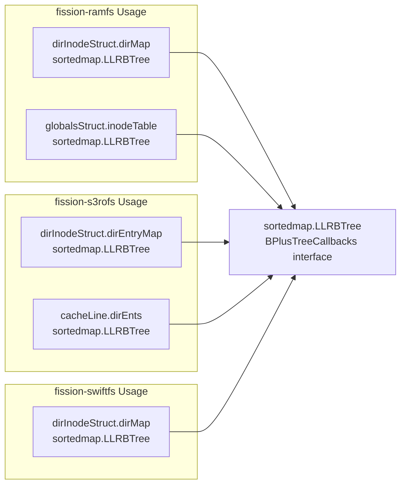
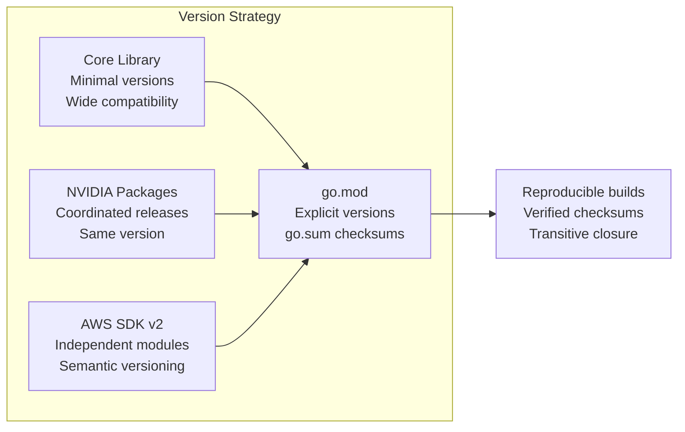
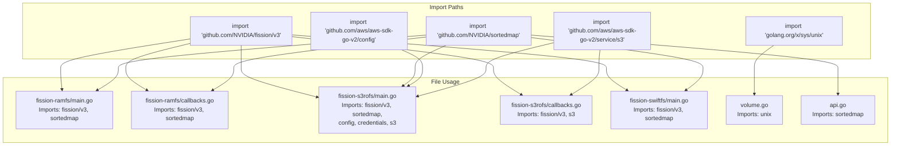

<!-- source: DeepWiki mcp.deepwiki.com · repo NVIDIA/fission · page 4 Dependencies and External Integrations · fetched 2026-10-26 -->

# Dependencies and External Integrations

<details>
<summary>Relevant source files</summary>

The following files were used as context for generating this wiki page:

- [go.mod](go.mod)
- [go.sum](go.sum)

</details>


## Purpose and Scope

This page documents the external dependencies used by the fission library and its example implementations. It explains the rationale behind dependency choices, version coordination, and integration patterns. The page covers both the minimal core library dependencies and the additional dependencies required by specific example implementations.

For detailed usage of AWS SDK v2 within the S3 filesystem, see [AWS SDK v2 Integration](#4.1). For sortedmap implementation details, see [sortedmap for Directory Management](#4.2). For build system configuration, see [Build System and Makefile Targets](#5.2).

---

## Overview

The fission library follows a **minimal dependency philosophy** for its core components, requiring only two external packages:

| Package | Version | Purpose | Used By |
|---------|---------|---------|---------|
| `github.com/NVIDIA/sortedmap` | v1.30.0 | Ordered directory entries using LLRB trees | Core + Examples |
| `golang.org/x/sys` | v0.13.0 | FUSE protocol syscalls and Unix interfaces | Core Library |

Example implementations add dependencies as needed for their specific backends. The most significant additional dependency is the AWS SDK v2 ecosystem, used exclusively by `fission-s3rofs`.

**Sources:** [go.mod:1-30]()

---

## Dependency Architecture

The following diagram shows the complete dependency graph with actual module paths and version numbers:

```mermaid
graph TB
    subgraph Core["fission/v3 Core Library"]
        api["api.go<br/>Volume & Callbacks interfaces"]
        volume["volume.go<br/>FUSE device communication"]
        callbacks["callbacks.go<br/>Protocol marshalling"]
    end
    
    subgraph NVIDIA["NVIDIA Package Ecosystem"]
        sortedmap["github.com/NVIDIA/sortedmap<br/>v1.30.0<br/>LLRB tree implementation"]
        cstruct["github.com/NVIDIA/cstruct<br/>v1.30.0<br/>Memory layout helpers"]
    end
    
    subgraph GoX["Go Extended Libraries"]
        sys["golang.org/x/sys<br/>v0.13.0<br/>unix package<br/>FUSE syscalls"]
    end
    
    subgraph AWS["AWS SDK v2 - Core"]
        awscore["aws-sdk-go-v2<br/>v1.21.2<br/>SDK framework"]
        config["config v1.19.1<br/>Configuration loading"]
        credentials["credentials v1.13.43<br/>Credential providers"]
        s3service["service/s3 v1.40.2<br/>S3 API client"]
    end
    
    subgraph AWSInternal["AWS SDK v2 - Internal"]
        smithy["smithy-go v1.15.0<br/>Code generation runtime"]
        configsources["internal/configsources<br/>v1.1.43"]
        endpoints["internal/endpoints/v2<br/>v2.4.37"]
        eventstream["aws/protocol/eventstream<br/>v1.4.14"]
        checksum["service/internal/checksum<br/>v1.1.38"]
        presignedurl["service/internal/presigned-url<br/>v1.9.37"]
        s3shared["service/internal/s3shared<br/>v1.15.6"]
        sso["service/sso v1.15.2"]
        ssooidc["service/ssooidc v1.17.3"]
        sts["service/sts v1.23.2"]
    end
    
    subgraph Examples["Example Implementations"]
        ramfs["fission-ramfs"]
        s3rofs["fission-s3rofs"]
        swiftfs["fission-swiftfs"]
        hellofs["fission-hellofs"]
    end
    
    %% Core dependencies
    volume --> sys
    api --> sortedmap
    callbacks --> sys
    
    %% NVIDIA internal
    sortedmap --> cstruct
    
    %% AWS dependencies
    awscore --> smithy
    config --> awscore
    config --> configsources
    config --> endpoints
    credentials --> awscore
    s3service --> awscore
    s3service --> eventstream
    s3service --> checksum
    s3service --> presignedurl
    s3service --> s3shared
    config --> sso
    config --> ssooidc
    config --> sts
    
    %% Example dependencies
    ramfs --> api
    ramfs --> sortedmap
    
    s3rofs --> api
    s3rofs --> sortedmap
    s3rofs --> config
    s3rofs --> credentials
    s3rofs --> s3service
    
    swiftfs --> api
    swiftfs --> sortedmap
    
    hellofs --> api
```



**Sources:** [go.mod:5-30]()

---

## Core Library Dependencies

### golang.org/x/sys - FUSE Protocol Support

The `golang.org/x/sys` package provides low-level Unix system call wrappers required for FUSE communication. The core library uses it for:

| Component | Package | Purpose |
|-----------|---------|---------|
| `volume.go` | `golang.org/x/sys/unix` | Reading/writing `/dev/fuse`, `Mount()`, `Unmount()`, `Ioctl()` |
| `callbacks.go` | `golang.org/x/sys/unix` | FUSE opcode constants, errno values |

**Key Usage Pattern:**
- Low-level file descriptor operations on `/dev/fuse`
- FUSE-specific constants (e.g., `FUSE_INIT`, `FUSE_GETATTR`)
- Unix error code translation

**Version Rationale:** v0.13.0 provides stable FUSE protocol definitions compatible with Linux kernel 5.x+ and macOS FUSE implementations.

**Sources:** [go.mod:11]()

---

### github.com/NVIDIA/sortedmap - Directory Entry Management

The `sortedmap` package implements a **Left-Leaning Red-Black (LLRB) tree** for maintaining ordered key-value collections. It is used extensively for directory entry storage.

**Performance Characteristics:**

| Operation | Time Complexity | Use Case |
|-----------|----------------|----------|
| Insert | O(log n) | Creating files/directories |
| Lookup | O(log n) | Name resolution in directories |
| Delete | O(log n) | Removing entries |
| Iteration | O(n) | `DoReadDir` listing |
| Ordered Range | O(log n + k) | Offset-based directory reads |

**Usage Across Examples:**



**Key Methods Used:**
- `BPlusTree()` - Create new sorted map
- `Put(key, value)` - Insert entry
- `GetByKey(key)` - Lookup by name
- `DeleteByKey(key)` - Remove entry
- `Len()` - Count entries
- `BisectLeft()` / `BisectRight()` - Offset-based access for pagination

**Sources:** [go.mod:6]()

---

### github.com/NVIDIA/cstruct - Indirect Dependency

The `cstruct` package is an indirect dependency of `sortedmap`, providing memory layout helpers for efficient binary serialization. The fission library does not directly import it.

**Version Coordination:** Both `sortedmap` and `cstruct` share version v1.30.0, indicating coordinated releases within the NVIDIA package family.

**Sources:** [go.mod:15]()

---

## AWS SDK v2 Ecosystem (fission-s3rofs Only)

The `fission-s3rofs` example uses AWS SDK v2 for accessing S3 buckets. The SDK is **not required** by the core library or other examples.

### Module Structure

```mermaid
graph TB
    subgraph Config["Configuration Layer"]
        config["config v1.19.1<br/>LoadDefaultConfig()<br/>WithRegion()"]
        ini["internal/ini v1.3.45<br/>Config file parsing"]
        imds["feature/ec2/imds v1.13.13<br/>EC2 metadata service"]
    end
    
    subgraph Auth["Authentication Layer"]
        creds["credentials v1.13.43<br/>StaticCredentialsProvider<br/>EnvironmentVariableProvider"]
        sso["service/sso v1.15.2<br/>SSO authentication"]
        ssooidc["service/ssooidc v1.17.3<br/>OIDC token exchange"]
        sts["service/sts v1.23.2<br/>AssumeRole support"]
    end
    
    subgraph S3["S3 Service Layer"]
        s3client["service/s3 v1.40.2<br/>S3 client operations"]
        s3shared["internal/s3shared v1.15.6<br/>Shared S3 logic"]
        checksum["internal/checksum v1.1.38<br/>Data integrity"]
        presigned["internal/presigned-url v1.9.37<br/>Temporary URLs"]
        acceptenc["internal/accept-encoding v1.9.15<br/>Compression support"]
        eventstream["protocol/eventstream v1.4.14<br/>Streaming responses"]
    end
    
    subgraph Core["SDK Core"]
        awscore["aws-sdk-go-v2 v1.21.2<br/>Middleware framework"]
        smithy["smithy-go v1.15.0<br/>Code generation runtime"]
        configsources["internal/configsources v1.1.43"]
        endpoints["internal/endpoints/v2 v2.4.37<br/>Service endpoint resolution"]
        v4a["internal/v4a v1.1.6<br/>SigV4A signing"]
    end
    
    config --> awscore
    config --> ini
    config --> imds
    config --> sso
    config --> ssooidc
    config --> sts
    
    creds --> awscore
    creds --> sts
    
    s3client --> awscore
    s3client --> s3shared
    s3client --> checksum
    s3client --> presigned
    s3client --> acceptenc
    s3client --> eventstream
    
    awscore --> smithy
    awscore --> configsources
    awscore --> endpoints
    awscore --> v4a
```



**Sources:** [go.mod:7-29]()

---

### Credential Provider Chain

The SDK supports multiple authentication methods through a provider chain:

| Provider | Source | Priority | Use Case |
|----------|--------|----------|----------|
| Static | `credentials.NewStaticCredentialsProvider()` | 1 | Hardcoded keys (testing) |
| Environment | `AWS_ACCESS_KEY_ID`, `AWS_SECRET_ACCESS_KEY` | 2 | Container/Lambda |
| Config File | `~/.aws/credentials` | 3 | Developer workstations |
| EC2 IMDS | `feature/ec2/imds` | 4 | EC2 instances |
| SSO | `service/sso`, `service/ssooidc` | 5 | Enterprise SSO |
| STS | `service/sts` AssumeRole | 6 | Cross-account access |

**Configuration Loading Pattern:**
```
config.LoadDefaultConfig(ctx,
    config.WithRegion("us-west-2"),
    config.WithCredentialsProvider(...),
)
```

**Sources:** [go.mod:8-9](), [go.mod:26-28]()

---

### S3 Service Operations

The `service/s3` package provides the S3 API client used by `fission-s3rofs`:

| Operation | Method | Purpose in s3rofs |
|-----------|--------|-------------------|
| List Objects | `ListObjectsV2()` | Enumerate bucket at mount time |
| Get Object | `GetObject()` | Fetch entire objects or byte ranges |
| Head Object | `HeadObject()` | Retrieve metadata without content |

**Range Request Support:**
The S3 client supports HTTP Range headers for partial object retrieval, critical for the caching strategy:
```
GetObject(ctx, &s3.GetObjectInput{
    Bucket: &bucketName,
    Key: &objectKey,
    Range: aws.String(fmt.Sprintf("bytes=%d-%d", start, end)),
})
```

**Internal Components:**
- `internal/checksum` - Validates object integrity using MD5/SHA256
- `internal/presigned-url` - Generates temporary signed URLs
- `internal/s3shared` - Shared logic for S3 transfer acceleration
- `protocol/eventstream` - Handles streaming responses for large objects

**Sources:** [go.mod:10](), [go.mod:16](), [go.mod:22-25]()

---

### smithy-go Code Generation Runtime

The `smithy-go` package is the runtime foundation for AWS SDK v2, providing:

- **Middleware Stack:** Request/response interceptors for signing, retries, logging
- **Type Serialization:** Protocol-agnostic marshalling (JSON, XML, Query)
- **Error Handling:** Typed error responses with HTTP status codes
- **Transport Abstraction:** HTTP client configuration and connection pooling

All AWS SDK packages are **generated code** built on top of smithy-go, which explains the consistent API patterns across services.

**Sources:** [go.mod:29]()

---

## Dependency Management and Versioning

### Version Pinning Strategy



**Key Principles:**

1. **Minimal Core Versions:** The core library pins only `sortedmap` and `golang.org/x/sys`, avoiding version conflicts for library consumers

2. **NVIDIA Package Coordination:** `sortedmap@v1.30.0` and `cstruct@v1.30.0` share the same version, indicating synchronized releases

3. **AWS SDK Independence:** Each AWS module has independent versioning (`v1.21.2`, `v1.19.1`, `v1.40.2`), allowing granular updates

4. **Indirect Dependency Tracking:** `go.mod` marks indirect dependencies with `// indirect` comment, documenting the complete transitive closure

5. **Checksum Verification:** `go.sum` contains SHA256 checksums for all modules, ensuring build reproducibility and supply chain security

**Sources:** [go.mod:1-30](), [go.sum:1-52]()

---

## Module Path and Import Structure

The following diagram maps Go import paths to their actual usage in the codebase:



**Module Path Notes:**

- The core library uses Go module path `github.com/NVIDIA/fission/v3` (semantic import versioning)
- Examples import the core as a module dependency, not relative imports
- Each example is a separate Go module with its own `go.mod`

**Sources:** [go.mod:1]()

---

## Dependency Update Process

### Updating Core Dependencies

To update `sortedmap` or `golang.org/x/sys`:

```
cd /path/to/fission
go get github.com/NVIDIA/sortedmap@v1.31.0
go mod tidy
go mod verify
```

### Updating AWS SDK

To update AWS SDK components in `fission-s3rofs`:

```
cd fission-s3rofs
go get github.com/aws/aws-sdk-go-v2/service/s3@latest
go get github.com/aws/aws-sdk-go-v2/config@latest
go mod tidy
```

**Compatibility Considerations:**
- AWS SDK v2 modules use semantic versioning; minor version updates are backward compatible
- Major version changes (v1 → v2) require code migration
- The `smithy-go` runtime version must be compatible with all AWS modules

**Sources:** [go.mod:1-30]()

---

## Transitive Dependency Graph

The complete transitive closure includes 15 direct dependencies and 15 indirect dependencies:

| Category | Count | Examples |
|----------|-------|----------|
| Core Library | 2 | `sortedmap`, `golang.org/x/sys` |
| AWS SDK Core | 3 | `aws-sdk-go-v2`, `config`, `credentials` |
| AWS Services | 4 | `s3`, `sso`, `ssooidc`, `sts` |
| AWS Internal | 9 | `smithy-go`, `endpoints`, `checksum`, etc. |
| NVIDIA Internal | 1 | `cstruct` (indirect) |

**Dependency Tree Depth:**
- Core library: 2 levels (fission → sortedmap → cstruct)
- S3 example: 3 levels (fission-s3rofs → aws/s3 → aws/core → smithy-go)

**No Conflicts:** All transitive dependencies resolve to a single version (no duplicate modules), indicating clean dependency management.

**Sources:** [go.mod:14-30]()

---

## Security and Supply Chain

### Checksum Verification

Every module version in `go.sum` has two checksums:

1. **Module Hash:** `h1:...` format, SHA256 of module source
2. **go.mod Hash:** Checksum of the module's own `go.mod` file

Example from `go.sum`:
```
github.com/NVIDIA/sortedmap v1.30.0 h1:cba/v/0Tj28jLw0fbQdKI7MULkMCdNwPJpiXNrsPF6w=
github.com/NVIDIA/sortedmap v1.30.0/go.mod h1:ZEHi/G6D8lDXeGITn8gLVwfrxKwash85B6d6ZWVlGao=
```

**Verification Process:**
- `go mod verify` checks all modules against `go.sum` checksums
- Detects tampering, corruption, or unexpected changes
- Build fails if checksums don't match

**Sources:** [go.sum:3-4]()

---

### Vulnerability Scanning

**Recommended Tools:**
- `govulncheck` - Official Go vulnerability scanner
- `go list -m all` - List all dependencies for audit
- Dependabot / Renovate - Automated dependency updates

**Example Command:**
```bash
govulncheck ./...
```

---

## Integration Patterns Summary

| Pattern | Implementation | Example |
|---------|----------------|---------|
| **Minimal Core** | Core depends only on sortedmap + sys | `api.go`, `volume.go` |
| **Interface Injection** | Examples provide their own storage backends | All filesystems implement `Callbacks` |
| **Optional Dependencies** | AWS SDK only for s3rofs, not core | `fission-s3rofs/main.go` |
| **Version Coordination** | NVIDIA packages share versions | `sortedmap@v1.30.0`, `cstruct@v1.30.0` |
| **Modular SDK** | Each AWS service is a separate module | `config`, `credentials`, `s3` independently versioned |

**Sources:** [go.mod:5-30]()

---

