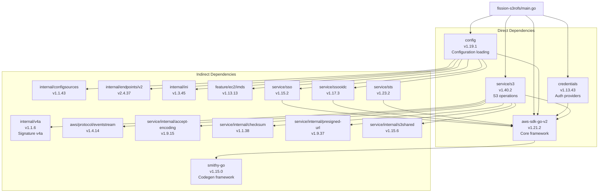
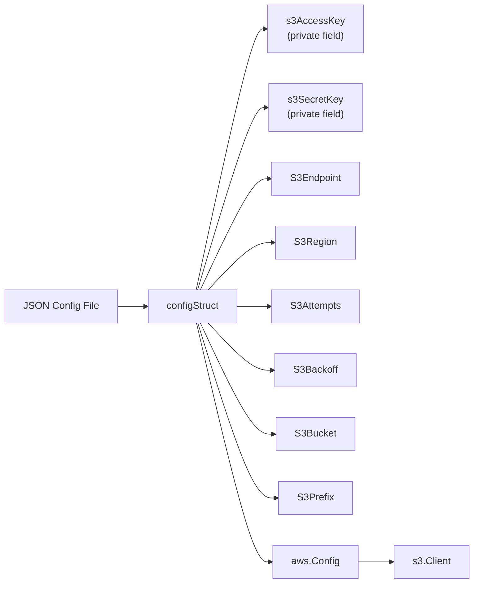
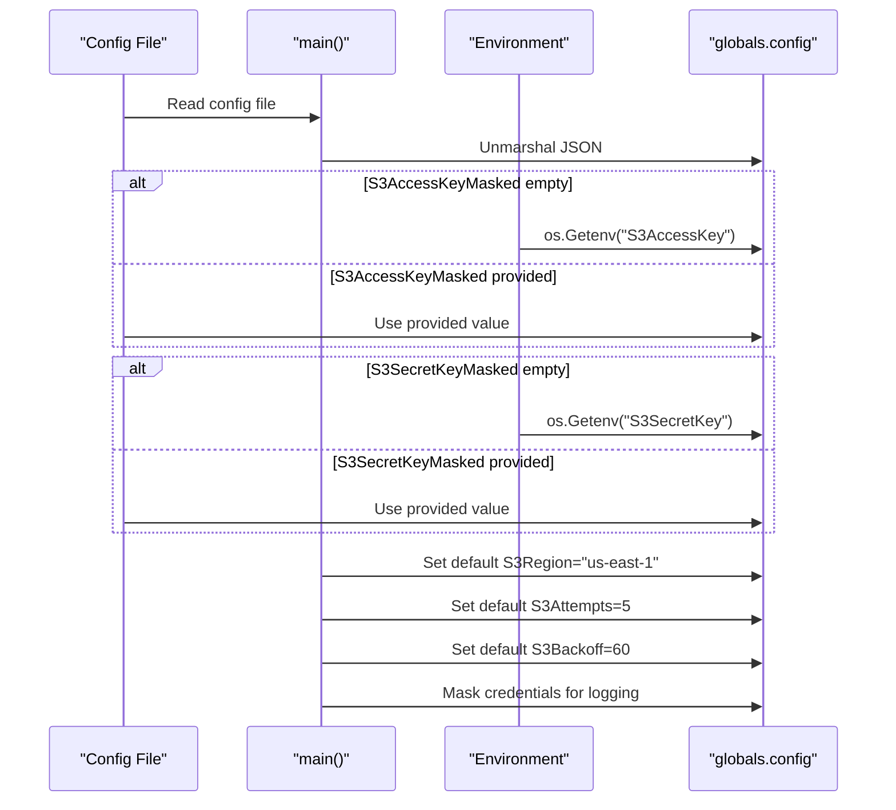
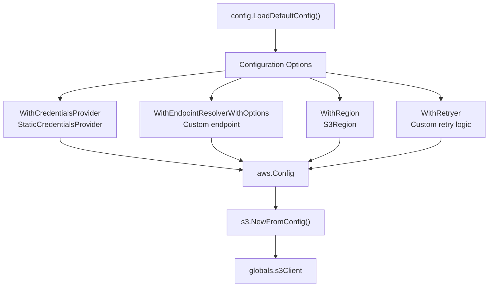
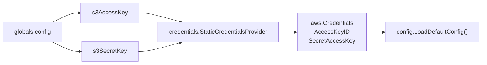
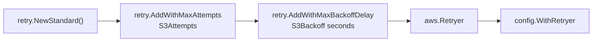
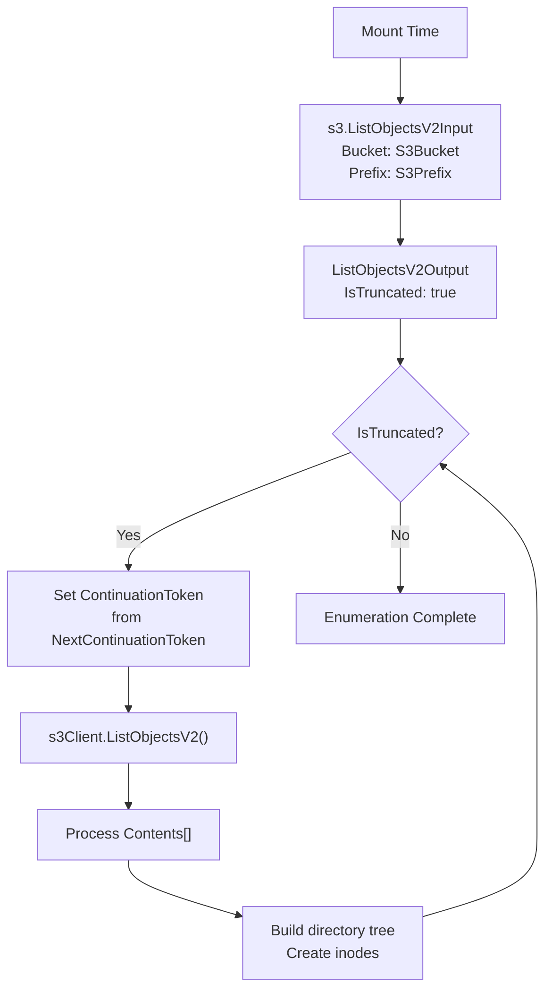
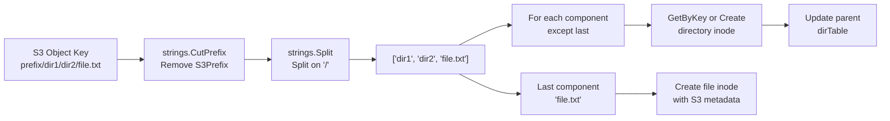
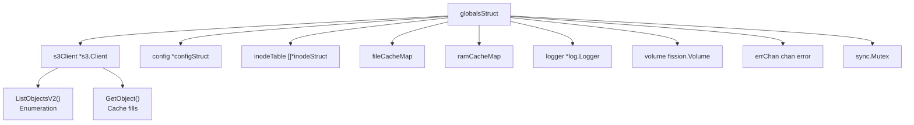
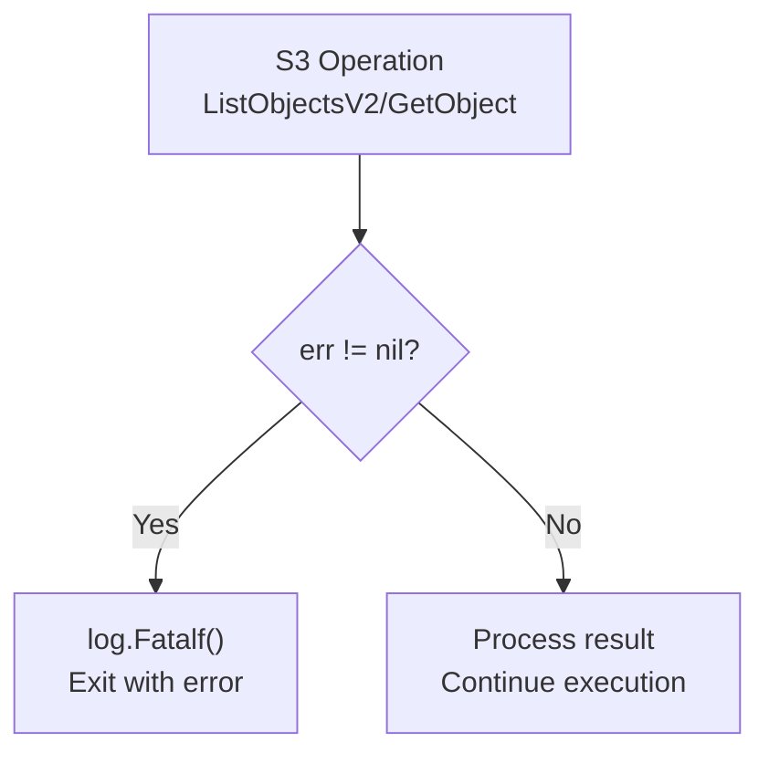

<!-- source: DeepWiki mcp.deepwiki.com · repo NVIDIA/fission · page 4.1 AWS SDK v2 Integration · fetched 2026-10-26 -->

# AWS SDK v2 Integration

Relevant source files

The following files were used as context for generating this wiki page:

- [examples/fission-s3rofs/main.go](examples/fission-s3rofs/main.go)
- [go.mod](go.mod)
- [go.sum](go.sum)

## Purpose and Scope

This document explains how the AWS SDK v2 (`aws-sdk-go-v2`) is integrated into the fission repository, specifically within the `fission-s3rofs` example implementation. It covers the modular SDK architecture, configuration patterns, credential providers, retry mechanisms, and S3-specific operations used to build a read-only FUSE filesystem backed by Amazon S3.

For information about the overall S3-backed filesystem architecture and caching strategy, see [S3 Integration and Filesystem Setup](#3.2.1). For details about the two-tier caching system that optimizes S3 access, see [S3RO Caching Strategy](#3.2.2).

## AWS SDK v2 Dependency Structure

The fission repository uses AWS SDK v2's modular architecture, which separates core functionality, configuration, credentials, and service-specific clients into distinct packages. This design allows fine-grained control over which components are imported and reduces binary size.

### Dependency Graph

**Sources:** [go.mod:1-30](), [examples/fission-s3rofs/main.go:23-28]()

### Package Responsibilities

| Package | Purpose | Key Types |
|---------|---------|-----------|
| `aws-sdk-go-v2` | Core SDK types and interfaces | `aws.Config`, `aws.Credentials`, `aws.Endpoint` |
| `config` | Configuration loading from environment, files, and defaults | `config.LoadDefaultConfig()` |
| `credentials` | Authentication providers (static, IAM, SSO, STS) | `credentials.StaticCredentialsProvider` |
| `service/s3` | S3 API operations | `s3.Client`, `s3.ListObjectsV2Input`, `s3.GetObjectInput` |
| `smithy-go` | Protocol-level code generation framework | Internal use by service clients |

**Sources:** [go.mod:5-12]()

## Configuration Patterns in fission-s3rofs

The `fission-s3rofs` implementation demonstrates a comprehensive configuration pattern that combines static credentials, custom endpoints, regional settings, and retry logic.

### Configuration Structure

The `configStruct` type stores S3 configuration parameters. Sensitive credentials are stored in private fields (`s3AccessKey`, `s3SecretKey`) while exposing masked versions in JSON output for logging purposes.

**Sources:** [examples/fission-s3rofs/main.go:82-98]()

### Configuration Loading Process

The configuration loading process in `main()` follows this sequence:

1. **JSON Unmarshalling**: Configuration is loaded from a JSON file specified as a command-line argument
2. **Credential Resolution**: Credentials are either read from the config file or fetched from environment variables (`S3AccessKey`, `S3SecretKey`)
3. **Default Value Assignment**: Missing optional parameters (region, attempts, backoff) are populated with defaults
4. **Masking**: Credentials are masked for logging purposes

**Sources:** [examples/fission-s3rofs/main.go:203-256]()

### Default Configuration Values

| Parameter | Default Value | Location |
|-----------|---------------|----------|
| `S3Region` | `"us-east-1"` | [main.go:229-231]() |
| `S3Attempts` | `5` | [main.go:233-235]() |
| `S3Backoff` | `60` seconds | [main.go:237-239]() |
| Environment variable for access key | `S3AccessKey` | [main.go:216]() |
| Environment variable for secret key | `S3SecretKey` | [main.go:223]() |

**Sources:** [examples/fission-s3rofs/main.go:215-239]()

## AWS SDK v2 Client Initialization

The S3 client initialization demonstrates the use of multiple configuration options to customize authentication, endpoint resolution, region settings, and retry behavior.

### Client Creation Flow

The client initialization occurs in [main.go:289-313]() and follows the functional options pattern provided by AWS SDK v2.

**Sources:** [examples/fission-s3rofs/main.go:289-313]()

### Static Credentials Provider

The `credentials.StaticCredentialsProvider` is used to provide hardcoded credentials from the configuration file. The provider wraps `aws.Credentials` with `AccessKeyID` and `SecretAccessKey` fields.

**Sources:** [examples/fission-s3rofs/main.go:291-296]()

### Custom Endpoint Resolver

The endpoint resolver is configured using `config.WithEndpointResolverWithOptions()` with an `aws.EndpointResolverWithOptionsFunc`. This allows specifying a custom S3 endpoint URL (useful for S3-compatible services like MinIO, Ceph, or private S3 deployments) while still maintaining proper request signing with the configured region.

Key endpoint configuration parameters:
- `URL`: The base URL for the S3 service (`globals.config.S3Endpoint`)
- `SigningRegion`: The AWS region for request signing (`globals.config.S3Region`)
- `HostnameImmutable`: Set to `true` to prevent the SDK from modifying the hostname for bucket-style URLs

**Sources:** [examples/fission-s3rofs/main.go:297-304]()

### Retry Configuration

The retry mechanism uses the `retry` package to configure maximum attempts and backoff delays. The configuration chains two retry modifiers:

1. `retry.AddWithMaxAttempts(retry.NewStandard(), int(globals.config.S3Attempts))`: Sets the maximum number of request attempts
2. `retry.AddWithMaxBackoffDelay(..., time.Duration(int(globals.config.S3Backoff))*time.Second)`: Caps the exponential backoff delay

The standard retryer implements exponential backoff with jitter for failed requests, automatically retrying on transient errors like network timeouts, 5xx server errors, and throttling responses.

**Sources:** [examples/fission-s3rofs/main.go:306-308]()

## S3 Operations in fission-s3rofs

The `fission-s3rofs` implementation uses two primary S3 operations: `ListObjectsV2` for enumerating objects at mount time, and `GetObject` with range requests for reading file contents.

### ListObjectsV2 Integration

The filesystem enumerates all objects in the S3 bucket at mount time to build the directory tree. This operation uses pagination to handle buckets with more than 1000 objects.

The pagination loop at [main.go:324-425]() continues until `listObjectsV2Output.IsTruncated` is `false`. Each iteration:

1. Sets `ContinuationToken` from the previous response's `NextContinuationToken`
2. Calls `globals.s3Client.ListObjectsV2(context.TODO(), listObjectsV2Input)`
3. Iterates over `listObjectsV2Output.Contents` to process each `s3types.Object`
4. Extracts object metadata: `Key`, `Size`, `LastModified`

**Sources:** [examples/fission-s3rofs/main.go:315-425]()

### Object Key Processing

Each S3 object key is transformed into a directory hierarchy:

1. **Prefix Removal**: The configured `S3Prefix` is stripped using `strings.CutPrefix(objectKey, globals.config.S3Prefix)`
2. **Path Splitting**: The remaining path is split on "/" using `strings.Split(objectKeyCutPrefix, "/")`
3. **Directory Creation**: Intermediate directories are created as needed by traversing the path components
4. **File Inode Creation**: The final path component becomes a file inode with metadata from the S3 object

**Sources:** [examples/fission-s3rofs/main.go:335-423]()

### Directory Inode Structure

Directory inodes created during enumeration have the following characteristics:

- **inodeNumber**: Sequential assignment based on `len(globals.inodeTable) + 1`
- **mode**: `dirMode` constant (includes `syscall.S_IFDIR` and read/execute permissions)
- **linkCount**: Starts at 2 (for "." and ".."), incremented for each subdirectory
- **dirTable**: A `sortedmap.LLRBTree` mapping basename strings to child inode numbers
- **lastModified**: Set to `timeAtLaunch` (the mount time)

**Sources:** [examples/fission-s3rofs/main.go:358-395]()

### File Inode Structure

File inodes created from S3 objects store the necessary metadata for subsequent read operations:

- **inodeNumber**: Sequential assignment
- **size**: From `listObjectsV2OutputContentsElement.Size`
- **lastModified**: From `*listObjectsV2OutputContentsElement.LastModified`
- **mode**: `fileMode` constant (includes `syscall.S_IFREG` and read-only permissions)
- **linkCount**: 1 (files are not hardlinked)
- **objectKey**: The full S3 object key, used for `GetObject` operations in read callbacks

**Sources:** [examples/fission-s3rofs/main.go:401-408]()

### GetObject Operations

While `GetObject` is not shown in `main.go`, it is used in the callbacks implementation (see [S3RO Caching Strategy](#3.2.2)) to fetch object content. The S3 client supports range requests, which are critical for the caching strategy:

- Range requests are specified using the `Range` parameter in `s3.GetObjectInput`
- The format is `"bytes=start-end"` following HTTP Range header syntax
- Cache lines fetch specific byte ranges rather than entire objects

**Sources:** [examples/fission-s3rofs/main.go:132]() (s3Client field in globalsStruct)

## S3 Client Storage and Access

The initialized S3 client is stored as a field in the `globalsStruct`:

The `globals` variable is a package-level singleton of type `globalsStruct` that provides access to the S3 client throughout the callbacks implementation. The client is thread-safe and can be used concurrently from multiple goroutines handling FUSE requests.

**Sources:** [examples/fission-s3rofs/main.go:129-145]()

## Type Mappings: AWS SDK to Internal Structures

The following table shows how AWS SDK v2 types are mapped to internal fission-s3rofs structures:

| AWS SDK v2 Type | Internal Type | Mapping Location | Purpose |
|-----------------|---------------|------------------|---------|
| `s3types.Object` | `inodeStruct` | [main.go:401-408]() | S3 object → file inode |
| `*string` (Key) | `string` (objectKey) | [main.go:407]() | S3 key storage |
| `*time.Time` (LastModified) | `time.Time` (lastModified) | [main.go:404]() | File timestamp |
| `int64` (Size) | `uint64` (size) | [main.go:403]() | File size in bytes |
| `aws.Config` | Part of `globals` | [main.go:132]() | Client configuration |
| `s3.Client` | `*s3.Client` in `globalsStruct` | [main.go:132]() | API operations |

**Sources:** [examples/fission-s3rofs/main.go:100-108](), [examples/fission-s3rofs/main.go:401-408]()

## Error Handling Patterns

The S3 client operations use standard Go error handling with fatal logging on errors during mount-time initialization:

Mount-time errors (configuration loading, client creation, ListObjectsV2 failures) are considered fatal and cause the program to exit via `globals.logger.Fatalf()`. This ensures the filesystem is only mounted if the S3 backend is fully accessible and enumerated.

Runtime errors during read operations (cache fills from GetObject) are handled differently in the callbacks implementation, where they return FUSE error codes to the kernel rather than terminating the process.

**Sources:** [examples/fission-s3rofs/main.go:310](), [examples/fission-s3rofs/main.go:329]()

## Integration Summary

The AWS SDK v2 integration in fission-s3rofs demonstrates several best practices:

1. **Modular Imports**: Only necessary SDK components are imported (core, config, credentials, s3)
2. **Configuration Flexibility**: Supports both file-based and environment-based credential sources
3. **Custom Endpoints**: Allows targeting S3-compatible services via endpoint configuration
4. **Retry Logic**: Configurable retry attempts and backoff delays for resilience
5. **Efficient Enumeration**: Proper pagination handling for large S3 buckets
6. **Thread Safety**: The S3 client is stored in a shared globals structure protected by mutexes where needed
7. **Metadata Preservation**: S3 object metadata (size, timestamps) is preserved in inode structures

The client is initialized once at mount time and reused throughout the filesystem's lifetime for all S3 operations, including both directory enumeration and file content retrieval through the caching system.

**Sources:** [examples/fission-s3rofs/main.go:1-476](), [go.mod:1-30]()

---

