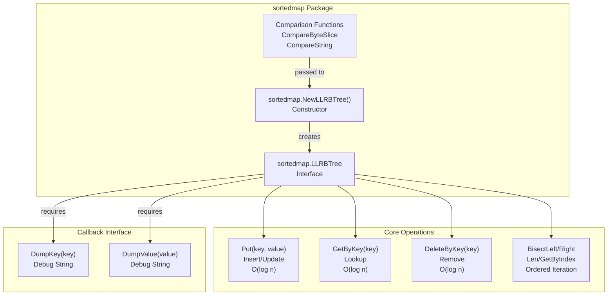
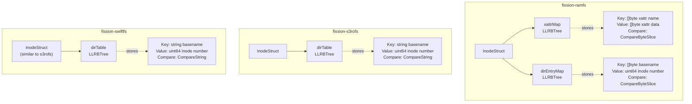
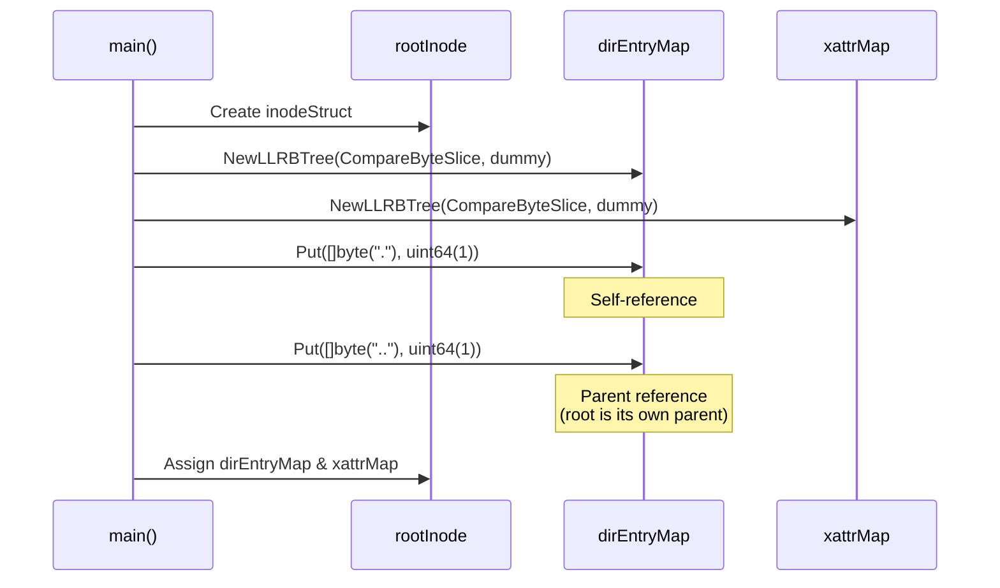
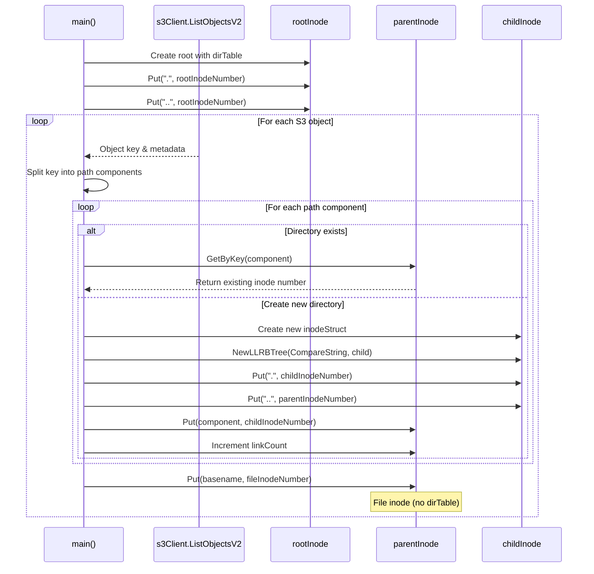
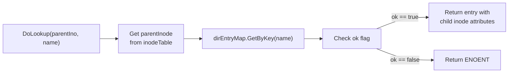
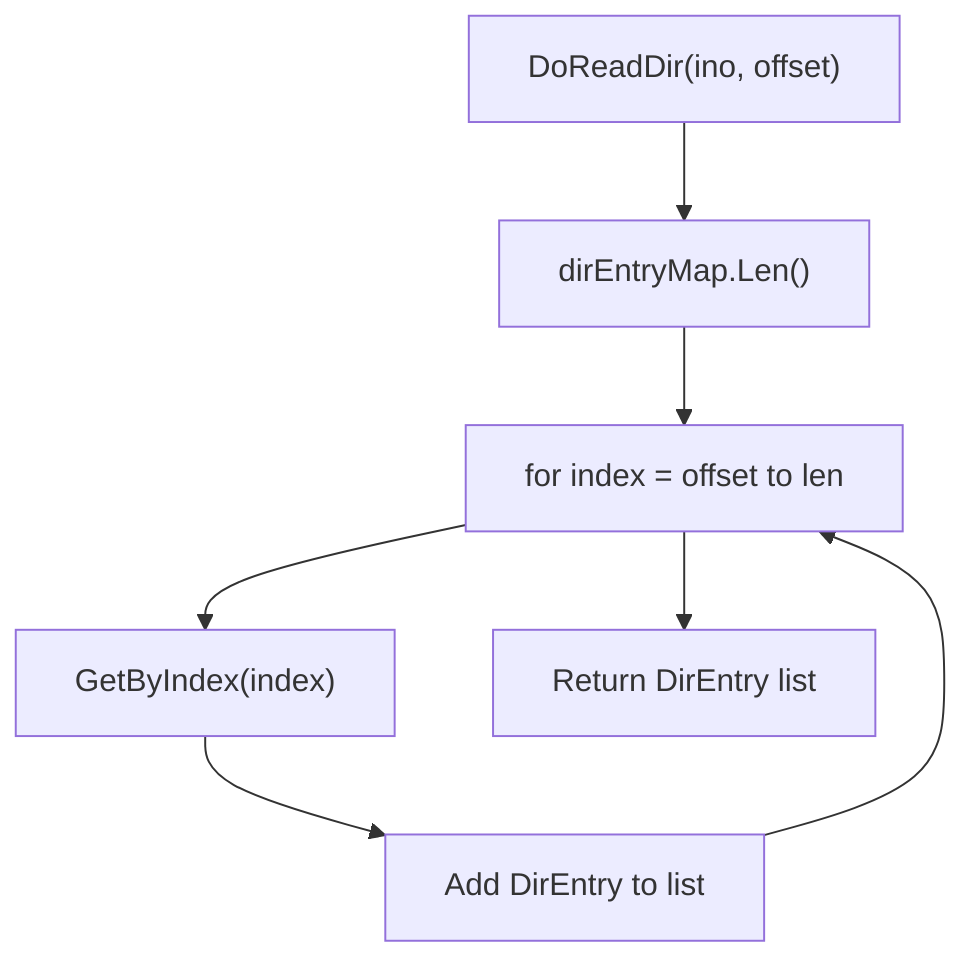
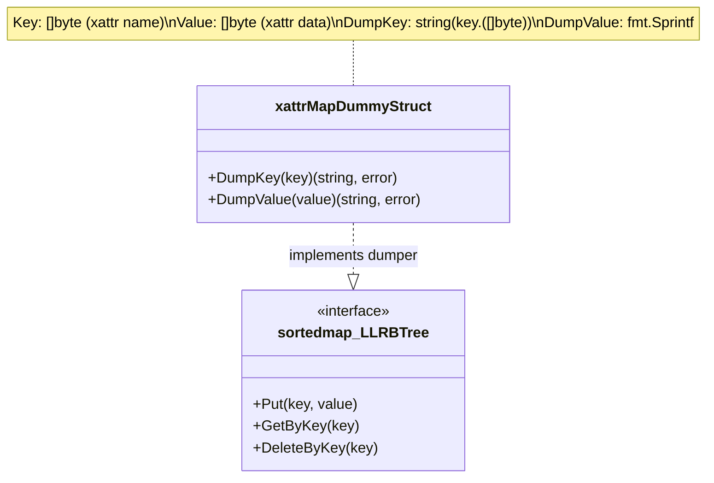

<!-- source: DeepWiki mcp.deepwiki.com · repo NVIDIA/fission · page 4.2 sortedmap for Directory Management · fetched 2026-10-26 -->

# sortedmap for Directory Management

<details>
<summary>Relevant source files</summary>

The following files were used as context for generating this wiki page:

- [examples/fission-ramfs/main.go](examples/fission-ramfs/main.go)
- [examples/fission-s3rofs/main.go](examples/fission-s3rofs/main.go)
- [go.mod](go.mod)
- [go.sum](go.sum)

</details>


## Purpose and Scope

This document explains the use of the `github.com/NVIDIA/sortedmap` package in the fission codebase for managing directory structures and extended attributes. The sortedmap library provides a Left-Leaning Red-Black (LLRB) tree implementation used by filesystem implementations to maintain ordered directory entries with O(log n) performance characteristics.

For information about AWS SDK integration, see [AWS SDK v2 Integration](#4.1). For general filesystem implementation patterns, see [Example Implementations](#3).

## Overview: Why Sorted Maps for Directories

Directory management in FUSE filesystems requires efficient ordered storage to support operations like `readdir` (which must return entries in sorted order), `lookup` (O(log n) name-to-inode resolution), and `create`/`unlink` (insertion/deletion). The sortedmap package provides these capabilities through an LLRB tree implementation.

**Key Requirements for Directory Storage:**
- Ordered iteration for `readdir` operations
- Fast lookup by basename for `DoLookup` callbacks
- Efficient insertion and deletion for directory modifications
- Support for both byte slice and string keys depending on use case

Sources: [examples/fission-ramfs/main.go:65-108](), [examples/fission-s3rofs/main.go:100-108]()

## LLRB Tree Implementation

The sortedmap package implements a Left-Leaning Red-Black tree, a self-balancing binary search tree that guarantees O(log n) worst-case performance for insertion, deletion, and lookup operations.



**Performance Characteristics:**
- **Insert/Update**: O(log n) time, self-balancing
- **Lookup**: O(log n) time, binary search
- **Delete**: O(log n) time, rebalancing
- **Iteration**: O(n) for full traversal, sorted order
- **Memory**: O(n) space for n entries

Sources: [go.mod:6](), [examples/fission-ramfs/main.go:76-77]()

## Usage Patterns Across Implementations

Different filesystem implementations use sortedmap for distinct purposes, with varying key and value types:



**Comparison Table:**

| Implementation | Use Case | Key Type | Value Type | Comparator |
|----------------|----------|----------|------------|------------|
| ramfs - dirEntryMap | Directory entries | `[]byte` | `uint64` (inode) | `CompareByteSlice` |
| ramfs - xattrMap | Extended attributes | `[]byte` | `[]byte` (data) | `CompareByteSlice` |
| s3rofs - dirTable | Directory entries | `string` | `uint64` (inode) | `CompareString` |
| swiftfs - dirTable | Directory entries | `string` | `uint64` (inode) | `CompareString` |

Sources: [examples/fission-ramfs/main.go:73-79](), [examples/fission-s3rofs/main.go:100-108]()

## Initialization and Construction

### fission-ramfs Initialization

The ramfs implementation creates two sortedmaps per directory inode: one for directory entries and one for extended attributes.



**Root Directory Setup:**
[examples/fission-ramfs/main.go:141-162]() creates the root inode with initialized sortedmaps:

```
rootInode = &inodeStruct{
    tryLock: makeTryLock(),
    attr: fission.Attr{...},
    xattrMap:    sortedmap.NewLLRBTree(sortedmap.CompareByteSlice, globals.xattrMapDummy),
    dirEntryMap: sortedmap.NewLLRBTree(sortedmap.CompareByteSlice, globals.dirEntryMapDummy),
    ...
}
```

The dummy structs passed as the second argument implement the `DumpKey` and `DumpValue` methods required by the sortedmap interface for debugging.

Sources: [examples/fission-ramfs/main.go:141-162](), [examples/fission-ramfs/main.go:158-159]()

### fission-s3rofs Initialization

The s3rofs implementation builds the entire directory tree at mount time by enumerating S3 objects and creating directory inodes as needed.



Sources: [examples/fission-s3rofs/main.go:262-287](), [examples/fission-s3rofs/main.go:324-425]()

## Key Comparison Functions

The sortedmap package provides built-in comparison functions that determine the ordering of keys in the tree:

### CompareByteSlice (ramfs)

Used by ramfs for both directory entries and extended attributes. This comparator handles `[]byte` keys with lexicographic comparison.

**Properties:**
- Compares byte-by-byte lexicographically
- Works with arbitrary binary data (including UTF-8 filenames)
- Consistent with Go's `bytes.Compare()` semantics

**Usage in ramfs:**
- Directory basenames stored as `[]byte` for consistency
- Extended attribute names stored as `[]byte`
- Allows non-UTF-8 names (though uncommon in practice)

Sources: [examples/fission-ramfs/main.go:158-159]()

### CompareString (s3rofs, swiftfs)

Used by s3rofs and swiftfs for directory entries. This comparator handles `string` keys.

**Properties:**
- Compares strings lexicographically
- More idiomatic for S3/Swift object keys (which are strings)
- Efficient for typical filesystem use cases

**Usage in s3rofs:**
- S3 object keys are naturally strings
- Directory basenames extracted from object key paths
- Simpler type handling compared to byte slices

Sources: [examples/fission-s3rofs/main.go:269](), [examples/fission-s3rofs/main.go:365]()

## Common Directory Operations

### Directory Entry Insertion

**Pattern in ramfs:**
```
ok, err = parentInode.dirEntryMap.Put([]byte(basename), childInodeNumber)
if err != nil {
    // Handle error
}
if !ok {
    // Entry already existed
}
```

**Pattern in s3rofs:**
```
ok, err = parentInode.dirTable.Put(basename, childInode.inodeNumber)
if err != nil {
    // Handle error
}
if !ok {
    // Entry already existed
}
```

Sources: [examples/fission-ramfs/main.go:166-183](), [examples/fission-s3rofs/main.go:271-285]()

### Directory Entry Lookup



**Typical lookup implementation:**
1. Retrieve parent inode from inode table using `parentIno`
2. Call `dirEntryMap.GetByKey(basename)` to find child inode number
3. If found (`ok == true`), retrieve child inode and return its attributes
4. If not found (`ok == false`), return `syscall.ENOENT`

Sources: [examples/fission-ramfs/main.go:76-77](), [examples/fission-s3rofs/main.go:345-356]()

### Directory Enumeration (readdir)

Directory enumeration requires iterating through the sortedmap in order:



**Key methods used:**
- `Len()`: Returns total number of entries
- `GetByIndex(index)`: Returns key-value pair at specified index
- Iteration starts at `offset` (for pagination support)
- Results are naturally sorted by basename

Sources: [examples/fission-ramfs/main.go:76-77](), [examples/fission-s3rofs/main.go:106]()

## DumpKey and DumpValue Interface

The sortedmap package requires implementations to provide `DumpKey` and `DumpValue` methods for debugging and diagnostics.

### ramfs Extended Attributes Dumper



**Implementation:**
[examples/fission-ramfs/main.go:333-343]()
- `DumpKey`: Converts `[]byte` key to string representation
- `DumpValue`: Formats `[]byte` value as `%v` (byte array notation)

### ramfs Directory Entries Dumper

[examples/fission-ramfs/main.go:345-355]()
- `DumpKey`: Converts `[]byte` basename to string
- `DumpValue`: Formats `uint64` inode number as decimal string

### s3rofs Directory Table Dumper

[examples/fission-s3rofs/main.go:478-509]()
- `DumpKey`: Extracts string basename from key
- `DumpValue`: Formats `uint64` inode number as hexadecimal (`%08X`)

**Purpose of Dumpers:**
- Enable sortedmap debugging and inspection
- Support diagnostics during development
- Required interface for sortedmap construction (even if unused)

Sources: [examples/fission-ramfs/main.go:82-83](), [examples/fission-ramfs/main.go:333-355]()

## Memory and Performance Characteristics

### Memory Overhead

**Per-Directory Costs:**
- LLRB tree structure: ~40-60 bytes per node (implementation-dependent)
- Key storage: Size of basename (typically 10-50 bytes)
- Value storage: 8 bytes (uint64 inode number)
- Tree metadata: Pointers, color bits, parent references

**Example for ramfs:**
- Root directory with 100 entries: ~5-8 KB
- Includes both directory entry map and xattr map
- Additional overhead from inode structures

**Example for s3rofs:**
- Mount with 10,000 objects: ~1-2 MB for directory trees
- Built entirely at mount time from S3 enumeration
- Persistent in memory for filesystem lifetime

Sources: [examples/fission-ramfs/main.go:73-79](), [examples/fission-s3rofs/main.go:258-425]()

### Performance Comparison: Sortedmap vs. Alternatives

| Approach | Lookup | Insert | Delete | Iteration | Memory |
|----------|--------|--------|--------|-----------|--------|
| sortedmap LLRB | O(log n) | O(log n) | O(log n) | O(n) sorted | O(n) |
| map[string]uint64 | O(1) | O(1) | O(1) | O(n) unsorted | O(n) |
| []DirEntry slice | O(n) | O(n) | O(n) | O(n log n) sort | O(n) |

**Why sortedmap was chosen:**
1. FUSE requires `readdir` results in sorted order
2. O(log n) operations acceptable for directory sizes (typically < 10,000 entries)
3. Maintains sorted order automatically without explicit sorting
4. Better than maintaining a map + slice combination

Sources: [examples/fission-ramfs/main.go:76-77](), [examples/fission-s3rofs/main.go:106]()

## Special Entry Handling: "." and ".."

All directory implementations must include special entries for current (`.`) and parent (`..`) directories.

**Initialization Pattern:**


**Special Cases:**
1. **Root directory**: Both `.` and `..` point to root itself
   - [examples/fission-ramfs/main.go:166-183]()
   - [examples/fission-s3rofs/main.go:271-285]()

2. **Child directories**: `.` points to self, `..` points to parent
   - [examples/fission-s3rofs/main.go:367-381]()

3. **Link count implications**: Each subdirectory increases parent's link count
   - [examples/fission-s3rofs/main.go:383]()

Sources: [examples/fission-ramfs/main.go:166-183](), [examples/fission-s3rofs/main.go:271-285]()

## Concurrency Considerations

While sortedmap itself does not provide built-in synchronization, filesystem implementations must protect concurrent access:

**ramfs Approach:**
- Per-inode tryLock system (see [RAMFS Concurrency and Locking](#3.1.2))
- Operations acquire inode lock before accessing dirEntryMap
- Optimistic locking with restart on contention

**s3rofs Approach:**
- Read-only filesystem after mount
- Directory structure immutable during operation
- No locking needed for directory tree traversal
- Global mutex only for cache operations

Sources: [examples/fission-ramfs/main.go:65-71](), [examples/fission-s3rofs/main.go:129-143]()

## Dependency Management

The sortedmap package is maintained by NVIDIA and versioned consistently with cstruct:

**Current version:** `v1.30.0`

**go.mod declaration:**
[go.mod:6]()
```
require (
    github.com/NVIDIA/sortedmap v1.30.0
    ...
)
```

**Transitive dependency:**
[go.mod:15]()
```
require (
    github.com/NVIDIA/cstruct v1.30.0 // indirect
    ...
)
```

The coordinated version numbers (`v1.30.0`) indicate these packages are released together as part of the NVIDIA storage infrastructure toolkit.

Sources: [go.mod:6](), [go.mod:15](), [go.sum:3-4]()

---

