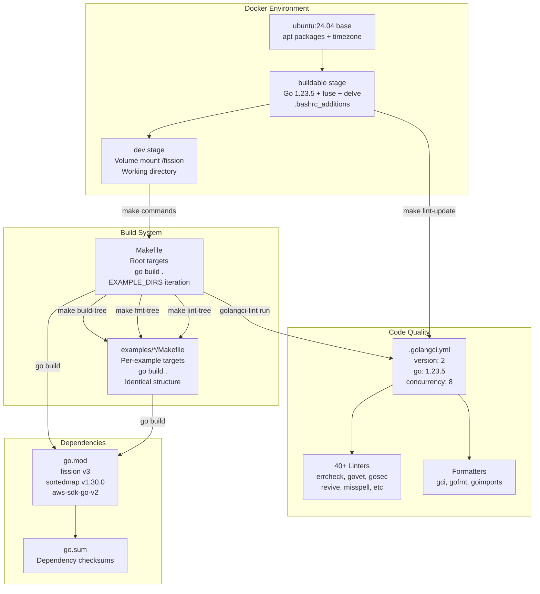
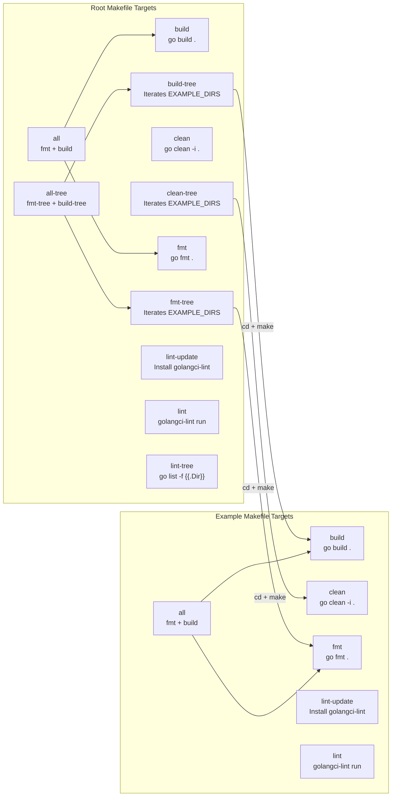
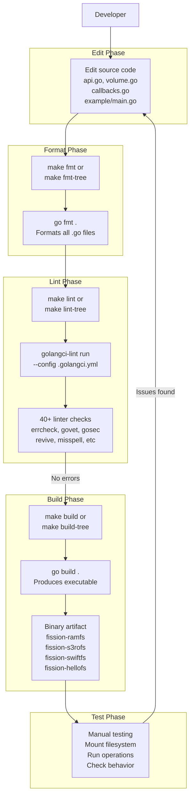
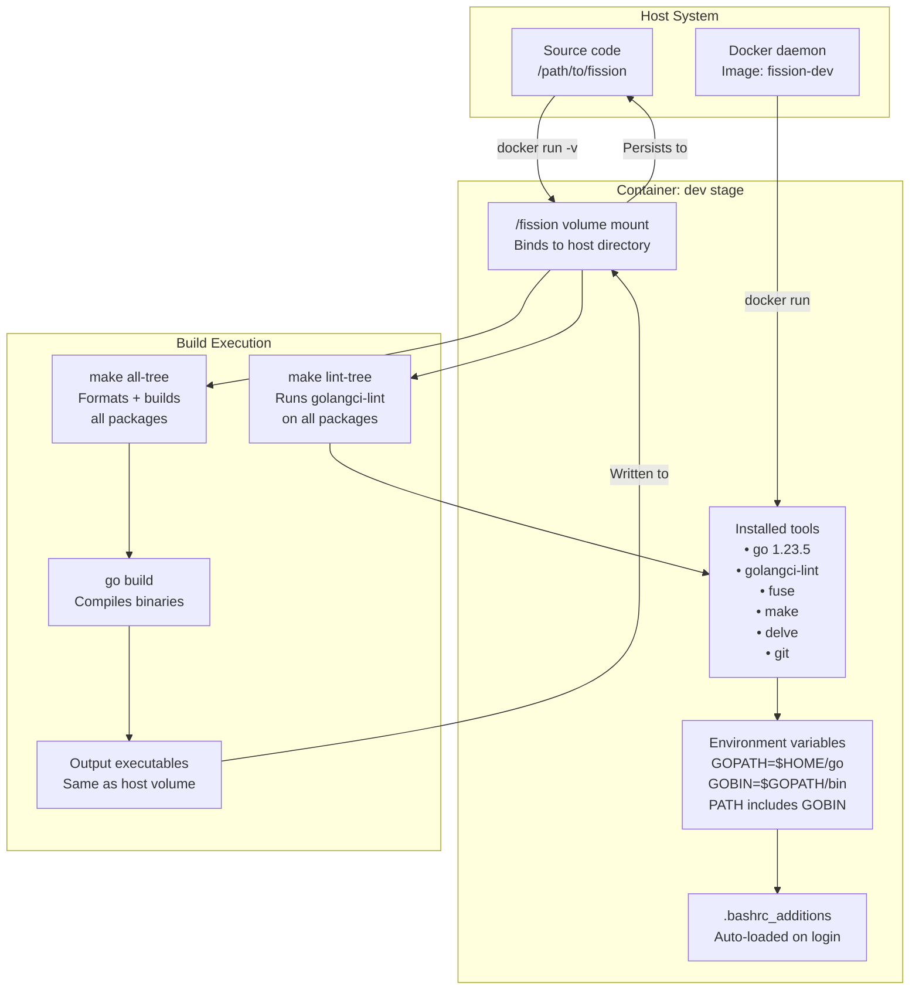

<!-- source: DeepWiki mcp.deepwiki.com · repo NVIDIA/fission · page 5 Development and Build Setup · fetched 2026-10-26 -->

# Development and Build Setup

Relevant source files

The following files were used as context for generating this wiki page:

- [.golangci.yml](.golangci.yml)
- [Dockerfile](Dockerfile)
- [Makefile](Makefile)
- [examples/fission-hellofs/Makefile](examples/fission-hellofs/Makefile)

## Purpose and Scope

This page provides an overview of the development environment, build system, and code quality tools for developers working on the fission library or creating new filesystem implementations. It covers the Docker-based development environment, Makefile structure, and linting configuration.

For detailed information about specific topics, see:
- **Docker container setup and usage**: [5.1](#5.1)
- **Makefile targets and build commands**: [5.2](#5.2)  
- **golangci-lint configuration and rules**: [5.3](#5.3)

## Development Environment Overview

The fission repository uses a multi-layered development approach with three primary components:

1. **Docker Environment** - A containerized Ubuntu 24.04 environment with Go 1.23.5, FUSE tools, and all dependencies pre-installed
2. **Makefile Build System** - Hierarchical Makefiles that support building the core library and all example implementations
3. **Code Quality Tools** - golangci-lint with 40+ enabled linters enforcing code standards across the repository

The development workflow is designed to work both inside the Docker container and on native Linux systems with appropriate dependencies installed.

Sources: [Dockerfile:1-74](), [Makefile:1-57](), [.golangci.yml:1-143]()

## Development Toolchain Components

The following diagram shows the relationship between the development tools and their roles in the build process:

Sources: [Dockerfile:4-74](), [Makefile:1-57](), [.golangci.yml:1-143]()

## Quick Start for Developers

The recommended development workflow uses the Docker container to ensure consistent tooling across different host systems. The basic steps are:

1. **Build the Docker image** (first time only)
2. **Run the container** with the repository mounted as a volume
3. **Execute build commands** inside the container

The Docker image is built in three stages defined in the `Dockerfile`:

| Stage | Base Image | Purpose | Key Components |
|-------|-----------|---------|----------------|
| `base` | `ubuntu:24.04` | OS foundation with updates | `apt-get update`, `apt-get dist-upgrade`, timezone configuration |
| `buildable` | `base` | Development tools | Go 1.23.5, fuse, git, make, vim, delve debugger, golangci-lint |
| `dev` | `buildable` | Runtime environment | Volume mount point `/fission`, clean working directory |

The `buildable` stage installs Go from the official tarball at [Dockerfile:31-36]() and builds the Delve debugger from source at [Dockerfile:38-41](). It also configures bash environment variables for `GOPATH` and `GOBIN` at [Dockerfile:43-50]().

Sources: [Dockerfile:4-74]()

## Makefile Target Hierarchy

The build system uses two levels of Makefiles with consistent targets:

The root `Makefile` defines `EXAMPLE_DIRS` as `examples/fission-*` at [Makefile:4](), which matches all example filesystem implementations. The `*-tree` targets iterate over these directories using shell loops at [Makefile:18-22]() for building, [Makefile:30-34]() for cleaning, and [Makefile:42-46]() for formatting.

Each example directory contains an identical `Makefile` structure. For instance, `fission-hellofs` defines the same targets at [examples/fission-hellofs/Makefile:4-22](), allowing developers to work on individual examples without building the entire tree.

Sources: [Makefile:1-57](), [examples/fission-hellofs/Makefile:1-23]()

## Typical Development Workflow

The following diagram illustrates the relationship between developer actions, build targets, and output artifacts:

The standard workflow sequence is:

1. **Edit** source files in the core library or examples
2. **Format** code using `make fmt-tree` to ensure consistent style
3. **Lint** code using `make lint-tree` to catch potential issues
4. **Build** binaries using `make build-tree` to verify compilation
5. **Test** manually by mounting and exercising the filesystem

The formatting step runs `go fmt` which applies standard Go formatting rules. The linting step runs `golangci-lint run --config .golangci.yml` which executes all enabled linters defined in the configuration. The build step compiles the Go packages into executable binaries.

Sources: [Makefile:36-46](), [Makefile:52-56](), [Makefile:12-22]()

## Build System File Structure

The repository organizes build-related files as follows:

| File/Directory | Purpose | Key Contents |
|----------------|---------|--------------|
| `Makefile` | Root build orchestration | `all`, `all-tree`, `build`, `build-tree`, `clean-tree`, `fmt-tree`, `lint`, `lint-tree`, `lint-update` |
| `examples/fission-ramfs/Makefile` | RAM filesystem build | `all`, `build`, `clean`, `fmt`, `lint`, `lint-update` |
| `examples/fission-s3rofs/Makefile` | S3 filesystem build | Identical target structure |
| `examples/fission-swiftfs/Makefile` | Swift filesystem build | Identical target structure |
| `examples/fission-hellofs/Makefile` | Hello filesystem build | Identical target structure |
| `.golangci.yml` | Linter configuration | 40+ enabled linters, exclusion rules, formatter settings |
| `Dockerfile` | Container environment | Multi-stage build: `base`, `buildable`, `dev` |
| `go.mod` | Go module definition | Dependencies and version requirements |
| `go.sum` | Dependency checksums | Cryptographic verification data |

The uniformity of example Makefiles allows developers to use muscle memory when working across different implementations. Each Makefile references the shared `.golangci.yml` using a relative path at [examples/fission-hellofs/Makefile:22]() (`../../.golangci.yml`), ensuring consistent linting rules across all examples.

Sources: [Makefile:1-57](), [examples/fission-hellofs/Makefile:1-23](), [.golangci.yml:1-143]()

## Code Quality Enforcement

The `.golangci.yml` configuration file defines code quality standards enforced during development. The configuration uses `version: "2"` syntax at [.golangci.yml:1]() and specifies Go version `1.23.5` at [.golangci.yml:4]().

The linter configuration includes several key sections:

**Enabled Linters** (40+ total) at [.golangci.yml:8-41]():
- `errcheck` - checks for unchecked errors
- `govet` - runs go vet with specific checks enabled
- `gosec` - security-focused linter
- `revive` - general-purpose linter with style rules
- `misspell` - catches spelling errors
- `ineffassign` - detects ineffectual assignments
- `unused` - finds unused code
- `staticcheck` - commented out at [.golangci.yml:37]()

**Linter Settings** at [.golangci.yml:42-110]():
- `depguard` - bans deprecated packages like `io/ioutil` and `math/rand`
- `dogsled` - allows max 3 blank identifiers
- `dupl` - detects code duplication over 250 lines
- `gocritic` - enables performance and style checks, disables `unnamedResult`
- `gosec` - excludes specific security rules: G115, G402, G404
- `govet` - disables `fieldalignment` and `shadow`, enables all others
- `revive` - 26 style rules including `error-naming`, `exported`, `indent-error-flow`

**Exclusions** at [.golangci.yml:111-128]():
- Generated code gets "lax" handling
- Common false positives are ignored
- Paths matching `third_party$`, `builtin$`, `examples$` are excluded

**Formatters** at [.golangci.yml:133-142]():
- `gci` - controls import grouping
- `gofmt` - standard Go formatting
- `goimports` - manages import statements

The `lint-update` target at [Makefile:48-50]() downloads the latest golangci-lint binary using curl, installing it to `$(GOPATH)/bin`.

Sources: [.golangci.yml:1-143](), [Makefile:48-50]()

## Integration with Development Container

The Docker development environment integrates all build tools:

The `dev` stage at [Dockerfile:67-73]() creates a clean working environment by removing the copied source at [Dockerfile:70]() and defining a volume mount point at [Dockerfile:72](). This design allows developers to mount their local source directory, making edits on the host while running builds inside the container.

The `buildable` stage pre-installs golangci-lint at [Dockerfile:65]() by running `make lint-update`, ensuring the linter is available immediately when the container starts. The bash configuration at [Dockerfile:43-50]() sets up `GOPATH`, `GOBIN`, and updates `PATH` so that go tools installed with `go install` are immediately available.

Sources: [Dockerfile:67-74](), [Dockerfile:43-50](), [Dockerfile:65]()

## Command Reference Table

The following table summarizes available make targets and their usage:

| Target | Scope | Description | Example Usage |
|--------|-------|-------------|---------------|
| `make all` | Local | Format and build current directory | `cd /fission && make all` |
| `make all-tree` | Tree | Format and build entire repository | `cd /fission && make all-tree` |
| `make build` | Local | Compile current package | `cd examples/fission-ramfs && make build` |
| `make build-tree` | Tree | Compile all packages | `cd /fission && make build-tree` |
| `make clean` | Local | Remove build artifacts | `cd examples/fission-s3rofs && make clean` |
| `make clean-tree` | Tree | Remove all build artifacts | `cd /fission && make clean-tree` |
| `make fmt` | Local | Format current directory | `cd /fission && make fmt` |
| `make fmt-tree` | Tree | Format entire repository | `cd /fission && make fmt-tree` |
| `make lint` | Local | Lint current directory | `cd /fission && make lint` |
| `make lint-tree` | Tree | Lint entire repository | `cd /fission && make lint-tree` |
| `make lint-update` | Local | Install/update golangci-lint | `make lint-update` |

"Local" scope targets operate on the current directory only, while "Tree" scope targets iterate over all example directories using shell loops.

Sources: [Makefile:1-57](), [examples/fission-hellofs/Makefile:1-23]()

## Summary

The fission development environment provides:

1. **Containerized consistency** - Docker ensures all developers use identical tooling (Go 1.23.5, golangci-lint, FUSE utilities)
2. **Hierarchical build system** - Root Makefile coordinates builds across core library and four example implementations
3. **Strict code quality** - 40+ linters enforce consistent style, catch common errors, and prevent deprecated API usage
4. **Parallel workflows** - Developers can work on individual examples or build the entire tree with `*-tree` targets

For detailed information about each component, see:
- Docker container internals and volume mounting: [5.1](#5.1)
- Complete Makefile target reference and implementation details: [5.2](#5.2)
- golangci-lint configuration and rule explanations: [5.3](#5.3)

Sources: [Dockerfile:1-74](), [Makefile:1-57](), [.golangci.yml:1-143]()

---

