<!-- source: DeepWiki mcp.deepwiki.com · repo NVIDIA/fission · page 5.1 Docker Development Environment · fetched 2026-10-26 -->

# Docker Development Environment

<details>
<summary>Relevant source files</summary>

The following files were used as context for generating this wiki page:

- [Dockerfile](Dockerfile)

</details>


## Purpose and Scope

This document describes the Docker-based development environment provided by the [Dockerfile](Dockerfile:1-74)() at the repository root. The Dockerfile implements a multi-stage build pattern to create a containerized environment with all necessary tools for developing, building, testing, and debugging fission filesystems. This includes Go toolchain installation, FUSE support, debugging tools, and pre-configured cloud storage clients.

For information about build targets and compilation workflows, see [Build System and Makefile Targets](#5.2). For code quality enforcement, see [Code Quality and Linting](#5.3).

---

## Multi-Stage Build Architecture

The Dockerfile uses a three-stage build pattern to separate concerns and enable flexible usage. Each stage builds upon the previous, with the final `dev` stage optimized for local development with volume mounting.

### Build Stage Flow

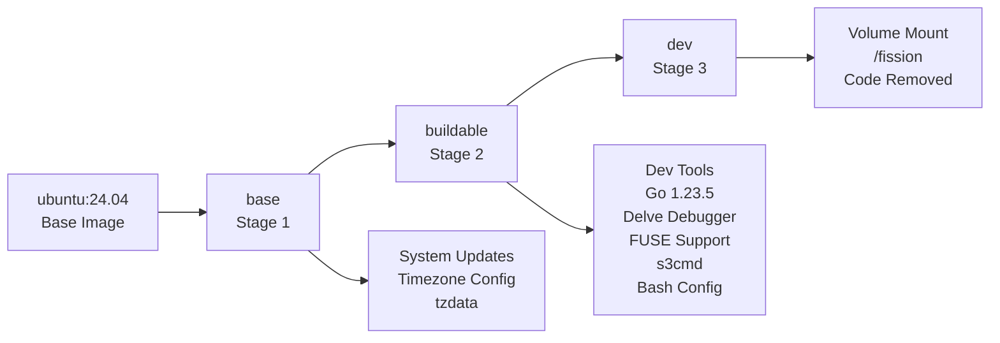

**Sources:** [Dockerfile:4-74]()

| Stage | Base Image | Purpose | Key Characteristics |
|-------|------------|---------|---------------------|
| `base` | `ubuntu:24.04` | System foundation with updated packages | Timezone configured, minimal footprint |
| `buildable` | `base` | Full build environment with all tools | Code copied, dependencies installed, ready to build |
| `dev` | `buildable` | Development container for volume mounting | Code removed, expects `/fission` volume mount |

---

## Base Stage: System Foundation

The `base` stage establishes the Linux environment with updated packages and timezone configuration.

### System Configuration

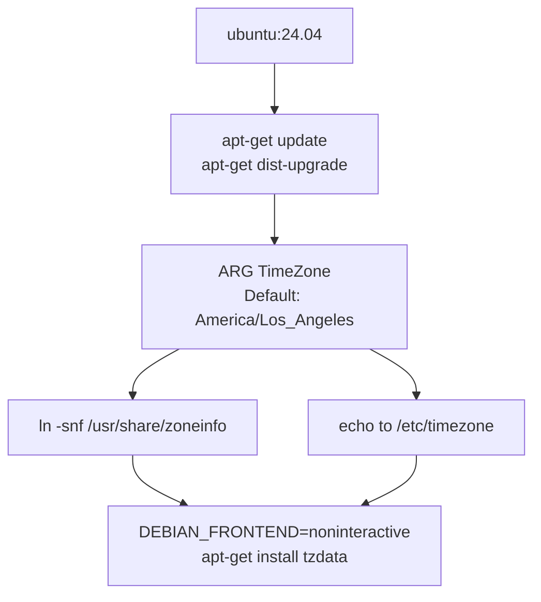

**Key Implementation Details:**

- **Package Updates**: [Dockerfile:6-7]() performs `apt-get update` and `apt-get dist-upgrade` to ensure all base packages are current
- **Timezone Configuration**: [Dockerfile:9-13]() sets timezone via build argument (default: `America/Los_Angeles`) to avoid interactive prompts during package installation
- **Non-Interactive tzdata**: [Dockerfile:13]() uses `DEBIAN_FRONTEND="noninteractive"` to prevent timezone selection prompts

**Sources:** [Dockerfile:4-13]()

---

## Buildable Stage: Development Tools Installation

The `buildable` stage transforms the base image into a complete development environment with Go toolchain, debugging tools, FUSE support, and cloud storage clients.

### Tool Installation Matrix

```mermaid
graph TB
    subgraph "Development Tools"
        Git["git<br/>Version Control"]
        Make["make<br/>Build System"]
        Vim["vim<br/>Text Editor"]
        Tree["tree<br/>Directory Viewer"]
    end
    
    subgraph "Network Tools"
        Curl["curl<br/>HTTP Client"]
        Wget["wget<br/>Download Tool"]
        DNS["dnsutils<br/>DNS Lookup"]
        Ping["iputils-ping<br/>Network Testing"]
    end
    
    subgraph "Filesystem Tools"
        FUSE["fuse<br/>FUSE Kernel Module"]
    end
    
    subgraph "Cloud Storage"
        S3CMD["s3cmd<br/>S3 CLI Client"]
        JQ["jq<br/>JSON Processor"]
    end
    
    subgraph "Go Toolchain"
        GoLang["Go 1.23.5<br/>Compiler & Runtime"]
        Delve["dlv<br/>Go Debugger"]
    end
    
    Buildable["buildable Stage"]
    
    Buildable --> Git
    Buildable --> Make
    Buildable --> Vim
    Buildable --> Tree
    Buildable --> Curl
    Buildable --> Wget
    Buildable --> DNS
    Buildable --> Ping
    Buildable --> FUSE
    Buildable --> S3CMD
    Buildable --> JQ
    Buildable --> GoLang
    Buildable --> Delve
```

**Sources:** [Dockerfile:15-41]()

### Go Installation Process

The Go toolchain is installed from official binaries with a specific version pinned via build argument:

1. **Version Selection**: [Dockerfile:31]() defines `ARG GolangVersion=1.23.5` allowing override at build time
2. **URL Construction**: [Dockerfile:32-33]() builds download URL: `https://golang.org/dl/go1.23.5.linux-amd64.tar.gz`
3. **Download and Extract**: [Dockerfile:34-36]() downloads to `/tmp` and extracts to `/usr/local/go`
4. **PATH Update**: [Dockerfile:37]() adds `/usr/local/go/bin` to system `PATH`

**Sources:** [Dockerfile:31-37]()

### Delve Debugger Installation

The Delve debugger is compiled from source to ensure compatibility with the installed Go version:

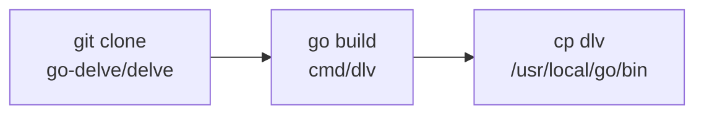

**Process Flow:**
1. [Dockerfile:38]() clones the Delve repository to `/tmp/delve`
2. [Dockerfile:39-40]() compiles the `dlv` binary using the installed Go toolchain
3. [Dockerfile:41]() installs `dlv` to `/usr/local/go/bin` for global access

**Sources:** [Dockerfile:38-41]()

---

## Environment Configuration

The `buildable` stage configures the shell environment and cloud storage credentials for seamless development workflows.

### Bash Environment Setup

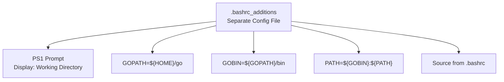

**Configuration Details:**

| Variable | Value | Purpose |
|----------|-------|---------|
| `PS1` | `"\w$ "` | Simple prompt showing current working directory |
| `GOPATH` | `${HOME}/go` | Go workspace directory for packages and binaries |
| `GOBIN` | `${GOPATH}/bin` | Installation directory for Go binaries |
| `PATH` | `${GOBIN}:${PATH}` | Prepends Go binaries to system PATH |

**Implementation:**
- [Dockerfile:43-47]() creates `.bashrc_additions` with environment variables
- [Dockerfile:49-50]() sources the additions file from `.bashrc`
- This separation allows the main `.bashrc` to remain clean while adding custom configurations

**Sources:** [Dockerfile:43-50]()

### S3 Configuration for Swift Testing

The container includes pre-configured s3cmd credentials for testing against OpenStack Swift with S3 API compatibility:

```
[default]
access_key  = test:tester
host_base   = swift:8080
host_bucket = AUTH_test
secret_key  = testing
use_https   = False
```

**Key Settings:**
- **Access Key**: [Dockerfile:53]() uses `test:tester` (Swift username:tenant format)
- **Host Configuration**: [Dockerfile:54-55]() points to `swift:8080` expecting a Docker Compose service named `swift`
- **Security**: [Dockerfile:57]() disables HTTPS for local development
- **File Location**: [Dockerfile:52]() saves to `/root/.s3cfg`

This configuration enables testing of [fission-swiftfs](#3.3) against a local Swift instance.

**Sources:** [Dockerfile:52-57]()

---

## Code Integration and Lint Setup

The `buildable` stage copies the fission codebase and performs initial linting setup:

### Build-Time Code Operations

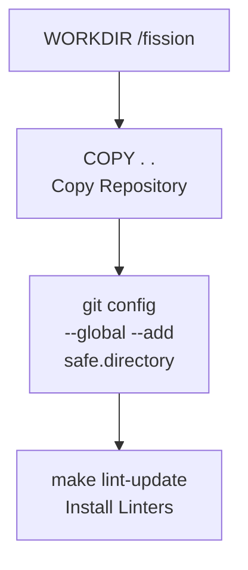

**Operation Sequence:**

1. **Working Directory**: [Dockerfile:59]() sets working directory to `/fission`
2. **Code Copy**: [Dockerfile:61]() copies entire repository into the image
3. **Git Safety**: [Dockerfile:63]() marks `/fission` as a safe directory to prevent Git ownership warnings
4. **Linter Installation**: [Dockerfile:65]() runs `make lint-update` to install golangci-lint and other code quality tools (see [Code Quality and Linting](#5.3))

**Note:** The copied code is removed in the `dev` stage to enable volume mounting. This approach allows the `buildable` stage to cache dependencies while keeping the `dev` stage flexible for local development.

**Sources:** [Dockerfile:59-65]()

---

## Dev Stage: Volume-Mounted Development

The `dev` stage removes the embedded code and configures the container for volume mounting, enabling live code updates without rebuilding the image.

### Volume Strategy

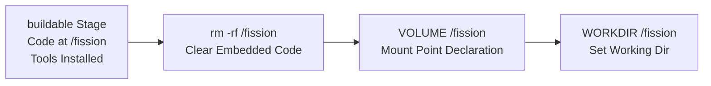

**Implementation:**

- [Dockerfile:69-70]() switches to root and removes `/fission` directory
- [Dockerfile:72]() declares `/fission` as a volume mount point
- [Dockerfile:73]() sets working directory back to `/fission`

**Usage Pattern:**

```bash
# Build the dev image
docker build --target dev -t fission-dev .

# Run with local code mounted
docker run -it --rm \
  --device /dev/fuse \
  --cap-add SYS_ADMIN \
  -v $(pwd):/fission \
  fission-dev \
  bash

# Inside container, code changes on host are immediately visible
/fission$ make build
/fission$ make test
```

**Sources:** [Dockerfile:67-74]()

---

## Container Capabilities and Privileges

To enable FUSE filesystem mounting, the container requires specific Linux capabilities:

### Required Configuration

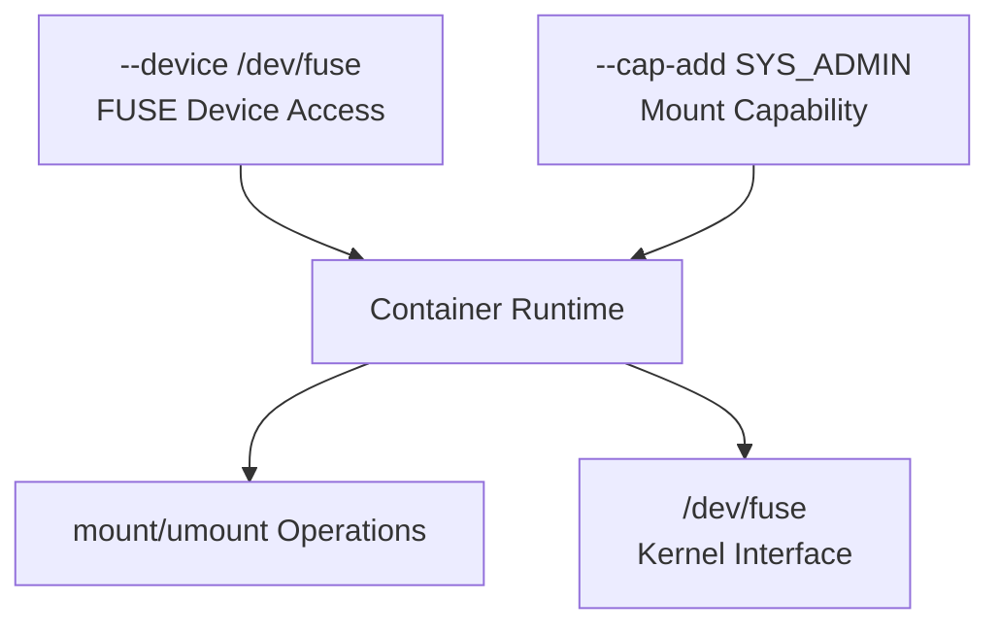

| Capability | Purpose | Required For |
|------------|---------|--------------|
| `--device /dev/fuse` | Exposes FUSE device to container | Communication with FUSE kernel module |
| `--cap-add SYS_ADMIN` | Grants mount/unmount privileges | Filesystem mounting operations |
| Volume mount (`-v`) | Shares host code with container | Live development without rebuilds |

**Security Note:** The `SYS_ADMIN` capability grants broad privileges. For production deployments of fission filesystems, consider using more restrictive capabilities or running on hosts with appropriate security policies.

**Sources:** [Dockerfile:1-74]()

---

## Tool Inventory

### Complete Package List

The following table catalogs all installed tools and their purposes in the development workflow:

| Tool | Version/Source | Purpose | Used By |
|------|----------------|---------|---------|
| `curl` | Ubuntu repos | HTTP requests, API testing | Manual testing, scripts |
| `dnsutils` | Ubuntu repos | DNS debugging (`dig`, `nslookup`) | Network troubleshooting |
| `fuse` | Ubuntu repos | FUSE kernel module and userspace tools | All filesystem implementations |
| `git` | Ubuntu repos | Version control operations | Development workflow |
| `iputils-ping` | Ubuntu repos | Network connectivity testing | Network troubleshooting |
| `jq` | Ubuntu repos | JSON parsing and filtering | S3/Swift API responses |
| `make` | Ubuntu repos | Build orchestration | All build operations (see [5.2](#5.2)) |
| `s3cmd` | Ubuntu repos | S3 CLI client | Testing S3-backed filesystems |
| `tree` | Ubuntu repos | Directory structure visualization | Documentation, debugging |
| `vim` | Ubuntu repos | Text editing | Manual code editing |
| `wget` | Ubuntu repos | File downloads | Go toolchain installation |
| `go` | 1.23.5 binary | Go compiler and runtime | Building all fission code |
| `dlv` | Source-built | Delve debugger | Debugging Go applications |

**Sources:** [Dockerfile:17-41]()

---

## Build Arguments and Customization

The Dockerfile supports build-time customization via arguments:

### Available Build Arguments

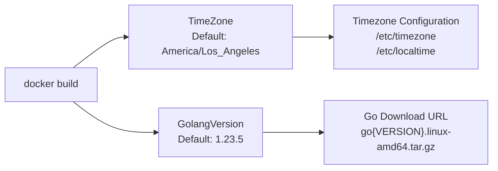

**Customization Examples:**

```bash
# Use different timezone
docker build --build-arg TimeZone=Europe/London -t fission-dev .

# Use different Go version
docker build --build-arg GolangVersion=1.22.0 -t fission-dev .

# Combine arguments
docker build \
  --build-arg TimeZone=Asia/Tokyo \
  --build-arg GolangVersion=1.23.0 \
  -t fission-dev .

# Build only to buildable stage (for CI)
docker build --target buildable -t fission-buildable .
```

**Sources:** [Dockerfile:9-33]()

---

## Integration with Build System

The Docker environment is designed to work seamlessly with the Makefile-based build system:

### Common Development Workflows

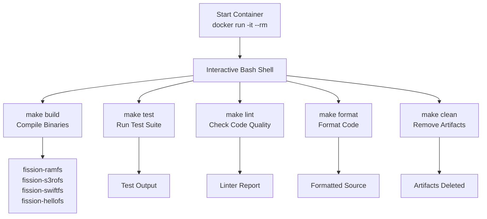

**Inside the container, all standard Make targets are available:**

- `make build` - Compiles all example filesystem implementations
- `make lint` - Runs golangci-lint (see [Code Quality and Linting](#5.3))
- `make format` - Formats all Go source files
- `make clean` - Removes build artifacts

For complete documentation of Makefile targets, see [Build System and Makefile Targets](#5.2).

**Sources:** [Dockerfile:65]()

---

## Multi-Stage Benefits

The three-stage architecture provides several advantages:

### Stage Usage Patterns

| Stage | Primary Use Case | Advantages | Disadvantages |
|-------|------------------|------------|---------------|
| `base` | CI base layer | Minimal size, fast builds | No development tools |
| `buildable` | CI builds, testing | All tools present, code embedded | Large image, no live updates |
| `dev` | Local development | Live code updates, full tooling | Requires volume mount |

### Image Size Optimization

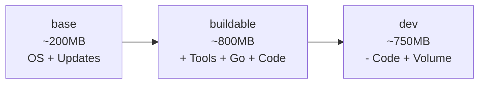

**Optimization Strategy:**

1. **Layer Caching**: Ubuntu base and tool installation layers are cached, speeding up rebuilds
2. **Code Separation**: The `dev` stage removes code to reduce image size while retaining all tools
3. **Selective Targeting**: Use `--target` flag to build only needed stage

**Sources:** [Dockerfile:4-74]()

---

