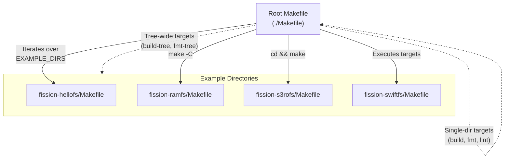
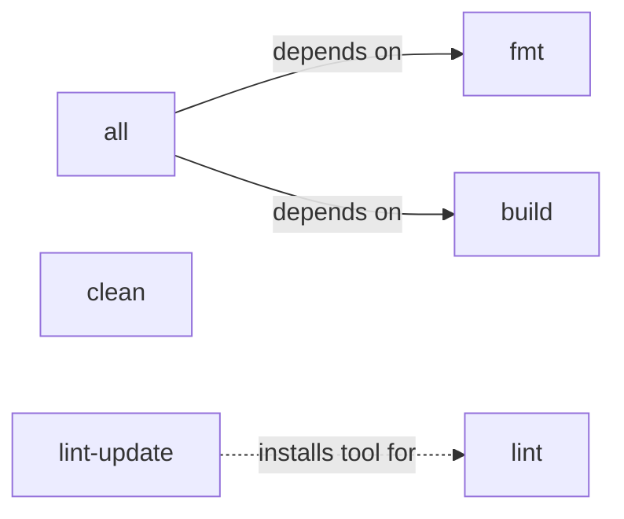
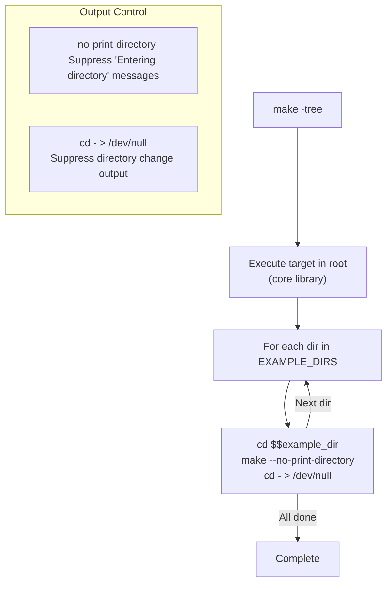
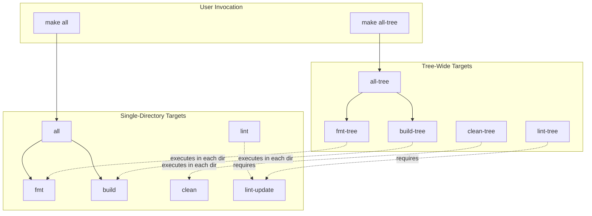

<!-- source: DeepWiki mcp.deepwiki.com · repo NVIDIA/fission · page 5.2 Build System and Makefile Targets · fetched 2026-10-26 -->

# Build System and Makefile Targets

<details>
<summary>Relevant source files</summary>

The following files were used as context for generating this wiki page:

- [Makefile](Makefile)
- [examples/fission-hellofs/Makefile](examples/fission-hellofs/Makefile)

</details>


## Purpose and Scope

This document describes the build system used throughout the fission repository, focusing on the Makefile structure and available targets for building, formatting, cleaning, and linting code. The build system consists of a root Makefile that can operate on both the core library and all example implementations, plus individual Makefiles in each example directory.

For Docker-based development environment setup, see [Docker Development Environment](#5.1). For code quality standards and linting configuration details, see [Code Quality and Linting](#5.3).

## Makefile Architecture

The fission repository uses a two-tier Makefile structure: a root Makefile for coordinated operations across the entire repository tree, and individual Makefiles in each example directory for standalone operations.

### Repository Makefile Layout



**Sources:** [Makefile:1-57](), [examples/fission-hellofs/Makefile:1-23]()

The root Makefile defines an `EXAMPLE_DIRS` variable [Makefile:4]() that matches all example directories using the pattern `examples/fission-*`. This variable is used by tree-wide targets to iterate over all examples.

### Makefile Types

| Makefile Type | Location | Purpose | Target Scope |
|---------------|----------|---------|--------------|
| **Root Makefile** | `./Makefile` | Core library and coordinated operations | Single-directory or tree-wide |
| **Example Makefile** | `examples/fission-*/Makefile` | Individual example build/test | Single example only |

**Sources:** [Makefile:1-57](), [examples/fission-hellofs/Makefile:1-23]()

## Core Targets

Both root and example Makefiles implement a common set of targets. The root Makefile additionally provides tree-wide variants with the `-tree` suffix.

### Single-Directory Targets



**Sources:** [Makefile:6-57](), [examples/fission-hellofs/Makefile:4-22]()

#### `all` Target

Default target that formats and builds the code.

- **Root:** [Makefile:6]() - Runs `fmt` then `build` for the core library
- **Example:** [examples/fission-hellofs/Makefile:4]() - Same pattern for example
- **Usage:** `make` or `make all`

#### `build` Target

Compiles the Go package in the current directory.

- **Implementation:** [Makefile:12-13](), [examples/fission-hellofs/Makefile:8-9]()
- **Command:** `go build .`
- **Output:** Creates an executable binary in the current directory (for examples) or verifies library compilation (for core)
- **Usage:** `make build`

#### `clean` Target

Removes compiled binaries and cached build artifacts.

- **Implementation:** [Makefile:24-25](), [examples/fission-hellofs/Makefile:11-12]()
- **Command:** `go clean -i .`
- **Effect:** Deletes the built binary and removes from Go's build cache
- **Usage:** `make clean`

#### `fmt` Target

Formats Go source code according to standard Go formatting rules.

- **Implementation:** [Makefile:36-37](), [examples/fission-hellofs/Makefile:14-15]()
- **Command:** `go fmt .`
- **Effect:** Reformats all `.go` files in the directory using `gofmt`
- **Usage:** `make fmt`

#### `lint-update` Target

Downloads and installs the latest version of `golangci-lint`.

- **Implementation:** [Makefile:48-50](), [examples/fission-hellofs/Makefile:17-19]()
- **Process:**
  1. Removes existing `golangci-lint` binary from `$(GOPATH)/bin`
  2. Downloads installation script from GitHub
  3. Installs latest version to `$(GOPATH)/bin`
- **Usage:** `make lint-update` (run once per environment or to upgrade)
- **Prerequisite:** Required before running `lint` target

**Sources:** [Makefile:48-50](), [examples/fission-hellofs/Makefile:17-19]()

#### `lint` Target

Runs static analysis and code quality checks.

- **Root Implementation:** [Makefile:52-53]()
  - Command: `golangci-lint run --config .golangci.yml .`
  - Analyzes only the core library directory
- **Example Implementation:** [examples/fission-hellofs/Makefile:21-22]()
  - Command: `golangci-lint run --config ../../.golangci.yml .`
  - References the root configuration file with relative path
- **Configuration:** Uses `.golangci.yml` from repository root (see [Code Quality and Linting](#5.3))
- **Usage:** `make lint`

**Sources:** [Makefile:52-53](), [examples/fission-hellofs/Makefile:21-22]()

## Tree-Wide Operations

The root Makefile provides specialized targets that operate across the entire repository tree, including the core library and all example implementations.

### Tree Target Execution Flow



**Sources:** [Makefile:15-46]()

### Tree Target Implementations

#### `all-tree` Target

Formats and builds the entire repository.

- **Implementation:** [Makefile:8]()
- **Depends on:** `fmt-tree` and `build-tree`
- **Usage:** `make all-tree`

#### `build-tree` Target

Compiles the core library and all examples.

- **Implementation:** [Makefile:15-22]()
- **Execution Pattern:**
  1. Prints "make build in root dir"
  2. Executes `make build` in root directory
  3. Iterates over `$(EXAMPLE_DIRS)` [Makefile:18]()
  4. For each example: `cd`, `make build`, `cd -`
- **Output:** Echoes directory before each build for progress tracking
- **Usage:** `make build-tree`

**Sources:** [Makefile:15-22]()

#### `clean-tree` Target

Removes all compiled binaries from the repository tree.

- **Implementation:** [Makefile:27-34]()
- **Pattern:** Same iteration structure as `build-tree`
- **Usage:** `make clean-tree`

#### `fmt-tree` Target

Formats all Go source files in the repository.

- **Implementation:** [Makefile:39-46]()
- **Pattern:** Same iteration structure as other tree targets
- **Usage:** `make fmt-tree`

#### `lint-tree` Target

Runs linting across all Go packages in the repository.

- **Implementation:** [Makefile:55-56]()
- **Command:** `golangci-lint run --config .golangci.yml $(go list -f {{.Dir}} ./...)`
- **Special Behavior:** Uses `go list` to enumerate all package directories, allowing golangci-lint to analyze the entire tree in a single invocation
- **Usage:** `make lint-tree`

**Sources:** [Makefile:55-56]()

### Output Suppression

Tree targets use two mechanisms to reduce noise in the output:

1. **`--no-print-directory` flag:** Prevents Make from printing "Entering directory" and "Leaving directory" messages [Makefile:17,20,29,32,41,44]()
2. **`cd - > /dev/null`:** Redirects the directory change output to null [Makefile:21,33,45]()

These keep the output focused on actual build/lint/format messages rather than directory navigation.

**Sources:** [Makefile:17-46]()

## Target Dependencies and Relationships



**Sources:** [Makefile:6-56]()

## PHONY Target Declaration

Both Makefiles declare their targets as `.PHONY` to ensure they always execute regardless of file timestamps.

- **Root:** [Makefile:10]() - Declares all targets including tree variants
- **Example:** [examples/fission-hellofs/Makefile:6]() - Declares standard targets

The `.PHONY` declaration prevents Make from checking for files named `build`, `clean`, etc., and ensures the targets always run when invoked.

**Sources:** [Makefile:10](), [examples/fission-hellofs/Makefile:6]()

## Common Usage Patterns

### Development Workflow

| Task | Command | Description |
|------|---------|-------------|
| Build everything | `make all-tree` | Format and compile core library + all examples |
| Build single example | `cd examples/fission-ramfs && make` | Format and compile one example |
| Clean workspace | `make clean-tree` | Remove all binaries from tree |
| Format before commit | `make fmt-tree` | Ensure consistent formatting |
| Run linting | `make lint-tree` | Check code quality across repository |
| Update linter | `make lint-update` | Install/upgrade golangci-lint |

### CI/CD Integration

For automated builds and testing, the typical command sequence would be:

```bash
# Install linter (once per environment)
make lint-update

# Verify formatting
make fmt-tree

# Run linting
make lint-tree

# Build all components
make build-tree
```

**Sources:** [Makefile:1-57]()

### Directory Navigation Pattern

The Makefiles use a consistent pattern for directory operations in loops:

```makefile
cd $$example_dir && $(MAKE) --no-print-directory <target>; \
cd - >/dev/null;
```

This pattern [Makefile:20-21,32-33,44-45]():
1. Changes to the example directory
2. Executes Make in that directory with output suppression
3. Returns to the original directory silently
4. Uses `$$` to escape the shell variable in Make syntax

**Sources:** [Makefile:18-21,30-33,42-45]()

## Build System Assumptions

The build system makes the following assumptions:

1. **Go Toolchain:** Commands assume `go` is in `PATH`
2. **GOPATH:** The `lint-update` target installs to `$(GOPATH)/bin`
3. **Directory Structure:** Tree targets assume examples are in `examples/fission-*`
4. **Naming Convention:** All example directories start with `fission-` prefix
5. **Consistent Makefiles:** All example Makefiles implement the same core targets

**Sources:** [Makefile:4,18,49-50](), [examples/fission-hellofs/Makefile:1-23]()

---

