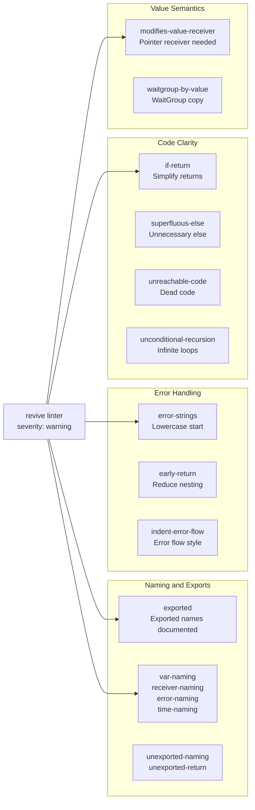
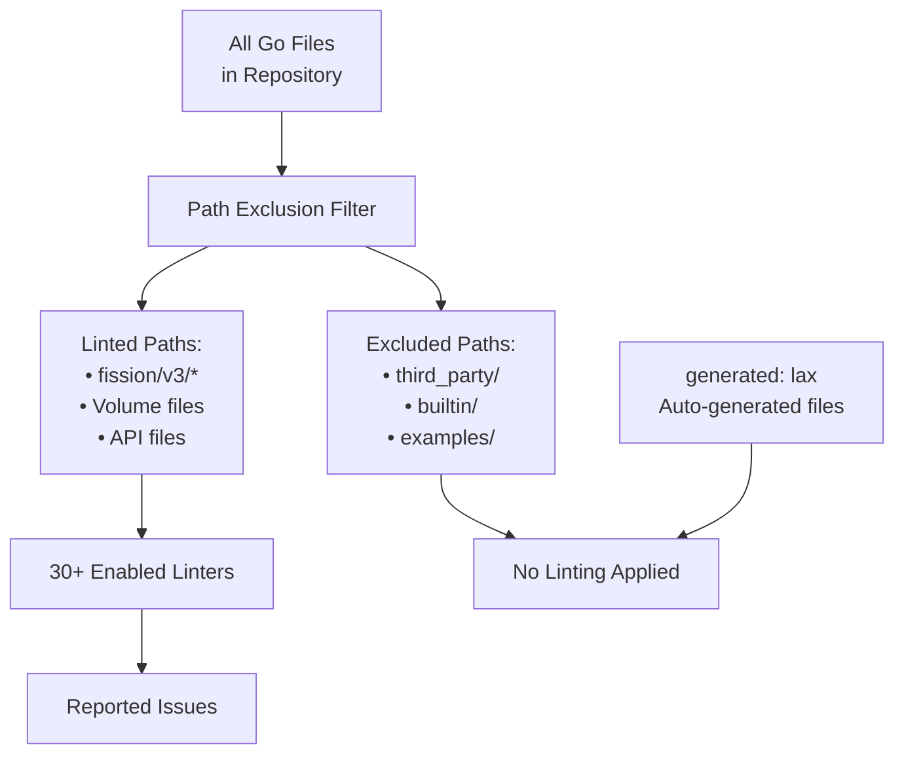
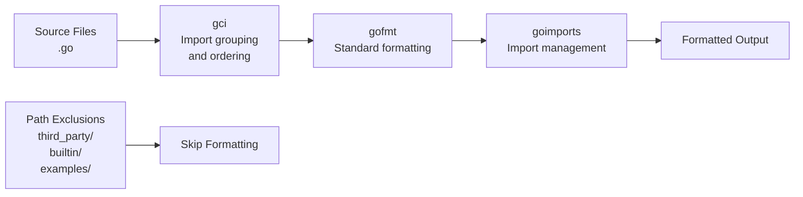
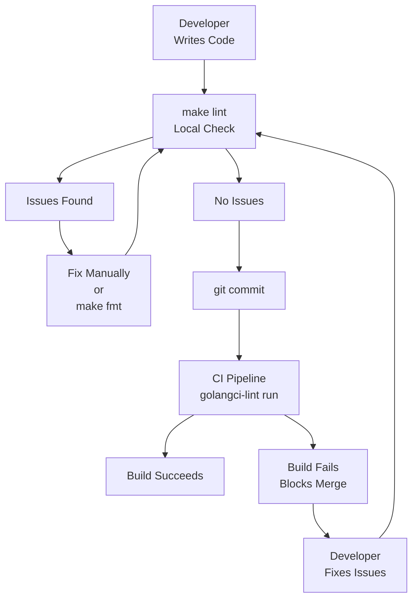

<!-- source: DeepWiki mcp.deepwiki.com · repo NVIDIA/fission · page 5.3 Code Quality and Linting · fetched 2026-10-26 -->

# Code Quality and Linting

<details>
<summary>Relevant source files</summary>

The following files were used as context for generating this wiki page:

- [.golangci.yml](.golangci.yml)

</details>


## Purpose and Scope

This document explains the code quality standards and automated linting configuration for the fission repository. The project uses `golangci-lint` as a comprehensive Go linting meta-tool, configured through [.golangci.yml:1-143](). This configuration enforces style guidelines, catches common bugs, identifies performance issues, and ensures code consistency across all modules.

For information about building and running the linters, see [5.2 - Build System and Makefile Targets](#5.2). For the broader development environment setup, see [5.1 - Docker Development Environment](#5.1).

---

## golangci-lint Configuration Overview

The repository uses golangci-lint version 2 with explicit linter selection, targeting Go 1.23.5. The configuration at [.golangci.yml:1-6]() establishes the runtime environment:

| Setting | Value | Purpose |
|---------|-------|---------|
| `version` | `"2"` | golangci-lint config format version |
| `concurrency` | `8` | Number of parallel worker goroutines |
| `go` | `1.23.5` | Target Go version for language features |
| `tests` | `true` | Apply linters to test files (`*_test.go`) |

The configuration disables all default linters ([.golangci.yml:7]()) and explicitly enables only selected ones, providing precise control over which checks are enforced.

**Sources:** [.golangci.yml:1-6]()

---

## Enabled Linters

The project enables 30+ linters covering correctness, performance, style, and security concerns. These are organized into functional categories below:

### Linter Categories and Configuration

```mermaid
graph TB
    subgraph "Correctness Linters"
        errcheck["errcheck<br/>Check error returns"]
        govet["govet<br/>Go vet analysis"]
        ineffassign["ineffassign<br/>Unused assignments"]
        unused["unused<br/>Unused code"]
        staticcheck["staticcheck<br/>Static analysis<br/>(commented out)"]
        nilnesserr["nilnesserr<br/>Nil error comparisons"]
        reassign["reassign<br/>Variable reassignment"]
    end
    
    subgraph "Style Linters"
        revive["revive<br/>Comprehensive style"]
        gocritic["gocritic<br/>Style diagnostics"]
        whitespace["whitespace<br/>Trailing whitespace"]
        misspell["misspell<br/>Common misspellings"]
        goprintffuncname["goprintffuncname<br/>Printf naming"]
        unconvert["unconvert<br/>Unnecessary conversions"]
    end
    
    subgraph "Performance Linters"
        prealloc["prealloc<br/>Slice preallocation"]
        perfsprint["perfsprint<br/>Sprint optimization"]
        bodyclose["bodyclose<br/>HTTP body close"]
        copyloopvar["copyloopvar<br/>Loop variable copy"]
    end
    
    subgraph "Security Linters"
        gosec["gosec<br/>Security issues"]
        depguard["depguard<br/>Dependency restrictions"]
    end
    
    subgraph "Specialized Linters"
        dupl["dupl<br/>Code duplication"]
        dogsled["dogsled<br/>Blank identifiers"]
        durationcheck["durationcheck<br/>Time.Duration multiply"]
        gochecksumtype["gochecksumtype<br/>Sum type exhaustiveness"]
        fatcontext["fatcontext<br/>Context in structs"]
        intrange["intrange<br/>Integer range loops"]
    end
    
    Config[".golangci.yml<br/>enable: list"] --> errcheck
    Config --> govet
    Config --> revive
    Config --> gocritic
    Config --> prealloc
    Config --> gosec
    Config --> dupl
    
    Settings["settings: section<br/>Custom configuration"] --> errcheck
    Settings --> gocritic
    Settings --> gosec
    Settings --> prealloc
    Settings --> depguard
    Settings --> dogsled
    Settings --> dupl
    Settings --> revive
```



**Sources:** [.golangci.yml:6-41]()

---

## Core Correctness Linters

These linters catch bugs and incorrect code patterns:

| Linter | Purpose | Configuration |
|--------|---------|---------------|
| `errcheck` | Ensures error return values are checked | `check-blank: true` - flags explicit `_ = ...` error ignores |
| `govet` | Runs `go vet` with all analyzers except `fieldalignment` and `shadow` | `enable-all: true` with selective disabling |
| `ineffassign` | Detects assignments to variables that are never read | Default settings |
| `unused` | Finds unused constants, variables, functions, types | Default settings |
| `unparam` | Reports unused function parameters | Default settings |
| `nilnesserr` | Checks for nil-ness before error checking | Default settings |
| `reassign` | Catches problematic variable reassignments | Default settings |

The `errcheck` configuration at [.golangci.yml:55-57]() is particularly strict, requiring explicit acknowledgment of ignored errors with `check-blank: true`. The `staticcheck` linter is commented out at [.golangci.yml:37](), indicating it may cause conflicts or false positives.

**Sources:** [.golangci.yml:17-40](), [.golangci.yml:55-57](), [.golangci.yml:69-73]()

---

## Style and Code Quality Linters

### revive Configuration

The `revive` linter provides comprehensive style checking with 25+ enabled rules at [.golangci.yml:80-110](). Key rules include:



Notable rules:
- **exported** ([.golangci.yml:89]()): All exported symbols must have documentation comments
- **error-strings** ([.golangci.yml:88]()): Error strings should not start with capital letters or end with punctuation
- **early-return** ([.golangci.yml:86]()): Encourages early returns to reduce nesting depth
- **waitgroup-by-value** ([.golangci.yml:110]()): Prevents passing `sync.WaitGroup` by value (must use pointer)

**Sources:** [.golangci.yml:80-110]()

### gocritic Configuration

The `gocritic` linter at [.golangci.yml:58-63]() enables performance and style checks with custom exclusions:

- **Enabled tags**: `performance`, `style`
- **Disabled checks**: `unnamedResult` (allows unnamed return values)

This configuration balances strict style enforcement with practical flexibility for unnamed returns, which are common in the fission codebase.

**Sources:** [.golangci.yml:58-63]()

---

## Performance Linters

### prealloc Configuration

The `prealloc` linter at [.golangci.yml:76-79]() identifies opportunities to preallocate slices with known capacity:

```go
// Instead of this (flagged):
var items []Item
for _, x := range data {
    items = append(items, processItem(x))
}

// Prefer this:
items := make([]Item, 0, len(data))
for _, x := range data {
    items = append(items, processItem(x))
}
```

Settings:
- `simple: true` - Check simple cases
- `range-loops: true` - Check range loops
- `for-loops: true` - Check traditional for loops

This reduces allocations and GC pressure in hot code paths.

**Sources:** [.golangci.yml:76-79]()

### Other Performance Linters

| Linter | Purpose | Impact Area |
|--------|---------|-------------|
| `perfsprint` | Suggests `fmt.Sprintf` alternatives when faster options exist | String formatting |
| `bodyclose` | Ensures `http.Response.Body` is closed | HTTP client code (s3rofs, swiftfs) |
| `copyloopvar` | Identifies loop variable capture issues | Goroutine spawning |

**Sources:** [.golangci.yml:10-11](), [.golangci.yml:12](), [.golangci.yml:32]()

---

## Security Linters

### gosec Configuration

The `gosec` security linter is enabled with specific exclusions at [.golangci.yml:64-68]():

```yaml
gosec:
  excludes:
    - G115  # Integer overflow check
    - G402  # TLS InsecureSkipVerify
    - G404  # Weak random number generator
```

These exclusions indicate:
- **G115**: Integer overflow checks may produce false positives in FUSE protocol handling where overflow is intentional or safe
- **G402**: Some filesystem implementations may intentionally use `InsecureSkipVerify` for development/testing
- **G404**: `math/rand` usage is acceptable for non-cryptographic purposes

**Sources:** [.golangci.yml:64-68]()

### depguard Configuration

The `depguard` linter at [.golangci.yml:43-50]() enforces dependency restrictions:

```yaml
depguard:
  rules:
    main:
      deny:
        - pkg: io/ioutil
          desc: 'replaced by io and os packages since Go 1.16'
        - pkg: math/rand$
          desc: '`math/rand` package has been deprecated use `math/rand/v2`'
```

This prevents use of deprecated packages, ensuring modern Go idioms.

**Sources:** [.golangci.yml:43-50]()

---

## Code Duplication and Complexity

### dupl Linter

The `dupl` linter at [.golangci.yml:53-54]() detects code duplication with a threshold of 250 tokens:

```yaml
dupl:
  threshold: 250
```

A threshold of 250 is relatively permissive, allowing some legitimate duplication (e.g., similar but not identical FUSE operation handlers) while catching egregious copy-paste.

**Sources:** [.golangci.yml:53-54]()

### dogsled Linter

The `dogsled` linter at [.golangci.yml:51-52]() limits blank identifier usage:

```yaml
dogsled:
  max-blank-identifiers: 3
```

This prevents excessive blank identifier usage like `_, _, _, _, val := function()`, which suggests the function signature may need refactoring.

**Sources:** [.golangci.yml:51-52]()

---

## Exclusions and Exceptions

### Path-Based Exclusions

The configuration excludes certain directories from linting at [.golangci.yml:125-128]() and [.golangci.yml:139-142]():



**Excluded directories:**
- **third_party/**: External vendored code not under project control
- **builtin/**: System-level built-in functionality
- **examples/**: Example filesystem implementations (ramfs, s3rofs, swiftfs, hellofs)

The exclusion of `examples/` indicates that example code prioritizes clarity and pedagogical value over strict style adherence. This allows examples to demonstrate patterns without enforcing production-level linting rigor.

**Sources:** [.golangci.yml:125-128](), [.golangci.yml:139-142]()

### Rule-Specific Exclusions

The configuration excludes certain false positives at [.golangci.yml:111-128]():

| Exclusion | Pattern | Rationale |
|-----------|---------|-----------|
| Error checking | `"Error return value of"` from `errcheck` | Some functions intentionally ignore errors (e.g., `Close()` in defer) |
| Block definitions | `"block doesn't have definitions"` from `gocritic` | Empty blocks may be intentional placeholders |

**Sources:** [.golangci.yml:111-128]()

### Preset Exclusions

The configuration applies preset exclusion groups at [.golangci.yml:113-117]():

- **comments**: Relaxes documentation requirements in certain contexts
- **common-false-positives**: Excludes well-known false positive patterns
- **legacy**: Allows older code patterns for backward compatibility
- **std-error-handling**: Permits standard library error handling idioms

**Sources:** [.golangci.yml:113-117]()

---

## Formatters and Auto-Fixes

The configuration enables three formatters at [.golangci.yml:132-142]():



### Formatter Responsibilities

| Formatter | Purpose | Example Impact |
|-----------|---------|----------------|
| `gci` | Groups imports into standard, external, local | Organizes imports consistently |
| `gofmt` | Applies standard Go formatting | Indentation, alignment, spacing |
| `goimports` | Adds missing imports, removes unused ones | Auto-fixes import statements |

These formatters can be run automatically (see [5.2 - Build System and Makefile Targets](#5.2)) to ensure consistent code style across the repository.

**Sources:** [.golangci.yml:132-142]()

---

## Issue Reporting Configuration

The linter is configured to report all issues without limits at [.golangci.yml:129-131]():

```yaml
issues:
  max-issues-per-linter: 0  # No limit per linter
  max-same-issues: 0        # No limit on duplicate issues
```

This ensures comprehensive reporting, making it immediately clear when code quality standards are violated. The unlimited reporting prevents issues from being hidden due to arbitrary caps.

**Sources:** [.golangci.yml:129-131]()

---

## Integration with Development Workflow

The linting configuration integrates with the development workflow through the Makefile:

1. **Local Development**: Developers run `make lint` to check code before committing
2. **CI/CD**: Automated builds fail if linting errors are present
3. **Formatting**: `make fmt` auto-fixes formatting issues
4. **Docker Environment**: The dev container includes golangci-lint pre-installed (see [5.1](#5.1))

### Linting Pipeline



The strict linting at the CI level prevents code quality regressions from entering the main branch.

**Sources:** [.golangci.yml:1-143]()

---

## Notable Linter Choices

### Disabled Linters

Some linters are conspicuously absent or disabled:

- **staticcheck** ([.golangci.yml:37]()): Commented out, suggesting it may have conflicted with other linters or produced excessive false positives
- **fieldalignment** ([.golangci.yml:71]()): Disabled in govet, allowing manual control over struct field ordering rather than optimizing for memory layout
- **shadow** ([.golangci.yml:72]()): Disabled in govet, permitting variable shadowing which can sometimes improve readability

### Modern Go Features

The configuration encourages modern Go practices:
- Prohibits `io/ioutil` in favor of `io` and `os` packages (Go 1.16+)
- Requires `math/rand/v2` instead of deprecated `math/rand`
- Targets Go 1.23.5, ensuring linters check for latest language features

**Sources:** [.golangci.yml:37](), [.golangci.yml:69-73](), [.golangci.yml:43-50]()

---

## Summary

The fission project enforces code quality through a carefully curated set of 30+ linters covering:
- **Correctness**: Error handling, unused code, nil checks
- **Style**: Naming conventions, documentation, code clarity
- **Performance**: Preallocation, string formatting, HTTP resource management
- **Security**: Deprecated packages, weak cryptography (with pragmatic exclusions)

The configuration balances strictness (all issues reported, examples excluded, no default linters) with practicality (blanket error checks disabled, specific security rules excluded for valid use cases). Path-based exclusions allow example code to prioritize readability while core library code maintains high standards.

**Sources:** [.golangci.yml:1-143]()