# Page: Overview

# Overview

<details>
<summary>Relevant source files</summary>

The following files were used as context for generating this wiki page:

- [api.go](api.go)
- [examples/fission-hellofs/main.go](examples/fission-hellofs/main.go)
- [go.mod](go.mod)
- [go.sum](go.sum)

</details>


## Purpose and Scope

The **fission** repository is a Go library that provides a high-level abstraction for building FUSE (Filesystem in Userspace) filesystems. It handles the low-level FUSE protocol communication with the Linux kernel, exposing an idiomatic Go callback interface that developers implement to create custom filesystems. The library manages `/dev/fuse` device communication, protocol marshalling, and goroutine lifecycle, allowing filesystem implementers to focus on business logic rather than FUSE protocol details.

This document provides a high-level overview of the fission architecture, its core components, and example implementations. For detailed information about specific subsystems, see:
- Core library internals: [Core Library](#2)
- Example filesystem implementations: [Example Implementations](#3)
- Build and development setup: [Development and Build Setup](#5)

**Sources:** [api.go:1-96](), [go.mod:1-11]()

---

## Repository Purpose

Fission solves the complexity of implementing FUSE filesystems by:

1. **Abstracting FUSE protocol details**: Handles binary protocol parsing, struct marshalling, and kernel communication
2. **Providing type-safe interfaces**: 40+ callback methods with structured Go types instead of raw byte buffers
3. **Managing lifecycle**: Automatic goroutine management, buffer pooling, and mount/unmount coordination
4. **Enabling rapid development**: Example implementations demonstrate patterns from minimal (hellofs) to production-ready (s3rofs)

The library is designed as a **reusable core** with **pluggable implementations**. Users implement the `Callbacks` interface to define filesystem behavior, while fission handles all FUSE protocol mechanics.

**Sources:** [api.go:30-83](), [examples/fission-hellofs/main.go:1-273]()

---

## High-Level Architecture

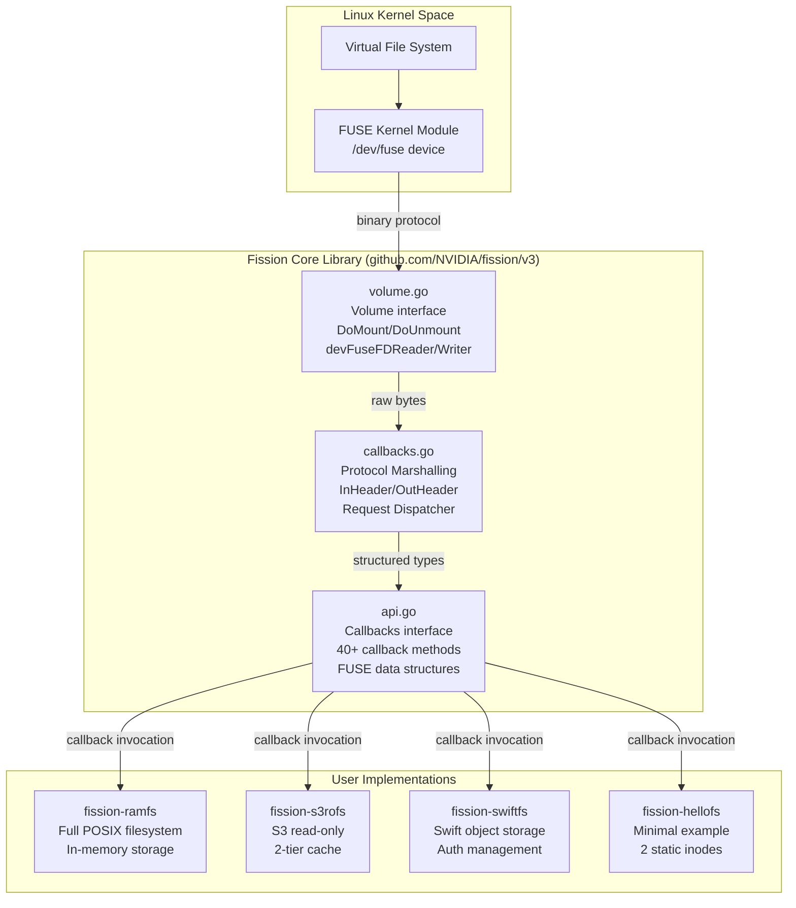

**Fission Architecture**: The library operates as a three-layer translation stack between the Linux kernel's FUSE module and user filesystem implementations. The `volume.go` layer handles device I/O, `callbacks.go` performs protocol marshalling, and `api.go` defines the callback contract.

**Sources:** [api.go:11-95](), Diagram 1, Diagram 2

---

## Core Components and Code Mapping

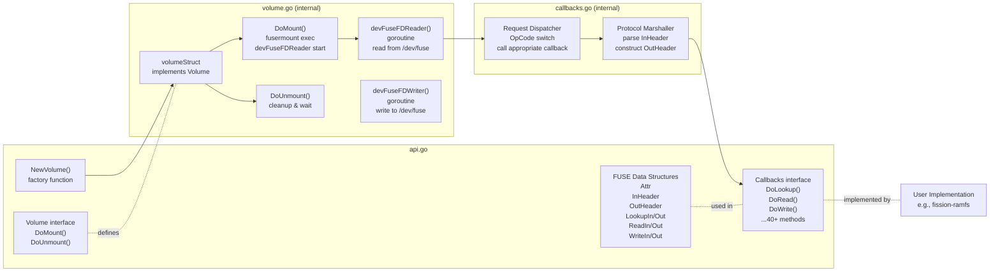

**Code Entity Mapping**: This diagram shows the relationship between the public API surface and internal implementation. Users interact only with `Volume` and `Callbacks` interfaces from `api.go`, while `volume.go` and `callbacks.go` provide the internal machinery.

| Component | File | Key Types/Functions | Visibility |
|-----------|------|---------------------|------------|
| **Public API** | `api.go` | `Volume`, `Callbacks`, `NewVolume()` | Exported |
| **Data Structures** | `api.go` | `Attr`, `InHeader`, `OutHeader`, 40+ request/response structs | Exported |
| **Volume Management** | `volume.go` | `volumeStruct`, `DoMount()`, `DoUnmount()`, `devFuseFDReader()` | Internal |
| **Protocol Layer** | `callbacks.go` | Request dispatcher, marshalling functions | Internal |

**Sources:** [api.go:11-1203](), Diagram 1

---

## Example Implementations Comparison

The repository includes four example implementations that demonstrate different filesystem patterns:

| Implementation | Purpose | Storage Backend | Operations | Complexity |
|----------------|---------|-----------------|------------|------------|
| **fission-hellofs** | Learning example | Static hardcoded data | Read-only, 2 inodes | Minimal |
| **fission-ramfs** | Full POSIX filesystem | In-memory (volatile) | Read/write, xattr, locking | High |
| **fission-s3rofs** | Cloud storage frontend | Amazon S3 | Read-only, cached | Medium |
| **fission-swiftfs** | Object storage frontend | OpenStack Swift | Read-only, cached | Medium |

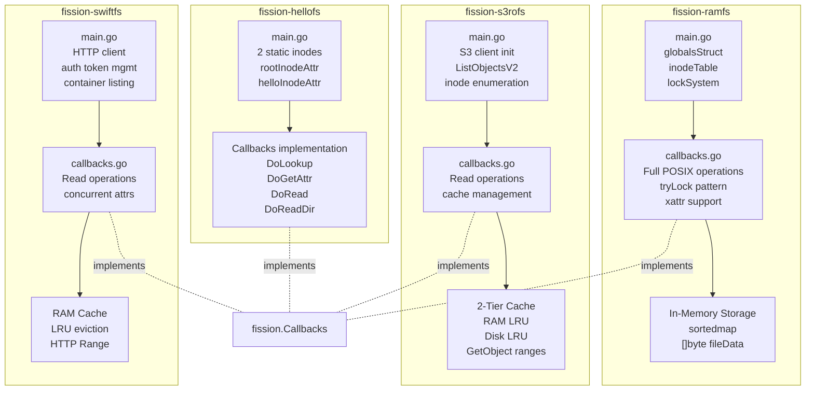

**Implementation Patterns**: Each example filesystem implements the `fission.Callbacks` interface but uses different storage backends and concurrency strategies. The hellofs example demonstrates the minimum viable implementation, while ramfs shows a full-featured POSIX filesystem with sophisticated locking.

**Sources:** [examples/fission-hellofs/main.go:1-273](), Diagram 3

---

## FUSE Request Flow

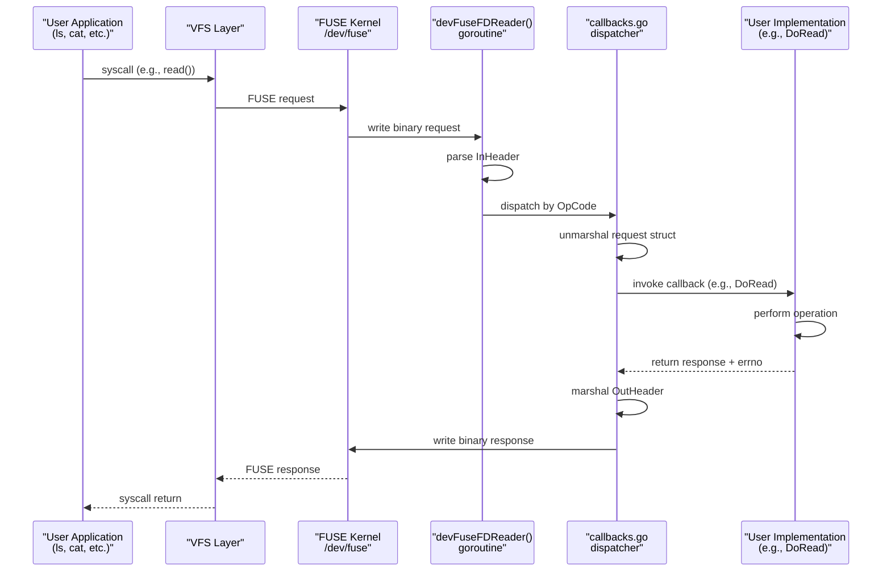

**Request Processing Pipeline**: When a user application performs a filesystem operation, the request flows through the kernel to fission's reader goroutine, which dispatches it to the appropriate callback. The response follows the reverse path back to the application.

**Sources:** [api.go:17-27](), Diagram 2

---

## Key Features

### Protocol Version Support

Fission supports FUSE protocol versions 7.17 through 7.44 (Linux kernels 3.1 through 6.16), with automatic version negotiation during mount via the `DoInit()` callback.

**Sources:** [api.go:97-134]()

### Operation Coverage

The library exposes 40+ FUSE operations through the `Callbacks` interface:

| Category | Operations |
|----------|------------|
| **Inode Operations** | `DoLookup`, `DoGetAttr`, `DoSetAttr`, `DoReadLink`, `DoAccess`, `DoStatX` |
| **File Operations** | `DoOpen`, `DoRead`, `DoWrite`, `DoRelease`, `DoFSync`, `DoFAllocate`, `DoLSeek` |
| **Directory Operations** | `DoOpenDir`, `DoReadDir`, `DoReadDirPlus`, `DoReleaseDir`, `DoFSyncDir` |
| **Namespace Operations** | `DoMkNod`, `DoMkDir`, `DoUnlink`, `DoRmDir`, `DoRename`, `DoRename2`, `DoLink`, `DoSymLink`, `DoCreate` |
| **Extended Attributes** | `DoSetXAttr`, `DoGetXAttr`, `DoListXAttr`, `DoRemoveXAttr` |
| **File Locking** | `DoGetLK`, `DoSetLK`, `DoSetLKW` |
| **Lifecycle** | `DoInit`, `DoDestroy`, `DoForget`, `DoBatchForget`, `DoInterrupt` |
| **Special** | `DoStatFS`, `DoFlush`, `DoBMap`, `DoPoll` |

Not all implementations need to support all operations. Read-only filesystems like s3rofs implement only read operations and return `syscall.ENOSYS` for write operations.

**Sources:** [api.go:40-83]()

### Concurrency and Buffer Management

- **Goroutine Management**: `devFuseFDReader()` spawns per-request handler goroutines, coordinated via `sync.WaitGroup`
- **Buffer Pooling**: `sync.Pool` for read buffers reduces GC pressure in high-throughput scenarios
- **Thread Safety**: User implementations are responsible for their own locking; fission callbacks may be invoked concurrently

**Sources:** Diagram 5

### Mount Options

The `NewVolume()` factory function accepts configuration parameters:

```go
NewVolume(
    volumeName string,           // Displayed in mount output
    mountpointDirPath string,    // Where to mount
    fuseSubtype string,          // Filesystem type suffix (e.g., "fission.ramfs")
    maxRead uint32,              // Maximum read size (typically 1MiB)
    maxWrite uint32,             // Maximum write size (0 = read-only)
    defaultPermissions bool,     // Enable kernel permission checking
    allowOther bool,             // Allow non-owner access
    callbacks Callbacks,         // User implementation
    logger *log.Logger,          // For debugging
    errChan chan error,          // Mount lifecycle errors
)
```

**Sources:** [api.go:85-95](), [examples/fission-hellofs/main.go:249]()

---

## Dependencies

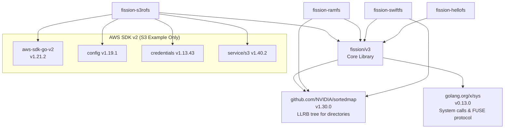

**Dependency Graph**: The core library has minimal dependencies (sortedmap for directory management and golang.org/x/sys for syscalls). Example implementations add dependencies as needed (e.g., AWS SDK for S3 integration).

| Package | Version | Purpose | Used By |
|---------|---------|---------|---------|
| `github.com/NVIDIA/sortedmap` | v1.30.0 | LLRB tree for ordered directory entries | Core, ramfs, s3rofs, swiftfs |
| `golang.org/x/sys` | v0.13.0 | Linux syscalls, FUSE protocol constants | Core |
| `github.com/aws/aws-sdk-go-v2` | v1.21.2 | AWS SDK core framework | s3rofs only |
| `github.com/aws/aws-sdk-go-v2/service/s3` | v1.40.2 | S3 client for GetObject/ListObjects | s3rofs only |

**Sources:** [go.mod:1-30](), [go.sum:1-52](), Diagram 4

---

## Getting Started

To use fission in your project:

1. **Import the library**:
   ```go
   import "github.com/NVIDIA/fission/v3"
   ```

2. **Implement the `Callbacks` interface**: Define filesystem behavior by implementing callback methods for the operations you support.

3. **Create a `Volume`**: Call `fission.NewVolume()` with your callbacks and configuration.

4. **Mount the filesystem**: Invoke `volume.DoMount()` to begin handling requests.

5. **Handle signals**: Wait for termination signals, then call `volume.DoUnmount()` to cleanly unmount.

The `fission-hellofs` example demonstrates this pattern with minimal code (approximately 600 lines including boilerplate), showing only the essential operations for a read-only filesystem with static content.

**Sources:** [examples/fission-hellofs/main.go:75-273]()

---

# Page: Core Library

# Core Library

<details>
<summary>Relevant source files</summary>

The following files were used as context for generating this wiki page:

- [api.go](api.go)
- [callbacks.go](callbacks.go)
- [volume.go](volume.go)

</details>


The Core Library is the foundation of the fission FUSE filesystem framework. It consists of three tightly-integrated components that abstract the Linux FUSE protocol into idiomatic Go interfaces. This page provides an overview of how these components work together to enable filesystem implementations.

For detailed documentation of the interfaces and data structures, see [API Design and Interfaces](#2.1). For mount/unmount mechanics and `/dev/fuse` communication, see [Volume Management and Lifecycle](#2.2). For protocol translation details, see [Protocol Marshalling and Request Handling](#2.3).

## Architecture Overview

The Core Library consists of three Go source files that provide distinct layers of abstraction:

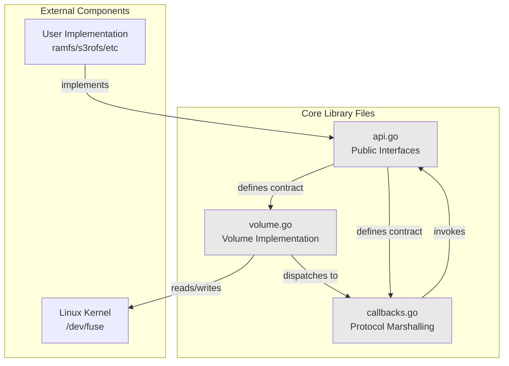

**Sources:** [api.go:1-1203](), [volume.go:1-628](), [callbacks.go:1-1781]()

### Component Responsibilities

| Component | Primary Responsibility | Key Types/Functions |
|-----------|----------------------|---------------------|
| `api.go` | Defines public interfaces and FUSE data structures | `Volume`, `Callbacks`, `InHeader`, `OutHeader`, `Attr`, all `*In` and `*Out` structs |
| `volume.go` | Manages FUSE volume lifecycle and `/dev/fuse` I/O | `volumeStruct`, `DoMount()`, `DoUnmount()`, `devFuseFDReader()`, `devFuseFDWriter()` |
| `callbacks.go` | Translates between binary FUSE protocol and Go types | `doLookup()`, `doRead()`, `doWrite()`, `marshalAttr()`, and 40+ protocol handlers |

**Sources:** [api.go:11-95](), [volume.go:19-39](), [callbacks.go:12-1781]()

## Public API Surface

The library exposes two primary interfaces that user implementations must understand:

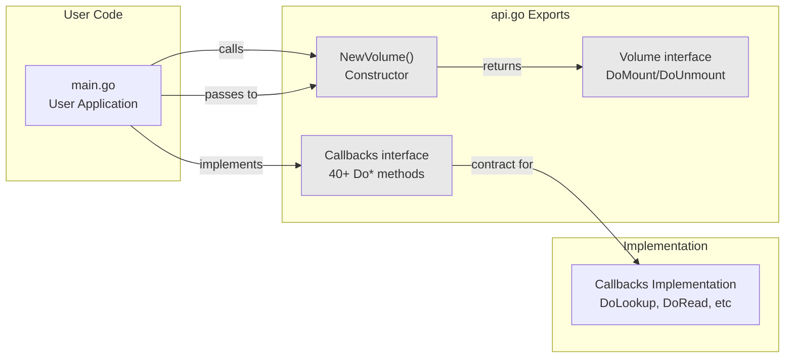

**Sources:** [api.go:17-28](), [api.go:39-83](), [api.go:92-95]()

### Volume Interface

The `Volume` interface provides lifecycle control:

- **`DoMount()`** - Initiates the FUSE mount process, spawns reader goroutines, and begins servicing requests
- **`DoUnmount()`** - Unmounts the filesystem and cleanly shuts down all goroutines

**Sources:** [api.go:17-28]()

### Callbacks Interface

The `Callbacks` interface declares 40+ methods corresponding to FUSE operations. Each method follows the pattern:

```
Do<Operation>(inHeader *InHeader, <operation>In *<Operation>In) (<operation>Out *<Operation>Out, errno syscall.Errno)
```

Examples include:
- `DoLookup()` - Path name lookup
- `DoRead()` - File read operations
- `DoWrite()` - File write operations
- `DoReadDir()` - Directory listing

**Sources:** [api.go:39-83]()

## Request Processing Pipeline

When a user application (e.g., `cat /mnt/fission/file.txt`) triggers a filesystem operation, the request flows through the Core Library in a well-defined path:

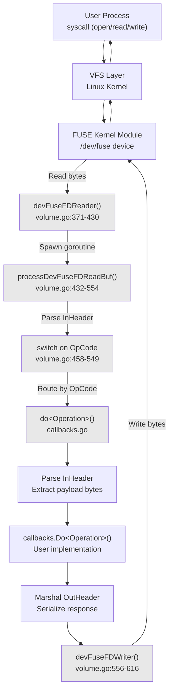

**Sources:** [volume.go:371-430](), [volume.go:432-554](), [callbacks.go:31-61](), [volume.go:556-616]()

### Detailed Flow

1. **Read Loop** - `devFuseFDReader()` continuously reads from `/dev/fuse` file descriptor
2. **Dispatch** - Each read spawns a goroutine calling `processDevFuseFDReadBuf()` with a buffer from the `sync.Pool`
3. **OpCode Routing** - `InHeader.OpCode` determines which `do*()` function in `callbacks.go` handles the request
4. **Unmarshalling** - The `do*()` function parses the binary payload into Go structs using `unsafe.Pointer` casts
5. **Callback Invocation** - The corresponding `Callbacks.Do*()` method is called with structured Go types
6. **Response Marshalling** - The response is serialized back into binary format
7. **Write** - `devFuseFDWriter()` sends the response via `syscall.Writev()`

**Sources:** [volume.go:371-430](), [volume.go:432-554](), [volume.go:556-616]()

## Volume Lifecycle Management

The `volumeStruct` manages the complete lifecycle of a FUSE mount:

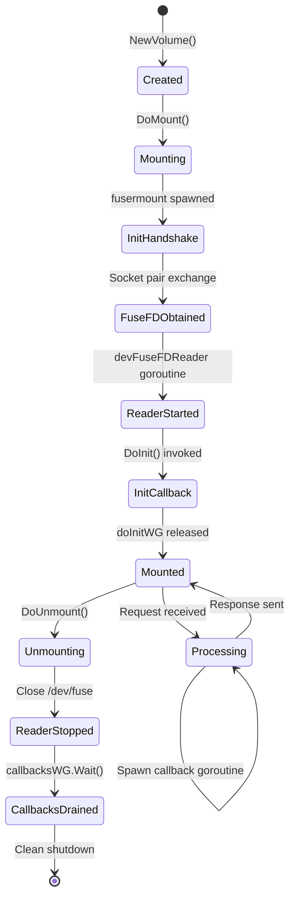

**Sources:** [volume.go:90-291](), [volume.go:293-325](), [volume.go:371-430]()

### Critical Synchronization Points

The `volumeStruct` uses multiple `sync.WaitGroup` instances to coordinate goroutine lifecycles:

| WaitGroup | Purpose | Set By | Waited By |
|-----------|---------|--------|-----------|
| `doInitWG` | Ensures mount completes before returning from `DoMount()` | [volume.go:229]() | [volume.go:285]() |
| `devFuseFDReaderWG` | Tracks the reader goroutine lifecycle | [volume.go:276]() | [volume.go:319]() |
| `callbacksWG` | Tracks all callback handler goroutines | [volume.go:427]() | [volume.go:404]() |

**Sources:** [volume.go:34-38](), [volume.go:229](), [volume.go:276](), [volume.go:319](), [volume.go:404](), [volume.go:427]()

## Protocol Marshalling Strategy

The `callbacks.go` file implements a zero-allocation marshalling strategy using `unsafe.Pointer` for performance:

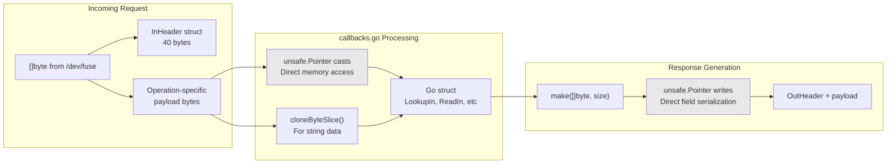

**Sources:** [callbacks.go:31-61](), [callbacks.go:447-481](), [volume.go:618-627]()

### Example: DoLookup Protocol Handling

The `doLookup()` function demonstrates the complete marshalling pattern:

**Unmarshalling (bytes → Go):**
```
devFuseFDReadBufPayload []byte → LookupIn struct
```
[callbacks.go:39-41]()

**User Callback:**
```
volume.callbacks.DoLookup(inHeader, lookupIn) → (lookupOut *LookupOut, errno syscall.Errno)
```
[callbacks.go:43]()

**Marshalling (Go → bytes):**
```
LookupOut struct → []byte with EntryOut + Attr fields
```
[callbacks.go:49-58]()

**Send Response:**
```
volume.devFuseFDWriter(inHeader, errno, outPayload)
```
[callbacks.go:60]()

**Sources:** [callbacks.go:31-61]()

## Memory Management

The Core Library employs several strategies to minimize allocations:

### Buffer Pooling

The `devFuseFDReadPool` reuses buffers for reading from `/dev/fuse`:

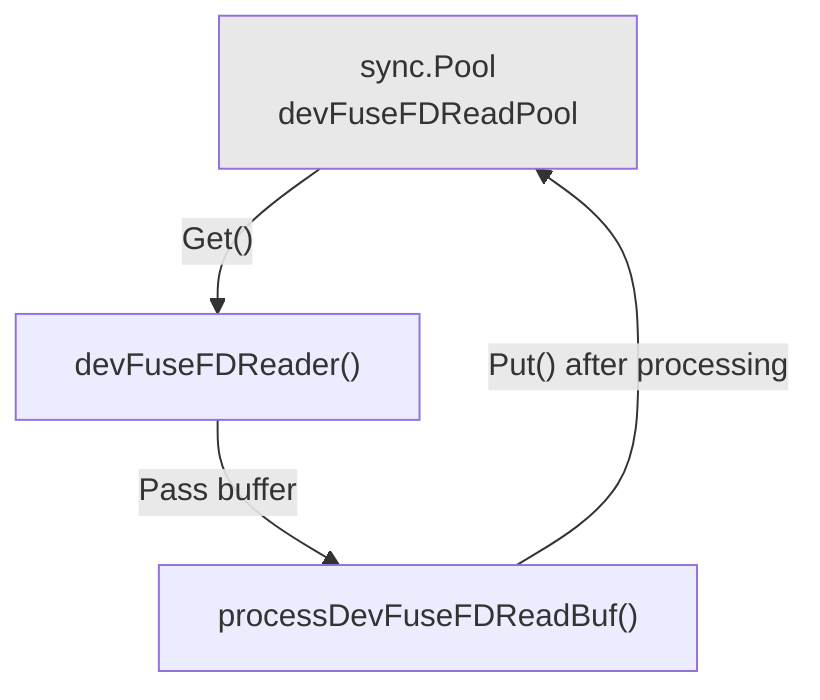

Each buffer is sized to accommodate the largest possible FUSE request:
```
devFuseFDReadSize = InHeaderSize + WriteInFixedPortionSize + maxWrite
```

**Sources:** [volume.go:30-31](), [volume.go:59-62](), [volume.go:80-85](), [volume.go:361-369]()

### Direct Memory Access

The `callbacks.go` functions avoid intermediate allocations by casting directly to struct types:

```go
inHeader = &InHeader{
    Len:    *(*uint32)(unsafe.Pointer(&devFuseFDReadBuf[0])),
    OpCode: *(*uint32)(unsafe.Pointer(&devFuseFDReadBuf[4])),
    // ... direct memory reads
}
```

**Sources:** [volume.go:447-456]()

Similarly, response marshalling writes directly to byte slices without intermediate structs:

```go
*(*uint64)(unsafe.Pointer(&outPayload[0])) = lookupOut.EntryOut.NodeID
*(*uint64)(unsafe.Pointer(&outPayload[8])) = lookupOut.EntryOut.Generation
```

**Sources:** [callbacks.go:51-56]()

## Concurrency Model

The Core Library uses a fork-join concurrency pattern:

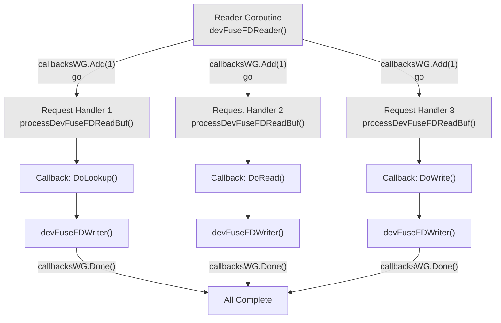

**Sources:** [volume.go:427-428](), [volume.go:443](), [volume.go:404]()

### Shutdown Coordination

During unmount, the library ensures clean shutdown:

1. `DoUnmount()` calls `fusermount -u` which triggers kernel teardown
2. Kernel closes the `/dev/fuse` file descriptor
3. `devFuseFDReader()` receives read error and exits its loop
4. Reader waits for all spawned handlers via `callbacksWG.Wait()`
5. Reader signals completion via `errChan`

**Sources:** [volume.go:293-325](), [volume.go:404-419]()

## Error Handling

All FUSE operations return errors as `syscall.Errno` values, which map directly to Linux error codes:

| Operation Result | Errno | Library Action |
|------------------|-------|----------------|
| Success | `0` | Marshal response, send via `devFuseFDWriter()` |
| Operation-specific error | `syscall.ENOENT`, `syscall.EINVAL`, etc. | Send error response with no payload |
| Unsupported operation | `syscall.ENOSYS` | Logged and sent as error |

**Sources:** [volume.go:556-616](), [volume.go:567-569]()

## Integration Points

### Fusermount Integration

The library spawns the `fusermount` utility to perform the actual mount:

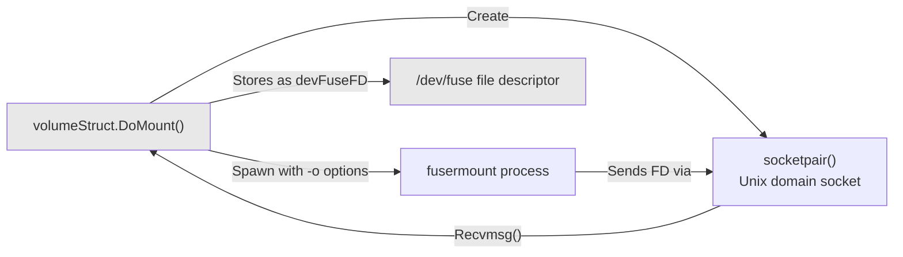

**Sources:** [volume.go:129-274]()

### Kernel Version Negotiation

The `doInit()` callback negotiates FUSE protocol version with the kernel:

- Kernel sends `InitIn` with its supported major/minor version
- Library validates major == 7
- Library responds with compatible minor version (17-44+)
- Response structure varies based on negotiated version

**Sources:** [callbacks.go:791-1044](), [api.go:97-134]()

## Usage Pattern

Typical usage of the Core Library:

```go
// 1. Implement Callbacks interface
type myFS struct { /* ... */ }
func (fs *myFS) DoLookup(...) { /* ... */ }
// ... implement all 40+ methods

// 2. Create Volume
volume := fission.NewVolume(
    "myfs",              // volume name
    "/mnt/myfs",         // mount point
    "myfs",              // FUSE subtype
    1024*1024,           // maxRead
    1024*1024,           // maxWrite
    false,               // defaultPermissions
    false,               // allowOther
    &myFS{},             // callbacks implementation
    logger,              // log.Logger
    errChan,             // chan error
)

// 3. Mount
err := volume.DoMount()

// 4. Handle errors from errChan
go func() {
    err := <-errChan
    // Handle shutdown
}()

// 5. Unmount when done
err = volume.DoUnmount()
```

**Sources:** [api.go:92-95](), [volume.go:51-88]()

---

# Page: API Design and Interfaces

# API Design and Interfaces

<details>
<summary>Relevant source files</summary>

The following files were used as context for generating this wiki page:

- [api.go](api.go)

</details>


## Purpose and Scope

This document describes the public API of the fission library as defined in [api.go](). It covers the two primary interfaces (`Volume` and `Callbacks`), the data structures used for FUSE protocol communication, operation types, and the contract between the library and filesystem implementations.

For information about how the `Volume` interface is implemented internally, see [Volume Management and Lifecycle](#2.2). For details on how callbacks are dispatched and marshalled, see [Protocol Marshalling and Request Handling](#2.3). For concrete examples of implementing the `Callbacks` interface, see [Example Implementations](#3).

---

## Core Interfaces

The fission library defines two fundamental interfaces that form the contract between the library and user code:

### Volume Interface

The `Volume` interface represents a mounted FUSE filesystem instance. It provides lifecycle management methods:

```go
type Volume interface {
    DoMount() (err error)
    DoUnmount() (err error)
}
```

| Method | Purpose | When to Call |
|--------|---------|--------------|
| `DoMount()` | Initiates the FUSE mount and begins receiving callbacks | Once after obtaining a `Volume` from `NewVolume()` |
| `DoUnmount()` | Performs FUSE unmount and stops all callbacks | Once before discarding the `Volume` instance |

**Sources:** [api.go:17-28]()

### Callbacks Interface

The `Callbacks` interface declares 43 methods that correspond to FUSE operations. User implementations must provide all methods, though many can return `syscall.ENOSYS` if unsupported:

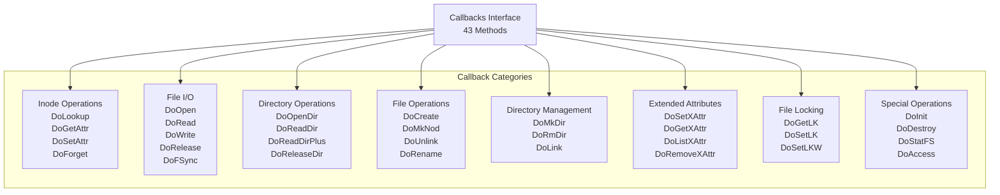

**Return Value Contract:**

Methods fall into three categories:

| Return Signature | Behavior | Examples |
|------------------|----------|----------|
| `(outStruct, errno)` | Return data on success (`errno=0`), error code on failure | `DoLookup`, `DoRead`, `DoGetAttr` |
| `(errno)` | Return error code only | `DoUnlink`, `DoRmDir`, `DoFlush` |
| No return value | Fire-and-forget notifications | `DoForget`, `DoInterrupt`, `DoBatchForget` |

**Important:** When returning an error (`errno != 0`), the output struct pointer must be `nil` as it will not be written to `/dev/fuse`.

**Sources:** [api.go:30-83]()

### NewVolume Factory Function

The `NewVolume` function creates a `Volume` instance:

```go
func NewVolume(
    volumeName string,
    mountpointDirPath string,
    fuseSubtype string,
    maxRead uint32,
    maxWrite uint32,
    defaultPermissions bool,
    allowOther bool,
    callbacks Callbacks,
    logger *log.Logger,
    errChan chan error,
) (volume Volume)
```

| Parameter | Purpose |
|-----------|---------|
| `volumeName` | Human-readable identifier for the filesystem |
| `mountpointDirPath` | Directory where filesystem will be mounted |
| `fuseSubtype` | Filesystem type suffix (appears as `fuse.{fuseSubtype}`) |
| `maxRead` | Maximum read request size in bytes |
| `maxWrite` | Maximum write request size in bytes; configures buffer pool |
| `defaultPermissions` | If `true`, kernel performs permission checks |
| `allowOther` | If `true`, non-root users can access the mount |
| `callbacks` | Implementation of the `Callbacks` interface |
| `logger` | Logger for internal library messages |
| `errChan` | Channel to receive fatal errors from the mount |

**Special Note on `maxWrite`:** This value configures the buffer pool used for `/dev/fuse` communication. The `DoInit()` callback can return a different `MaxWrite` in `InitOut`, but the original value passed to `NewVolume()` determines buffer sizing.

**Sources:** [api.go:85-95]()

---

## Request and Response Headers

All FUSE operations use common header structures to carry metadata:

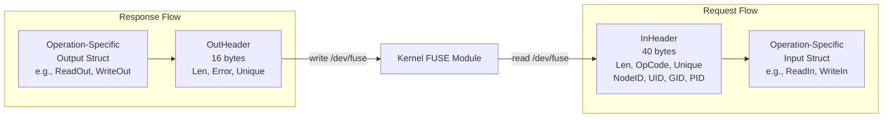

### InHeader Structure

Every request from the kernel begins with an `InHeader`:

| Field | Type | Purpose |
|-------|------|---------|
| `Len` | `uint32` | Total request size (header + payload) |
| `OpCode` | `uint32` | Operation type (see [Operation Types](#operation-types-and-opcodes)) |
| `Unique` | `uint64` | Request identifier for matching responses |
| `NodeID` | `uint64` | Inode number being operated on |
| `UID` | `uint32` | User ID of requesting process |
| `GID` | `uint32` | Group ID of requesting process |
| `PID` | `uint32` | Process ID of requesting process |
| `Padding` | `uint32` | Alignment padding |

**Sources:** [api.go:473-484]()

### OutHeader Structure

Every response to the kernel begins with an `OutHeader`:

| Field | Type | Purpose |
|-------|------|---------|
| `Len` | `uint32` | Total response size (automatically computed) |
| `Error` | `int32` | Error code (0 for success, negative errno for error) |
| `Unique` | `uint64` | Must match the request's `Unique` field |

**Sources:** [api.go:486-492]()

---

## Operation Types and OpCodes

The `OpCode` field in `InHeader` determines which callback method is invoked. The library supports 42 operation types:

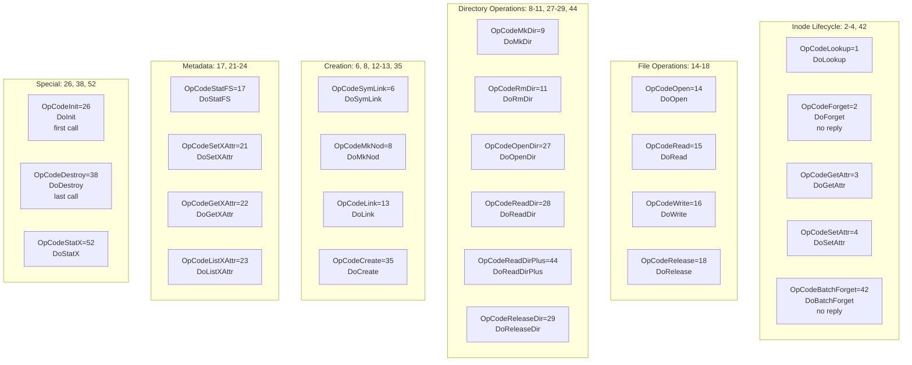

### OpCode Categories

| Range | Category | Example Operations |
|-------|----------|-------------------|
| 1-4 | Inode lifecycle | Lookup, Forget, GetAttr, SetAttr |
| 5-13 | File/directory creation | SymLink, MkNod, MkDir, Unlink, RmDir, Rename, Link |
| 14-18 | File I/O | Open, Read, Write, StatFS, Release |
| 20-30 | Metadata and directories | FSync, XAttr operations, Flush, Init, OpenDir, ReadDir |
| 31-46 | Advanced operations | Locking, Access, Create, Interrupt, FAllocate, ReadDirPlus, Rename2, LSeek |
| 52 | Extended stat | StatX |

**Unsupported Operations:** `OpCodeIoCtl` (39), `OpCodeNotifyReply` (41), `OpCodeCopyFileRange` (47), `OpCodeSetupMapping` (48), `OpCodeRemoveMapping` (49), `OpCodeSyncFS` (50), `OpCodeTmpFile` (51), `OpCodeCuseInit` (4096)

**Sources:** [api.go:417-471]()

---

## Core Data Structures

### Attr: File Attributes

The `Attr` structure represents POSIX file attributes (88 bytes):

| Field | Type | Description |
|-------|------|-------------|
| `Ino` | `uint64` | Inode number |
| `Size` | `uint64` | File size in bytes |
| `Blocks` | `uint64` | Number of 512-byte blocks allocated |
| `ATimeSec`, `ATimeNSec` | `uint64`, `uint32` | Access time |
| `MTimeSec`, `MTimeNSec` | `uint64`, `uint32` | Modification time |
| `CTimeSec`, `CTimeNSec` | `uint64`, `uint32` | Status change time |
| `Mode` | `uint32` | File type and permissions (use `syscall.S_*` constants) |
| `NLink` | `uint32` | Number of hard links |
| `UID`, `GID` | `uint32`, `uint32` | Owner user and group IDs |
| `RDev` | `uint32` | Device ID (for special files) |
| `BlkSize` | `uint32` | Preferred block size for I/O |

**Common Mode Values:**
- `syscall.S_IFDIR | 0755` - Directory with rwxr-xr-x permissions
- `syscall.S_IFREG | 0644` - Regular file with rw-r--r-- permissions
- `syscall.S_IFLNK | 0777` - Symbolic link

**Sources:** [api.go:136-155]()

### EntryOut: Inode Entry Information

Many callbacks return `EntryOut` (or embed it) to provide inode information:

| Field | Type | Purpose |
|-------|------|---------|
| `NodeID` | `uint64` | Inode number (must be unique per filesystem) |
| `Generation` | `uint64` | Inode generation number (for NFS exports) |
| `EntryValidSec`, `EntryValidNSec` | `uint64`, `uint32` | How long kernel can cache this entry |
| `AttrValidSec`, `AttrValidNSec` | `uint64`, `uint32` | How long kernel can cache attributes |
| `Attr` | `Attr` | Embedded file attributes |

**Cache Validity:** Setting validity times to large values (e.g., `math.MaxInt64`) enables aggressive kernel caching, reducing callback frequency. Setting to `0` disables caching.

**Sources:** [api.go:378-388]()

### DirEnt: Directory Entry

Directory listings use `DirEnt` structures:

| Field | Type | Purpose |
|-------|------|---------|
| `Ino` | `uint64` | Inode number of entry |
| `Off` | `uint64` | Offset of the *next* entry (must be unique) |
| `NameLen` | `uint32` | Length of `Name` (automatically computed) |
| `Type` | `uint32` | File type (`syscall.DT_REG`, `DT_DIR`, etc.) |
| `Name` | `[]byte` | Entry name (no null terminator) |

**Alignment:** Each `DirEnt` must be aligned to an 8-byte boundary. The serialization layer handles this automatically.

**Sources:** [api.go:397-414]()

---

## Operation-Specific Structures

Each operation has corresponding input and output structures. Here are key examples:

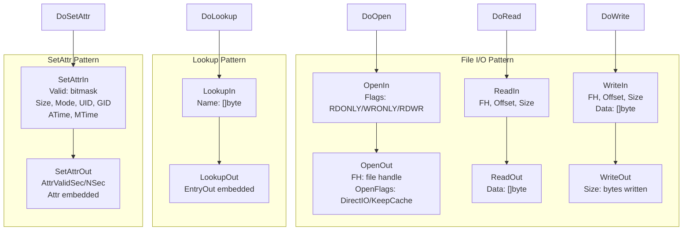

### Read Operation

```go
// DoRead signature
DoRead(inHeader *InHeader, readIn *ReadIn) (readOut *ReadOut, errno syscall.Errno)

// ReadIn fields
type ReadIn struct {
    FH        uint64  // File handle from OpenOut
    Offset    uint64  // Byte offset to read from
    Size      uint32  // Number of bytes to read
    ReadFlags uint32  // Flags (e.g., ReadLockOwner)
    LockOwner uint64  // Lock owner ID
    Flags     uint32  // Original open flags
    Padding   uint32
}

// ReadOut fields
type ReadOut struct {
    Data []byte  // File data (len must be <= Size from ReadIn)
}
```

**Sources:** [api.go:646-660]()

### Write Operation

```go
// DoWrite signature
DoWrite(inHeader *InHeader, writeIn *WriteIn) (writeOut *WriteOut, errno syscall.Errno)

// WriteIn fields
type WriteIn struct {
    FH         uint64  // File handle from OpenOut
    Offset     uint64  // Byte offset to write to
    Size       uint32  // Number of bytes to write (== len(Data))
    WriteFlags uint32  // Cache, LockOwner, or KillPriv flags
    LockOwner  uint64  // Lock owner ID
    Flags      uint32  // Original open flags
    Padding    uint32
    Data       []byte  // Data to write
}

// WriteOut fields
type WriteOut struct {
    Size    uint32  // Number of bytes actually written
    Padding uint32
}
```

**Sources:** [api.go:662-680]()

### Lookup Operation

```go
// DoLookup signature
DoLookup(inHeader *InHeader, lookupIn *LookupIn) (lookupOut *LookupOut, errno syscall.Errno)

// LookupIn fields
type LookupIn struct {
    Name []byte  // Name to look up in directory (inHeader.NodeID)
}

// LookupOut fields (embeds EntryOut)
type LookupOut struct {
    EntryOut  // NodeID, Generation, validity times, Attr
}
```

**Sources:** [api.go:494-502]()

### SetAttr Operation

The `SetAttrIn.Valid` bitmask determines which fields to update:

| Bit Constant | Field to Update |
|--------------|-----------------|
| `SetAttrInValidMode` | `Mode` |
| `SetAttrInValidUID` | `UID` |
| `SetAttrInValidGID` | `GID` |
| `SetAttrInValidSize` | `Size` (truncate/extend) |
| `SetAttrInValidATime` | `ATimeSec`, `ATimeNSec` |
| `SetAttrInValidMTime` | `MTimeSec`, `MTimeNSec` |
| `SetAttrInValidFH` | Use file handle instead of inode |
| `SetAttrInValidATimeNow` | Set atime to current time |
| `SetAttrInValidMTimeNow` | Set mtime to current time |

**Sources:** [api.go:231-244](), [api.go:527-556]()

---

## Initialization and DoInit

The `DoInit` callback is special—it's the first callback invoked after mounting:

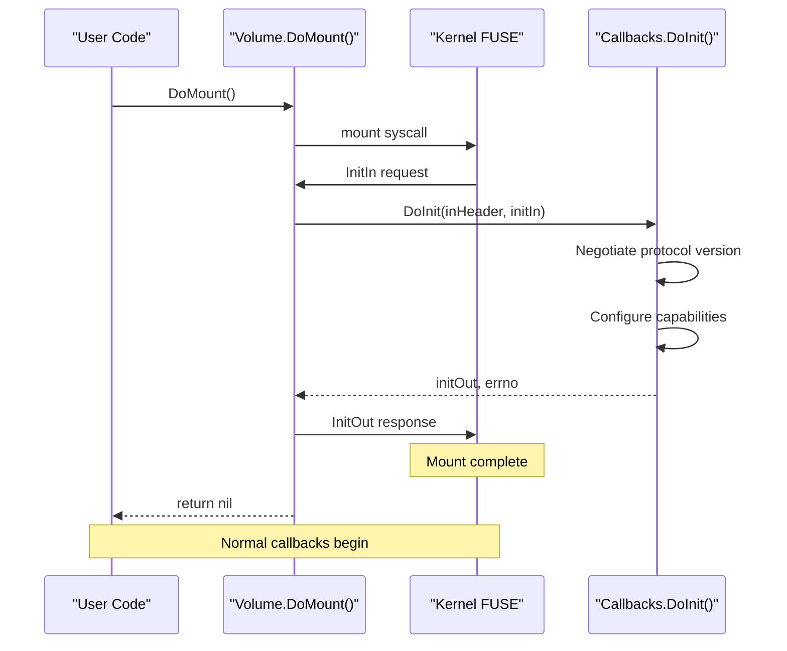

### InitIn: Kernel Capabilities

| Field | Type | Purpose |
|-------|------|---------|
| `Major`, `Minor` | `uint32` | FUSE protocol version (see [Version History](#fuse-protocol-version-history)) |
| `MaxReadAhead` | `uint32` | Kernel's maximum readahead size |
| `Flags` | `uint32` | Kernel-supported capabilities (bitmask) |
| `Flags2` | `uint32` | Extended capabilities (FUSE 7.36+) |

### InitOut: Filesystem Capabilities

| Field | Type | Purpose |
|-------|------|---------|
| `Major`, `Minor` | `uint32` | Protocol version to use (typically echo kernel's) |
| `MaxReadAhead` | `uint32` | Filesystem's maximum readahead |
| `Flags` | `uint32` | Capabilities filesystem supports |
| `MaxBackground` | `uint16` | Max concurrent background requests |
| `CongestionThreshhold` | `uint16` | When to start throttling |
| `MaxWrite` | `uint32` | **Maximum write size** (critical!) |
| `TimeGran` | `uint32` | Timestamp granularity in nanoseconds |
| `MaxPages` | `uint16` | Max pages for splicing |

**Critical Note:** The `MaxWrite` value returned by `DoInit` should match the value passed to `NewVolume()`. The buffer pool is pre-sized based on the `NewVolume()` parameter, so returning a different value will not resize the pool.

**Sources:** [api.go:788-954]()

### Common Init Flags

| Flag Constant | Purpose |
|---------------|---------|
| `InitFlagsAsyncRead` | Enable asynchronous read operations |
| `InitFlagsBigWrites` | Support writes larger than 4KB |
| `InitFlagsDoReadDirPlus` | Enable `DoReadDirPlus` optimization |
| `InitFlagsReaddirplusAuto` | Kernel adaptively uses ReadDirPlus |
| `InitFlagsParallelDirops` | Allow concurrent directory operations |
| `InitFlagsWritebackCache` | Enable write-back page cache |
| `InitFlagsExplicitInvalData` | Explicit data invalidation support |

**Sources:** [api.go:271-315]()

---

## FUSE Protocol Version History

The fission library includes comprehensive version history mapping Linux kernel versions to FUSE protocol versions:

| Kernel Version | FUSE Version | Key Changes |
|----------------|--------------|-------------|
| 3.1 - 3.6 | 7.17 - 7.20 | `fuse.h` in `include/linux/` |
| 3.9+ | 7.21+ | `fuse.h` moved to `include/uapi/linux/` |
| 4.5 | 7.24 | Added `InitFlagsWritebackCache` |
| 4.9 | 7.26 | Added `InitFlagsParallelDirops` |
| 5.2 - 5.4 | 7.31a/b | Added `MapAlignment` field |
| 5.11 | 7.33 | Added `InitFlagsExplicitInvalData` |
| 6.9 | 7.40 | Added `MaxStackDepth` |
| 6.15 | 7.43 | Current version (includes `RequestTimeout`) |

**Note:** Distributions may modify these mappings. The library supports protocol negotiation via the `DoInit` handshake.

**Sources:** [api.go:97-134]()

---

## Data Structure Size Constants

The library defines size constants for all structures to aid in buffer management:

| Constant | Value | Structure |
|----------|-------|-----------|
| `InHeaderSize` | 40 | `InHeader` |
| `OutHeaderSize` | 16 | `OutHeader` |
| `AttrSize` | 88 | `Attr` |
| `EntryOutSize` | 128 | `EntryOut` (40 + 88) |
| `DirEntFixedPortionSize` | 24 | `DirEnt` (excluding name) |
| `DirEntAlignment` | 8 | Alignment boundary for directory entries |
| `InitOutSize` | 64 | `InitOut` |

**Usage Pattern:** These constants are used by the marshalling layer to allocate buffers and validate message sizes.

**Sources:** [api.go:136](), [api.go:473](), [api.go:486](), [api.go:378](), [api.go:399](), [api.go:937]()

---

## Flag Constants Reference

### Open Flags (Request)

| Constant | Value | Purpose |
|----------|-------|---------|
| `FOpenRequestRDONLY` | `O_RDONLY` | Open for reading only |
| `FOpenRequestWRONLY` | `O_WRONLY` | Open for writing only |
| `FOpenRequestRDWR` | `O_RDWR` | Open for reading and writing |
| `FOpenRequestAPPEND` | `O_APPEND` | Append mode |
| `FOpenRequestCREAT` | `O_CREAT` | Create if not exists |
| `FOpenRequestTRUNC` | `O_TRUNC` | Truncate to zero length |

**Sources:** [api.go:251-260]()

### Open Flags (Response)

| Constant | Bit Position | Purpose |
|----------|--------------|---------|
| `FOpenResponseDirectIO` | 0 | Bypass page cache (direct I/O) |
| `FOpenResponseKeepCache` | 1 | Don't invalidate page cache on open |
| `FOpenResponseNonSeekable` | 2 | File cannot be seeked |
| `FOpenResponseCacheDir` | 3 | Cache directory contents |
| `FOpenResponseStream` | 4 | Stream-like file (no seeking) |

**Sources:** [api.go:262-268]()

---

## Extended Attributes (XAttr) Operations

The `Callbacks` interface supports full extended attributes:

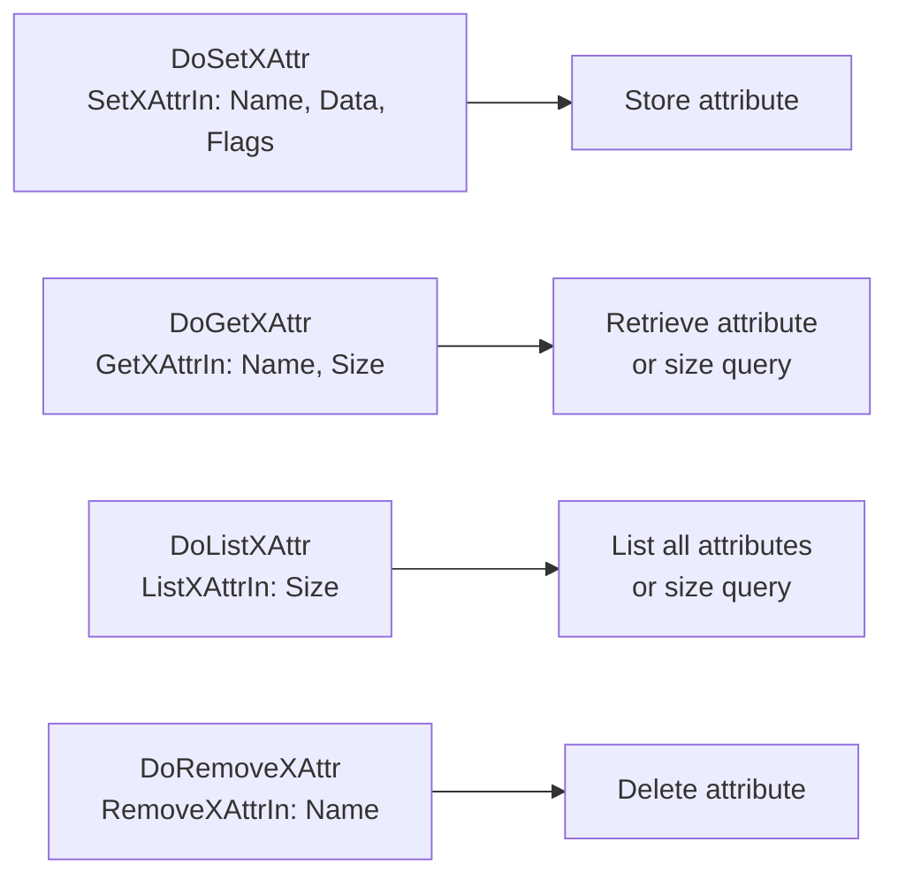

### SetXAttr Flags

| Constant | Value | Purpose |
|----------|-------|---------|
| `SetXAttrInCreate` | 1 | Fail if attribute exists |
| `SetXAttrInReplace` | 2 | Fail if attribute doesn't exist |

### Size Query Pattern

Both `DoGetXAttr` and `DoListXAttr` support a two-call pattern:
1. **Size Query:** Input `Size == 0` → Return only size in output
2. **Data Retrieval:** Input `Size >= required` → Return full data

**Sources:** [api.go:705-750]()

---

## File Locking Operations

The library supports POSIX file locks and flock-style locks:

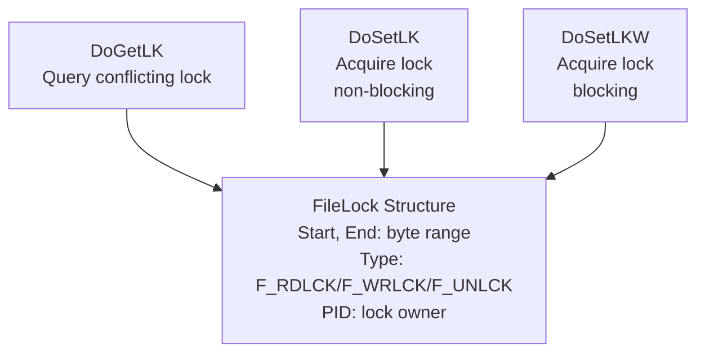

### FileLock Structure

| Field | Type | Purpose |
|-------|------|---------|
| `Start` | `uint64` | Starting byte offset |
| `End` | `uint64` | Ending byte offset (use `math.MaxUint64` for EOF) |
| `Type` | `uint32` | `syscall.F_RDLCK`, `F_WRLCK`, or `F_UNLCK` |
| `PID` | `uint32` | Process ID holding the lock |

**Sources:** [api.go:222-229](), [api.go:1004-1038]()

---

## API Usage Pattern

The standard usage pattern for the fission API:

```mermaid
sequenceDiagram
    participant App as "Application"
    participant CB as "Callbacks Implementation"
    participant Vol as "Volume"
    participant Kernel as "FUSE Kernel"
    
    App->>CB: Implement Callbacks interface
    App->>App: NewVolume(..., callbacks)
    App->>Vol: DoMount()
    Vol->>Kernel: Mount filesystem
    Kernel->>Vol: InitIn
    Vol->>CB: DoInit(...)
    CB-->>Vol: InitOut
    Vol->>Kernel: Respond
    Vol-->>App: Mount complete
    
    loop Normal Operations
        Note over Kernel,CB: User accesses files
        Kernel->>Vol: FUSE request
        Vol->>CB: DoLookup/DoRead/etc.
        CB-->>Vol: Response + errno
        Vol->>Kernel: FUSE response
    end
    
    App->>Vol: DoUnmount()
    Vol->>Kernel: Unmount filesystem
    Kernel->>Vol: Destroy
    Vol->>CB: DoDestroy(...)
    CB-->>Vol: errno
    Vol-->>App: Unmount complete
    App->>Vol: Discard Volume
```

### Implementation Checklist

1. **Implement all `Callbacks` methods**
   - Return `syscall.ENOSYS` for unsupported operations
   - Ensure `DoInit` returns compatible protocol version
   - Implement at minimum: `DoLookup`, `DoGetAttr`, `DoOpen`, `DoRead`, `DoReadDir`

2. **Create a `Volume`**
   - Call `NewVolume()` with appropriate `maxRead`/`maxWrite`
   - Provide error channel for async notifications
   - Set `allowOther` appropriately for multi-user access

3. **Mount the filesystem**
   - Call `DoMount()` (blocks until unmount or error)
   - Handle errors from the error channel

4. **Unmount cleanly**
   - Call `DoUnmount()` before exiting
   - Wait for all in-flight callbacks to complete

**Sources:** [api.go:85-95]()

---

## Summary of Key Interfaces and Types

| Interface/Type | Purpose | Defined At |
|----------------|---------|------------|
| `Volume` | Filesystem lifecycle management | [api.go:17-28]() |
| `Callbacks` | FUSE operation handlers | [api.go:39-83]() |
| `NewVolume()` | Volume factory function | [api.go:92-95]() |
| `InHeader` | Request metadata | [api.go:475-484]() |
| `OutHeader` | Response metadata | [api.go:488-492]() |
| `Attr` | File attributes (88 bytes) | [api.go:138-155]() |
| `EntryOut` | Inode entry information | [api.go:380-388]() |
| `DirEnt` | Directory entry | [api.go:401-407]() |
| `InitIn`/`InitOut` | Protocol negotiation | [api.go:789-954]() |
| `ReadIn`/`ReadOut` | Read operations | [api.go:647-660]() |
| `WriteIn`/`WriteOut` | Write operations | [api.go:664-680]() |
| `LookupIn`/`LookupOut` | Name resolution | [api.go:494-502]() |

**Sources:** [api.go:1-1203]()

---

# Page: Volume Management and Lifecycle

# Volume Management and Lifecycle

<details>
<summary>Relevant source files</summary>

The following files were used as context for generating this wiki page:

- [api.go](api.go)
- [volume.go](volume.go)

</details>


## Purpose and Scope

This document describes the implementation of FUSE volume management in the fission library, specifically the `volumeStruct` type and its lifecycle. It covers the mount and unmount processes, communication with the Linux `/dev/fuse` device, goroutine coordination, and buffer management. 

For information about the interfaces that `volumeStruct` implements, see [API Design and Interfaces](#2.1). For details on how raw FUSE protocol bytes are parsed and dispatched to callbacks, see [Protocol Marshalling and Request Handling](#2.3).

## Volume Structure and State

The `volumeStruct` type is the core implementation of the `Volume` interface. It maintains all state necessary for a mounted FUSE filesystem.

### Structure Fields

```mermaid
graph TB
    subgraph "volumeStruct Fields"
        Config["Configuration<br/>volumeName<br/>mountpointDirPath<br/>fuseSubtype<br/>maxRead/maxWrite<br/>defaultPermissions<br/>allowOther"]
        
        Callbacks["Callbacks Interface<br/>callbacks<br/>logger<br/>errChan"]
        
        FUSEComm["FUSE Communication<br/>devFuseFD<br/>devFuseFile<br/>devFuseFDReadSize<br/>fuseMajor/fuseMinor"]
        
        Pooling["Buffer Management<br/>devFuseFDReadPool<br/>sync.Pool"]
        
        Sync["Synchronization<br/>devFuseFDReaderWG<br/>callbacksWG<br/>doInitWG"]
    end
    
    Config --> volumeStruct
    Callbacks --> volumeStruct
    FUSEComm --> volumeStruct
    Pooling --> volumeStruct
    Sync --> volumeStruct
```

**Sources:** [volume.go:19-39]()

| Field Group | Key Fields | Purpose |
|------------|------------|---------|
| **Configuration** | `volumeName`, `mountpointDirPath`, `fuseSubtype` | Mount point identification and filesystem type |
| **I/O Parameters** | `maxRead`, `maxWrite` | Buffer sizing for FUSE protocol messages |
| **Permissions** | `defaultPermissions`, `allowOther` | Access control configuration |
| **Callbacks** | `callbacks`, `logger`, `errChan` | User implementation interface and error signaling |
| **Device** | `devFuseFD`, `devFuseFile` | File descriptor for `/dev/fuse` communication |
| **Buffer Pool** | `devFuseFDReadPool`, `devFuseFDReadSize` | Memory-efficient buffer reuse via `sync.Pool` |
| **Synchronization** | `devFuseFDReaderWG`, `callbacksWG`, `doInitWG` | Goroutine lifecycle coordination |

### Initialization

The `newVolume()` function creates a `volumeStruct` instance and configures the buffer pool:

**Sources:** [volume.go:51-88]()

**Buffer Size Calculation:**
- Minimum size: `devFuseFDReadSizeMin` (8192 bytes)
- Calculated size: `InHeaderSize + WriteInFixedPortionSize + maxWrite`
- The size accounts for the largest possible FUSE message (write operations)

**Buffer Pool Initialization:**
```mermaid
graph LR
    newVolume["newVolume()"] --> CalcSize["Calculate<br/>devFuseFDReadSize"]
    CalcSize --> CreatePool["Create sync.Pool"]
    CreatePool --> PoolNew["Pool.New = func()"]
    PoolNew --> AllocBuf["Allocate []byte<br/>len == cap"]
```

**Sources:** [volume.go:56-86]()

The `sync.Pool` reduces GC pressure by reusing read buffers across requests. Each buffer is allocated to exactly `devFuseFDReadSize` bytes with `len == cap`.

## Mount Process

The `DoMount()` method orchestrates the FUSE mount operation through coordination with the `fusermount` utility.

### Mount Sequence Overview

```mermaid
sequenceDiagram
    participant V as volumeStruct
    participant F as fusermount
    participant K as Kernel FUSE
    participant D as /dev/fuse
    
    V->>V: Unmount if already mounted
    V->>V: Create socketpair
    V->>F: exec fusermount with socket
    V->>V: Spawn stdout/stderr scanners
    F->>K: Request mount
    K->>K: Open /dev/fuse
    K->>F: Pass FD via socket
    F->>V: Send FD via socketpair
    V->>V: Store devFuseFD
    V->>V: Start devFuseFDReader goroutine
    V->>F: Wait for fusermount exit
    K->>D: Send INIT request
    D->>V: devFuseFDReader reads INIT
    V->>Callbacks: DoInit()
    V->>D: Write INIT response
    V->>V: doInitWG.Wait() completes
    V->>V: Mount complete
```

**Sources:** [volume.go:90-291]()

### Fusermount Integration

The mount process uses the external `fusermount` utility to interface with the kernel:

**Sources:** [volume.go:120-127]()

**Pre-flight Unmount:** Before attempting to mount, `DoMount()` unconditionally calls `fusermount -u` to clean up any stale mount at the target path. Errors are ignored.

### Mount Options Construction

The function builds a comma-separated mount options string:

**Sources:** [volume.go:158-191]()

| Option | Source | Example |
|--------|--------|---------|
| `rootmode` | Hardcoded as `S_IFDIR` | `rootmode=40000` |
| `user_id` | `syscall.Geteuid()` | `user_id=1000` |
| `group_id` | `syscall.Getegid()` | `group_id=1000` |
| `fsname` | `volumeName` parameter | `fsname=myfs` |
| `max_read` | `maxRead` parameter | `max_read=131072` |
| `ro` / `rw` | `maxWrite == 0` ? ro : rw | `rw` |
| `default_permissions` | `defaultPermissions` flag | `default_permissions` |
| `allow_other` | `allowOther` flag | `allow_other` |
| `subtype` | `fuseSubtype` parameter | `subtype=ramfs` |

### Socket Pair Communication

File descriptor passing occurs via a Unix domain socket pair:

```mermaid
graph TB
    socketpair["socketpair()<br/>AF_UNIX, SOCK_SEQPACKET"]
    socketpair --> pair0["fusermountSocketPair[0]<br/>Child Write End"]
    socketpair --> pair1["fusermountSocketPair[1]<br/>Parent Read End"]
    
    pair0 --> childFile["fusermountChildWriteFile<br/>os.File wrapper"]
    pair1 --> parentFile["fusermountParentReadFile<br/>os.File wrapper"]
    
    childFile --> extraFiles["ExtraFiles[0]<br/>becomes FD 3"]
    extraFiles --> env["_FUSE_COMMFD=3<br/>environment variable"]
    
    parentFile --> recvmsg["syscall.Recvmsg()<br/>receives FD + OOB data"]
    recvmsg --> parseOOB["ParseSocketControlMessage<br/>ParseUnixRights"]
    parseOOB --> fuseFD["devFuseFD<br/>/dev/fuse file descriptor"]
```

**Sources:** [volume.go:129-274]()

**Key Steps:**
1. Create `SOCK_SEQPACKET` socket pair for reliable message delivery
2. Wrap socket ends as `os.File` objects
3. Pass child end as FD 3 via `exec.Cmd.ExtraFiles`
4. Set environment variable `_FUSE_COMMFD=3` for fusermount
5. Block on `syscall.Recvmsg()` waiting for out-of-band data
6. Parse control message to extract `/dev/fuse` file descriptor

### Pipe Monitoring

Two goroutines monitor fusermount's stdout and stderr:

**Sources:** [volume.go:211-237](), [volume.go:327-359]()

```mermaid
graph TB
    DoMount["DoMount()"] --> StdoutPipe["mountCmd.StdoutPipe()"]
    DoMount --> StderrPipe["mountCmd.StderrPipe()"]
    
    StdoutPipe --> ScanStdout["scanPipe goroutine<br/>lineCount = nil"]
    StderrPipe --> ScanStderr["scanPipe goroutine<br/>lineCount tracked"]
    
    ScanStdout --> WG["scanPipeWaitGroup"]
    ScanStderr --> WG
    
    WG --> Await["awaitScanPipe goroutine"]
    Await --> CheckLines{"lineCount != 0?"}
    CheckLines -->|Yes| Abort["syscallRecvmsgAborted = true<br/>Close child socket"]
    CheckLines -->|No| Continue["Allow Recvmsg to proceed"]
```

**Sources:** [volume.go:327-359]()

If fusermount writes to stderr (indicating an error), `awaitScanPipe()` sets `syscallRecvmsgAborted` and closes the child socket file descriptor to interrupt the `Recvmsg()` call.

### Init Handshake

After receiving the `/dev/fuse` file descriptor, the volume must complete the FUSE init protocol:

**Sources:** [volume.go:229](), [volume.go:285]()

```mermaid
graph LR
    StartReader["devFuseFDReaderWG.Add(1)<br/>doInitWG.Add(1)"] --> SpawnReader["go devFuseFDReader()"]
    SpawnReader --> WaitFusermount["mountCmd.Wait()"]
    WaitFusermount --> WaitInit["doInitWG.Wait()"]
    WaitInit --> MountComplete["Mount Complete"]
```

The `doInitWG` WaitGroup blocks `DoMount()` from returning until the INIT request is received and processed. This ensures the filesystem is fully initialized before user code proceeds.

**Sources:** [volume.go:276-290]()

## /dev/fuse Communication

The volume communicates with the kernel FUSE module through `/dev/fuse` using raw file descriptor operations.

### Reader Goroutine Lifecycle

```mermaid
stateDiagram-v2
    [*] --> Starting: DoMount() spawns
    Starting --> Reading: devFuseFDReader() loop
    Reading --> ProcessRequest: syscall.Read() success
    ProcessRequest --> SpawnCallback: Spawn processDevFuseFDReadBuf()
    SpawnCallback --> Reading: Continue loop
    
    Reading --> HandleEINTR: syscall.Read() returns EINTR
    HandleEINTR --> Reading: Retry
    
    Reading --> HandleENOTPERM: Read returns ENOTPERM
    HandleENOTPERM --> Reading: Retry (special case)
    
    Reading --> Shutdown: Read error (ENODEV, etc.)
    Shutdown --> WaitCallbacks: callbacksWG.Wait()
    WaitCallbacks --> SignalError: errChan <- err
    SignalError --> [*]: devFuseFDReaderWG.Done()
```

**Sources:** [volume.go:371-430]()

**Error Handling Strategy:**
- `EINTR` (interrupted system call): Retry immediately via `goto RetrySyscallRead`
- `ENOTPERM` (operation not permitted): Continue loop to retry
- `ENODEV` (no such device): Clean shutdown, signal `nil` on `errChan`
- `ENOTSUP` (operation not supported by device): Clean shutdown, signal `nil` on `errChan`
- Other errors: Log and signal error on `errChan`

### Buffer Pool Operations

```mermaid
graph TB
    Reader["devFuseFDReader()"] --> Get["devFuseFDReadPoolGet()"]
    Get --> PoolGet["sync.Pool.Get()"]
    PoolGet --> Cast["Type assertion<br/>*[]byte"]
    Cast --> ReadBuf["devFuseFDReadBuf"]
    
    ReadBuf --> SyscallRead["syscall.Read()"]
    SyscallRead --> Slice["Reslice to bytesRead"]
    Slice --> Spawn["Spawn callback goroutine"]
    
    Spawn --> Process["processDevFuseFDReadBuf()"]
    Process --> Reset["Restore len to cap"]
    Reset --> Put["devFuseFDReadPoolPut()"]
    Put --> PoolPut["sync.Pool.Put()"]
```

**Sources:** [volume.go:361-369](), [volume.go:380-382](), [volume.go:432-443](), [volume.go:551-553]()

**Key Implementation Details:**
- Buffers retrieved from pool have `len == cap`
- After `syscall.Read()`, buffer is resliced to actual bytes read: `devFuseFDReadBuf[:bytesRead]`
- Before returning to pool, buffer is restored: `*devFuseFDReadBufPtr = (*devFuseFDReadBufPtr)[:cap(*devFuseFDReadBufPtr)]`

### Request Dispatch

The `processDevFuseFDReadBuf()` function parses the FUSE header and dispatches to the appropriate handler:

**Sources:** [volume.go:432-554]()

```mermaid
graph TB
    Entry["processDevFuseFDReadBuf()"] --> ValidateLen{"len >= InHeaderSize?"}
    ValidateLen -->|No| Drop["Log error<br/>Drop message"]
    ValidateLen -->|Yes| ParseHeader["Parse InHeader<br/>unsafe.Pointer casts"]
    
    ParseHeader --> SwitchOpCode{"Switch on<br/>inHeader.OpCode"}
    
    SwitchOpCode -->|OpCodeLookup| Lookup["volume.doLookup()"]
    SwitchOpCode -->|OpCodeGetAttr| GetAttr["volume.doGetAttr()"]
    SwitchOpCode -->|OpCodeRead| Read["volume.doRead()"]
    SwitchOpCode -->|OpCodeWrite| Write["volume.doWrite()"]
    SwitchOpCode -->|OpCodeInit| Init["volume.doInit()"]
    SwitchOpCode -->|OpCodeIoCtl| IoCtl["devFuseFDWriter(EINVAL)"]
    SwitchOpCode -->|default| Unsupported["devFuseFDWriter(ENOSYS)"]
    
    Lookup --> Return["Return buffer to pool"]
    GetAttr --> Return
    Read --> Return
    Write --> Return
    Init --> Return
    IoCtl --> Return
    Unsupported --> Return
    
    Return --> Done["callbacksWG.Done()"]
```

**Sources:** [volume.go:447-553]()

**Header Parsing:** The `InHeader` struct is populated using `unsafe.Pointer` casts to directly interpret bytes as Go types, avoiding allocation.

**OpCode Dispatch:** A large switch statement routes to 40+ operation handlers. Each handler (covered in [Protocol Marshalling and Request Handling](#2.3)) parses operation-specific data and invokes the user's `Callbacks` implementation.

**Unsupported Operations:**
- `OpCodeIoCtl`: Always returns `EINVAL`
- Unrecognized opcodes: Return `ENOSYS`

### Response Writing

The `devFuseFDWriter()` method writes responses back to `/dev/fuse`:

**Sources:** [volume.go:556-616]()

```mermaid
graph TB
    Entry["devFuseFDWriter(inHeader, errno, bufs...)"] --> LogEnosys{"errno == ENOSYS?"}
    LogEnosys -->|Yes| Log["Log unsupported OpCode"]
    LogEnosys -->|No| BuildHeader["Build OutHeader"]
    
    BuildHeader --> IovecSetup["Create []syscall.Iovec"]
    IovecSetup --> IovecHeader["iovec[0] = OutHeader"]
    IovecHeader --> IovecBufs["iovec[1..n] = bufs"]
    
    IovecBufs --> UpdateLen["Update OutHeader.Len<br/>with total span"]
    UpdateLen --> Writev["syscall.SYS_WRITEV"]
    
    Writev --> CheckEINTR{"errno == EINTR?"}
    CheckEINTR -->|Yes| Writev
    CheckEINTR -->|No| CheckBytes{"bytesWritten == iovecSpan?"}
    
    CheckBytes -->|No| LogBadWrite["Log bad bytesWritten"]
    CheckBytes -->|Yes| Success["Return"]
```

**Sources:** [volume.go:556-616]()

**Iovec Construction:**
1. First element: `OutHeader` with `Len`, `Error` (negated errno), and `Unique`
2. Subsequent elements: Optional data buffers (e.g., file data, directory entries)
3. `OutHeader.Len` is updated with the sum of all buffer lengths

**Write Retry:** If `SYS_WRITEV` returns `EINTR`, the operation is retried via `goto RetrySyscallWriteV`.

## Unmount Process

The `DoUnmount()` method cleanly tears down the FUSE mount:

**Sources:** [volume.go:293-325]()

```mermaid
sequenceDiagram
    participant C as Caller
    participant V as volumeStruct
    participant F as fusermount
    participant K as Kernel
    participant R as devFuseFDReader
    
    C->>V: DoUnmount()
    V->>F: exec fusermount -u -q -z
    F->>K: Unmount request
    K->>K: Close /dev/fuse
    K->>R: Read() returns ENODEV
    R->>R: callbacksWG.Wait()
    R->>V: errChan <- nil
    R->>R: devFuseFDReaderWG.Done()
    V->>V: syscall.Close(devFuseFD)
    V->>V: devFuseFDReaderWG.Wait()
    V->>C: return nil
```

**Sources:** [volume.go:293-325]()

**Fusermount Flags:**
- `-u`: Unmount
- `-q`: Quiet (suppress messages)
- `-z`: Lazy unmount (detach even if busy)

**Shutdown Sequence:**
1. Execute `fusermount -u` to request kernel unmount
2. Kernel closes `/dev/fuse`, causing reader's `syscall.Read()` to fail
3. Reader goroutine waits for all callback goroutines (`callbacksWG.Wait()`)
4. Reader signals `errChan` and exits
5. `DoUnmount()` closes `devFuseFD` explicitly
6. `DoUnmount()` waits for reader goroutine (`devFuseFDReaderWG.Wait()`)

## Goroutine Lifecycle Management

The volume uses three `sync.WaitGroup` instances to coordinate goroutine lifecycles:

### WaitGroup Architecture

```mermaid
graph TB
    subgraph "DoMount Lifecycle"
        DoMount["DoMount()"] --> ReaderWG["devFuseFDReaderWG.Add(1)"]
        ReaderWG --> InitWG["doInitWG.Add(1)"]
        InitWG --> ScanWG["scanPipeWaitGroup.Add(2)"]
        
        ScanWG --> Scan1["scanPipe goroutine 1"]
        ScanWG --> Scan2["scanPipe goroutine 2"]
        
        Scan1 --> ScanDone["scanPipeWaitGroup.Done()"]
        Scan2 --> ScanDone
        
        InitWG --> Reader["devFuseFDReader goroutine"]
        Reader --> InitDone["doInitWG.Done()<br/>(in doInit handler)"]
        
        InitDone --> WaitInit["DoMount waits<br/>doInitWG.Wait()"]
        WaitInit --> MountReturns["DoMount returns"]
    end
    
    subgraph "Request Processing Lifecycle"
        Reader --> ReadLoop["Read loop"]
        ReadLoop --> CallbackWG["callbacksWG.Add(1)"]
        CallbackWG --> SpawnCallback["go processDevFuseFDReadBuf()"]
        SpawnCallback --> ProcessReq["Process request"]
        ProcessReq --> CallbackDone["callbacksWG.Done()"]
    end
    
    subgraph "DoUnmount Lifecycle"
        Unmount["DoUnmount()"] --> FusermountU["fusermount -u"]
        FusermountU --> ReadError["Read error"]
        ReadError --> WaitCallbacks["callbacksWG.Wait()"]
        WaitCallbacks --> ReaderDone["devFuseFDReaderWG.Done()"]
        ReaderDone --> WaitReader["DoUnmount waits<br/>devFuseFDReaderWG.Wait()"]
        WaitReader --> UnmountReturns["DoUnmount returns"]
    end
```

**Sources:** [volume.go:34](), [volume.go:35](), [volume.go:38]()

### WaitGroup Purposes

| WaitGroup | Purpose | Add Location | Done Location | Wait Location |
|-----------|---------|--------------|---------------|---------------|
| `devFuseFDReaderWG` | Track reader goroutine lifetime | [volume.go:276]() | [volume.go:405]() | [volume.go:319]() |
| `callbacksWG` | Track all callback goroutines | [volume.go:427]() | [volume.go:553]() | [volume.go:404]() |
| `doInitWG` | Synchronize INIT handshake | [volume.go:229]() | See [Protocol Marshalling](#2.3) | [volume.go:285]() |

**Sources:** [volume.go:276](), [volume.go:319](), [volume.go:404-405](), [volume.go:427](), [volume.go:553]()

### Fork-Join Pattern

The volume implements a fork-join concurrency model:

```mermaid
graph TB
    Main["Main Goroutine<br/>(DoMount)"] --> Fork1["Fork: devFuseFDReader"]
    Fork1 --> Loop["Read Loop"]
    Loop --> Fork2["Fork: processDevFuseFDReadBuf<br/>per request"]
    Fork2 --> Join2["Join: callbacksWG"]
    Join2 --> Join1["Join: devFuseFDReaderWG"]
    Join1 --> MainReturn["Main Goroutine<br/>(DoUnmount returns)"]
```

**Sources:** [volume.go:276-277](), [volume.go:319](), [volume.go:404-405](), [volume.go:427-428]()

**Guarantees:**
- Reader goroutine exits only after all callback goroutines complete
- `DoUnmount()` returns only after reader goroutine exits
- No goroutines leak after unmount

### Error Channel Signaling

The `errChan` provides asynchronous error notification:

**Sources:** [volume.go:29](), [volume.go:407-417]()

```mermaid
graph LR
    Reader["devFuseFDReader"] --> CheckError{"Read error?"}
    CheckError -->|ENODEV| SendNil["errChan <- nil<br/>(clean unmount)"]
    CheckError -->|ENOTSUP| SendNil
    CheckError -->|Other| SendErr["errChan <- err<br/>(unexpected error)"]
    
    SendNil --> UserReceive["User code<br/>receives on errChan"]
    SendErr --> UserReceive
```

**Sources:** [volume.go:407-417]()

**Error Interpretation:**
- `nil`: Expected shutdown from `DoUnmount()`
- Non-`nil`: Unexpected error (e.g., kernel module removed)

User code should monitor `errChan` to detect filesystem shutdown and react appropriately (e.g., retry mounting).

## Helper Functions

### cloneByteSlice

A utility function for safely copying byte slices with optional null terminator trimming:

**Sources:** [volume.go:618-627]()

```mermaid
graph LR
    Input["Input: inBuf, andTrimTrailingNullByte"] --> Allocate["Allocate outBuf<br/>len(inBuf)"]
    Allocate --> Copy["copy(outBuf, inBuf)"]
    Copy --> CheckTrim{"andTrimTrailingNullByte<br/>AND<br/>outBuf[len-1] == 0?"}
    CheckTrim -->|Yes| Trim["outBuf = outBuf[:len-1]"]
    CheckTrim -->|No| Return["return outBuf"]
    Trim --> Return
```

**Sources:** [volume.go:618-627]()

This is used throughout the protocol handlers to safely copy filename and xattr data from read buffers (which are returned to the pool) into persistent storage.

---

## Summary

The volume management system provides a robust foundation for FUSE filesystem implementations:

- **Mount orchestration** via fusermount with socket-based file descriptor passing
- **Efficient I/O** through buffer pooling and vectored writes
- **Reliable concurrency** using WaitGroups for fork-join coordination
- **Clean shutdown** with proper goroutine cleanup and error signaling

The design separates concerns cleanly: this layer handles only device communication and lifecycle, while [Protocol Marshalling](#2.3) handles message parsing and [API Design](#2.1) defines the callback interface.

---

# Page: Protocol Marshalling and Request Handling

# Protocol Marshalling and Request Handling

<details>
<summary>Relevant source files</summary>

The following files were used as context for generating this wiki page:

- [api.go](api.go)
- [callbacks.go](callbacks.go)
- [volume.go](volume.go)

</details>


## Purpose and Scope

This document describes the protocol marshalling layer implemented in `callbacks.go`, which translates between the binary FUSE protocol and idiomatic Go data structures. This layer sits between the low-level `/dev/fuse` communication managed by `volume.go` (see [Volume Management and Lifecycle](#2.2)) and the high-level `Callbacks` interface defined in `api.go` (see [API Design and Interfaces](#2.1)).

The marshalling layer performs three critical functions:
1. **Parsing**: Converts raw byte streams from the kernel into structured Go types
2. **Dispatching**: Routes requests to the appropriate callback method based on OpCode
3. **Serialization**: Converts Go responses back into FUSE wire format

This page focuses specifically on the binary protocol translation mechanics. For the API contract and data structures, see [API Design and Interfaces](#2.1). For the lifecycle and goroutine management, see [Volume Management and Lifecycle](#2.2).

## Request Flow Architecture

The following diagram shows how a FUSE request flows through the marshalling layer:

```mermaid
graph TB
    Kernel["Kernel FUSE Module"]
    DevFuse["/dev/fuse<br/>(File Descriptor)"]
    Reader["volume.devFuseFDReader()<br/>Goroutine Loop"]
    Process["volume.processDevFuseFDReadBuf()<br/>InHeader Parsing"]
    
    subgraph "OpCode Dispatch (volume.go:458-549)"
        Switch["switch inHeader.OpCode"]
    end
    
    subgraph "Marshalling Functions (callbacks.go)"
        DoLookup["doLookup()"]
        DoRead["doRead()"]
        DoWrite["doWrite()"]
        DoReadDir["doReadDir()"]
        DoInit["doInit()"]
        Others["... 38+ other do* functions"]
    end
    
    subgraph "User Implementation"
        Callbacks["Callbacks Interface<br/>DoLookup(), DoRead(), etc."]
    end
    
    Writer["volume.devFuseFDWriter()<br/>Binary Serialization"]
    
    Kernel -->|"binary bytes"| DevFuse
    DevFuse -->|"syscall.Read()"| Reader
    Reader -->|"raw []byte"| Process
    Process -->|"*InHeader + payload"| Switch
    
    Switch -->|"OpCodeLookup"| DoLookup
    Switch -->|"OpCodeRead"| DoRead
    Switch -->|"OpCodeWrite"| DoWrite
    Switch -->|"OpCodeReadDir"| DoReadDir
    Switch -->|"OpCodeInit"| DoInit
    Switch -->|"other OpCodes"| Others
    
    DoLookup -->|"parsed *LookupIn"| Callbacks
    DoRead -->|"parsed *ReadIn"| Callbacks
    DoWrite -->|"parsed *WriteIn"| Callbacks
    DoReadDir -->|"parsed *ReadDirIn"| Callbacks
    DoInit -->|"parsed *InitIn"| Callbacks
    Others -->|"parsed structs"| Callbacks
    
    Callbacks -->|"*LookupOut, errno"| DoLookup
    Callbacks -->|"*ReadOut, errno"| DoRead
    Callbacks -->|"*WriteOut, errno"| DoWrite
    Callbacks -->|"*ReadDirOut, errno"| DoReadDir
    Callbacks -->|"*InitOut, errno"| DoInit
    Callbacks -->|"response structs"| Others
    
    DoLookup -->|"[]byte payload"| Writer
    DoRead -->|"[]byte payload"| Writer
    DoWrite -->|"[]byte payload"| Writer
    DoReadDir -->|"[]byte payload"| Writer
    DoInit -->|"[]byte payload"| Writer
    Others -->|"[]byte payload"| Writer
    
    Writer -->|"OutHeader + payload"| DevFuse
    DevFuse -->|"response"| Kernel
```

**Sources**: [volume.go:371-430](), [volume.go:432-554](), [callbacks.go:31-1780]()

## OpCode Dispatching

Requests are dispatched based on the `OpCode` field in the `InHeader` structure. The dispatching logic uses a switch statement that maps each FUSE operation code to its corresponding marshalling function.

### Dispatch Table

The following table shows the OpCode-to-function mapping:

| OpCode Constant | Value | Function | Requires Response |
|----------------|-------|----------|-------------------|
| `OpCodeLookup` | 1 | `doLookup()` | Yes |
| `OpCodeForget` | 2 | `doForget()` | No |
| `OpCodeGetAttr` | 3 | `doGetAttr()` | Yes |
| `OpCodeSetAttr` | 4 | `doSetAttr()` | Yes |
| `OpCodeReadLink` | 5 | `doReadLink()` | Yes |
| `OpCodeSymLink` | 6 | `doSymLink()` | Yes |
| `OpCodeMkNod` | 8 | `doMkNod()` | Yes |
| `OpCodeMkDir` | 9 | `doMkDir()` | Yes |
| `OpCodeUnlink` | 10 | `doUnlink()` | Yes |
| `OpCodeRmDir` | 11 | `doRmDir()` | Yes |
| `OpCodeRename` | 12 | `doRename()` | Yes |
| `OpCodeLink` | 13 | `doLink()` | Yes |
| `OpCodeOpen` | 14 | `doOpen()` | Yes |
| `OpCodeRead` | 15 | `doRead()` | Yes |
| `OpCodeWrite` | 16 | `doWrite()` | Yes |
| `OpCodeStatFS` | 17 | `doStatFS()` | Yes |
| `OpCodeRelease` | 18 | `doRelease()` | Yes |
| `OpCodeFSync` | 20 | `doFSync()` | Yes |
| `OpCodeSetXAttr` | 21 | `doSetXAttr()` | Yes |
| `OpCodeGetXAttr` | 22 | `doGetXAttr()` | Yes |
| `OpCodeListXAttr` | 23 | `doListXAttr()` | Yes |
| `OpCodeRemoveXAttr` | 24 | `doRemoveXAttr()` | Yes |
| `OpCodeFlush` | 25 | `doFlush()` | Yes |
| `OpCodeInit` | 26 | `doInit()` | Yes |
| `OpCodeOpenDir` | 27 | `doOpenDir()` | Yes |
| `OpCodeReadDir` | 28 | `doReadDir()` | Yes |
| `OpCodeReleaseDir` | 29 | `doReleaseDir()` | Yes |
| `OpCodeFSyncDir` | 30 | `doFSyncDir()` | Yes |
| `OpCodeGetLK` | 31 | `doGetLK()` | Yes |
| `OpCodeSetLK` | 32 | `doSetLK()` | Yes |
| `OpCodeSetLKW` | 33 | `doSetLKW()` | Yes |
| `OpCodeAccess` | 34 | `doAccess()` | Yes |
| `OpCodeCreate` | 35 | `doCreate()` | Yes |
| `OpCodeInterrupt` | 36 | `doInterrupt()` | No |
| `OpCodeBMap` | 37 | `doBMap()` | Yes |
| `OpCodeDestroy` | 38 | `doDestroy()` | Yes |
| `OpCodeIoCtl` | 39 | Returns `EINVAL` | Unsupported |
| `OpCodePoll` | 40 | `doPoll()` | Yes |
| `OpCodeBatchForget` | 42 | `doBatchForget()` | No |
| `OpCodeFAllocate` | 43 | `doFAllocate()` | Yes |
| `OpCodeReadDirPlus` | 44 | `doReadDirPlus()` | Yes |
| `OpCodeRename2` | 45 | `doRename2()` | Yes |
| `OpCodeLSeek` | 46 | `doLSeek()` | Yes |
| `OpCodeStatX` | 52 | `doStatX()` | Yes |

**Note**: Operations marked as "No" for "Requires Response" do not send data back to the kernel. `OpCodeForget`, `OpCodeInterrupt`, and `OpCodeBatchForget` are fire-and-forget operations used for resource management.

**Sources**: [volume.go:458-549](), [api.go:417-471]()

## Binary Protocol Parsing

All marshalling functions follow a consistent pattern for parsing binary FUSE protocol messages using Go's `unsafe.Pointer` mechanism.

### Parsing Pattern

```mermaid
graph LR
    Bytes["Raw []byte<br/>devFuseFDReadBufPayload"]
    Validate["Size Validation<br/>len() checks"]
    Cast["unsafe.Pointer<br/>Type Casting"]
    Struct["Go Struct<br/>Populated Fields"]
    Clone["Clone Variable Data<br/>cloneByteSlice()"]
    Final["Complete Input Struct"]
    
    Bytes --> Validate
    Validate -->|"Valid"| Cast
    Validate -->|"Invalid"| Error["Log Error<br/>Return EINVAL"]
    Cast --> Struct
    Struct --> Clone
    Clone --> Final
```

### Example: doRead Parsing

The `doRead` function demonstrates the typical parsing flow:

1. **Size Validation** [callbacks.go:456-460]():
```go
if len(devFuseFDReadBufPayload) != ReadInSize {
    volume.logger.Printf("Call to doRead() with bad len...")
    volume.devFuseFDWriter(inHeader, syscall.EINVAL)
    return
}
```

2. **Fixed-Size Field Parsing** [callbacks.go:462-470]():
```go
readIn = &ReadIn{
    FH:        *(*uint64)(unsafe.Pointer(&devFuseFDReadBufPayload[0])),
    Offset:    *(*uint64)(unsafe.Pointer(&devFuseFDReadBufPayload[8])),
    Size:      *(*uint32)(unsafe.Pointer(&devFuseFDReadBufPayload[16])),
    ReadFlags: *(*uint32)(unsafe.Pointer(&devFuseFDReadBufPayload[20])),
    LockOwner: *(*uint64)(unsafe.Pointer(&devFuseFDReadBufPayload[24])),
    Flags:     *(*uint32)(unsafe.Pointer(&devFuseFDReadBufPayload[32])),
    Padding:   *(*uint32)(unsafe.Pointer(&devFuseFDReadBufPayload[36])),
}
```

This pattern uses `unsafe.Pointer` to directly cast byte slices to the appropriate integer types, matching the FUSE protocol's C struct layout.

**Sources**: [callbacks.go:448-481]()

### Variable-Length Data Handling

Some FUSE messages contain variable-length fields like filenames or file data. The library handles these in two ways:

#### Simple Variable Data (Single Field)

For operations with a single variable-length field at the end, the data is simply sliced and cloned:

```go
// Example from doLookup
lookupIn = &LookupIn{
    Name: cloneByteSlice(devFuseFDReadBufPayload, true),
}
```

The `cloneByteSlice` function [volume.go:618-627]() creates a copy of the byte slice and optionally trims trailing null bytes (required by the FUSE protocol for string fields).

#### Multiple Variable Fields (Separated by Null Bytes)

Operations like `doRename` have multiple variable-length fields separated by null bytes:

```go
oldNameNewNameSplit = bytes.SplitN(
    devFuseFDReadBufPayload[RenameInFixedPortionSize:], 
    []byte{0}, 
    2
)
if len(oldNameNewNameSplit) != 2 {
    volume.logger.Printf("Call to doRename() with bad devFuseFDReadBufPayload")
    volume.devFuseFDWriter(inHeader, syscall.EINVAL)
    return
}

renameIn = &RenameIn{
    NewDir:  *(*uint64)(unsafe.Pointer(&devFuseFDReadBufPayload[0])),
    OldName: cloneByteSlice(oldNameNewNameSplit[0], false),
    NewName: cloneByteSlice(oldNameNewNameSplit[1], true),
}
```

**Sources**: [callbacks.go:31-61](), [callbacks.go:344-373](), [volume.go:618-627]()

## Callback Invocation Pattern

After parsing the request, each `do*` function invokes the corresponding method on the user's `Callbacks` interface implementation.

### Standard Invocation Flow

```mermaid
sequenceDiagram
    participant M as "do* Function<br/>(callbacks.go)"
    participant C as "User Callbacks<br/>Implementation"
    participant W as "devFuseFDWriter<br/>(volume.go)"
    
    M->>M: Parse binary payload
    M->>C: Invoke Do* callback
    
    alt Success (errno == 0)
        C-->>M: Return struct + errno=0
        M->>M: Marshal response struct
        M->>W: Write OutHeader + payload
        W->>W: Send to /dev/fuse
    else Error (errno != 0)
        C-->>M: Return nil + errno
        M->>W: Write OutHeader with error
        W->>W: Send to /dev/fuse
    end
```

### Example: doGetAttr Implementation

The `doGetAttr` function [callbacks.go:80-115]() shows the standard pattern:

1. Parse the request
2. Invoke the user callback
3. Check for errors
4. Marshal the response if successful
5. Write to `/dev/fuse`

```go
getAttrOut, errno = volume.callbacks.DoGetAttr(inHeader, getAttrIn)
if errno != 0 {
    volume.devFuseFDWriter(inHeader, errno)
    return
}

// Marshal response...
outPayload = make([]byte, GetAttrOutSize)
*(*uint64)(unsafe.Pointer(&outPayload[0])) = getAttrOut.AttrValidSec
// ... more marshalling ...

volume.devFuseFDWriter(inHeader, 0, outPayload)
```

**Note**: If the callback returns a non-zero `errno`, the response struct is ignored and only the error code is sent to the kernel.

**Sources**: [callbacks.go:80-115](), [callbacks.go:414-446]()

## Response Serialization

Response marshalling converts Go structs back into the binary FUSE protocol format using `unsafe.Pointer` operations.

### marshallAttr Helper Function

The `marshalAttr` helper function [callbacks.go:12-29]() is used extensively to serialize the `Attr` struct, which appears in many response types:

```go
func marshalAttr(attr *Attr, outPayload []byte, outPayloadOffset uint32) {
    *(*uint64)(unsafe.Pointer(&outPayload[outPayloadOffset+0])) = attr.Ino
    *(*uint64)(unsafe.Pointer(&outPayload[outPayloadOffset+8])) = attr.Size
    *(*uint64)(unsafe.Pointer(&outPayload[outPayloadOffset+16])) = attr.Blocks
    // ... continues for all 88 bytes of Attr ...
}
```

This function writes the 88-byte `Attr` structure at any offset within the output payload.

### Output Writing via devFuseFDWriter

The `devFuseFDWriter` function [volume.go:556-616]() is the final step in response serialization:

```mermaid
graph TB
    Input["do* function calls<br/>devFuseFDWriter()"]
    Header["Construct OutHeader<br/>16 bytes"]
    Iovec["Build iovec array<br/>Header + optional payloads"]
    Calc["Calculate total size<br/>Update OutHeader.Len"]
    Write["syscall.SYS_WRITEV<br/>Write to /dev/fuse"]
    Retry["Retry on EINTR"]
    
    Input --> Header
    Header --> Iovec
    Iovec --> Calc
    Calc --> Write
    Write -->|"EINTR"| Retry
    Retry --> Write
    Write -->|"Success"| Done["Return"]
```

The `OutHeader` contains three fields:
- `Len`: Total size of the message (header + payload)
- `Error`: Negated errno (e.g., `-ENOENT`)
- `Unique`: Request identifier from `InHeader` for matching

**Sources**: [callbacks.go:12-29](), [volume.go:556-616]()

### Complex Response Types

Some operations return complex nested structures that require careful marshalling.

#### Example: doReadDir

`doReadDir` [callbacks.go:1080-1156]() demonstrates marshalling an array of variable-length `DirEnt` structures:

1. **Allocation**: Pre-allocate buffer to maximum size requested by kernel
2. **Iteration**: Loop through each `DirEnt` returned by callback
3. **Alignment**: Ensure each entry is aligned to 8-byte boundary
4. **Overflow Check**: Stop if response would exceed requested size
5. **Trim**: Reduce buffer to actual size used

```go
outPayload = make([]byte, readDirIn.Size)
outPayloadOffset = 0

for dirEntIndex = range len(readDirOut.DirEnt) {
    dirEnt = &readDirOut.DirEnt[dirEntIndex]
    
    nameLenAligned = (uint32(len(dirEnt.Name)) + (DirEntAlignment - 1)) & ^uint32(DirEntAlignment-1)
    dirEntPayloadSize = DirEntFixedPortionSize + nameLenAligned
    
    if (outPayloadOffset + dirEntPayloadSize) > readDirIn.Size {
        // Exceeded buffer - truncate
        outPayload = outPayload[:outPayloadOffset]
        volume.devFuseFDWriter(inHeader, 0, outPayload)
        return
    }
    
    // Marshal fixed portion
    *(*uint64)(unsafe.Pointer(&outPayload[outPayloadOffset+0])) = dirEnt.Ino
    // ... marshal other fields ...
    
    // Copy name
    copy(outPayload[outPayloadOffset:], dirEnt.Name)
    
    // Add padding to alignment
    for paddingIndex = uint32(len(dirEnt.Name)); paddingIndex < nameLenAligned; paddingIndex++ {
        outPayload[outPayloadOffset] = 0
        outPayloadOffset++
    }
}
```

The `DirEntAlignment` constant (value 8) ensures each directory entry starts on an 8-byte boundary, as required by the FUSE protocol.

**Sources**: [callbacks.go:1080-1156](), [callbacks.go:1544-1631]()

## Protocol Version Negotiation

The `doInit` function [callbacks.go:791-1044]() handles FUSE protocol version negotiation, which is critical for compatibility across different kernel versions.

### Init Handshake Flow

```mermaid
sequenceDiagram
    participant K as "Kernel"
    participant V as "volume.go"
    participant I as "doInit()<br/>(callbacks.go)"
    participant U as "User Callbacks"
    
    K->>V: Init request (Major, Minor, Flags)
    V->>I: Raw Init bytes
    
    I->>I: Parse Major/Minor
    I->>I: Determine message size<br/>based on protocol version
    
    alt Version 7.17
        I->>I: Parse InitInUpThru735Size
    else Version 7.21-7.35
        I->>I: Parse InitInUpThru735Size
    else Version 7.36+
        I->>I: Parse InitInFrom736OnSize<br/>(includes Flags2)
    end
    
    I->>U: DoInit(inHeader, initIn)
    U-->>I: initOut, errno
    
    I->>I: Validate Major == 7
    
    alt initOut.Minor 7.17
        I->>I: Marshal InitOut717Size
    else initOut.Minor 7.21-7.22
        I->>I: Marshal InitOut721Thru722Size
    else initOut.Minor 7.23-7.27
        I->>I: Marshal InitOut723Thru727Size
    else initOut.Minor 7.28-7.30
        I->>I: Marshal InitOut728Thru731aSize
    else initOut.Minor 7.32-7.35
        I->>I: Marshal InitOut731bThru735Size
    else initOut.Minor 7.36-7.39
        I->>I: Marshal InitOut736Thru739Size
    else initOut.Minor 7.40-7.42
        I->>I: Marshal InitOut740Thru742Size
    else initOut.Minor 7.43+
        I->>I: Marshal InitOut743AndBeyondSize
    end
    
    I->>V: Marshalled Init response
    V->>K: Init response
    
    Note over V: Signal doInitWG<br/>Mount complete
```

### Version-Specific Parsing

The `doInit` function supports multiple protocol versions [callbacks.go:816-873]():

**For kernel version 7.17**:
```go
case volume.fuseMinor == 17:
    if len(devFuseFDReadBufPayload) != InitInUpThru735Size {
        volume.devFuseFDWriter(inHeader, syscall.EINVAL)
        return
    }
    initIn = &InitIn{
        Major:        volume.fuseMajor,
        Minor:        volume.fuseMinor,
        MaxReadAhead: *(*uint32)(unsafe.Pointer(&devFuseFDReadBufPayload[8])),
        Flags:        *(*uint32)(unsafe.Pointer(&devFuseFDReadBufPayload[12])),
        Flags2:       0, // Not present in this version
    }
```

**For kernel version 7.36+**:
```go
case volume.fuseMinor >= 36:
    if len(devFuseFDReadBufPayload) != InitInFrom736OnSize {
        volume.devFuseFDWriter(inHeader, syscall.EINVAL)
        return
    }
    initIn = &InitIn{
        Major:        volume.fuseMajor,
        Minor:        volume.fuseMinor,
        MaxReadAhead: *(*uint32)(unsafe.Pointer(&devFuseFDReadBufPayload[8])),
        Flags:        *(*uint32)(unsafe.Pointer(&devFuseFDReadBufPayload[12])),
        Flags2:       *(*uint32)(unsafe.Pointer(&devFuseFDReadBufPayload[16])),
    }
```

### Version-Specific Serialization

The response marshalling also varies by protocol version [callbacks.go:888-1039](). Each version range has a different `InitOut` struct size with different fields. The function marshals only the fields that exist in the negotiated protocol version.

For example, version 7.28 introduced the `MaxPages` field:
```go
case (initOut.Minor >= 28) && (initOut.Minor <= 30):
    outPayload = make([]byte, InitOut728Thru731aSize)
    // ... marshal common fields ...
    *(*uint16)(unsafe.Pointer(&outPayload[28])) = initOut.MaxPages
    *(*uint16)(unsafe.Pointer(&outPayload[30])) = 0  // padding
    // ... zero out spare fields ...
```

**Important**: The `doInitWG` wait group [callbacks.go:799]() ensures that `DoMount()` does not return until the Init handshake completes. This synchronization is critical because the mount is not usable until protocol negotiation finishes.

**Sources**: [callbacks.go:791-1044](), [api.go:97-135]()

## Special Cases and Edge Conditions

### Operations Without Responses

Three operations do not send responses back to the kernel:

1. **OpCodeForget** [callbacks.go:63-78](): Notifies the filesystem to decrement reference count on an inode
2. **OpCodeInterrupt** [callbacks.go:1376-1392](): Requests cancellation of a pending operation
3. **OpCodeBatchForget** [callbacks.go:1478-1517](): Batch version of Forget for efficiency

These functions do not call `devFuseFDWriter` after invoking the callback:

```go
func (volume *volumeStruct) doForget(inHeader *InHeader, devFuseFDReadBufPayload []byte) {
    // ... parse forgetIn ...
    volume.callbacks.DoForget(inHeader, forgetIn)
    // No response sent
}
```

### Conditional Response Sizes

Some operations have conditional response formats based on the request parameters.

#### GetXAttr

`doGetXAttr` [callbacks.go:658-694]() returns either:
- **Size-only response** (8 bytes) when `getXAttrIn.Size == 0`
- **Data response** (variable size) when `getXAttrIn.Size != 0`

```go
if getXAttrIn.Size == 0 {
    outPayload = make([]byte, GetXAttrOutSizeOnlySize)
    *(*uint32)(unsafe.Pointer(&outPayload[0])) = getXAttrOut.Size
    *(*uint32)(unsafe.Pointer(&outPayload[4])) = getXAttrOut.Padding
} else {
    outPayload = getXAttrOut.Data
}
```

This two-phase approach lets applications query the attribute size first, then request the actual data.

#### ListXAttr

Similarly, `doListXAttr` [callbacks.go:696-750]() has two modes:
- **Size query**: Returns total size needed for all attribute names
- **Data query**: Returns null-separated list of attribute names

### Alignment Requirements

Directory entries must be aligned to 8-byte boundaries as specified by `DirEntAlignment`:

```go
nameLenAligned = (uint32(len(dirEnt.Name)) + (DirEntAlignment - 1)) & ^uint32(DirEntAlignment-1)
```

This formula rounds up to the next 8-byte boundary. The padding bytes are explicitly zeroed [callbacks.go:1147-1150]():

```go
for paddingIndex = uint32(len(dirEnt.Name)); paddingIndex < nameLenAligned; paddingIndex++ {
    outPayload[outPayloadOffset] = 0
    outPayloadOffset++
}
```

**Sources**: [callbacks.go:63-78](), [callbacks.go:658-694](), [callbacks.go:696-750](), [callbacks.go:1080-1156]()

## Error Handling and Validation

Each marshalling function performs extensive validation before processing requests.

### Size Validation Pattern

Every `do*` function validates the payload size matches the expected struct size:

```go
if len(devFuseFDReadBufPayload) != ExpectedInSize {
    volume.logger.Printf("Call to do*() with bad len(devFuseFDReadBufPayload) == %v", 
                         len(devFuseFDReadBufPayload))
    volume.devFuseFDWriter(inHeader, syscall.EINVAL)
    return
}
```

For variable-length messages, the function checks the minimum size:

```go
if len(devFuseFDReadBufPayload) < FixedPortionSize {
    volume.logger.Printf("Call to do*() with bad len...")
    volume.devFuseFDWriter(inHeader, syscall.EINVAL)
    return
}
```

### Content Validation

Some operations perform additional semantic validation:

**doWrite** [callbacks.go:508-512]() verifies the data size matches the declared size:
```go
if len(writeIn.Data) != int(writeIn.Size) {
    volume.logger.Printf("Call to doWrite() with bad Size == %v expected %v", 
                         writeIn.Size, len(writeIn.Data))
    volume.devFuseFDWriter(inHeader, syscall.EINVAL)
    return
}
```

**doRename** [callbacks.go:357-362]() ensures null-separated fields are present:
```go
oldNameNewNameSplit = bytes.SplitN(devFuseFDReadBufPayload[RenameInFixedPortionSize:], []byte{0}, 2)
if len(oldNameNewNameSplit) != 2 {
    volume.logger.Printf("Call to doRename() with bad devFuseFDReadBufPayload")
    volume.devFuseFDWriter(inHeader, syscall.EINVAL)
    return
}
```

### Error Response

When validation fails or the callback returns an error, only the `OutHeader` is sent with the error code:

```go
errno = volume.callbacks.DoSomeOperation(inHeader, someIn)
if errno != 0 {
    volume.devFuseFDWriter(inHeader, errno)
    return
}
```

The `devFuseFDWriter` function [volume.go:556-616]() constructs an `OutHeader` with:
- `Len`: 16 (size of OutHeader)
- `Error`: `-int32(errno)` (negated errno)
- `Unique`: Copied from `InHeader.Unique`

**Sources**: [callbacks.go:88-92](), [callbacks.go:456-460](), [callbacks.go:508-512](), [callbacks.go:357-362]()

## Data Structure Binary Layout

The following diagram illustrates how binary data is mapped to Go structs using `unsafe.Pointer`:

```mermaid
graph TB
    subgraph "Binary Payload ([]byte)"
        B0["Byte 0-7<br/>FH (uint64)"]
        B8["Byte 8-15<br/>Offset (uint64)"]
        B16["Byte 16-19<br/>Size (uint32)"]
        B20["Byte 20-23<br/>ReadFlags (uint32)"]
        B24["Byte 24-31<br/>LockOwner (uint64)"]
        B32["Byte 32-35<br/>Flags (uint32)"]
        B36["Byte 36-39<br/>Padding (uint32)"]
    end
    
    subgraph "ReadIn Struct"
        F1["FH uint64"]
        F2["Offset uint64"]
        F3["Size uint32"]
        F4["ReadFlags uint32"]
        F5["LockOwner uint64"]
        F6["Flags uint32"]
        F7["Padding uint32"]
    end
    
    B0 -->|"*(*uint64)(unsafe.Pointer(&buf[0]))"| F1
    B8 -->|"*(*uint64)(unsafe.Pointer(&buf[8]))"| F2
    B16 -->|"*(*uint32)(unsafe.Pointer(&buf[16]))"| F3
    B20 -->|"*(*uint32)(unsafe.Pointer(&buf[20]))"| F4
    B24 -->|"*(*uint64)(unsafe.Pointer(&buf[24]))"| F5
    B32 -->|"*(*uint32)(unsafe.Pointer(&buf[32]))"| F6
    B36 -->|"*(*uint32)(unsafe.Pointer(&buf[36]))"| F7
```

This direct memory mapping avoids copying and parsing overhead, making the marshalling layer extremely efficient.

### Multi-Field Layout Example

For structures with variable-length data, the layout is more complex:

```
RenameIn Binary Layout:
+------------------+
| NewDir (8 bytes) |  Offset 0-7: uint64
+------------------+
| OldName          |  Variable length
| (null-terminated)|
+------------------+
| NewName          |  Variable length
| (null-terminated)|
+------------------+
```

The parsing splits on null bytes to extract the two variable-length fields [callbacks.go:357-368]().

**Sources**: [callbacks.go:462-470](), [callbacks.go:344-373]()

## Performance Considerations

### Zero-Copy Operations

The marshalling layer uses several techniques to minimize copying:

1. **Direct pointer casting**: `unsafe.Pointer` allows reading binary data without intermediate parsing
2. **Slice referencing**: Response data like `ReadOut.Data` is passed by reference, not copied
3. **In-place marshalling**: Output buffers are allocated once and written directly

### Buffer Pooling

The `volume.go` layer uses a `sync.Pool` [volume.go:80-86]() to recycle read buffers:

```go
volume.devFuseFDReadPool = sync.Pool{
    New: func() interface{} {
        buf := make([]byte, volume.devFuseFDReadSize)
        return &buf
    },
}
```

After each request is processed, the buffer is returned to the pool [volume.go:551-553]():

```go
*devFuseFDReadBufPtr = devFuseFDReadBuf
volume.devFuseFDReadPoolPut(devFuseFDReadBufPtr)
```

This reduces GC pressure in high-throughput scenarios.

### Vectored I/O

The `devFuseFDWriter` uses `syscall.SYS_WRITEV` [volume.go:601-605]() to send the `OutHeader` and payload in a single system call:

```go
iovec = make([]syscall.Iovec, 1, len(bufs)+1)
iovec[0] = syscall.Iovec{Base: &outHeader[0], Len: uint64(OutHeaderSize)}

for _, buf = range bufs {
    if len(buf) != 0 {
        iovec = append(iovec, syscall.Iovec{Base: &buf[0], Len: uint64(len(buf))})
    }
}
```

This avoids allocating and copying data into a single contiguous buffer.

**Sources**: [volume.go:80-86](), [volume.go:366-369](), [volume.go:551-553](), [volume.go:581-605]()

## Summary

The protocol marshalling layer in `callbacks.go` provides:

- **Binary-to-Go translation** using `unsafe.Pointer` for zero-copy efficiency
- **OpCode-based dispatching** routing 40+ operation types to handlers
- **Bidirectional marshalling** for both requests and responses
- **Version negotiation** supporting FUSE protocol 7.17 through 7.44+
- **Extensive validation** catching malformed messages before user callbacks
- **Special handling** for variable-length data, alignment, and no-response operations

This layer isolates users from the complexity of the binary FUSE protocol while maintaining high performance through direct memory operations and buffer pooling.

---

# Page: Example Implementations

# Example Implementations

<details>
<summary>Relevant source files</summary>

The following files were used as context for generating this wiki page:

- [examples/fission-hellofs/main.go](examples/fission-hellofs/main.go)
- [examples/fission-ramfs/main.go](examples/fission-ramfs/main.go)
- [examples/fission-s3rofs/main.go](examples/fission-s3rofs/main.go)
- [examples/fission-swiftfs/main.go](examples/fission-swiftfs/main.go)

</details>


## Purpose and Scope

This document provides an overview of the four example filesystem implementations included in the fission repository. Each example demonstrates different patterns for implementing the `Callbacks` interface (see [API Design and Interfaces](#2.1)) and showcases various use cases from minimal learning examples to production-ready cloud storage filesystems.

For detailed documentation on individual implementations, see:
- [fission-ramfs](#3.1) - Full-featured read-write filesystem
- [fission-s3rofs](#3.2) - S3-backed read-only filesystem  
- [fission-swiftfs](#3.3) - Swift object storage filesystem
- [fission-hellofs](#3.4) - Minimal example

For information about the core library these implementations use, see [Core Library](#2).

---

## Implementation Comparison

The following table summarizes the key characteristics of each example implementation:

| Implementation | Storage Backend | Read/Write | Persistence | Cache Strategy | Primary Use Case |
|---------------|----------------|------------|-------------|----------------|------------------|
| fission-ramfs | In-memory maps | Read-Write | Volatile | None (all in RAM) | Full POSIX filesystem testing |
| fission-s3rofs | Amazon S3 | Read-Only | Persistent | 2-tier (RAM + Disk) | Cloud object storage access |
| fission-swiftfs | Swift Storage | Read-Only | Persistent | 1-tier (RAM only) | OpenStack Swift access |
| fission-hellofs | Static data | Read-Only | Static | None | Learning the API |

### Lines of Code

| Implementation | Main File LOC | Callbacks File LOC | Total Complexity |
|---------------|--------------|-------------------|------------------|
| fission-ramfs | ~356 | ~2000+ | Highest |
| fission-s3rofs | ~510 | ~800+ | High |
| fission-swiftfs | ~572 | ~700+ | Medium |
| fission-hellofs | ~296 | ~200+ | Lowest |

**Sources:** [examples/fission-ramfs/main.go](), [examples/fission-s3rofs/main.go](), [examples/fission-swiftfs/main.go](), [examples/fission-hellofs/main.go]()

---

## Architecture Overview

### Interface Implementation Pattern

All four implementations follow the same architectural pattern: they implement the `Callbacks` interface and delegate lifecycle management to the core library's `Volume`.

```mermaid
graph TB
    subgraph "Fission Core Library"
        Volume["fission.Volume<br/>(volume.go)"]
        Callbacks["Callbacks Interface<br/>(api.go)"]
    end
    
    subgraph "Implementation Packages"
        RAMFS["fission-ramfs<br/>globalsStruct"]
        S3RO["fission-s3rofs<br/>globalsStruct"]
        Swift["fission-swiftfs<br/>globalsStruct"]
        Hello["fission-hellofs<br/>globalsStruct"]
    end
    
    Volume -->|"calls callbacks on"| Callbacks
    
    RAMFS -.->|"implements"| Callbacks
    S3RO -.->|"implements"| Callbacks
    Swift -.->|"implements"| Callbacks
    Hello -.->|"implements"| Callbacks
    
    RAMFS -->|"fission.NewVolume()"| Volume
    S3RO -->|"fission.NewVolume()"| Volume
    Swift -->|"fission.NewVolume()"| Volume
    Hello -->|"fission.NewVolume()"| Volume
```

**Sources:** [examples/fission-ramfs/main.go:89-105](), [examples/fission-s3rofs/main.go:129-143](), [examples/fission-swiftfs/main.go:100-118](), [examples/fission-hellofs/main.go:59-71]()

---

## Global State Structure Comparison

Each implementation maintains its state in a `globalsStruct` but with different contents based on requirements.

### State Structure Diagram

```mermaid
graph LR
    subgraph "fission-ramfs"
        RAM_G["globalsStruct"]
        RAM_G --> RAM_TL["tryLock<br/>*tryLockStruct"]
        RAM_G --> RAM_IM["inodeMap<br/>map[uint64]*inodeStruct"]
        RAM_G --> RAM_FH["fhMap<br/>map[uint64]uint32"]
        RAM_G --> RAM_V["volume<br/>fission.Volume"]
    end
    
    subgraph "fission-s3rofs"
        S3_G["globalsStruct"]
        S3_G --> S3_CFG["config<br/>*configStruct"]
        S3_G --> S3_CLI["s3Client<br/>*s3.Client"]
        S3_G --> S3_IT["inodeTable<br/>[]*inodeStruct"]
        S3_G --> S3_FCM["fileCacheMap<br/>map[cacheLineTagStruct]*"]
        S3_G --> S3_RCM["ramCacheMap<br/>map[cacheLineTagStruct]*"]
        S3_G --> S3_V["volume<br/>fission.Volume"]
    end
    
    subgraph "fission-swiftfs"
        SW_G["globalsStruct"]
        SW_G --> SW_CFG["config<br/>*configStruct"]
        SW_G --> SW_AUTH["authToken<br/>string"]
        SW_G --> SW_FIM["fileInodeMap<br/>map[uint64]*fileInodeStruct"]
        SW_G --> SW_RCM["readCacheMap<br/>map[cacheLineTagStruct]*"]
        SW_G --> SW_V["volume<br/>fission.Volume"]
    end
    
    subgraph "fission-hellofs"
        H_G["globalsStruct"]
        H_G --> H_RA["rootInodeAttr<br/>*fission.Attr"]
        H_G --> H_HA["helloInodeAttr<br/>*fission.Attr"]
        H_G --> H_DE["dirEnt<br/>[]fission.DirEnt"]
        H_G --> H_V["volume<br/>fission.Volume"]
    end
```

**Sources:** [examples/fission-ramfs/main.go:89-105](), [examples/fission-s3rofs/main.go:129-143](), [examples/fission-swiftfs/main.go:100-118](), [examples/fission-hellofs/main.go:59-71]()

---

## Initialization Patterns

### Mount Initialization Flow

```mermaid
sequenceDiagram
    participant M as main()
    participant GS as globalsStruct
    participant V as fission.Volume
    participant K as Kernel FUSE
    
    M->>GS: Initialize state structures
    M->>GS: Setup storage backend
    Note over GS: ramfs: inodeMap<br/>s3rofs: enumerate S3<br/>swiftfs: list container<br/>hellofs: static data
    M->>V: fission.NewVolume()
    M->>V: DoMount()
    V->>K: Mount FUSE filesystem
    K-->>V: INIT handshake
    V->>GS: DoInit() callback
    GS-->>V: InitOut flags
    Note over M: Wait for signal
    M->>V: DoUnmount()
    V->>K: Unmount
```

### Initialization Code Locations

| Implementation | Volume Creation | DoMount | Cleanup |
|---------------|----------------|---------|---------|
| fission-ramfs | [main.go:197]() | [main.go:199]() | [main.go:216]() |
| fission-s3rofs | [main.go:447]() | [main.go:449]() | [main.go:465]() |
| fission-swiftfs | [main.go:406]() | [main.go:408]() | [main.go:425]() |
| fission-hellofs | [main.go:249]() | [main.go:251]() | [main.go:268]() |

**Sources:** [examples/fission-ramfs/main.go:197-220](), [examples/fission-s3rofs/main.go:447-476](), [examples/fission-swiftfs/main.go:406-429](), [examples/fission-hellofs/main.go:249-272]()

---

## Data Structure Patterns

### Inode Representation

Each implementation uses different strategies for representing filesystem inodes:

```mermaid
graph TB
    subgraph "fission-ramfs"
        RAM_IS["inodeStruct"]
        RAM_IS --> RAM_TL["tryLock<br/>*tryLockStruct"]
        RAM_IS --> RAM_ATTR["attr<br/>fission.Attr"]
        RAM_IS --> RAM_XM["xattrMap<br/>sortedmap.LLRBTree"]
        RAM_IS --> RAM_DEM["dirEntryMap<br/>sortedmap.LLRBTree"]
        RAM_IS --> RAM_FD["fileData<br/>[]byte"]
        RAM_IS --> RAM_SD["symlinkData<br/>[]byte"]
    end
    
    subgraph "fission-s3rofs"
        S3_IS["inodeStruct"]
        S3_IS --> S3_INO["inodeNumber<br/>uint64"]
        S3_IS --> S3_SZ["size<br/>uint64"]
        S3_IS --> S3_LM["lastModified<br/>time.Time"]
        S3_IS --> S3_MODE["mode<br/>uint32"]
        S3_IS --> S3_DT["dirTable<br/>sortedmap.LLRBTree"]
        S3_IS --> S3_OK["objectKey<br/>string"]
    end
    
    subgraph "fission-swiftfs"
        SW_FIS["fileInodeStruct"]
        SW_FIS --> SW_RWM["sync.RWMutex"]
        SW_FIS --> SW_ON["objectName<br/>string"]
        SW_FIS --> SW_INO["inodeNumber<br/>uint64"]
        SW_FIS --> SW_CA["cachedAttr<br/>*fission.Attr"]
    end
    
    subgraph "fission-hellofs"
        H_ATTR["Static Attrs"]
        H_ATTR --> H_RA["rootInodeAttr"]
        H_ATTR --> H_HA["helloInodeAttr"]
    end
```

**Sources:** [examples/fission-ramfs/main.go:73-80](), [examples/fission-s3rofs/main.go:100-108](), [examples/fission-swiftfs/main.go:81-86](), [examples/fission-hellofs/main.go:66-67]()

---

## Storage Backend Integration

### Backend Access Patterns

```mermaid
graph LR
    subgraph "Application Layer"
        READ["Read Request"]
        WRITE["Write Request"]
        LOOKUP["Lookup Request"]
    end
    
    subgraph "fission-ramfs"
        RAM_CB["callbacks.go"]
        RAM_MAP["inodeMap<br/>fileData []byte"]
        READ -->|"DoRead"| RAM_CB
        WRITE -->|"DoWrite"| RAM_CB
        LOOKUP -->|"DoLookup"| RAM_CB
        RAM_CB --> RAM_MAP
    end
    
    subgraph "fission-s3rofs"
        S3_CB["callbacks.go"]
        S3_CACHE["2-tier Cache"]
        S3_SDK["aws-sdk-go-v2"]
        S3_STOR["Amazon S3"]
        READ -->|"DoRead"| S3_CB
        LOOKUP -->|"DoLookup"| S3_CB
        S3_CB --> S3_CACHE
        S3_CACHE -->|"miss"| S3_SDK
        S3_SDK --> S3_STOR
    end
    
    subgraph "fission-swiftfs"
        SW_CB["callbacks.go"]
        SW_CACHE["RAM Cache"]
        SW_HTTP["http.Client"]
        SW_STOR["Swift Storage"]
        READ -->|"DoRead"| SW_CB
        LOOKUP -->|"DoLookup"| SW_CB
        SW_CB --> SW_CACHE
        SW_CACHE -->|"miss"| SW_HTTP
        SW_HTTP --> SW_STOR
    end
    
    subgraph "fission-hellofs"
        H_CB["callbacks.go"]
        H_DATA["Static Arrays"]
        READ -->|"DoRead"| H_CB
        LOOKUP -->|"DoLookup"| H_CB
        H_CB --> H_DATA
    end
```

**Sources:** [examples/fission-ramfs/callbacks.go](), [examples/fission-s3rofs/callbacks.go](), [examples/fission-swiftfs/callbacks.go](), [examples/fission-hellofs/callbacks.go]()

---

## Callback Implementation Coverage

The following table shows which FUSE callbacks are implemented in each example:

| Callback Category | ramfs | s3rofs | swiftfs | hellofs |
|------------------|-------|--------|---------|---------|
| **Init/Destroy** | ✓ | ✓ | ✓ | ✓ |
| DoInit | ✓ | ✓ | ✓ | ✓ |
| DoDestroy | ✓ | ✓ | ✓ | ✓ |
| **Lookup/Stat** | ✓ | ✓ | ✓ | ✓ |
| DoLookup | ✓ | ✓ | ✓ | ✓ |
| DoGetAttr | ✓ | ✓ | ✓ | ✓ |
| DoSetAttr | ✓ | - | - | - |
| **File I/O** | ✓ | ✓ | ✓ | ✓ |
| DoOpen | ✓ | ✓ | ✓ | ✓ |
| DoRead | ✓ | ✓ | ✓ | ✓ |
| DoWrite | ✓ | - | - | - |
| DoRelease | ✓ | ✓ | ✓ | ✓ |
| **Directory Ops** | ✓ | ✓ | ✓ | ✓ |
| DoReadDir | ✓ | ✓ | ✓ | ✓ |
| DoReadDirPlus | ✓ | ✓ | ✓ | ✓ |
| DoMkDir | ✓ | - | - | - |
| DoRmDir | ✓ | - | - | - |
| **Creation** | ✓ | - | - | - |
| DoCreate | ✓ | - | - | - |
| DoMkNod | ✓ | - | - | - |
| DoSymlink | ✓ | - | - | - |
| **Deletion** | ✓ | - | - | - |
| DoUnlink | ✓ | - | - | - |
| **Extended Attrs** | ✓ | - | - | - |
| DoGetXAttr | ✓ | - | - | - |
| DoSetXAttr | ✓ | - | - | - |
| DoListXAttr | ✓ | - | - | - |
| DoRemoveXAttr | ✓ | - | - | - |
| **Links** | ✓ | - | - | - |
| DoLink | ✓ | - | - | - |
| DoRename | ✓ | - | - | - |
| **Other** | ✓ | ✓ | ✓ | ✓ |
| DoStatFS | ✓ | ✓ | ✓ | ✓ |
| DoFlush | ✓ | ✓ | ✓ | ✓ |
| DoFSync | ✓ | ✓ | ✓ | ✓ |
| DoAccess | ✓ | ✓ | ✓ | ✓ |

✓ = Implemented, - = Returns `syscall.ENOSYS` or similar

**Sources:** [examples/fission-ramfs/callbacks.go](), [examples/fission-s3rofs/callbacks.go](), [examples/fission-swiftfs/callbacks.go](), [examples/fission-hellofs/callbacks.go]()

---

## Configuration and Dependencies

### External Dependencies by Implementation

```mermaid
graph TB
    subgraph "fission-ramfs"
        RAM["main.go"]
        RAM --> FISSION1["github.com/NVIDIA/fission/v3"]
        RAM --> SM1["github.com/NVIDIA/sortedmap"]
        RAM --> SYS1["golang.org/x/sys/unix"]
    end
    
    subgraph "fission-s3rofs"
        S3["main.go"]
        S3 --> FISSION2["github.com/NVIDIA/fission/v3"]
        S3 --> SM2["github.com/NVIDIA/sortedmap"]
        S3 --> AWS_CFG["aws-sdk-go-v2/config"]
        S3 --> AWS_CRED["aws-sdk-go-v2/credentials"]
        S3 --> AWS_S3["aws-sdk-go-v2/service/s3"]
        S3 --> SYS2["golang.org/x/sys/unix"]
    end
    
    subgraph "fission-swiftfs"
        SW["main.go"]
        SW --> FISSION3["github.com/NVIDIA/fission/v3"]
        SW --> SM3["github.com/NVIDIA/sortedmap"]
        SW --> HTTP["net/http"]
        SW --> SYS3["golang.org/x/sys/unix"]
    end
    
    subgraph "fission-hellofs"
        H["main.go"]
        H --> FISSION4["github.com/NVIDIA/fission/v3"]
        H --> SYS4["golang.org/x/sys/unix"]
    end
```

### Configuration Methods

| Implementation | Config Source | Key Parameters |
|---------------|--------------|----------------|
| fission-ramfs | Command-line args | `<mount_point>` |
| fission-s3rofs | JSON config file | `S3Endpoint`, `S3Bucket`, `S3Prefix`, cache settings |
| fission-swiftfs | JSON config file | `ContainerURL`, `AuthURL`, `AuthToken`, cache settings |
| fission-hellofs | Command-line args | `<mount_point>` |

**Sources:** [examples/fission-ramfs/main.go:119-122](), [examples/fission-s3rofs/main.go:82-98](), [examples/fission-swiftfs/main.go:62-73](), [examples/fission-hellofs/main.go:83-86]()

---

## Concurrency Models

### Locking Strategy Comparison

```mermaid
graph TB
    subgraph "fission-ramfs"
        RAM_LOCK["Locking Strategy"]
        RAM_LOCK --> RAM_GL["Global tryLock<br/>globals.tryLock"]
        RAM_LOCK --> RAM_IL["Per-Inode tryLock<br/>inodeStruct.tryLock"]
        RAM_LOCK --> RAM_GLS["grantedLockSetStruct<br/>Tracks acquired locks"]
        RAM_LOCK --> RAM_RESTART["Restart on Contention<br/>freeAll() + retry"]
    end
    
    subgraph "fission-s3rofs"
        S3_LOCK["Locking Strategy"]
        S3_LOCK --> S3_MUTEX["globals.Mutex<br/>Protects cache maps"]
        S3_LOCK --> S3_WG["WaitGroup per CacheLine<br/>Prevents duplicate fetches"]
        S3_LOCK --> S3_LRU["LRU List Operations<br/>Protected by Mutex"]
    end
    
    subgraph "fission-swiftfs"
        SW_LOCK["Locking Strategy"]
        SW_LOCK --> SW_MUTEX["globals.Mutex<br/>Protects auth + cache"]
        SW_LOCK --> SW_AUTHWG["authWG<br/>Token fetch coordination"]
        SW_LOCK --> SW_RWMUTEX["fileInode.RWMutex<br/>Lazy attr loading"]
        SW_LOCK --> SW_WG["Cache WaitGroup<br/>Per-line coordination"]
    end
    
    subgraph "fission-hellofs"
        H_LOCK["Locking Strategy"]
        H_LOCK --> H_NONE["No Locks<br/>Read-only static data"]
    end
```

**Sources:** [examples/fission-ramfs/main.go:65-71](), [examples/fission-ramfs/main.go:234-309](), [examples/fission-s3rofs/main.go:129-143](), [examples/fission-swiftfs/main.go:81-86](), [examples/fission-swiftfs/main.go:100-118]()

---

## Init Flags Configuration

Each implementation declares which FUSE features it supports via `InitOut` flags returned from `DoInit()`:

### Init Flags by Implementation

| Flag | ramfs | s3rofs | swiftfs | hellofs | Purpose |
|------|-------|--------|---------|---------|---------|
| `InitFlagsAsyncRead` | ✓ | ✓ | ✓ | ✓ | Enable async reads |
| `InitFlagsFileOps` | ✓ | ✓ | ✓ | ✓ | File handle operations |
| `InitFlagsAtomicOTrunc` | ✓ | - | - | ✓ | Atomic open+truncate |
| `InitFlagsBigWrites` | ✓ | - | - | - | Large write support |
| `InitFlagsAutoInvalData` | ✓ | - | - | ✓ | Auto invalidate data |
| `InitFlagsDoReadDirPlus` | ✓ | ✓ | ✓ | ✓ | ReadDirPlus support |
| `InitFlagsReaddirplusAuto` | ✓ | ✓ | ✓ | ✓ | Auto ReadDirPlus |
| `InitFlagsParallelDirops` | ✓ | ✓ | ✓ | ✓ | Parallel dir ops |
| `InitFlagsMaxPages` | ✓ | ✓ | ✓ | ✓ | Max pages support |
| `InitFlagsExplicitInvalData` | ✓ | ✓ | ✓ | ✓ | Explicit invalidation |
| `InitFlagsNoOpendirSupport` | - | ✓ | ✓ | - | No DoOpenDir needed |

**Constants:**
- ramfs: [main.go:25-35]()
- s3rofs: [main.go:37-45]()
- swiftfs: [main.go:31-39]()
- hellofs: [main.go:22-32]()

**Sources:** [examples/fission-ramfs/main.go:25-35](), [examples/fission-s3rofs/main.go:37-45](), [examples/fission-swiftfs/main.go:31-39](), [examples/fission-hellofs/main.go:22-32]()

---

## Cache Architecture

### Cache Type and Strategy

```mermaid
graph TB
    subgraph "No Caching"
        H["fission-hellofs"]
        H --> H_STATIC["Static Data<br/>No cache needed"]
        
        RAM["fission-ramfs"]
        RAM --> RAM_MEM["All in Memory<br/>No cache needed"]
    end
    
    subgraph "Single-Tier Cache"
        SW["fission-swiftfs"]
        SW --> SW_LRU["readCacheLRU<br/>*list.List"]
        SW --> SW_MAP["readCacheMap<br/>map[cacheLineTagStruct]*cacheLineStruct"]
        SW_LRU -.->|"eviction"| SW_MAP
        SW --> SW_HTTP["Swift HTTP API"]
    end
    
    subgraph "Two-Tier Cache"
        S3["fission-s3rofs"]
        S3 --> S3_RAM["RAM Cache Tier"]
        S3_RAM --> S3_RLRU["ramCacheLRU<br/>*list.List"]
        S3_RAM --> S3_RMAP["ramCacheMap<br/>map[cacheLineTagStruct]*ramCacheLineStruct"]
        
        S3 --> S3_FILE["File Cache Tier"]
        S3_FILE --> S3_FLRU["fileCacheLRU<br/>*list.List"]
        S3_FILE --> S3_FMAP["fileCacheMap<br/>map[cacheLineTagStruct]*fileCacheLineStruct"]
        
        S3_RAM -->|"evict to"| S3_FILE
        S3_FILE -->|"evict to"| S3_S3["Amazon S3"]
    end
```

### Cache Line Structure

| Implementation | Tag Structure | Content Storage | Synchronization |
|---------------|--------------|-----------------|-----------------|
| s3rofs | `inodeNumber` + `lineNumber` | RAM: `[]byte`, File: file path | `sync.WaitGroup` per line |
| swiftfs | `inodeNumber` + `lineNumber` | RAM: `[]byte` | `sync.WaitGroup` per line |

**Sources:** [examples/fission-s3rofs/main.go:110-127](), [examples/fission-swiftfs/main.go:88-98]()

---

## Use Case Summary

### When to Use Each Implementation

```mermaid
graph TB
    USECASE["Use Case Selection"]
    
    USECASE --> Q1{"Persistent<br/>Storage?"}
    Q1 -->|"No"| Q2{"Full POSIX<br/>Support?"}
    Q2 -->|"Yes"| RAMFS["fission-ramfs<br/>Full-featured testing"]
    Q2 -->|"No"| HELLOFS["fission-hellofs<br/>Learning/prototyping"]
    
    Q1 -->|"Yes"| Q3{"Storage<br/>Backend?"}
    Q3 -->|"Amazon S3"| S3ROFS["fission-s3rofs<br/>S3 object access"]
    Q3 -->|"Swift"| SWIFTFS["fission-swiftfs<br/>Swift object access"]
    Q3 -->|"Other"| CUSTOM["Custom Implementation<br/>Follow ramfs pattern"]
```

### Recommended Starting Point by Goal

| Goal | Start With | Reason |
|------|-----------|--------|
| Learn the fission API | hellofs | Minimal code, clear structure |
| Implement read-write filesystem | ramfs | Complete example with all operations |
| Add S3 backend | s3rofs | Two-tier cache pattern, enumeration strategy |
| Add HTTP-based storage | swiftfs | Authentication, single-tier cache |
| Test FUSE operations | ramfs | Supports all POSIX operations |
| Mount existing data | s3rofs or swiftfs | Read-only, efficient caching |

**Sources:** [examples/fission-hellofs/main.go](), [examples/fission-ramfs/main.go](), [examples/fission-s3rofs/main.go](), [examples/fission-swiftfs/main.go]()

---

## Command-Line Usage

### Invocation Examples

**fission-ramfs:**
```bash
./fission-ramfs /mnt/ramfs
```

**fission-s3rofs:**
```bash
./fission-s3rofs config.json
```

Where `config.json` contains S3 credentials, bucket, prefix, and cache configuration.

**fission-swiftfs:**
```bash
./fission-swiftfs config.json
```

Where `config.json` contains Swift URL, authentication, and cache configuration.

**fission-hellofs:**
```bash
./fission-hellofs /mnt/hellofs
```

### Signal Handling

All implementations handle the same termination signals:

- `SIGINT` (Ctrl+C)
- `SIGTERM` (kill command)
- `SIGHUP` (terminal hangup)

**Signal handling code:** [examples/fission-ramfs/main.go:205-214](), [examples/fission-s3rofs/main.go:454-463](), [examples/fission-swiftfs/main.go:414-423](), [examples/fission-hellofs/main.go:257-266]()

**Sources:** [examples/fission-ramfs/main.go:205-214](), [examples/fission-s3rofs/main.go:171-198](), [examples/fission-swiftfs/main.go:145-165](), [examples/fission-hellofs/main.go:83-86]()

---

# Page: fission-ramfs: Full-Featured In-Memory Filesystem

# fission-ramfs: Full-Featured In-Memory Filesystem

<details>
<summary>Relevant source files</summary>

The following files were used as context for generating this wiki page:

- [examples/fission-ramfs/callbacks.go](examples/fission-ramfs/callbacks.go)
- [examples/fission-ramfs/main.go](examples/fission-ramfs/main.go)

</details>


## Purpose and Scope

This document provides a comprehensive guide to `fission-ramfs`, the most complete example filesystem implementation in the fission repository. It demonstrates a full read-write POSIX-compliant filesystem with support for directories, regular files, symbolic links, hard links, and extended attributes. All data is stored in volatile memory with no persistence.

For detailed information about specific subsystems:
- Architecture and state management: see [RAMFS Architecture and State Management](#3.1.1)
- Concurrency control mechanisms: see [RAMFS Concurrency and Locking](#3.1.2)
- Individual file operations: see [RAMFS File and Directory Operations](#3.1.3)

For comparison with other filesystem examples, see [Example Implementations](#3).

**Sources:** [examples/fission-ramfs/main.go:1-356](), [examples/fission-ramfs/callbacks.go:1-2495]()

## Overview

`fission-ramfs` is located in `examples/fission-ramfs/` and consists of two primary files:
- `main.go` - Initialization, global state, and locking infrastructure
- `callbacks.go` - Implementation of all FUSE operations

### Supported Features

| Feature | Support Level | Notes |
|---------|--------------|-------|
| Regular Files | Full read/write | Zero-copy byte slice operations |
| Directories | Full support | Recursive creation and removal |
| Symbolic Links | Full support | Arbitrary target paths |
| Hard Links | Full support | Reference counting with `NLink` |
| Extended Attributes | Full support | Arbitrary key-value pairs |
| POSIX Permissions | Full support | Owner/group/other RWX bits |
| Access Control | Full support | UID/GID-based permission checks |
| File Locking | Not implemented | Returns `ENOSYS` |
| Direct I/O | Enabled | Bypasses kernel page cache |

**Sources:** [examples/fission-ramfs/callbacks.go:25-43](), [examples/fission-ramfs/main.go:22-63]()

## Architecture: Code Entity Mapping

The following diagram maps high-level concepts to the actual code structures used in `fission-ramfs`:

```mermaid
graph TB
    subgraph "Global State (main.go)"
        GS["globalsStruct<br/>(globals variable)"]
        GT["tryLock: *tryLockStruct<br/>Global filesystem lock"]
        IM["inodeMap: map[uint64]*inodeStruct<br/>Inode number → inode data"]
        FH["fhMap: map[uint64]uint32<br/>File handle → open flags"]
        VOL["volume: fission.Volume<br/>FUSE mount interface"]
    end
    
    subgraph "Per-Inode State (inodeStruct)"
        IS["inodeStruct"]
        IT["tryLock: *tryLockStruct<br/>Per-inode lock"]
        ATTR["attr: fission.Attr<br/>Mode, size, times, owner"]
        XA["xattrMap: sortedmap.LLRBTree<br/>[]byte → []byte"]
        DE["dirEntryMap: sortedmap.LLRBTree<br/>(S_IFDIR only)<br/>[]byte → uint64"]
        FD["fileData: []byte<br/>(S_IFREG only)"]
        SL["symlinkData: []byte<br/>(S_IFLNK only)"]
    end
    
    subgraph "Locking Infrastructure"
        TLS["tryLockStruct<br/>lockChan: chan struct{}"]
        GLS["grantedLockSetStruct<br/>set: map[*tryLockStruct]uint64"]
    end
    
    subgraph "FUSE Callbacks (callbacks.go)"
        CB["DoLookup, DoGetAttr, DoSetAttr<br/>DoCreate, DoMkDir, DoSymLink<br/>DoRead, DoWrite, DoOpen<br/>DoReadDir, DoReadDirPlus<br/>DoSetXAttr, DoGetXAttr<br/>DoLink, DoUnlink, DoRename"]
    end
    
    GS --> GT
    GS --> IM
    GS --> FH
    GS --> VOL
    
    IS --> IT
    IS --> ATTR
    IS --> XA
    IS --> DE
    IS --> FD
    IS --> SL
    
    IM -.stores.-> IS
    CB -.uses.-> GLS
    GLS -.manages.-> TLS
    CB -.operates on.-> GS
```

**Sources:** [examples/fission-ramfs/main.go:65-107](), [examples/fission-ramfs/main.go:73-80]()

## Core Data Structures

### globalsStruct

The `globalsStruct` holds all filesystem-wide state and is instantiated as a single global variable `globals`:

```mermaid
graph LR
    subgraph "globalsStruct Fields"
        A["tryLock<br/>Global lock"]
        B["inodeMap<br/>All inodes"]
        C["lastNodeID<br/>Inode counter"]
        D["fhMap<br/>File handles"]
        E["lastFH<br/>FH counter"]
        F["volume<br/>FUSE interface"]
        G["logger<br/>Log output"]
    end
    
    A --> H["Protects global state<br/>during modifications"]
    B --> I["Key: Inode number<br/>Value: *inodeStruct"]
    C --> J["Incremented for each<br/>new file/dir/symlink"]
    D --> K["Key: File handle<br/>Value: Open flags"]
    E --> L["Incremented on<br/>DoOpen/DoCreate"]
```

**Sources:** [examples/fission-ramfs/main.go:89-105]()

### inodeStruct

Each file, directory, or symlink is represented by an `inodeStruct`:

| Field | Type | Purpose | Used For |
|-------|------|---------|----------|
| `tryLock` | `*tryLockStruct` | Per-inode concurrency control | All inode types |
| `attr` | `fission.Attr` | POSIX metadata (mode, size, times) | All inode types |
| `xattrMap` | `sortedmap.LLRBTree` | Extended attributes (name → value) | All inode types |
| `dirEntryMap` | `sortedmap.LLRBTree` | Directory entries (name → inode#) | `S_IFDIR` only |
| `fileData` | `[]byte` | File contents | `S_IFREG` only |
| `symlinkData` | `[]byte` | Symlink target path | `S_IFLNK` only |

The `attr.Mode` field determines which type-specific fields are valid:
- `(attr.Mode & syscall.S_IFMT) == syscall.S_IFDIR` → use `dirEntryMap`
- `(attr.Mode & syscall.S_IFMT) == syscall.S_IFREG` → use `fileData`
- `(attr.Mode & syscall.S_IFMT) == syscall.S_IFLNK` → use `symlinkData`

**Sources:** [examples/fission-ramfs/main.go:73-80]()

### Initialization Sequence

The following diagram shows how ramfs initializes at startup:

```mermaid
sequenceDiagram
    participant M as main()
    participant G as globals
    participant R as rootInode
    participant F as fission.Volume
    participant K as Kernel
    
    M->>M: Parse command line<br/>args (mount point)
    M->>G: Initialize tryLock,<br/>logger, errChan
    M->>R: Create root directory<br/>inode (Ino=1)
    R->>R: Initialize dirEntryMap<br/>with "." and ".."
    M->>G: inodeMap[1] = rootInode<br/>lastNodeID = 1
    M->>F: fission.NewVolume()
    M->>F: volume.DoMount()
    F->>K: Mount FUSE filesystem
    K-->>F: Mount successful
    M->>M: Wait for signals or<br/>errChan notification
```

**Sources:** [examples/fission-ramfs/main.go:109-221]()

## FUSE Operation Implementation

All FUSE callbacks are implemented as methods on `*globalsStruct`. The general pattern for each operation is:

1. Create a `grantedLockSetStruct` to track acquired locks
2. Acquire the global `tryLock` 
3. Look up relevant inodes in `inodeMap`
4. Attempt to acquire per-inode locks using `tryLock.try()`
5. If lock acquisition fails, release all locks and `goto Restart`
6. Perform the operation
7. Release all locks via `grantedLockSet.freeAll(false)`

### Example: DoLookup Operation Flow

```mermaid
flowchart TD
    Start["DoLookup(dirNodeID, name)"] --> Init["grantedLockSet = makeGrantedLockSet()"]
    Init --> Restart["Restart:"]
    Restart --> GLock["grantedLockSet.get(globals.tryLock)"]
    GLock --> GetDir["dirInode = globals.inodeMap[dirNodeID]"]
    GetDir --> TryDir["granted = grantedLockSet.try(dirInode.tryLock)"]
    TryDir --> CheckGrant{granted?}
    CheckGrant -->|No| FreeRestart["grantedLockSet.freeAll(true)<br/>(with delay)"]
    FreeRestart --> Restart
    CheckGrant -->|Yes| FreeGlobal["grantedLockSet.free(globals.tryLock)"]
    FreeGlobal --> Lookup["value = dirInode.dirEntryMap.GetByKey(name)"]
    Lookup --> GetChild["childInode = globals.inodeMap[value]"]
    GetChild --> TryChild["granted = grantedLockSet.try(childInode.tryLock)"]
    TryChild --> CheckGrant2{granted?}
    CheckGrant2 -->|No| FreeRestart
    CheckGrant2 -->|Yes| Build["Build LookupOut with<br/>childInode.attr"]
    Build --> FreeAll["grantedLockSet.freeAll(false)"]
    FreeAll --> Return["Return LookupOut, errno=0"]
```

**Sources:** [examples/fission-ramfs/callbacks.go:14-108]()

### Implemented Operations

The following table shows all implemented FUSE operations and their behaviors:

| Operation | Function | Primary Purpose | Returns Data |
|-----------|----------|----------------|--------------|
| `DoLookup` | Resolve name in directory | Returns inode attributes | `LookupOut` |
| `DoGetAttr` | Get inode attributes | Returns size, mode, times | `GetAttrOut` |
| `DoSetAttr` | Modify inode attributes | Updates mode, size, times, owner | `SetAttrOut` |
| `DoReadLink` | Read symlink target | Returns target path | `ReadLinkOut` |
| `DoSymLink` | Create symlink | Allocates new inode | `SymLinkOut` |
| `DoMkDir` | Create directory | Allocates new inode with "." and ".." | `MkDirOut` |
| `DoUnlink` | Remove file | Decrements `NLink`, deletes if 0 | errno |
| `DoRmDir` | Remove directory | Checks empty (only "." and "..") | errno |
| `DoRename` | Move/rename entry | Handles cross-directory moves | errno |
| `DoLink` | Create hard link | Increments `NLink` | `LinkOut` |
| `DoOpen` | Open file | Allocates file handle, handles `O_TRUNC` | `OpenOut` |
| `DoRead` | Read file data | Returns slice of `fileData` | `ReadOut` |
| `DoWrite` | Write file data | Modifies `fileData`, handles `O_APPEND` | `WriteOut` |
| `DoRelease` | Close file | Releases file handle, may delete inode | errno |
| `DoOpenDir` | Open directory | Validation only | `OpenDirOut` |
| `DoReadDir` | Read directory entries | Returns paginated entry list | `ReadDirOut` |
| `DoReadDirPlus` | Read directory with attrs | Returns entries + attributes | `ReadDirPlusOut` |
| `DoReleaseDir` | Close directory | May delete inode if `NLink==0` | errno |
| `DoSetXAttr` | Set extended attribute | Updates or creates xattr | errno |
| `DoGetXAttr` | Get extended attribute | Returns xattr value | `GetXAttrOut` |
| `DoListXAttr` | List all xattrs | Returns xattr names | `ListXAttrOut` |
| `DoRemoveXAttr` | Remove extended attribute | Deletes xattr | errno |
| `DoCreate` | Atomic create+open | Allocates inode and file handle | `CreateOut` |
| `DoAccess` | Check permissions | Validates based on UID/GID/mode | errno |

**Sources:** [examples/fission-ramfs/callbacks.go:14-2274]()

## Lock-Based Concurrency Control

The ramfs implementation uses a sophisticated locking strategy to allow concurrent operations while preventing deadlocks:

### tryLockStruct Design

```mermaid
graph LR
    subgraph "tryLockStruct"
        Chan["lockChan: chan struct{}<br/>Buffer size: 1"]
    end
    
    subgraph "Lock States"
        Unlocked["Unlocked<br/>Channel has token"]
        Locked["Locked<br/>Channel empty"]
    end
    
    subgraph "Operations"
        Get["get(): Block until available"]
        Try["try(): Non-blocking attempt"]
        Free["free(): Return token"]
    end
    
    Chan --> Unlocked
    Chan --> Locked
    
    Get -.-> Locked
    Try -.-> Locked
    Try -.-> Unlocked
    Free -.-> Unlocked
```

The `tryLockStruct` uses a buffered channel with capacity 1. When a token is in the channel, the lock is available. When the channel is empty, the lock is held.

**Key Implementation Details:**
- `makeTryLock()` creates a lock with the token pre-inserted (unlocked state)
- `grantedLockSet.get()` blocks until lock is available
- `grantedLockSet.try()` returns immediately with success/failure
- On `try()` failure, all locks are released and operation restarts after random backoff

**Sources:** [examples/fission-ramfs/main.go:65-71](), [examples/fission-ramfs/main.go:223-309]()

### Restart Pattern

When a lock cannot be acquired, the operation follows this pattern:

```mermaid
sequenceDiagram
    participant Op as Operation
    participant GLS as grantedLockSet
    participant Lock as tryLock
    
    Op->>GLS: try(inode.tryLock)
    GLS->>Lock: Non-blocking attempt
    Lock-->>GLS: granted = false
    GLS-->>Op: false
    Op->>GLS: freeAll(andDelay=true)
    GLS->>Lock: Release all held locks
    GLS->>GLS: time.Sleep(random backoff)
    Op->>Op: goto Restart
    Note over Op: Retry entire operation<br/>from beginning
```

The random backoff duration is between `tryLockBackoffMin` (100μs) and `tryLockBackoffMax` (300μs) to reduce contention.

**Sources:** [examples/fission-ramfs/callbacks.go:26-40](), [examples/fission-ramfs/main.go:52-53](), [examples/fission-ramfs/main.go:294-309]()

## File I/O Implementation

### Read Operation

The `DoRead` operation demonstrates zero-copy semantics:

```mermaid
flowchart TD
    Start["DoRead(nodeID, fh, offset, size)"] --> Validate["Validate FH in fhMap<br/>Check not write-only"]
    Validate --> GetInode["fileInode = inodeMap[nodeID]<br/>Acquire locks"]
    GetInode --> CalcRange["readEnd = offset + size"]
    CalcRange --> CheckBounds{offset < fileSize?}
    CheckBounds -->|No| ReturnEmpty["Return empty []byte"]
    CheckBounds -->|Yes| CheckEnd{readEnd <= fileSize?}
    CheckEnd -->|Yes| SliceFull["data = fileData[offset:readEnd]"]
    CheckEnd -->|No| SlicePartial["data = fileData[offset:]"]
    SliceFull --> Clone["Clone slice to avoid<br/>buffer aliasing"]
    SlicePartial --> Clone
    Clone --> Return["Return ReadOut{Data: data}"]
```

**Sources:** [examples/fission-ramfs/callbacks.go:964-1030]()

### Write Operation

The `DoWrite` operation handles three cases:

1. **Overwrite within file**: Copy data into existing `fileData` slice
2. **Extend file**: Overwrite + append new data
3. **Write beyond EOF**: Append zeros to reach offset, then append data

```mermaid
flowchart TD
    Start["DoWrite(nodeID, fh, offset, size, data)"] --> CheckFlags["Check O_APPEND flag"]
    CheckFlags --> SetOffset{O_APPEND set?}
    SetOffset -->|Yes| AppendMode["writeOffset = fileInode.attr.Size"]
    SetOffset -->|No| NormalMode["writeOffset = offset"]
    AppendMode --> Compare{writeOffset < fileSize?}
    NormalMode --> Compare
    Compare -->|Yes| CheckEnd{writeEnd <= fileSize?}
    CheckEnd -->|Yes| Overwrite["copy into fileData[offset:end]"]
    CheckEnd -->|No| Extend["copy into fileData[offset:]<br/>append remainder"]
    Compare -->|No| CheckGap{writeOffset > fileSize?}
    CheckGap -->|Yes| FillGap["append zeros to reach offset"]
    CheckGap -->|No| Direct["append data directly"]
    FillGap --> Direct
    Overwrite --> Update["Update attr.Size, attr.Blocks"]
    Extend --> Update
    Direct --> Update
    Update --> Return["Return WriteOut{Size: size}"]
```

**Sources:** [examples/fission-ramfs/callbacks.go:1032-1119]()

## Directory Operations

### DoMkDir Implementation

Creating a directory involves several steps to maintain POSIX semantics:

1. Validate parent is a directory
2. Check name doesn't exist
3. Allocate new inode with `S_IFDIR` mode
4. Initialize `dirEntryMap` with "." (self) and ".." (parent)
5. Increment parent's `NLink` (for the ".." entry)
6. Add entry to parent's `dirEntryMap`

**Sources:** [examples/fission-ramfs/callbacks.go:466-611]()

### DoReadDirPlus Optimization

The `DoReadDirPlus` operation is an optimized version of `DoReadDir` that returns both directory entries and their attributes in a single call. This reduces round-trips:

```mermaid
sequenceDiagram
    participant K as Kernel
    participant R as ramfs
    participant DM as dirEntryMap
    participant IM as inodeMap
    
    K->>R: DoReadDirPlus(dirIno, offset, size)
    R->>DM: Len() to get entry count
    loop For each entry >= offset
        R->>DM: GetByIndex(i)
        DM-->>R: (name, childIno)
        R->>IM: inodeMap[childIno]
        IM-->>R: childInode
        R->>R: try(childInode.tryLock)
        R->>R: Build DirEntPlus with<br/>EntryOut (attrs) + DirEnt
    end
    R->>R: Prune to fit in size
    R-->>K: ReadDirPlusOut{DirEntPlus[]}
```

This operation locks each child inode to safely read its attributes. If any lock cannot be acquired, all locks are released and the operation restarts.

**Sources:** [examples/fission-ramfs/callbacks.go:2097-2259]()

## Extended Attributes (xattrs)

Each inode has an `xattrMap` (a `sortedmap.LLRBTree`) that stores extended attributes as byte slices:

| Operation | Implementation | Notes |
|-----------|----------------|-------|
| Set | `xattrMap.PatchByKey()` or `Put()` | Creates if not exists, updates if exists |
| Get | `xattrMap.GetByKey()` | Returns `ENODATA` if not found |
| List | Iterate via `GetByIndex()` | Returns names only, null-terminated |
| Remove | `xattrMap.DeleteByKey()` | Returns `ENOENT` if not found |

The xattr operations follow the standard FUSE xattr protocol, including two-phase queries where the first call with `Size=0` returns the required buffer size.

**Sources:** [examples/fission-ramfs/callbacks.go:1228-1472]()

## Hard Link Reference Counting

The ramfs implementation maintains proper reference counting for hard links:

- **DoLink**: Increments `NLink` on target inode, adds new directory entry
- **DoUnlink**: Decrements `NLink`, deletes inode from `inodeMap` only if `NLink==0`
- **DoRelease**: After closing file, checks `NLink==0` to handle unlinked-but-open files

This correctly implements UNIX semantics where an inode persists as long as either:
1. At least one directory entry references it (`NLink > 0`), OR
2. At least one file descriptor is open to it (tracked via `fhMap`)

**Sources:** [examples/fission-ramfs/callbacks.go:803-911](), [examples/fission-ramfs/callbacks.go:613-698](), [examples/fission-ramfs/callbacks.go:1143-1190]()

## Performance Characteristics

| Aspect | Performance | Explanation |
|--------|-------------|-------------|
| Read latency | ~10μs | In-memory byte slice access |
| Write latency | ~10μs | Direct slice modification |
| Directory lookup | O(log N) | LLRB tree search in `dirEntryMap` |
| Lock contention | Optimistic | Retry with backoff on failure |
| Memory usage | Linear in data | No compression or deduplication |
| Scalability | Good for reads | Global lock limits write concurrency |

The use of `sortedmap.LLRBTree` provides O(log N) directory operations, while the restart-based locking enables high concurrency for non-conflicting operations.

**Sources:** [examples/fission-ramfs/main.go:158-159](), [examples/fission-ramfs/callbacks.go:26-40]()

## Usage Example

```bash
# Build the ramfs binary
cd examples/fission-ramfs
go build

# Create a mount point
mkdir /tmp/ramfs-mount

# Mount the filesystem
./fission-ramfs /tmp/ramfs-mount

# Use the filesystem
echo "Hello, RAMFS!" > /tmp/ramfs-mount/test.txt
cat /tmp/ramfs-mount/test.txt
mkdir /tmp/ramfs-mount/subdir
ln -s test.txt /tmp/ramfs-mount/link

# Unmount (send signal to process)
# The filesystem will unmount on SIGINT, SIGTERM, or SIGHUP
```

The ramfs process logs all activity to stdout and remains in the foreground until terminated by a signal.

**Sources:** [examples/fission-ramfs/main.go:109-221](), [examples/fission-ramfs/main.go:205-220]()

## Limitations

The following FUSE operations are explicitly not implemented and return `ENOSYS`:

- **DoMkNod**: Special device node creation (block/char devices, FIFOs, sockets)
- **DoGetLK, DoSetLK, DoSetLKW**: POSIX advisory file locking
- **DoBMap**: Block mapping for direct I/O to block devices
- **DoPoll**: Poll/epoll support for asynchronous I/O
- **DoFAllocate**: `fallocate()` for pre-allocating space
- **DoLSeek**: `lseek()` with `SEEK_DATA`/`SEEK_HOLE`
- **DoStatX**: Extended `stat()` with additional fields
- **DoDestroy**: Filesystem shutdown notification

The `DoStatFS` operation is implemented but returns all-zero statistics (TODO comment indicates incomplete implementation).

**Sources:** [examples/fission-ramfs/callbacks.go:461-464](), [examples/fission-ramfs/callbacks.go:1786-1798](), [examples/fission-ramfs/callbacks.go:1121-1141]()

## Relationship to Core Library

The ramfs implementation demonstrates all aspects of the fission library's callback interface:

```mermaid
graph TB
    subgraph "fission Core (api.go)"
        CB_IF["Callbacks Interface<br/>40+ methods"]
    end
    
    subgraph "ramfs Implementation"
        GS["globalsStruct<br/>(implements Callbacks)"]
        Methods["DoLookup()<br/>DoGetAttr()<br/>DoRead()<br/>... 40+ methods"]
    end
    
    subgraph "FUSE Protocol Layer (callbacks.go in core)"
        Marshal["Protocol Marshalling<br/>InHeader → structured types<br/>responses → OutHeader"]
    end
    
    subgraph "Volume Management (volume.go in core)"
        Vol["DoMount()<br/>DoUnmount()<br/>devFuseFDReader/Writer"]
    end
    
    CB_IF -.defines.-> GS
    GS --> Methods
    Vol --> Marshal
    Marshal --> CB_IF
```

The ramfs `globalsStruct` implements every method defined in the `fission.Callbacks` interface, making it a complete reference implementation for building new filesystems.

**Sources:** [examples/fission-ramfs/main.go:89-105](), [examples/fission-ramfs/callbacks.go:14-2274]()

---

For implementation details on specific subsystems, refer to:
- [RAMFS Architecture and State Management](#3.1.1)
- [RAMFS Concurrency and Locking](#3.1.2)
- [RAMFS File and Directory Operations](#3.1.3)

---

# Page: RAMFS Architecture and State Management

# RAMFS Architecture and State Management

<details>
<summary>Relevant source files</summary>

The following files were used as context for generating this wiki page:

- [examples/fission-ramfs/callbacks.go](examples/fission-ramfs/callbacks.go)
- [examples/fission-ramfs/main.go](examples/fission-ramfs/main.go)

</details>


## Purpose and Scope

This document details the core data structures and state management architecture of the `fission-ramfs` in-memory filesystem implementation. It covers how the filesystem maintains its state using `globalsStruct` and `inodeStruct`, how inodes are organized and accessed through the `inodeMap`, and how different filesystem object types (files, directories, symlinks) are represented in memory.

For information about the concurrency control mechanisms and locking strategy used to protect this state, see [RAMFS Concurrency and Locking](#3.1.2). For documentation of specific filesystem operations (read, write, mkdir, etc.), see [RAMFS File and Directory Operations](#3.1.3).

---

## Global State Architecture

The fission-ramfs filesystem maintains all state in a single global variable `globals` of type `globalsStruct`. This singleton pattern provides centralized access to the filesystem's in-memory state from all FUSE callback handlers.

### globalsStruct Overview

```mermaid
graph TB
    subgraph "globalsStruct (Singleton)"
        tryLock["tryLock<br/>*tryLockStruct<br/>Global filesystem lock"]
        programMeta["programPath, mountPoint<br/>programName, volumeName<br/>Configuration metadata"]
        logger["logger<br/>*log.Logger<br/>Logging interface"]
        errChan["errChan<br/>chan error<br/>Error reporting channel"]
        inodeMap["inodeMap<br/>map[uint64]*inodeStruct<br/>NodeID → Inode lookup"]
        lastNodeID["lastNodeID<br/>uint64<br/>Inode allocation counter"]
        fhMap["fhMap<br/>map[uint64]uint32<br/>File handle → flags"]
        lastFH["lastFH<br/>uint64<br/>File handle counter"]
        volume["volume<br/>fission.Volume<br/>FUSE communication"]
        dummies["xattrMapDummy<br/>dirEntryMapDummy<br/>sortedmap callbacks"]
    end
    
    inodeMap --> inodeStruct1["inodeStruct<br/>(NodeID=1, root)"]
    inodeMap --> inodeStruct2["inodeStruct<br/>(NodeID=2)"]
    inodeMap --> inodeStructN["inodeStruct<br/>(NodeID=N)"]
    
    lastNodeID -.->|"allocates next"| inodeMap
    lastFH -.->|"allocates next"| fhMap
```

**Sources:** [examples/fission-ramfs/main.go:89-105]()

The `globalsStruct` contains the following key components:

| Field | Type | Purpose |
|-------|------|---------|
| `tryLock` | `*tryLockStruct` | Global lock for filesystem-level operations |
| `inodeMap` | `map[uint64]*inodeStruct` | Primary inode lookup table, keyed by NodeID |
| `lastNodeID` | `uint64` | Counter for allocating unique NodeIDs; starts at 1 |
| `fhMap` | `map[uint64]uint32` | Maps file handles to open flags |
| `lastFH` | `uint64` | Counter for allocating unique file handles |
| `volume` | `fission.Volume` | Interface to FUSE kernel communication layer |
| `logger` | `*log.Logger` | Structured logging for debugging and errors |
| `errChan` | `chan error` | Channel for reporting asynchronous errors |

**Sources:** [examples/fission-ramfs/main.go:89-105]()

---

## Inode Structure

Each filesystem object (file, directory, or symlink) is represented by an `inodeStruct`. This structure contains all metadata and data for the object.

### inodeStruct Fields

```mermaid
graph TB
    subgraph "inodeStruct"
        tryLock["tryLock<br/>*tryLockStruct<br/>Per-inode lock"]
        attr["attr<br/>fission.Attr<br/>POSIX metadata"]
        xattrMap["xattrMap<br/>sortedmap.LLRBTree<br/>Extended attributes"]
        dirEntryMap["dirEntryMap<br/>sortedmap.LLRBTree<br/>Directory entries"]
        fileData["fileData<br/>[]byte<br/>File contents"]
        symlinkData["symlinkData<br/>[]byte<br/>Symlink target"]
    end
    
    attr --> attrFields["Ino: uint64 (NodeID)<br/>Size: uint64<br/>Mode: uint32<br/>NLink: uint32<br/>UID, GID: uint32<br/>Timestamps"]
    
    xattrMap --> xattrEntries["Key: []byte (xattr name)<br/>Value: []byte (xattr data)"]
    
    dirEntryMap --> dirEntries["Key: []byte (basename)<br/>Value: uint64 (child NodeID)"]
    
    fileData -.->|"Used only if<br/>Mode & S_IFMT == S_IFREG"| RegularFile
    dirEntryMap -.->|"Used only if<br/>Mode & S_IFMT == S_IFDIR"| Directory
    symlinkData -.->|"Used only if<br/>Mode & S_IFMT == S_IFLNK"| Symlink
```

**Sources:** [examples/fission-ramfs/main.go:73-80]()

| Field | Type | Usage by Inode Type |
|-------|------|---------------------|
| `tryLock` | `*tryLockStruct` | All types: provides per-inode concurrency control |
| `attr` | `fission.Attr` | All types: stores POSIX metadata (mode, size, times, owner) |
| `xattrMap` | `sortedmap.LLRBTree` | All types: stores extended attributes as name→data mappings |
| `dirEntryMap` | `sortedmap.LLRBTree` | **Directories only**: maps entry names to child NodeIDs |
| `fileData` | `[]byte` | **Regular files only**: stores file contents up to `attr.Size` |
| `symlinkData` | `[]byte` | **Symlinks only**: stores target path as byte slice |

**Sources:** [examples/fission-ramfs/main.go:73-80]()

### Inode Type Discrimination

The inode type is encoded in `attr.Mode & syscall.S_IFMT` and determines which fields are valid:

- **`syscall.S_IFDIR`**: Directory inode, `dirEntryMap` is populated, `fileData` and `symlinkData` are `nil`
- **`syscall.S_IFREG`**: Regular file inode, `fileData` is populated, `dirEntryMap` and `symlinkData` are `nil`
- **`syscall.S_IFLNK`**: Symlink inode, `symlinkData` is populated, `dirEntryMap` and `fileData` are `nil`

**Sources:** [examples/fission-ramfs/main.go:75](), [examples/fission-ramfs/callbacks.go:44-48]()

---

## Inode Map Organization

The `inodeMap` is the central lookup table for all filesystem objects. It maps NodeIDs (which are also stored in `attr.Ino`) to their corresponding `inodeStruct` pointers.

### Inode Map Structure

```mermaid
graph LR
    subgraph "globals.inodeMap"
        map["map[uint64]*inodeStruct"]
    end
    
    map -->|"NodeID: 1"| root["Root Directory<br/>Mode: S_IFDIR<br/>NLink: 2<br/>dirEntryMap: {'.':1, '..':1}"]
    map -->|"NodeID: 2"| file1["Regular File<br/>Mode: S_IFREG<br/>NLink: 1<br/>fileData: []byte"]
    map -->|"NodeID: 3"| dir1["Subdirectory<br/>Mode: S_IFDIR<br/>NLink: 2<br/>dirEntryMap: entries"]
    map -->|"NodeID: 4"| symlink1["Symlink<br/>Mode: S_IFLNK<br/>NLink: 1<br/>symlinkData: target"]
    map -->|"NodeID: N"| inodeN["Inode N<br/>..."]
    
    root -.->|"dirEntryMap['subdir']"| dir1
    dir1 -.->|"dirEntryMap['file.txt']"| file1
```

**Sources:** [examples/fission-ramfs/main.go:99](), [examples/fission-ramfs/main.go:185-189]()

### NodeID Allocation Strategy

NodeIDs are allocated sequentially using a simple counter:

1. NodeID `1` is reserved for the root directory (created during initialization)
2. `globals.lastNodeID` tracks the most recently allocated NodeID
3. When creating a new inode, `globals.lastNodeID++` generates the next NodeID
4. The new inode is immediately inserted into `globals.inodeMap[newNodeID]`

**Sources:** [examples/fission-ramfs/main.go:189](), [examples/fission-ramfs/callbacks.go:386-387](), [examples/fission-ramfs/callbacks.go:518]()

Example from `DoMkDir`:

```
globals.lastNodeID++

dirEntInode = &inodeStruct{
    tryLock: makeTryLock(),
    attr: fission.Attr{
        Ino:   globals.lastNodeID,
        ...
    },
    ...
}

globals.inodeMap[dirEntInode.attr.Ino] = dirEntInode
```

**Sources:** [examples/fission-ramfs/callbacks.go:518-577]()

---

## Root Inode Initialization

The root directory (NodeID 1) is created during filesystem initialization in `main()`. It is the only pre-existing inode when the filesystem mounts.

### Root Inode Setup Sequence

```mermaid
sequenceDiagram
    participant main as "main()"
    participant rootInode as "rootInode"
    participant dirMap as "dirEntryMap"
    participant globals as "globals.inodeMap"
    
    main->>rootInode: Create inodeStruct
    Note over rootInode: Ino=1, Mode=S_IFDIR|0777<br/>NLink=2, UID=0, GID=0
    
    main->>rootInode: Initialize xattrMap
    main->>rootInode: Initialize dirEntryMap
    
    main->>dirMap: Put(".", 1)
    Note over dirMap: Self-reference
    
    main->>dirMap: Put("..", 1)
    Note over dirMap: Parent reference (root is its own parent)
    
    main->>globals: inodeMap[1] = rootInode
    main->>main: Set lastNodeID = 1
```

**Sources:** [examples/fission-ramfs/main.go:141-189]()

Key characteristics of the root inode:

- **NodeID**: Always `1` (hardcoded)
- **Mode**: `S_IFDIR | 0777` (directory with full permissions)
- **NLink**: `2` (one for itself, one for `.` entry)
- **Directory entries**: Initially contains only `.` and `..`, both pointing to NodeID 1
- **Timestamps**: Set to current time at mount

**Sources:** [examples/fission-ramfs/main.go:141-184]()

---

## Directory Entry Management

Directories use `dirEntryMap` to maintain their child entries as a sorted map of basename→NodeID.

### Directory Entry Structure

```mermaid
graph TB
    subgraph "Directory Inode (NodeID=3)"
        dirInode["attr.Mode: S_IFDIR<br/>attr.NLink: 2+N"]
        dirEntryMap["dirEntryMap<br/>sortedmap.LLRBTree"]
    end
    
    dirEntryMap --> dot["Key: '.'<br/>Value: 3<br/>(self)"]
    dirEntryMap --> dotdot["Key: '..'<br/>Value: 1<br/>(parent)"]
    dirEntryMap --> file1["Key: 'file.txt'<br/>Value: 5<br/>(child file)"]
    dirEntryMap --> subdir["Key: 'subdir'<br/>Value: 7<br/>(child directory)"]
    
    file1 -.->|"lookup in globals.inodeMap"| childInode1["inodeStruct<br/>NodeID=5"]
    subdir -.->|"lookup in globals.inodeMap"| childInode2["inodeStruct<br/>NodeID=7"]
```

**Sources:** [examples/fission-ramfs/main.go:77](), [examples/fission-ramfs/callbacks.go:547-564]()

The `dirEntryMap` uses `sortedmap.LLRBTree` (Left-Leaning Red-Black Tree) for efficient ordered storage:

- **Key**: `[]byte` containing the entry's basename (e.g., `"file.txt"`)
- **Value**: `uint64` containing the child inode's NodeID
- **Comparator**: `sortedmap.CompareByteSlice` for lexicographic ordering
- **Special entries**: `.` points to the directory itself, `..` points to parent directory

**Sources:** [examples/fission-ramfs/main.go:159](), [examples/fission-ramfs/callbacks.go:540]()

### Directory Link Count

The `NLink` field in a directory's attributes follows POSIX conventions:

- Base count of `2` (one for itself, one for `.` entry)
- Increment by `1` for each subdirectory (due to its `..` entry pointing back)
- Regular files do not affect parent directory link count

**Sources:** [examples/fission-ramfs/callbacks.go:533](), [examples/fission-ramfs/callbacks.go:575]()

---

## File Data Storage

Regular files store their contents directly in the `fileData` byte slice within the inode.

### File Data Layout

```mermaid
graph TB
    subgraph "Regular File Inode"
        attr["attr.Mode: S_IFREG<br/>attr.Size: N bytes<br/>attr.Blocks: ceil(N/512)"]
        fileData["fileData: []byte"]
    end
    
    fileData --> data["len(fileData) == attr.Size<br/>Direct byte storage<br/>Zero-filled holes"]
    
    attr -.->|"Size metadata"| fileData
    
    subgraph "Operations"
        DoWrite["DoWrite()<br/>Appends or overwrites<br/>Extends fileData as needed"]
        DoRead["DoRead()<br/>Returns slice of fileData"]
        DoSetAttr["DoSetAttr()<br/>Truncates or extends<br/>with zero padding"]
    end
    
    DoWrite --> fileData
    DoRead --> fileData
    DoSetAttr --> fileData
```

**Sources:** [examples/fission-ramfs/main.go:78](), [examples/fission-ramfs/callbacks.go:234-241]()

File data characteristics:

- **Storage**: Direct `[]byte` slice within inode, no separate block allocation
- **Size synchronization**: `len(fileData)` always equals `attr.Size`
- **Growth**: On write beyond EOF, `fileData` is extended with `append()`
- **Truncation**: On size reduction, slice is resliced; on growth, zeros are appended
- **Block count**: Calculated as `(attr.Size + 511) / 512` for reporting to stat calls

**Sources:** [examples/fission-ramfs/callbacks.go:234-242](), [examples/fission-ramfs/callbacks.go:1084-1109](), [examples/fission-ramfs/callbacks.go:2276-2286]()

Example from `DoWrite`:

```
if writeOffsetActual < fileInode.attr.Size {
    if writeOffsetPlusSize <= fileInode.attr.Size {
        _ = copy(fileInode.fileData[writeOffsetActual:writeOffsetPlusSize], writeIn.Data)
    } else {
        overwriteSize = fileInode.attr.Size - writeOffsetActual
        _ = copy(fileInode.fileData[writeOffsetActual:], writeIn.Data[:overwriteSize])
        fileInode.fileData = append(fileInode.fileData, writeIn.Data[overwriteSize:]...)
        fileInode.attr.Size = writeOffsetPlusSize
    }
} else {
    if writeOffsetActual > fileInode.attr.Size {
        fileInode.fileData = append(fileInode.fileData, make([]byte, (writeOffsetActual-fileInode.attr.Size))...)
    }
    fileInode.fileData = append(fileInode.fileData, writeIn.Data...)
    fileInode.attr.Size = writeOffsetPlusSize
}
```

**Sources:** [examples/fission-ramfs/callbacks.go:1086-1109]()

---

## Extended Attribute Storage

All inodes (files, directories, and symlinks) support extended attributes stored in their `xattrMap`.

### Extended Attribute Structure

```mermaid
graph TB
    subgraph "Any Inode"
        xattrMap["xattrMap<br/>sortedmap.LLRBTree"]
    end
    
    xattrMap --> xattr1["Key: 'user.comment'<br/>Value: []byte('metadata')"]
    xattrMap --> xattr2["Key: 'user.mime_type'<br/>Value: []byte('text/plain')"]
    xattrMap --> xattrN["Key: 'user.custom'<br/>Value: []byte(...)"]
    
    subgraph "Operations"
        DoSetXAttr["DoSetXAttr()<br/>PatchByKey or Put"]
        DoGetXAttr["DoGetXAttr()<br/>GetByKey"]
        DoListXAttr["DoListXAttr()<br/>Iterate all keys"]
        DoRemoveXAttr["DoRemoveXAttr()<br/>DeleteByKey"]
    end
    
    DoSetXAttr --> xattrMap
    DoGetXAttr --> xattrMap
    DoListXAttr --> xattrMap
    DoRemoveXAttr --> xattrMap
```

**Sources:** [examples/fission-ramfs/main.go:76](), [examples/fission-ramfs/callbacks.go:1255-1262]()

Extended attribute characteristics:

- **Key**: `[]byte` containing the attribute name (e.g., `"user.comment"`)
- **Value**: `[]byte` containing arbitrary attribute data
- **Storage**: Separate `sortedmap.LLRBTree` per inode for ordered iteration
- **Operations**: Support set, get, list, and remove operations
- **Namespace**: No filtering; all namespaces accepted (user, system, security, trusted)

**Sources:** [examples/fission-ramfs/callbacks.go:1228-1472]()

---

## Inode Lifecycle Management

Inodes are created, accessed, and deleted through well-defined patterns enforced by reference counting.

### Inode Creation Flow

```mermaid
sequenceDiagram
    participant CB as "FUSE Callback<br/>(DoMkDir/DoCreate/DoSymLink)"
    participant G as "globals"
    participant Parent as "Parent Directory Inode"
    participant New as "New Inode"
    
    CB->>G: Acquire locks on parent
    CB->>Parent: Check name doesn't exist<br/>dirEntryMap.GetByKey()
    
    CB->>G: lastNodeID++
    CB->>New: Allocate inodeStruct<br/>with new NodeID
    
    Note over New: Initialize attr, tryLock,<br/>type-specific fields
    
    CB->>Parent: Add entry<br/>dirEntryMap.Put(name, newNodeID)
    CB->>G: inodeMap[newNodeID] = newInode
    
    CB->>CB: Update parent NLink if dir
    CB->>CB: Release locks
```

**Sources:** [examples/fission-ramfs/callbacks.go:466-611](), [examples/fission-ramfs/callbacks.go:1935-2069]()

### Inode Access Pattern

All filesystem operations follow a consistent pattern for accessing inodes:

1. **Lookup in map**: `inode, ok := globals.inodeMap[nodeID]`
2. **Check existence**: If `!ok`, return `syscall.ENOENT`
3. **Acquire lock**: Use `grantedLockSet.try(inode.tryLock)` (may trigger restart)
4. **Perform operation**: Read or modify inode fields
5. **Release locks**: `grantedLockSet.freeAll(false)`

**Sources:** [examples/fission-ramfs/callbacks.go:27-42](), [examples/fission-ramfs/callbacks.go:122-137]()

### Inode Deletion Flow

```mermaid
sequenceDiagram
    participant CB as "FUSE Callback<br/>(DoUnlink/DoRmDir)"
    participant Parent as "Parent Directory"
    participant Target as "Target Inode"
    participant G as "globals.inodeMap"
    
    CB->>Parent: Acquire locks
    CB->>Parent: Lookup entry<br/>dirEntryMap.GetByKey(name)
    CB->>Target: Acquire lock on target
    
    CB->>Parent: Remove entry<br/>dirEntryMap.DeleteByKey(name)
    CB->>Target: Decrement target.attr.NLink
    
    alt NLink == 0
        CB->>G: delete(inodeMap, targetNodeID)
        Note over Target: Inode memory freed<br/>by Go GC
    else NLink > 0
        Note over Target: Inode retained<br/>(hard links exist)
    end
    
    CB->>CB: Release locks
```

**Sources:** [examples/fission-ramfs/callbacks.go:613-698](), [examples/fission-ramfs/callbacks.go:700-796]()

Reference counting rules:

- **Regular files**: Start with `NLink=1`, deleted when reaches `0`
- **Directories**: Start with `NLink=2`, must be empty (only `.` and `..`) before deletion
- **Hard links**: Increment `NLink` on `DoLink()`, decrement on `DoUnlink()`
- **Open file handles**: Deletion deferred until `DoRelease()` if `NLink=0` while file is open

**Sources:** [examples/fission-ramfs/callbacks.go:688-692](), [examples/fission-ramfs/callbacks.go:1182-1184]()

---

## File Handle Management

The `fhMap` tracks open file handles and their associated flags, separate from the inode table.

### File Handle Mapping

```mermaid
graph TB
    subgraph "globals.fhMap"
        fhMap["map[uint64]uint32"]
    end
    
    fhMap -->|"FH: 1"| flags1["Flags: O_RDONLY"]
    fhMap -->|"FH: 2"| flags2["Flags: O_WRONLY|O_APPEND"]
    fhMap -->|"FH: 3"| flags3["Flags: O_RDWR"]
    fhMap -->|"FH: N"| flagsN["Flags: ..."]
    
    subgraph "Lifecycle"
        DoOpen["DoOpen() / DoCreate()<br/>Allocate FH<br/>Store flags"]
        DoRead["DoRead() / DoWrite()<br/>Lookup FH<br/>Check flags"]
        DoRelease["DoRelease()<br/>Delete FH"]
    end
    
    DoOpen --> fhMap
    DoRead --> fhMap
    DoRelease --> fhMap
```

**Sources:** [examples/fission-ramfs/main.go:101-102](), [examples/fission-ramfs/callbacks.go:948-950]()

File handle characteristics:

- **Allocation**: `globals.lastFH++` on `DoOpen()` or `DoCreate()`
- **Stored flags**: Open flags from `{open|create}In.Flags` (e.g., `O_RDONLY`, `O_WRONLY`, `O_APPEND`)
- **Validation**: `DoRead()` checks for write-only, `DoWrite()` checks for read-only
- **Cleanup**: Removed from `fhMap` on `DoRelease()`
- **No inode link**: File handle doesn't hold a reference; deletion happens when `NLink=0`

**Sources:** [examples/fission-ramfs/callbacks.go:943-961](), [examples/fission-ramfs/callbacks.go:977-987](), [examples/fission-ramfs/callbacks.go:1047-1057](), [examples/fission-ramfs/callbacks.go:1180]()

---

## State Persistence and Volatility

The ramfs implementation stores all data in memory with no persistence mechanism.

### Volatility Characteristics

| Component | Volatility | Consequence |
|-----------|-----------|-------------|
| `inodeMap` | Volatile | All files/directories lost on unmount |
| `fileData` | Volatile | File contents lost on unmount |
| `dirEntryMap` | Volatile | Directory structure lost on unmount |
| `xattrMap` | Volatile | Extended attributes lost on unmount |
| `fhMap` | Volatile | Open handles invalidated on unmount |

On filesystem unmount:
1. `DoUnmount()` is called
2. All goroutines terminate
3. `globals` goes out of scope
4. Go garbage collector reclaims all memory

There is no persistence layer, journal, or recovery mechanism. This design prioritizes simplicity and performance for temporary storage use cases.

**Sources:** [examples/fission-ramfs/main.go:216-220]()

---

## Summary

The fission-ramfs state management architecture uses a straightforward in-memory design:

- **Central state**: `globalsStruct` singleton holds all filesystem state
- **Inode table**: `map[uint64]*inodeStruct` provides O(1) lookup by NodeID
- **Type discrimination**: `attr.Mode & S_IFMT` determines which inode fields are valid
- **Directory organization**: `sortedmap.LLRBTree` provides ordered directory entries
- **File storage**: Direct `[]byte` slice storage within each inode
- **Reference counting**: `attr.NLink` tracks references, deletion at zero
- **Sequential allocation**: Monotonically increasing NodeID and FH counters

This architecture balances simplicity with functionality, providing a complete POSIX-like filesystem interface backed entirely by Go's native data structures and memory management.

**Sources:** [examples/fission-ramfs/main.go:1-356](), [examples/fission-ramfs/callbacks.go:1-2495]()

---

# Page: RAMFS Concurrency and Locking

# RAMFS Concurrency and Locking

<details>
<summary>Relevant source files</summary>

The following files were used as context for generating this wiki page:

- [examples/fission-ramfs/callbacks.go](examples/fission-ramfs/callbacks.go)
- [examples/fission-ramfs/main.go](examples/fission-ramfs/main.go)

</details>


## Purpose and Scope

This document explains the concurrency control and locking mechanisms used in the fission-ramfs example implementation. It covers the custom lock primitives, the two-phase locking protocol, and the restart-based deadlock prevention strategy that allows safe concurrent access to the in-memory filesystem state.

For information about the overall RAMFS architecture and state management, see [RAMFS Architecture and State Management](#3.1.1). For details on file and directory operations that utilize these locking mechanisms, see [RAMFS File and Directory Operations](#3.1.3).

---

## Lock Primitives

The ramfs implementation uses two custom lock types to manage concurrent access: `tryLockStruct` for individual locks and `grantedLockSetStruct` for tracking all locks held during an operation.

### tryLockStruct

The `tryLockStruct` implements a non-blocking lock using Go channels. It provides both blocking acquisition (`get`) and non-blocking try-lock semantics.

```mermaid
graph LR
    subgraph "tryLockStruct Implementation"
        TLS["tryLockStruct"]
        Chan["lockChan chan struct{}"]
        TLS --> Chan
    end
    
    subgraph "Lock Operations"
        Make["makeTryLock()"]
        Get["grantedLockSet.get()"]
        Try["grantedLockSet.try()"]
        Free["grantedLockSet.free()"]
    end
    
    subgraph "Lock States"
        Available["Available<br/>(1 token in channel)"]
        Held["Held<br/>(0 tokens in channel)"]
    end
    
    Make -->|"initialize with 1 token"| Available
    Get -->|"blocking <-lockChan"| Held
    Try -->|"non-blocking select"| Held
    Try -.->|"returns false if locked"| Available
    Free -->|"lockChan <- struct{}{}"| Available
```

**Structure Definition:**
- `lockChan`: A buffered channel with capacity 1, initialized with a token to represent the unlocked state

**Key characteristics:**
- Lock is available when the channel contains a token
- Lock is held when the channel is empty
- Blocking acquisition blocks on channel receive
- Non-blocking try uses `select` with `default` case

Sources: [examples/fission-ramfs/main.go:65-67](), [examples/fission-ramfs/main.go:223-227]()

### grantedLockSetStruct

The `grantedLockSetStruct` tracks all locks acquired during a single operation, enabling atomic release of all locks during restart scenarios.

```mermaid
graph TB
    subgraph "grantedLockSetStruct"
        GLS["grantedLockSetStruct"]
        Map["set map[*tryLockStruct]uint64"]
        GLS --> Map
    end
    
    subgraph "Tracking Semantics"
        Count1["Lock A: count = 1"]
        Count2["Lock B: count = 2<br/>(recursive)"]
        Count3["Lock C: count = 1"]
    end
    
    subgraph "Operations"
        Get["get(tryLock)"]
        Try["try(tryLock)"]
        Free["free(tryLock)"]
        FreeAll["freeAll(andDelay)"]
    end
    
    Get -->|"increment or acquire"| Count1
    Get -->|"recursive lock"| Count2
    Try -->|"non-blocking attempt"| Count3
    Free -->|"decrement count"| Map
    FreeAll -->|"release all at once"| Map
    FreeAll -.->|"with backoff delay"| Backoff["100-300µs random delay"]
```

**Structure Definition:**
- `set`: A map from `*tryLockStruct` to `uint64`, where the value is the lock count (supporting recursive locking)

**Key methods:**

| Method | Behavior | Use Case |
|--------|----------|----------|
| `get(tryLock)` | Blocks until lock acquired, increments count | Acquiring global lock |
| `try(tryLock)` | Non-blocking attempt, returns success/failure | Acquiring inode locks |
| `free(tryLock)` | Decrements count, releases if zero | Releasing single lock |
| `freeAll(andDelay)` | Releases all locks, optional backoff delay | Restart on contention |

Sources: [examples/fission-ramfs/main.go:69-71](), [examples/fission-ramfs/main.go:229-232](), [examples/fission-ramfs/main.go:234-309]()

---

## Two-Phase Locking Protocol

The ramfs implementation uses a hierarchical two-phase locking protocol to protect filesystem state. This ensures consistent access to both the global inode table and individual inode data structures.

### Locking Hierarchy

```mermaid
graph TD
    subgraph "Global State"
        GT["globals.tryLock"]
        IM["globals.inodeMap<br/>map[uint64]*inodeStruct"]
        FH["globals.fhMap<br/>map[uint64]uint32"]
        LN["globals.lastNodeID"]
        LF["globals.lastFH"]
    end
    
    subgraph "Per-Inode State"
        I1["inode.tryLock"]
        A1["inode.attr"]
        X1["inode.xattrMap"]
        D1["inode.dirEntryMap"]
        F1["inode.fileData"]
    end
    
    subgraph "Lock Order"
        Phase1["Phase 1: Acquire globals.tryLock"]
        Phase2["Phase 2: Acquire inode.tryLock"]
        Phase3["Phase 3: Release globals.tryLock"]
        Phase4["Phase 4: Perform operation"]
    end
    
    GT --> IM
    GT --> FH
    GT --> LN
    GT --> LF
    
    I1 --> A1
    I1 --> X1
    I1 --> D1
    I1 --> F1
    
    Phase1 -->|"protects map lookup"| Phase2
    Phase2 -->|"inode found and locked"| Phase3
    Phase3 -->|"hold only inode lock"| Phase4
```

**Locking levels:**

1. **Global lock** (`globals.tryLock`): Protects global data structures
   - `inodeMap`: Maps inode numbers to `inodeStruct` pointers
   - `fhMap`: Maps file handles to open flags
   - `lastNodeID`: Counter for allocating new inode numbers
   - `lastFH`: Counter for allocating new file handles

2. **Per-inode lock** (`inode.tryLock`): Protects individual inode state
   - `attr`: File/directory attributes (size, mode, times, etc.)
   - `xattrMap`: Extended attributes
   - `dirEntryMap`: Directory entries (for directories)
   - `fileData`: File contents (for regular files)

Sources: [examples/fission-ramfs/main.go:73-80](), [examples/fission-ramfs/main.go:89-105]()

### Standard Lock Acquisition Pattern

Most operations follow this canonical pattern:

```mermaid
sequenceDiagram
    participant Op as "Operation"
    participant GLS as "grantedLockSet"
    participant GL as "globals.tryLock"
    participant IM as "inodeMap"
    participant IL as "inode.tryLock"
    
    Note over Op: Restart:
    Op->>GLS: get(globals.tryLock)
    GLS->>GL: Acquire (blocking)
    GL-->>GLS: Granted
    
    Op->>IM: Lookup inode
    IM-->>Op: Return *inodeStruct
    
    Op->>GLS: try(inode.tryLock)
    GLS->>IL: Try acquire (non-blocking)
    
    alt Lock acquired
        IL-->>GLS: Success
        Op->>GLS: free(globals.tryLock)
        GLS->>GL: Release
        Note over Op: Perform operation
        Op->>GLS: freeAll(false)
    else Lock contention
        IL-->>GLS: Failure
        Op->>GLS: freeAll(true)
        GLS->>GL: Release all locks
        GLS->>IL: Release any held
        Note over GLS: Random backoff delay
        Note over Op: goto Restart
    end
```

**Pattern details:**

1. **Acquire global lock** (blocking): Ensures exclusive access to `inodeMap`
2. **Lookup inode**: Find the target inode structure
3. **Try-lock inode** (non-blocking): Attempt to acquire inode-specific lock
4. **Release global lock**: If inode lock acquired, global lock no longer needed
5. **Perform operation**: Work with inode data under inode lock protection
6. **Release all locks**: Clean up at operation completion

Sources: [examples/fission-ramfs/callbacks.go:14-108](), [examples/fission-ramfs/callbacks.go:113-167]()

---

## Restart-Based Deadlock Prevention

The ramfs implementation uses an optimistic restart strategy to prevent deadlocks. When lock acquisition fails, the operation releases all held locks, delays briefly, and retries from the beginning.

### Deadlock Avoidance Strategy

```mermaid
graph TB
    Start["Operation Start"]
    Label["Restart: Label"]
    GetGlobal["Acquire globals.tryLock"]
    Lookup["Lookup inode(s)"]
    TryInode["Try acquire inode.tryLock"]
    CheckSuccess{"Lock acquired?"}
    ReleaseGlobal["Release globals.tryLock"]
    DoWork["Perform operation"]
    FreeAll["Release all locks"]
    End["Operation Complete"]
    
    ReleaseAll["freeAll(true)"]
    Backoff["Random backoff:<br/>100-300 µs"]
    
    Start --> Label
    Label --> GetGlobal
    GetGlobal --> Lookup
    Lookup --> TryInode
    TryInode --> CheckSuccess
    
    CheckSuccess -->|"Yes"| ReleaseGlobal
    CheckSuccess -->|"No (contention)"| ReleaseAll
    
    ReleaseAll --> Backoff
    Backoff --> Label
    
    ReleaseGlobal --> DoWork
    DoWork --> FreeAll
    FreeAll --> End
```

**Deadlock prevention properties:**

- **No circular wait**: Operations never hold inode locks while waiting for global lock
- **Atomic all-or-nothing**: Either all required locks acquired, or all released
- **Randomized backoff**: Prevents repeated collision between competing operations
- **Label-based restart**: Simple `goto Restart` returns to beginning of operation

Sources: [examples/fission-ramfs/main.go:52-53](), [examples/fission-ramfs/main.go:294-309]()

### Contention Example: DoLookup

Here's a concrete example from `DoLookup` showing the restart pattern:

**Operation: Lookup directory entry**

Required locks:
1. `globals.tryLock` - to access `inodeMap`
2. `dirInode.tryLock` - to read directory's `dirEntryMap`
3. `dirEntInode.tryLock` - to read found entry's attributes

```mermaid
stateDiagram-v2
    [*] --> Restart
    
    state "Restart Label" as Restart
    state "Acquire Global Lock" as AcqGlobal
    state "Lookup dirInode" as LookupDir
    state "Try Lock dirInode" as TryDir
    state "Try Lock dirEntInode" as TryEnt
    state "Release Locks & Backoff" as Release
    state "Build Response" as Build
    state "Free All Locks" as FreeAll
    state [*]
    
    Restart --> AcqGlobal
    AcqGlobal --> LookupDir
    LookupDir --> TryDir
    
    TryDir --> TryEnt: granted
    TryDir --> Release: contention
    
    TryEnt --> Build: granted
    TryEnt --> Release: contention
    
    Release --> Restart
    Build --> FreeAll
    FreeAll --> [*]
```

**Code structure:**

```
DoLookup:
  Restart:                                    // Line 26
    grantedLockSet.get(globals.tryLock)       // Line 27 - blocking acquire
    
    dirInode := globals.inodeMap[nodeID]      // Line 29 - lookup under global lock
    
    granted := grantedLockSet.try(dirInode)   // Line 36 - non-blocking try
    if !granted {
      grantedLockSet.freeAll(true)            // Line 38 - release all + backoff
      goto Restart                             // Line 39 - retry
    }
    
    grantedLockSet.free(globals.tryLock)      // Line 42 - release global
    
    // ... lookup directory entry ...
    
    granted = grantedLockSet.try(dirEntInode) // Line 69 - second inode lock
    if !granted {
      grantedLockSet.freeAll(true)            // Line 71
      goto Restart                             // Line 72
    }
    
    // ... build response ...
    
    grantedLockSet.freeAll(false)             // Line 104 - success path
```

Sources: [examples/fission-ramfs/callbacks.go:14-108]()

### Backoff Mechanism

When contention occurs, `freeAll(true)` introduces a randomized delay to reduce repeated collisions:

| Parameter | Value | Purpose |
|-----------|-------|---------|
| `tryLockBackoffMin` | 100 µs | Minimum backoff duration |
| `tryLockBackoffMax` | 300 µs | Maximum backoff duration |
| Distribution | Uniform random | Prevents synchronized retry storms |

The backoff is calculated as:
```
backoff = tryLockBackoffMin + rand(0, tryLockBackoffMax - tryLockBackoffMin + 1)
```

Sources: [examples/fission-ramfs/main.go:52-53](), [examples/fission-ramfs/main.go:304-307]()

---

## Lock Acquisition Patterns

Different operations require different locking patterns based on their data access needs.

### Single Inode Operations

Operations that access only one inode use the basic pattern:

**Example operations:**
- `DoGetAttr`: Read inode attributes
- `DoSetAttr`: Modify inode attributes  
- `DoReadLink`: Read symlink target
- `DoOpen`: Open file for I/O

**Locking sequence:**

```mermaid
flowchart LR
    subgraph "Locks Acquired"
        G1["globals.tryLock<br/>(phase 1)"]
        I1["inode.tryLock<br/>(phase 2)"]
    end
    
    subgraph "Locks Released"
        G2["globals.tryLock<br/>(released early)"]
    end
    
    subgraph "Work Phase"
        W["Read/modify inode<br/>under inode.tryLock"]
    end
    
    G1 --> I1
    I1 --> G2
    G2 --> W
    
    style G2 stroke-dasharray: 5 5
```

Sources: [examples/fission-ramfs/callbacks.go:113-167](), [examples/fission-ramfs/callbacks.go:169-294]()

### Two Inode Operations

Operations involving two inodes (e.g., directory and its entry) must acquire both locks:

**Example operations:**
- `DoLookup`: Access directory and directory entry
- `DoUnlink`: Modify directory and unlink file
- `DoLink`: Add link in directory to existing file

**Locking sequence:**

```mermaid
flowchart TD
    subgraph "Phase 1: Global Lock"
        G["globals.tryLock"]
    end
    
    subgraph "Phase 2: First Inode"
        I1["dirInode.tryLock"]
    end
    
    subgraph "Phase 3: Second Inode"
        I2["dirEntInode.tryLock"]
    end
    
    subgraph "Phase 4: Work"
        W["Modify directory and entry"]
    end
    
    G --> I1
    I1 -.->|"try fails?"| Restart["Release all & Restart"]
    I1 --> I2
    I2 -.->|"try fails?"| Restart
    I2 --> Release["Release globals.tryLock"]
    Release --> W
```

**Key invariant:** Global lock released only after all inode locks acquired, ensuring atomic all-or-nothing behavior.

Sources: [examples/fission-ramfs/callbacks.go:14-108](), [examples/fission-ramfs/callbacks.go:613-698](), [examples/fission-ramfs/callbacks.go:803-911]()

### Complex Operations: Rename

The `commonRename` function demonstrates the most complex locking scenario, potentially involving four inodes:

**Inodes involved:**
1. `oldDirInode` - Source directory
2. `newDirInode` - Destination directory (may equal oldDirInode)
3. `movedInode` - The inode being renamed
4. `replacedInode` - Optional: existing inode at destination

```mermaid
flowchart TB
    Start["commonRename"]
    
    subgraph "Lock Acquisition"
        L1["Lock globals.tryLock"]
        L2["Try lock oldDirInode"]
        L3["Try lock newDirInode<br/>(if different)"]
        L4["Try lock movedInode"]
        L5["Try lock replacedInode<br/>(if exists)"]
    end
    
    subgraph "Work Phase"
        W1["Remove from oldDir"]
        W2["Add to newDir"]
        W3["Update link counts"]
        W4["Handle replaced inode"]
    end
    
    subgraph "Error Handling"
        R["Any try fails?<br/>freeAll(true) & Restart"]
    end
    
    Start --> L1
    L1 --> L2
    L2 --> L3
    L3 --> L4
    L4 --> L5
    
    L2 -.-> R
    L3 -.-> R
    L4 -.-> R
    L5 -.-> R
    
    L5 --> W1
    W1 --> W2
    W2 --> W3
    W3 --> W4
```

**Special cases handled:**
- Same directory rename: Only lock `oldDirInode` once
- Directory rename: Update parent link (`..` entry)
- Replace existing entry: Lock and remove `replacedInode`

Sources: [examples/fission-ramfs/callbacks.go:2288-2494]()

### Read Operations with Directory Traversal

Operations like `DoReadDir` and `DoReadDirPlus` must lock each directory entry as they iterate:

```mermaid
sequenceDiagram
    participant Op as "DoReadDir"
    participant GLS as "grantedLockSet"
    participant Dir as "dirInode"
    participant Ent1 as "entryInode[0]"
    participant Ent2 as "entryInode[1]"
    participant EntN as "entryInode[n]"
    
    Note over Op: Restart:
    Op->>GLS: get(globals.tryLock)
    Op->>GLS: try(dirInode.tryLock)
    
    Note over Op: Iterate entries
    Op->>GLS: try(entryInode[0].tryLock)
    
    alt Lock acquired
        Ent1-->>Op: Read attributes
        Op->>GLS: Continue with next entry
    else Contention
        Op->>GLS: freeAll(true)
        Note over Op: goto Restart
    end
    
    Op->>GLS: try(entryInode[1].tryLock)
    Op->>GLS: try(entryInode[n].tryLock)
    
    Note over Op: All entries locked
    Op->>Op: Build response
    Op->>GLS: freeAll(false)
```

**Characteristics:**
- Multiple inode locks held simultaneously
- Any contention triggers complete restart
- All locks held until response built
- Lock order: directory first, then entries in iteration order

Sources: [examples/fission-ramfs/callbacks.go:1574-1708](), [examples/fission-ramfs/callbacks.go:2097-2259]()

---

## Performance Considerations

### Lock Granularity Trade-offs

| Approach | Advantages | Disadvantages | RAMFS Choice |
|----------|-----------|---------------|--------------|
| Single global lock | Simple, no deadlocks | Poor concurrency | ❌ Not used |
| Per-inode locks | Good concurrency | Deadlock risk | ✅ Used with restart |
| Lock-free structures | Best concurrency | Complex, limited ops | ❌ Not needed |

The ramfs implementation chooses **per-inode locks with restart-based deadlock prevention** to balance:
- Reasonable concurrency for most workloads
- Simplicity of implementation
- Correctness guarantees

### Contention Scenarios

**Low contention workload:**
- Operations rarely retry
- Minimal backoff delays
- Good throughput

**High contention workload:**
- Frequent restarts on popular inodes (e.g., root directory)
- Cumulative backoff delays
- Reduced effective throughput

**Hotspot mitigation:**
- Early release of global lock reduces contention window
- Randomized backoff prevents synchronization
- In-order locking for multi-inode operations reduces restart probability

Sources: [examples/fission-ramfs/main.go:294-309]()

### Recursive Locking Support

The `grantedLockSetStruct` tracks lock counts, enabling recursive lock acquisition:

```mermaid
graph LR
    subgraph "Lock Count Tracking"
        First["First get(lock):<br/>count = 1"]
        Second["Second get(lock):<br/>count = 2"]
        Third["Third get(lock):<br/>count = 3"]
    end
    
    subgraph "Release Sequence"
        Free1["First free(lock):<br/>count = 2"]
        Free2["Second free(lock):<br/>count = 1"]
        Free3["Third free(lock):<br/>count = 0<br/>→ release to channel"]
    end
    
    First --> Second
    Second --> Third
    Third --> Free1
    Free1 --> Free2
    Free2 --> Free3
```

**Use case:** An operation can re-acquire a lock it already holds without deadlocking. The lock is only released to the channel when the count reaches zero.

**Example:** `commonRename` may need to lock the same directory twice if source and destination are the same:
```
granted = grantedLockSet.try(oldDirInode.tryLock)  // count = 1
if oldDirNodeID == newDirNodeID {
  newDirInode = oldDirInode  // Same inode, already locked
} else {
  granted = grantedLockSet.try(newDirInode.tryLock)  // Different inode
}
```

Sources: [examples/fission-ramfs/main.go:234-251](), [examples/fission-ramfs/main.go:279-292](), [examples/fission-ramfs/callbacks.go:2327-2348]()

---

## Summary

The fission-ramfs concurrency system provides:

1. **Custom lock primitives** using channel-based semaphores
2. **Hierarchical locking** (global → per-inode) for scalable access
3. **Optimistic restart strategy** that prevents deadlocks through all-or-nothing lock acquisition
4. **Randomized backoff** to reduce contention on retry
5. **Recursive lock tracking** to support complex multi-inode operations

This design prioritizes **correctness** and **simplicity** over maximum throughput, making it suitable for the in-memory filesystem use case where operations are typically fast and contention is manageable.

---

# Page: RAMFS File and Directory Operations

# RAMFS File and Directory Operations

<details>
<summary>Relevant source files</summary>

The following files were used as context for generating this wiki page:

- [examples/fission-ramfs/callbacks.go](examples/fission-ramfs/callbacks.go)

</details>


This page documents the implementation of FUSE file and directory operations in the fission-ramfs example. It covers how the filesystem handles file I/O, directory manipulation, inode lookups, attribute management, links, and extended attributes. Each operation demonstrates the complete lifecycle from request parsing through state modification and response construction.

For information about the underlying data structures and state management, see [RAMFS Architecture and State Management](#3.1.1). For details on the concurrency control mechanisms used throughout these operations, see [RAMFS Concurrency and Locking](#3.1.2).

## Operation Categories

The RAMFS implementation provides handlers for 40+ FUSE operations. The table below maps logical filesystem operations to their corresponding callback functions:

| Operation Category | FUSE Callbacks | Purpose |
|-------------------|----------------|---------|
| **File I/O** | `DoCreate`, `DoOpen`, `DoRead`, `DoWrite`, `DoRelease`, `DoFSync`, `DoFlush` | File creation, opening, reading, writing, and closing |
| **Directory Management** | `DoMkDir`, `DoOpenDir`, `DoReadDir`, `DoReadDirPlus`, `DoReleaseDir`, `DoRmDir`, `DoFSyncDir` | Directory creation, listing, and deletion |
| **Lookup & Attributes** | `DoLookup`, `DoGetAttr`, `DoSetAttr`, `DoAccess` | Inode resolution, attribute retrieval and modification, permission checking |
| **Links** | `DoSymLink`, `DoReadLink`, `DoLink`, `DoUnlink` | Symbolic and hard link management |
| **Rename** | `DoRename`, `DoRename2` | Moving and renaming filesystem entries |
| **Extended Attributes** | `DoSetXAttr`, `DoGetXAttr`, `DoListXAttr`, `DoRemoveXAttr` | Extended attribute storage and retrieval |

**Sources:** [examples/fission-ramfs/callbacks.go:1-2495]()

## File Operations

### File Creation and Opening

```mermaid
graph TB
    subgraph "DoCreate Flow"
        Create1["DoCreate Request<br/>inHeader.NodeID = parent dir"]
        Create2["Lock parent directory<br/>Restart on contention"]
        Create3["Check if file exists<br/>Return EEXIST if found"]
        Create4["Increment globals.lastNodeID<br/>Allocate new inode"]
        Create5["Initialize fileInode<br/>Mode, timestamps, empty data"]
        Create6["Add to parent dirEntryMap<br/>Add to globals.inodeMap"]
        Create7["Allocate FH in globals.fhMap<br/>Store open flags"]
        Create8["Return CreateOut<br/>NodeID, Attr, FH"]
        
        Create1 --> Create2
        Create2 --> Create3
        Create3 --> Create4
        Create4 --> Create5
        Create5 --> Create6
        Create6 --> Create7
        Create7 --> Create8
    end
    
    subgraph "DoOpen Flow"
        Open1["DoOpen Request<br/>inHeader.NodeID = file inode"]
        Open2["Lock file inode<br/>Restart on contention"]
        Open3["Verify S_IFREG type<br/>Return EINVAL if not"]
        Open4["Handle TRUNC flag<br/>Clear fileData if set"]
        Open5["Allocate FH in globals.fhMap<br/>Store open flags"]
        Open6["Return OpenOut<br/>FH, DirectIO flag"]
        
        Open1 --> Open2
        Open2 --> Open3
        Open3 --> Open4
        Open4 --> Open5
        Open5 --> Open6
    end
```

**DoCreate** ([examples/fission-ramfs/callbacks.go:1935-2069]()) handles both file creation and opening in a single operation. It combines the logic of `mkdir`-like creation with `open`-like FH allocation:

1. **Lock Acquisition**: Uses the restart pattern to acquire locks on the parent directory inode
2. **Existence Check**: Queries `dirEntryMap` to ensure the name doesn't already exist
3. **Inode Allocation**: Increments `globals.lastNodeID` and creates a new `inodeStruct` with `S_IFREG` mode
4. **Mode Calculation**: Applies `createIn.Mode & ~createIn.UMask` to determine final permissions
5. **Directory Entry**: Inserts the new inode into the parent's `dirEntryMap` using `sortedmap.Put()`
6. **File Handle**: Allocates an FH in `globals.fhMap` to track the open file descriptor
7. **Response Construction**: Populates `CreateOut` with `EntryOut` (inode attributes) and `FH` (file handle)

**DoOpen** ([examples/fission-ramfs/callbacks.go:913-962]()) opens an existing file without creating it:

1. **Type Verification**: Ensures the inode has `S_IFREG` mode (regular file)
2. **Truncate Handling**: If `FOpenRequestTRUNC` flag is set, clears `fileData` and sets `Size` to 0
3. **FH Allocation**: Creates a new file handle and stores `openIn.Flags` for later validation
4. **DirectIO Flag**: Returns `FOpenResponseDirectIO` to disable kernel page cache

**Sources:** [examples/fission-ramfs/callbacks.go:913-962](), [examples/fission-ramfs/callbacks.go:1935-2069]()

### File Reading and Writing

The read and write operations implement in-memory byte slice manipulation with proper bounds checking:

```mermaid
graph LR
    subgraph "DoRead"
        Read1["Validate FH<br/>Check not WRONLY"]
        Read2["Lock file inode"]
        Read3["Verify S_IFREG"]
        Read4["Calculate range<br/>offset to offset+size"]
        Read5["Slice fileData<br/>Handle EOF"]
        Read6["Clone byte slice<br/>Return ReadOut"]
        
        Read1 --> Read2
        Read2 --> Read3
        Read3 --> Read4
        Read4 --> Read5
        Read5 --> Read6
    end
    
    subgraph "DoWrite"
        Write1["Validate FH<br/>Check not RDONLY"]
        Write2["Lock file inode"]
        Write3["Verify S_IFREG"]
        Write4["Handle APPEND<br/>Set offset to Size"]
        Write5["Overwrite or append<br/>fileData manipulation"]
        Write6["Update Size, Blocks<br/>Return WriteOut"]
        
        Write1 --> Write2
        Write2 --> Write3
        Write3 --> Write4
        Write4 --> Write5
        Write5 --> Write6
    end
```

**DoRead** ([examples/fission-ramfs/callbacks.go:964-1030]()) implements the following logic:

- **FH Validation**: Checks that `globals.fhMap[readIn.FH]` exists and doesn't have `FOpenRequestWRONLY` flag
- **Range Calculation**: Computes `readOffsetPlusSize = readIn.Offset + readIn.Size`
- **Data Slicing**: Three cases:
  - `offset < size && offset+size <= size`: Return `fileData[offset:offset+size]`
  - `offset < size && offset+size > size`: Return `fileData[offset:]` (partial read at EOF)
  - `offset >= size`: Return empty slice (read beyond EOF)
- **Cloning**: Uses `cloneByteSlice()` to prevent aliasing the internal buffer

**DoWrite** ([examples/fission-ramfs/callbacks.go:1032-1119]()) handles three write scenarios:

1. **Overwrite Within Size**: `copy(fileData[offset:offset+size], writeIn.Data)` when write doesn't extend file
2. **Partial Overwrite + Append**: Overwrites up to current size, then appends remaining data
3. **Gap + Append**: If `offset > size`, fills gap with zeros before appending data

The `APPEND` flag handling ([examples/fission-ramfs/callbacks.go:1078-1082]()) forces `writeOffsetActual = fileInode.attr.Size`, ignoring `writeIn.Offset`.

After writing, `Blocks` is recalculated as `(Size + attrBlkSize - 1) / attrBlkSize` to maintain accurate block counts for reporting.

**Sources:** [examples/fission-ramfs/callbacks.go:964-1030](), [examples/fission-ramfs/callbacks.go:1032-1119]()

### File Handle Lifecycle

The file handle lifecycle demonstrates proper resource tracking:

```mermaid
stateDiagram-v2
    [*] --> Created: DoCreate allocates FH
    [*] --> Opened: DoOpen allocates FH
    
    Created --> InUse: FH stored in globals.fhMap
    Opened --> InUse: FH stored in globals.fhMap
    
    InUse --> InUse: DoRead / DoWrite use FH
    
    InUse --> Released: DoRelease
    Released --> InodeCheck: delete(globals.fhMap, FH)
    
    InodeCheck --> InodeKept: NLink > 0
    InodeCheck --> InodeDeleted: NLink == 0
    
    InodeKept --> [*]
    InodeDeleted --> [*]: delete(globals.inodeMap)
```

**DoRelease** ([examples/fission-ramfs/callbacks.go:1143-1190]()) implements POSIX close semantics:

1. **FH Removal**: Deletes the entry from `globals.fhMap` to free the file handle
2. **Inode Validation**: Verifies the inode still exists and has `S_IFREG` mode
3. **Garbage Collection**: If `fileInode.attr.NLink == 0`, removes the inode from `globals.inodeMap`

This enables the "unlink while open" pattern where a file can be deleted (`DoUnlink` decrements `NLink`) while still open. The inode persists until the last file handle is released.

**DoFlush** ([examples/fission-ramfs/callbacks.go:1474-1508]()) and **DoFSync** ([examples/fission-ramfs/callbacks.go:1192-1226]()) are no-ops in RAMFS since all writes are synchronous to memory. They simply validate the inode exists and return success.

**Sources:** [examples/fission-ramfs/callbacks.go:1143-1190](), [examples/fission-ramfs/callbacks.go:1192-1226](), [examples/fission-ramfs/callbacks.go:1474-1508]()

## Directory Operations

### Directory Creation

**DoMkDir** ([examples/fission-ramfs/callbacks.go:466-611]()) creates a new directory with proper parent-child linking:

```mermaid
graph TB
    MkDir1["Calculate mode<br/>mode & umask | S_IFDIR"]
    MkDir2["Lock parent directory"]
    MkDir3["Check name collision<br/>dirEntryMap.GetByKey"]
    MkDir4["Increment globals.lastNodeID"]
    MkDir5["Create dirEntInode<br/>NLink = 2 (. and ..)"]
    MkDir6["Initialize dirEntryMap<br/>NewLLRBTree"]
    MkDir7["Add . entry<br/>Points to self"]
    MkDir8["Add .. entry<br/>Points to parent"]
    MkDir9["Add to parent dirEntryMap"]
    MkDir10["Increment parent NLink<br/>(for .. reference)"]
    MkDir11["Add to globals.inodeMap"]
    
    MkDir1 --> MkDir2
    MkDir2 --> MkDir3
    MkDir3 --> MkDir4
    MkDir4 --> MkDir5
    MkDir5 --> MkDir6
    MkDir6 --> MkDir7
    MkDir7 --> MkDir8
    MkDir8 --> MkDir9
    MkDir9 --> MkDir10
    MkDir10 --> MkDir11
```

Key aspects of directory creation:

- **Mode Calculation** ([examples/fission-ramfs/callbacks.go:479-482]()): Applies `(S_IRWXU | S_IRWXG | S_IRWXO) & mkDirIn.Mode & ~mkDirIn.UMask | S_IFDIR`
- **NLink Initialization**: Directories start with `NLink = 2` because they contain `.` (self-reference)
- **Dot Entries**: Every directory gets `.` pointing to itself and `..` pointing to parent
- **Parent NLink**: Increments parent's `NLink` due to the `..` reference ([examples/fission-ramfs/callbacks.go:575]())
- **Empty dirEntryMap**: Allocates a new `sortedmap.LLRBTree` for storing child entries

**Sources:** [examples/fission-ramfs/callbacks.go:466-611]()

### Directory Reading

RAMFS provides two directory reading operations with different levels of detail:

| Operation | Data Returned | Use Case |
|-----------|---------------|----------|
| **DoReadDir** | Inode number, name, type | Basic `ls`, readdir() |
| **DoReadDirPlus** | Full attributes + directory entry | `ls -l`, stat-heavy operations |

**DoReadDir** ([examples/fission-ramfs/callbacks.go:1574-1708]()) implementation:

1. **Directory Validation**: Ensures inode has `S_IFDIR` mode
2. **Entry Counting**: Calls `dirEntryMap.Len()` to determine total entries
3. **Offset Handling**: If `readDirIn.Offset >= count`, returns empty result
4. **Entry Iteration**: Loops through `dirEntryMap.GetByIndex()` to fetch each entry
5. **Type Determination**: Sets `DirEnt.Type` to `DT_DIR` or `DT_REG` based on `Mode & S_IFMT`
6. **Progressive Locking**: Acquires each child inode lock during iteration (restart if contention)
7. **Size Pruning**: Truncates result when accumulated size exceeds `readDirIn.Size`

**DoReadDirPlus** ([examples/fission-ramfs/callbacks.go:2097-2259]()) adds full attribute population:

- Returns `DirEntPlus` structures containing both `EntryOut` (full inode attributes) and `DirEnt`
- Each entry includes `NodeID`, `Generation`, validity timeouts, and complete `Attr` structure
- Calls `fixAttrSizes()` on each attribute to ensure correct `Size`, `Blocks`, and `BlkSize`
- More expensive but avoids subsequent `DoGetAttr` calls for `stat()` operations

The size calculation for pruning uses alignment ([examples/fission-ramfs/callbacks.go:1691-1692]()):
```
dirEntNameLenAligned = (len(Name) + (DirEntAlignment - 1)) & ^(DirEntAlignment - 1)
dirEntSize = DirEntFixedPortionSize + dirEntNameLenAligned
```

**Sources:** [examples/fission-ramfs/callbacks.go:1574-1708](), [examples/fission-ramfs/callbacks.go:2097-2259]()

### Directory Deletion

```mermaid
graph TB
    RmDir1["Lock parent directory"]
    RmDir2["Lookup directory entry<br/>dirEntryMap.GetByKey"]
    RmDir3["Lock target directory"]
    RmDir4["Verify S_IFDIR mode"]
    RmDir5["Check if empty<br/>dirEntryMap.Len() == 2"]
    RmDir6["Remove from parent<br/>dirEntryMap.DeleteByKey"]
    RmDir7["Decrement target NLink<br/>(should become 1)"]
    RmDir8["Delete from globals.inodeMap<br/>(always deleted)"]
    
    RmDir1 --> RmDir2
    RmDir2 --> RmDir3
    RmDir3 --> RmDir4
    RmDir4 --> RmDir5
    RmDir5 -->|Not empty| Error["Return ENOTEMPTY"]
    RmDir5 -->|Only . and ..| RmDir6
    RmDir6 --> RmDir7
    RmDir7 --> RmDir8
```

**DoRmDir** ([examples/fission-ramfs/callbacks.go:700-796]()) enforces POSIX directory deletion semantics:

- **Empty Check**: Only allows deletion if `dirEntryMap.Len() == 2` (only `.` and `..` remain)
- **Always Deletes Inode**: Unlike files, directories are immediately removed from `globals.inodeMap` even though their `NLink` is decremented from 2 to 1 (the parent no longer references them, and `.` self-reference doesn't keep them alive)
- **No Open Directory Issue**: Unlike files, there's no "rmdir while open" scenario since directory FDs don't prevent deletion

The parent directory's `NLink` is not modified in `DoRmDir` because only child directories with `..` entries affect parent link counts. Removing a child only removes the named entry, not the parent's self-reference.

**DoOpenDir** ([examples/fission-ramfs/callbacks.go:1532-1572]()) and **DoReleaseDir** ([examples/fission-ramfs/callbacks.go:1710-1748]()) are simpler than their file equivalents:

- **DoOpenDir**: Validates directory exists and has `S_IFDIR` mode, returns `FH=0` (unused)
- **DoReleaseDir**: Checks for `NLink == 0` and performs garbage collection if directory was deleted while open

**Sources:** [examples/fission-ramfs/callbacks.go:700-796](), [examples/fission-ramfs/callbacks.go:1532-1572](), [examples/fission-ramfs/callbacks.go:1710-1748]()

## Lookup and Attribute Operations

### Name Resolution

**DoLookup** ([examples/fission-ramfs/callbacks.go:14-108]()) is the most frequently called operation, translating path components to inodes:

```mermaid
graph LR
    Lookup1["Lock parent directory<br/>inHeader.NodeID"]
    Lookup2["Verify S_IFDIR mode"]
    Lookup3["Query dirEntryMap<br/>lookupIn.Name -> inode#"]
    Lookup4["Fetch child inode<br/>globals.inodeMap"]
    Lookup5["Lock child inode"]
    Lookup6["Populate LookupOut<br/>EntryOut with full Attr"]
    Lookup7["Call fixAttrSizes<br/>Ensure Size/Blocks correct"]
    
    Lookup1 --> Lookup2
    Lookup2 --> Lookup3
    Lookup3 --> Lookup4
    Lookup4 --> Lookup5
    Lookup5 --> Lookup6
    Lookup6 --> Lookup7
```

The operation acquires locks on both parent and child inodes progressively:

1. **Parent Lock**: Acquired first via `grantedLockSet.get(globals.tryLock)` then `grantedLockSet.try(dirInode.tryLock)`
2. **Name Lookup**: Uses `dirInode.dirEntryMap.GetByKey(lookupIn.Name)` to retrieve child inode number
3. **Global Lock Release**: Frees `globals.tryLock` after fetching parent and before child access
4. **Child Lock**: Acquires `dirEntInode.tryLock`, restarting entire operation on contention
5. **Attribute Copy**: Populates all fields of `LookupOut.EntryOut.Attr` from `dirEntInode.attr`

The validity timeouts ([examples/fission-ramfs/callbacks.go:79-82]()) control kernel caching:
- `EntryValidSec/NSec`: How long the name→inode mapping is valid
- `AttrValidSec/NSec`: How long the inode attributes are valid

**Sources:** [examples/fission-ramfs/callbacks.go:14-108]()

### Attribute Management

**DoGetAttr** ([examples/fission-ramfs/callbacks.go:113-167]()) simply returns cached inode attributes:

- Locks the target inode
- Copies all fields from `inode.attr` to `GetAttrOut.Attr`
- Calls `fixAttrSizes()` to ensure `Size`, `Blocks`, and `BlkSize` are consistent

**DoSetAttr** ([examples/fission-ramfs/callbacks.go:169-294]()) handles attribute modification with complex flag processing:

```mermaid
graph TB
    SetAttr1["Parse setAttrIn.Valid<br/>Bitfield of attributes to change"]
    SetAttr2["Lock target inode"]
    SetAttr3{"Mode change?<br/>SetAttrInValidMode"}
    SetAttr4{"UID/GID change?<br/>SetAttrInValidUID/GID"}
    SetAttr5{"Size change?<br/>SetAttrInValidSize"}
    SetAttr6{"Time change?<br/>SetAttrInValidATime/MTime"}
    SetAttr7{"Time to now?<br/>SetAttrInValidATimeNow/MTimeNow"}
    SetAttr8["Update attr fields<br/>Modify inode.attr"]
    SetAttr9["Return SetAttrOut<br/>Updated attributes"]
    
    SetAttr1 --> SetAttr2
    SetAttr2 --> SetAttr3
    SetAttr3 --> SetAttr4
    SetAttr4 --> SetAttr5
    SetAttr5 --> SetAttr6
    SetAttr6 --> SetAttr7
    SetAttr7 --> SetAttr8
    SetAttr8 --> SetAttr9
```

Supported attribute changes:

| Flag | Action | Implementation |
|------|--------|----------------|
| `SetAttrInValidMode` | Change permissions | Preserves file type bits, updates permission bits only ([examples/fission-ramfs/callbacks.go:213-219]()) |
| `SetAttrInValidUID/GID` | Change ownership | Directly updates `inode.attr.UID/GID` |
| `SetAttrInValidSize` | Truncate/extend file | Modifies `fileData` slice, updates `Blocks` ([examples/fission-ramfs/callbacks.go:228-242]()) |
| `SetAttrInValidATime/MTime` | Set explicit times | Updates `ATimeSec/NSec` and `MTimeSec/NSec` |
| `SetAttrInValidATimeNow/MTimeNow` | Set current time | Calls `unixTimeNow()` and updates times |

The size change logic handles three cases:
- **Truncate**: `setAttrIn.Size < inode.attr.Size` → `fileData = fileData[:Size]`
- **Extend**: `setAttrIn.Size > inode.attr.Size` → `fileData = append(fileData, make([]byte, difference)...)`
- **No change**: Size already matches

**Sources:** [examples/fission-ramfs/callbacks.go:113-167](), [examples/fission-ramfs/callbacks.go:169-294]()

### Permission Checking

**DoAccess** ([examples/fission-ramfs/callbacks.go:1801-1933]()) implements POSIX permission semantics:

```mermaid
graph TB
    Access1["Extract inode UID/GID/Mode"]
    Access2["Determine caller identity<br/>isRoot, isInodeOwner, isInodeGroup"]
    Access3["Check read permission<br/>accessROK bit"]
    Access4["Check write permission<br/>accessWOK bit"]
    Access5["Check execute permission<br/>accessXOK bit"]
    Access6["Evaluate owner/group/other bits<br/>Per permission type"]
    Access7["Return 0 or EACCES"]
    
    Access1 --> Access2
    Access2 --> Access3
    Access2 --> Access4
    Access2 --> Access5
    Access3 --> Access6
    Access4 --> Access6
    Access5 --> Access6
    Access6 --> Access7
```

Permission evaluation logic:

1. **Identity Check**: Compares `inHeader.UID` and `inHeader.GID` to `inode.attr.UID/GID`
2. **Root Privilege**: UID 0 bypasses read/write checks but still requires execute bit for execute access
3. **Permission Bits**: Extracts owner/group/other bits from `inode.attr.Mode` using shifts:
   - Owner: `mode >> accessOwnerShift` (bits 6-8)
   - Group: `mode >> accessGroupShift` (bits 3-5)
   - Other: `mode >> accessOtherShift` (bits 0-2)
4. **Evaluation Order**: Checks owner permissions first, then group, then other
5. **Result**: Returns `errno = 0` if all requested permissions granted, `EACCES` otherwise

The execute permission special case for root ([examples/fission-ramfs/callbacks.go:1898-1909]()) requires at least one execute bit to be set (owner, group, or other) before granting access.

**Sources:** [examples/fission-ramfs/callbacks.go:1801-1933]()

## Link Operations

### Symbolic Links

```mermaid
graph TB
    subgraph "DoSymLink - Creation"
        Sym1["Lock parent directory"]
        Sym2["Check name collision"]
        Sym3["Allocate new inode<br/>Mode = S_IFLNK"]
        Sym4["Store symLinkIn.Data<br/>in symlinkData field"]
        Sym5["Add to parent dirEntryMap"]
        Sym6["Set NLink = 1<br/>Return EntryOut"]
    end
    
    subgraph "DoReadLink - Resolution"
        Read1["Lock symlink inode"]
        Read2["Verify S_IFLNK mode"]
        Read3["Clone symlinkData<br/>Return as ReadLinkOut.Data"]
    end
    
    Sym1 --> Sym2
    Sym2 --> Sym3
    Sym3 --> Sym4
    Sym4 --> Sym5
    Sym5 --> Sym6
    
    Read1 --> Read2
    Read2 --> Read3
```

**DoSymLink** ([examples/fission-ramfs/callbacks.go:336-459]()) creates symbolic links:

- **Mode Setup**: Always sets `Mode = S_IFLNK | (S_IRWXU | S_IRWXG | S_IRWXO)` (777 permissions)
- **Data Storage**: Stores `symLinkIn.Data` (the target path) in `inodeStruct.symlinkData`
- **NLink**: Initializes to 1 (symlinks don't support hard links)
- **No Size Field**: Symlinks have `attr.Size = 0` per `fixAttrSizes()` for non-regular files

**DoReadLink** ([examples/fission-ramfs/callbacks.go:296-334]()) retrieves the symbolic link target:

- Validates inode has `S_IFLNK` mode (returns `ENOTDIR` error if not)
- Clones `symlinkData` to avoid buffer aliasing
- Returns raw byte slice (not null-terminated)

**Sources:** [examples/fission-ramfs/callbacks.go:296-334](), [examples/fission-ramfs/callbacks.go:336-459]()

### Hard Links

**DoLink** ([examples/fission-ramfs/callbacks.go:803-911]()) creates hard links to existing inodes:

```mermaid
graph LR
    Link1["Lock target directory<br/>inHeader.NodeID"]
    Link2["Check name collision<br/>Return EEXIST if exists"]
    Link3["Fetch existing inode<br/>linkIn.OldNodeID"]
    Link4["Lock old inode"]
    Link5["Verify not S_IFDIR<br/>Hard links to dirs forbidden"]
    Link6["Add to dirEntryMap<br/>Same inode number"]
    Link7["Increment oldInode.NLink"]
    Link8["Return LinkOut<br/>With updated NLink"]
    
    Link1 --> Link2
    Link2 --> Link3
    Link3 --> Link4
    Link4 --> Link5
    Link5 --> Link6
    Link6 --> Link7
    Link7 --> Link8
```

Key restrictions and behavior:

- **Directory Check**: Returns `EISDIR` if `oldInode.attr.Mode & S_IFMT == S_IFDIR` ([examples/fission-ramfs/callbacks.go:860-864]())
- **NLink Increment**: Increases reference count on the target inode
- **Same Inode**: Multiple directory entries point to the same `inodeStruct` instance
- **Attribute Return**: Provides updated attributes including new `NLink` value

**DoUnlink** ([examples/fission-ramfs/callbacks.go:613-698]()) removes directory entries and manages inode lifecycle:

1. **Lock Directory**: Acquires parent directory inode lock
2. **Lookup Entry**: Finds target inode number via `dirEntryMap.GetByKey()`
3. **Lock Target**: Acquires target inode lock (may restart)
4. **Type Check**: Returns `EISDIR` if target is directory (use `DoRmDir` instead)
5. **Remove Entry**: Deletes from `dirEntryMap.DeleteByKey()`
6. **Decrement NLink**: Reduces reference count
7. **Garbage Collection**: If `NLink == 0`, removes from `globals.inodeMap`

The inode may survive with `NLink == 0` if file handles are still open (see DoRelease for cleanup).

**Sources:** [examples/fission-ramfs/callbacks.go:613-698](), [examples/fission-ramfs/callbacks.go:803-911]()

### Rename Operations

Both **DoRename** ([examples/fission-ramfs/callbacks.go:798-801]()) and **DoRename2** ([examples/fission-ramfs/callbacks.go:2261-2264]()) delegate to the shared **commonRename** function:

```mermaid
graph TB
    Rename1["Lock old parent directory"]
    Rename2["Lock new parent directory<br/>(may be same as old)"]
    Rename3["Lookup moved inode<br/>oldDirInode.dirEntryMap"]
    Rename4["Lock moved inode"]
    Rename5["Lookup replaced inode<br/>newDirInode.dirEntryMap"]
    Rename6["Lock replaced inode<br/>(if exists)"]
    Rename7{"Moved is directory?"}
    Rename8{"Replaced exists?"}
    Rename9["Handle directory rename<br/>Update .. entry"]
    Rename10["Handle file rename<br/>Update NLink"]
    Rename11["Delete old entry<br/>oldDirInode.dirEntryMap.DeleteByKey"]
    Rename12["Add new entry<br/>newDirInode.dirEntryMap.Put"]
    
    Rename1 --> Rename2
    Rename2 --> Rename3
    Rename3 --> Rename4
    Rename4 --> Rename5
    Rename5 --> Rename6
    Rename6 --> Rename7
    Rename7 -->|Yes| Rename9
    Rename7 -->|No| Rename10
    Rename9 --> Rename8
    Rename10 --> Rename8
    Rename8 --> Rename11
    Rename11 --> Rename12
```

**commonRename** ([examples/fission-ramfs/callbacks.go:2288-2494]()) handles multiple complex scenarios:

**Directory Rename** ([examples/fission-ramfs/callbacks.go:2399-2446]()):
- If replacing an existing directory, verifies it's empty (`Len() == 2`)
- Decrements old parent `NLink`, increments new parent `NLink`
- Updates `..` entry in moved directory using `dirEntryMap.PatchByKey([]byte(".."), newDirInode.attr.Ino)`
- Deletes replaced directory from `inodeMap` immediately

**File Rename** ([examples/fission-ramfs/callbacks.go:2446-2468]()):
- If replacing an existing file (not directory), returns `EISDIR` error
- Decrements replaced file's `NLink`, removes from `inodeMap` if `NLink == 0`
- No parent `NLink` changes for regular files

**Common Steps**:
1. Removes entry from old directory
2. Adds entry to new directory (same inode number)
3. Handles self-rename case (`oldDirNodeID == newDirNodeID`)

**Sources:** [examples/fission-ramfs/callbacks.go:798-801](), [examples/fission-ramfs/callbacks.go:2261-2264](), [examples/fission-ramfs/callbacks.go:2288-2494]()

## Extended Attributes

Extended attributes (xattrs) are stored per-inode in a `sortedmap.LLRBTree` with byte slice keys and values:

```mermaid
graph LR
    subgraph "Extended Attribute Operations"
        SetX["DoSetXAttr<br/>PatchByKey or Put"]
        GetX["DoGetXAttr<br/>GetByKey"]
        ListX["DoListXAttr<br/>Iterate all keys"]
        RemoveX["DoRemoveXAttr<br/>DeleteByKey"]
    end
    
    SetX --> XMap["inode.xattrMap<br/>sortedmap.LLRBTree"]
    GetX --> XMap
    ListX --> XMap
    RemoveX --> XMap
    
    XMap --> Data["Key: []byte name<br/>Value: []byte data"]
```

### Setting Extended Attributes

**DoSetXAttr** ([examples/fission-ramfs/callbacks.go:1228-1277]()) implements upsert semantics:

1. **Lock Inode**: Acquires lock on target inode, releases global lock
2. **Try Patch**: Attempts `xattrMap.PatchByKey(setXAttrIn.Name, setXAttrIn.Data)`
3. **Fallback Put**: If patch fails (key doesn't exist), calls `xattrMap.Put()`
4. **No Flags**: Ignores XATTR_CREATE and XATTR_REPLACE flags (always succeeds)

### Retrieving Extended Attributes

**DoGetXAttr** ([examples/fission-ramfs/callbacks.go:1279-1346]()) supports size-query mode:

- **Size Query**: If `getXAttrIn.Size == 0`, returns only `GetXAttrOut.Size` with empty data
- **Normal Retrieval**: Returns attribute value if `Size >= len(data)`, else `ERANGE` error
- **Missing Attribute**: Returns `ENODATA` if key not found
- **Data Cloning**: Uses `cloneByteSlice()` to prevent buffer sharing

**DoListXAttr** ([examples/fission-ramfs/callbacks.go:1348-1428]()) enumerates all attribute names:

- **Iteration**: Loops through `xattrMap.GetByIndex(xattrIndex)` for all entries
- **Size Calculation**: Accumulates `len(name) + 1` for each attribute (null terminator included)
- **Size Query Mode**: If `listXAttrIn.Size == 0`, returns total size without names
- **Range Check**: Returns `ERANGE` if accumulated size exceeds `listXAttrIn.Size`
- **Name Array**: Returns `ListXAttrOut.Name` as `[][]byte` of attribute names

**DoRemoveXAttr** ([examples/fission-ramfs/callbacks.go:1430-1472]()) deletes attributes:

- Calls `xattrMap.DeleteByKey(removeXAttrIn.Name)`
- Returns `ENOENT` if key not found
- No validation of attribute name format or prefix

**Sources:** [examples/fission-ramfs/callbacks.go:1228-1277](), [examples/fission-ramfs/callbacks.go:1279-1346](), [examples/fission-ramfs/callbacks.go:1348-1428](), [examples/fission-ramfs/callbacks.go:1430-1472]()

## Inode Lifecycle Management

The inode lifecycle demonstrates POSIX reference counting semantics:

```mermaid
stateDiagram-v2
    [*] --> Created: DoCreate/DoMkDir/DoSymLink
    
    Created --> InMap: Add to globals.inodeMap
    
    InMap --> Referenced: NLink > 0
    InMap --> Orphaned: NLink == 0, FH open
    
    Referenced --> Referenced: DoLink increments NLink
    Referenced --> InMap: DoUnlink/DoRmDir decrements NLink
    
    Orphaned --> Orphaned: File still has open FH
    Orphaned --> Deleted: DoRelease with NLink==0
    
    InMap --> Deleted: NLink==0, no open FH
    
    Deleted --> [*]: delete(globals.inodeMap)
```

### NLink Tracking Rules

| Inode Type | Initial NLink | Increment On | Decrement On |
|------------|---------------|--------------|--------------|
| Regular File | 1 | `DoLink` creates hard link | `DoUnlink` removes directory entry |
| Directory | 2 | Child directory created (for `..` entry) | Child directory removed, self removed via `DoRmDir` |
| Symbolic Link | 1 | Never (hard links to symlinks not supported) | `DoUnlink` |

### Garbage Collection Points

**Inode deletion occurs at**:

1. **DoUnlink** ([examples/fission-ramfs/callbacks.go:690-692]()): If `NLink` reaches 0 after removing directory entry
2. **DoRmDir** ([examples/fission-ramfs/callbacks.go:790]()): Always deletes directory immediately (ignores `NLink`)
3. **DoRelease** ([examples/fission-ramfs/callbacks.go:1182-1184]()): If file's `NLink == 0` when last FH is closed
4. **DoReleaseDir** ([examples/fission-ramfs/callbacks.go:1740-1742]()): If directory's `NLink == 0` when last FH is closed

### File Handle Tracking

The `globals.fhMap` maintains open file handles:

- **Key**: `uint64` file handle number from `globals.lastFH++`
- **Value**: `uint32` open flags (`FOpenRequestRDONLY`, `FOpenRequestWRONLY`, `FOpenRequestAPPEND`, etc.)
- **Lifecycle**: Allocated in `DoCreate`/`DoOpen`, freed in `DoRelease`
- **Validation**: Read/write operations check FH exists and has appropriate flags

This enables the "unlink while open" pattern where an inode persists in memory with `NLink == 0` until all file handles are released, at which point it's garbage collected.

**Sources:** [examples/fission-ramfs/callbacks.go:690-692](), [examples/fission-ramfs/callbacks.go:790](), [examples/fission-ramfs/callbacks.go:1182-1184](), [examples/fission-ramfs/callbacks.go:1740-1742]()

## Operation Implementation Summary

The following table summarizes the implementation status of all FUSE operations:

| Operation | Implementation | Return Value | Notes |
|-----------|----------------|--------------|-------|
| `DoLookup` | Full | Entry + Attr | Name→inode resolution |
| `DoForget` | No-op | void | Reference counting handled internally |
| `DoGetAttr` | Full | Attr | Returns cached inode attributes |
| `DoSetAttr` | Full | Attr | Supports mode, size, times, uid/gid |
| `DoReadLink` | Full | Data | Returns symlink target path |
| `DoSymLink` | Full | Entry + Attr | Creates symbolic link |
| `DoMkNod` | Stub | ENOSYS | Device files not supported |
| `DoMkDir` | Full | Entry + Attr | Creates directory with `.` and `..` |
| `DoUnlink` | Full | void | Removes file, decrements NLink |
| `DoRmDir` | Full | void | Removes empty directory |
| `DoRename` | Full | void | Moves/renames entries |
| `DoLink` | Full | Entry + Attr | Creates hard link |
| `DoOpen` | Full | FH + Flags | Opens file, allocates FH |
| `DoRead` | Full | Data | Reads from fileData slice |
| `DoWrite` | Full | Size | Writes to fileData slice |
| `DoStatFS` | Stub | KStatFS | Returns zeros (TODO) |
| `DoRelease` | Full | void | Closes file, frees FH |
| `DoFSync` | No-op | void | All writes are synchronous |
| `DoSetXAttr` | Full | void | Sets extended attribute |
| `DoGetXAttr` | Full | Data | Gets extended attribute |
| `DoListXAttr` | Full | Names | Lists attribute names |
| `DoRemoveXAttr` | Full | void | Deletes attribute |
| `DoFlush` | No-op | void | Per-open synchronization |
| `DoInit` | Full | InitOut | Negotiates FUSE protocol |
| `DoOpenDir` | Full | FH | Opens directory (FH unused) |
| `DoReadDir` | Full | DirEnt[] | Lists directory entries |
| `DoReleaseDir` | Full | void | Closes directory |
| `DoFSyncDir` | No-op | void | Directory sync |
| `DoGetLK` | Stub | ENOSYS | POSIX locks not supported |
| `DoSetLK` | Stub | ENOSYS | POSIX locks not supported |
| `DoSetLKW` | Stub | ENOSYS | POSIX locks not supported |
| `DoAccess` | Full | void | Permission checking |
| `DoCreate` | Full | Entry + FH | Creates and opens file |
| `DoInterrupt` | No-op | void | Request cancellation |
| `DoBMap` | Stub | ENOSYS | Block mapping not supported |
| `DoDestroy` | Stub | ENOSYS | Filesystem shutdown |
| `DoPoll` | Stub | ENOSYS | Poll/select not supported |
| `DoBatchForget` | No-op | void | Batch reference release |
| `DoFAllocate` | Stub | ENOSYS | Preallocation not supported |
| `DoReadDirPlus` | Full | DirEntPlus[] | Directory listing with attributes |
| `DoRename2` | Full | void | Extended rename with flags |
| `DoLSeek` | Stub | ENOSYS | Seek not supported |
| `DoStatX` | Stub | ENOSYS | Extended stat not supported |

**Sources:** [examples/fission-ramfs/callbacks.go:1-2495]()

---

# Page: fission-s3rofs: S3-Backed Read-Only Filesystem

# fission-s3rofs: S3-Backed Read-Only Filesystem

<details>
<summary>Relevant source files</summary>

The following files were used as context for generating this wiki page:

- [examples/fission-s3rofs/callbacks.go](examples/fission-s3rofs/callbacks.go)
- [examples/fission-s3rofs/main.go](examples/fission-s3rofs/main.go)

</details>


## Purpose and Scope

This page documents the `fission-s3rofs` example implementation, which provides a read-only FUSE filesystem backed by Amazon S3 object storage. The filesystem enumerates all S3 objects at mount time to construct an in-memory directory tree, then serves file reads through a sophisticated two-tier caching system (RAM + optional disk cache) that optimizes network access via HTTP Range requests.

This page covers the overall architecture, configuration, initialization, inode management, and FUSE operation implementations. For detailed information about specific subsystems, see:
- **S3 integration and filesystem setup**: [3.2.1](#3.2.1)
- **Two-tier caching strategy**: [3.2.2](#3.2.2)

Related implementations with different design patterns:
- **Full read-write in-memory filesystem**: [3.1](#3.1)
- **Swift-backed filesystem with authentication**: [3.3](#3.3)

---

## System Architecture

The `fission-s3rofs` implementation demonstrates a cloud-optimized read-only filesystem that prioritizes performance through aggressive caching while maintaining consistency with the S3 backend state captured at mount time.

```mermaid
graph TB
    subgraph "User Application Layer"
        App["Application<br/>(ls, cat, read)"]
    end
    
    subgraph "fission-s3rofs Implementation"
        Main["main.go<br/>• Initialization<br/>• S3 Client Setup<br/>• Mount-time Enumeration"]
        
        Callbacks["callbacks.go<br/>• FUSE Operations<br/>• Read-only Enforcement<br/>• Cache Coordination"]
        
        Globals["globalsStruct<br/>• inodeTable []inodeStruct<br/>• s3Client *s3.Client<br/>• ramCacheMap<br/>• fileCacheMap<br/>• Mutex"]
        
        InodeTable["Inode Table<br/>[]inodeStruct<br/>• Directories: dirTable<br/>• Files: objectKey + size"]
        
        Main --> Globals
        Callbacks --> Globals
        Globals --> InodeTable
    end
    
    subgraph "Cache Layers"
        RAMCache["RAM Cache<br/>ramCacheLineStruct<br/>• LRU: ramCacheLRU<br/>• Map: ramCacheMap<br/>• WaitGroup coordination"]
        
        FileCache["File Cache (Optional)<br/>fileCacheLineStruct<br/>• LRU: fileCacheLRU<br/>• Map: fileCacheMap<br/>• Disk-backed"]
        
        RAMCache --> FileCache
    end
    
    subgraph "External Storage"
        S3["Amazon S3<br/>• ListObjectsV2<br/>• GetObject + Range<br/>• Read-only Access"]
    end
    
    subgraph "Fission Core"
        Volume["fission.Volume<br/>FUSE Protocol Handler"]
    end
    
    App --> Volume
    Volume --> Callbacks
    Callbacks --> RAMCache
    RAMCache --> S3
    FileCache --> S3
    Main --> S3
    Globals --> Volume
```

**System Flow:**
1. **Mount time**: `main.go` enumerates all S3 objects via `ListObjectsV2` and constructs the complete inode table
2. **Runtime**: FUSE operations dispatch through `callbacks.go` to query the in-memory inode table
3. **File reads**: Cache-line-based fetching with LRU eviction; S3 Range requests fetch only needed data
4. **Concurrency**: `sync.Mutex` on `globalsStruct` protects cache maps; `sync.WaitGroup` per cache line prevents duplicate fetches

**Sources:** [examples/fission-s3rofs/main.go:1-510](), [examples/fission-s3rofs/callbacks.go:1-937]()

---

## Key Data Structures

The filesystem state is managed through several interconnected structures that separate concerns between configuration, inode metadata, and caching.

```mermaid
graph LR
    subgraph "Configuration"
        Config["configStruct<br/>• MountPoint string<br/>• s3AccessKey string<br/>• S3Endpoint string<br/>• S3Bucket string<br/>• S3Prefix string<br/>• RAMCacheLines uint64<br/>• FileCacheLines uint64<br/>• CacheLineSize uint64"]
    end
    
    subgraph "Global State"
        Globals["globalsStruct<br/>• config *configStruct<br/>• s3Client *s3.Client<br/>• inodeTable []inodeStruct<br/>• blocks uint64<br/>• sync.Mutex<br/>• ramCacheMap<br/>• fileCacheMap<br/>• volume fission.Volume"]
    end
    
    subgraph "Inode Metadata"
        Inode["inodeStruct<br/>• inodeNumber uint64<br/>• size uint64 (files)<br/>• lastModified time.Time<br/>• mode uint32 (S_IFDIR|S_IFREG)<br/>• linkCount uint64<br/>• dirTable sortedmap (dirs)<br/>• objectKey string (files)"]
    end
    
    subgraph "Cache Coordination"
        CacheTag["cacheLineTagStruct<br/>• inodeNumber uint64<br/>• lineNumber uint64"]
        
        RAMLine["ramCacheLineStruct<br/>• tag cacheLineTagStruct<br/>• listElement *list.Element<br/>• sync.WaitGroup<br/>• content []byte"]
        
        FileLine["fileCacheLineStruct<br/>• tag cacheLineTagStruct<br/>• listElement *list.Element<br/>• sync.WaitGroup<br/>• contentReady bool"]
        
        CacheTag --> RAMLine
        CacheTag --> FileLine
    end
    
    Config --> Globals
    Globals --> Inode
    Globals --> RAMLine
    Globals --> FileLine
```

**Structure Relationships:**

| Structure | Purpose | Key Fields | Usage Pattern |
|-----------|---------|------------|---------------|
| `configStruct` | User configuration | S3 credentials, bucket, prefix, cache sizes | Read at startup, immutable |
| `globalsStruct` | Global filesystem state | Inode table, S3 client, cache structures | Singleton, mutex-protected |
| `inodeStruct` | File/directory metadata | Mode, size, dirTable (dirs), objectKey (files) | Indexed by `inodeNumber - 1` |
| `cacheLineTagStruct` | Cache line identifier | Inode number + line number | Map key for cache lookups |
| `ramCacheLineStruct` | RAM cache entry | Content bytes + WaitGroup | LRU-managed, nil content during fetch |
| `fileCacheLineStruct` | Disk cache entry | Ready flag + WaitGroup | Fallback for RAM overflow |

**Sources:** [examples/fission-s3rofs/main.go:82-143]()

---

## Configuration and Initialization

The filesystem is configured via a JSON file that specifies S3 credentials, endpoint, bucket, prefix, and cache parameters.

### Configuration Structure

```mermaid
graph TB
    subgraph "JSON Config File"
        JSON["Configuration JSON<br/>• MountPoint<br/>• S3AccessKey<br/>• S3SecretKey<br/>• S3Endpoint<br/>• S3Region<br/>• S3Bucket<br/>• S3Prefix<br/>• RAMCacheLines<br/>• FileCacheLines<br/>• CacheLineSize"]
    end
    
    subgraph "Initialization Steps"
        Parse["1. Parse Config<br/>json.Unmarshal()"]
        
        Validate["2. Validate & Default<br/>• Region: 'us-east-1'<br/>• S3Attempts: 5<br/>• S3Backoff: 60s<br/>• RAMCacheLines > 0<br/>• CacheLineSize > 0"]
        
        S3Client["3. Create S3 Client<br/>config.LoadDefaultConfig()<br/>• StaticCredentials<br/>• EndpointResolver<br/>• Retryer with backoff"]
        
        Enumerate["4. Enumerate Objects<br/>ListObjectsV2<br/>Build inode table"]
        
        Cache["5. Initialize Caches<br/>• os.MkdirTemp()<br/>• list.New() for LRU<br/>• make() for maps"]
        
        Mount["6. Mount Filesystem<br/>fission.NewVolume()<br/>volume.DoMount()"]
    end
    
    JSON --> Parse
    Parse --> Validate
    Validate --> S3Client
    S3Client --> Enumerate
    Enumerate --> Cache
    Cache --> Mount
```

**Configuration Fields:**

| Field | Type | Required | Default | Description |
|-------|------|----------|---------|-------------|
| `MountPoint` | string | Yes | - | Directory path for mount |
| `S3AccessKey` | string | No | ENV | AWS access key (masked in logs) |
| `S3SecretKey` | string | No | ENV | AWS secret key (masked in logs) |
| `S3Endpoint` | string | Yes | - | S3 endpoint URL |
| `S3Region` | string | No | "us-east-1" | AWS region |
| `S3Attempts` | uint64 | No | 5 | Max retry attempts |
| `S3Backoff` | uint64 | No | 60 | Max backoff delay (seconds) |
| `S3Bucket` | string | Yes | - | S3 bucket name |
| `S3Prefix` | string | Yes | - | Object key prefix (directory) |
| `RAMCacheLines` | uint64 | Yes | - | Number of cache lines in RAM (must be > 0) |
| `FileCacheLines` | uint64 | No | 0 | Number of cache lines on disk (0 = disabled) |
| `CacheLineSize` | uint64 | Yes | - | Size of each cache line in bytes |

**Sources:** [examples/fission-s3rofs/main.go:82-98](), [examples/fission-s3rofs/main.go:171-256]()

### AWS SDK Configuration

The S3 client is configured with static credentials, custom endpoint resolution, and exponential backoff retry logic:

```mermaid
graph LR
    LoadConfig["config.LoadDefaultConfig()"]
    
    StaticCreds["StaticCredentialsProvider<br/>AccessKeyID<br/>SecretAccessKey"]
    
    EndpointResolver["EndpointResolverWithOptions<br/>• Custom URL<br/>• SigningRegion<br/>• HostnameImmutable"]
    
    Retryer["Retryer<br/>• MaxAttempts<br/>• MaxBackoffDelay<br/>retry.NewStandard()"]
    
    S3Client["s3.NewFromConfig()<br/>globals.s3Client"]
    
    LoadConfig --> StaticCreds
    LoadConfig --> EndpointResolver
    LoadConfig --> Retryer
    StaticCreds --> S3Client
    EndpointResolver --> S3Client
    Retryer --> S3Client
```

**Sources:** [examples/fission-s3rofs/main.go:289-313]()

---

## Inode Structure and Table Organization

The filesystem maintains all metadata in an in-memory inode table constructed during mount. Each inode represents either a directory or a regular file.

### Inode Dual-Mode Design

```mermaid
graph TB
    subgraph "inodeStruct Fields"
        Common["Common Fields<br/>• inodeNumber uint64<br/>• lastModified time.Time<br/>• mode uint32<br/>• linkCount uint64"]
        
        DirFields["Directory-Only Fields<br/>• dirTable sortedmap.LLRBTree<br/>  key: string (basename)<br/>  value: uint64 (child inode#)"]
        
        FileFields["File-Only Fields<br/>• size uint64<br/>• objectKey string<br/>  (full S3 key with prefix)"]
    end
    
    Mode["mode & S_IFMT"]
    
    Mode -->|"== S_IFDIR<br/>0040000"| DirFields
    Mode -->|"== S_IFREG<br/>0100000"| FileFields
    
    Common --> Mode
    
    DirExample["Example Directory Inode<br/>inodeNumber: 1<br/>mode: 0040555<br/>linkCount: 2 + subdirs<br/>dirTable: '.', '..', children"]
    
    FileExample["Example File Inode<br/>inodeNumber: 5<br/>mode: 0100444<br/>size: 1048576<br/>objectKey: 'prefix/path/file.txt'"]
    
    DirFields -.-> DirExample
    FileFields -.-> FileExample
```

**Inode Field Usage:**

| Field | Type | Directories | Files | Description |
|-------|------|-------------|-------|-------------|
| `inodeNumber` | uint64 | ✓ | ✓ | Unique ID (1-based, index = num - 1) |
| `size` | uint64 | - | ✓ | File size in bytes |
| `lastModified` | time.Time | ✓ | ✓ | Converted to {A\|M\|C}Time attrs |
| `mode` | uint32 | ✓ | ✓ | File type + permissions |
| `linkCount` | uint64 | ✓ | ✓ | Dirs: 2 + subdirs; Files: 1 |
| `dirTable` | sortedmap.LLRBTree | ✓ | - | Ordered directory entries |
| `objectKey` | string | - | ✓ | Full S3 key (includes prefix) |

**Sources:** [examples/fission-s3rofs/main.go:100-108]()

### Directory Entry Resolution

Directories use `sortedmap.LLRBTree` for O(log n) lookups with sorted iteration:

```mermaid
graph LR
    DirInode["Directory inodeStruct<br/>inodeNumber: 42<br/>dirTable: LLRBTree"]
    
    DotEntry["'.' → 42"]
    DotDotEntry["'..' → 1"]
    FileEntry["'data.txt' → 103"]
    SubdirEntry["'subdir' → 57"]
    
    DirInode --> DotEntry
    DirInode --> DotDotEntry
    DirInode --> FileEntry
    DirInode --> SubdirEntry
    
    FileEntry --> FileInode["File inodeStruct<br/>inodeNumber: 103<br/>objectKey: 'prefix/path/data.txt'"]
    
    SubdirEntry --> SubdirInode["Directory inodeStruct<br/>inodeNumber: 57<br/>dirTable: LLRBTree"]
```

The `sortedmap` library (see [4.2](#4.2)) provides ordered key-value storage using left-leaning red-black trees, enabling efficient sorted directory listings required by `DoReadDir` and `DoReadDirPlus`.

**Sources:** [examples/fission-s3rofs/main.go:269-285]()

---

## Mount-Time Object Enumeration

Unlike traditional filesystems that populate metadata on demand, `fission-s3rofs` enumerates **all S3 objects at mount time** to construct the complete directory tree. This design choice optimizes runtime performance at the cost of mount latency and memory usage.

### Enumeration Process Flow

```mermaid
graph TB
    Start["Start Enumeration<br/>listObjectsV2Input<br/>Bucket + Prefix"]
    
    ListObjects["ListObjectsV2<br/>Paginated API Call<br/>IsTruncated loop"]
    
    IterateObjects["For each S3 Object<br/>Key, Size, LastModified"]
    
    CutPrefix["strings.CutPrefix()<br/>Remove S3Prefix<br/>Split by '/'"]
    
    TraversePathSegments["For each path segment<br/>(excluding last)"]
    
    CheckDirExists{"Directory inode<br/>exists in parent?"}
    
    ReuseDirInode["Reuse existing<br/>directory inode<br/>Descend to child"]
    
    CreateDirInode["Create new directory<br/>• Allocate inodeNumber<br/>• Initialize dirTable<br/>• Add '.' and '..'<br/>• Increment parent linkCount<br/>• Add to parent.dirTable"]
    
    CreateFileInode["Create file inode<br/>• Allocate inodeNumber<br/>• Set size, objectKey<br/>• Add to parent.dirTable<br/>• Update globals.blocks"]
    
    NextObject{"More objects?"}
    
    Done["Enumeration Complete<br/>inodeTable populated"]
    
    Start --> ListObjects
    ListObjects --> IterateObjects
    IterateObjects --> CutPrefix
    CutPrefix --> TraversePathSegments
    TraversePathSegments --> CheckDirExists
    CheckDirExists -->|"Yes"| ReuseDirInode
    CheckDirExists -->|"No"| CreateDirInode
    ReuseDirInode --> TraversePathSegments
    CreateDirInode --> TraversePathSegments
    TraversePathSegments --> CreateFileInode
    CreateFileInode --> NextObject
    NextObject -->|"Yes"| IterateObjects
    NextObject -->|"No"| Done
```

**Enumeration Algorithm Details:**

1. **Pagination Loop**: Repeatedly call `ListObjectsV2` with continuation tokens until `IsTruncated == false` [examples/fission-s3rofs/main.go:324-330]()

2. **Object Key Processing**: For S3 key `prefix/dir1/dir2/file.txt`:
   - Cut prefix to get `dir1/dir2/file.txt`
   - Split into `["dir1", "dir2", "file.txt"]`
   - Process path segments sequentially

3. **Directory Creation**: When encountering a new directory segment:
   - Allocate new `inodeNumber = len(inodeTable) + 1`
   - Create `dirTable` with `.` (self) and `..` (parent) entries
   - Increment parent's `linkCount` (directory hard link count)
   - Add to parent's `dirTable` with basename as key

4. **File Creation**: For the final path segment:
   - Create file inode with S3 object's `Size` and `LastModified`
   - Store full `objectKey` (with prefix) for future `GetObject` calls
   - Update `globals.blocks` for `DoStatFS` reporting

**Sources:** [examples/fission-s3rofs/main.go:315-425]()

### Root Directory Initialization

Before enumeration, the root directory (inode #1) is pre-created with self-referential `.` and `..` entries:

```mermaid
graph LR
    Root["Root Directory<br/>inodeNumber: 1<br/>mode: 0040555<br/>linkCount: 2"]
    
    DotEntry["'.' → 1"]
    DotDotEntry["'..' → 1"]
    
    Root --> DotEntry
    Root --> DotDotEntry
    
    DotEntry --> Root
    DotDotEntry --> Root
```

**Sources:** [examples/fission-s3rofs/main.go:262-287]()

---

## FUSE Operations Implementation

The `callbacks.go` file implements the `fission.Callbacks` interface with a read-only subset of FUSE operations. Most write operations return `syscall.ENOSYS` (function not implemented).

### Supported vs Unsupported Operations

```mermaid
graph TB
    subgraph "Supported Operations"
        Lookup["DoLookup<br/>Directory entry lookup<br/>Returns EntryOut + Attr"]
        
        GetAttr["DoGetAttr<br/>File/directory attributes<br/>Reads from inode table"]
        
        Open["DoOpen<br/>File open (validation only)<br/>No file handle allocation"]
        
        Read["DoRead<br/>File content reading<br/>Cache-line based fetching"]
        
        OpenDir["DoOpenDir<br/>Directory open (validation)"]
        
        ReadDir["DoReadDir<br/>Directory listing<br/>Iterates dirTable"]
        
        ReadDirPlus["DoReadDirPlus<br/>Enhanced directory listing<br/>Includes attributes"]
        
        Access["DoAccess<br/>Permission check<br/>Denies write access"]
        
        StatFS["DoStatFS<br/>Filesystem statistics<br/>Reports blocks and inodes"]
        
        Release["DoRelease<br/>File close (no-op)"]
        
        ReleaseDir["DoReleaseDir<br/>Directory close (no-op)"]
        
        Flush["DoFlush<br/>Flush (no-op for read-only)"]
        
        Init["DoInit<br/>FUSE handshake<br/>Sets read-only flags"]
        
        Forget["DoForget<br/>Inode reference drop (no-op)"]
        
        BatchForget["DoBatchForget<br/>Batch forget (no-op)"]
        
        Interrupt["DoInterrupt<br/>Request cancellation (no-op)"]
    end
    
    subgraph "Unsupported Operations (ENOSYS)"
        SetAttr["DoSetAttr"]
        ReadLink["DoReadLink"]
        SymLink["DoSymLink"]
        MkNod["DoMkNod"]
        MkDir["DoMkDir"]
        Unlink["DoUnlink"]
        RmDir["DoRmDir"]
        Rename["DoRename"]
        Rename2["DoRename2"]
        Link["DoLink"]
        Write["DoWrite"]
        FSync["DoFSync"]
        FSyncDir["DoFSyncDir"]
        SetXAttr["DoSetXAttr"]
        GetXAttr["DoGetXAttr"]
        ListXAttr["DoListXAttr"]
        RemoveXAttr["DoRemoveXAttr"]
        Create["DoCreate"]
        GetLK["DoGetLK"]
        SetLK["DoSetLK"]
        SetLKW["DoSetLKW"]
        BMap["DoBMap"]
        Destroy["DoDestroy"]
        Poll["DoPoll"]
        FAllocate["DoFAllocate"]
        LSeek["DoLSeek"]
        StatX["DoStatX"]
    end
```

**Sources:** [examples/fission-s3rofs/callbacks.go:72-936]()

### DoLookup: Directory Entry Resolution

Translates a name within a parent directory to an inode number and attributes:

```mermaid
graph TB
    DoLookup["DoLookup(inHeader, lookupIn)"]
    
    FetchParent["fetchInode(inHeader.NodeID)<br/>Get parent directory inode"]
    
    CheckParent{"Parent exists?"}
    
    GetEntry["dirInode.dirTable.GetByKey(name)<br/>Lookup child in dirTable"]
    
    CheckEntry{"Entry exists?"}
    
    FetchChild["fetchInode(childInodeNumber)<br/>Get child inode"]
    
    BuildResponse["Build lookupOut<br/>• NodeID: child inode#<br/>• EntryValidSec: 10s<br/>• AttrValidSec: 10s<br/>• Attr: populateAttr()"]
    
    ReturnSuccess["Return lookupOut<br/>errno = 0"]
    
    ReturnENOENT["Return errno = ENOENT"]
    
    DoLookup --> FetchParent
    FetchParent --> CheckParent
    CheckParent -->|"No"| ReturnENOENT
    CheckParent -->|"Yes"| GetEntry
    GetEntry --> CheckEntry
    CheckEntry -->|"No"| ReturnENOENT
    CheckEntry -->|"Yes"| FetchChild
    FetchChild --> BuildResponse
    BuildResponse --> ReturnSuccess
```

The `fetchInode` helper validates and retrieves inodes by number: [examples/fission-s3rofs/callbacks.go:62-70]()

**Sources:** [examples/fission-s3rofs/callbacks.go:72-122]()

### DoGetAttr: Attribute Retrieval

Returns inode attributes by converting in-memory metadata to FUSE `Attr` structure:

```mermaid
graph LR
    DoGetAttr["DoGetAttr(inHeader)"]
    
    FetchInode["fetchInode(inHeader.NodeID)"]
    
    PopulateAttr["populateAttr(&getAttrOut.Attr, inode)<br/>• Ino: inodeNumber<br/>• ATime/MTime/CTime: lastModified<br/>• Mode: mode<br/>• NLink: linkCount<br/>• UID/GID: 0<br/>• Size/Blocks: for files"]
    
    Return["Return getAttrOut<br/>AttrValidSec: 10s<br/>errno = 0"]
    
    DoGetAttr --> FetchInode
    FetchInode --> PopulateAttr
    PopulateAttr --> Return
```

The `populateAttr` helper handles directory vs file attribute differences: [examples/fission-s3rofs/callbacks.go:31-60]()

**Sources:** [examples/fission-s3rofs/callbacks.go:127-147]()

### DoRead: Cache-Line-Based File Reading

File reads are the most complex operation, involving cache lookups, LRU management, and S3 Range fetches:

```mermaid
graph TB
    DoRead["DoRead(inHeader, readIn)<br/>Offset + Size"]
    
    ValidateInode["Validate file inode exists<br/>mode & S_IFMT == S_IFREG"]
    
    ComputeRange["Compute file range<br/>fileOffsetCurrent: readIn.Offset<br/>fileOffsetLimit: Offset + Size<br/>Clamp to fileInode.size"]
    
    LoopStart["For fileOffsetCurrent < fileOffsetLimit"]
    
    LockGlobals["globals.Lock()"]
    
    CheckRAMOverflow{"len(ramCacheMap) ><br/>RAMCacheLines?"}
    
    EvictRAM["Evict LRU RAM cache line<br/>• Move to file cache if enabled<br/>• Remove from ramCacheMap<br/>• globals.ramCacheLRU.Remove()"]
    
    CheckFileOverflow{"FileCacheLines > 0 &&<br/>len(fileCacheMap) > limit?"}
    
    EvictFile["Evict LRU file cache line<br/>• os.Remove() cached file<br/>• Remove from fileCacheMap"]
    
    ComputeTag["Compute cacheLineTag<br/>inodeNumber: fileInode.inodeNumber<br/>lineNumber: offset / CacheLineSize"]
    
    CheckRAMCache{"Tag in<br/>ramCacheMap?"}
    
    CheckContent{"content != nil?"}
    
    WaitRAM["globals.Unlock()<br/>ramCacheLine.Wait()<br/>Retry loop"]
    
    UseRAMCache["Move to LRU back<br/>ramCacheLRU.MoveToBack()<br/>Copy data to readOut<br/>Update fileOffsetCurrent"]
    
    CheckFileCache{"FileCacheLines > 0 &&<br/>tag in fileCacheMap?"}
    
    LoadFromFile["Load from disk cache<br/>os.ReadFile()<br/>Create RAM cache entry<br/>ramCacheLine.Done()"]
    
    FetchFromS3["fetchCacheLine()<br/>S3 GetObject with Range<br/>Store in RAM cache<br/>ramCacheLine.Done()"]
    
    UnlockGlobals["globals.Unlock()"]
    
    ReturnData["Return readOut<br/>Data: []byte<br/>errno = 0"]
    
    DoRead --> ValidateInode
    ValidateInode --> ComputeRange
    ComputeRange --> LoopStart
    LoopStart --> LockGlobals
    LockGlobals --> CheckRAMOverflow
    CheckRAMOverflow -->|"Yes"| EvictRAM
    CheckRAMOverflow -->|"No"| CheckFileOverflow
    EvictRAM --> LoopStart
    CheckFileOverflow -->|"Yes"| EvictFile
    CheckFileOverflow -->|"No"| ComputeTag
    EvictFile --> LoopStart
    ComputeTag --> CheckRAMCache
    CheckRAMCache -->|"Yes"| CheckContent
    CheckRAMCache -->|"No"| CheckFileCache
    CheckContent -->|"No (fetching)"| WaitRAM
    CheckContent -->|"Yes"| UseRAMCache
    WaitRAM --> LoopStart
    UseRAMCache --> LoopStart
    CheckFileCache -->|"Yes"| LoadFromFile
    CheckFileCache -->|"No"| FetchFromS3
    LoadFromFile --> LoopStart
    FetchFromS3 --> LoopStart
    LoopStart --> UnlockGlobals
    UnlockGlobals --> ReturnData
```

**Key Design Aspects:**

1. **Cache Line Granularity**: Files are divided into fixed-size cache lines (`globals.config.CacheLineSize`). Each read may span multiple cache lines.

2. **LRU Eviction**: When cache limits are exceeded, the least-recently-used line is evicted from the front of the LRU list [examples/fission-s3rofs/callbacks.go:305-386]()

3. **WaitGroup Coordination**: Multiple concurrent reads for the same cache line wait on a `sync.WaitGroup` instead of fetching duplicates [examples/fission-s3rofs/callbacks.go:393-395]()

4. **Two-Tier Fallback**: RAM cache overflow moves to file cache (if enabled); file cache overflow is evicted [examples/fission-s3rofs/callbacks.go:315-349]()

5. **S3 Range Requests**: Only the needed byte range is fetched via `GetObject` with `Range: bytes=X-Y` header [examples/fission-s3rofs/callbacks.go:219-256]()

**Sources:** [examples/fission-s3rofs/callbacks.go:258-477]()

### DoReadDir and DoReadDirPlus: Directory Listings

Both operations iterate the `dirTable` sorted map to return directory entries:

```mermaid
graph LR
    DoReadDirPlus["DoReadDirPlus(inHeader, readDirPlusIn)"]
    
    FetchDir["fetchInode(inHeader.NodeID)<br/>Validate S_IFDIR"]
    
    ComputeCapacity["Compute max entries<br/>Size / DirEntPlusMinSize"]
    
    GetTableLen["dirTable.Len()<br/>Check offset bounds"]
    
    IterateEntries["For each entry from offset<br/>dirTable.GetByIndex()"]
    
    ComputeEntrySize["Compute padded size<br/>Fixed + NameLen + Alignment"]
    
    CheckFit{"Entry fits<br/>in Size?"}
    
    FetchChild["fetchInode(childInodeNumber)<br/>Get child inode"]
    
    BuildDirEntPlus["Build DirEntPlus<br/>• EntryOut: NodeID, Attr<br/>• DirEnt: Ino, Off, Name, Type"]
    
    AppendEntry["Append to readDirPlusOut"]
    
    ReturnEntries["Return readDirPlusOut<br/>errno = 0"]
    
    DoReadDirPlus --> FetchDir
    FetchDir --> ComputeCapacity
    ComputeCapacity --> GetTableLen
    GetTableLen --> IterateEntries
    IterateEntries --> ComputeEntrySize
    ComputeEntrySize --> CheckFit
    CheckFit -->|"No"| ReturnEntries
    CheckFit -->|"Yes"| FetchChild
    FetchChild --> BuildDirEntPlus
    BuildDirEntPlus --> AppendEntry
    AppendEntry --> IterateEntries
```

**DoReadDir vs DoReadDirPlus:**
- `DoReadDir`: Returns `DirEnt` (inode number, name, type) [examples/fission-s3rofs/callbacks.go:600-709]()
- `DoReadDirPlus`: Returns `DirEntPlus` (includes full `EntryOut` with attributes) [examples/fission-s3rofs/callbacks.go:800-921]()

The `DoReadDirPlus` variant is preferred by modern Linux kernels as it reduces subsequent `DoLookup` calls.

**Sources:** [examples/fission-s3rofs/callbacks.go:600-709](), [examples/fission-s3rofs/callbacks.go:800-921]()

### DoAccess: Read-Only Permission Enforcement

Checks access permissions and enforces read-only semantics:

```mermaid
graph LR
    DoAccess["DoAccess(inHeader, accessIn)"]
    
    FetchInode["fetchInode(inHeader.NodeID)"]
    
    CheckMask{"accessIn.Mask &<br/>accessWOK?"}
    
    AllowRead["Return errno = 0<br/>(Read/Execute allowed)"]
    
    DenyWrite["Return errno = EACCES<br/>(Write denied)"]
    
    DoAccess --> FetchInode
    FetchInode --> CheckMask
    CheckMask -->|"No write bit"| AllowRead
    CheckMask -->|"Write requested"| DenyWrite
```

The constant `accessWOK = syscall.S_IWOTH` represents the write permission bit [examples/fission-s3rofs/main.go:69-71]()

**Sources:** [examples/fission-s3rofs/callbacks.go:750-767]()

### DoInit: FUSE Initialization Handshake

Negotiates FUSE capabilities and signals read-only mode:

**Init Flags Set:**
- `InitFlagsAsyncRead`: Enable async read-ahead
- `InitFlagsFileOps`: File-level operations supported
- `InitFlagsDoReadDirPlus`: Support enhanced directory listing
- `InitFlagsReaddirplusAuto`: Kernel auto-uses DoReadDirPlus
- `InitFlagsParallelDirops`: Concurrent directory operations allowed
- `InitFlagsMaxPages`: Support multi-page (up to 256 pages = 1MB) transfers
- `InitFlagsNoOpendirSupport`: No separate opendir implementation needed
- `InitFlagsExplicitInvalData`: Explicit data invalidation

The `maxWrite = 0` signal indicates the volume is read-only [examples/fission-s3rofs/main.go:52]()

**Sources:** [examples/fission-s3rofs/callbacks.go:553-573](), [examples/fission-s3rofs/main.go:37-52]()

---

## Cache Architecture Overview

The two-tier caching system optimizes S3 access patterns by keeping frequently-accessed data in RAM with a disk-backed second tier for overflow.

### Cache Hierarchy

```mermaid
graph TB
    subgraph "Read Request Flow"
        ReadReq["DoRead(offset, size)"]
    end
    
    subgraph "Tier 1: RAM Cache"
        RAMCheck{"Cache line in<br/>ramCacheMap?"}
        
        RAMLookup["Check ramCacheMap[tag]"]
        
        RAMHit["Cache hit<br/>• ramCacheLRU.MoveToBack()<br/>• Copy data from content<br/>• Return immediately"]
        
        RAMWait["Cache line fetching<br/>• content == nil<br/>• Wait on WaitGroup<br/>• Retry after fetch completes"]
        
        RAMLRUEvict["LRU eviction<br/>• len(ramCacheMap) > RAMCacheLines<br/>• ramCacheLRU.Front() oldest<br/>• Move to file cache or discard"]
    end
    
    subgraph "Tier 2: File Cache (Optional)"
        FileCheck{"Cache line in<br/>fileCacheMap?"}
        
        FileHit["Disk cache hit<br/>• os.ReadFile(path)<br/>• Promote to RAM cache<br/>• Return data"]
        
        FileWait["Cache file writing<br/>• contentReady == false<br/>• Wait on WaitGroup<br/>• Retry after write completes"]
        
        FileLRUEvict["LRU eviction<br/>• len(fileCacheMap) > FileCacheLines<br/>• fileCacheLRU.Front() oldest<br/>• os.Remove(path)<br/>• Discard"]
    end
    
    subgraph "Tier 3: S3 Storage"
        S3Fetch["S3 GetObject<br/>• Range: bytes=X-Y<br/>• Fetch cache line<br/>• Store in RAM cache<br/>• Signal WaitGroup"]
    end
    
    ReadReq --> RAMCheck
    RAMCheck -->|"Yes"| RAMLookup
    RAMCheck -->|"No"| FileCheck
    RAMLookup -->|"content != nil"| RAMHit
    RAMLookup -->|"content == nil"| RAMWait
    FileCheck -->|"Yes + contentReady"| FileHit
    FileCheck -->|"Yes + !contentReady"| FileWait
    FileCheck -->|"No"| S3Fetch
    
    RAMLRUEvict -.->|"overflow"| FileCheck
    FileLRUEvict -.->|"overflow"| S3Fetch
```

**Cache Sizing Strategy:**

| Cache Tier | Configuration | Size Formula | Eviction |
|------------|---------------|--------------|----------|
| RAM Cache | `RAMCacheLines` (required > 0) | `RAMCacheLines * CacheLineSize` bytes | LRU from front of `ramCacheLRU` |
| File Cache | `FileCacheLines` (optional, 0 = disabled) | `FileCacheLines * CacheLineSize` bytes | LRU from front of `fileCacheLRU` + disk cleanup |

**Concurrency Pattern:**

1. **Global Mutex**: `globals.sync.Mutex` protects all cache map and LRU list modifications
2. **Per-Line WaitGroup**: Each `ramCacheLineStruct` and `fileCacheLineStruct` has an embedded `sync.WaitGroup`:
   - Incremented before marking `content = nil` (RAM) or `contentReady = false` (file)
   - Decremented after population completes
   - Other goroutines `Wait()` on it to avoid duplicate fetches

**Sources:** [examples/fission-s3rofs/main.go:110-127](), [examples/fission-s3rofs/callbacks.go:300-472]()

### fetchCacheLine: S3 Range Request

The core cache miss handler fetches a single cache line from S3:

```mermaid
graph LR
    FetchCacheLine["fetchCacheLine(lineNumber)"]
    
    ComputeRange["Compute byte range<br/>rangeOffsetFirst: lineNumber * CacheLineSize<br/>rangeOffsetLast: min(First + Size - 1, fileSize - 1)"]
    
    BuildGetObjectInput["GetObjectInput<br/>• Bucket: S3Bucket<br/>• Key: fileInode.objectKey<br/>• Range: 'bytes=X-Y'"]
    
    CallGetObject["s3Client.GetObject(ctx, input)"]
    
    ReadAll["io.ReadAll(output.Body)<br/>Read HTTP response body"]
    
    ValidateSize{"len(data) ==<br/>expected?"}
    
    ReturnData["Return []byte<br/>err = nil"]
    
    ReturnError["Return error<br/>Size mismatch"]
    
    FetchCacheLine --> ComputeRange
    ComputeRange --> BuildGetObjectInput
    BuildGetObjectInput --> CallGetObject
    CallGetObject --> ReadAll
    ReadAll --> ValidateSize
    ValidateSize -->|"Yes"| ReturnData
    ValidateSize -->|"No"| ReturnError
```

**Range Request Optimization:**

The S3 `Range` header allows fetching only the required bytes, reducing bandwidth and latency. For a 1GB file with 1MB cache lines:
- Full object fetch: 1GB transfer
- Range fetch (single line): 1MB transfer

This is especially important for large objects where only a small portion is accessed.

**Sources:** [examples/fission-s3rofs/callbacks.go:219-256]()

---

## Configuration Example

Here is a complete configuration file example:

```json
{
  "MountPoint": "/mnt/s3data",
  "S3AccessKey": "",
  "S3SecretKey": "",
  "S3Endpoint": "https://s3.us-west-2.amazonaws.com",
  "S3Region": "us-west-2",
  "S3Attempts": 10,
  "S3Backoff": 120,
  "S3Bucket": "my-data-bucket",
  "S3Prefix": "dataset/v1/",
  "FileCacheLines": 1000,
  "RAMCacheLines": 100,
  "CacheLineSize": 1048576
}
```

**Cache Configuration Analysis:**

With the above settings:
- **RAM Cache**: 100 lines × 1MB = 100MB memory
- **File Cache**: 1000 lines × 1MB = 1GB disk space (in temp directory)
- **Total**: Up to 1.1GB of cached data (100MB RAM + 1GB disk)

**Tuning Guidelines:**

| Workload | RAMCacheLines | FileCacheLines | CacheLineSize |
|----------|---------------|----------------|---------------|
| Sequential reads | Small (10-50) | Large (1000+) | Large (4MB-16MB) |
| Random access | Large (100-500) | Medium (100-500) | Small (256KB-1MB) |
| Memory-constrained | Small (10-20) | Large (1000+) | Medium (1MB) |
| Disk-constrained | Large (200-1000) | 0 (disabled) | Medium (1MB) |

**Sources:** [examples/fission-s3rofs/main.go:82-98](), [examples/fission-s3rofs/main.go:171-198]()

---

## Constants and Defaults

The filesystem uses several compile-time constants for FUSE behavior:

| Constant | Value | Description |
|----------|-------|-------------|
| `maxPages` | 256 | Max pages per transfer (256 × 4KB = 1MB) |
| `maxRead` | 1048576 | Max read size (1MB) |
| `maxWrite` | 0 | Indicates read-only (no writes allowed) |
| `attrBlkSize` | 512 | Block size reported in attributes |
| `entryValidSec` | 10 | Directory entry cache validity (seconds) |
| `attrValidSec` | 10 | Attribute cache validity (seconds) |
| `dirMode` | 0040555 | Directory permissions (dr-xr-xr-x) |
| `fileMode` | 0100444 | File permissions (-r--r--r--) |
| `attrUID` | 0 | Owner UID (root) |
| `attrGID` | 0 | Owner GID (root) |

**Sources:** [examples/fission-s3rofs/main.go:32-79]()

---

## Error Handling and Logging

All errors are logged and result in process termination via `globals.logger.Fatalf()`. This fail-fast approach ensures data consistency by preventing operation on corrupted state:

```mermaid
graph LR
    Operation["FUSE Operation<br/>or Initialization"]
    
    CheckError{"Error<br/>occurred?"}
    
    Continue["Continue execution"]
    
    LogFatal["logger.Fatalf()<br/>• Print error message<br/>• Call os.Exit(1)"]
    
    Unmount["Emergency unmount<br/>(if mounted)"]
    
    Operation --> CheckError
    CheckError -->|"No"| Continue
    CheckError -->|"Yes"| LogFatal
    LogFatal --> Unmount
```

**Common Fatal Error Scenarios:**

1. **Configuration errors**: Invalid JSON, missing required fields, invalid cache sizes
2. **S3 errors**: Connection failures, authentication errors, ListObjectsV2 failures
3. **FUSE mount errors**: Mount point doesn't exist, permission denied, already mounted
4. **Cache errors**: TempDir creation failure, disk full during file cache writes
5. **Invariant violations**: Inode table corruption, dirTable operation failures

The `errChan` receives errors from the background `/dev/fuse` reader goroutine, allowing the main goroutine to detect unexpected FUSE disconnections [examples/fission-s3rofs/main.go:457-463]()

**Sources:** [examples/fission-s3rofs/main.go:201-476]()

---

## Shutdown and Cleanup

Graceful shutdown is triggered by signals (SIGINT, SIGTERM, SIGHUP):

```mermaid
graph TB
    Running["Filesystem Running<br/>Serving FUSE requests"]
    
    SignalReceived["Signal received<br/>SIGINT/SIGTERM/SIGHUP"]
    
    ErrChanTriggered["errChan receives error<br/>(unexpected /dev/fuse exit)"]
    
    SelectBlock["select {<br/>  case <-signalChan<br/>  case err := <-errChan<br/>}"]
    
    DoUnmount["volume.DoUnmount()<br/>• fusermount -u<br/>• Wait for FUSE shutdown"]
    
    CleanupFileCache["Remove file cache<br/>os.RemoveAll(fileCacheDir)"]
    
    Exit["Process exits"]
    
    Running --> SelectBlock
    SignalReceived --> SelectBlock
    ErrChanTriggered --> SelectBlock
    SelectBlock --> DoUnmount
    DoUnmount --> CleanupFileCache
    CleanupFileCache --> Exit
```

**Cleanup Steps:**

1. **FUSE Unmount**: `volume.DoUnmount()` executes `fusermount -u` to disconnect the kernel FUSE connection [examples/fission-s3rofs/main.go:465-468]()
2. **File Cache Removal**: `os.RemoveAll(globals.fileCacheDir)` deletes the temporary directory and all cached files [examples/fission-s3rofs/main.go:470-475]()
3. **Exit**: Process terminates cleanly

**Note:** RAM cache cleanup is handled automatically by Go's garbage collector once the process exits.

**Sources:** [examples/fission-s3rofs/main.go:454-476]()

---

## Performance Characteristics

The `fission-s3rofs` design makes specific performance tradeoffs:

| Aspect | Characteristics | Implications |
|--------|-----------------|--------------|
| **Mount Time** | O(N) where N = object count | Slow mounts for large buckets; all ListObjectsV2 calls upfront |
| **Memory Usage** | O(N) where N = object count | One inode per object/directory; grows with dataset size |
| **Lookup Performance** | O(log M) where M = directory size | LLRB tree lookups in dirTable |
| **Read Performance** | O(1) for cached; O(network) for cache miss | LRU cache minimizes S3 fetches |
| **Cache Eviction** | O(1) LRU removal | Linked list front/back operations |
| **Concurrency** | Single global mutex | Simple but may bottleneck under high concurrency |
| **Consistency** | Snapshot at mount time | Changes to S3 after mount not visible |

**Scalability Limits:**

- **Object Count**: Tested with millions of objects; limited by available RAM for inode table
- **File Size**: No limit; cache line granularity allows efficient large file access
- **Concurrent Readers**: Good; cache contention is the main bottleneck
- **Directory Size**: O(log N) lookups scale well; large flat directories perform better than traditional filesystems

**Sources:** [examples/fission-s3rofs/main.go:315-425](), [examples/fission-s3rofs/callbacks.go:258-477]()

---

## Comparison with fission-swiftfs

Both `fission-s3rofs` and `fission-swiftfs` (see [3.3](#3.3)) provide read-only cloud storage filesystems, but differ in several key aspects:

| Feature | fission-s3rofs | fission-swiftfs |
|---------|----------------|-----------------|
| **Backend** | Amazon S3 | OpenStack Swift |
| **Authentication** | Static credentials | Token-based (3 modes) |
| **Mount Enumeration** | Full object list (ListObjectsV2) | Full object list (container listing) |
| **Cache Tiers** | 2 (RAM + disk) | 1 (RAM only) |
| **Cache Eviction** | LRU with WaitGroup | LRU with WaitGroup |
| **Attribute Fetching** | Eager (at mount) | Lazy (on DoGetAttr) |
| **Range Requests** | S3 GetObject Range header | HTTP Range header |
| **Retry Logic** | AWS SDK built-in | Custom 401 retry loop |
| **Token Refresh** | N/A | Automatic on 401 response |

Both implementations share the read-only design pattern and cache-line-based optimization strategy, demonstrating the versatility of the fission library for different cloud storage backends.

**Sources:** [examples/fission-s3rofs/main.go:1-510](), [examples/fission-s3rofs/callbacks.go:1-937]()

---

# Page: S3 Integration and Filesystem Setup

# S3 Integration and Filesystem Setup

<details>
<summary>Relevant source files</summary>

The following files were used as context for generating this wiki page:

- [examples/fission-s3rofs/main.go](examples/fission-s3rofs/main.go)
- [go.mod](go.mod)
- [go.sum](go.sum)

</details>


## Purpose and Scope

This document explains how the `fission-s3rofs` example filesystem integrates with Amazon S3 using AWS SDK v2, including client configuration, credential management, and the initialization process that enumerates all S3 objects to construct an in-memory directory tree at mount time. For information about the two-tier caching strategy used to optimize S3 data access, see [S3RO Caching Strategy](#3.2.2).

## Configuration Structure

The filesystem configuration is loaded from a JSON file and parsed into the `configStruct` type defined in [examples/fission-s3rofs/main.go:82-98](). The configuration contains S3 connection parameters, retry settings, and cache sizing:

| Field | Type | Purpose | Default |
|-------|------|---------|---------|
| `MountPoint` | string | Target directory for FUSE mount | required |
| `S3AccessKey` | string | AWS access key ID | from `S3AccessKey` env var |
| `S3SecretKey` | string | AWS secret access key | from `S3SecretKey` env var |
| `S3Endpoint` | string | S3-compatible endpoint URL | required |
| `S3Region` | string | AWS region identifier | `"us-east-1"` |
| `S3Attempts` | uint64 | Maximum retry attempts | `5` |
| `S3Backoff` | uint64 | Maximum backoff delay (seconds) | `60` |
| `S3Bucket` | string | Target S3 bucket name | required |
| `S3Prefix` | string | Object key prefix filter | required |
| `FileCacheLines` | uint64 | Disk cache size (lines) | `0` (disabled) |
| `RAMCacheLines` | uint64 | RAM cache size (lines) | required > 0 |
| `CacheLineSize` | uint64 | Size of each cache line (bytes) | required > 0 |

The configuration parsing includes credential masking for security. If credentials are not provided in the JSON file, they are read from environment variables [examples/fission-s3rofs/main.go:215-227]().

**Sources:** [examples/fission-s3rofs/main.go:82-227]()

## AWS SDK v2 Client Initialization

### Configuration Loading

The S3 client is initialized using the AWS SDK v2 `config.LoadDefaultConfig` function with several custom configuration options [examples/fission-s3rofs/main.go:289-313]():

```mermaid
graph TB
    ConfigFile["JSON Config File"]
    ConfigStruct["configStruct<br/>S3AccessKey, S3SecretKey<br/>S3Endpoint, S3Region<br/>S3Attempts, S3Backoff"]
    LoadDefaultConfig["config.LoadDefaultConfig()"]
    
    subgraph "Configuration Options"
        StaticCreds["StaticCredentialsProvider<br/>AccessKeyID, SecretAccessKey"]
        EndpointResolver["EndpointResolverWithOptions<br/>URL, SigningRegion<br/>HostnameImmutable: true"]
        Region["WithRegion<br/>S3Region"]
        Retryer["WithRetryer<br/>MaxAttempts, MaxBackoffDelay"]
    end
    
    S3Config["aws.Config"]
    S3Client["s3.Client<br/>globals.s3Client"]
    
    ConfigFile --> ConfigStruct
    ConfigStruct --> LoadDefaultConfig
    ConfigStruct --> StaticCreds
    ConfigStruct --> EndpointResolver
    ConfigStruct --> Region
    ConfigStruct --> Retryer
    
    StaticCreds --> LoadDefaultConfig
    EndpointResolver --> LoadDefaultConfig
    Region --> LoadDefaultConfig
    Retryer --> LoadDefaultConfig
    
    LoadDefaultConfig --> S3Config
    S3Config --> S3Client
```

**Diagram: AWS SDK v2 Configuration Pipeline**

### Credential Provider

Static credentials are configured using `credentials.StaticCredentialsProvider` [examples/fission-s3rofs/main.go:291-296]():

```go
config.WithCredentialsProvider(credentials.StaticCredentialsProvider{
    Value: aws.Credentials{
        AccessKeyID:     globals.config.s3AccessKey,
        SecretAccessKey: globals.config.s3SecretKey,
    },
})
```

This bypasses the default AWS credential chain (environment variables, shared credentials file, IAM role) and uses explicit credentials from the configuration file.

### Endpoint Resolver

The endpoint resolver allows connecting to S3-compatible storage services (not just AWS S3) by specifying a custom endpoint URL [examples/fission-s3rofs/main.go:297-304]():

```go
config.WithEndpointResolverWithOptions(aws.EndpointResolverWithOptionsFunc(
    func(_, _ string, _ ...interface{}) (aws.Endpoint, error) {
        return aws.Endpoint{
            URL:               globals.config.S3Endpoint,
            SigningRegion:     globals.config.S3Region,
            HostnameImmutable: true,
        }, nil
    }))
```

Setting `HostnameImmutable: true` prevents the SDK from rewriting the hostname, which is necessary for S3-compatible services that don't follow AWS hostname conventions.

### Retry Configuration

The retry strategy uses `retry.AddWithMaxAttempts` and `retry.AddWithMaxBackoffDelay` to customize the exponential backoff behavior [examples/fission-s3rofs/main.go:306-308]():

```go
config.WithRetryer(func() aws.Retryer {
    return retry.AddWithMaxBackoffDelay(
        retry.AddWithMaxAttempts(
            retry.NewStandard(), 
            int(globals.config.S3Attempts)
        ), 
        time.Duration(int(globals.config.S3Backoff))*time.Second
    )
})
```

This ensures that transient network errors or S3 throttling don't immediately fail operations.

### Client Creation

After configuration loading completes, the S3 client is instantiated with `s3.NewFromConfig` [examples/fission-s3rofs/main.go:313]() and stored in the global state as `globals.s3Client`.

**Sources:** [examples/fission-s3rofs/main.go:289-313](), [go.mod:7-10]()

## S3 Object Enumeration

### ListObjectsV2 Pagination

At mount time, the filesystem enumerates all objects in the specified bucket with the given prefix using `ListObjectsV2` [examples/fission-s3rofs/main.go:315-330](). The pagination loop handles buckets with more than 1,000 objects:

```mermaid
graph TB
    Start["Start Enumeration"]
    CreateInput["listObjectsV2Input<br/>Bucket: S3Bucket<br/>Prefix: S3Prefix<br/>ContinuationToken: nil"]
    SetToken["listObjectsV2Input.ContinuationToken<br/>= NextContinuationToken"]
    CallAPI["globals.s3Client.ListObjectsV2()"]
    CheckTruncated{"IsTruncated<br/>== true?"}
    ProcessObjects["Process Contents[]<br/>Build Directory Tree"]
    End["Enumeration Complete"]
    
    Start --> CreateInput
    CreateInput --> SetToken
    SetToken --> CallAPI
    CallAPI --> ProcessObjects
    ProcessObjects --> CheckTruncated
    CheckTruncated -->|Yes| SetToken
    CheckTruncated -->|No| End
```

**Diagram: S3 Object Enumeration Flow**

The enumeration uses continuation tokens to handle pagination automatically:

1. Initialize `listObjectsV2Input` with bucket name and prefix [examples/fission-s3rofs/main.go:315-318]()
2. Initialize `listObjectsV2Output` with `IsTruncated: true` to enter the loop [examples/fission-s3rofs/main.go:319-322]()
3. Loop while `IsTruncated` is true [examples/fission-s3rofs/main.go:324]()
4. Set continuation token from previous response [examples/fission-s3rofs/main.go:325]()
5. Call `ListObjectsV2` [examples/fission-s3rofs/main.go:327-330]()
6. Process each object in `Contents` slice [examples/fission-s3rofs/main.go:332]()

### Object Processing

For each S3 object returned, the following metadata is extracted from the `s3types.Object` structure [examples/fission-s3rofs/main.go:332-333]():

- `Key`: Full S3 object key (string pointer)
- `Size`: Object size in bytes (int64)
- `LastModified`: Modification timestamp (time.Time pointer)

**Sources:** [examples/fission-s3rofs/main.go:315-333]()

## Directory Tree Construction

### Object Key Parsing Algorithm

The directory tree construction algorithm converts flat S3 object keys into a hierarchical filesystem structure [examples/fission-s3rofs/main.go:335-425](). The algorithm handles object keys as filesystem paths with `/` separators:

```mermaid
graph TB
    ObjectKey["Object Key<br/>e.g., 'prefix/dir1/dir2/file.txt'"]
    CutPrefix["strings.CutPrefix()<br/>Remove S3Prefix<br/>Result: 'dir1/dir2/file.txt'"]
    Split["strings.Split(key, '/')<br/>Result: ['dir1', 'dir2', 'file.txt']"]
    
    subgraph "Process Path Components"
        StartRoot["parentInode = rootDirInode"]
        IterateDirs["For each directory component<br/>(all except last)"]
        CheckExists{"Directory exists<br/>in parentInode.dirTable?"}
        GetExisting["Get existing childInode<br/>from dirTable"]
        CreateDir["Create new dirStruct<br/>mode: dirMode<br/>linkCount: 2<br/>dirTable: sortedmap"]
        AddToParent["Add to parentInode.dirTable<br/>Increment parentInode.linkCount"]
        UpdateParent["parentInode = childInode"]
    end
    
    CreateFile["Create fileStruct<br/>mode: fileMode<br/>size: from S3<br/>objectKey: full S3 key"]
    AddFile["Add to parentInode.dirTable"]
    AppendInode["Append to globals.inodeTable"]
    
    ObjectKey --> CutPrefix
    CutPrefix --> Split
    Split --> StartRoot
    StartRoot --> IterateDirs
    IterateDirs --> CheckExists
    CheckExists -->|Yes| GetExisting
    CheckExists -->|No| CreateDir
    CreateDir --> AddToParent
    AddToParent --> UpdateParent
    GetExisting --> UpdateParent
    UpdateParent --> IterateDirs
    IterateDirs --> CreateFile
    CreateFile --> AddFile
    AddFile --> AppendInode
```

**Diagram: Directory Tree Construction Algorithm**

### Path Component Processing

The algorithm iterates through path components in stages [examples/fission-s3rofs/main.go:335-425]():

1. **Prefix Removal**: Remove `S3Prefix` from object key using `strings.CutPrefix` [examples/fission-s3rofs/main.go:335-338]()
2. **Path Splitting**: Split the remaining key by "/" into components [examples/fission-s3rofs/main.go:340]()
3. **Directory Traversal**: Process all components except the last (the filename) [examples/fission-s3rofs/main.go:342-397]()
4. **File Creation**: Create file inode for the last component [examples/fission-s3rofs/main.go:399-423]()

### Directory Inode Creation

For each directory component, the code checks if it already exists in the parent's `dirTable` [examples/fission-s3rofs/main.go:345-348](). If not, a new directory `inodeStruct` is created [examples/fission-s3rofs/main.go:358-381]():

- `inodeNumber`: Assigned sequentially as `len(globals.inodeTable) + 1`
- `lastModified`: Set to filesystem launch time
- `mode`: Set to `dirMode` (S_IFDIR with read/execute permissions)
- `linkCount`: Initially 2 (for "." and "..")
- `dirTable`: New `sortedmap.LLRBTree` for child entries

The directory is added to its parent's `dirTable` with the component name as the key [examples/fission-s3rofs/main.go:385-391](), and the parent's `linkCount` is incremented [examples/fission-s3rofs/main.go:383]().

### File Inode Creation

The final path component becomes a file inode [examples/fission-s3rofs/main.go:401-408]():

- `inodeNumber`: Sequential assignment
- `size`: From S3 object metadata
- `lastModified`: From S3 object metadata
- `mode`: Set to `fileMode` (S_IFREG with read-only permissions)
- `linkCount`: 1 (files have no hard links)
- `objectKey`: Full S3 key including prefix (used for GetObject requests)

The file is added to its parent directory's `dirTable` [examples/fission-s3rofs/main.go:415-420]() and appended to `globals.inodeTable` [examples/fission-s3rofs/main.go:423]().

### Block Accounting

For each file inode, the total filesystem block count is updated [examples/fission-s3rofs/main.go:410-413]():

```go
fileInodeBlocks = childInode.size + (uint64(attrBlkSize) - 1)
fileInodeBlocks /= uint64(attrBlkSize)
globals.blocks += fileInodeBlocks
```

This rounds up to the nearest 512-byte block and accumulates the total across all files.

**Sources:** [examples/fission-s3rofs/main.go:335-425]()

## Data Structures

### inodeStruct

The `inodeStruct` type [examples/fission-s3rofs/main.go:100-108]() represents both directories and files, using the `mode` field to distinguish them:

```mermaid
classDiagram
    class inodeStruct {
        +uint64 inodeNumber
        +uint64 size
        +time.Time lastModified
        +uint32 mode
        +uint64 linkCount
        +sortedmap.LLRBTree dirTable
        +string objectKey
    }
    
    class dirInode {
        mode & S_IFMT == S_IFDIR
        dirTable != nil
        objectKey == ""
    }
    
    class fileInode {
        mode & S_IFMT == S_IFREG
        size > 0
        objectKey contains S3 key
    }
    
    inodeStruct <|-- dirInode : specialization
    inodeStruct <|-- fileInode : specialization
```

**Diagram: inodeStruct Type Variants**

| Field | Directory Inode | File Inode |
|-------|----------------|------------|
| `inodeNumber` | Unique identifier | Unique identifier |
| `size` | Not used | S3 object size |
| `lastModified` | Launch time | S3 LastModified |
| `mode` | `dirMode` (S_IFDIR) | `fileMode` (S_IFREG) |
| `linkCount` | 2 + subdirectory count | Always 1 |
| `dirTable` | sortedmap of children | Not used |
| `objectKey` | Empty string | Full S3 key |

### globalsStruct

The `globalsStruct` [examples/fission-s3rofs/main.go:129-143]() maintains all filesystem state:

```mermaid
graph TB
    subgraph "globalsStruct"
        Config["config<br/>*configStruct"]
        Logger["logger<br/>*log.Logger"]
        S3Client["s3Client<br/>*s3.Client"]
        InodeTable["inodeTable<br/>[]* inodeStruct"]
        Blocks["blocks<br/>uint64"]
        Mutex["sync.Mutex<br/>(protects cache structures)"]
        FileCacheDir["fileCacheDir<br/>string"]
        FileCacheLRU["fileCacheLRU<br/>*list.List"]
        FileCacheMap["fileCacheMap<br/>map[cacheLineTagStruct]*fileCacheLineStruct"]
        RamCacheLRU["ramCacheLRU<br/>*list.List"]
        RamCacheMap["ramCacheMap<br/>map[cacheLineTagStruct]*ramCacheLineStruct"]
        ErrChan["errChan<br/>chan error"]
        Volume["volume<br/>fission.Volume"]
    end
    
    Config -.->|"configures"| S3Client
    S3Client -.->|"populates"| InodeTable
    InodeTable -.->|"calculates"| Blocks
    Mutex -.->|"protects"| FileCacheLRU
    Mutex -.->|"protects"| FileCacheMap
    Mutex -.->|"protects"| RamCacheLRU
    Mutex -.->|"protects"| RamCacheMap
```

**Diagram: globalsStruct Organization**

The `inodeTable` is a slice indexed by `inodeNumber - 1`, providing O(1) inode lookups [examples/fission-s3rofs/main.go:133](). All inodes are allocated contiguously during initialization.

**Sources:** [examples/fission-s3rofs/main.go:100-143]()

## Root Directory Initialization

Before object enumeration begins, the root directory inode is created [examples/fission-s3rofs/main.go:262-287]():

```mermaid
graph LR
    Create["Create rootDirInode<br/>inodeNumber: 1<br/>mode: dirMode<br/>linkCount: 2"]
    InitDirTable["dirTable = sortedmap.NewLLRBTree<br/>(CompareString, childInode)"]
    AddDot["dirTable.Put('.', 1)"]
    AddDotDot["dirTable.Put('..', 1)"]
    AppendTable["Append to globals.inodeTable"]
    
    Create --> InitDirTable
    InitDirTable --> AddDot
    AddDot --> AddDotDot
    AddDotDot --> AppendTable
```

**Diagram: Root Directory Setup**

The root directory's `dirTable` is initialized with:
- `"."` entry pointing to itself (inode 1)
- `".."` entry pointing to itself (inode 1, since it's the root)

Both entries use the root's own inode number because there is no parent directory above the mount point [examples/fission-s3rofs/main.go:271-285]().

**Sources:** [examples/fission-s3rofs/main.go:262-287]()

## Cache Initialization

After directory tree construction completes, the cache structures are initialized [examples/fission-s3rofs/main.go:427-443]():

### File Cache (Disk-Backed)

If `FileCacheLines > 0`, a temporary directory is created using `os.MkdirTemp` with the pattern `"fission-s3rofs_cache"` [examples/fission-s3rofs/main.go:428-431](). The file cache structures are then initialized:

- `fileCacheLRU`: `list.New()` for LRU ordering
- `fileCacheMap`: `make(map[cacheLineTagStruct]*fileCacheLineStruct)` for O(1) lookups

If file caching is disabled (`FileCacheLines == 0`), these fields remain `nil` [examples/fission-s3rofs/main.go:436-439]().

### RAM Cache

The RAM cache is always enabled and initialized unconditionally [examples/fission-s3rofs/main.go:442-443]():

- `ramCacheLRU`: `list.New()` for LRU ordering  
- `ramCacheMap`: `make(map[cacheLineTagStruct]*ramCacheLineStruct)` for O(1) lookups

**Sources:** [examples/fission-s3rofs/main.go:427-443]()

## Volume Mounting

After all initialization completes, the FUSE volume is created and mounted [examples/fission-s3rofs/main.go:445-452]():

```mermaid
graph LR
    NewVolume["fission.NewVolume()<br/>volumeName: path.Base(MountPoint)<br/>mountPoint: MountPoint<br/>fuseSubtype: 'fission-s3rofs'<br/>maxRead: 1MiB<br/>maxWrite: 0"]
    DoMount["volume.DoMount()"]
    WaitSignal["Wait for SIGINT/SIGTERM<br/>or errChan"]
    DoUnmount["volume.DoUnmount()"]
    Cleanup["os.RemoveAll(fileCacheDir)"]
    
    NewVolume --> DoMount
    DoMount --> WaitSignal
    WaitSignal --> DoUnmount
    DoUnmount --> Cleanup
```

**Diagram: Volume Lifecycle**

The `maxWrite` parameter is set to `0` to indicate the volume is read-only [examples/fission-s3rofs/main.go:52](). After mounting, the main goroutine blocks waiting for a termination signal or an error from the FUSE reader loop [examples/fission-s3rofs/main.go:454-463]().

On unmount, the temporary file cache directory (if created) is removed [examples/fission-s3rofs/main.go:470-474]().

**Sources:** [examples/fission-s3rofs/main.go:445-476]()

---

# Page: S3RO Caching Strategy

# S3RO Caching Strategy

<details>
<summary>Relevant source files</summary>

The following files were used as context for generating this wiki page:

- [examples/fission-s3rofs/callbacks.go](examples/fission-s3rofs/callbacks.go)
- [examples/fission-s3rofs/main.go](examples/fission-s3rofs/main.go)

</details>


## Purpose and Scope

This document describes the two-tier caching system implemented in `fission-s3rofs`, the S3-backed read-only filesystem example. The caching strategy optimizes S3 access by maintaining cache lines in RAM and optionally on disk, using LRU eviction to manage memory and disk space. For information about S3 client setup and object enumeration, see [S3 Integration and Filesystem Setup](#3.2.1).

## Cache Architecture Overview

The `fission-s3rofs` implementation uses a two-tier cache hierarchy to minimize expensive S3 `GetObject` requests. Data flows from S3 → File Cache (optional) → RAM Cache → Application.

```mermaid
graph TB
    subgraph "Application Layer"
        DoRead["DoRead()"]
    end
    
    subgraph "RAM Cache Tier"
        ramCacheMap["ramCacheMap<br/>map[cacheLineTagStruct]*ramCacheLineStruct"]
        ramCacheLRU["ramCacheLRU<br/>*list.List"]
        ramLine["ramCacheLineStruct<br/>• tag<br/>• content []byte<br/>• WaitGroup"]
    end
    
    subgraph "File Cache Tier (Optional)"
        fileCacheMap["fileCacheMap<br/>map[cacheLineTagStruct]*fileCacheLineStruct"]
        fileCacheLRU["fileCacheLRU<br/>*list.List"]
        fileLine["fileCacheLineStruct<br/>• tag<br/>• contentReady bool<br/>• WaitGroup"]
        fileCacheDir["File System<br/>/tmp/fission-s3rofs_cache_XXXXX/<br/>08X_08X"]
    end
    
    subgraph "S3 Backend"
        s3["S3 Object<br/>HTTP Range Requests<br/>bytes=start-end"]
    end
    
    DoRead --> ramCacheMap
    DoRead --> fileCacheMap
    ramCacheMap --> ramLine
    ramCacheLRU --> ramLine
    fileCacheMap --> fileLine
    fileCacheLRU --> fileLine
    fileLine --> fileCacheDir
    ramLine -.promote.-> fileLine
    fileLine -.load.-> ramLine
    DoRead -.fetch.-> s3
```

**Sources:** [examples/fission-s3rofs/main.go:129-143](), [examples/fission-s3rofs/callbacks.go:258-477]()

## Data Structures

### Cache Line Tag

The `cacheLineTagStruct` uniquely identifies a cache line by combining the inode number and line offset within that file.

| Field | Type | Description |
|-------|------|-------------|
| `inodeNumber` | `uint64` | Inode number of the file |
| `lineNumber` | `uint64` | Line index (offset / CacheLineSize) |

**Sources:** [examples/fission-s3rofs/main.go:110-113]()

### RAM Cache Line

```mermaid
graph LR
    ramStruct["ramCacheLineStruct"]
    listElement["listElement<br/>*list.Element"]
    tag["tag<br/>cacheLineTagStruct"]
    waitGroup["WaitGroup<br/>sync.WaitGroup"]
    content["content<br/>[]byte or nil"]
    
    ramStruct --> listElement
    ramStruct --> tag
    ramStruct --> waitGroup
    ramStruct --> content
    
    content -.nil.-> fetching["Being fetched from S3"]
    content -.non-nil.-> ready["Ready for reads"]
```

| Field | Type | Purpose |
|-------|------|---------|
| `listElement` | `*list.Element` | Position in `ramCacheLRU` for LRU tracking |
| `tag` | `cacheLineTagStruct` | Cache line identifier |
| `WaitGroup` | `sync.WaitGroup` | Signals when `content` becomes non-nil |
| `content` | `[]byte` | Cache line data; `nil` during fetch |

**Sources:** [examples/fission-s3rofs/main.go:122-127]()

### File Cache Line

| Field | Type | Purpose |
|-------|------|---------|
| `listElement` | `*list.Element` | Position in `fileCacheLRU` for LRU tracking |
| `tag` | `cacheLineTagStruct` | Cache line identifier |
| `WaitGroup` | `sync.WaitGroup` | Signals when file is written or evicted |
| `contentReady` | `bool` | `true` when file exists at expected path |

The file path format is `fmt.Sprintf("%s/%08X_%08X", globals.fileCacheDir, tag.inodeNumber, tag.lineNumber)`.

**Sources:** [examples/fission-s3rofs/main.go:115-120](), [examples/fission-s3rofs/callbacks.go:340-343]()

## Configuration Parameters

The cache behavior is controlled by three configuration parameters:

| Parameter | Type | Requirement | Description |
|-----------|------|-------------|-------------|
| `CacheLineSize` | `uint64` | Must be > 0 | Maximum bytes per cache line |
| `RAMCacheLines` | `uint64` | Must be > 0 | Maximum cache lines in RAM |
| `FileCacheLines` | `uint64` | Optional | Maximum cache lines on disk; 0 disables file cache |

**Sources:** [examples/fission-s3rofs/main.go:82-98](), [examples/fission-s3rofs/main.go:241-247]()

## Cache Line Fetching from S3

### Fetch Implementation

The `fetchCacheLine()` method issues HTTP Range requests to S3 to retrieve only the required portion of an object:

```mermaid
graph TB
    start["fetchCacheLine(lineNumber)"]
    calc["Calculate Range<br/>first = lineNumber * CacheLineSize<br/>last = min(first + CacheLineSize - 1, size - 1)"]
    input["Build GetObjectInput<br/>Bucket, Key, Range header"]
    getObj["s3Client.GetObject()"]
    readAll["io.ReadAll(Body)"]
    validate["Validate length"]
    
    start --> calc
    calc --> input
    input --> getObj
    getObj --> readAll
    readAll --> validate
```

The Range header uses the format `bytes=rangeOffsetFirst-rangeOffsetLast`, which allows fetching partial objects efficiently.

**Sources:** [examples/fission-s3rofs/callbacks.go:219-256]()

### Range Calculation

```
rangeOffsetFirst = lineNumber * globals.config.CacheLineSize
rangeOffsetLast = rangeOffsetFirst + globals.config.CacheLineSize - 1

if rangeOffsetLast > (fileInode.size - 1) {
    rangeOffsetLast = fileInode.size - 1
}
```

This ensures the last cache line of a file doesn't request bytes beyond EOF.

**Sources:** [examples/fission-s3rofs/callbacks.go:227-231]()

## LRU Eviction Strategy

### RAM Cache Eviction

The RAM cache uses a doubly-linked list (`globals.ramCacheLRU`) to track access order:

| Position | Meaning |
|----------|---------|
| Front | Least Recently Used (LRU) - eviction candidate |
| Back | Most Recently Used (MRU) - just accessed |

When `len(globals.ramCacheMap) > globals.config.RAMCacheLines`:

```mermaid
graph TB
    check["RAM cache full?"]
    getFront["listElement = ramCacheLRU.Front()"]
    checkContent["content == nil?"]
    wait["Unlock, Wait(), retry"]
    checkFileCache["FileCacheLines > 0?"]
    
    evictDirect["Remove from RAM<br/>Delete from map"]
    checkInFileCache["Already in file cache?"]
    
    evictToFile["Remove from RAM<br/>Create fileCacheLine<br/>WriteFile to disk"]
    
    check -->|Yes| getFront
    getFront --> checkContent
    checkContent -->|Yes| wait
    checkContent -->|No| checkFileCache
    
    checkFileCache -->|No| evictDirect
    checkFileCache -->|Yes| checkInFileCache
    
    checkInFileCache -->|Yes| evictDirect
    checkInFileCache -->|No| evictToFile
```

**Sources:** [examples/fission-s3rofs/callbacks.go:305-355]()

### File Cache Eviction

When `len(globals.fileCacheMap) > globals.config.FileCacheLines` and file caching is enabled:

1. Get front element from `fileCacheLRU` (LRU candidate)
2. If `contentReady == false`, unlock and wait for write completion
3. Set `contentReady = false` to prevent reads during removal
4. Remove file using `os.Remove()`
5. Remove from map and list

**Sources:** [examples/fission-s3rofs/callbacks.go:359-386]()

## Read Operation Flow

The `DoRead()` implementation orchestrates cache lookups, evictions, and S3 fetches:

```mermaid
graph TB
    start["DoRead(offset, size)"]
    init["Calculate fileOffsetCurrent, fileOffsetLimit"]
    loop["fileOffsetCurrent < fileOffsetLimit?"]
    
    lock["globals.Lock()"]
    pruneRAM["Check RAM cache size"]
    pruneFile["Check file cache size"]
    calcTag["Calculate cacheLineTag<br/>lineNumber = offset / CacheLineSize"]
    
    checkRAM["tag in ramCacheMap?"]
    checkRAMContent["content != nil?"]
    waitRAM["Unlock, Wait()"]
    useRAM["MoveToBack()<br/>Copy data to readOut<br/>Advance offset"]
    
    checkFileCache["FileCacheLines > 0?"]
    checkFileCacheMap["tag in fileCacheMap?"]
    checkFileReady["contentReady?"]
    waitFile["Unlock, Wait()"]
    
    loadFromFile["Create ramCacheLine<br/>ReadFile from disk<br/>Set content"]
    
    fetchS3["Create ramCacheLine<br/>fetchCacheLine()<br/>Set content"]
    
    done["Return readOut"]
    
    start --> init
    init --> loop
    loop -->|Yes| lock
    lock --> pruneRAM
    pruneRAM --> pruneFile
    pruneFile --> calcTag
    calcTag --> checkRAM
    
    checkRAM -->|Yes| checkRAMContent
    checkRAMContent -->|No| waitRAM
    checkRAMContent -->|Yes| useRAM
    waitRAM --> loop
    useRAM --> loop
    
    checkRAM -->|No| checkFileCache
    checkFileCache -->|No| fetchS3
    checkFileCache -->|Yes| checkFileCacheMap
    
    checkFileCacheMap -->|No| fetchS3
    checkFileCacheMap -->|Yes| checkFileReady
    
    checkFileReady -->|No| waitFile
    checkFileReady -->|Yes| loadFromFile
    
    waitFile --> loop
    loadFromFile --> loop
    fetchS3 --> loop
    
    loop -->|No| done
```

**Sources:** [examples/fission-s3rofs/callbacks.go:258-477]()

### Cache Lookup Priority

The read path follows this priority:

1. **RAM Cache Hit**: Content available in `ramCacheMap` → Copy directly
2. **File Cache Hit**: Content on disk → Read file, promote to RAM
3. **Cache Miss**: Fetch from S3 → Store in RAM (and file cache if evicted)

### Data Copy Logic

When a cache line is found in RAM:

```
ramCacheLineContentOffset = fileOffsetCurrent - (lineNumber * CacheLineSize)
ramCacheLineContentRemaining = len(content) - ramCacheLineContentOffset

if ramCacheLineContentRemaining > (fileOffsetLimit - fileOffsetCurrent) {
    ramCacheLineContentLimit = ramCacheLineContentOffset + (fileOffsetLimit - fileOffsetCurrent)
} else {
    ramCacheLineContentLimit = len(content)
}

readOut.Data = append(readOut.Data, content[ramCacheLineContentOffset:ramCacheLineContentLimit]...)
fileOffsetCurrent += (ramCacheLineContentLimit - ramCacheLineContentOffset)
```

This handles partial cache line reads when the request spans multiple cache lines.

**Sources:** [examples/fission-s3rofs/callbacks.go:400-408]()

## Concurrency Control

### Global Lock Protection

A single `sync.Mutex` (embedded in `globalsStruct`) protects all cache data structures:

- `ramCacheMap` and `ramCacheLRU`
- `fileCacheMap` and `fileCacheLRU`

The lock is held during:
- Cache lookups
- LRU list manipulations (`MoveToBack`, `Remove`, `PushBack`)
- Map insertions and deletions

The lock is released during:
- S3 API calls
- Disk I/O operations
- WaitGroup waits

**Sources:** [examples/fission-s3rofs/main.go:129-143](), [examples/fission-s3rofs/callbacks.go:301-473]()

### Duplicate Fetch Prevention

Each cache line struct embeds a `sync.WaitGroup` to coordinate concurrent readers:

```mermaid
graph TB
    thread1["Thread 1: Needs line X"]
    thread2["Thread 2: Needs line X"]
    
    check1["Check ramCacheMap[X]"]
    check2["Check ramCacheMap[X]"]
    
    notFound1["Not found"]
    found2["Found, content == nil"]
    
    create["Thread 1 creates ramCacheLine<br/>content = nil<br/>WaitGroup.Add(1)"]
    insert["Insert into map"]
    
    unlock1["Unlock"]
    unlock2["Unlock"]
    
    fetch["Thread 1 fetches from S3"]
    wait["Thread 2 waits on WaitGroup"]
    
    setContent["Thread 1 sets content"]
    done["Thread 1 calls WaitGroup.Done()"]
    
    wakeup["Thread 2 wakes up"]
    retry["Thread 2 retries loop"]
    
    thread1 --> check1
    thread2 --> check2
    
    check1 --> notFound1
    check2 --> found2
    
    notFound1 --> create
    create --> insert
    insert --> unlock1
    
    found2 --> unlock2
    
    unlock1 --> fetch
    unlock2 --> wait
    
    fetch --> setContent
    setContent --> done
    
    wait --> wakeup
    done --> wakeup
    wakeup --> retry
```

This pattern ensures only one thread fetches a given cache line from S3, while other threads wait for the result.

**Sources:** [examples/fission-s3rofs/callbacks.go:412-427](), [examples/fission-s3rofs/callbacks.go:393-396]()

### File Cache Write Coordination

When a RAM cache line is evicted to disk:

1. Create `fileCacheLineStruct` with `contentReady = false`
2. Add WaitGroup count: `fileCacheLine.Add(1)`
3. Insert into `fileCacheMap` and `fileCacheLRU`
4. Unlock global mutex
5. Write file to disk
6. Re-lock, set `contentReady = true`, unlock
7. Call `fileCacheLine.Done()`

Any thread checking the file cache during this window will wait on the WaitGroup before accessing the file.

**Sources:** [examples/fission-s3rofs/callbacks.go:332-348]()

## Cache Initialization

During startup, the cache structures are initialized:

```
if globals.config.FileCacheLines > 0 {
    globals.fileCacheDir = os.MkdirTemp("", "fission-s3rofs_cache")
    globals.fileCacheLRU = list.New()
    globals.fileCacheMap = make(map[cacheLineTagStruct]*fileCacheLineStruct)
} else {
    globals.fileCacheDir = ""
    globals.fileCacheLRU = nil
    globals.fileCacheMap = nil
}

globals.ramCacheLRU = list.New()
globals.ramCacheMap = make(map[cacheLineTagStruct]*ramCacheLineStruct)
```

During shutdown, the temporary cache directory is removed with `os.RemoveAll(globals.fileCacheDir)`.

**Sources:** [examples/fission-s3rofs/main.go:427-443](), [examples/fission-s3rofs/main.go:470-475]()

---

# Page: fission-swiftfs: Swift Object Storage Filesystem

# fission-swiftfs: Swift Object Storage Filesystem

<details>
<summary>Relevant source files</summary>

The following files were used as context for generating this wiki page:

- [examples/fission-swiftfs/callbacks.go](examples/fission-swiftfs/callbacks.go)
- [examples/fission-swiftfs/main.go](examples/fission-swiftfs/main.go)

</details>


## Purpose and Scope

This document describes **fission-swiftfs**, a read-only FUSE filesystem implementation that mounts OpenStack Swift object storage containers. The filesystem enumerates all objects at mount time to construct a flat directory structure, implements single-tier RAM caching for read operations, and supports three authentication modes for Swift API access. For detailed information on authentication mechanisms, see [SwiftFS Authentication and Token Management](#3.3.1). For cache implementation details, see [SwiftFS Cache and Concurrent Operations](#3.3.2).

**Sources:** [examples/fission-swiftfs/main.go:1-572](), [examples/fission-swiftfs/callbacks.go:1-969]()

---

## System Architecture

### High-Level Design

The fission-swiftfs implementation follows a read-only filesystem pattern where all objects in a Swift container are exposed as files in a single flat directory. The system performs object enumeration once at mount time and caches file attributes lazily on first access.

```mermaid
graph TB
    subgraph "User Space"
        User["User Application<br/>(ls, cat, read)"]
    end
    
    subgraph "Fission Library Layer"
        Volume["fission.Volume<br/>DoMount/DoUnmount"]
        Callbacks["Callbacks Interface<br/>DoLookup/DoRead/DoGetAttr"]
    end
    
    subgraph "SwiftFS Implementation"
        Main["main.go<br/>Initialization & Setup"]
        CB["callbacks.go<br/>FUSE Operations"]
        Auth["Authentication Logic<br/>fetchAuthToken()<br/>forceReAuth()<br/>getAuthToken()"]
        Cache["Read Cache<br/>readCacheLRU<br/>readCacheMap"]
    end
    
    subgraph "Swift Object Storage"
        Swift["Swift Container<br/>HTTP API<br/>GET/HEAD requests"]
    end
    
    subgraph "Global State"
        GlobalsStruct["globalsStruct<br/>• sync.Mutex<br/>• authToken<br/>• readCacheMap<br/>• fileInodeMap<br/>• rootDirMap"]
    end
    
    User --> Volume
    Volume --> Callbacks
    Callbacks --> CB
    CB --> Auth
    CB --> Cache
    CB --> GlobalsStruct
    Auth --> Swift
    Cache --> Swift
    Main --> GlobalsStruct
    Main --> Volume
    
    style GlobalsStruct fill:#E8E8E8
    style CB fill:#D0D0D0
    style Auth fill:#D0D0D0
```

**Diagram: fission-swiftfs System Architecture**

**Sources:** [examples/fission-swiftfs/main.go:100-118](), [examples/fission-swiftfs/callbacks.go:1-19]()

---

## Configuration and Initialization

### Configuration Structure

The filesystem is configured via a JSON file that defines the mount point, Swift container URL, authentication parameters, HTTP client settings, and cache parameters.

| Configuration Field | Type | Purpose |
|-------------------|------|---------|
| `MountPoint` | string | Path to empty directory for mounting |
| `ContainerURL` | string | Swift container URL (account/container) |
| `AuthURL` | string | Swift authentication endpoint (optional) |
| `AuthUser` | string | Authentication username (optional) |
| `AuthKey` | string | Authentication key/password (optional) |
| `AuthToken` | string | Pre-obtained auth token (optional) |
| `SwiftTimeout` | string | HTTP client timeout (time.Duration format) |
| `SwiftConnectionPoolSize` | uint64 | Max HTTP connections to Swift |
| `NumCacheLines` | uint64 | Number of cache lines to enable |
| `CacheLineSize` | uint64 | Maximum size of each cache line |

**Sources:** [examples/fission-swiftfs/main.go:62-73]()

### Initialization Flow

```mermaid
graph TB
    Start["main() Entry"]
    LoadConfig["Load JSON Config<br/>json.Unmarshal()"]
    ValidateAuth["Validate Auth Mode<br/>authMode{NoAuth|TokenProvided|URLProvided}"]
    SetupHTTP["Setup HTTP Client<br/>customTransport<br/>Connection Pool"]
    EnumObjects["Enumerate Container<br/>GET ContainerURL<br/>Parse Object List"]
    BuildDirMap["Build Directory Structure<br/>rootDirMap<br/>fileInodeMap"]
    InitCache["Initialize Cache<br/>readCacheLRU = list.New()<br/>readCacheMap = make()"]
    CreateVolume["fission.NewVolume()"]
    DoMount["volume.DoMount()"]
    WaitSignal["Wait for Signal<br/>SIGINT/SIGTERM/SIGHUP"]
    DoUnmount["volume.DoUnmount()"]
    
    Start --> LoadConfig
    LoadConfig --> ValidateAuth
    ValidateAuth --> SetupHTTP
    SetupHTTP --> EnumObjects
    EnumObjects --> BuildDirMap
    BuildDirMap --> InitCache
    InitCache --> CreateVolume
    CreateVolume --> DoMount
    DoMount --> WaitSignal
    WaitSignal --> DoUnmount
```

**Diagram: Initialization Sequence**

The initialization process performs all object enumeration at mount time, creating a complete directory listing before the filesystem becomes available.

**Sources:** [examples/fission-swiftfs/main.go:122-430]()

### Object Enumeration

At mount time, the system performs a GET request to the container URL to retrieve all object names:

```mermaid
graph LR
    GET["GET ContainerURL"]
    Response["HTTP Response Body<br/>Object names separated by \\n"]
    Split["strings.Split(body, \\n)"]
    CreateInodes["Create fileInodeStruct<br/>for each object"]
    PopulateMap["Populate rootDirMap<br/>and fileInodeMap"]
    
    GET --> Response
    Response --> Split
    Split --> CreateInodes
    CreateInodes --> PopulateMap
```

**Diagram: Container Object Enumeration**

Each object name becomes a `dirEntryStruct` in the `rootDirMap` (a sorted B-tree) and a `fileInodeStruct` in the `fileInodeMap` (a hash map). The filesystem assigns sequential inode numbers starting from 2 (inode 1 is reserved for the root directory).

**Sources:** [examples/fission-swiftfs/main.go:250-397]()

---

## Key Data Structures

### globalsStruct

The `globalsStruct` contains all filesystem state and is protected by a `sync.Mutex`:

```mermaid
graph TB
    globalsStruct["globalsStruct"]
    
    subgraph "Synchronization"
        Mutex["sync.Mutex<br/>Protects authToken & cache"]
        AuthWG["authWG *sync.WaitGroup<br/>Token fetch coordination"]
    end
    
    subgraph "Configuration"
        Config["config *configStruct"]
        AuthMode["authMode uint8"]
        AuthToken["authToken string"]
    end
    
    subgraph "Swift Client"
        HTTPClient["httpClient *http.Client"]
        Timeout["swiftTimeout time.Duration"]
    end
    
    subgraph "Filesystem State"
        RootDirAttr["rootDirAttr *fission.Attr"]
        RootDirMap["rootDirMap sortedmap.LLRBTree"]
        FileInodeMap["fileInodeMap map[uint64]*fileInodeStruct"]
    end
    
    subgraph "Cache State"
        ReadCacheLRU["readCacheLRU *list.List"]
        ReadCacheMap["readCacheMap map[cacheLineTagStruct]*cacheLineStruct"]
    end
    
    subgraph "Volume"
        Volume["volume fission.Volume"]
        ErrChan["errChan chan error"]
    end
    
    globalsStruct --> Mutex
    globalsStruct --> AuthWG
    globalsStruct --> Config
    globalsStruct --> AuthMode
    globalsStruct --> AuthToken
    globalsStruct --> HTTPClient
    globalsStruct --> Timeout
    globalsStruct --> RootDirAttr
    globalsStruct --> RootDirMap
    globalsStruct --> FileInodeMap
    globalsStruct --> ReadCacheLRU
    globalsStruct --> ReadCacheMap
    globalsStruct --> Volume
    globalsStruct --> ErrChan
```

**Diagram: globalsStruct Data Structure**

**Sources:** [examples/fission-swiftfs/main.go:100-118]()

### fileInodeStruct

Each file object is represented by a `fileInodeStruct` with lazy attribute loading:

| Field | Type | Purpose |
|-------|------|---------|
| `sync.RWMutex` | embedded | Protects `cachedAttr` |
| `objectName` | string | Swift object name (1:1 mapping, no hard links) |
| `inodeNumber` | uint64 | FUSE inode number |
| `cachedAttr` | *fission.Attr | Lazily loaded file attributes (nil until first access) |

The `RWMutex` allows concurrent reads of cached attributes while ensuring exclusive access during the initial HEAD request.

**Sources:** [examples/fission-swiftfs/main.go:81-86]()

### cacheLineStruct

Cache lines use embedded `sync.WaitGroup` to prevent duplicate fetches:

| Field | Type | Purpose |
|-------|------|---------|
| `sync.WaitGroup` | embedded | Coordinates concurrent access to the same cache line |
| `listElement` | *list.Element | Position in LRU list |
| `tag` | cacheLineTagStruct | Cache key (inodeNumber + lineNumber) |
| `buf` | []byte | Cached data (length ≤ CacheLineSize) |

When multiple goroutines request the same cache line, only the first performs the HTTP GET. Others wait on the WaitGroup until data is available.

**Sources:** [examples/fission-swiftfs/main.go:93-98](), [examples/fission-swiftfs/callbacks.go:391-492]()

---

## Filesystem Operations

### Read-Only Operation Set

The filesystem implements a minimal set of operations for read-only access:

| Operation | Implementation | Notes |
|-----------|---------------|-------|
| `DoLookup` | Full | Returns attributes for named file |
| `DoGetAttr` | Full | Returns inode attributes (lazy load for files) |
| `DoOpen` | Full | Sets `FOpenResponseDirectIO` flag |
| `DoRead` | Full | Cache-based with HTTP Range requests |
| `DoReadDir` | Full | Enumerates directory entries |
| `DoReadDirPlus` | Full | Enumerates with concurrent attribute fetching |
| `DoAccess` | Full | Validates permissions (read/execute only) |
| `DoStatFS` | Partial | Returns zeroed statistics (TODO: implement) |
| All write ops | ENOSYS | `DoWrite`, `DoMkDir`, `DoUnlink`, etc. |

**Sources:** [examples/fission-swiftfs/callbacks.go:147-969]()

### Lazy Attribute Loading

File attributes are loaded on-demand via HEAD requests to avoid unnecessary network calls during directory enumeration:

```mermaid
graph TB
    Request["FUSE Operation<br/>(DoLookup, DoGetAttr, DoOpen)"]
    EnsureAttr["fileInode.ensureAttrInCache()"]
    CheckRLock["RLock + Check cachedAttr"]
    
    CachedQ{"cachedAttr<br/>!= nil?"}
    ReturnCached["Return cached attributes"]
    
    UpgradeLock["Upgrade to Lock()<br/>Double-check cachedAttr"]
    StillNilQ{"Still nil?"}
    
    HeadRequest["HTTP HEAD request<br/>objectURL"]
    Auth401Q{"Status == 401?"}
    ForceReAuth["forceReAuth()<br/>Retry HEAD"]
    
    ParseHeaders["Parse Content-Length<br/>Parse Last-Modified"]
    BuildAttr["Construct fission.Attr"]
    CacheAttr["Cache in fileInode.cachedAttr"]
    Unlock["Unlock()"]
    
    Request --> EnsureAttr
    EnsureAttr --> CheckRLock
    CheckRLock --> CachedQ
    CachedQ -->|Yes| ReturnCached
    CachedQ -->|No| UpgradeLock
    UpgradeLock --> StillNilQ
    StillNilQ -->|No| Unlock
    StillNilQ -->|Yes| HeadRequest
    HeadRequest --> Auth401Q
    Auth401Q -->|Yes| ForceReAuth
    ForceReAuth --> HeadRequest
    Auth401Q -->|No| ParseHeaders
    ParseHeaders --> BuildAttr
    BuildAttr --> CacheAttr
    CacheAttr --> Unlock
    Unlock --> ReturnCached
```

**Diagram: Lazy Attribute Loading Flow**

The double-check pattern after lock upgrade prevents race conditions when multiple goroutines request attributes simultaneously.

**Sources:** [examples/fission-swiftfs/callbacks.go:26-145]()

### Read Operation with Range Requests

The `DoRead` implementation uses cache lines aligned to `CacheLineSize` boundaries:

```mermaid
graph TB
    DoRead["DoRead(offset, size)"]
    CalcRange["Calculate read range<br/>fileCurrentOffset to fileLimitOffset"]
    
    LoopStart["For each cache line in range"]
    CalcLineTag["cacheLineTag = {inodeNumber, lineNumber}"]
    
    LockGlobals["globals.Lock()"]
    CheckCache{"Cache line<br/>exists?"}
    
    CacheHit["Move to LRU back<br/>globals.Unlock()<br/>Wait on cacheLine.WaitGroup"]
    
    EvictLRU["Evict LRU if needed<br/>while len(LRU) >= NumCacheLines"]
    CreateLine["Create cacheLineStruct<br/>Add(1) on WaitGroup"]
    InsertCache["Insert into readCacheMap<br/>PushBack to readCacheLRU"]
    UnlockGlobals["globals.Unlock()"]
    
    FetchHTTP["HTTP GET with Range header<br/>bytes=start-end"]
    Auth401Q{"Status == 401?"}
    Retry["forceReAuth()<br/>Retry GET"]
    ReadBody["io.ReadAll(response.Body)"]
    StoreBuf["cacheLine.buf = body"]
    Done["cacheLine.Done()"]
    
    ExtractData["Extract requested bytes<br/>from cacheLine.buf"]
    AppendOutput["Append to readOut.Data"]
    AdvanceOffset["fileCurrentOffset += bytes_read"]
    
    MoreData{"More data<br/>to read?"}
    Return["Return readOut"]
    
    DoRead --> CalcRange
    CalcRange --> LoopStart
    LoopStart --> CalcLineTag
    CalcLineTag --> LockGlobals
    LockGlobals --> CheckCache
    
    CheckCache -->|Hit| CacheHit
    CacheHit --> ExtractData
    
    CheckCache -->|Miss| EvictLRU
    EvictLRU --> CreateLine
    CreateLine --> InsertCache
    InsertCache --> UnlockGlobals
    UnlockGlobals --> FetchHTTP
    FetchHTTP --> Auth401Q
    Auth401Q -->|Yes| Retry
    Retry --> FetchHTTP
    Auth401Q -->|No| ReadBody
    ReadBody --> StoreBuf
    StoreBuf --> Done
    Done --> ExtractData
    
    ExtractData --> AppendOutput
    AppendOutput --> AdvanceOffset
    AdvanceOffset --> MoreData
    MoreData -->|Yes| LoopStart
    MoreData -->|No| Return
```

**Diagram: DoRead Cache-Based Implementation**

The Range header format is `bytes=start-end` (inclusive), requesting exactly one cache line worth of data per HTTP GET. Cache lines are evicted from the front of the LRU list when capacity is exceeded.

**Sources:** [examples/fission-swiftfs/callbacks.go:344-512]()

### Concurrent Directory Listing

`DoReadDirPlus` optimizes attribute fetching by spawning goroutines for concurrent HEAD requests:

```mermaid
graph TB
    DoReadDirPlus["DoReadDirPlus(offset, size)"]
    InitWG["asyncFillAttrWG sync.WaitGroup"]
    LoopEntries["For each dirEntry from offset"]
    
    CheckSize{"totalSize + dirEntSize<br/>> requested size?"}
    ReturnPartial["Return partial results"]
    
    IsRootDirQ{"dirEntry.isRootDir?"}
    AppendRootDir["Append with globals.rootDirAttr"]
    
    AppendFileEntry["Append DirEntPlus<br/>with empty Attr"]
    AddWG["asyncFillAttrWG.Add(1)"]
    SpawnGoroutine["go func(fileInode, attr, wg)"]
    
    GoroutineWork["fileInode.ensureAttrInCache()<br/>Copy all Attr fields<br/>fixAttr(attr)<br/>wg.Done()"]
    
    NextEntry["Continue to next entry"]
    WaitAll["asyncFillAttrWG.Wait()"]
    ReturnResults["Return complete readDirPlusOut"]
    
    DoReadDirPlus --> InitWG
    InitWG --> LoopEntries
    LoopEntries --> CheckSize
    CheckSize -->|Yes| ReturnPartial
    CheckSize -->|No| IsRootDirQ
    
    IsRootDirQ -->|Yes| AppendRootDir
    AppendRootDir --> NextEntry
    
    IsRootDirQ -->|No| AppendFileEntry
    AppendFileEntry --> AddWG
    AddWG --> SpawnGoroutine
    SpawnGoroutine --> GoroutineWork
    SpawnGoroutine --> NextEntry
    
    NextEntry --> LoopEntries
    LoopEntries -->|Done| WaitAll
    WaitAll --> ReturnResults
```

**Diagram: DoReadDirPlus Concurrent Attribute Fetching**

This concurrent approach significantly reduces latency for `ls -l` operations by parallelizing HEAD requests for all files in the directory. Each goroutine writes directly to its assigned `Attr` struct in the output slice, avoiding synchronization overhead.

**Sources:** [examples/fission-swiftfs/callbacks.go:790-953]()

---

## Authentication Modes

The filesystem supports three authentication modes, configured at startup:

| Mode | Constant | Configuration Requirements | Token Management |
|------|----------|---------------------------|------------------|
| No Auth | `authModeNoAuthNeeded` | No auth fields provided | None |
| Token Provided | `authModeTokenProvided` | Only `AuthToken` provided | Static token from config |
| URL Provided | `authModeURLProvided` | `AuthURL`, `AuthUser`, `AuthKey` provided | Dynamic fetch and refresh |

**Sources:** [examples/fission-swiftfs/main.go:57-60](), [examples/fission-swiftfs/main.go:181-203]()

### Token Fetch Coordination

For `authModeURLProvided`, the `fetchAuthToken()` function ensures only one goroutine performs token fetching at a time:

```mermaid
graph TB
    Caller["fetchAuthToken() caller"]
    
    LockCheck["globals.Lock()"]
    TokenEmptyQ{"authToken == ''?"}
    ReturnToken["Return cached authToken<br/>globals.Unlock()"]
    
    AuthWGNilQ{"authWG == nil?"}
    CreateWG["authWG = &sync.WaitGroup{}<br/>authWG.Add(1)<br/>go getAuthToken()"]
    
    WaitLocal["localAuthWG = authWG<br/>globals.Unlock()<br/>localAuthWG.Wait()"]
    Retry["goto RetryGetAuthTokenWait"]
    
    Caller --> LockCheck
    LockCheck --> TokenEmptyQ
    TokenEmptyQ -->|No| ReturnToken
    TokenEmptyQ -->|Yes| AuthWGNilQ
    
    AuthWGNilQ -->|Yes| CreateWG
    CreateWG --> WaitLocal
    
    AuthWGNilQ -->|No| WaitLocal
    WaitLocal --> Retry
    Retry --> LockCheck
```

**Diagram: Token Fetch Coordination Pattern**

This pattern prevents thundering herd problems when multiple FUSE operations need authentication simultaneously. Only the first caller spawns `getAuthToken()`; others wait on the WaitGroup.

**Sources:** [examples/fission-swiftfs/main.go:432-461]()

### Retry-on-401 Pattern

All HTTP operations that receive `http.StatusUnauthorized` trigger re-authentication:

```mermaid
graph LR
    HTTPReq["HTTP Request<br/>(GET/HEAD)"]
    Check401{"Status == 401?"}
    CheckRetried{"retryAfterReAuthAttempted?"}
    Exit["Exit with error"]
    ForceReAuth["forceReAuth()<br/>Set retryAfterReAuthAttempted = true"]
    Retry["goto RetryAfterReAuth"]
    Success["Process response"]
    
    HTTPReq --> Check401
    Check401 -->|Yes| CheckRetried
    Check401 -->|No| Success
    CheckRetried -->|Yes| Exit
    CheckRetried -->|No| ForceReAuth
    ForceReAuth --> Retry
    Retry --> HTTPReq
```

**Diagram: Retry-on-401 Authentication Pattern**

This pattern allows the filesystem to automatically recover from expired tokens without requiring remount. The `retryAfterReAuthAttempted` flag prevents infinite retry loops.

**Sources:** [examples/fission-swiftfs/callbacks.go:58-103](), [examples/fission-swiftfs/callbacks.go:430-484](), [examples/fission-swiftfs/main.go:463-478]()

---

## Cache Implementation

### Cache Line Alignment

Reads are served from cache lines aligned to `CacheLineSize` boundaries:

```
Object: [----------------------------- File Content ---------------------------------]
        0                                                                       Size

Cache Lines:
        [---Line 0---][---Line 1---][---Line 2---][---Line 3---][---Line 4---]
        0             CacheLineSize  2*CLS          3*CLS          4*CLS

Read Request (offset=1500, size=5000):
                [--- Requested Range ---]
        Line 0: [partial]
        Line 1: [complete]
        Line 2: [complete]
        Line 3: [partial]
```

Each cache line's `lineNumber` is calculated as `offset / CacheLineSize`. The HTTP Range request fetches `bytes=lineStart-lineEnd` (inclusive).

**Sources:** [examples/fission-swiftfs/callbacks.go:391-508]()

### LRU Eviction

The cache uses a doubly-linked list (`container/list`) for LRU tracking:

| Operation | List Method | Purpose |
|-----------|-------------|---------|
| Cache Hit | `MoveToBack(element)` | Mark as most recently used |
| Cache Miss | `PushBack(cacheLine)` | Add new entry as MRU |
| Eviction | `Remove(Front())` | Remove least recently used |

The back of the list is the most recently used (MRU), and the front is the least recently used (LRU). When `len(readCacheLRU) >= NumCacheLines`, entries are removed from the front.

**Sources:** [examples/fission-swiftfs/callbacks.go:399-416]()

### WaitGroup Coordination

The embedded `sync.WaitGroup` in `cacheLineStruct` prevents duplicate fetches:

```mermaid
sequenceDiagram
    participant G1 as Goroutine 1
    participant G2 as Goroutine 2
    participant Cache as readCacheMap
    participant Line as cacheLineStruct
    
    G1->>Cache: Lock + Check for tag
    G1->>Cache: Not found, create line
    G1->>Line: Add(1) on WaitGroup
    G1->>Cache: Insert into map
    G1->>Cache: Unlock
    
    G2->>Cache: Lock + Check for tag
    G2->>Cache: Found existing line
    G2->>Cache: MoveToBack(line.listElement)
    G2->>Cache: Unlock
    G2->>Line: Wait() on WaitGroup (blocks)
    
    G1->>Line: Perform HTTP GET
    G1->>Line: Store data in buf
    G1->>Line: Done() on WaitGroup
    
    Line-->>G2: Wait() returns
    G2->>Line: Read from buf
```

**Diagram: WaitGroup-Based Concurrent Fetch Prevention**

This ensures that when multiple goroutines need the same cache line simultaneously, only one performs the expensive HTTP GET operation.

**Sources:** [examples/fission-swiftfs/callbacks.go:395-492]()

---

## Constants and Flags

### FUSE Init Flags

The `DoInit` callback returns read-only flags optimized for Swift access:

```go
initOutFlagsReadOnly = 
    fission.InitFlagsAsyncRead |         // Enable async read operations
    fission.InitFlagsFileOps |           // File operations supported
    fission.InitFlagsDoReadDirPlus |     // DoReadDirPlus implemented
    fission.InitFlagsReaddirplusAuto |   // Auto-use ReadDirPlus
    fission.InitFlagsParallelDirops |    // Allow concurrent directory ops
    fission.InitFlagsMaxPages |          // Support maxPages parameter
    fission.InitFlagsNoOpendirSupport |  // No OpenDir handle tracking
    fission.InitFlagsExplicitInvalData   // Explicit data invalidation
```

**Sources:** [examples/fission-swiftfs/main.go:31-39]()

### File Mode Constants

| Constant | Value | Description |
|----------|-------|-------------|
| `dirMode` | `S_IFDIR \| 0555` | Directory: read and execute for all |
| `fileMode` | `S_IFREG \| 0444` | Regular file: read-only for all |
| `maxRead` | `1048576` (1 MiB) | Maximum read request size |
| `maxWrite` | `0` | Indicates read-only mount |
| `attrBlkSize` | `512` | Block size for attribute reporting |

**Sources:** [examples/fission-swiftfs/main.go:44-56]()

---

## Error Handling

The implementation uses a fail-fast approach for critical errors:

| Error Type | Handling |
|-----------|----------|
| Configuration errors | `fmt.Printf() + os.Exit(1)` during init |
| HTTP client errors | `fmt.Printf() + os.Exit(1)` |
| Authentication failures | `fmt.Printf() + os.Exit(1)` after one retry |
| FUSE operation errors | Return appropriate `syscall.Errno` |
| Unsupported operations | Return `syscall.ENOSYS` |

**Sources:** [examples/fission-swiftfs/main.go:168-180](), [examples/fission-swiftfs/callbacks.go:62-108]()

---

## Usage Pattern

Typical invocation:

```bash
./fission-swiftfs config.json
```

Where `config.json` contains:

```json
{
  "MountPoint": "/mnt/swift",
  "ContainerURL": "http://swift.example.com:8080/v1/AUTH_account/container",
  "AuthURL": "http://swift.example.com:8080/auth/v1.0",
  "AuthUser": "account:user",
  "AuthKey": "password",
  "SwiftTimeout": "30s",
  "SwiftConnectionPoolSize": 64,
  "NumCacheLines": 1024,
  "CacheLineSize": 65536
}
```

The filesystem remains mounted until receiving SIGINT, SIGTERM, or SIGHUP.

**Sources:** [examples/fission-swiftfs/main.go:145-166](), [examples/fission-swiftfs/main.go:414-429]()

---

# Page: Swift Authentication and Token Management

# Swift Authentication and Token Management

<details>
<summary>Relevant source files</summary>

The following files were used as context for generating this wiki page:

- [examples/fission-swiftfs/callbacks.go](examples/fission-swiftfs/callbacks.go)
- [examples/fission-swiftfs/main.go](examples/fission-swiftfs/main.go)

</details>


## Purpose and Scope

This document describes the authentication and token management system used by `fission-swiftfs` to access Swift object storage. The system supports three authentication modes, handles token expiration automatically through a retry-on-401 pattern, and coordinates token refreshes across concurrent operations using synchronization primitives.

For information about the caching layer that uses these authentication mechanisms, see [SwiftFS Cache and Concurrent Operations](#3.3.2). For general Swift filesystem architecture, see [fission-swiftfs: Swift Object Storage Filesystem](#3.3).

**Sources:** [examples/fission-swiftfs/main.go:1-572](), [examples/fission-swiftfs/callbacks.go:1-969]()

---

## Authentication Modes

The Swift filesystem supports three distinct authentication modes, selected at startup based on the configuration provided. Each mode determines how authentication tokens are obtained and managed throughout the filesystem's lifecycle.

### Mode Constants and Configuration

The three modes are defined as constants in [examples/fission-swiftfs/main.go:57-60]():

| Mode Constant | Value | Usage |
|---------------|-------|-------|
| `authModeNoAuthNeeded` | `0` | No authentication required |
| `authModeTokenProvided` | `1` | Static token provided in config |
| `authModeURLProvided` | `2` | Dynamic token fetching via auth URL |

The configuration structure [examples/fission-swiftfs/main.go:62-73]() includes the following authentication-related fields:

```
configStruct {
    AuthURL    string  // URL for token authentication
    AuthUser   string  // Username for authentication
    AuthKey    string  // Password/key for authentication
    AuthToken  string  // Pre-obtained static token
}
```

### Mode Selection Logic

Mode selection occurs during initialization in [examples/fission-swiftfs/main.go:181-203](). The logic follows these rules:

```mermaid
graph TD
    Start["Startup Configuration"] --> CheckURL{"AuthURL<br/>provided?"}
    
    CheckURL -->|No| CheckToken{"AuthToken<br/>provided?"}
    CheckURL -->|Yes| ValidateUserKey{"AuthUser AND<br/>AuthKey provided?"}
    
    CheckToken -->|No| ModeNoAuth["authModeNoAuthNeeded<br/>(Mode 0)"]
    CheckToken -->|Yes| ModeTokenProvided["authModeTokenProvided<br/>(Mode 1)"]
    
    ValidateUserKey -->|No| Error1["Error:<br/>Must provide both"]
    ValidateUserKey -->|Yes| CheckTokenConflict{"AuthToken also<br/>provided?"}
    
    CheckTokenConflict -->|Yes| Error2["Error:<br/>Cannot provide both"]
    CheckTokenConflict -->|No| ModeURLProvided["authModeURLProvided<br/>(Mode 2)"]
    
    style ModeNoAuth fill:#e8e8e8
    style ModeTokenProvided fill:#e8e8e8
    style ModeURLProvided fill:#e8e8e8
    style Error1 fill:#f8d7da
    style Error2 fill:#f8d7da
```

**Sources:** [examples/fission-swiftfs/main.go:181-203]()

### Behavioral Differences

Each mode handles token management differently:

**Mode 0: No Authentication**
- Returns empty string from `fetchAuthToken()` [examples/fission-swiftfs/main.go:438-439]()
- No `X-Auth-Token` header added to HTTP requests
- Suitable for local testing or unauthenticated Swift deployments

**Mode 1: Token Provided**
- Returns static token from `globals.config.AuthToken` [examples/fission-swiftfs/main.go:440-441]()
- Token never refreshes automatically
- Process exits if token expires [examples/fission-swiftfs/main.go:464-466]()

**Mode 2: URL Provided (Dynamic)**
- Fetches tokens dynamically via HTTP GET to `AuthURL` [examples/fission-swiftfs/main.go:480-530]()
- Automatically refreshes on 401 Unauthorized responses
- Uses `X-Auth-User` and `X-Auth-Key` headers for authentication

**Sources:** [examples/fission-swiftfs/main.go:432-461](), [examples/fission-swiftfs/main.go:463-478]()

---

## Token Fetching and Management

### Global State Structure

Authentication state is managed in the `globalsStruct` [examples/fission-swiftfs/main.go:100-118]():

```
globalsStruct {
    sync.Mutex                           // Protects authToken and authWG
    authMode     uint8                   // One of the three modes above
    authWG       *sync.WaitGroup         // Non-nil indicates active fetch
    authToken    string                  // Current token (Mode 2 only)
    config       *configStruct           // Contains static token (Mode 1)
    ...
}
```

The `authWG` field serves dual purposes:
1. **Signal mechanism**: `nil` indicates no fetch in progress, non-`nil` indicates active fetch
2. **Coordination primitive**: Allows multiple threads to wait for a single fetch to complete

**Sources:** [examples/fission-swiftfs/main.go:100-118]()

### Token Fetch Flow (Mode 2)

The `fetchAuthToken()` function [examples/fission-swiftfs/main.go:432-461]() implements a wait-or-fetch pattern:

```mermaid
sequenceDiagram
    participant Caller as "Calling Thread"
    participant Fetch as "fetchAuthToken()"
    participant Global as "globals (locked)"
    participant Get as "getAuthToken()"
    
    Caller->>Fetch: fetchAuthToken()
    
    rect rgb(240, 240, 240)
        Note over Fetch,Global: Mode 2 Path Only
        
        Fetch->>Global: Lock()
        
        alt authToken != ""
            Global-->>Fetch: Return cached token
            Fetch->>Global: Unlock()
            Fetch-->>Caller: token
        else authToken == "" AND authWG == nil
            Note over Global: First thread - start fetch
            Global->>Global: authWG = new WaitGroup
            Global->>Global: authWG.Add(1)
            Global->>Get: go getAuthToken()
            Global-->>Fetch: localAuthWG = authWG
            Fetch->>Global: Unlock()
            Fetch->>Fetch: localAuthWG.Wait()
            Fetch->>Fetch: goto RetryGetAuthTokenWait
        else authToken == "" AND authWG != nil
            Note over Global: Other threads - wait for fetch
            Global-->>Fetch: localAuthWG = authWG
            Fetch->>Global: Unlock()
            Fetch->>Fetch: localAuthWG.Wait()
            Fetch->>Fetch: goto RetryGetAuthTokenWait
        end
    end
```

The retry loop at label `RetryGetAuthTokenWait` [examples/fission-swiftfs/main.go:443-454]() ensures that after waiting, the thread re-checks whether a token is now available or if it needs to wait again.

**Sources:** [examples/fission-swiftfs/main.go:432-461]()

### Token Acquisition via HTTP

The `getAuthToken()` goroutine [examples/fission-swiftfs/main.go:480-530]() performs the actual HTTP authentication:

```mermaid
graph TB
    Start["getAuthToken()"] --> CreateReq["Create HTTP GET request<br/>to globals.config.AuthURL"]
    CreateReq --> AddHeaders["Add Headers:<br/>User-Agent: fission-swiftfs<br/>X-Auth-User: config.AuthUser<br/>X-Auth-Key: config.AuthKey"]
    AddHeaders --> DoRequest["globals.httpClient.Do(request)"]
    
    DoRequest --> CheckStatus{"Status == 200 OK?"}
    CheckStatus -->|No| Exit1["Print error<br/>os.Exit(1)"]
    CheckStatus -->|Yes| LockGlobals["globals.Lock()"]
    
    LockGlobals --> SaveWG["localAuthWG = globals.authWG"]
    SaveWG --> ClearWG["globals.authWG = nil"]
    ClearWG --> SaveToken["globals.authToken =<br/>response.Header.Get('X-Auth-Token')"]
    SaveToken --> UnlockGlobals["globals.Unlock()"]
    
    UnlockGlobals --> Done["localAuthWG.Done()<br/>Wake waiting threads"]
    
    style Start fill:#e8e8e8
    style Done fill:#e8e8e8
    style Exit1 fill:#f8d7da
```

The function extracts the token from the `X-Auth-Token` response header [examples/fission-swiftfs/main.go:525]() and stores it atomically under the global lock. Setting `authWG` to `nil` signals that no fetch is in progress, allowing future token requests to use the cached token.

**Sources:** [examples/fission-swiftfs/main.go:480-530]()

### WaitGroup Coordination Pattern

The coordination mechanism prevents thundering herd issues where multiple threads would attempt simultaneous authentication:

| State | `authToken` | `authWG` | Action |
|-------|-------------|----------|--------|
| No token cached | `""` | `nil` | First thread creates `WaitGroup`, spawns `getAuthToken()` |
| Fetch in progress | `""` | non-`nil` | Subsequent threads wait on existing `WaitGroup` |
| Token cached | non-empty | `nil` | All threads use cached token immediately |
| Token invalidated | `""` | non-`nil` | Forced by `forceReAuth()`, triggers new fetch |

**Sources:** [examples/fission-swiftfs/main.go:443-458](), [examples/fission-swiftfs/main.go:520-529]()

---

## Automatic Token Refresh on 401

The filesystem automatically detects token expiration through HTTP 401 Unauthorized responses and triggers re-authentication. This pattern is implemented in multiple callback functions that make HTTP requests to Swift.

### Retry-on-401 Pattern

Both `ensureAttrInCache()` [examples/fission-swiftfs/callbacks.go:26-145]() and `DoRead()` [examples/fission-swiftfs/callbacks.go:344-512]() implement identical retry logic:

```mermaid
graph TB
    Start["HTTP Operation Start"] --> InitFlag["retryAfterReAuthAttempted = false"]
    InitFlag --> Label["Label: RetryAfterReAuth"]
    
    Label --> BuildReq["Build HTTP Request"]
    BuildReq --> GetToken["authToken = fetchAuthToken()"]
    GetToken --> AddToken{"authToken != ''?"}
    
    AddToken -->|Yes| SetHeader["Set X-Auth-Token header"]
    AddToken -->|No| DoHTTP["Execute HTTP request"]
    SetHeader --> DoHTTP
    
    DoHTTP --> CheckStatus{"Response<br/>StatusCode?"}
    
    CheckStatus -->|401 Unauthorized| CheckRetried{"retryAfterReAuthAttempted<br/>== true?"}
    CheckStatus -->|2xx Success| Success["Process response<br/>Return data"]
    CheckStatus -->|Other error| Error["Print error<br/>os.Exit(1)"]
    
    CheckRetried -->|Yes| Exit["Print 'Re-authorization failed'<br/>os.Exit(1)"]
    CheckRetried -->|No| ForceReAuth["forceReAuth()"]
    
    ForceReAuth --> SetRetried["retryAfterReAuthAttempted = true"]
    SetRetried --> Label
    
    style Success fill:#d4edda
    style Exit fill:#f8d7da
    style Error fill:#f8d7da
```

The pattern allows exactly one retry attempt per operation. If the second attempt also returns 401, the process terminates.

**Sources:** [examples/fission-swiftfs/callbacks.go:58-103](), [examples/fission-swiftfs/callbacks.go:430-484]()

### Force Re-Authentication Function

The `forceReAuth()` function [examples/fission-swiftfs/main.go:463-478]() initiates token refresh:

```mermaid
sequenceDiagram
    participant Op as "HTTP Operation<br/>(ensureAttrInCache/DoRead)"
    participant Force as "forceReAuth()"
    participant Global as "globals (locked)"
    participant Get as "getAuthToken()"
    
    Op->>Op: Receive 401 Unauthorized
    Op->>Force: forceReAuth()
    
    alt authMode != authModeURLProvided
        Force->>Force: Print "AuthToken expired"
        Force->>Force: os.Exit(1)
    end
    
    Force->>Global: Lock()
    
    alt authWG == nil
        Note over Global: No fetch in progress
        Global->>Global: authWG = new WaitGroup
        Global->>Global: authToken = ""
        Global->>Get: go getAuthToken()
    else authWG != nil
        Note over Global: Fetch already in progress<br/>Let it complete
    end
    
    Force->>Global: Unlock()
    Force-->>Op: Return
    Op->>Op: goto RetryAfterReAuth
```

Key behaviors:
- For Mode 0 or Mode 1, exits immediately since no dynamic refresh is possible [examples/fission-swiftfs/main.go:464-466]()
- For Mode 2, clears the cached token and starts a new fetch if none is in progress [examples/fission-swiftfs/main.go:469-475]()
- If a fetch is already in progress, does nothing (avoids duplicate fetches)

**Sources:** [examples/fission-swiftfs/main.go:463-478]()

### Example: HEAD Request with Retry

The `ensureAttrInCache()` function [examples/fission-swiftfs/callbacks.go:26-145]() demonstrates the pattern for HEAD requests to fetch file attributes:

```
1. Initialize retryAfterReAuthAttempted = false (line 58)
2. Label RetryAfterReAuth: (line 60)
3. Create HEAD request for object URL (line 62)
4. Add User-Agent header (line 68)
5. authToken = fetchAuthToken() (line 70)
6. If authToken != "", add X-Auth-Token header (lines 71-73)
7. Execute request (line 75)
8. Check status code (line 92):
   - If 401 AND !retryAfterReAuthAttempted:
     * Call forceReAuth() (line 98)
     * Set retryAfterReAuthAttempted = true (line 100)
     * goto RetryAfterReAuth (line 102)
   - If 401 AND retryAfterReAuthAttempted:
     * Print error and exit (lines 93-95)
   - If 2xx:
     * Parse Content-Length and Last-Modified
     * Cache attributes
     * Return
```

**Sources:** [examples/fission-swiftfs/callbacks.go:26-145]()

### Example: GET Request with Retry

The `DoRead()` function [examples/fission-swiftfs/callbacks.go:344-512]() implements the same pattern for reading file data with Range requests:

```
Inside cache line fetch loop (lines 391-492):
  1. retryAfterReAuthAttempted = false (line 430)
  2. Label RetryAfterReAuth: (line 432)
  3. Create GET request with Range header (lines 434-454)
  4. authToken = fetchAuthToken() (line 442)
  5. Add X-Auth-Token header if token present (lines 443-445)
  6. Execute request (line 456)
  7. Read response body (line 462)
  8. Check status (line 473):
     - If 401: forceReAuth(), retry (lines 473-483)
     - If 2xx: cache data, continue (line 491)
```

**Sources:** [examples/fission-swiftfs/callbacks.go:344-512]()

---

## Thread Safety and Synchronization

### Lock Hierarchy

The authentication system uses a single `sync.Mutex` embedded in `globalsStruct` to protect all authentication-related state [examples/fission-swiftfs/main.go:101]():

```mermaid
graph TB
    subgraph "Protected by globals.Mutex"
        AuthToken["authToken string<br/>(current cached token)"]
        AuthWG["authWG *sync.WaitGroup<br/>(fetch coordination)"]
        CacheState["read cache state<br/>(readCacheMap, readCacheLRU)"]
    end
    
    subgraph "Read-Only After Init"
        AuthMode["authMode uint8<br/>(selected at startup)"]
        Config["config *configStruct<br/>(contains AuthToken for Mode 1)"]
    end
    
    subgraph "Per-File Locks"
        FileInode["fileInode.RWMutex<br/>(protects cachedAttr)"]
    end
    
    Lock["globals.Lock()"] -.->|protects| AuthToken
    Lock -.->|protects| AuthWG
    Lock -.->|protects| CacheState
    
    style AuthToken fill:#e8e8e8
    style AuthWG fill:#e8e8e8
    style AuthMode fill:#e8e8e8
```

Note: The same mutex also protects the read cache structures, not just authentication state [examples/fission-swiftfs/callbacks.go:395-428]().

**Sources:** [examples/fission-swiftfs/main.go:100-118]()

### Critical Sections

The implementation uses short critical sections to minimize lock contention:

**In `fetchAuthToken()` [examples/fission-swiftfs/main.go:444-458]():**
```
Lock()
Check authToken == ""
Check authWG == nil
If needed: Create authWG, spawn goroutine
Save local reference to authWG
Unlock()
Wait outside lock
```

**In `getAuthToken()` [examples/fission-swiftfs/main.go:520-527]():**
```
Lock()
Save authWG reference
Clear authWG to nil
Store new authToken
Unlock()
Signal WaitGroup outside lock
```

**In `forceReAuth()` [examples/fission-swiftfs/main.go:469-477]():**
```
Lock()
Check authWG == nil
If nil: Create authWG, clear authToken, spawn goroutine
Unlock()
```

**Sources:** [examples/fission-swiftfs/main.go:432-530]()

### Initialization and Startup Auth

During startup [examples/fission-swiftfs/main.go:248-293](), the initial container listing request uses the retry-on-401 pattern:

```
1. Set retryAfterReAuthAttempted = false (line 248)
2. Create GET request for ContainerURL (line 252)
3. authToken = fetchAuthToken() (line 260)
4. Execute request (line 265)
5. Check for 401 (line 282):
   - If 401 AND first attempt: forceReAuth(), retry (lines 282-292)
   - If 401 AND second attempt: exit (lines 283-285)
```

This ensures that even if Mode 2 is used and no token exists yet, the first request will trigger token acquisition automatically.

**Sources:** [examples/fission-swiftfs/main.go:248-293]()

### Concurrency Safety Guarantees

The design provides several safety guarantees:

1. **Single fetch guarantee**: Only one `getAuthToken()` goroutine runs at a time per token invalidation
2. **Wait semantics**: Multiple threads waiting for a token all wake up when it becomes available
3. **Atomic state transitions**: Token and `authWG` are always updated together under the lock
4. **No race conditions**: All reads/writes to `authToken` and `authWG` occur under `globals.Mutex`

The implementation does not use channels, preferring the simpler `WaitGroup` pattern for one-shot coordination.

**Sources:** [examples/fission-swiftfs/main.go:432-530](), [examples/fission-swiftfs/callbacks.go:26-145](), [examples/fission-swiftfs/callbacks.go:344-512]()

---

# Page: SwiftFS Cache and Concurrent Operations

# SwiftFS Cache and Concurrent Operations

<details>
<summary>Relevant source files</summary>

The following files were used as context for generating this wiki page:

- [examples/fission-swiftfs/callbacks.go](examples/fission-swiftfs/callbacks.go)
- [examples/fission-swiftfs/main.go](examples/fission-swiftfs/main.go)

</details>


## Purpose and Scope

This document describes the single-tier RAM caching system and concurrent operation patterns implemented in `fission-swiftfs`. The SwiftFS filesystem uses an LRU-based cache to minimize HTTP requests to Swift object storage, and employs WaitGroup-based coordination to prevent duplicate fetches. The page covers cache line management, attribute lazy-loading patterns, and concurrent attribute fetching during directory enumeration.

For authentication token management and retry patterns, see [Swift Authentication and Token Management](#3.3.1). For a comparison with the two-tier caching strategy used in S3, see [S3RO Caching Strategy](#3.2.2).

---

## Cache Architecture Overview

SwiftFS implements a **single-tier RAM cache** with LRU eviction. Unlike `fission-s3rofs` which uses both RAM and disk caches, SwiftFS keeps all cached data in memory for simplicity and performance.

**Diagram: SwiftFS Cache Architecture**

```mermaid
graph TB
    subgraph "Global State (globalsStruct)"
        GMutex["sync.Mutex<br/>Protects cache + authToken"]
        RCacheMap["readCacheMap<br/>map[cacheLineTagStruct]*cacheLineStruct"]
        RCacheLRU["readCacheLRU<br/>*list.List<br/>LRU ordering"]
        FInodeMap["fileInodeMap<br/>map[uint64]*fileInodeStruct"]
    end
    
    subgraph "Cache Line (cacheLineStruct)"
        CLWaitGroup["sync.WaitGroup<br/>Fetch coordination"]
        CLTag["tag<br/>cacheLineTagStruct<br/>{inodeNumber, lineNumber}"]
        CLBuf["buf []byte<br/>Cached data"]
        CLElement["listElement<br/>*list.Element<br/>LRU position"]
    end
    
    subgraph "File Inode (fileInodeStruct)"
        FIRWMutex["sync.RWMutex<br/>Protects cachedAttr"]
        FICachedAttr["cachedAttr<br/>*fission.Attr<br/>Lazy-loaded"]
        FIObjectName["objectName string"]
        FIInodeNum["inodeNumber uint64"]
    end
    
    GMutex --> RCacheMap
    GMutex --> RCacheLRU
    RCacheMap --> CLTag
    RCacheLRU --> CLElement
    CLElement --> CLWaitGroup
    CLWaitGroup --> CLBuf
    FInodeMap --> FIInodeNum
    FIRWMutex --> FICachedAttr
    
    style GMutex fill:#f9f9f9
    style CLWaitGroup fill:#f9f9f9
    style FIRWMutex fill:#f9f9f9
```

**Sources:** [examples/fission-swiftfs/main.go:88-118]()

---

## Cache Data Structures

The cache system uses three primary data structures defined in `globalsStruct`:

| Structure | Type | Purpose | Protected By |
|-----------|------|---------|--------------|
| `readCacheMap` | `map[cacheLineTagStruct]*cacheLineStruct` | Fast O(1) lookup of cache lines by tag | `globals.Mutex` |
| `readCacheLRU` | `*list.List` | Doubly-linked list maintaining LRU order | `globals.Mutex` |
| `fileInodeMap` | `map[uint64]*fileInodeStruct` | Maps inode numbers to file metadata | Read-only after mount |

### Cache Line Tag Structure

Each cache line is uniquely identified by a `cacheLineTagStruct`:

```go
type cacheLineTagStruct struct {
    inodeNumber uint64  // Which file
    lineNumber  uint64  // Which cache line within the file
}
```

The `lineNumber` is calculated as `fileOffset / CacheLineSize`, allowing efficient range mapping.

**Sources:** [examples/fission-swiftfs/main.go:88-91](), [examples/fission-swiftfs/main.go:100-118]()

---

## Cache Line Lifecycle and WaitGroup Coordination

Each `cacheLineStruct` embeds a `sync.WaitGroup` to coordinate concurrent access during fetches. This prevents duplicate HTTP requests when multiple goroutines request the same cache line simultaneously.

**Diagram: Cache Line Fetch Coordination**

```mermaid
sequenceDiagram
    participant G1 as "Goroutine 1<br/>(DoRead)"
    participant G2 as "Goroutine 2<br/>(DoRead)"
    participant Cache as "globals.readCacheMap"
    participant CL as "cacheLineStruct"
    participant Swift as "Swift HTTP API"
    
    G1->>Cache: Lock() + lookup tag
    Note over Cache: Cache miss
    G1->>CL: Create new cacheLineStruct
    G1->>CL: Add(1) to WaitGroup
    G1->>Cache: Insert into map + LRU
    G1->>Cache: Unlock()
    
    G2->>Cache: Lock() + lookup tag
    Note over Cache: Cache hit (fetching)
    G2->>Cache: MoveToBack(listElement)
    G2->>Cache: Unlock()
    
    G1->>Swift: HTTP GET with Range header
    Swift-->>G1: Return data
    G1->>CL: Store in buf
    G1->>CL: Done() on WaitGroup
    
    G2->>CL: Wait() blocks until Done()
    CL-->>G2: Unblocks
    G2->>CL: Read from buf
```

**Key Pattern:** The WaitGroup is incremented (`Add(1)`) before releasing the lock, ensuring subsequent lookups see the cache line in a "fetching" state. The first goroutine performs the HTTP fetch, calls `Done()`, and all waiting goroutines proceed.

**Sources:** [examples/fission-swiftfs/callbacks.go:391-428](), [examples/fission-swiftfs/callbacks.go:462-492]()

---

## LRU Eviction Policy

The cache uses a **least-recently-used (LRU) eviction policy** implemented with Go's `container/list`:

| List Position | Meaning | Operation |
|---------------|---------|-----------|
| **Back** (tail) | Most recently used (MRU) | `PushBack()` on new inserts, `MoveToBack()` on hits |
| **Front** (head) | Least recently used (LRU) | `Remove()` when evicting |

### Eviction Algorithm

[examples/fission-swiftfs/callbacks.go:406-416]()

```
1. Check: if len(readCacheLRU) >= NumCacheLines
2. Get front element (LRU victim)
3. Remove from LRU list
4. Delete from readCacheMap
5. Insert new cache line at back (MRU position)
```

On cache hit, the accessed cache line is moved to the back of the LRU list [callbacks.go:400](), ensuring frequently accessed data remains cached.

**Sources:** [examples/fission-swiftfs/callbacks.go:395-428]()

---

## Concurrent Read Operations

The `DoRead()` callback implements the core read logic with cache integration. Multiple reads can proceed concurrently, with coordination at the cache line level.

**Diagram: DoRead Flow with Cache Lookup**

```mermaid
graph TB
    Start["DoRead(inHeader, readIn)"] --> GetInode["Get fileInode from<br/>fileInodeMap"]
    GetInode --> EnsureAttr["fileInode.ensureAttrInCache()<br/>Lazy load attributes"]
    EnsureAttr --> CalcRange["Calculate file range<br/>fileCurrentOffset → fileLimitOffset"]
    
    CalcRange --> LoopStart{"fileCurrentOffset<br/>< fileLimitOffset?"}
    LoopStart -->|No| Return["Return readOut"]
    
    LoopStart -->|Yes| CalcTag["Calculate cacheLineTag<br/>{inodeNumber, lineNumber}"]
    CalcTag --> LockGlobals["globals.Lock()"]
    
    LockGlobals --> CheckCache{"cacheLine in<br/>readCacheMap?"}
    
    CheckCache -->|Hit| MoveToBack["MoveToBack(listElement)"]
    MoveToBack --> UnlockHit["globals.Unlock()"]
    UnlockHit --> Wait["cacheLine.Wait()<br/>If fetching"]
    
    CheckCache -->|Miss| EvictCheck{"len(LRU) >=<br/>NumCacheLines?"}
    EvictCheck -->|Yes| Evict["Remove LRU.Front()<br/>Delete from map"]
    EvictCheck -->|No| CreateNew["Create cacheLineStruct"]
    Evict --> CreateNew
    
    CreateNew --> AddWG["cacheLine.Add(1)"]
    AddWG --> InsertCache["Insert into map + LRU"]
    InsertCache --> UnlockMiss["globals.Unlock()"]
    
    UnlockMiss --> FetchHTTP["HTTP GET with Range header<br/>bytes=start-limit"]
    FetchHTTP --> CheckAuth{"StatusCode ==<br/>401 Unauthorized?"}
    CheckAuth -->|Yes| ReAuth["forceReAuth()<br/>Retry once"]
    CheckAuth -->|No| StoreBuf["Store in cacheLine.buf"]
    ReAuth --> FetchHTTP
    StoreBuf --> DoneWG["cacheLine.Done()"]
    
    Wait --> CopyData["Append cacheLine.buf slice<br/>to readOut.Data"]
    DoneWG --> CopyData
    CopyData --> AdvanceOffset["fileCurrentOffset += bytes copied"]
    AdvanceOffset --> LoopStart
```

**Key Observations:**

1. **Cache lookup is O(1)** via map access [callbacks.go:397]()
2. **LRU update happens under lock** [callbacks.go:400]()
3. **HTTP fetches happen outside the lock** to prevent blocking other readers
4. **Range requests** use `bytes=start-limit` header format [callbacks.go:454]()
5. **Authentication retry** on 401 status with `retryAfterReAuthAttempted` flag

**Sources:** [examples/fission-swiftfs/callbacks.go:344-512]()

---

## Attribute Caching with RWMutex

File attributes (size, timestamps, permissions) are **lazy-loaded** on first access and cached in `fileInodeStruct.cachedAttr`. The implementation uses a **double-checked locking pattern** with `RWMutex`:

**Diagram: ensureAttrInCache Double-Check Pattern**

```mermaid
sequenceDiagram
    participant Caller
    participant RLock as "RLock (Read Lock)"
    participant Lock as "Lock (Write Lock)"
    participant HTTP as "HTTP HEAD Request"
    
    Caller->>RLock: fileInode.RLock()
    RLock->>RLock: Check cachedAttr != nil?
    alt Attr already cached
        RLock->>Caller: RUnlock() and return
    else Attr not cached
        RLock->>Caller: RUnlock()
        Caller->>Lock: fileInode.Lock()
        Lock->>Lock: Check cachedAttr != nil? (double-check)
        alt Another goroutine cached it
            Lock->>Caller: Unlock() and return
        else Still needs fetching
            Lock->>HTTP: HEAD objectURL
            HTTP-->>Lock: Content-Length, Last-Modified
            Lock->>Lock: Construct cachedAttr
            Lock->>Caller: Unlock()
        end
    end
```

### Implementation Pattern

[examples/fission-swiftfs/callbacks.go:26-145]()

```
1. Acquire RLock (read lock)
2. If cachedAttr != nil, return immediately
3. Release RLock
4. Acquire Lock (write lock)
5. Double-check cachedAttr != nil (another goroutine may have filled it)
6. If still nil:
   - Issue HTTP HEAD request
   - Parse Content-Length and Last-Modified headers
   - Construct fission.Attr
   - Store in cachedAttr
7. Release Lock
```

**Rationale:** The RWMutex allows multiple concurrent readers when attributes are already cached (common case), while serializing the expensive HTTP HEAD requests during cache misses.

**Sources:** [examples/fission-swiftfs/callbacks.go:26-145](), [examples/fission-swiftfs/main.go:81-86]()

---

## Concurrent Attribute Fetching in DoReadDirPlus

The `DoReadDirPlus()` callback implements an **optimized directory listing** that fetches file attributes concurrently using goroutines. This significantly improves performance when listing directories with many files.

**Diagram: DoReadDirPlus Concurrent Execution**

```mermaid
graph TB
    Start["DoReadDirPlus(inHeader, readDirPlusIn)"] --> InitWG["Initialize asyncFillAttrWG<br/>sync.WaitGroup"]
    InitWG --> StartLoop["for dirEntryIndex in range"]
    
    StartLoop --> CheckSize{"(totalSize + dirEntSize)<br/>> readDirPlusIn.Size?"}
    CheckSize -->|Yes| WaitAll["asyncFillAttrWG.Wait()"]
    CheckSize -->|No| CheckType{"dirEntry.isRootDir?"}
    
    CheckType -->|Yes| FillRoot["Fill EntryOut with<br/>globals.rootDirAttr<br/>(synchronous)"]
    FillRoot --> AppendRoot["Append to DirEntPlus[]"]
    
    CheckType -->|No| GetFileInode["Get fileInode from<br/>fileInodeMap"]
    GetFileInode --> AddWG["asyncFillAttrWG.Add(1)"]
    AddWG --> LaunchGoroutine["Launch goroutine with<br/>(fileInode, attr, wg)"]
    
    LaunchGoroutine --> AppendPartial["Append DirEntPlus with<br/>empty EntryOut.Attr"]
    AppendPartial --> NextIter["dirEntryIndex++"]
    NextIter --> StartLoop
    
    subgraph "Spawned Goroutine"
        GStart["Goroutine starts"] --> GEnsure["fileInode.ensureAttrInCache()"]
        GEnsure --> GCopy["Copy all fields from<br/>cachedAttr to attr pointer"]
        GCopy --> GFix["fixAttr(attr)"]
        GFix --> GDone["wg.Done()"]
    end
    
    WaitAll --> Return["Return readDirPlusOut"]
```

### Goroutine Launch Pattern

[examples/fission-swiftfs/callbacks.go:915-940]()

For each file entry:
1. **Add to WaitGroup** before launching goroutine
2. **Launch anonymous goroutine** with closure capturing:
   - `fileInode` pointer
   - `attr` pointer (from `DirEntPlus` slice)
   - `wg` pointer (the shared WaitGroup)
3. **Goroutine independently calls** `ensureAttrInCache()` (may issue HTTP HEAD)
4. **Copies cached attributes** to the pre-allocated `DirEntPlus.EntryOut.Attr`
5. **Signals completion** via `wg.Done()`

The main goroutine continues appending entries, then **blocks on `Wait()`** [callbacks.go:944]() until all attribute fetches complete.

### Concurrency Benefits

| Scenario | Sequential Fetch | Concurrent Fetch |
|----------|------------------|------------------|
| 100 files, 50ms HEAD latency | 5000ms | ~50ms (parallel) |
| Network round-trips | 100 × RTT | 1 × RTT (if parallel) |
| CPU utilization | Single core | Multi-core |

**Sources:** [examples/fission-swiftfs/callbacks.go:790-953]()

---

## Cache Configuration Parameters

The cache behavior is controlled by two configuration parameters:

| Parameter | Type | Purpose | Typical Value |
|-----------|------|---------|---------------|
| `NumCacheLines` | `uint64` | Maximum number of cache lines in RAM | 1000-10000 |
| `CacheLineSize` | `uint64` | Size of each cache line in bytes | 65536 (64 KiB) |

**Total Cache Size** = `NumCacheLines × CacheLineSize`

Example: 1000 lines × 64 KiB = 64 MiB total cache

The cache line size determines the granularity of HTTP Range requests. Larger cache lines reduce request overhead but increase memory usage and potential waste when reading small files.

**Sources:** [examples/fission-swiftfs/main.go:62-73]()

---

## Comparison with S3RO Caching

| Feature | SwiftFS | S3RO |
|---------|---------|------|
| **Tiers** | Single (RAM only) | Two (RAM + Disk) |
| **Data Structure** | `container/list` + map | `container/list` + map (both tiers) |
| **Eviction** | LRU on RAM | LRU on both RAM and disk independently |
| **Persistence** | Volatile (lost on unmount) | Disk tier survives restarts |
| **WaitGroup Use** | Per cache line | Per cache line (both tiers) |
| **Coordination Lock** | `globals.Mutex` | `globals.Lock` |
| **Attribute Caching** | Lazy with RWMutex | Eager at mount time |

**Key Architectural Difference:** SwiftFS uses lazy attribute loading with double-checked locking, while S3RO enumerates all objects and caches attributes at mount time. This makes SwiftFS faster to mount but slower on first directory listing.

**Sources:** [examples/fission-swiftfs/callbacks.go:26-145](), [examples/fission-s3rofs/callbacks.go:26-92]()

---

## Thread Safety Summary

| Component | Synchronization Primitive | Protected Resources |
|-----------|---------------------------|---------------------|
| `globalsStruct` | `sync.Mutex` | `authToken`, `readCacheMap`, `readCacheLRU` |
| `fileInodeStruct` | `sync.RWMutex` | `cachedAttr` |
| `cacheLineStruct` | `sync.WaitGroup` | Fetch completion status |
| `authWG` | `sync.WaitGroup` | Token fetch completion |

**Concurrency Model:** SwiftFS uses **coarse-grained locking** for cache operations (single global mutex) but **fine-grained coordination** for individual fetches (per-line WaitGroups). This balances simplicity with concurrency, as cache map operations are fast while HTTP requests are slow.

**Sources:** [examples/fission-swiftfs/main.go:100-118](), [examples/fission-swiftfs/main.go:81-86](), [examples/fission-swiftfs/main.go:93-98]()

---

# Page: fission-hellofs: Minimal Example

# fission-hellofs: Minimal Example

<details>
<summary>Relevant source files</summary>

The following files were used as context for generating this wiki page:

- [api.go](api.go)
- [examples/fission-hellofs/main.go](examples/fission-hellofs/main.go)

</details>


## Purpose and Scope

This page documents `fission-hellofs`, the simplest possible FUSE filesystem implementation in the fission repository. It serves as a learning tool to understand the minimum requirements for implementing the `Callbacks` interface and demonstrates the core concepts without the complexity of real storage backends, caching, or concurrency management.

For full-featured filesystem implementations, see [fission-ramfs: Full-Featured In-Memory Filesystem](#3.1), [fission-s3rofs: S3-Backed Read-Only Filesystem](#3.2), or [fission-swiftfs: Swift Object Storage Filesystem](#3.3). For details on the `Callbacks` interface itself, see [API Design and Interfaces](#2.1).

**Sources:** [examples/fission-hellofs/main.go:1-296]()

---

## Architecture Overview

`fission-hellofs` presents the absolute minimum filesystem structure: a root directory containing a single file with static content. No dynamic state, no storage backend, and no concurrency primitives are required.

### Filesystem Structure Diagram

```mermaid
graph TB
    subgraph "fission-hellofs Filesystem Tree"
        Root["Root Directory<br/>inode=1<br/>mode=dr-xr-xr-x"]
        Dot[".<br/>(self-reference)"]
        DotDot["..<br/>(parent-reference)"]
        Hello["hello<br/>inode=2<br/>mode=-r--r--r--<br/>data='Hello World\n'"]
        
        Root --> Dot
        Root --> DotDot
        Root --> Hello
    end
    
    subgraph "Global State (globalsStruct)"
        RootAttr["rootInodeAttr<br/>*fission.Attr"]
        HelloAttr["helloInodeAttr<br/>*fission.Attr"]
        DirEntSlice["dirEnt<br/>[]fission.DirEnt[3]"]
        DirEntPlusSlice["dirEntPlus<br/>[]fission.DirEntPlus[3]"]
        Volume["volume<br/>fission.Volume"]
    end
    
    Root -.pre-initialized.-> RootAttr
    Hello -.pre-initialized.-> HelloAttr
    Root -.entries.-> DirEntSlice
    Root -.entries+attrs.-> DirEntPlusSlice
    
    style Root fill:#90EE90
    style Hello fill:#87CEEB
    style RootAttr fill:#FFE4B5
    style HelloAttr fill:#FFE4B5
```

**Key Characteristics:**
- **2 inodes total**: root directory (`rootInodeIno=1`) and hello file (`helloInodeIno=2`)
- **Read-only**: `maxWrite=0` prevents all write operations
- **Static data**: All attributes and content are hardcoded at initialization
- **No storage backend**: Data exists only as byte slices in memory

**Sources:** [examples/fission-hellofs/main.go:19-56](), [examples/fission-hellofs/main.go:59-71]()

---

## Static Data Structures

The filesystem's entire state is pre-initialized in the `globalsStruct` and never modified during runtime.

### globalsStruct Definition

| Field | Type | Purpose |
|-------|------|---------|
| `programPath` | `string` | Executable path (from `os.Args[0]`) |
| `mountPoint` | `string` | Mount point directory path |
| `programName` | `string` | Base name of executable |
| `volumeName` | `string` | Volume name (base name of mount point) |
| `logger` | `*log.Logger` | Logging output |
| `errChan` | `chan error` | Error channel for volume lifecycle |
| `rootInodeAttr` | `*fission.Attr` | Pre-initialized root directory attributes |
| `helloInodeAttr` | `*fission.Attr` | Pre-initialized hello file attributes |
| `dirEnt` | `[]fission.DirEnt` | Directory entries for `DoReadDir` |
| `dirEntPlus` | `[]fission.DirEntPlus` | Directory entries with attributes for `DoReadDirPlus` |
| `volume` | `fission.Volume` | FUSE volume instance |

**Sources:** [examples/fission-hellofs/main.go:59-71]()

### Inode Attribute Initialization

Both inodes are initialized with identical timestamps and fixed permissions:

```mermaid
graph LR
    subgraph "Root Inode (1)"
        R1["Ino: 1"]
        R2["Mode: S_IFDIR | 0555<br/>(dr-xr-xr-x)"]
        R3["NLink: 2<br/>(. and ..)"]
        R4["UID/GID: 0/0"]
        R5["Size: computed<br/>Blocks: computed"]
    end
    
    subgraph "Hello Inode (2)"
        H1["Ino: 2"]
        H2["Mode: S_IFREG | 0444<br/>(-r--r--r--)"]
        H3["NLink: 1"]
        H4["UID/GID: 0/0"]
        H5["Size: 12 bytes<br/>Blocks: 1"]
    end
    
    Time["time.Now()<br/>at initialization"] -.-> R1
    Time -.-> H1
    
    FixAttr["fixAttrSizes()<br/>computes Size/Blocks"] --> R5
    FixAttr --> H5
```

**Root Inode Setup:**
- [examples/fission-hellofs/main.go:100-114](): Creates `rootInodeAttr` with `S_IFDIR | 0555` permissions
- `NLink=2` reflects `.` and `..` entries
- Size and block count computed by `fixAttrSizes()`

**Hello Inode Setup:**
- [examples/fission-hellofs/main.go:118-133](): Creates `helloInodeAttr` with `S_IFREG | 0444` permissions
- `Size=len(helloInodeFileData)` = 12 bytes ("Hello World\n")
- `NLink=1` as it's a regular file with one directory entry

**Sources:** [examples/fission-hellofs/main.go:98-135]()

---

## Directory Entry Pre-computation

To avoid any dynamic allocation during callback execution, all directory entries are pre-built at initialization.

### Directory Entry Structure

```mermaid
graph TB
    subgraph "dirEnt[3] - for DoReadDir"
        DE0["dirEnt[0]<br/>Ino: 1<br/>Off: 1<br/>Name: '.'<br/>Type: DT_DIR"]
        DE1["dirEnt[1]<br/>Ino: 1<br/>Off: 2<br/>Name: '..'<br/>Type: DT_DIR"]
        DE2["dirEnt[2]<br/>Ino: 2<br/>Off: 3<br/>Name: 'hello'<br/>Type: DT_REG"]
    end
    
    subgraph "dirEntPlus[3] - for DoReadDirPlus"
        DEP0["dirEntPlus[0]<br/>EntryOut: root attrs<br/>DirEnt: dirEnt[0]"]
        DEP1["dirEntPlus[1]<br/>EntryOut: root attrs<br/>DirEnt: dirEnt[1]"]
        DEP2["dirEntPlus[2]<br/>EntryOut: hello attrs<br/>DirEnt: dirEnt[2]"]
    end
    
    DE0 -.embedded in.-> DEP0
    DE1 -.embedded in.-> DEP1
    DE2 -.embedded in.-> DEP2
    
    RootAttr["rootInodeAttr"] -.copied to.-> DEP0
    RootAttr -.copied to.-> DEP1
    HelloAttr["helloInodeAttr"] -.copied to.-> DEP2
```

**Key Design Points:**
- **Offset field (`Off`)**: Sequential integers (1, 2, 3) used as opaque position markers for pagination
- **`dirEnt` array**: Used by `DoReadDir` callback for basic directory listing
- **`dirEntPlus` array**: Used by `DoReadDirPlus` callback, includes full inode attributes to avoid subsequent `DoGetAttr` calls
- **Static allocation**: All three entries created once at initialization

**Sources:** [examples/fission-hellofs/main.go:137-247]()

---

## Initialization and Volume Mounting

### Main Function Flow

```mermaid
graph TB
    Start["main() entry"]
    Args["Parse os.Args<br/>Require 1 arg: mount_point"]
    GlobalsInit["Initialize globals<br/>programPath, mountPoint<br/>programName, volumeName"]
    Logger["Create logger<br/>log.New(os.Stdout)"]
    ErrChan["Create errChan<br/>chan error, buffer=1"]
    
    TimeNow["Get current time<br/>unixTimeNow()"]
    RootInit["Initialize rootInodeAttr<br/>with S_IFDIR | 0555"]
    FixRoot["fixAttrSizes(rootInodeAttr)<br/>compute Size/Blocks"]
    HelloInit["Initialize helloInodeAttr<br/>with S_IFREG | 0444"]
    FixHello["fixAttrSizes(helloInodeAttr)<br/>compute Size/Blocks"]
    
    DirEntInit["Build dirEnt[3]<br/>., .., hello"]
    DirEntPlusInit["Build dirEntPlus[3]<br/>with full attributes"]
    
    NewVolume["fission.NewVolume()<br/>volumeName, mountPoint<br/>fuseSubtype, maxRead=1MiB<br/>maxWrite=0, callbacks=&globals"]
    DoMount["volume.DoMount()<br/>Start FUSE loop"]
    
    Signal["Wait for signal<br/>SIGINT/SIGTERM/SIGHUP<br/>or errChan"]
    DoUnmount["volume.DoUnmount()<br/>Stop FUSE loop"]
    Exit["os.Exit(0)"]
    
    Start --> Args
    Args --> GlobalsInit
    GlobalsInit --> Logger
    Logger --> ErrChan
    ErrChan --> TimeNow
    
    TimeNow --> RootInit
    RootInit --> FixRoot
    FixRoot --> HelloInit
    HelloInit --> FixHello
    
    FixHello --> DirEntInit
    DirEntInit --> DirEntPlusInit
    
    DirEntPlusInit --> NewVolume
    NewVolume --> DoMount
    DoMount --> Signal
    Signal --> DoUnmount
    DoUnmount --> Exit
```

**Sources:** [examples/fission-hellofs/main.go:75-273]()

### Constants and Configuration

| Constant | Value | Purpose |
|----------|-------|---------|
| `fuseSubtype` | `"fission-hellofs"` | Filesystem type string shown in `/proc/mounts` |
| `maxRead` | `1048576` (1 MiB) | Maximum read size (256 pages × 4096 bytes) |
| `maxWrite` | `0` | Zero indicates read-only mount |
| `rootInodeIno` | `1` | Root directory inode number (FUSE convention) |
| `helloInodeIno` | `2` | Hello file inode number |
| `attrBlkSize` | `512` | Block size reported in attributes |

**Init Flags:** [examples/fission-hellofs/main.go:22-32]() configures:
- `InitFlagsAsyncRead`: Enable asynchronous read operations
- `InitFlagsDoReadDirPlus`: Support optimized `READDIRPLUS` operation
- `InitFlagsParallelDirops`: Allow parallel directory operations
- `InitFlagsMaxPages`: Indicate support for large page counts

**Sources:** [examples/fission-hellofs/main.go:19-48]()

---

## Callback Implementation

The `globalsStruct` implements the `Callbacks` interface by providing methods for each FUSE operation. The actual callback implementations are not shown in the provided file (likely in a separate `callbacks.go` file in the same directory), but we can infer the minimal set required.

### Required Callbacks for Minimal Filesystem

```mermaid
graph TB
    subgraph "Essential Operations"
        Init["DoInit()<br/>FUSE handshake<br/>returns InitOut"]
        GetAttr["DoGetAttr()<br/>Return inode attributes<br/>for root or hello"]
        Lookup["DoLookup()<br/>Lookup 'hello' in root<br/>Return hello's EntryOut"]
    end
    
    subgraph "Directory Operations"
        OpenDir["DoOpenDir()<br/>Open root directory<br/>Return file handle"]
        ReadDir["DoReadDir()<br/>Return dirEnt[3]<br/>paginated by offset"]
        ReadDirPlus["DoReadDirPlus()<br/>Return dirEntPlus[3]<br/>with embedded attrs"]
        ReleaseDir["DoReleaseDir()<br/>Close directory<br/>No-op for stateless"]
    end
    
    subgraph "File Operations"
        Open["DoOpen()<br/>Open hello file<br/>Return file handle"]
        Read["DoRead()<br/>Return slice of<br/>helloInodeFileData"]
        Release["DoRelease()<br/>Close file<br/>No-op for stateless"]
    end
    
    subgraph "Metadata Operations"
        StatFS["DoStatFS()<br/>Return filesystem stats<br/>total/free blocks"]
        Access["DoAccess()<br/>Check R_OK permission<br/>Allow for 0444/0555"]
    end
    
    subgraph "No-Op Operations"
        Forget["DoForget()<br/>Release inode reference<br/>No-op: no ref counting"]
        Destroy["DoDestroy()<br/>Unmount cleanup<br/>No-op: no state"]
    end
    
    Init -.required.-> GetAttr
    Lookup -.required for lookup.-> Open
    GetAttr -.required.-> Open
```

**Minimal Implementation Strategy:**

1. **`DoInit`**: Return `InitOut` with `maxWrite=0` and configured flags
2. **`DoGetAttr`**: Switch on `inHeader.NodeID` to return either `rootInodeAttr` or `helloInodeAttr`
3. **`DoLookup`**: If `lookupIn.Name=="hello"` and `inHeader.NodeID==rootInodeIno`, return `helloInodeAttr` as `EntryOut`
4. **`DoOpenDir` / `DoReleaseDir`**: Return success with dummy file handle (no state tracking needed)
5. **`DoReadDir` / `DoReadDirPlus`**: Slice `dirEnt` or `dirEntPlus` array based on `readDirIn.Offset`
6. **`DoOpen` / `DoRelease`**: Return success for `helloInodeIno` (no file handle state needed)
7. **`DoRead`**: Return substring of `helloInodeFileData` based on `readIn.Offset` and `readIn.Size`
8. **All write operations**: Return `syscall.EROFS` (read-only filesystem)
9. **Unsupported operations**: Return `syscall.ENOSYS`

**Sources:** [api.go:39-83]()

---

## Read-Only Enforcement

The filesystem enforces read-only behavior through multiple mechanisms:

| Mechanism | Location | Effect |
|-----------|----------|--------|
| `maxWrite=0` | [examples/fission-hellofs/main.go:39]() | Tells kernel to mount filesystem read-only |
| Permissions | [examples/fission-hellofs/main.go:108,127]() | Root: `0555`, Hello: `0444` (no write bits) |
| Write callbacks | (inferred) | `DoWrite`, `DoSetAttr`, `DoMkDir`, etc. return `syscall.EROFS` |

---

## Comparison with Other Examples

```mermaid
graph LR
    subgraph "hellofs"
        H1["2 static inodes"]
        H2["No storage"]
        H3["No locking"]
        H4["12 bytes data"]
        H5["~200 LOC"]
    end
    
    subgraph "ramfs"
        R1["Dynamic inodes"]
        R2["In-memory storage"]
        R3["Complex locking"]
        R4["Unlimited data"]
        R5["~2000+ LOC"]
    end
    
    subgraph "s3rofs"
        S1["Enumerated inodes"]
        S2["S3 backend"]
        S3["Cache locking"]
        S4["Cloud objects"]
        S5["~1500+ LOC"]
    end
    
    subgraph "swiftfs"
        SW1["Lazy inodes"]
        SW2["Swift backend"]
        SW3["Auth+cache locking"]
        SW4["Cloud objects"]
        SW5["~1500+ LOC"]
    end
    
    H1 -.vs.-> R1
    H2 -.vs.-> R2
    H2 -.vs.-> S2
    H2 -.vs.-> SW2
    H3 -.vs.-> R3
    H3 -.vs.-> S3
    H3 -.vs.-> SW3
```

### Feature Comparison Table

| Feature | hellofs | ramfs | s3rofs | swiftfs |
|---------|---------|-------|--------|---------|
| **Read operations** | ✓ | ✓ | ✓ | ✓ |
| **Write operations** | ✗ | ✓ | ✗ | ✗ |
| **Dynamic inodes** | ✗ | ✓ | ✗ (static at mount) | ✗ (lazy load) |
| **Storage backend** | None | In-memory | S3 | Swift |
| **Caching** | N/A | N/A | 2-tier (RAM+disk) | 1-tier (RAM) |
| **Concurrency** | None | Restart-based locks | Mutex + WaitGroup | Mutex + WaitGroup |
| **Extended attributes** | ✗ | ✓ | ✗ | ✗ |
| **Authentication** | N/A | N/A | AWS SDK | Token management |
| **Primary use case** | Learning | Testing | S3 mounting | Swift mounting |
| **Complexity (LOC)** | ~200 | ~2000+ | ~1500+ | ~1500+ |

**Key Insight:** `fission-hellofs` demonstrates that a functional FUSE filesystem requires:
- Implementing only ~10-15 callbacks (out of 40+ available)
- No dynamic memory allocation during runtime
- No concurrency primitives for a read-only, single-threaded design
- Minimal state management (just pre-initialized attributes)

**Sources:** [examples/fission-hellofs/main.go:1-296]()

---

## Usage Example

### Building and Running

```bash
# Build the binary
cd examples/fission-hellofs
go build -o fission-hellofs

# Create mount point
mkdir -p /tmp/hellofs-mount

# Run the filesystem
./fission-hellofs /tmp/hellofs-mount
```

### Filesystem Operations

```bash
# List directory contents
$ ls -la /tmp/hellofs-mount
total 1
dr-xr-xr-x  2 root root    0 Jan  1  1970 .
drwxrwxrwt 20 user user 4096 Jan 15 10:30 ..
-r--r--r--  1 root root   12 Jan  1  1970 hello

# Read file contents
$ cat /tmp/hellofs-mount/hello
Hello World

# Attempt write operation (fails)
$ echo "test" > /tmp/hellofs-mount/hello
bash: /tmp/hellofs-mount/hello: Read-only file system

# Unmount (via SIGINT or SIGTERM)
$ kill -SIGTERM $(pgrep fission-hellofs)
```

**Sources:** [examples/fission-hellofs/main.go:75-273]()

---

## Code Walkthrough: fixAttrSizes Helper

The `fixAttrSizes()` function computes derived fields in the `Attr` structure:

```go
// Inferred implementation based on usage pattern:
func fixAttrSizes(attr *fission.Attr) {
    // Set block size to 512 bytes (standard UNIX block size)
    attr.BlkSize = attrBlkSize
    
    // For directories: size is typically 0 or block-aligned
    // For files: size is already set to len(data)
    
    // Compute number of 512-byte blocks, rounding up
    attr.Blocks = (attr.Size + uint64(attrBlkSize) - 1) / uint64(attrBlkSize)
}
```

This ensures:
- `BlkSize` matches the constant `attrBlkSize=512`
- `Blocks` correctly reflects storage allocation for `stat(2)` reporting
- Both directory and file inodes have consistent block accounting

**Sources:** [examples/fission-hellofs/main.go:116,135]()

---

## Learning Path Recommendations

For developers learning the fission library:

1. **Start here (hellofs)**: Understand the minimal callback set and static data structures
2. **Study ramfs** ([3.1](#3.1)): Learn dynamic inode management and locking strategies  
3. **Study s3rofs** ([3.2](#3.2)): Understand caching, pagination, and external storage integration
4. **Study swiftfs** ([3.3](#3.3)): Learn authentication patterns and lazy loading techniques

**Next Steps:**
- Modify `helloInodeFileData` to return dynamic content (e.g., current timestamp)
- Add a second file with different content
- Implement basic directory creation (upgrade from read-only to read-write)
- Add file handle state tracking to support concurrent operations

**Sources:** [examples/fission-hellofs/main.go:1-296](), [api.go:39-83]()

---

# Page: Dependencies and External Integrations

# Dependencies and External Integrations

<details>
<summary>Relevant source files</summary>

The following files were used as context for generating this wiki page:

- [go.mod](go.mod)
- [go.sum](go.sum)

</details>


## Purpose and Scope

This page documents the external dependencies used by the fission library and its example implementations. It explains the rationale behind dependency choices, version coordination, and integration patterns. The page covers both the minimal core library dependencies and the additional dependencies required by specific example implementations.

For detailed usage of AWS SDK v2 within the S3 filesystem, see [AWS SDK v2 Integration](#4.1). For sortedmap implementation details, see [sortedmap for Directory Management](#4.2). For build system configuration, see [Build System and Makefile Targets](#5.2).

---

## Overview

The fission library follows a **minimal dependency philosophy** for its core components, requiring only two external packages:

| Package | Version | Purpose | Used By |
|---------|---------|---------|---------|
| `github.com/NVIDIA/sortedmap` | v1.30.0 | Ordered directory entries using LLRB trees | Core + Examples |
| `golang.org/x/sys` | v0.13.0 | FUSE protocol syscalls and Unix interfaces | Core Library |

Example implementations add dependencies as needed for their specific backends. The most significant additional dependency is the AWS SDK v2 ecosystem, used exclusively by `fission-s3rofs`.

**Sources:** [go.mod:1-30]()

---

## Dependency Architecture

The following diagram shows the complete dependency graph with actual module paths and version numbers:

```mermaid
graph TB
    subgraph Core["fission/v3 Core Library"]
        api["api.go<br/>Volume & Callbacks interfaces"]
        volume["volume.go<br/>FUSE device communication"]
        callbacks["callbacks.go<br/>Protocol marshalling"]
    end
    
    subgraph NVIDIA["NVIDIA Package Ecosystem"]
        sortedmap["github.com/NVIDIA/sortedmap<br/>v1.30.0<br/>LLRB tree implementation"]
        cstruct["github.com/NVIDIA/cstruct<br/>v1.30.0<br/>Memory layout helpers"]
    end
    
    subgraph GoX["Go Extended Libraries"]
        sys["golang.org/x/sys<br/>v0.13.0<br/>unix package<br/>FUSE syscalls"]
    end
    
    subgraph AWS["AWS SDK v2 - Core"]
        awscore["aws-sdk-go-v2<br/>v1.21.2<br/>SDK framework"]
        config["config v1.19.1<br/>Configuration loading"]
        credentials["credentials v1.13.43<br/>Credential providers"]
        s3service["service/s3 v1.40.2<br/>S3 API client"]
    end
    
    subgraph AWSInternal["AWS SDK v2 - Internal"]
        smithy["smithy-go v1.15.0<br/>Code generation runtime"]
        configsources["internal/configsources<br/>v1.1.43"]
        endpoints["internal/endpoints/v2<br/>v2.4.37"]
        eventstream["aws/protocol/eventstream<br/>v1.4.14"]
        checksum["service/internal/checksum<br/>v1.1.38"]
        presignedurl["service/internal/presigned-url<br/>v1.9.37"]
        s3shared["service/internal/s3shared<br/>v1.15.6"]
        sso["service/sso v1.15.2"]
        ssooidc["service/ssooidc v1.17.3"]
        sts["service/sts v1.23.2"]
    end
    
    subgraph Examples["Example Implementations"]
        ramfs["fission-ramfs"]
        s3rofs["fission-s3rofs"]
        swiftfs["fission-swiftfs"]
        hellofs["fission-hellofs"]
    end
    
    %% Core dependencies
    volume --> sys
    api --> sortedmap
    callbacks --> sys
    
    %% NVIDIA internal
    sortedmap --> cstruct
    
    %% AWS dependencies
    awscore --> smithy
    config --> awscore
    config --> configsources
    config --> endpoints
    credentials --> awscore
    s3service --> awscore
    s3service --> eventstream
    s3service --> checksum
    s3service --> presignedurl
    s3service --> s3shared
    config --> sso
    config --> ssooidc
    config --> sts
    
    %% Example dependencies
    ramfs --> api
    ramfs --> sortedmap
    
    s3rofs --> api
    s3rofs --> sortedmap
    s3rofs --> config
    s3rofs --> credentials
    s3rofs --> s3service
    
    swiftfs --> api
    swiftfs --> sortedmap
    
    hellofs --> api
```

**Sources:** [go.mod:5-30]()

---

## Core Library Dependencies

### golang.org/x/sys - FUSE Protocol Support

The `golang.org/x/sys` package provides low-level Unix system call wrappers required for FUSE communication. The core library uses it for:

| Component | Package | Purpose |
|-----------|---------|---------|
| `volume.go` | `golang.org/x/sys/unix` | Reading/writing `/dev/fuse`, `Mount()`, `Unmount()`, `Ioctl()` |
| `callbacks.go` | `golang.org/x/sys/unix` | FUSE opcode constants, errno values |

**Key Usage Pattern:**
- Low-level file descriptor operations on `/dev/fuse`
- FUSE-specific constants (e.g., `FUSE_INIT`, `FUSE_GETATTR`)
- Unix error code translation

**Version Rationale:** v0.13.0 provides stable FUSE protocol definitions compatible with Linux kernel 5.x+ and macOS FUSE implementations.

**Sources:** [go.mod:11]()

---

### github.com/NVIDIA/sortedmap - Directory Entry Management

The `sortedmap` package implements a **Left-Leaning Red-Black (LLRB) tree** for maintaining ordered key-value collections. It is used extensively for directory entry storage.

**Performance Characteristics:**

| Operation | Time Complexity | Use Case |
|-----------|----------------|----------|
| Insert | O(log n) | Creating files/directories |
| Lookup | O(log n) | Name resolution in directories |
| Delete | O(log n) | Removing entries |
| Iteration | O(n) | `DoReadDir` listing |
| Ordered Range | O(log n + k) | Offset-based directory reads |

**Usage Across Examples:**

```mermaid
graph LR
    subgraph RAMFS["fission-ramfs Usage"]
        ramfs_dir["dirInodeStruct.dirMap<br/>sortedmap.LLRBTree"]
        ramfs_global["globalsStruct.inodeTable<br/>sortedmap.LLRBTree"]
    end
    
    subgraph S3ROFS["fission-s3rofs Usage"]
        s3_dir["dirInodeStruct.dirEntryMap<br/>sortedmap.LLRBTree"]
        s3_cache["cacheLine.dirEnts<br/>sortedmap.LLRBTree"]
    end
    
    subgraph SWIFTFS["fission-swiftfs Usage"]
        swift_dir["dirInodeStruct.dirMap<br/>sortedmap.LLRBTree"]
    end
    
    sortedmap["sortedmap.LLRBTree<br/>BPlusTreeCallbacks interface"]
    
    ramfs_dir --> sortedmap
    ramfs_global --> sortedmap
    s3_dir --> sortedmap
    s3_cache --> sortedmap
    swift_dir --> sortedmap
```

**Key Methods Used:**
- `BPlusTree()` - Create new sorted map
- `Put(key, value)` - Insert entry
- `GetByKey(key)` - Lookup by name
- `DeleteByKey(key)` - Remove entry
- `Len()` - Count entries
- `BisectLeft()` / `BisectRight()` - Offset-based access for pagination

**Sources:** [go.mod:6]()

---

### github.com/NVIDIA/cstruct - Indirect Dependency

The `cstruct` package is an indirect dependency of `sortedmap`, providing memory layout helpers for efficient binary serialization. The fission library does not directly import it.

**Version Coordination:** Both `sortedmap` and `cstruct` share version v1.30.0, indicating coordinated releases within the NVIDIA package family.

**Sources:** [go.mod:15]()

---

## AWS SDK v2 Ecosystem (fission-s3rofs Only)

The `fission-s3rofs` example uses AWS SDK v2 for accessing S3 buckets. The SDK is **not required** by the core library or other examples.

### Module Structure

```mermaid
graph TB
    subgraph Config["Configuration Layer"]
        config["config v1.19.1<br/>LoadDefaultConfig()<br/>WithRegion()"]
        ini["internal/ini v1.3.45<br/>Config file parsing"]
        imds["feature/ec2/imds v1.13.13<br/>EC2 metadata service"]
    end
    
    subgraph Auth["Authentication Layer"]
        creds["credentials v1.13.43<br/>StaticCredentialsProvider<br/>EnvironmentVariableProvider"]
        sso["service/sso v1.15.2<br/>SSO authentication"]
        ssooidc["service/ssooidc v1.17.3<br/>OIDC token exchange"]
        sts["service/sts v1.23.2<br/>AssumeRole support"]
    end
    
    subgraph S3["S3 Service Layer"]
        s3client["service/s3 v1.40.2<br/>S3 client operations"]
        s3shared["internal/s3shared v1.15.6<br/>Shared S3 logic"]
        checksum["internal/checksum v1.1.38<br/>Data integrity"]
        presigned["internal/presigned-url v1.9.37<br/>Temporary URLs"]
        acceptenc["internal/accept-encoding v1.9.15<br/>Compression support"]
        eventstream["protocol/eventstream v1.4.14<br/>Streaming responses"]
    end
    
    subgraph Core["SDK Core"]
        awscore["aws-sdk-go-v2 v1.21.2<br/>Middleware framework"]
        smithy["smithy-go v1.15.0<br/>Code generation runtime"]
        configsources["internal/configsources v1.1.43"]
        endpoints["internal/endpoints/v2 v2.4.37<br/>Service endpoint resolution"]
        v4a["internal/v4a v1.1.6<br/>SigV4A signing"]
    end
    
    config --> awscore
    config --> ini
    config --> imds
    config --> sso
    config --> ssooidc
    config --> sts
    
    creds --> awscore
    creds --> sts
    
    s3client --> awscore
    s3client --> s3shared
    s3client --> checksum
    s3client --> presigned
    s3client --> acceptenc
    s3client --> eventstream
    
    awscore --> smithy
    awscore --> configsources
    awscore --> endpoints
    awscore --> v4a
```

**Sources:** [go.mod:7-29]()

---

### Credential Provider Chain

The SDK supports multiple authentication methods through a provider chain:

| Provider | Source | Priority | Use Case |
|----------|--------|----------|----------|
| Static | `credentials.NewStaticCredentialsProvider()` | 1 | Hardcoded keys (testing) |
| Environment | `AWS_ACCESS_KEY_ID`, `AWS_SECRET_ACCESS_KEY` | 2 | Container/Lambda |
| Config File | `~/.aws/credentials` | 3 | Developer workstations |
| EC2 IMDS | `feature/ec2/imds` | 4 | EC2 instances |
| SSO | `service/sso`, `service/ssooidc` | 5 | Enterprise SSO |
| STS | `service/sts` AssumeRole | 6 | Cross-account access |

**Configuration Loading Pattern:**
```
config.LoadDefaultConfig(ctx,
    config.WithRegion("us-west-2"),
    config.WithCredentialsProvider(...),
)
```

**Sources:** [go.mod:8-9](), [go.mod:26-28]()

---

### S3 Service Operations

The `service/s3` package provides the S3 API client used by `fission-s3rofs`:

| Operation | Method | Purpose in s3rofs |
|-----------|--------|-------------------|
| List Objects | `ListObjectsV2()` | Enumerate bucket at mount time |
| Get Object | `GetObject()` | Fetch entire objects or byte ranges |
| Head Object | `HeadObject()` | Retrieve metadata without content |

**Range Request Support:**
The S3 client supports HTTP Range headers for partial object retrieval, critical for the caching strategy:
```
GetObject(ctx, &s3.GetObjectInput{
    Bucket: &bucketName,
    Key: &objectKey,
    Range: aws.String(fmt.Sprintf("bytes=%d-%d", start, end)),
})
```

**Internal Components:**
- `internal/checksum` - Validates object integrity using MD5/SHA256
- `internal/presigned-url` - Generates temporary signed URLs
- `internal/s3shared` - Shared logic for S3 transfer acceleration
- `protocol/eventstream` - Handles streaming responses for large objects

**Sources:** [go.mod:10](), [go.mod:16](), [go.mod:22-25]()

---

### smithy-go Code Generation Runtime

The `smithy-go` package is the runtime foundation for AWS SDK v2, providing:

- **Middleware Stack:** Request/response interceptors for signing, retries, logging
- **Type Serialization:** Protocol-agnostic marshalling (JSON, XML, Query)
- **Error Handling:** Typed error responses with HTTP status codes
- **Transport Abstraction:** HTTP client configuration and connection pooling

All AWS SDK packages are **generated code** built on top of smithy-go, which explains the consistent API patterns across services.

**Sources:** [go.mod:29]()

---

## Dependency Management and Versioning

### Version Pinning Strategy

```mermaid
graph LR
    subgraph Versioning["Version Strategy"]
        core["Core Library<br/>Minimal versions<br/>Wide compatibility"]
        nvidia["NVIDIA Packages<br/>Coordinated releases<br/>Same version"]
        aws["AWS SDK v2<br/>Independent modules<br/>Semantic versioning"]
        gomod["go.mod<br/>Explicit versions<br/>go.sum checksums"]
    end
    
    core --> gomod
    nvidia --> gomod
    aws --> gomod
    
    gomod --> build["Reproducible builds<br/>Verified checksums<br/>Transitive closure"]
```

**Key Principles:**

1. **Minimal Core Versions:** The core library pins only `sortedmap` and `golang.org/x/sys`, avoiding version conflicts for library consumers

2. **NVIDIA Package Coordination:** `sortedmap@v1.30.0` and `cstruct@v1.30.0` share the same version, indicating synchronized releases

3. **AWS SDK Independence:** Each AWS module has independent versioning (`v1.21.2`, `v1.19.1`, `v1.40.2`), allowing granular updates

4. **Indirect Dependency Tracking:** `go.mod` marks indirect dependencies with `// indirect` comment, documenting the complete transitive closure

5. **Checksum Verification:** `go.sum` contains SHA256 checksums for all modules, ensuring build reproducibility and supply chain security

**Sources:** [go.mod:1-30](), [go.sum:1-52]()

---

## Module Path and Import Structure

The following diagram maps Go import paths to their actual usage in the codebase:

```mermaid
graph TB
    subgraph Imports["Import Paths"]
        import1["import 'github.com/NVIDIA/fission/v3'"]
        import2["import 'github.com/NVIDIA/sortedmap'"]
        import3["import 'golang.org/x/sys/unix'"]
        import4["import 'github.com/aws/aws-sdk-go-v2/config'"]
        import5["import 'github.com/aws/aws-sdk-go-v2/service/s3'"]
    end
    
    subgraph Files["File Usage"]
        ramfs_main["fission-ramfs/main.go<br/>Imports: fission/v3, sortedmap"]
        ramfs_cb["fission-ramfs/callbacks.go<br/>Imports: fission/v3, sortedmap"]
        
        s3_main["fission-s3rofs/main.go<br/>Imports: fission/v3, sortedmap,<br/>config, credentials, s3"]
        s3_cb["fission-s3rofs/callbacks.go<br/>Imports: fission/v3, s3"]
        
        swift_main["fission-swiftfs/main.go<br/>Imports: fission/v3, sortedmap"]
        
        vol["volume.go<br/>Imports: unix"]
        api["api.go<br/>Imports: sortedmap"]
    end
    
    import1 --> ramfs_main
    import1 --> ramfs_cb
    import1 --> s3_main
    import1 --> s3_cb
    import1 --> swift_main
    
    import2 --> ramfs_main
    import2 --> ramfs_cb
    import2 --> s3_main
    import2 --> api
    import2 --> swift_main
    
    import3 --> vol
    
    import4 --> s3_main
    import5 --> s3_main
    import5 --> s3_cb
```

**Module Path Notes:**

- The core library uses Go module path `github.com/NVIDIA/fission/v3` (semantic import versioning)
- Examples import the core as a module dependency, not relative imports
- Each example is a separate Go module with its own `go.mod`

**Sources:** [go.mod:1]()

---

## Dependency Update Process

### Updating Core Dependencies

To update `sortedmap` or `golang.org/x/sys`:

```
cd /path/to/fission
go get github.com/NVIDIA/sortedmap@v1.31.0
go mod tidy
go mod verify
```

### Updating AWS SDK

To update AWS SDK components in `fission-s3rofs`:

```
cd fission-s3rofs
go get github.com/aws/aws-sdk-go-v2/service/s3@latest
go get github.com/aws/aws-sdk-go-v2/config@latest
go mod tidy
```

**Compatibility Considerations:**
- AWS SDK v2 modules use semantic versioning; minor version updates are backward compatible
- Major version changes (v1 → v2) require code migration
- The `smithy-go` runtime version must be compatible with all AWS modules

**Sources:** [go.mod:1-30]()

---

## Transitive Dependency Graph

The complete transitive closure includes 15 direct dependencies and 15 indirect dependencies:

| Category | Count | Examples |
|----------|-------|----------|
| Core Library | 2 | `sortedmap`, `golang.org/x/sys` |
| AWS SDK Core | 3 | `aws-sdk-go-v2`, `config`, `credentials` |
| AWS Services | 4 | `s3`, `sso`, `ssooidc`, `sts` |
| AWS Internal | 9 | `smithy-go`, `endpoints`, `checksum`, etc. |
| NVIDIA Internal | 1 | `cstruct` (indirect) |

**Dependency Tree Depth:**
- Core library: 2 levels (fission → sortedmap → cstruct)
- S3 example: 3 levels (fission-s3rofs → aws/s3 → aws/core → smithy-go)

**No Conflicts:** All transitive dependencies resolve to a single version (no duplicate modules), indicating clean dependency management.

**Sources:** [go.mod:14-30]()

---

## Security and Supply Chain

### Checksum Verification

Every module version in `go.sum` has two checksums:

1. **Module Hash:** `h1:...` format, SHA256 of module source
2. **go.mod Hash:** Checksum of the module's own `go.mod` file

Example from `go.sum`:
```
github.com/NVIDIA/sortedmap v1.30.0 h1:cba/v/0Tj28jLw0fbQdKI7MULkMCdNwPJpiXNrsPF6w=
github.com/NVIDIA/sortedmap v1.30.0/go.mod h1:ZEHi/G6D8lDXeGITn8gLVwfrxKwash85B6d6ZWVlGao=
```

**Verification Process:**
- `go mod verify` checks all modules against `go.sum` checksums
- Detects tampering, corruption, or unexpected changes
- Build fails if checksums don't match

**Sources:** [go.sum:3-4]()

---

### Vulnerability Scanning

**Recommended Tools:**
- `govulncheck` - Official Go vulnerability scanner
- `go list -m all` - List all dependencies for audit
- Dependabot / Renovate - Automated dependency updates

**Example Command:**
```bash
govulncheck ./...
```

---

## Integration Patterns Summary

| Pattern | Implementation | Example |
|---------|----------------|---------|
| **Minimal Core** | Core depends only on sortedmap + sys | `api.go`, `volume.go` |
| **Interface Injection** | Examples provide their own storage backends | All filesystems implement `Callbacks` |
| **Optional Dependencies** | AWS SDK only for s3rofs, not core | `fission-s3rofs/main.go` |
| **Version Coordination** | NVIDIA packages share versions | `sortedmap@v1.30.0`, `cstruct@v1.30.0` |
| **Modular SDK** | Each AWS service is a separate module | `config`, `credentials`, `s3` independently versioned |

**Sources:** [go.mod:5-30]()

---

# Page: AWS SDK v2 Integration

# AWS SDK v2 Integration

<details>
<summary>Relevant source files</summary>

The following files were used as context for generating this wiki page:

- [examples/fission-s3rofs/main.go](examples/fission-s3rofs/main.go)
- [go.mod](go.mod)
- [go.sum](go.sum)

</details>


## Purpose and Scope

This document explains how the AWS SDK v2 (`aws-sdk-go-v2`) is integrated into the fission repository, specifically within the `fission-s3rofs` example implementation. It covers the modular SDK architecture, configuration patterns, credential providers, retry mechanisms, and S3-specific operations used to build a read-only FUSE filesystem backed by Amazon S3.

For information about the overall S3-backed filesystem architecture and caching strategy, see [S3 Integration and Filesystem Setup](#3.2.1). For details about the two-tier caching system that optimizes S3 access, see [S3RO Caching Strategy](#3.2.2).

## AWS SDK v2 Dependency Structure

The fission repository uses AWS SDK v2's modular architecture, which separates core functionality, configuration, credentials, and service-specific clients into distinct packages. This design allows fine-grained control over which components are imported and reduces binary size.

### Dependency Graph

```mermaid
graph TB
    subgraph "Direct Dependencies"
        Core["aws-sdk-go-v2<br/>v1.21.2<br/>Core framework"]
        Config["config<br/>v1.19.1<br/>Configuration loading"]
        Creds["credentials<br/>v1.13.43<br/>Auth providers"]
        S3["service/s3<br/>v1.40.2<br/>S3 operations"]
    end
    
    subgraph "Indirect Dependencies"
        Smithy["smithy-go<br/>v1.15.0<br/>Codegen framework"]
        ConfigSources["internal/configsources<br/>v1.1.43"]
        Endpoints["internal/endpoints/v2<br/>v2.4.37"]
        INI["internal/ini<br/>v1.3.45"]
        V4A["internal/v4a<br/>v1.1.6<br/>Signature v4a"]
        EventStream["aws/protocol/eventstream<br/>v1.4.14"]
        EC2IMDS["feature/ec2/imds<br/>v1.13.13"]
        AcceptEncoding["service/internal/accept-encoding<br/>v1.9.15"]
        Checksum["service/internal/checksum<br/>v1.1.38"]
        PresignedURL["service/internal/presigned-url<br/>v1.9.37"]
        S3Shared["service/internal/s3shared<br/>v1.15.6"]
        SSO["service/sso<br/>v1.15.2"]
        SSOOIDC["service/ssooidc<br/>v1.17.3"]
        STS["service/sts<br/>v1.23.2"]
    end
    
    S3RO["fission-s3rofs/main.go"] --> Core
    S3RO --> Config
    S3RO --> Creds
    S3RO --> S3
    
    Core --> Smithy
    Config --> Core
    Config --> ConfigSources
    Config --> Endpoints
    Config --> INI
    Config --> EC2IMDS
    Config --> SSO
    Config --> SSOOIDC
    Creds --> Core
    S3 --> Core
    S3 --> EventStream
    S3 --> AcceptEncoding
    S3 --> Checksum
    S3 --> PresignedURL
    S3 --> S3Shared
    S3 --> V4A
    SSO --> Core
    SSOOIDC --> Core
    STS --> Core
```

**Sources:** [go.mod:1-30](), [examples/fission-s3rofs/main.go:23-28]()

### Package Responsibilities

| Package | Purpose | Key Types |
|---------|---------|-----------|
| `aws-sdk-go-v2` | Core SDK types and interfaces | `aws.Config`, `aws.Credentials`, `aws.Endpoint` |
| `config` | Configuration loading from environment, files, and defaults | `config.LoadDefaultConfig()` |
| `credentials` | Authentication providers (static, IAM, SSO, STS) | `credentials.StaticCredentialsProvider` |
| `service/s3` | S3 API operations | `s3.Client`, `s3.ListObjectsV2Input`, `s3.GetObjectInput` |
| `smithy-go` | Protocol-level code generation framework | Internal use by service clients |

**Sources:** [go.mod:5-12]()

## Configuration Patterns in fission-s3rofs

The `fission-s3rofs` implementation demonstrates a comprehensive configuration pattern that combines static credentials, custom endpoints, regional settings, and retry logic.

### Configuration Structure

```mermaid
graph LR
    ConfigFile["JSON Config File"] --> ConfigStruct["configStruct"]
    ConfigStruct --> S3AccessKey["s3AccessKey<br/>(private field)"]
    ConfigStruct --> S3SecretKey["s3SecretKey<br/>(private field)"]
    ConfigStruct --> S3Endpoint["S3Endpoint"]
    ConfigStruct --> S3Region["S3Region"]
    ConfigStruct --> S3Attempts["S3Attempts"]
    ConfigStruct --> S3Backoff["S3Backoff"]
    ConfigStruct --> S3Bucket["S3Bucket"]
    ConfigStruct --> S3Prefix["S3Prefix"]
    
    ConfigStruct --> AWSConfig["aws.Config"]
    AWSConfig --> S3Client["s3.Client"]
```

The `configStruct` type stores S3 configuration parameters. Sensitive credentials are stored in private fields (`s3AccessKey`, `s3SecretKey`) while exposing masked versions in JSON output for logging purposes.

**Sources:** [examples/fission-s3rofs/main.go:82-98]()

### Configuration Loading Process

The configuration loading process in `main()` follows this sequence:

1. **JSON Unmarshalling**: Configuration is loaded from a JSON file specified as a command-line argument
2. **Credential Resolution**: Credentials are either read from the config file or fetched from environment variables (`S3AccessKey`, `S3SecretKey`)
3. **Default Value Assignment**: Missing optional parameters (region, attempts, backoff) are populated with defaults
4. **Masking**: Credentials are masked for logging purposes

```mermaid
sequenceDiagram
    participant JSON as "Config File"
    participant Main as "main()"
    participant Env as "Environment"
    participant Config as "globals.config"
    
    JSON->>Main: Read config file
    Main->>Config: Unmarshal JSON
    
    alt S3AccessKeyMasked empty
        Env->>Config: os.Getenv("S3AccessKey")
    else S3AccessKeyMasked provided
        JSON->>Config: Use provided value
    end
    
    alt S3SecretKeyMasked empty
        Env->>Config: os.Getenv("S3SecretKey")
    else S3SecretKeyMasked provided
        JSON->>Config: Use provided value
    end
    
    Main->>Config: Set default S3Region="us-east-1"
    Main->>Config: Set default S3Attempts=5
    Main->>Config: Set default S3Backoff=60
    Main->>Config: Mask credentials for logging
```

**Sources:** [examples/fission-s3rofs/main.go:203-256]()

### Default Configuration Values

| Parameter | Default Value | Location |
|-----------|---------------|----------|
| `S3Region` | `"us-east-1"` | [main.go:229-231]() |
| `S3Attempts` | `5` | [main.go:233-235]() |
| `S3Backoff` | `60` seconds | [main.go:237-239]() |
| Environment variable for access key | `S3AccessKey` | [main.go:216]() |
| Environment variable for secret key | `S3SecretKey` | [main.go:223]() |

**Sources:** [examples/fission-s3rofs/main.go:215-239]()

## AWS SDK v2 Client Initialization

The S3 client initialization demonstrates the use of multiple configuration options to customize authentication, endpoint resolution, region settings, and retry behavior.

### Client Creation Flow

```mermaid
graph TB
    LoadDefaultConfig["config.LoadDefaultConfig()"] --> ConfigOptions["Configuration Options"]
    
    ConfigOptions --> StaticCreds["WithCredentialsProvider<br/>StaticCredentialsProvider"]
    ConfigOptions --> EndpointResolver["WithEndpointResolverWithOptions<br/>Custom endpoint"]
    ConfigOptions --> RegionConfig["WithRegion<br/>S3Region"]
    ConfigOptions --> RetryConfig["WithRetryer<br/>Custom retry logic"]
    
    StaticCreds --> AWSConfig["aws.Config"]
    EndpointResolver --> AWSConfig
    RegionConfig --> AWSConfig
    RetryConfig --> AWSConfig
    
    AWSConfig --> S3Client["s3.NewFromConfig()"]
    S3Client --> GlobalsS3Client["globals.s3Client"]
```

The client initialization occurs in [main.go:289-313]() and follows the functional options pattern provided by AWS SDK v2.

**Sources:** [examples/fission-s3rofs/main.go:289-313]()

### Static Credentials Provider

```mermaid
graph LR
    ConfigStruct["globals.config"] --> AccessKey["s3AccessKey"]
    ConfigStruct --> SecretKey["s3SecretKey"]
    
    AccessKey --> StaticProvider["credentials.StaticCredentialsProvider"]
    SecretKey --> StaticProvider
    
    StaticProvider --> AWSCredentials["aws.Credentials<br/>AccessKeyID<br/>SecretAccessKey"]
    AWSCredentials --> LoadDefaultConfig["config.LoadDefaultConfig()"]
```

The `credentials.StaticCredentialsProvider` is used to provide hardcoded credentials from the configuration file. The provider wraps `aws.Credentials` with `AccessKeyID` and `SecretAccessKey` fields.

**Sources:** [examples/fission-s3rofs/main.go:291-296]()

### Custom Endpoint Resolver

The endpoint resolver is configured using `config.WithEndpointResolverWithOptions()` with an `aws.EndpointResolverWithOptionsFunc`. This allows specifying a custom S3 endpoint URL (useful for S3-compatible services like MinIO, Ceph, or private S3 deployments) while still maintaining proper request signing with the configured region.

Key endpoint configuration parameters:
- `URL`: The base URL for the S3 service (`globals.config.S3Endpoint`)
- `SigningRegion`: The AWS region for request signing (`globals.config.S3Region`)
- `HostnameImmutable`: Set to `true` to prevent the SDK from modifying the hostname for bucket-style URLs

**Sources:** [examples/fission-s3rofs/main.go:297-304]()

### Retry Configuration

The retry mechanism uses the `retry` package to configure maximum attempts and backoff delays. The configuration chains two retry modifiers:

1. `retry.AddWithMaxAttempts(retry.NewStandard(), int(globals.config.S3Attempts))`: Sets the maximum number of request attempts
2. `retry.AddWithMaxBackoffDelay(..., time.Duration(int(globals.config.S3Backoff))*time.Second)`: Caps the exponential backoff delay

```mermaid
graph LR
    NewStandard["retry.NewStandard()"] --> AddMaxAttempts["retry.AddWithMaxAttempts<br/>S3Attempts"]
    AddMaxAttempts --> AddMaxBackoff["retry.AddWithMaxBackoffDelay<br/>S3Backoff seconds"]
    AddMaxBackoff --> Retryer["aws.Retryer"]
    Retryer --> WithRetryer["config.WithRetryer"]
```

The standard retryer implements exponential backoff with jitter for failed requests, automatically retrying on transient errors like network timeouts, 5xx server errors, and throttling responses.

**Sources:** [examples/fission-s3rofs/main.go:306-308]()

## S3 Operations in fission-s3rofs

The `fission-s3rofs` implementation uses two primary S3 operations: `ListObjectsV2` for enumerating objects at mount time, and `GetObject` with range requests for reading file contents.

### ListObjectsV2 Integration

The filesystem enumerates all objects in the S3 bucket at mount time to build the directory tree. This operation uses pagination to handle buckets with more than 1000 objects.

```mermaid
graph TB
    Start["Mount Time"] --> CreateInput["s3.ListObjectsV2Input<br/>Bucket: S3Bucket<br/>Prefix: S3Prefix"]
    CreateInput --> InitOutput["ListObjectsV2Output<br/>IsTruncated: true"]
    
    InitOutput --> CheckTruncated{"IsTruncated?"}
    CheckTruncated -->|Yes| SetToken["Set ContinuationToken<br/>from NextContinuationToken"]
    SetToken --> CallAPI["s3Client.ListObjectsV2()"]
    CallAPI --> ProcessContents["Process Contents[]"]
    ProcessContents --> BuildTree["Build directory tree<br/>Create inodes"]
    BuildTree --> CheckTruncated
    
    CheckTruncated -->|No| Done["Enumeration Complete"]
```

The pagination loop at [main.go:324-425]() continues until `listObjectsV2Output.IsTruncated` is `false`. Each iteration:

1. Sets `ContinuationToken` from the previous response's `NextContinuationToken`
2. Calls `globals.s3Client.ListObjectsV2(context.TODO(), listObjectsV2Input)`
3. Iterates over `listObjectsV2Output.Contents` to process each `s3types.Object`
4. Extracts object metadata: `Key`, `Size`, `LastModified`

**Sources:** [examples/fission-s3rofs/main.go:315-425]()

### Object Key Processing

Each S3 object key is transformed into a directory hierarchy:

1. **Prefix Removal**: The configured `S3Prefix` is stripped using `strings.CutPrefix(objectKey, globals.config.S3Prefix)`
2. **Path Splitting**: The remaining path is split on "/" using `strings.Split(objectKeyCutPrefix, "/")`
3. **Directory Creation**: Intermediate directories are created as needed by traversing the path components
4. **File Inode Creation**: The final path component becomes a file inode with metadata from the S3 object

```mermaid
graph LR
    ObjectKey["S3 Object Key<br/>prefix/dir1/dir2/file.txt"] --> CutPrefix["strings.CutPrefix<br/>Remove S3Prefix"]
    CutPrefix --> Split["strings.Split<br/>Split on '/'"]
    Split --> PathComponents["['dir1', 'dir2', 'file.txt']"]
    
    PathComponents --> TraverseLoop["For each component<br/>except last"]
    TraverseLoop --> GetOrCreate["GetByKey or Create<br/>directory inode"]
    GetOrCreate --> UpdateParent["Update parent<br/>dirTable"]
    
    PathComponents --> LastComponent["Last component<br/>'file.txt'"]
    LastComponent --> CreateFileInode["Create file inode<br/>with S3 metadata"]
```

**Sources:** [examples/fission-s3rofs/main.go:335-423]()

### Directory Inode Structure

Directory inodes created during enumeration have the following characteristics:

- **inodeNumber**: Sequential assignment based on `len(globals.inodeTable) + 1`
- **mode**: `dirMode` constant (includes `syscall.S_IFDIR` and read/execute permissions)
- **linkCount**: Starts at 2 (for "." and ".."), incremented for each subdirectory
- **dirTable**: A `sortedmap.LLRBTree` mapping basename strings to child inode numbers
- **lastModified**: Set to `timeAtLaunch` (the mount time)

**Sources:** [examples/fission-s3rofs/main.go:358-395]()

### File Inode Structure

File inodes created from S3 objects store the necessary metadata for subsequent read operations:

- **inodeNumber**: Sequential assignment
- **size**: From `listObjectsV2OutputContentsElement.Size`
- **lastModified**: From `*listObjectsV2OutputContentsElement.LastModified`
- **mode**: `fileMode` constant (includes `syscall.S_IFREG` and read-only permissions)
- **linkCount**: 1 (files are not hardlinked)
- **objectKey**: The full S3 object key, used for `GetObject` operations in read callbacks

**Sources:** [examples/fission-s3rofs/main.go:401-408]()

### GetObject Operations

While `GetObject` is not shown in `main.go`, it is used in the callbacks implementation (see [S3RO Caching Strategy](#3.2.2)) to fetch object content. The S3 client supports range requests, which are critical for the caching strategy:

- Range requests are specified using the `Range` parameter in `s3.GetObjectInput`
- The format is `"bytes=start-end"` following HTTP Range header syntax
- Cache lines fetch specific byte ranges rather than entire objects

**Sources:** [examples/fission-s3rofs/main.go:132]() (s3Client field in globalsStruct)

## S3 Client Storage and Access

The initialized S3 client is stored as a field in the `globalsStruct`:

```mermaid
graph TB
    GlobalsStruct["globalsStruct"] --> S3Client["s3Client *s3.Client"]
    GlobalsStruct --> Config["config *configStruct"]
    GlobalsStruct --> InodeTable["inodeTable []*inodeStruct"]
    GlobalsStruct --> FileCacheMap["fileCacheMap"]
    GlobalsStruct --> RAMCacheMap["ramCacheMap"]
    GlobalsStruct --> Logger["logger *log.Logger"]
    GlobalsStruct --> Volume["volume fission.Volume"]
    GlobalsStruct --> ErrChan["errChan chan error"]
    GlobalsStruct --> Mutex["sync.Mutex"]
    
    S3Client --> ListObjectsV2["ListObjectsV2()<br/>Enumeration"]
    S3Client --> GetObject["GetObject()<br/>Cache fills"]
```

The `globals` variable is a package-level singleton of type `globalsStruct` that provides access to the S3 client throughout the callbacks implementation. The client is thread-safe and can be used concurrently from multiple goroutines handling FUSE requests.

**Sources:** [examples/fission-s3rofs/main.go:129-145]()

## Type Mappings: AWS SDK to Internal Structures

The following table shows how AWS SDK v2 types are mapped to internal fission-s3rofs structures:

| AWS SDK v2 Type | Internal Type | Mapping Location | Purpose |
|-----------------|---------------|------------------|---------|
| `s3types.Object` | `inodeStruct` | [main.go:401-408]() | S3 object → file inode |
| `*string` (Key) | `string` (objectKey) | [main.go:407]() | S3 key storage |
| `*time.Time` (LastModified) | `time.Time` (lastModified) | [main.go:404]() | File timestamp |
| `int64` (Size) | `uint64` (size) | [main.go:403]() | File size in bytes |
| `aws.Config` | Part of `globals` | [main.go:132]() | Client configuration |
| `s3.Client` | `*s3.Client` in `globalsStruct` | [main.go:132]() | API operations |

**Sources:** [examples/fission-s3rofs/main.go:100-108](), [examples/fission-s3rofs/main.go:401-408]()

## Error Handling Patterns

The S3 client operations use standard Go error handling with fatal logging on errors during mount-time initialization:

```mermaid
graph TB
    S3Operation["S3 Operation<br/>ListObjectsV2/GetObject"] --> CheckError{"err != nil?"}
    CheckError -->|Yes| LogFatal["log.Fatalf()<br/>Exit with error"]
    CheckError -->|No| ProcessResult["Process result<br/>Continue execution"]
```

Mount-time errors (configuration loading, client creation, ListObjectsV2 failures) are considered fatal and cause the program to exit via `globals.logger.Fatalf()`. This ensures the filesystem is only mounted if the S3 backend is fully accessible and enumerated.

Runtime errors during read operations (cache fills from GetObject) are handled differently in the callbacks implementation, where they return FUSE error codes to the kernel rather than terminating the process.

**Sources:** [examples/fission-s3rofs/main.go:310](), [examples/fission-s3rofs/main.go:329]()

## Integration Summary

The AWS SDK v2 integration in fission-s3rofs demonstrates several best practices:

1. **Modular Imports**: Only necessary SDK components are imported (core, config, credentials, s3)
2. **Configuration Flexibility**: Supports both file-based and environment-based credential sources
3. **Custom Endpoints**: Allows targeting S3-compatible services via endpoint configuration
4. **Retry Logic**: Configurable retry attempts and backoff delays for resilience
5. **Efficient Enumeration**: Proper pagination handling for large S3 buckets
6. **Thread Safety**: The S3 client is stored in a shared globals structure protected by mutexes where needed
7. **Metadata Preservation**: S3 object metadata (size, timestamps) is preserved in inode structures

The client is initialized once at mount time and reused throughout the filesystem's lifetime for all S3 operations, including both directory enumeration and file content retrieval through the caching system.

**Sources:** [examples/fission-s3rofs/main.go:1-476](), [go.mod:1-30]()

---

# Page: sortedmap for Directory Management

# sortedmap for Directory Management

<details>
<summary>Relevant source files</summary>

The following files were used as context for generating this wiki page:

- [examples/fission-ramfs/main.go](examples/fission-ramfs/main.go)
- [examples/fission-s3rofs/main.go](examples/fission-s3rofs/main.go)
- [go.mod](go.mod)
- [go.sum](go.sum)

</details>


## Purpose and Scope

This document explains the use of the `github.com/NVIDIA/sortedmap` package in the fission codebase for managing directory structures and extended attributes. The sortedmap library provides a Left-Leaning Red-Black (LLRB) tree implementation used by filesystem implementations to maintain ordered directory entries with O(log n) performance characteristics.

For information about AWS SDK integration, see [AWS SDK v2 Integration](#4.1). For general filesystem implementation patterns, see [Example Implementations](#3).

## Overview: Why Sorted Maps for Directories

Directory management in FUSE filesystems requires efficient ordered storage to support operations like `readdir` (which must return entries in sorted order), `lookup` (O(log n) name-to-inode resolution), and `create`/`unlink` (insertion/deletion). The sortedmap package provides these capabilities through an LLRB tree implementation.

**Key Requirements for Directory Storage:**
- Ordered iteration for `readdir` operations
- Fast lookup by basename for `DoLookup` callbacks
- Efficient insertion and deletion for directory modifications
- Support for both byte slice and string keys depending on use case

Sources: [examples/fission-ramfs/main.go:65-108](), [examples/fission-s3rofs/main.go:100-108]()

## LLRB Tree Implementation

The sortedmap package implements a Left-Leaning Red-Black tree, a self-balancing binary search tree that guarantees O(log n) worst-case performance for insertion, deletion, and lookup operations.

```mermaid
graph TB
    subgraph "sortedmap Package"
        LLRBTree["sortedmap.LLRBTree<br/>Interface"]
        NewLLRBTree["sortedmap.NewLLRBTree()<br/>Constructor"]
        CompareFunc["Comparison Functions<br/>CompareByteSlice<br/>CompareString"]
    end
    
    subgraph "Core Operations"
        Put["Put(key, value)<br/>Insert/Update<br/>O(log n)"]
        GetByKey["GetByKey(key)<br/>Lookup<br/>O(log n)"]
        Delete["DeleteByKey(key)<br/>Remove<br/>O(log n)"]
        Iterate["BisectLeft/Right<br/>Len/GetByIndex<br/>Ordered Iteration"]
    end
    
    subgraph "Callback Interface"
        DumpKey["DumpKey(key)<br/>Debug String"]
        DumpValue["DumpValue(value)<br/>Debug String"]
    end
    
    NewLLRBTree -->|"creates"| LLRBTree
    CompareFunc -->|"passed to"| NewLLRBTree
    
    LLRBTree --> Put
    LLRBTree --> GetByKey
    LLRBTree --> Delete
    LLRBTree --> Iterate
    
    LLRBTree -->|"requires"| DumpKey
    LLRBTree -->|"requires"| DumpValue
```

**Performance Characteristics:**
- **Insert/Update**: O(log n) time, self-balancing
- **Lookup**: O(log n) time, binary search
- **Delete**: O(log n) time, rebalancing
- **Iteration**: O(n) for full traversal, sorted order
- **Memory**: O(n) space for n entries

Sources: [go.mod:6](), [examples/fission-ramfs/main.go:76-77]()

## Usage Patterns Across Implementations

Different filesystem implementations use sortedmap for distinct purposes, with varying key and value types:

```mermaid
graph TB
    subgraph "fission-ramfs"
        RAMFS_Inode["inodeStruct"]
        RAMFS_XAttr["xattrMap<br/>LLRBTree"]
        RAMFS_DirEntry["dirEntryMap<br/>LLRBTree"]
        
        RAMFS_Inode --> RAMFS_XAttr
        RAMFS_Inode --> RAMFS_DirEntry
        
        RAMFS_XAttr_Detail["Key: []byte xattr name<br/>Value: []byte xattr data<br/>Compare: CompareByteSlice"]
        RAMFS_DirEntry_Detail["Key: []byte basename<br/>Value: uint64 inode number<br/>Compare: CompareByteSlice"]
        
        RAMFS_XAttr -.->|"stores"| RAMFS_XAttr_Detail
        RAMFS_DirEntry -.->|"stores"| RAMFS_DirEntry_Detail
    end
    
    subgraph "fission-s3rofs"
        S3_Inode["inodeStruct"]
        S3_DirTable["dirTable<br/>LLRBTree"]
        
        S3_Inode --> S3_DirTable
        
        S3_DirTable_Detail["Key: string basename<br/>Value: uint64 inode number<br/>Compare: CompareString"]
        
        S3_DirTable -.->|"stores"| S3_DirTable_Detail
    end
    
    subgraph "fission-swiftfs"
        Swift_Inode["inodeStruct<br/>(similar to s3rofs)"]
        Swift_DirTable["dirTable<br/>LLRBTree"]
        
        Swift_Inode --> Swift_DirTable
        
        Swift_DirTable_Detail["Key: string basename<br/>Value: uint64 inode number<br/>Compare: CompareString"]
        
        Swift_DirTable -.->|"stores"| Swift_DirTable_Detail
    end
```

**Comparison Table:**

| Implementation | Use Case | Key Type | Value Type | Comparator |
|----------------|----------|----------|------------|------------|
| ramfs - dirEntryMap | Directory entries | `[]byte` | `uint64` (inode) | `CompareByteSlice` |
| ramfs - xattrMap | Extended attributes | `[]byte` | `[]byte` (data) | `CompareByteSlice` |
| s3rofs - dirTable | Directory entries | `string` | `uint64` (inode) | `CompareString` |
| swiftfs - dirTable | Directory entries | `string` | `uint64` (inode) | `CompareString` |

Sources: [examples/fission-ramfs/main.go:73-79](), [examples/fission-s3rofs/main.go:100-108]()

## Initialization and Construction

### fission-ramfs Initialization

The ramfs implementation creates two sortedmaps per directory inode: one for directory entries and one for extended attributes.

```mermaid
sequenceDiagram
    participant Main as main()
    participant Root as rootInode
    participant DirMap as dirEntryMap
    participant XAttrMap as xattrMap
    
    Main->>Root: Create inodeStruct
    Main->>DirMap: NewLLRBTree(CompareByteSlice, dummy)
    Main->>XAttrMap: NewLLRBTree(CompareByteSlice, dummy)
    
    Main->>DirMap: Put([]byte("."), uint64(1))
    Note over DirMap: Self-reference
    
    Main->>DirMap: Put([]byte(".."), uint64(1))
    Note over DirMap: Parent reference<br/>(root is its own parent)
    
    Main->>Root: Assign dirEntryMap & xattrMap
```

**Root Directory Setup:**
[examples/fission-ramfs/main.go:141-162]() creates the root inode with initialized sortedmaps:

```
rootInode = &inodeStruct{
    tryLock: makeTryLock(),
    attr: fission.Attr{...},
    xattrMap:    sortedmap.NewLLRBTree(sortedmap.CompareByteSlice, globals.xattrMapDummy),
    dirEntryMap: sortedmap.NewLLRBTree(sortedmap.CompareByteSlice, globals.dirEntryMapDummy),
    ...
}
```

The dummy structs passed as the second argument implement the `DumpKey` and `DumpValue` methods required by the sortedmap interface for debugging.

Sources: [examples/fission-ramfs/main.go:141-162](), [examples/fission-ramfs/main.go:158-159]()

### fission-s3rofs Initialization

The s3rofs implementation builds the entire directory tree at mount time by enumerating S3 objects and creating directory inodes as needed.

```mermaid
sequenceDiagram
    participant Main as main()
    participant S3 as s3Client.ListObjectsV2
    participant Root as rootInode
    participant Parent as parentInode
    participant Child as childInode
    
    Main->>Root: Create root with dirTable
    Main->>Root: Put(".", rootInodeNumber)
    Main->>Root: Put("..", rootInodeNumber)
    
    loop For each S3 object
        S3-->>Main: Object key & metadata
        Main->>Main: Split key into path components
        
        loop For each path component
            alt Directory exists
                Main->>Parent: GetByKey(component)
                Parent-->>Main: Return existing inode number
            else Create new directory
                Main->>Child: Create new inodeStruct
                Main->>Child: NewLLRBTree(CompareString, child)
                Main->>Child: Put(".", childInodeNumber)
                Main->>Child: Put("..", parentInodeNumber)
                Main->>Parent: Put(component, childInodeNumber)
                Main->>Parent: Increment linkCount
            end
        end
        
        Main->>Parent: Put(basename, fileInodeNumber)
        Note over Parent: File inode (no dirTable)
    end
```

Sources: [examples/fission-s3rofs/main.go:262-287](), [examples/fission-s3rofs/main.go:324-425]()

## Key Comparison Functions

The sortedmap package provides built-in comparison functions that determine the ordering of keys in the tree:

### CompareByteSlice (ramfs)

Used by ramfs for both directory entries and extended attributes. This comparator handles `[]byte` keys with lexicographic comparison.

**Properties:**
- Compares byte-by-byte lexicographically
- Works with arbitrary binary data (including UTF-8 filenames)
- Consistent with Go's `bytes.Compare()` semantics

**Usage in ramfs:**
- Directory basenames stored as `[]byte` for consistency
- Extended attribute names stored as `[]byte`
- Allows non-UTF-8 names (though uncommon in practice)

Sources: [examples/fission-ramfs/main.go:158-159]()

### CompareString (s3rofs, swiftfs)

Used by s3rofs and swiftfs for directory entries. This comparator handles `string` keys.

**Properties:**
- Compares strings lexicographically
- More idiomatic for S3/Swift object keys (which are strings)
- Efficient for typical filesystem use cases

**Usage in s3rofs:**
- S3 object keys are naturally strings
- Directory basenames extracted from object key paths
- Simpler type handling compared to byte slices

Sources: [examples/fission-s3rofs/main.go:269](), [examples/fission-s3rofs/main.go:365]()

## Common Directory Operations

### Directory Entry Insertion

**Pattern in ramfs:**
```
ok, err = parentInode.dirEntryMap.Put([]byte(basename), childInodeNumber)
if err != nil {
    // Handle error
}
if !ok {
    // Entry already existed
}
```

**Pattern in s3rofs:**
```
ok, err = parentInode.dirTable.Put(basename, childInode.inodeNumber)
if err != nil {
    // Handle error
}
if !ok {
    // Entry already existed
}
```

Sources: [examples/fission-ramfs/main.go:166-183](), [examples/fission-s3rofs/main.go:271-285]()

### Directory Entry Lookup

```mermaid
graph LR
    DoLookup["DoLookup(parentIno, name)"]
    GetInode["Get parentInode<br/>from inodeTable"]
    GetByKey["dirEntryMap.GetByKey(name)"]
    CheckOK["Check ok flag"]
    ReturnEntry["Return entry with<br/>child inode attributes"]
    ReturnError["Return ENOENT"]
    
    DoLookup --> GetInode
    GetInode --> GetByKey
    GetByKey --> CheckOK
    CheckOK -->|"ok == true"| ReturnEntry
    CheckOK -->|"ok == false"| ReturnError
```

**Typical lookup implementation:**
1. Retrieve parent inode from inode table using `parentIno`
2. Call `dirEntryMap.GetByKey(basename)` to find child inode number
3. If found (`ok == true`), retrieve child inode and return its attributes
4. If not found (`ok == false`), return `syscall.ENOENT`

Sources: [examples/fission-ramfs/main.go:76-77](), [examples/fission-s3rofs/main.go:345-356]()

### Directory Enumeration (readdir)

Directory enumeration requires iterating through the sortedmap in order:

```mermaid
graph TB
    DoReadDir["DoReadDir(ino, offset)"]
    GetLen["dirEntryMap.Len()"]
    Loop["for index = offset to len"]
    GetByIndex["GetByIndex(index)"]
    AddEntry["Add DirEntry to list"]
    Return["Return DirEntry list"]
    
    DoReadDir --> GetLen
    GetLen --> Loop
    Loop --> GetByIndex
    GetByIndex --> AddEntry
    AddEntry --> Loop
    Loop --> Return
```

**Key methods used:**
- `Len()`: Returns total number of entries
- `GetByIndex(index)`: Returns key-value pair at specified index
- Iteration starts at `offset` (for pagination support)
- Results are naturally sorted by basename

Sources: [examples/fission-ramfs/main.go:76-77](), [examples/fission-s3rofs/main.go:106]()

## DumpKey and DumpValue Interface

The sortedmap package requires implementations to provide `DumpKey` and `DumpValue` methods for debugging and diagnostics.

### ramfs Extended Attributes Dumper

```mermaid
classDiagram
    class xattrMapDummyStruct {
        +DumpKey(key) (string, error)
        +DumpValue(value) (string, error)
    }
    
    class sortedmap_LLRBTree {
        <<interface>>
        +Put(key, value)
        +GetByKey(key)
        +DeleteByKey(key)
    }
    
    xattrMapDummyStruct ..|> sortedmap_LLRBTree : implements dumper
    
    note for xattrMapDummyStruct "Key: []byte (xattr name)\nValue: []byte (xattr data)\nDumpKey: string(key.([]byte))\nDumpValue: fmt.Sprintf"
```

**Implementation:**
[examples/fission-ramfs/main.go:333-343]()
- `DumpKey`: Converts `[]byte` key to string representation
- `DumpValue`: Formats `[]byte` value as `%v` (byte array notation)

### ramfs Directory Entries Dumper

[examples/fission-ramfs/main.go:345-355]()
- `DumpKey`: Converts `[]byte` basename to string
- `DumpValue`: Formats `uint64` inode number as decimal string

### s3rofs Directory Table Dumper

[examples/fission-s3rofs/main.go:478-509]()
- `DumpKey`: Extracts string basename from key
- `DumpValue`: Formats `uint64` inode number as hexadecimal (`%08X`)

**Purpose of Dumpers:**
- Enable sortedmap debugging and inspection
- Support diagnostics during development
- Required interface for sortedmap construction (even if unused)

Sources: [examples/fission-ramfs/main.go:82-83](), [examples/fission-ramfs/main.go:333-355]()

## Memory and Performance Characteristics

### Memory Overhead

**Per-Directory Costs:**
- LLRB tree structure: ~40-60 bytes per node (implementation-dependent)
- Key storage: Size of basename (typically 10-50 bytes)
- Value storage: 8 bytes (uint64 inode number)
- Tree metadata: Pointers, color bits, parent references

**Example for ramfs:**
- Root directory with 100 entries: ~5-8 KB
- Includes both directory entry map and xattr map
- Additional overhead from inode structures

**Example for s3rofs:**
- Mount with 10,000 objects: ~1-2 MB for directory trees
- Built entirely at mount time from S3 enumeration
- Persistent in memory for filesystem lifetime

Sources: [examples/fission-ramfs/main.go:73-79](), [examples/fission-s3rofs/main.go:258-425]()

### Performance Comparison: Sortedmap vs. Alternatives

| Approach | Lookup | Insert | Delete | Iteration | Memory |
|----------|--------|--------|--------|-----------|--------|
| sortedmap LLRB | O(log n) | O(log n) | O(log n) | O(n) sorted | O(n) |
| map[string]uint64 | O(1) | O(1) | O(1) | O(n) unsorted | O(n) |
| []DirEntry slice | O(n) | O(n) | O(n) | O(n log n) sort | O(n) |

**Why sortedmap was chosen:**
1. FUSE requires `readdir` results in sorted order
2. O(log n) operations acceptable for directory sizes (typically < 10,000 entries)
3. Maintains sorted order automatically without explicit sorting
4. Better than maintaining a map + slice combination

Sources: [examples/fission-ramfs/main.go:76-77](), [examples/fission-s3rofs/main.go:106]()

## Special Entry Handling: "." and ".."

All directory implementations must include special entries for current (`.`) and parent (`..`) directories.

**Initialization Pattern:**
```mermaid
graph LR
    Create["Create directory inode"]
    PutDot["Put('.', selfInodeNumber)"]
    PutDotDot["Put('..', parentInodeNumber)"]
    Complete["Directory ready"]
    
    Create --> PutDot
    PutDot --> PutDotDot
    PutDotDot --> Complete
```

**Special Cases:**
1. **Root directory**: Both `.` and `..` point to root itself
   - [examples/fission-ramfs/main.go:166-183]()
   - [examples/fission-s3rofs/main.go:271-285]()

2. **Child directories**: `.` points to self, `..` points to parent
   - [examples/fission-s3rofs/main.go:367-381]()

3. **Link count implications**: Each subdirectory increases parent's link count
   - [examples/fission-s3rofs/main.go:383]()

Sources: [examples/fission-ramfs/main.go:166-183](), [examples/fission-s3rofs/main.go:271-285]()

## Concurrency Considerations

While sortedmap itself does not provide built-in synchronization, filesystem implementations must protect concurrent access:

**ramfs Approach:**
- Per-inode tryLock system (see [RAMFS Concurrency and Locking](#3.1.2))
- Operations acquire inode lock before accessing dirEntryMap
- Optimistic locking with restart on contention

**s3rofs Approach:**
- Read-only filesystem after mount
- Directory structure immutable during operation
- No locking needed for directory tree traversal
- Global mutex only for cache operations

Sources: [examples/fission-ramfs/main.go:65-71](), [examples/fission-s3rofs/main.go:129-143]()

## Dependency Management

The sortedmap package is maintained by NVIDIA and versioned consistently with cstruct:

**Current version:** `v1.30.0`

**go.mod declaration:**
[go.mod:6]()
```
require (
    github.com/NVIDIA/sortedmap v1.30.0
    ...
)
```

**Transitive dependency:**
[go.mod:15]()
```
require (
    github.com/NVIDIA/cstruct v1.30.0 // indirect
    ...
)
```

The coordinated version numbers (`v1.30.0`) indicate these packages are released together as part of the NVIDIA storage infrastructure toolkit.

Sources: [go.mod:6](), [go.mod:15](), [go.sum:3-4]()

---

# Page: Development and Build Setup

# Development and Build Setup

<details>
<summary>Relevant source files</summary>

The following files were used as context for generating this wiki page:

- [.golangci.yml](.golangci.yml)
- [Dockerfile](Dockerfile)
- [Makefile](Makefile)
- [examples/fission-hellofs/Makefile](examples/fission-hellofs/Makefile)

</details>


## Purpose and Scope

This page provides an overview of the development environment, build system, and code quality tools for developers working on the fission library or creating new filesystem implementations. It covers the Docker-based development environment, Makefile structure, and linting configuration.

For detailed information about specific topics, see:
- **Docker container setup and usage**: [5.1](#5.1)
- **Makefile targets and build commands**: [5.2](#5.2)  
- **golangci-lint configuration and rules**: [5.3](#5.3)

## Development Environment Overview

The fission repository uses a multi-layered development approach with three primary components:

1. **Docker Environment** - A containerized Ubuntu 24.04 environment with Go 1.23.5, FUSE tools, and all dependencies pre-installed
2. **Makefile Build System** - Hierarchical Makefiles that support building the core library and all example implementations
3. **Code Quality Tools** - golangci-lint with 40+ enabled linters enforcing code standards across the repository

The development workflow is designed to work both inside the Docker container and on native Linux systems with appropriate dependencies installed.

Sources: [Dockerfile:1-74](), [Makefile:1-57](), [.golangci.yml:1-143]()

## Development Toolchain Components

The following diagram shows the relationship between the development tools and their roles in the build process:

```mermaid
graph TB
    subgraph "Docker Environment"
        Base["ubuntu:24.04 base<br/>apt packages + timezone"]
        Buildable["buildable stage<br/>Go 1.23.5 + fuse + delve<br/>.bashrc_additions"]
        Dev["dev stage<br/>Volume mount /fission<br/>Working directory"]
        
        Base --> Buildable
        Buildable --> Dev
    end
    
    subgraph "Build System"
        RootMake["Makefile<br/>Root targets<br/>go build .<br/>EXAMPLE_DIRS iteration"]
        ExMake["examples/*/Makefile<br/>Per-example targets<br/>go build .<br/>Identical structure"]
        
        RootMake -->|"make build-tree"| ExMake
        RootMake -->|"make fmt-tree"| ExMake
        RootMake -->|"make lint-tree"| ExMake
    end
    
    subgraph "Code Quality"
        GolangCI[".golangci.yml<br/>version: 2<br/>go: 1.23.5<br/>concurrency: 8"]
        Linters["40+ Linters<br/>errcheck, govet, gosec<br/>revive, misspell, etc"]
        Formatters["Formatters<br/>gci, gofmt, goimports"]
        
        GolangCI --> Linters
        GolangCI --> Formatters
    end
    
    subgraph "Dependencies"
        GoMod["go.mod<br/>fission v3<br/>sortedmap v1.30.0<br/>aws-sdk-go-v2"]
        GoSum["go.sum<br/>Dependency checksums"]
        
        GoMod --> GoSum
    end
    
    Dev -->|"make commands"| RootMake
    Buildable -->|"make lint-update"| GolangCI
    RootMake -->|"golangci-lint run"| GolangCI
    RootMake -->|"go build"| GoMod
    ExMake -->|"go build"| GoMod
```

Sources: [Dockerfile:4-74](), [Makefile:1-57](), [.golangci.yml:1-143]()

## Quick Start for Developers

The recommended development workflow uses the Docker container to ensure consistent tooling across different host systems. The basic steps are:

1. **Build the Docker image** (first time only)
2. **Run the container** with the repository mounted as a volume
3. **Execute build commands** inside the container

The Docker image is built in three stages defined in the `Dockerfile`:

| Stage | Base Image | Purpose | Key Components |
|-------|-----------|---------|----------------|
| `base` | `ubuntu:24.04` | OS foundation with updates | `apt-get update`, `apt-get dist-upgrade`, timezone configuration |
| `buildable` | `base` | Development tools | Go 1.23.5, fuse, git, make, vim, delve debugger, golangci-lint |
| `dev` | `buildable` | Runtime environment | Volume mount point `/fission`, clean working directory |

The `buildable` stage installs Go from the official tarball at [Dockerfile:31-36]() and builds the Delve debugger from source at [Dockerfile:38-41](). It also configures bash environment variables for `GOPATH` and `GOBIN` at [Dockerfile:43-50]().

Sources: [Dockerfile:4-74]()

## Makefile Target Hierarchy

The build system uses two levels of Makefiles with consistent targets:

```mermaid
graph LR
    subgraph "Root Makefile Targets"
        RootAll["all<br/>fmt + build"]
        RootTree["all-tree<br/>fmt-tree + build-tree"]
        RootBuild["build<br/>go build ."]
        RootBuildTree["build-tree<br/>Iterates EXAMPLE_DIRS"]
        RootClean["clean<br/>go clean -i ."]
        RootCleanTree["clean-tree<br/>Iterates EXAMPLE_DIRS"]
        RootFmt["fmt<br/>go fmt ."]
        RootFmtTree["fmt-tree<br/>Iterates EXAMPLE_DIRS"]
        RootLintUpdate["lint-update<br/>Install golangci-lint"]
        RootLint["lint<br/>golangci-lint run"]
        RootLintTree["lint-tree<br/>go list -f {{.Dir}}"]
    end
    
    subgraph "Example Makefile Targets"
        ExAll["all<br/>fmt + build"]
        ExBuild["build<br/>go build ."]
        ExClean["clean<br/>go clean -i ."]
        ExFmt["fmt<br/>go fmt ."]
        ExLintUpdate["lint-update<br/>Install golangci-lint"]
        ExLint["lint<br/>golangci-lint run"]
    end
    
    RootBuildTree -->|"cd + make"| ExBuild
    RootCleanTree -->|"cd + make"| ExClean
    RootFmtTree -->|"cd + make"| ExFmt
    
    RootAll --> RootFmt
    RootAll --> RootBuild
    RootTree --> RootFmtTree
    RootTree --> RootBuildTree
    
    ExAll --> ExFmt
    ExAll --> ExBuild
```

The root `Makefile` defines `EXAMPLE_DIRS` as `examples/fission-*` at [Makefile:4](), which matches all example filesystem implementations. The `*-tree` targets iterate over these directories using shell loops at [Makefile:18-22]() for building, [Makefile:30-34]() for cleaning, and [Makefile:42-46]() for formatting.

Each example directory contains an identical `Makefile` structure. For instance, `fission-hellofs` defines the same targets at [examples/fission-hellofs/Makefile:4-22](), allowing developers to work on individual examples without building the entire tree.

Sources: [Makefile:1-57](), [examples/fission-hellofs/Makefile:1-23]()

## Typical Development Workflow

The following diagram illustrates the relationship between developer actions, build targets, and output artifacts:

```mermaid
graph TB
    Dev["Developer"]
    
    subgraph "Edit Phase"
        Edit["Edit source code<br/>api.go, volume.go<br/>callbacks.go<br/>example/main.go"]
    end
    
    subgraph "Format Phase"
        FmtCmd["make fmt or<br/>make fmt-tree"]
        GoFmt["go fmt .<br/>Formats all .go files"]
    end
    
    subgraph "Lint Phase"
        LintCmd["make lint or<br/>make lint-tree"]
        GolangCILint["golangci-lint run<br/>--config .golangci.yml"]
        LintResults["40+ linter checks<br/>errcheck, govet, gosec<br/>revive, misspell, etc"]
    end
    
    subgraph "Build Phase"
        BuildCmd["make build or<br/>make build-tree"]
        GoBuild["go build .<br/>Produces executable"]
        Executable["Binary artifact<br/>fission-ramfs<br/>fission-s3rofs<br/>fission-swiftfs<br/>fission-hellofs"]
    end
    
    subgraph "Test Phase"
        Manual["Manual testing<br/>Mount filesystem<br/>Run operations<br/>Check behavior"]
    end
    
    Dev --> Edit
    Edit --> FmtCmd
    FmtCmd --> GoFmt
    GoFmt --> LintCmd
    LintCmd --> GolangCILint
    GolangCILint --> LintResults
    LintResults -->|"No errors"| BuildCmd
    BuildCmd --> GoBuild
    GoBuild --> Executable
    Executable --> Manual
    Manual -->|"Issues found"| Edit
```

The standard workflow sequence is:

1. **Edit** source files in the core library or examples
2. **Format** code using `make fmt-tree` to ensure consistent style
3. **Lint** code using `make lint-tree` to catch potential issues
4. **Build** binaries using `make build-tree` to verify compilation
5. **Test** manually by mounting and exercising the filesystem

The formatting step runs `go fmt` which applies standard Go formatting rules. The linting step runs `golangci-lint run --config .golangci.yml` which executes all enabled linters defined in the configuration. The build step compiles the Go packages into executable binaries.

Sources: [Makefile:36-46](), [Makefile:52-56](), [Makefile:12-22]()

## Build System File Structure

The repository organizes build-related files as follows:

| File/Directory | Purpose | Key Contents |
|----------------|---------|--------------|
| `Makefile` | Root build orchestration | `all`, `all-tree`, `build`, `build-tree`, `clean-tree`, `fmt-tree`, `lint`, `lint-tree`, `lint-update` |
| `examples/fission-ramfs/Makefile` | RAM filesystem build | `all`, `build`, `clean`, `fmt`, `lint`, `lint-update` |
| `examples/fission-s3rofs/Makefile` | S3 filesystem build | Identical target structure |
| `examples/fission-swiftfs/Makefile` | Swift filesystem build | Identical target structure |
| `examples/fission-hellofs/Makefile` | Hello filesystem build | Identical target structure |
| `.golangci.yml` | Linter configuration | 40+ enabled linters, exclusion rules, formatter settings |
| `Dockerfile` | Container environment | Multi-stage build: `base`, `buildable`, `dev` |
| `go.mod` | Go module definition | Dependencies and version requirements |
| `go.sum` | Dependency checksums | Cryptographic verification data |

The uniformity of example Makefiles allows developers to use muscle memory when working across different implementations. Each Makefile references the shared `.golangci.yml` using a relative path at [examples/fission-hellofs/Makefile:22]() (`../../.golangci.yml`), ensuring consistent linting rules across all examples.

Sources: [Makefile:1-57](), [examples/fission-hellofs/Makefile:1-23](), [.golangci.yml:1-143]()

## Code Quality Enforcement

The `.golangci.yml` configuration file defines code quality standards enforced during development. The configuration uses `version: "2"` syntax at [.golangci.yml:1]() and specifies Go version `1.23.5` at [.golangci.yml:4]().

The linter configuration includes several key sections:

**Enabled Linters** (40+ total) at [.golangci.yml:8-41]():
- `errcheck` - checks for unchecked errors
- `govet` - runs go vet with specific checks enabled
- `gosec` - security-focused linter
- `revive` - general-purpose linter with style rules
- `misspell` - catches spelling errors
- `ineffassign` - detects ineffectual assignments
- `unused` - finds unused code
- `staticcheck` - commented out at [.golangci.yml:37]()

**Linter Settings** at [.golangci.yml:42-110]():
- `depguard` - bans deprecated packages like `io/ioutil` and `math/rand`
- `dogsled` - allows max 3 blank identifiers
- `dupl` - detects code duplication over 250 lines
- `gocritic` - enables performance and style checks, disables `unnamedResult`
- `gosec` - excludes specific security rules: G115, G402, G404
- `govet` - disables `fieldalignment` and `shadow`, enables all others
- `revive` - 26 style rules including `error-naming`, `exported`, `indent-error-flow`

**Exclusions** at [.golangci.yml:111-128]():
- Generated code gets "lax" handling
- Common false positives are ignored
- Paths matching `third_party$`, `builtin$`, `examples$` are excluded

**Formatters** at [.golangci.yml:133-142]():
- `gci` - controls import grouping
- `gofmt` - standard Go formatting
- `goimports` - manages import statements

The `lint-update` target at [Makefile:48-50]() downloads the latest golangci-lint binary using curl, installing it to `$(GOPATH)/bin`.

Sources: [.golangci.yml:1-143](), [Makefile:48-50]()

## Integration with Development Container

The Docker development environment integrates all build tools:

```mermaid
graph TB
    subgraph "Host System"
        Source["Source code<br/>/path/to/fission"]
        Docker["Docker daemon<br/>Image: fission-dev"]
    end
    
    subgraph "Container: dev stage"
        Mount["/fission volume mount<br/>Binds to host directory"]
        Tools["Installed tools<br/>• go 1.23.5<br/>• golangci-lint<br/>• fuse<br/>• make<br/>• delve<br/>• git"]
        Env["Environment variables<br/>GOPATH=$HOME/go<br/>GOBIN=$GOPATH/bin<br/>PATH includes GOBIN"]
        BashRC[".bashrc_additions<br/>Auto-loaded on login"]
    end
    
    subgraph "Build Execution"
        MakeAll["make all-tree<br/>Formats + builds<br/>all packages"]
        MakeLint["make lint-tree<br/>Runs golangci-lint<br/>on all packages"]
        GoBuild["go build<br/>Compiles binaries"]
        Binaries["Output executables<br/>Same as host volume"]
    end
    
    Source -->|"docker run -v"| Mount
    Docker -->|"docker run"| Tools
    Tools --> Env
    Env --> BashRC
    Mount --> MakeAll
    Mount --> MakeLint
    MakeAll --> GoBuild
    MakeLint --> Tools
    GoBuild --> Binaries
    Binaries -->|"Written to"| Mount
    Mount -->|"Persists to"| Source
```

The `dev` stage at [Dockerfile:67-73]() creates a clean working environment by removing the copied source at [Dockerfile:70]() and defining a volume mount point at [Dockerfile:72](). This design allows developers to mount their local source directory, making edits on the host while running builds inside the container.

The `buildable` stage pre-installs golangci-lint at [Dockerfile:65]() by running `make lint-update`, ensuring the linter is available immediately when the container starts. The bash configuration at [Dockerfile:43-50]() sets up `GOPATH`, `GOBIN`, and updates `PATH` so that go tools installed with `go install` are immediately available.

Sources: [Dockerfile:67-74](), [Dockerfile:43-50](), [Dockerfile:65]()

## Command Reference Table

The following table summarizes available make targets and their usage:

| Target | Scope | Description | Example Usage |
|--------|-------|-------------|---------------|
| `make all` | Local | Format and build current directory | `cd /fission && make all` |
| `make all-tree` | Tree | Format and build entire repository | `cd /fission && make all-tree` |
| `make build` | Local | Compile current package | `cd examples/fission-ramfs && make build` |
| `make build-tree` | Tree | Compile all packages | `cd /fission && make build-tree` |
| `make clean` | Local | Remove build artifacts | `cd examples/fission-s3rofs && make clean` |
| `make clean-tree` | Tree | Remove all build artifacts | `cd /fission && make clean-tree` |
| `make fmt` | Local | Format current directory | `cd /fission && make fmt` |
| `make fmt-tree` | Tree | Format entire repository | `cd /fission && make fmt-tree` |
| `make lint` | Local | Lint current directory | `cd /fission && make lint` |
| `make lint-tree` | Tree | Lint entire repository | `cd /fission && make lint-tree` |
| `make lint-update` | Local | Install/update golangci-lint | `make lint-update` |

"Local" scope targets operate on the current directory only, while "Tree" scope targets iterate over all example directories using shell loops.

Sources: [Makefile:1-57](), [examples/fission-hellofs/Makefile:1-23]()

## Summary

The fission development environment provides:

1. **Containerized consistency** - Docker ensures all developers use identical tooling (Go 1.23.5, golangci-lint, FUSE utilities)
2. **Hierarchical build system** - Root Makefile coordinates builds across core library and four example implementations
3. **Strict code quality** - 40+ linters enforce consistent style, catch common errors, and prevent deprecated API usage
4. **Parallel workflows** - Developers can work on individual examples or build the entire tree with `*-tree` targets

For detailed information about each component, see:
- Docker container internals and volume mounting: [5.1](#5.1)
- Complete Makefile target reference and implementation details: [5.2](#5.2)
- golangci-lint configuration and rule explanations: [5.3](#5.3)

Sources: [Dockerfile:1-74](), [Makefile:1-57](), [.golangci.yml:1-143]()

---

# Page: Docker Development Environment

# Docker Development Environment

<details>
<summary>Relevant source files</summary>

The following files were used as context for generating this wiki page:

- [Dockerfile](Dockerfile)

</details>


## Purpose and Scope

This document describes the Docker-based development environment provided by the [Dockerfile](Dockerfile:1-74)() at the repository root. The Dockerfile implements a multi-stage build pattern to create a containerized environment with all necessary tools for developing, building, testing, and debugging fission filesystems. This includes Go toolchain installation, FUSE support, debugging tools, and pre-configured cloud storage clients.

For information about build targets and compilation workflows, see [Build System and Makefile Targets](#5.2). For code quality enforcement, see [Code Quality and Linting](#5.3).

---

## Multi-Stage Build Architecture

The Dockerfile uses a three-stage build pattern to separate concerns and enable flexible usage. Each stage builds upon the previous, with the final `dev` stage optimized for local development with volume mounting.

### Build Stage Flow

```mermaid
graph LR
    Ubuntu["ubuntu:24.04<br/>Base Image"]
    Base["base<br/>Stage 1"]
    Buildable["buildable<br/>Stage 2"]
    Dev["dev<br/>Stage 3"]
    
    Ubuntu --> Base
    Base --> Buildable
    Buildable --> Dev
    
    Base_Config["System Updates<br/>Timezone Config<br/>tzdata"]
    Build_Tools["Dev Tools<br/>Go 1.23.5<br/>Delve Debugger<br/>FUSE Support<br/>s3cmd<br/>Bash Config"]
    Volume["Volume Mount<br/>/fission<br/>Code Removed"]
    
    Base --> Base_Config
    Buildable --> Build_Tools
    Dev --> Volume
```

**Sources:** [Dockerfile:4-74]()

| Stage | Base Image | Purpose | Key Characteristics |
|-------|------------|---------|---------------------|
| `base` | `ubuntu:24.04` | System foundation with updated packages | Timezone configured, minimal footprint |
| `buildable` | `base` | Full build environment with all tools | Code copied, dependencies installed, ready to build |
| `dev` | `buildable` | Development container for volume mounting | Code removed, expects `/fission` volume mount |

---

## Base Stage: System Foundation

The `base` stage establishes the Linux environment with updated packages and timezone configuration.

### System Configuration

```mermaid
graph TB
    Ubuntu["ubuntu:24.04"]
    Update["apt-get update<br/>apt-get dist-upgrade"]
    TZ_Arg["ARG TimeZone<br/>Default: America/Los_Angeles"]
    TZ_Link["ln -snf /usr/share/zoneinfo"]
    TZ_File["echo to /etc/timezone"]
    TZDATA["DEBIAN_FRONTEND=noninteractive<br/>apt-get install tzdata"]
    
    Ubuntu --> Update
    Update --> TZ_Arg
    TZ_Arg --> TZ_Link
    TZ_Arg --> TZ_File
    TZ_Link --> TZDATA
    TZ_File --> TZDATA
```

**Key Implementation Details:**

- **Package Updates**: [Dockerfile:6-7]() performs `apt-get update` and `apt-get dist-upgrade` to ensure all base packages are current
- **Timezone Configuration**: [Dockerfile:9-13]() sets timezone via build argument (default: `America/Los_Angeles`) to avoid interactive prompts during package installation
- **Non-Interactive tzdata**: [Dockerfile:13]() uses `DEBIAN_FRONTEND="noninteractive"` to prevent timezone selection prompts

**Sources:** [Dockerfile:4-13]()

---

## Buildable Stage: Development Tools Installation

The `buildable` stage transforms the base image into a complete development environment with Go toolchain, debugging tools, FUSE support, and cloud storage clients.

### Tool Installation Matrix

```mermaid
graph TB
    subgraph "Development Tools"
        Git["git<br/>Version Control"]
        Make["make<br/>Build System"]
        Vim["vim<br/>Text Editor"]
        Tree["tree<br/>Directory Viewer"]
    end
    
    subgraph "Network Tools"
        Curl["curl<br/>HTTP Client"]
        Wget["wget<br/>Download Tool"]
        DNS["dnsutils<br/>DNS Lookup"]
        Ping["iputils-ping<br/>Network Testing"]
    end
    
    subgraph "Filesystem Tools"
        FUSE["fuse<br/>FUSE Kernel Module"]
    end
    
    subgraph "Cloud Storage"
        S3CMD["s3cmd<br/>S3 CLI Client"]
        JQ["jq<br/>JSON Processor"]
    end
    
    subgraph "Go Toolchain"
        GoLang["Go 1.23.5<br/>Compiler & Runtime"]
        Delve["dlv<br/>Go Debugger"]
    end
    
    Buildable["buildable Stage"]
    
    Buildable --> Git
    Buildable --> Make
    Buildable --> Vim
    Buildable --> Tree
    Buildable --> Curl
    Buildable --> Wget
    Buildable --> DNS
    Buildable --> Ping
    Buildable --> FUSE
    Buildable --> S3CMD
    Buildable --> JQ
    Buildable --> GoLang
    Buildable --> Delve
```

**Sources:** [Dockerfile:15-41]()

### Go Installation Process

The Go toolchain is installed from official binaries with a specific version pinned via build argument:

1. **Version Selection**: [Dockerfile:31]() defines `ARG GolangVersion=1.23.5` allowing override at build time
2. **URL Construction**: [Dockerfile:32-33]() builds download URL: `https://golang.org/dl/go1.23.5.linux-amd64.tar.gz`
3. **Download and Extract**: [Dockerfile:34-36]() downloads to `/tmp` and extracts to `/usr/local/go`
4. **PATH Update**: [Dockerfile:37]() adds `/usr/local/go/bin` to system `PATH`

**Sources:** [Dockerfile:31-37]()

### Delve Debugger Installation

The Delve debugger is compiled from source to ensure compatibility with the installed Go version:

```mermaid
graph LR
    Clone["git clone<br/>go-delve/delve"]
    Build["go build<br/>cmd/dlv"]
    Install["cp dlv<br/>/usr/local/go/bin"]
    
    Clone --> Build
    Build --> Install
```

**Process Flow:**
1. [Dockerfile:38]() clones the Delve repository to `/tmp/delve`
2. [Dockerfile:39-40]() compiles the `dlv` binary using the installed Go toolchain
3. [Dockerfile:41]() installs `dlv` to `/usr/local/go/bin` for global access

**Sources:** [Dockerfile:38-41]()

---

## Environment Configuration

The `buildable` stage configures the shell environment and cloud storage credentials for seamless development workflows.

### Bash Environment Setup

```mermaid
graph TB
    Bashrc_Add[".bashrc_additions<br/>Separate Config File"]
    PS1["PS1 Prompt<br/>Display: Working Directory"]
    GOPATH["GOPATH=${HOME}/go"]
    GOBIN["GOBIN=${GOPATH}/bin"]
    PATH_Env["PATH=${GOBIN}:${PATH}"]
    Source["Source from .bashrc"]
    
    Bashrc_Add --> PS1
    Bashrc_Add --> GOPATH
    Bashrc_Add --> GOBIN
    Bashrc_Add --> PATH_Env
    Bashrc_Add --> Source
```

**Configuration Details:**

| Variable | Value | Purpose |
|----------|-------|---------|
| `PS1` | `"\w$ "` | Simple prompt showing current working directory |
| `GOPATH` | `${HOME}/go` | Go workspace directory for packages and binaries |
| `GOBIN` | `${GOPATH}/bin` | Installation directory for Go binaries |
| `PATH` | `${GOBIN}:${PATH}` | Prepends Go binaries to system PATH |

**Implementation:**
- [Dockerfile:43-47]() creates `.bashrc_additions` with environment variables
- [Dockerfile:49-50]() sources the additions file from `.bashrc`
- This separation allows the main `.bashrc` to remain clean while adding custom configurations

**Sources:** [Dockerfile:43-50]()

### S3 Configuration for Swift Testing

The container includes pre-configured s3cmd credentials for testing against OpenStack Swift with S3 API compatibility:

```
[default]
access_key  = test:tester
host_base   = swift:8080
host_bucket = AUTH_test
secret_key  = testing
use_https   = False
```

**Key Settings:**
- **Access Key**: [Dockerfile:53]() uses `test:tester` (Swift username:tenant format)
- **Host Configuration**: [Dockerfile:54-55]() points to `swift:8080` expecting a Docker Compose service named `swift`
- **Security**: [Dockerfile:57]() disables HTTPS for local development
- **File Location**: [Dockerfile:52]() saves to `/root/.s3cfg`

This configuration enables testing of [fission-swiftfs](#3.3) against a local Swift instance.

**Sources:** [Dockerfile:52-57]()

---

## Code Integration and Lint Setup

The `buildable` stage copies the fission codebase and performs initial linting setup:

### Build-Time Code Operations

```mermaid
graph TB
    WorkDir["WORKDIR /fission"]
    Copy["COPY . .<br/>Copy Repository"]
    GitSafe["git config<br/>--global --add<br/>safe.directory"]
    LintUpdate["make lint-update<br/>Install Linters"]
    
    WorkDir --> Copy
    Copy --> GitSafe
    GitSafe --> LintUpdate
```

**Operation Sequence:**

1. **Working Directory**: [Dockerfile:59]() sets working directory to `/fission`
2. **Code Copy**: [Dockerfile:61]() copies entire repository into the image
3. **Git Safety**: [Dockerfile:63]() marks `/fission` as a safe directory to prevent Git ownership warnings
4. **Linter Installation**: [Dockerfile:65]() runs `make lint-update` to install golangci-lint and other code quality tools (see [Code Quality and Linting](#5.3))

**Note:** The copied code is removed in the `dev` stage to enable volume mounting. This approach allows the `buildable` stage to cache dependencies while keeping the `dev` stage flexible for local development.

**Sources:** [Dockerfile:59-65]()

---

## Dev Stage: Volume-Mounted Development

The `dev` stage removes the embedded code and configures the container for volume mounting, enabling live code updates without rebuilding the image.

### Volume Strategy

```mermaid
graph LR
    Buildable["buildable Stage<br/>Code at /fission<br/>Tools Installed"]
    RemoveCode["rm -rf /fission<br/>Clear Embedded Code"]
    Volume["VOLUME /fission<br/>Mount Point Declaration"]
    Workdir["WORKDIR /fission<br/>Set Working Dir"]
    
    Buildable --> RemoveCode
    RemoveCode --> Volume
    Volume --> Workdir
```

**Implementation:**

- [Dockerfile:69-70]() switches to root and removes `/fission` directory
- [Dockerfile:72]() declares `/fission` as a volume mount point
- [Dockerfile:73]() sets working directory back to `/fission`

**Usage Pattern:**

```bash
# Build the dev image
docker build --target dev -t fission-dev .

# Run with local code mounted
docker run -it --rm \
  --device /dev/fuse \
  --cap-add SYS_ADMIN \
  -v $(pwd):/fission \
  fission-dev \
  bash

# Inside container, code changes on host are immediately visible
/fission$ make build
/fission$ make test
```

**Sources:** [Dockerfile:67-74]()

---

## Container Capabilities and Privileges

To enable FUSE filesystem mounting, the container requires specific Linux capabilities:

### Required Configuration

```mermaid
graph TB
    DevFuse["--device /dev/fuse<br/>FUSE Device Access"]
    SysAdmin["--cap-add SYS_ADMIN<br/>Mount Capability"]
    Container["Container Runtime"]
    
    DevFuse --> Container
    SysAdmin --> Container
    
    Mount["mount/umount Operations"]
    FuseKernel["/dev/fuse<br/>Kernel Interface"]
    
    Container --> Mount
    Container --> FuseKernel
```

| Capability | Purpose | Required For |
|------------|---------|--------------|
| `--device /dev/fuse` | Exposes FUSE device to container | Communication with FUSE kernel module |
| `--cap-add SYS_ADMIN` | Grants mount/unmount privileges | Filesystem mounting operations |
| Volume mount (`-v`) | Shares host code with container | Live development without rebuilds |

**Security Note:** The `SYS_ADMIN` capability grants broad privileges. For production deployments of fission filesystems, consider using more restrictive capabilities or running on hosts with appropriate security policies.

**Sources:** [Dockerfile:1-74]()

---

## Tool Inventory

### Complete Package List

The following table catalogs all installed tools and their purposes in the development workflow:

| Tool | Version/Source | Purpose | Used By |
|------|----------------|---------|---------|
| `curl` | Ubuntu repos | HTTP requests, API testing | Manual testing, scripts |
| `dnsutils` | Ubuntu repos | DNS debugging (`dig`, `nslookup`) | Network troubleshooting |
| `fuse` | Ubuntu repos | FUSE kernel module and userspace tools | All filesystem implementations |
| `git` | Ubuntu repos | Version control operations | Development workflow |
| `iputils-ping` | Ubuntu repos | Network connectivity testing | Network troubleshooting |
| `jq` | Ubuntu repos | JSON parsing and filtering | S3/Swift API responses |
| `make` | Ubuntu repos | Build orchestration | All build operations (see [5.2](#5.2)) |
| `s3cmd` | Ubuntu repos | S3 CLI client | Testing S3-backed filesystems |
| `tree` | Ubuntu repos | Directory structure visualization | Documentation, debugging |
| `vim` | Ubuntu repos | Text editing | Manual code editing |
| `wget` | Ubuntu repos | File downloads | Go toolchain installation |
| `go` | 1.23.5 binary | Go compiler and runtime | Building all fission code |
| `dlv` | Source-built | Delve debugger | Debugging Go applications |

**Sources:** [Dockerfile:17-41]()

---

## Build Arguments and Customization

The Dockerfile supports build-time customization via arguments:

### Available Build Arguments

```mermaid
graph LR
    TimeZone["TimeZone<br/>Default: America/Los_Angeles"]
    GolangVersion["GolangVersion<br/>Default: 1.23.5"]
    
    Build["docker build"]
    
    Build --> TimeZone
    Build --> GolangVersion
    
    TimeZone --> TZ_Config["Timezone Configuration<br/>/etc/timezone<br/>/etc/localtime"]
    GolangVersion --> Go_Install["Go Download URL<br/>go{VERSION}.linux-amd64.tar.gz"]
```

**Customization Examples:**

```bash
# Use different timezone
docker build --build-arg TimeZone=Europe/London -t fission-dev .

# Use different Go version
docker build --build-arg GolangVersion=1.22.0 -t fission-dev .

# Combine arguments
docker build \
  --build-arg TimeZone=Asia/Tokyo \
  --build-arg GolangVersion=1.23.0 \
  -t fission-dev .

# Build only to buildable stage (for CI)
docker build --target buildable -t fission-buildable .
```

**Sources:** [Dockerfile:9-33]()

---

## Integration with Build System

The Docker environment is designed to work seamlessly with the Makefile-based build system:

### Common Development Workflows

```mermaid
graph TB
    Start["Start Container<br/>docker run -it --rm"]
    Shell["Interactive Bash Shell"]
    
    Build["make build<br/>Compile Binaries"]
    Test["make test<br/>Run Test Suite"]
    Lint["make lint<br/>Check Code Quality"]
    Format["make format<br/>Format Code"]
    Clean["make clean<br/>Remove Artifacts"]
    
    Start --> Shell
    Shell --> Build
    Shell --> Test
    Shell --> Lint
    Shell --> Format
    Shell --> Clean
    
    Build --> Binaries["fission-ramfs<br/>fission-s3rofs<br/>fission-swiftfs<br/>fission-hellofs"]
    Test --> Results["Test Output"]
    Lint --> Report["Linter Report"]
    Format --> Formatted["Formatted Source"]
    Clean --> Removed["Artifacts Deleted"]
```

**Inside the container, all standard Make targets are available:**

- `make build` - Compiles all example filesystem implementations
- `make lint` - Runs golangci-lint (see [Code Quality and Linting](#5.3))
- `make format` - Formats all Go source files
- `make clean` - Removes build artifacts

For complete documentation of Makefile targets, see [Build System and Makefile Targets](#5.2).

**Sources:** [Dockerfile:65]()

---

## Multi-Stage Benefits

The three-stage architecture provides several advantages:

### Stage Usage Patterns

| Stage | Primary Use Case | Advantages | Disadvantages |
|-------|------------------|------------|---------------|
| `base` | CI base layer | Minimal size, fast builds | No development tools |
| `buildable` | CI builds, testing | All tools present, code embedded | Large image, no live updates |
| `dev` | Local development | Live code updates, full tooling | Requires volume mount |

### Image Size Optimization

```mermaid
graph LR
    Base["base<br/>~200MB<br/>OS + Updates"]
    Buildable["buildable<br/>~800MB<br/>+ Tools + Go + Code"]
    Dev["dev<br/>~750MB<br/>- Code + Volume"]
    
    Base --> Buildable
    Buildable --> Dev
```

**Optimization Strategy:**

1. **Layer Caching**: Ubuntu base and tool installation layers are cached, speeding up rebuilds
2. **Code Separation**: The `dev` stage removes code to reduce image size while retaining all tools
3. **Selective Targeting**: Use `--target` flag to build only needed stage

**Sources:** [Dockerfile:4-74]()

---

# Page: Build System and Makefile Targets

# Build System and Makefile Targets

<details>
<summary>Relevant source files</summary>

The following files were used as context for generating this wiki page:

- [Makefile](Makefile)
- [examples/fission-hellofs/Makefile](examples/fission-hellofs/Makefile)

</details>


## Purpose and Scope

This document describes the build system used throughout the fission repository, focusing on the Makefile structure and available targets for building, formatting, cleaning, and linting code. The build system consists of a root Makefile that can operate on both the core library and all example implementations, plus individual Makefiles in each example directory.

For Docker-based development environment setup, see [Docker Development Environment](#5.1). For code quality standards and linting configuration details, see [Code Quality and Linting](#5.3).

## Makefile Architecture

The fission repository uses a two-tier Makefile structure: a root Makefile for coordinated operations across the entire repository tree, and individual Makefiles in each example directory for standalone operations.

### Repository Makefile Layout

```mermaid
graph TB
    Root["Root Makefile<br/>(./Makefile)"]
    
    subgraph Examples["Example Directories"]
        HelloFS["fission-hellofs/Makefile"]
        RAMFS["fission-ramfs/Makefile"]
        S3RO["fission-s3rofs/Makefile"]
        SwiftFS["fission-swiftfs/Makefile"]
    end
    
    Root -->|"Iterates over<br/>EXAMPLE_DIRS"| HelloFS
    Root -->|"make -C"| RAMFS
    Root -->|"cd && make"| S3RO
    Root -->|"Executes targets"| SwiftFS
    
    Root -.->|"Single-dir targets<br/>(build, fmt, lint)"| Root
    Root -.->|"Tree-wide targets<br/>(build-tree, fmt-tree)"| Examples
```

**Sources:** [Makefile:1-57](), [examples/fission-hellofs/Makefile:1-23]()

The root Makefile defines an `EXAMPLE_DIRS` variable [Makefile:4]() that matches all example directories using the pattern `examples/fission-*`. This variable is used by tree-wide targets to iterate over all examples.

### Makefile Types

| Makefile Type | Location | Purpose | Target Scope |
|---------------|----------|---------|--------------|
| **Root Makefile** | `./Makefile` | Core library and coordinated operations | Single-directory or tree-wide |
| **Example Makefile** | `examples/fission-*/Makefile` | Individual example build/test | Single example only |

**Sources:** [Makefile:1-57](), [examples/fission-hellofs/Makefile:1-23]()

## Core Targets

Both root and example Makefiles implement a common set of targets. The root Makefile additionally provides tree-wide variants with the `-tree` suffix.

### Single-Directory Targets

```mermaid
graph LR
    all["all"]
    build["build"]
    clean["clean"]
    fmt["fmt"]
    lint_update["lint-update"]
    lint["lint"]
    
    all -->|"depends on"| fmt
    all -->|"depends on"| build
    
    lint_update -.->|"installs tool for"| lint
```

**Sources:** [Makefile:6-57](), [examples/fission-hellofs/Makefile:4-22]()

#### `all` Target

Default target that formats and builds the code.

- **Root:** [Makefile:6]() - Runs `fmt` then `build` for the core library
- **Example:** [examples/fission-hellofs/Makefile:4]() - Same pattern for example
- **Usage:** `make` or `make all`

#### `build` Target

Compiles the Go package in the current directory.

- **Implementation:** [Makefile:12-13](), [examples/fission-hellofs/Makefile:8-9]()
- **Command:** `go build .`
- **Output:** Creates an executable binary in the current directory (for examples) or verifies library compilation (for core)
- **Usage:** `make build`

#### `clean` Target

Removes compiled binaries and cached build artifacts.

- **Implementation:** [Makefile:24-25](), [examples/fission-hellofs/Makefile:11-12]()
- **Command:** `go clean -i .`
- **Effect:** Deletes the built binary and removes from Go's build cache
- **Usage:** `make clean`

#### `fmt` Target

Formats Go source code according to standard Go formatting rules.

- **Implementation:** [Makefile:36-37](), [examples/fission-hellofs/Makefile:14-15]()
- **Command:** `go fmt .`
- **Effect:** Reformats all `.go` files in the directory using `gofmt`
- **Usage:** `make fmt`

#### `lint-update` Target

Downloads and installs the latest version of `golangci-lint`.

- **Implementation:** [Makefile:48-50](), [examples/fission-hellofs/Makefile:17-19]()
- **Process:**
  1. Removes existing `golangci-lint` binary from `$(GOPATH)/bin`
  2. Downloads installation script from GitHub
  3. Installs latest version to `$(GOPATH)/bin`
- **Usage:** `make lint-update` (run once per environment or to upgrade)
- **Prerequisite:** Required before running `lint` target

**Sources:** [Makefile:48-50](), [examples/fission-hellofs/Makefile:17-19]()

#### `lint` Target

Runs static analysis and code quality checks.

- **Root Implementation:** [Makefile:52-53]()
  - Command: `golangci-lint run --config .golangci.yml .`
  - Analyzes only the core library directory
- **Example Implementation:** [examples/fission-hellofs/Makefile:21-22]()
  - Command: `golangci-lint run --config ../../.golangci.yml .`
  - References the root configuration file with relative path
- **Configuration:** Uses `.golangci.yml` from repository root (see [Code Quality and Linting](#5.3))
- **Usage:** `make lint`

**Sources:** [Makefile:52-53](), [examples/fission-hellofs/Makefile:21-22]()

## Tree-Wide Operations

The root Makefile provides specialized targets that operate across the entire repository tree, including the core library and all example implementations.

### Tree Target Execution Flow

```mermaid
graph TB
    Start["make <target>-tree"]
    
    RootOp["Execute target in root<br/>(core library)"]
    
    Loop["For each dir in EXAMPLE_DIRS"]
    
    ExecExample["cd $$example_dir<br/>make --no-print-directory <target><br/>cd - > /dev/null"]
    
    Done["Complete"]
    
    Start --> RootOp
    RootOp --> Loop
    Loop --> ExecExample
    ExecExample -->|"Next dir"| Loop
    ExecExample -->|"All done"| Done
    
    subgraph "Output Control"
        NoDir["--no-print-directory<br/>Suppress 'Entering directory' messages"]
        Silent["cd - > /dev/null<br/>Suppress directory change output"]
    end
```

**Sources:** [Makefile:15-46]()

### Tree Target Implementations

#### `all-tree` Target

Formats and builds the entire repository.

- **Implementation:** [Makefile:8]()
- **Depends on:** `fmt-tree` and `build-tree`
- **Usage:** `make all-tree`

#### `build-tree` Target

Compiles the core library and all examples.

- **Implementation:** [Makefile:15-22]()
- **Execution Pattern:**
  1. Prints "make build in root dir"
  2. Executes `make build` in root directory
  3. Iterates over `$(EXAMPLE_DIRS)` [Makefile:18]()
  4. For each example: `cd`, `make build`, `cd -`
- **Output:** Echoes directory before each build for progress tracking
- **Usage:** `make build-tree`

**Sources:** [Makefile:15-22]()

#### `clean-tree` Target

Removes all compiled binaries from the repository tree.

- **Implementation:** [Makefile:27-34]()
- **Pattern:** Same iteration structure as `build-tree`
- **Usage:** `make clean-tree`

#### `fmt-tree` Target

Formats all Go source files in the repository.

- **Implementation:** [Makefile:39-46]()
- **Pattern:** Same iteration structure as other tree targets
- **Usage:** `make fmt-tree`

#### `lint-tree` Target

Runs linting across all Go packages in the repository.

- **Implementation:** [Makefile:55-56]()
- **Command:** `golangci-lint run --config .golangci.yml $(go list -f {{.Dir}} ./...)`
- **Special Behavior:** Uses `go list` to enumerate all package directories, allowing golangci-lint to analyze the entire tree in a single invocation
- **Usage:** `make lint-tree`

**Sources:** [Makefile:55-56]()

### Output Suppression

Tree targets use two mechanisms to reduce noise in the output:

1. **`--no-print-directory` flag:** Prevents Make from printing "Entering directory" and "Leaving directory" messages [Makefile:17,20,29,32,41,44]()
2. **`cd - > /dev/null`:** Redirects the directory change output to null [Makefile:21,33,45]()

These keep the output focused on actual build/lint/format messages rather than directory navigation.

**Sources:** [Makefile:17-46]()

## Target Dependencies and Relationships

```mermaid
graph TD
    subgraph "User Invocation"
        MakeAll["make all"]
        MakeAllTree["make all-tree"]
    end
    
    subgraph "Single-Directory Targets"
        all["all"]
        fmt["fmt"]
        build["build"]
        clean["clean"]
        lint["lint"]
        lint_update["lint-update"]
    end
    
    subgraph "Tree-Wide Targets"
        all_tree["all-tree"]
        fmt_tree["fmt-tree"]
        build_tree["build-tree"]
        clean_tree["clean-tree"]
        lint_tree["lint-tree"]
    end
    
    MakeAll --> all
    MakeAllTree --> all_tree
    
    all --> fmt
    all --> build
    
    all_tree --> fmt_tree
    all_tree --> build_tree
    
    fmt_tree -.->|"executes in each dir"| fmt
    build_tree -.->|"executes in each dir"| build
    clean_tree -.->|"executes in each dir"| clean
    
    lint -.->|"requires"| lint_update
    lint_tree -.->|"requires"| lint_update
```

**Sources:** [Makefile:6-56]()

## PHONY Target Declaration

Both Makefiles declare their targets as `.PHONY` to ensure they always execute regardless of file timestamps.

- **Root:** [Makefile:10]() - Declares all targets including tree variants
- **Example:** [examples/fission-hellofs/Makefile:6]() - Declares standard targets

The `.PHONY` declaration prevents Make from checking for files named `build`, `clean`, etc., and ensures the targets always run when invoked.

**Sources:** [Makefile:10](), [examples/fission-hellofs/Makefile:6]()

## Common Usage Patterns

### Development Workflow

| Task | Command | Description |
|------|---------|-------------|
| Build everything | `make all-tree` | Format and compile core library + all examples |
| Build single example | `cd examples/fission-ramfs && make` | Format and compile one example |
| Clean workspace | `make clean-tree` | Remove all binaries from tree |
| Format before commit | `make fmt-tree` | Ensure consistent formatting |
| Run linting | `make lint-tree` | Check code quality across repository |
| Update linter | `make lint-update` | Install/upgrade golangci-lint |

### CI/CD Integration

For automated builds and testing, the typical command sequence would be:

```bash
# Install linter (once per environment)
make lint-update

# Verify formatting
make fmt-tree

# Run linting
make lint-tree

# Build all components
make build-tree
```

**Sources:** [Makefile:1-57]()

### Directory Navigation Pattern

The Makefiles use a consistent pattern for directory operations in loops:

```makefile
cd $$example_dir && $(MAKE) --no-print-directory <target>; \
cd - >/dev/null;
```

This pattern [Makefile:20-21,32-33,44-45]():
1. Changes to the example directory
2. Executes Make in that directory with output suppression
3. Returns to the original directory silently
4. Uses `$$` to escape the shell variable in Make syntax

**Sources:** [Makefile:18-21,30-33,42-45]()

## Build System Assumptions

The build system makes the following assumptions:

1. **Go Toolchain:** Commands assume `go` is in `PATH`
2. **GOPATH:** The `lint-update` target installs to `$(GOPATH)/bin`
3. **Directory Structure:** Tree targets assume examples are in `examples/fission-*`
4. **Naming Convention:** All example directories start with `fission-` prefix
5. **Consistent Makefiles:** All example Makefiles implement the same core targets

**Sources:** [Makefile:4,18,49-50](), [examples/fission-hellofs/Makefile:1-23]()

---

# Page: Code Quality and Linting

# Code Quality and Linting

<details>
<summary>Relevant source files</summary>

The following files were used as context for generating this wiki page:

- [.golangci.yml](.golangci.yml)

</details>


## Purpose and Scope

This document explains the code quality standards and automated linting configuration for the fission repository. The project uses `golangci-lint` as a comprehensive Go linting meta-tool, configured through [.golangci.yml:1-143](). This configuration enforces style guidelines, catches common bugs, identifies performance issues, and ensures code consistency across all modules.

For information about building and running the linters, see [5.2 - Build System and Makefile Targets](#5.2). For the broader development environment setup, see [5.1 - Docker Development Environment](#5.1).

---

## golangci-lint Configuration Overview

The repository uses golangci-lint version 2 with explicit linter selection, targeting Go 1.23.5. The configuration at [.golangci.yml:1-6]() establishes the runtime environment:

| Setting | Value | Purpose |
|---------|-------|---------|
| `version` | `"2"` | golangci-lint config format version |
| `concurrency` | `8` | Number of parallel worker goroutines |
| `go` | `1.23.5` | Target Go version for language features |
| `tests` | `true` | Apply linters to test files (`*_test.go`) |

The configuration disables all default linters ([.golangci.yml:7]()) and explicitly enables only selected ones, providing precise control over which checks are enforced.

**Sources:** [.golangci.yml:1-6]()

---

## Enabled Linters

The project enables 30+ linters covering correctness, performance, style, and security concerns. These are organized into functional categories below:

### Linter Categories and Configuration

```mermaid
graph TB
    subgraph "Correctness Linters"
        errcheck["errcheck<br/>Check error returns"]
        govet["govet<br/>Go vet analysis"]
        ineffassign["ineffassign<br/>Unused assignments"]
        unused["unused<br/>Unused code"]
        staticcheck["staticcheck<br/>Static analysis<br/>(commented out)"]
        nilnesserr["nilnesserr<br/>Nil error comparisons"]
        reassign["reassign<br/>Variable reassignment"]
    end
    
    subgraph "Style Linters"
        revive["revive<br/>Comprehensive style"]
        gocritic["gocritic<br/>Style diagnostics"]
        whitespace["whitespace<br/>Trailing whitespace"]
        misspell["misspell<br/>Common misspellings"]
        goprintffuncname["goprintffuncname<br/>Printf naming"]
        unconvert["unconvert<br/>Unnecessary conversions"]
    end
    
    subgraph "Performance Linters"
        prealloc["prealloc<br/>Slice preallocation"]
        perfsprint["perfsprint<br/>Sprint optimization"]
        bodyclose["bodyclose<br/>HTTP body close"]
        copyloopvar["copyloopvar<br/>Loop variable copy"]
    end
    
    subgraph "Security Linters"
        gosec["gosec<br/>Security issues"]
        depguard["depguard<br/>Dependency restrictions"]
    end
    
    subgraph "Specialized Linters"
        dupl["dupl<br/>Code duplication"]
        dogsled["dogsled<br/>Blank identifiers"]
        durationcheck["durationcheck<br/>Time.Duration multiply"]
        gochecksumtype["gochecksumtype<br/>Sum type exhaustiveness"]
        fatcontext["fatcontext<br/>Context in structs"]
        intrange["intrange<br/>Integer range loops"]
    end
    
    Config[".golangci.yml<br/>enable: list"] --> errcheck
    Config --> govet
    Config --> revive
    Config --> gocritic
    Config --> prealloc
    Config --> gosec
    Config --> dupl
    
    Settings["settings: section<br/>Custom configuration"] --> errcheck
    Settings --> gocritic
    Settings --> gosec
    Settings --> prealloc
    Settings --> depguard
    Settings --> dogsled
    Settings --> dupl
    Settings --> revive
```

**Sources:** [.golangci.yml:6-41]()

---

## Core Correctness Linters

These linters catch bugs and incorrect code patterns:

| Linter | Purpose | Configuration |
|--------|---------|---------------|
| `errcheck` | Ensures error return values are checked | `check-blank: true` - flags explicit `_ = ...` error ignores |
| `govet` | Runs `go vet` with all analyzers except `fieldalignment` and `shadow` | `enable-all: true` with selective disabling |
| `ineffassign` | Detects assignments to variables that are never read | Default settings |
| `unused` | Finds unused constants, variables, functions, types | Default settings |
| `unparam` | Reports unused function parameters | Default settings |
| `nilnesserr` | Checks for nil-ness before error checking | Default settings |
| `reassign` | Catches problematic variable reassignments | Default settings |

The `errcheck` configuration at [.golangci.yml:55-57]() is particularly strict, requiring explicit acknowledgment of ignored errors with `check-blank: true`. The `staticcheck` linter is commented out at [.golangci.yml:37](), indicating it may cause conflicts or false positives.

**Sources:** [.golangci.yml:17-40](), [.golangci.yml:55-57](), [.golangci.yml:69-73]()

---

## Style and Code Quality Linters

### revive Configuration

The `revive` linter provides comprehensive style checking with 25+ enabled rules at [.golangci.yml:80-110](). Key rules include:

```mermaid
graph LR
    subgraph "Naming and Exports"
        exported["exported<br/>Exported names documented"]
        naming["var-naming<br/>receiver-naming<br/>error-naming<br/>time-naming"]
        unexported["unexported-naming<br/>unexported-return"]
    end
    
    subgraph "Error Handling"
        errorstr["error-strings<br/>Lowercase start"]
        earlyret["early-return<br/>Reduce nesting"]
        indent["indent-error-flow<br/>Error flow style"]
    end
    
    subgraph "Code Clarity"
        ifrtn["if-return<br/>Simplify returns"]
        supelse["superfluous-else<br/>Unnecessary else"]
        unreachable["unreachable-code<br/>Dead code"]
        uncondrec["unconditional-recursion<br/>Infinite loops"]
    end
    
    subgraph "Value Semantics"
        modifies["modifies-value-receiver<br/>Pointer receiver needed"]
        wgval["waitgroup-by-value<br/>WaitGroup copy"]
    end
    
    revive["revive linter<br/>severity: warning"] --> exported
    revive --> naming
    revive --> errorstr
    revive --> ifrtn
    revive --> modifies
```

Notable rules:
- **exported** ([.golangci.yml:89]()): All exported symbols must have documentation comments
- **error-strings** ([.golangci.yml:88]()): Error strings should not start with capital letters or end with punctuation
- **early-return** ([.golangci.yml:86]()): Encourages early returns to reduce nesting depth
- **waitgroup-by-value** ([.golangci.yml:110]()): Prevents passing `sync.WaitGroup` by value (must use pointer)

**Sources:** [.golangci.yml:80-110]()

### gocritic Configuration

The `gocritic` linter at [.golangci.yml:58-63]() enables performance and style checks with custom exclusions:

- **Enabled tags**: `performance`, `style`
- **Disabled checks**: `unnamedResult` (allows unnamed return values)

This configuration balances strict style enforcement with practical flexibility for unnamed returns, which are common in the fission codebase.

**Sources:** [.golangci.yml:58-63]()

---

## Performance Linters

### prealloc Configuration

The `prealloc` linter at [.golangci.yml:76-79]() identifies opportunities to preallocate slices with known capacity:

```go
// Instead of this (flagged):
var items []Item
for _, x := range data {
    items = append(items, processItem(x))
}

// Prefer this:
items := make([]Item, 0, len(data))
for _, x := range data {
    items = append(items, processItem(x))
}
```

Settings:
- `simple: true` - Check simple cases
- `range-loops: true` - Check range loops
- `for-loops: true` - Check traditional for loops

This reduces allocations and GC pressure in hot code paths.

**Sources:** [.golangci.yml:76-79]()

### Other Performance Linters

| Linter | Purpose | Impact Area |
|--------|---------|-------------|
| `perfsprint` | Suggests `fmt.Sprintf` alternatives when faster options exist | String formatting |
| `bodyclose` | Ensures `http.Response.Body` is closed | HTTP client code (s3rofs, swiftfs) |
| `copyloopvar` | Identifies loop variable capture issues | Goroutine spawning |

**Sources:** [.golangci.yml:10-11](), [.golangci.yml:12](), [.golangci.yml:32]()

---

## Security Linters

### gosec Configuration

The `gosec` security linter is enabled with specific exclusions at [.golangci.yml:64-68]():

```yaml
gosec:
  excludes:
    - G115  # Integer overflow check
    - G402  # TLS InsecureSkipVerify
    - G404  # Weak random number generator
```

These exclusions indicate:
- **G115**: Integer overflow checks may produce false positives in FUSE protocol handling where overflow is intentional or safe
- **G402**: Some filesystem implementations may intentionally use `InsecureSkipVerify` for development/testing
- **G404**: `math/rand` usage is acceptable for non-cryptographic purposes

**Sources:** [.golangci.yml:64-68]()

### depguard Configuration

The `depguard` linter at [.golangci.yml:43-50]() enforces dependency restrictions:

```yaml
depguard:
  rules:
    main:
      deny:
        - pkg: io/ioutil
          desc: 'replaced by io and os packages since Go 1.16'
        - pkg: math/rand$
          desc: '`math/rand` package has been deprecated use `math/rand/v2`'
```

This prevents use of deprecated packages, ensuring modern Go idioms.

**Sources:** [.golangci.yml:43-50]()

---

## Code Duplication and Complexity

### dupl Linter

The `dupl` linter at [.golangci.yml:53-54]() detects code duplication with a threshold of 250 tokens:

```yaml
dupl:
  threshold: 250
```

A threshold of 250 is relatively permissive, allowing some legitimate duplication (e.g., similar but not identical FUSE operation handlers) while catching egregious copy-paste.

**Sources:** [.golangci.yml:53-54]()

### dogsled Linter

The `dogsled` linter at [.golangci.yml:51-52]() limits blank identifier usage:

```yaml
dogsled:
  max-blank-identifiers: 3
```

This prevents excessive blank identifier usage like `_, _, _, _, val := function()`, which suggests the function signature may need refactoring.

**Sources:** [.golangci.yml:51-52]()

---

## Exclusions and Exceptions

### Path-Based Exclusions

The configuration excludes certain directories from linting at [.golangci.yml:125-128]() and [.golangci.yml:139-142]():

```mermaid
graph TB
    AllFiles["All Go Files<br/>in Repository"] --> PathFilter["Path Exclusion Filter"]
    
    PathFilter --> Excluded["Excluded Paths:<br/>• third_party/<br/>• builtin/<br/>• examples/"]
    PathFilter --> Linted["Linted Paths:<br/>• fission/v3/*<br/>• Volume files<br/>• API files"]
    
    Linted --> Linters["30+ Enabled Linters"]
    Linters --> Issues["Reported Issues"]
    
    Excluded --> Skipped["No Linting Applied"]
    
    Generated["generated: lax<br/>Auto-generated files"] --> Skipped
```

**Excluded directories:**
- **third_party/**: External vendored code not under project control
- **builtin/**: System-level built-in functionality
- **examples/**: Example filesystem implementations (ramfs, s3rofs, swiftfs, hellofs)

The exclusion of `examples/` indicates that example code prioritizes clarity and pedagogical value over strict style adherence. This allows examples to demonstrate patterns without enforcing production-level linting rigor.

**Sources:** [.golangci.yml:125-128](), [.golangci.yml:139-142]()

### Rule-Specific Exclusions

The configuration excludes certain false positives at [.golangci.yml:111-128]():

| Exclusion | Pattern | Rationale |
|-----------|---------|-----------|
| Error checking | `"Error return value of"` from `errcheck` | Some functions intentionally ignore errors (e.g., `Close()` in defer) |
| Block definitions | `"block doesn't have definitions"` from `gocritic` | Empty blocks may be intentional placeholders |

**Sources:** [.golangci.yml:111-128]()

### Preset Exclusions

The configuration applies preset exclusion groups at [.golangci.yml:113-117]():

- **comments**: Relaxes documentation requirements in certain contexts
- **common-false-positives**: Excludes well-known false positive patterns
- **legacy**: Allows older code patterns for backward compatibility
- **std-error-handling**: Permits standard library error handling idioms

**Sources:** [.golangci.yml:113-117]()

---

## Formatters and Auto-Fixes

The configuration enables three formatters at [.golangci.yml:132-142]():

```mermaid
graph LR
    Source["Source Files<br/>.go"] --> gci["gci<br/>Import grouping<br/>and ordering"]
    gci --> gofmt["gofmt<br/>Standard formatting"]
    gofmt --> goimports["goimports<br/>Import management"]
    goimports --> Formatted["Formatted Output"]
    
    ExclusionFilter["Path Exclusions<br/>third_party/<br/>builtin/<br/>examples/"] --> Skip["Skip Formatting"]
```

### Formatter Responsibilities

| Formatter | Purpose | Example Impact |
|-----------|---------|----------------|
| `gci` | Groups imports into standard, external, local | Organizes imports consistently |
| `gofmt` | Applies standard Go formatting | Indentation, alignment, spacing |
| `goimports` | Adds missing imports, removes unused ones | Auto-fixes import statements |

These formatters can be run automatically (see [5.2 - Build System and Makefile Targets](#5.2)) to ensure consistent code style across the repository.

**Sources:** [.golangci.yml:132-142]()

---

## Issue Reporting Configuration

The linter is configured to report all issues without limits at [.golangci.yml:129-131]():

```yaml
issues:
  max-issues-per-linter: 0  # No limit per linter
  max-same-issues: 0        # No limit on duplicate issues
```

This ensures comprehensive reporting, making it immediately clear when code quality standards are violated. The unlimited reporting prevents issues from being hidden due to arbitrary caps.

**Sources:** [.golangci.yml:129-131]()

---

## Integration with Development Workflow

The linting configuration integrates with the development workflow through the Makefile:

1. **Local Development**: Developers run `make lint` to check code before committing
2. **CI/CD**: Automated builds fail if linting errors are present
3. **Formatting**: `make fmt` auto-fixes formatting issues
4. **Docker Environment**: The dev container includes golangci-lint pre-installed (see [5.1](#5.1))

### Linting Pipeline

```mermaid
graph TB
    Dev["Developer<br/>Writes Code"] --> LocalLint["make lint<br/>Local Check"]
    LocalLint --> Pass["No Issues"]
    LocalLint --> Fail["Issues Found"]
    
    Fail --> Fix["Fix Manually<br/>or<br/>make fmt"]
    Fix --> LocalLint
    
    Pass --> Commit["git commit"]
    Commit --> CI["CI Pipeline<br/>golangci-lint run"]
    CI --> CIPass["Build Succeeds"]
    CI --> CIFail["Build Fails<br/>Blocks Merge"]
    
    CIFail --> DevFix["Developer<br/>Fixes Issues"]
    DevFix --> LocalLint
```

The strict linting at the CI level prevents code quality regressions from entering the main branch.

**Sources:** [.golangci.yml:1-143]()

---

## Notable Linter Choices

### Disabled Linters

Some linters are conspicuously absent or disabled:

- **staticcheck** ([.golangci.yml:37]()): Commented out, suggesting it may have conflicted with other linters or produced excessive false positives
- **fieldalignment** ([.golangci.yml:71]()): Disabled in govet, allowing manual control over struct field ordering rather than optimizing for memory layout
- **shadow** ([.golangci.yml:72]()): Disabled in govet, permitting variable shadowing which can sometimes improve readability

### Modern Go Features

The configuration encourages modern Go practices:
- Prohibits `io/ioutil` in favor of `io` and `os` packages (Go 1.16+)
- Requires `math/rand/v2` instead of deprecated `math/rand`
- Targets Go 1.23.5, ensuring linters check for latest language features

**Sources:** [.golangci.yml:37](), [.golangci.yml:69-73](), [.golangci.yml:43-50]()

---

## Summary

The fission project enforces code quality through a carefully curated set of 30+ linters covering:
- **Correctness**: Error handling, unused code, nil checks
- **Style**: Naming conventions, documentation, code clarity
- **Performance**: Preallocation, string formatting, HTTP resource management
- **Security**: Deprecated packages, weak cryptography (with pragmatic exclusions)

The configuration balances strictness (all issues reported, examples excluded, no default linters) with practicality (blanket error checks disabled, specific security rules excluded for valid use cases). Path-based exclusions allow example code to prioritize readability while core library code maintains high standards.

**Sources:** [.golangci.yml:1-143]()