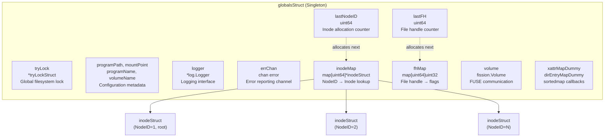
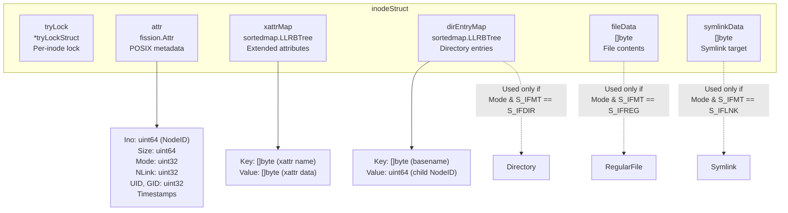
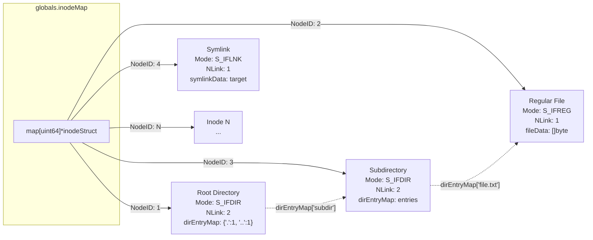
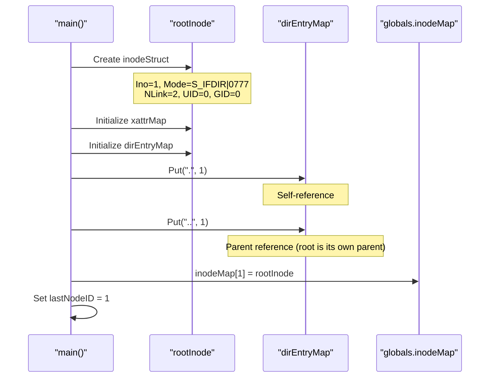
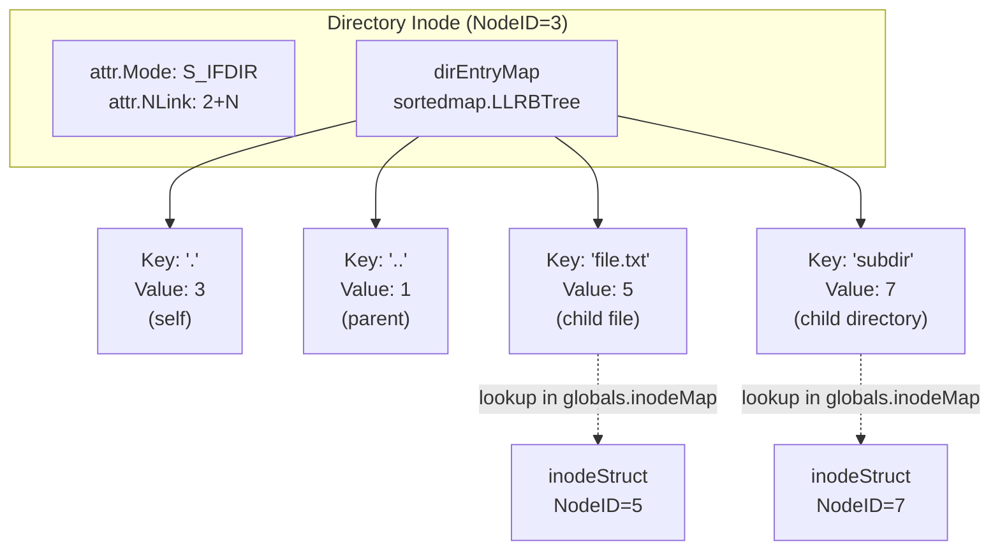
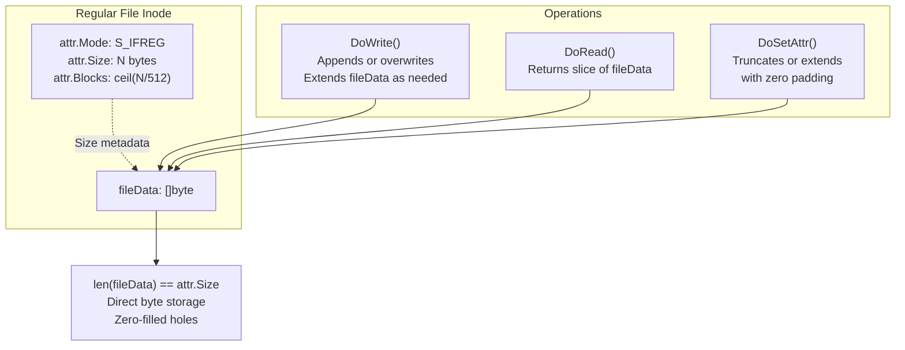
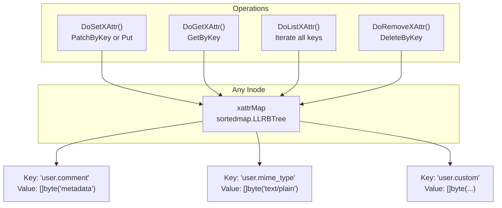
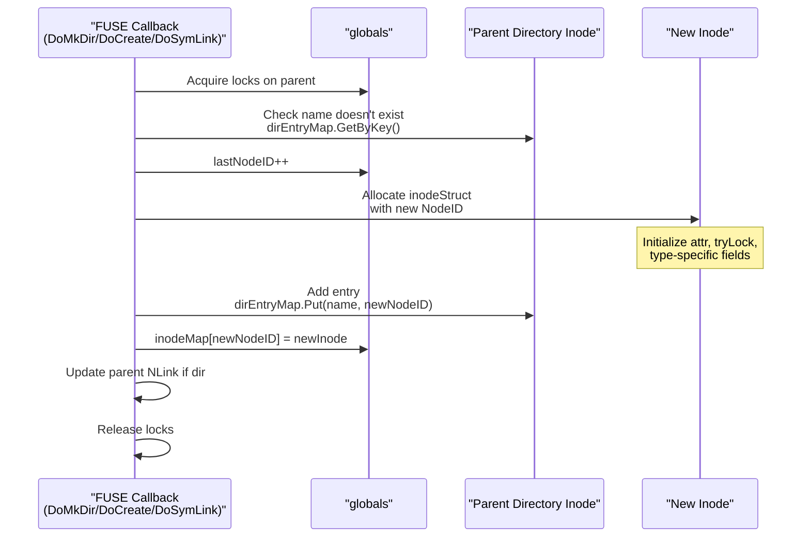
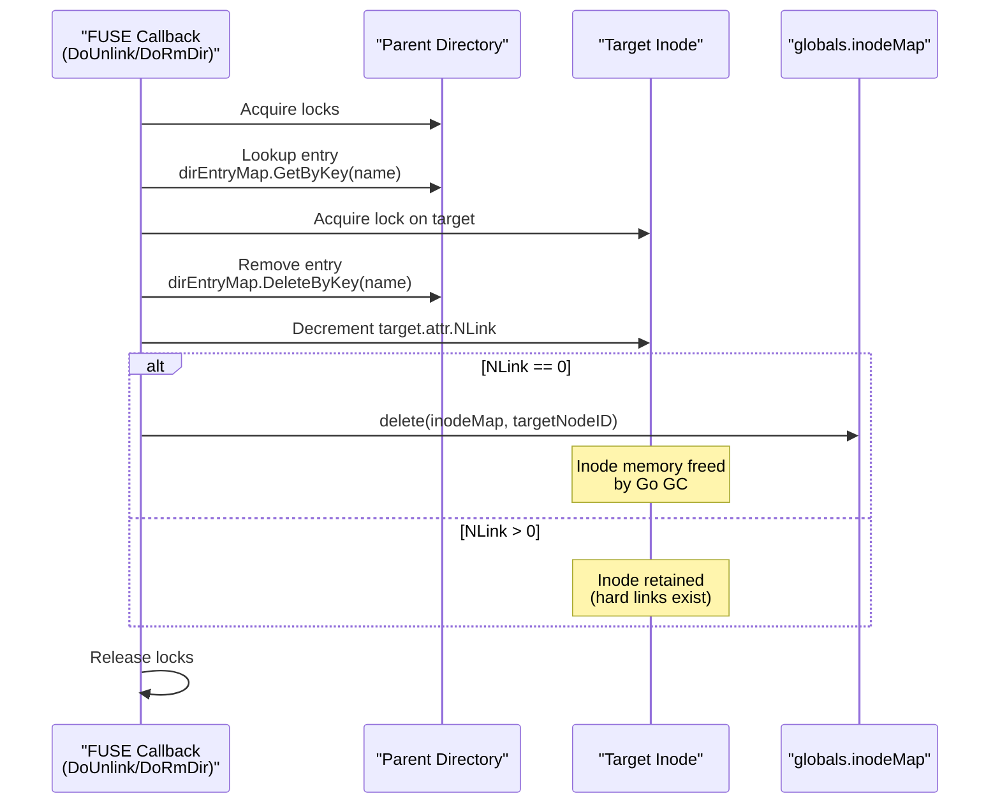
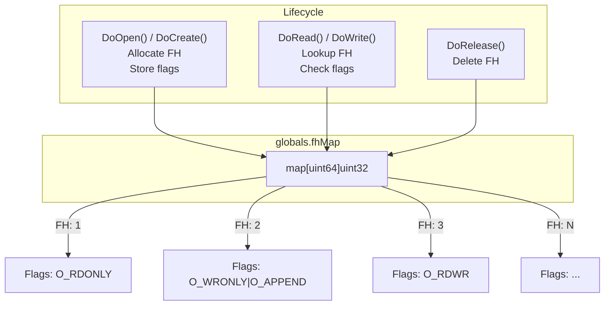

<!-- source: DeepWiki mcp.deepwiki.com · repo NVIDIA/fission · extra page RAMFS Architecture and State Management · fetched 2026-10-26 -->

# RAMFS Architecture and State Management

<details>
<summary>Relevant source files</summary>

The following files were used as context for generating this wiki page:

- [examples/fission-ramfs/callbacks.go](examples/fission-ramfs/callbacks.go)
- [examples/fission-ramfs/main.go](examples/fission-ramfs/main.go)

</details>


## Purpose and Scope

This document details the core data structures and state management architecture of the `fission-ramfs` in-memory filesystem implementation. It covers how the filesystem maintains its state using `globalsStruct` and `inodeStruct`, how inodes are organized and accessed through the `inodeMap`, and how different filesystem object types (files, directories, symlinks) are represented in memory.

For information about the concurrency control mechanisms and locking strategy used to protect this state, see [RAMFS Concurrency and Locking](#3.1.2). For documentation of specific filesystem operations (read, write, mkdir, etc.), see [RAMFS File and Directory Operations](#3.1.3).

---

## Global State Architecture

The fission-ramfs filesystem maintains all state in a single global variable `globals` of type `globalsStruct`. This singleton pattern provides centralized access to the filesystem's in-memory state from all FUSE callback handlers.

### globalsStruct Overview



**Sources:** [examples/fission-ramfs/main.go:89-105]()

The `globalsStruct` contains the following key components:

| Field | Type | Purpose |
|-------|------|---------|
| `tryLock` | `*tryLockStruct` | Global lock for filesystem-level operations |
| `inodeMap` | `map[uint64]*inodeStruct` | Primary inode lookup table, keyed by NodeID |
| `lastNodeID` | `uint64` | Counter for allocating unique NodeIDs; starts at 1 |
| `fhMap` | `map[uint64]uint32` | Maps file handles to open flags |
| `lastFH` | `uint64` | Counter for allocating unique file handles |
| `volume` | `fission.Volume` | Interface to FUSE kernel communication layer |
| `logger` | `*log.Logger` | Structured logging for debugging and errors |
| `errChan` | `chan error` | Channel for reporting asynchronous errors |

**Sources:** [examples/fission-ramfs/main.go:89-105]()

---

## Inode Structure

Each filesystem object (file, directory, or symlink) is represented by an `inodeStruct`. This structure contains all metadata and data for the object.

### inodeStruct Fields



**Sources:** [examples/fission-ramfs/main.go:73-80]()

| Field | Type | Usage by Inode Type |
|-------|------|---------------------|
| `tryLock` | `*tryLockStruct` | All types: provides per-inode concurrency control |
| `attr` | `fission.Attr` | All types: stores POSIX metadata (mode, size, times, owner) |
| `xattrMap` | `sortedmap.LLRBTree` | All types: stores extended attributes as name→data mappings |
| `dirEntryMap` | `sortedmap.LLRBTree` | **Directories only**: maps entry names to child NodeIDs |
| `fileData` | `[]byte` | **Regular files only**: stores file contents up to `attr.Size` |
| `symlinkData` | `[]byte` | **Symlinks only**: stores target path as byte slice |

**Sources:** [examples/fission-ramfs/main.go:73-80]()

### Inode Type Discrimination

The inode type is encoded in `attr.Mode & syscall.S_IFMT` and determines which fields are valid:

- **`syscall.S_IFDIR`**: Directory inode, `dirEntryMap` is populated, `fileData` and `symlinkData` are `nil`
- **`syscall.S_IFREG`**: Regular file inode, `fileData` is populated, `dirEntryMap` and `symlinkData` are `nil`
- **`syscall.S_IFLNK`**: Symlink inode, `symlinkData` is populated, `dirEntryMap` and `fileData` are `nil`

**Sources:** [examples/fission-ramfs/main.go:75](), [examples/fission-ramfs/callbacks.go:44-48]()

---

## Inode Map Organization

The `inodeMap` is the central lookup table for all filesystem objects. It maps NodeIDs (which are also stored in `attr.Ino`) to their corresponding `inodeStruct` pointers.

### Inode Map Structure



**Sources:** [examples/fission-ramfs/main.go:99](), [examples/fission-ramfs/main.go:185-189]()

### NodeID Allocation Strategy

NodeIDs are allocated sequentially using a simple counter:

1. NodeID `1` is reserved for the root directory (created during initialization)
2. `globals.lastNodeID` tracks the most recently allocated NodeID
3. When creating a new inode, `globals.lastNodeID++` generates the next NodeID
4. The new inode is immediately inserted into `globals.inodeMap[newNodeID]`

**Sources:** [examples/fission-ramfs/main.go:189](), [examples/fission-ramfs/callbacks.go:386-387](), [examples/fission-ramfs/callbacks.go:518]()

Example from `DoMkDir`:

```
globals.lastNodeID++

dirEntInode = &inodeStruct{
    tryLock: makeTryLock(),
    attr: fission.Attr{
        Ino:   globals.lastNodeID,
        ...
    },
    ...
}

globals.inodeMap[dirEntInode.attr.Ino] = dirEntInode
```

**Sources:** [examples/fission-ramfs/callbacks.go:518-577]()

---

## Root Inode Initialization

The root directory (NodeID 1) is created during filesystem initialization in `main()`. It is the only pre-existing inode when the filesystem mounts.

### Root Inode Setup Sequence



**Sources:** [examples/fission-ramfs/main.go:141-189]()

Key characteristics of the root inode:

- **NodeID**: Always `1` (hardcoded)
- **Mode**: `S_IFDIR | 0777` (directory with full permissions)
- **NLink**: `2` (one for itself, one for `.` entry)
- **Directory entries**: Initially contains only `.` and `..`, both pointing to NodeID 1
- **Timestamps**: Set to current time at mount

**Sources:** [examples/fission-ramfs/main.go:141-184]()

---

## Directory Entry Management

Directories use `dirEntryMap` to maintain their child entries as a sorted map of basename→NodeID.

### Directory Entry Structure



**Sources:** [examples/fission-ramfs/main.go:77](), [examples/fission-ramfs/callbacks.go:547-564]()

The `dirEntryMap` uses `sortedmap.LLRBTree` (Left-Leaning Red-Black Tree) for efficient ordered storage:

- **Key**: `[]byte` containing the entry's basename (e.g., `"file.txt"`)
- **Value**: `uint64` containing the child inode's NodeID
- **Comparator**: `sortedmap.CompareByteSlice` for lexicographic ordering
- **Special entries**: `.` points to the directory itself, `..` points to parent directory

**Sources:** [examples/fission-ramfs/main.go:159](), [examples/fission-ramfs/callbacks.go:540]()

### Directory Link Count

The `NLink` field in a directory's attributes follows POSIX conventions:

- Base count of `2` (one for itself, one for `.` entry)
- Increment by `1` for each subdirectory (due to its `..` entry pointing back)
- Regular files do not affect parent directory link count

**Sources:** [examples/fission-ramfs/callbacks.go:533](), [examples/fission-ramfs/callbacks.go:575]()

---

## File Data Storage

Regular files store their contents directly in the `fileData` byte slice within the inode.

### File Data Layout



**Sources:** [examples/fission-ramfs/main.go:78](), [examples/fission-ramfs/callbacks.go:234-241]()

File data characteristics:

- **Storage**: Direct `[]byte` slice within inode, no separate block allocation
- **Size synchronization**: `len(fileData)` always equals `attr.Size`
- **Growth**: On write beyond EOF, `fileData` is extended with `append()`
- **Truncation**: On size reduction, slice is resliced; on growth, zeros are appended
- **Block count**: Calculated as `(attr.Size + 511) / 512` for reporting to stat calls

**Sources:** [examples/fission-ramfs/callbacks.go:234-242](), [examples/fission-ramfs/callbacks.go:1084-1109](), [examples/fission-ramfs/callbacks.go:2276-2286]()

Example from `DoWrite`:

```
if writeOffsetActual < fileInode.attr.Size {
    if writeOffsetPlusSize <= fileInode.attr.Size {
        _ = copy(fileInode.fileData[writeOffsetActual:writeOffsetPlusSize], writeIn.Data)
    } else {
        overwriteSize = fileInode.attr.Size - writeOffsetActual
        _ = copy(fileInode.fileData[writeOffsetActual:], writeIn.Data[:overwriteSize])
        fileInode.fileData = append(fileInode.fileData, writeIn.Data[overwriteSize:]...)
        fileInode.attr.Size = writeOffsetPlusSize
    }
} else {
    if writeOffsetActual > fileInode.attr.Size {
        fileInode.fileData = append(fileInode.fileData, make([]byte, (writeOffsetActual-fileInode.attr.Size))...)
    }
    fileInode.fileData = append(fileInode.fileData, writeIn.Data...)
    fileInode.attr.Size = writeOffsetPlusSize
}
```

**Sources:** [examples/fission-ramfs/callbacks.go:1086-1109]()

---

## Extended Attribute Storage

All inodes (files, directories, and symlinks) support extended attributes stored in their `xattrMap`.

### Extended Attribute Structure



**Sources:** [examples/fission-ramfs/main.go:76](), [examples/fission-ramfs/callbacks.go:1255-1262]()

Extended attribute characteristics:

- **Key**: `[]byte` containing the attribute name (e.g., `"user.comment"`)
- **Value**: `[]byte` containing arbitrary attribute data
- **Storage**: Separate `sortedmap.LLRBTree` per inode for ordered iteration
- **Operations**: Support set, get, list, and remove operations
- **Namespace**: No filtering; all namespaces accepted (user, system, security, trusted)

**Sources:** [examples/fission-ramfs/callbacks.go:1228-1472]()

---

## Inode Lifecycle Management

Inodes are created, accessed, and deleted through well-defined patterns enforced by reference counting.

### Inode Creation Flow



**Sources:** [examples/fission-ramfs/callbacks.go:466-611](), [examples/fission-ramfs/callbacks.go:1935-2069]()

### Inode Access Pattern

All filesystem operations follow a consistent pattern for accessing inodes:

1. **Lookup in map**: `inode, ok := globals.inodeMap[nodeID]`
2. **Check existence**: If `!ok`, return `syscall.ENOENT`
3. **Acquire lock**: Use `grantedLockSet.try(inode.tryLock)` (may trigger restart)
4. **Perform operation**: Read or modify inode fields
5. **Release locks**: `grantedLockSet.freeAll(false)`

**Sources:** [examples/fission-ramfs/callbacks.go:27-42](), [examples/fission-ramfs/callbacks.go:122-137]()

### Inode Deletion Flow



**Sources:** [examples/fission-ramfs/callbacks.go:613-698](), [examples/fission-ramfs/callbacks.go:700-796]()

Reference counting rules:

- **Regular files**: Start with `NLink=1`, deleted when reaches `0`
- **Directories**: Start with `NLink=2`, must be empty (only `.` and `..`) before deletion
- **Hard links**: Increment `NLink` on `DoLink()`, decrement on `DoUnlink()`
- **Open file handles**: Deletion deferred until `DoRelease()` if `NLink=0` while file is open

**Sources:** [examples/fission-ramfs/callbacks.go:688-692](), [examples/fission-ramfs/callbacks.go:1182-1184]()

---

## File Handle Management

The `fhMap` tracks open file handles and their associated flags, separate from the inode table.

### File Handle Mapping



**Sources:** [examples/fission-ramfs/main.go:101-102](), [examples/fission-ramfs/callbacks.go:948-950]()

File handle characteristics:

- **Allocation**: `globals.lastFH++` on `DoOpen()` or `DoCreate()`
- **Stored flags**: Open flags from `{open|create}In.Flags` (e.g., `O_RDONLY`, `O_WRONLY`, `O_APPEND`)
- **Validation**: `DoRead()` checks for write-only, `DoWrite()` checks for read-only
- **Cleanup**: Removed from `fhMap` on `DoRelease()`
- **No inode link**: File handle doesn't hold a reference; deletion happens when `NLink=0`

**Sources:** [examples/fission-ramfs/callbacks.go:943-961](), [examples/fission-ramfs/callbacks.go:977-987](), [examples/fission-ramfs/callbacks.go:1047-1057](), [examples/fission-ramfs/callbacks.go:1180]()

---

## State Persistence and Volatility

The ramfs implementation stores all data in memory with no persistence mechanism.

### Volatility Characteristics

| Component | Volatility | Consequence |
|-----------|-----------|-------------|
| `inodeMap` | Volatile | All files/directories lost on unmount |
| `fileData` | Volatile | File contents lost on unmount |
| `dirEntryMap` | Volatile | Directory structure lost on unmount |
| `xattrMap` | Volatile | Extended attributes lost on unmount |
| `fhMap` | Volatile | Open handles invalidated on unmount |

On filesystem unmount:
1. `DoUnmount()` is called
2. All goroutines terminate
3. `globals` goes out of scope
4. Go garbage collector reclaims all memory

There is no persistence layer, journal, or recovery mechanism. This design prioritizes simplicity and performance for temporary storage use cases.

**Sources:** [examples/fission-ramfs/main.go:216-220]()

---

## Summary

The fission-ramfs state management architecture uses a straightforward in-memory design:

- **Central state**: `globalsStruct` singleton holds all filesystem state
- **Inode table**: `map[uint64]*inodeStruct` provides O(1) lookup by NodeID
- **Type discrimination**: `attr.Mode & S_IFMT` determines which inode fields are valid
- **Directory organization**: `sortedmap.LLRBTree` provides ordered directory entries
- **File storage**: Direct `[]byte` slice storage within each inode
- **Reference counting**: `attr.NLink` tracks references, deletion at zero
- **Sequential allocation**: Monotonically increasing NodeID and FH counters

This architecture balances simplicity with functionality, providing a complete POSIX-like filesystem interface backed entirely by Go's native data structures and memory management.

**Sources:** [examples/fission-ramfs/main.go:1-356](), [examples/fission-ramfs/callbacks.go:1-2495]()

---

