<!-- source: DeepWiki mcp.deepwiki.com · repo NVIDIA/fission · extra page RAMFS Concurrency and Locking · fetched 2026-10-26 -->

# RAMFS Concurrency and Locking

<details>
<summary>Relevant source files</summary>

The following files were used as context for generating this wiki page:

- [examples/fission-ramfs/callbacks.go](examples/fission-ramfs/callbacks.go)
- [examples/fission-ramfs/main.go](examples/fission-ramfs/main.go)

</details>


## Purpose and Scope

This document explains the concurrency control and locking mechanisms used in the fission-ramfs example implementation. It covers the custom lock primitives, the two-phase locking protocol, and the restart-based deadlock prevention strategy that allows safe concurrent access to the in-memory filesystem state.

For information about the overall RAMFS architecture and state management, see [RAMFS Architecture and State Management](#3.1.1). For details on file and directory operations that utilize these locking mechanisms, see [RAMFS File and Directory Operations](#3.1.3).

---

## Lock Primitives

The ramfs implementation uses two custom lock types to manage concurrent access: `tryLockStruct` for individual locks and `grantedLockSetStruct` for tracking all locks held during an operation.

### tryLockStruct

The `tryLockStruct` implements a non-blocking lock using Go channels. It provides both blocking acquisition (`get`) and non-blocking try-lock semantics.

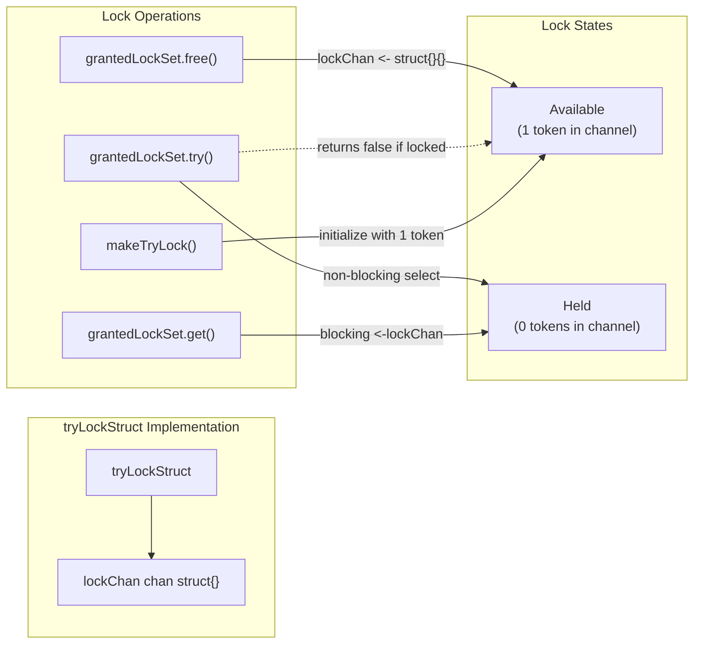

**Structure Definition:**
- `lockChan`: A buffered channel with capacity 1, initialized with a token to represent the unlocked state

**Key characteristics:**
- Lock is available when the channel contains a token
- Lock is held when the channel is empty
- Blocking acquisition blocks on channel receive
- Non-blocking try uses `select` with `default` case

Sources: [examples/fission-ramfs/main.go:65-67](), [examples/fission-ramfs/main.go:223-227]()

### grantedLockSetStruct

The `grantedLockSetStruct` tracks all locks acquired during a single operation, enabling atomic release of all locks during restart scenarios.

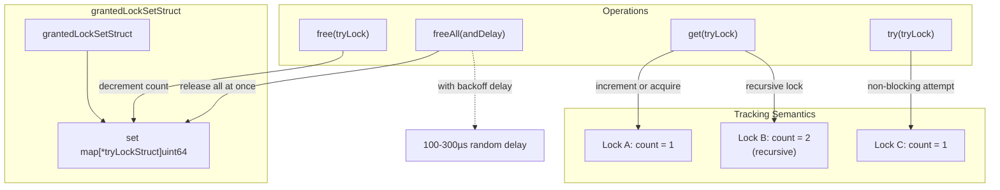

**Structure Definition:**
- `set`: A map from `*tryLockStruct` to `uint64`, where the value is the lock count (supporting recursive locking)

**Key methods:**

| Method | Behavior | Use Case |
|--------|----------|----------|
| `get(tryLock)` | Blocks until lock acquired, increments count | Acquiring global lock |
| `try(tryLock)` | Non-blocking attempt, returns success/failure | Acquiring inode locks |
| `free(tryLock)` | Decrements count, releases if zero | Releasing single lock |
| `freeAll(andDelay)` | Releases all locks, optional backoff delay | Restart on contention |

Sources: [examples/fission-ramfs/main.go:69-71](), [examples/fission-ramfs/main.go:229-232](), [examples/fission-ramfs/main.go:234-309]()

---

## Two-Phase Locking Protocol

The ramfs implementation uses a hierarchical two-phase locking protocol to protect filesystem state. This ensures consistent access to both the global inode table and individual inode data structures.

### Locking Hierarchy

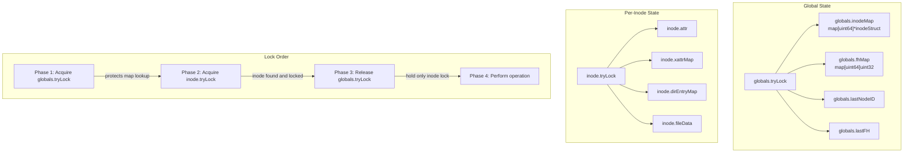

**Locking levels:**

1. **Global lock** (`globals.tryLock`): Protects global data structures
   - `inodeMap`: Maps inode numbers to `inodeStruct` pointers
   - `fhMap`: Maps file handles to open flags
   - `lastNodeID`: Counter for allocating new inode numbers
   - `lastFH`: Counter for allocating new file handles

2. **Per-inode lock** (`inode.tryLock`): Protects individual inode state
   - `attr`: File/directory attributes (size, mode, times, etc.)
   - `xattrMap`: Extended attributes
   - `dirEntryMap`: Directory entries (for directories)
   - `fileData`: File contents (for regular files)

Sources: [examples/fission-ramfs/main.go:73-80](), [examples/fission-ramfs/main.go:89-105]()

### Standard Lock Acquisition Pattern

Most operations follow this canonical pattern:

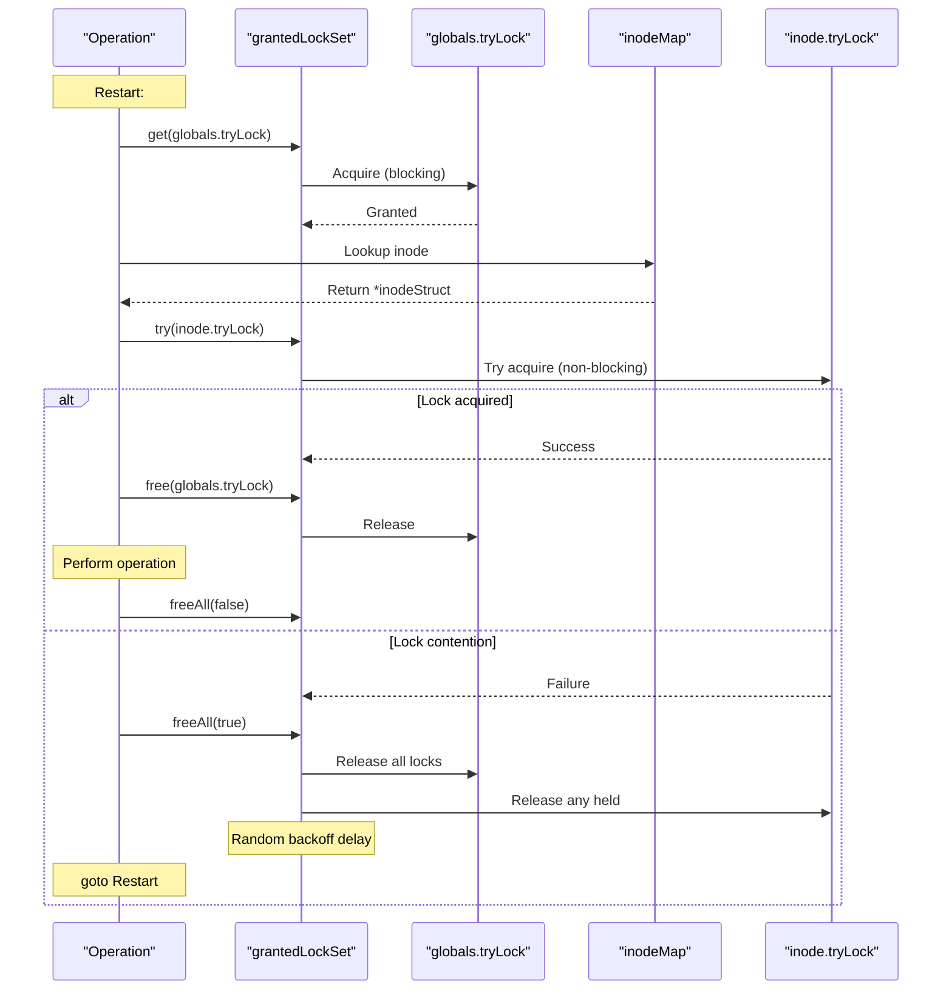

**Pattern details:**

1. **Acquire global lock** (blocking): Ensures exclusive access to `inodeMap`
2. **Lookup inode**: Find the target inode structure
3. **Try-lock inode** (non-blocking): Attempt to acquire inode-specific lock
4. **Release global lock**: If inode lock acquired, global lock no longer needed
5. **Perform operation**: Work with inode data under inode lock protection
6. **Release all locks**: Clean up at operation completion

Sources: [examples/fission-ramfs/callbacks.go:14-108](), [examples/fission-ramfs/callbacks.go:113-167]()

---

## Restart-Based Deadlock Prevention

The ramfs implementation uses an optimistic restart strategy to prevent deadlocks. When lock acquisition fails, the operation releases all held locks, delays briefly, and retries from the beginning.

### Deadlock Avoidance Strategy

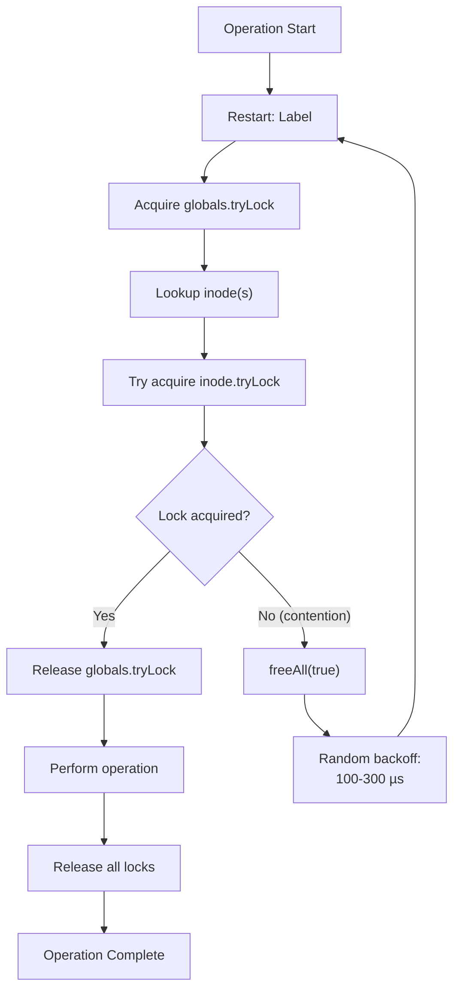

**Deadlock prevention properties:**

- **No circular wait**: Operations never hold inode locks while waiting for global lock
- **Atomic all-or-nothing**: Either all required locks acquired, or all released
- **Randomized backoff**: Prevents repeated collision between competing operations
- **Label-based restart**: Simple `goto Restart` returns to beginning of operation

Sources: [examples/fission-ramfs/main.go:52-53](), [examples/fission-ramfs/main.go:294-309]()

### Contention Example: DoLookup

Here's a concrete example from `DoLookup` showing the restart pattern:

**Operation: Lookup directory entry**

Required locks:
1. `globals.tryLock` - to access `inodeMap`
2. `dirInode.tryLock` - to read directory's `dirEntryMap`
3. `dirEntInode.tryLock` - to read found entry's attributes

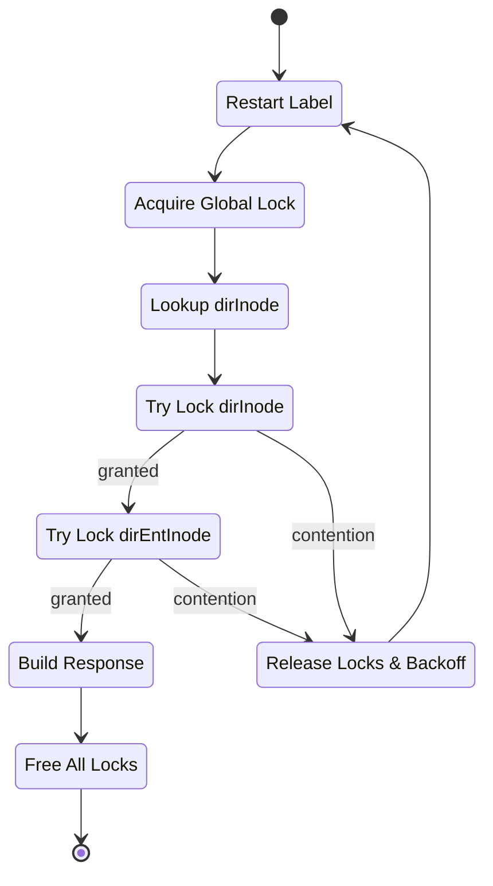

**Code structure:**

```
DoLookup:
  Restart:                                    // Line 26
    grantedLockSet.get(globals.tryLock)       // Line 27 - blocking acquire
    
    dirInode := globals.inodeMap[nodeID]      // Line 29 - lookup under global lock
    
    granted := grantedLockSet.try(dirInode)   // Line 36 - non-blocking try
    if !granted {
      grantedLockSet.freeAll(true)            // Line 38 - release all + backoff
      goto Restart                             // Line 39 - retry
    }
    
    grantedLockSet.free(globals.tryLock)      // Line 42 - release global
    
    // ... lookup directory entry ...
    
    granted = grantedLockSet.try(dirEntInode) // Line 69 - second inode lock
    if !granted {
      grantedLockSet.freeAll(true)            // Line 71
      goto Restart                             // Line 72
    }
    
    // ... build response ...
    
    grantedLockSet.freeAll(false)             // Line 104 - success path
```

Sources: [examples/fission-ramfs/callbacks.go:14-108]()

### Backoff Mechanism

When contention occurs, `freeAll(true)` introduces a randomized delay to reduce repeated collisions:

| Parameter | Value | Purpose |
|-----------|-------|---------|
| `tryLockBackoffMin` | 100 µs | Minimum backoff duration |
| `tryLockBackoffMax` | 300 µs | Maximum backoff duration |
| Distribution | Uniform random | Prevents synchronized retry storms |

The backoff is calculated as:
```
backoff = tryLockBackoffMin + rand(0, tryLockBackoffMax - tryLockBackoffMin + 1)
```

Sources: [examples/fission-ramfs/main.go:52-53](), [examples/fission-ramfs/main.go:304-307]()

---

## Lock Acquisition Patterns

Different operations require different locking patterns based on their data access needs.

### Single Inode Operations

Operations that access only one inode use the basic pattern:

**Example operations:**
- `DoGetAttr`: Read inode attributes
- `DoSetAttr`: Modify inode attributes  
- `DoReadLink`: Read symlink target
- `DoOpen`: Open file for I/O

**Locking sequence:**

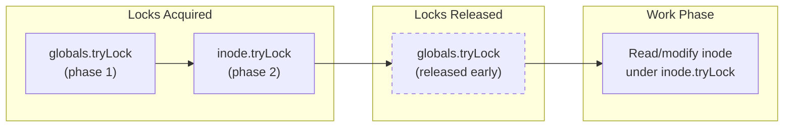

Sources: [examples/fission-ramfs/callbacks.go:113-167](), [examples/fission-ramfs/callbacks.go:169-294]()

### Two Inode Operations

Operations involving two inodes (e.g., directory and its entry) must acquire both locks:

**Example operations:**
- `DoLookup`: Access directory and directory entry
- `DoUnlink`: Modify directory and unlink file
- `DoLink`: Add link in directory to existing file

**Locking sequence:**

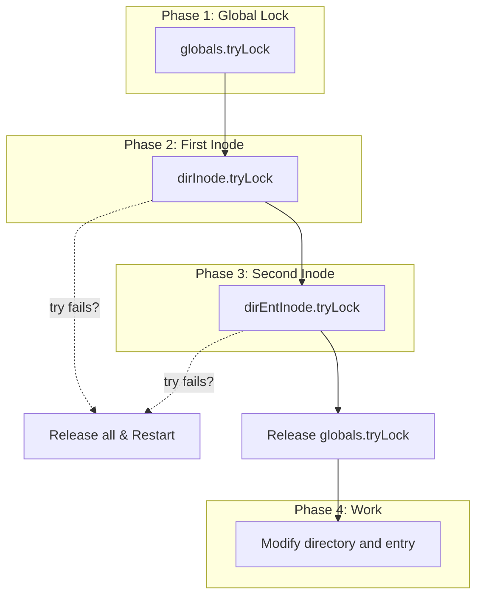

**Key invariant:** Global lock released only after all inode locks acquired, ensuring atomic all-or-nothing behavior.

Sources: [examples/fission-ramfs/callbacks.go:14-108](), [examples/fission-ramfs/callbacks.go:613-698](), [examples/fission-ramfs/callbacks.go:803-911]()

### Complex Operations: Rename

The `commonRename` function demonstrates the most complex locking scenario, potentially involving four inodes:

**Inodes involved:**
1. `oldDirInode` - Source directory
2. `newDirInode` - Destination directory (may equal oldDirInode)
3. `movedInode` - The inode being renamed
4. `replacedInode` - Optional: existing inode at destination

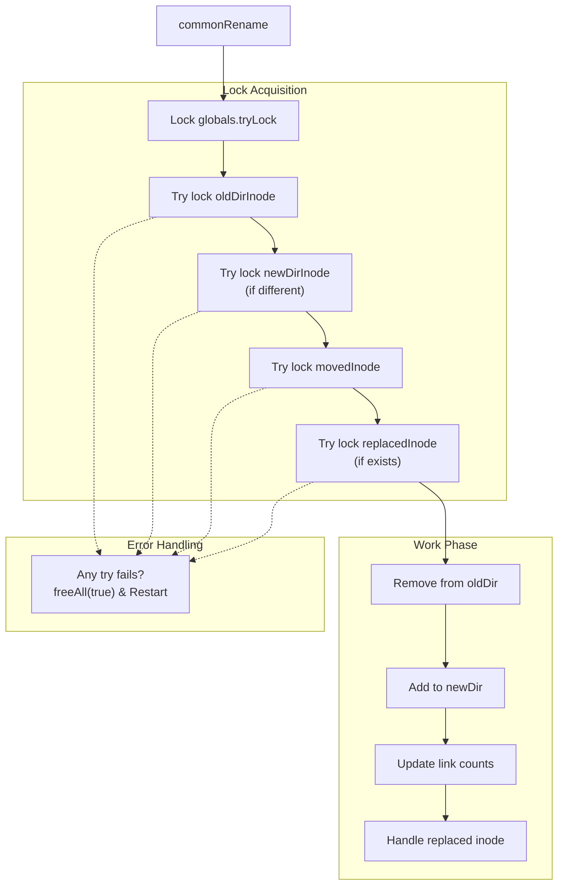

**Special cases handled:**
- Same directory rename: Only lock `oldDirInode` once
- Directory rename: Update parent link (`..` entry)
- Replace existing entry: Lock and remove `replacedInode`

Sources: [examples/fission-ramfs/callbacks.go:2288-2494]()

### Read Operations with Directory Traversal

Operations like `DoReadDir` and `DoReadDirPlus` must lock each directory entry as they iterate:

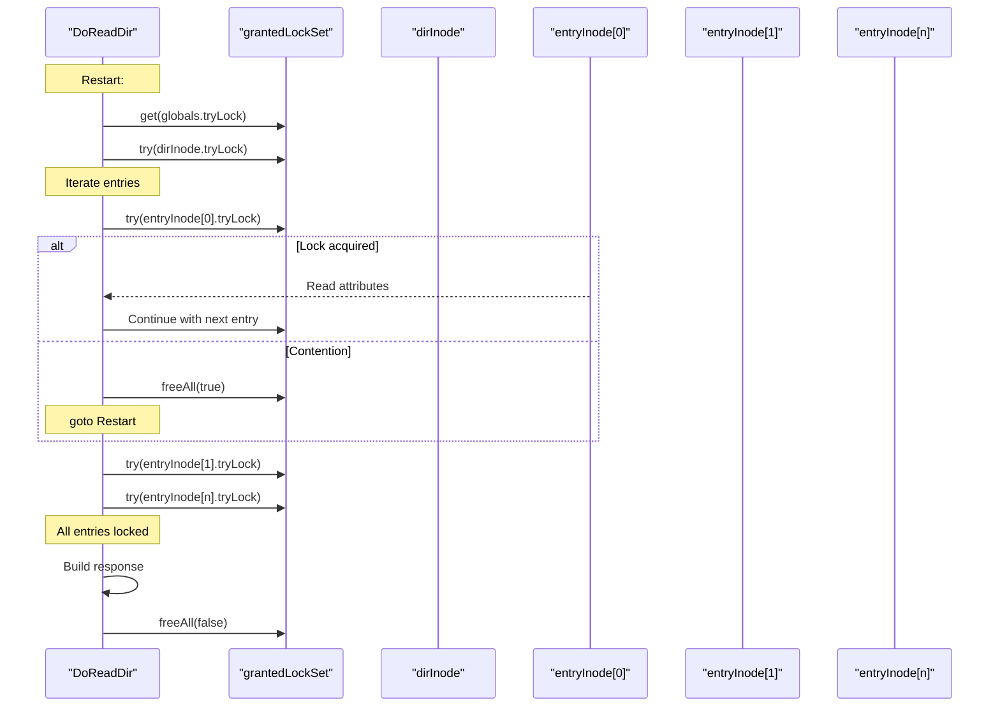

**Characteristics:**
- Multiple inode locks held simultaneously
- Any contention triggers complete restart
- All locks held until response built
- Lock order: directory first, then entries in iteration order

Sources: [examples/fission-ramfs/callbacks.go:1574-1708](), [examples/fission-ramfs/callbacks.go:2097-2259]()

---

## Performance Considerations

### Lock Granularity Trade-offs

| Approach | Advantages | Disadvantages | RAMFS Choice |
|----------|-----------|---------------|--------------|
| Single global lock | Simple, no deadlocks | Poor concurrency | ❌ Not used |
| Per-inode locks | Good concurrency | Deadlock risk | ✅ Used with restart |
| Lock-free structures | Best concurrency | Complex, limited ops | ❌ Not needed |

The ramfs implementation chooses **per-inode locks with restart-based deadlock prevention** to balance:
- Reasonable concurrency for most workloads
- Simplicity of implementation
- Correctness guarantees

### Contention Scenarios

**Low contention workload:**
- Operations rarely retry
- Minimal backoff delays
- Good throughput

**High contention workload:**
- Frequent restarts on popular inodes (e.g., root directory)
- Cumulative backoff delays
- Reduced effective throughput

**Hotspot mitigation:**
- Early release of global lock reduces contention window
- Randomized backoff prevents synchronization
- In-order locking for multi-inode operations reduces restart probability

Sources: [examples/fission-ramfs/main.go:294-309]()

### Recursive Locking Support

The `grantedLockSetStruct` tracks lock counts, enabling recursive lock acquisition:

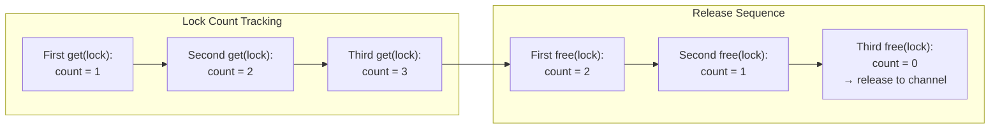

**Use case:** An operation can re-acquire a lock it already holds without deadlocking. The lock is only released to the channel when the count reaches zero.

**Example:** `commonRename` may need to lock the same directory twice if source and destination are the same:
```
granted = grantedLockSet.try(oldDirInode.tryLock)  // count = 1
if oldDirNodeID == newDirNodeID {
  newDirInode = oldDirInode  // Same inode, already locked
} else {
  granted = grantedLockSet.try(newDirInode.tryLock)  // Different inode
}
```

Sources: [examples/fission-ramfs/main.go:234-251](), [examples/fission-ramfs/main.go:279-292](), [examples/fission-ramfs/callbacks.go:2327-2348]()

---

## Summary

The fission-ramfs concurrency system provides:

1. **Custom lock primitives** using channel-based semaphores
2. **Hierarchical locking** (global → per-inode) for scalable access
3. **Optimistic restart strategy** that prevents deadlocks through all-or-nothing lock acquisition
4. **Randomized backoff** to reduce contention on retry
5. **Recursive lock tracking** to support complex multi-inode operations

This design prioritizes **correctness** and **simplicity** over maximum throughput, making it suitable for the in-memory filesystem use case where operations are typically fast and contention is manageable.

---

