<!-- source: DeepWiki mcp.deepwiki.com · repo NVIDIA/fission · extra page RAMFS File and Directory Operations · fetched 2026-10-26 -->

# RAMFS File and Directory Operations

<details>
<summary>Relevant source files</summary>

The following files were used as context for generating this wiki page:

- [examples/fission-ramfs/callbacks.go](examples/fission-ramfs/callbacks.go)

</details>


This page documents the implementation of FUSE file and directory operations in the fission-ramfs example. It covers how the filesystem handles file I/O, directory manipulation, inode lookups, attribute management, links, and extended attributes. Each operation demonstrates the complete lifecycle from request parsing through state modification and response construction.

For information about the underlying data structures and state management, see [RAMFS Architecture and State Management](#3.1.1). For details on the concurrency control mechanisms used throughout these operations, see [RAMFS Concurrency and Locking](#3.1.2).

## Operation Categories

The RAMFS implementation provides handlers for 40+ FUSE operations. The table below maps logical filesystem operations to their corresponding callback functions:

| Operation Category | FUSE Callbacks | Purpose |
|-------------------|----------------|---------|
| **File I/O** | `DoCreate`, `DoOpen`, `DoRead`, `DoWrite`, `DoRelease`, `DoFSync`, `DoFlush` | File creation, opening, reading, writing, and closing |
| **Directory Management** | `DoMkDir`, `DoOpenDir`, `DoReadDir`, `DoReadDirPlus`, `DoReleaseDir`, `DoRmDir`, `DoFSyncDir` | Directory creation, listing, and deletion |
| **Lookup & Attributes** | `DoLookup`, `DoGetAttr`, `DoSetAttr`, `DoAccess` | Inode resolution, attribute retrieval and modification, permission checking |
| **Links** | `DoSymLink`, `DoReadLink`, `DoLink`, `DoUnlink` | Symbolic and hard link management |
| **Rename** | `DoRename`, `DoRename2` | Moving and renaming filesystem entries |
| **Extended Attributes** | `DoSetXAttr`, `DoGetXAttr`, `DoListXAttr`, `DoRemoveXAttr` | Extended attribute storage and retrieval |

**Sources:** [examples/fission-ramfs/callbacks.go:1-2495]()

## File Operations

### File Creation and Opening

```mermaid
graph TB
    subgraph "DoCreate Flow"
        Create1["DoCreate Request<br/>inHeader.NodeID = parent dir"]
        Create2["Lock parent directory<br/>Restart on contention"]
        Create3["Check if file exists<br/>Return EEXIST if found"]
        Create4["Increment globals.lastNodeID<br/>Allocate new inode"]
        Create5["Initialize fileInode<br/>Mode, timestamps, empty data"]
        Create6["Add to parent dirEntryMap<br/>Add to globals.inodeMap"]
        Create7["Allocate FH in globals.fhMap<br/>Store open flags"]
        Create8["Return CreateOut<br/>NodeID, Attr, FH"]
        
        Create1 --> Create2
        Create2 --> Create3
        Create3 --> Create4
        Create4 --> Create5
        Create5 --> Create6
        Create6 --> Create7
        Create7 --> Create8
    end
    
    subgraph "DoOpen Flow"
        Open1["DoOpen Request<br/>inHeader.NodeID = file inode"]
        Open2["Lock file inode<br/>Restart on contention"]
        Open3["Verify S_IFREG type<br/>Return EINVAL if not"]
        Open4["Handle TRUNC flag<br/>Clear fileData if set"]
        Open5["Allocate FH in globals.fhMap<br/>Store open flags"]
        Open6["Return OpenOut<br/>FH, DirectIO flag"]
        
        Open1 --> Open2
        Open2 --> Open3
        Open3 --> Open4
        Open4 --> Open5
        Open5 --> Open6
    end
```

**DoCreate** ([examples/fission-ramfs/callbacks.go:1935-2069]()) handles both file creation and opening in a single operation. It combines the logic of `mkdir`-like creation with `open`-like FH allocation:

1. **Lock Acquisition**: Uses the restart pattern to acquire locks on the parent directory inode
2. **Existence Check**: Queries `dirEntryMap` to ensure the name doesn't already exist
3. **Inode Allocation**: Increments `globals.lastNodeID` and creates a new `inodeStruct` with `S_IFREG` mode
4. **Mode Calculation**: Applies `createIn.Mode & ~createIn.UMask` to determine final permissions
5. **Directory Entry**: Inserts the new inode into the parent's `dirEntryMap` using `sortedmap.Put()`
6. **File Handle**: Allocates an FH in `globals.fhMap` to track the open file descriptor
7. **Response Construction**: Populates `CreateOut` with `EntryOut` (inode attributes) and `FH` (file handle)

**DoOpen** ([examples/fission-ramfs/callbacks.go:913-962]()) opens an existing file without creating it:

1. **Type Verification**: Ensures the inode has `S_IFREG` mode (regular file)
2. **Truncate Handling**: If `FOpenRequestTRUNC` flag is set, clears `fileData` and sets `Size` to 0
3. **FH Allocation**: Creates a new file handle and stores `openIn.Flags` for later validation
4. **DirectIO Flag**: Returns `FOpenResponseDirectIO` to disable kernel page cache

**Sources:** [examples/fission-ramfs/callbacks.go:913-962](), [examples/fission-ramfs/callbacks.go:1935-2069]()

### File Reading and Writing

The read and write operations implement in-memory byte slice manipulation with proper bounds checking:

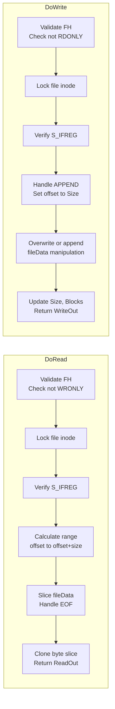

**DoRead** ([examples/fission-ramfs/callbacks.go:964-1030]()) implements the following logic:

- **FH Validation**: Checks that `globals.fhMap[readIn.FH]` exists and doesn't have `FOpenRequestWRONLY` flag
- **Range Calculation**: Computes `readOffsetPlusSize = readIn.Offset + readIn.Size`
- **Data Slicing**: Three cases:
  - `offset < size && offset+size <= size`: Return `fileData[offset:offset+size]`
  - `offset < size && offset+size > size`: Return `fileData[offset:]` (partial read at EOF)
  - `offset >= size`: Return empty slice (read beyond EOF)
- **Cloning**: Uses `cloneByteSlice()` to prevent aliasing the internal buffer

**DoWrite** ([examples/fission-ramfs/callbacks.go:1032-1119]()) handles three write scenarios:

1. **Overwrite Within Size**: `copy(fileData[offset:offset+size], writeIn.Data)` when write doesn't extend file
2. **Partial Overwrite + Append**: Overwrites up to current size, then appends remaining data
3. **Gap + Append**: If `offset > size`, fills gap with zeros before appending data

The `APPEND` flag handling ([examples/fission-ramfs/callbacks.go:1078-1082]()) forces `writeOffsetActual = fileInode.attr.Size`, ignoring `writeIn.Offset`.

After writing, `Blocks` is recalculated as `(Size + attrBlkSize - 1) / attrBlkSize` to maintain accurate block counts for reporting.

**Sources:** [examples/fission-ramfs/callbacks.go:964-1030](), [examples/fission-ramfs/callbacks.go:1032-1119]()

### File Handle Lifecycle

The file handle lifecycle demonstrates proper resource tracking:

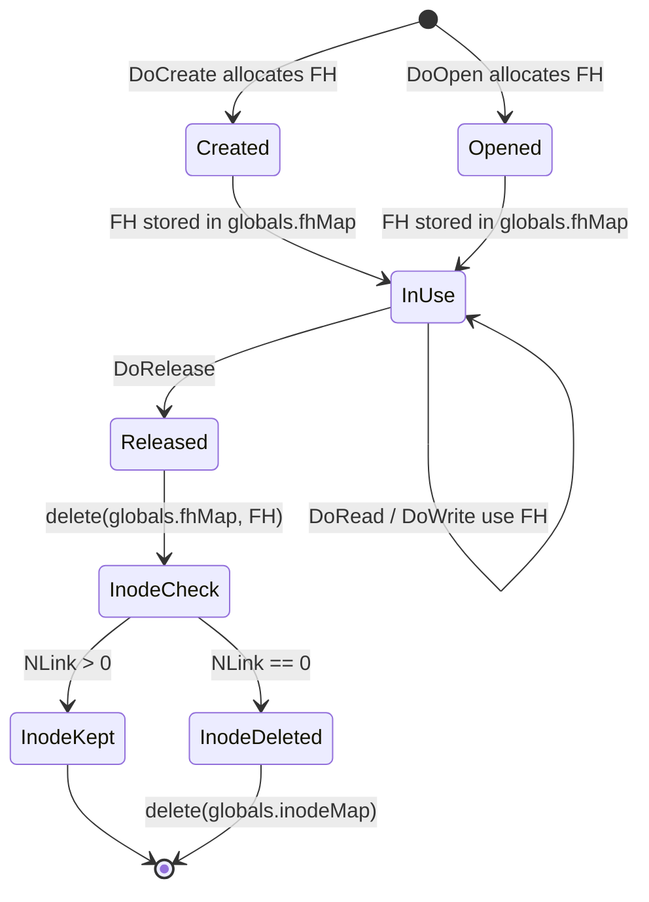

**DoRelease** ([examples/fission-ramfs/callbacks.go:1143-1190]()) implements POSIX close semantics:

1. **FH Removal**: Deletes the entry from `globals.fhMap` to free the file handle
2. **Inode Validation**: Verifies the inode still exists and has `S_IFREG` mode
3. **Garbage Collection**: If `fileInode.attr.NLink == 0`, removes the inode from `globals.inodeMap`

This enables the "unlink while open" pattern where a file can be deleted (`DoUnlink` decrements `NLink`) while still open. The inode persists until the last file handle is released.

**DoFlush** ([examples/fission-ramfs/callbacks.go:1474-1508]()) and **DoFSync** ([examples/fission-ramfs/callbacks.go:1192-1226]()) are no-ops in RAMFS since all writes are synchronous to memory. They simply validate the inode exists and return success.

**Sources:** [examples/fission-ramfs/callbacks.go:1143-1190](), [examples/fission-ramfs/callbacks.go:1192-1226](), [examples/fission-ramfs/callbacks.go:1474-1508]()

## Directory Operations

### Directory Creation

**DoMkDir** ([examples/fission-ramfs/callbacks.go:466-611]()) creates a new directory with proper parent-child linking:

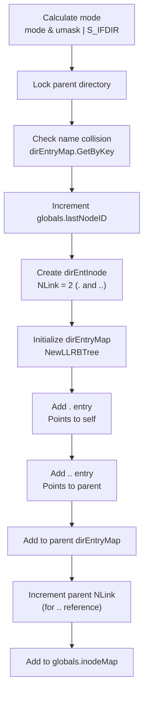

Key aspects of directory creation:

- **Mode Calculation** ([examples/fission-ramfs/callbacks.go:479-482]()): Applies `(S_IRWXU | S_IRWXG | S_IRWXO) & mkDirIn.Mode & ~mkDirIn.UMask | S_IFDIR`
- **NLink Initialization**: Directories start with `NLink = 2` because they contain `.` (self-reference)
- **Dot Entries**: Every directory gets `.` pointing to itself and `..` pointing to parent
- **Parent NLink**: Increments parent's `NLink` due to the `..` reference ([examples/fission-ramfs/callbacks.go:575]())
- **Empty dirEntryMap**: Allocates a new `sortedmap.LLRBTree` for storing child entries

**Sources:** [examples/fission-ramfs/callbacks.go:466-611]()

### Directory Reading

RAMFS provides two directory reading operations with different levels of detail:

| Operation | Data Returned | Use Case |
|-----------|---------------|----------|
| **DoReadDir** | Inode number, name, type | Basic `ls`, readdir() |
| **DoReadDirPlus** | Full attributes + directory entry | `ls -l`, stat-heavy operations |

**DoReadDir** ([examples/fission-ramfs/callbacks.go:1574-1708]()) implementation:

1. **Directory Validation**: Ensures inode has `S_IFDIR` mode
2. **Entry Counting**: Calls `dirEntryMap.Len()` to determine total entries
3. **Offset Handling**: If `readDirIn.Offset >= count`, returns empty result
4. **Entry Iteration**: Loops through `dirEntryMap.GetByIndex()` to fetch each entry
5. **Type Determination**: Sets `DirEnt.Type` to `DT_DIR` or `DT_REG` based on `Mode & S_IFMT`
6. **Progressive Locking**: Acquires each child inode lock during iteration (restart if contention)
7. **Size Pruning**: Truncates result when accumulated size exceeds `readDirIn.Size`

**DoReadDirPlus** ([examples/fission-ramfs/callbacks.go:2097-2259]()) adds full attribute population:

- Returns `DirEntPlus` structures containing both `EntryOut` (full inode attributes) and `DirEnt`
- Each entry includes `NodeID`, `Generation`, validity timeouts, and complete `Attr` structure
- Calls `fixAttrSizes()` on each attribute to ensure correct `Size`, `Blocks`, and `BlkSize`
- More expensive but avoids subsequent `DoGetAttr` calls for `stat()` operations

The size calculation for pruning uses alignment ([examples/fission-ramfs/callbacks.go:1691-1692]()):
```
dirEntNameLenAligned = (len(Name) + (DirEntAlignment - 1)) & ^(DirEntAlignment - 1)
dirEntSize = DirEntFixedPortionSize + dirEntNameLenAligned
```

**Sources:** [examples/fission-ramfs/callbacks.go:1574-1708](), [examples/fission-ramfs/callbacks.go:2097-2259]()

### Directory Deletion

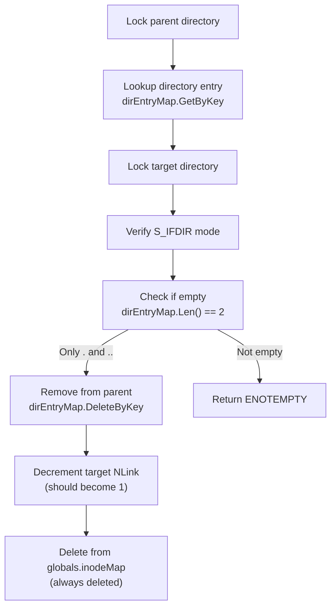

**DoRmDir** ([examples/fission-ramfs/callbacks.go:700-796]()) enforces POSIX directory deletion semantics:

- **Empty Check**: Only allows deletion if `dirEntryMap.Len() == 2` (only `.` and `..` remain)
- **Always Deletes Inode**: Unlike files, directories are immediately removed from `globals.inodeMap` even though their `NLink` is decremented from 2 to 1 (the parent no longer references them, and `.` self-reference doesn't keep them alive)
- **No Open Directory Issue**: Unlike files, there's no "rmdir while open" scenario since directory FDs don't prevent deletion

The parent directory's `NLink` is not modified in `DoRmDir` because only child directories with `..` entries affect parent link counts. Removing a child only removes the named entry, not the parent's self-reference.

**DoOpenDir** ([examples/fission-ramfs/callbacks.go:1532-1572]()) and **DoReleaseDir** ([examples/fission-ramfs/callbacks.go:1710-1748]()) are simpler than their file equivalents:

- **DoOpenDir**: Validates directory exists and has `S_IFDIR` mode, returns `FH=0` (unused)
- **DoReleaseDir**: Checks for `NLink == 0` and performs garbage collection if directory was deleted while open

**Sources:** [examples/fission-ramfs/callbacks.go:700-796](), [examples/fission-ramfs/callbacks.go:1532-1572](), [examples/fission-ramfs/callbacks.go:1710-1748]()

## Lookup and Attribute Operations

### Name Resolution

**DoLookup** ([examples/fission-ramfs/callbacks.go:14-108]()) is the most frequently called operation, translating path components to inodes:


The operation acquires locks on both parent and child inodes progressively:

1. **Parent Lock**: Acquired first via `grantedLockSet.get(globals.tryLock)` then `grantedLockSet.try(dirInode.tryLock)`
2. **Name Lookup**: Uses `dirInode.dirEntryMap.GetByKey(lookupIn.Name)` to retrieve child inode number
3. **Global Lock Release**: Frees `globals.tryLock` after fetching parent and before child access
4. **Child Lock**: Acquires `dirEntInode.tryLock`, restarting entire operation on contention
5. **Attribute Copy**: Populates all fields of `LookupOut.EntryOut.Attr` from `dirEntInode.attr`

The validity timeouts ([examples/fission-ramfs/callbacks.go:79-82]()) control kernel caching:
- `EntryValidSec/NSec`: How long the name→inode mapping is valid
- `AttrValidSec/NSec`: How long the inode attributes are valid

**Sources:** [examples/fission-ramfs/callbacks.go:14-108]()

### Attribute Management

**DoGetAttr** ([examples/fission-ramfs/callbacks.go:113-167]()) simply returns cached inode attributes:

- Locks the target inode
- Copies all fields from `inode.attr` to `GetAttrOut.Attr`
- Calls `fixAttrSizes()` to ensure `Size`, `Blocks`, and `BlkSize` are consistent

**DoSetAttr** ([examples/fission-ramfs/callbacks.go:169-294]()) handles attribute modification with complex flag processing:

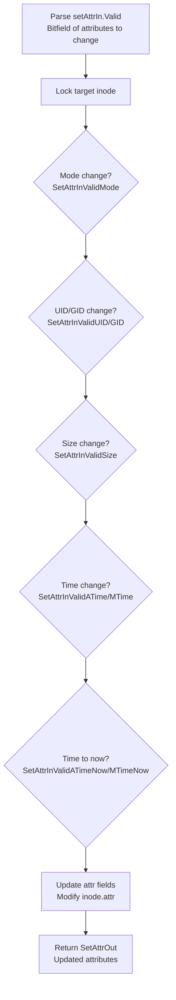

Supported attribute changes:

| Flag | Action | Implementation |
|------|--------|----------------|
| `SetAttrInValidMode` | Change permissions | Preserves file type bits, updates permission bits only ([examples/fission-ramfs/callbacks.go:213-219]()) |
| `SetAttrInValidUID/GID` | Change ownership | Directly updates `inode.attr.UID/GID` |
| `SetAttrInValidSize` | Truncate/extend file | Modifies `fileData` slice, updates `Blocks` ([examples/fission-ramfs/callbacks.go:228-242]()) |
| `SetAttrInValidATime/MTime` | Set explicit times | Updates `ATimeSec/NSec` and `MTimeSec/NSec` |
| `SetAttrInValidATimeNow/MTimeNow` | Set current time | Calls `unixTimeNow()` and updates times |

The size change logic handles three cases:
- **Truncate**: `setAttrIn.Size < inode.attr.Size` → `fileData = fileData[:Size]`
- **Extend**: `setAttrIn.Size > inode.attr.Size` → `fileData = append(fileData, make([]byte, difference)...)`
- **No change**: Size already matches

**Sources:** [examples/fission-ramfs/callbacks.go:113-167](), [examples/fission-ramfs/callbacks.go:169-294]()

### Permission Checking

**DoAccess** ([examples/fission-ramfs/callbacks.go:1801-1933]()) implements POSIX permission semantics:

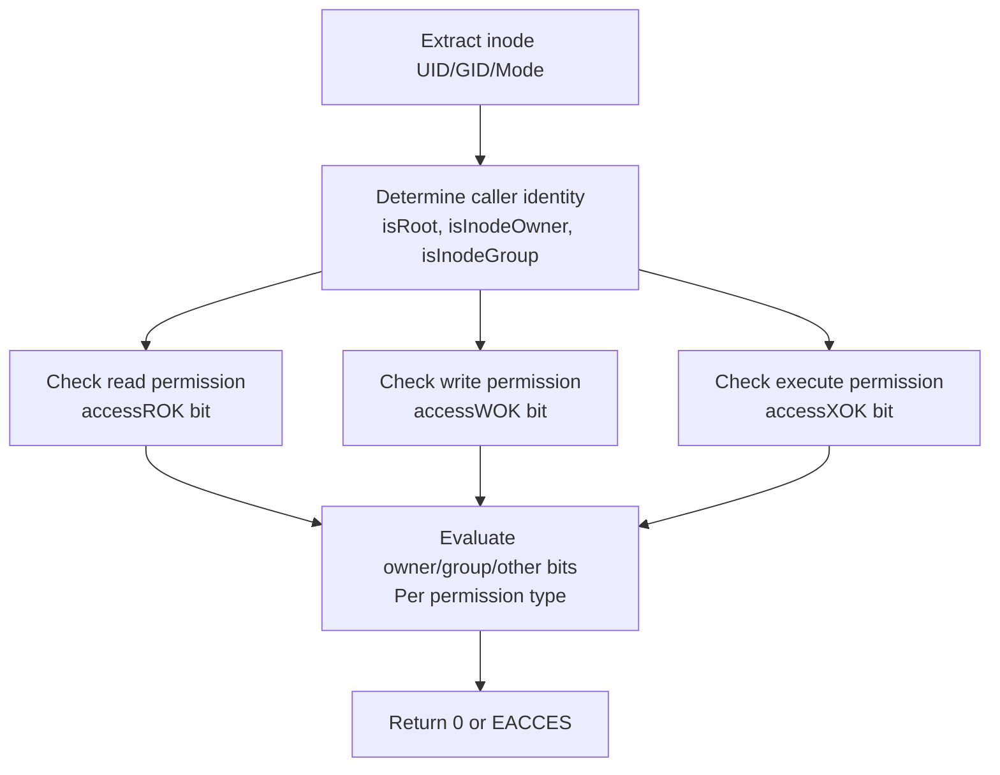

Permission evaluation logic:

1. **Identity Check**: Compares `inHeader.UID` and `inHeader.GID` to `inode.attr.UID/GID`
2. **Root Privilege**: UID 0 bypasses read/write checks but still requires execute bit for execute access
3. **Permission Bits**: Extracts owner/group/other bits from `inode.attr.Mode` using shifts:
   - Owner: `mode >> accessOwnerShift` (bits 6-8)
   - Group: `mode >> accessGroupShift` (bits 3-5)
   - Other: `mode >> accessOtherShift` (bits 0-2)
4. **Evaluation Order**: Checks owner permissions first, then group, then other
5. **Result**: Returns `errno = 0` if all requested permissions granted, `EACCES` otherwise

The execute permission special case for root ([examples/fission-ramfs/callbacks.go:1898-1909]()) requires at least one execute bit to be set (owner, group, or other) before granting access.

**Sources:** [examples/fission-ramfs/callbacks.go:1801-1933]()

## Link Operations

### Symbolic Links

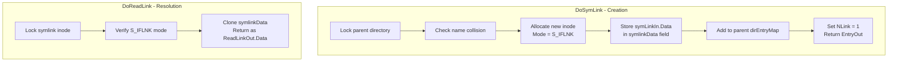

**DoSymLink** ([examples/fission-ramfs/callbacks.go:336-459]()) creates symbolic links:

- **Mode Setup**: Always sets `Mode = S_IFLNK | (S_IRWXU | S_IRWXG | S_IRWXO)` (777 permissions)
- **Data Storage**: Stores `symLinkIn.Data` (the target path) in `inodeStruct.symlinkData`
- **NLink**: Initializes to 1 (symlinks don't support hard links)
- **No Size Field**: Symlinks have `attr.Size = 0` per `fixAttrSizes()` for non-regular files

**DoReadLink** ([examples/fission-ramfs/callbacks.go:296-334]()) retrieves the symbolic link target:

- Validates inode has `S_IFLNK` mode (returns `ENOTDIR` error if not)
- Clones `symlinkData` to avoid buffer aliasing
- Returns raw byte slice (not null-terminated)

**Sources:** [examples/fission-ramfs/callbacks.go:296-334](), [examples/fission-ramfs/callbacks.go:336-459]()

### Hard Links

**DoLink** ([examples/fission-ramfs/callbacks.go:803-911]()) creates hard links to existing inodes:


Key restrictions and behavior:

- **Directory Check**: Returns `EISDIR` if `oldInode.attr.Mode & S_IFMT == S_IFDIR` ([examples/fission-ramfs/callbacks.go:860-864]())
- **NLink Increment**: Increases reference count on the target inode
- **Same Inode**: Multiple directory entries point to the same `inodeStruct` instance
- **Attribute Return**: Provides updated attributes including new `NLink` value

**DoUnlink** ([examples/fission-ramfs/callbacks.go:613-698]()) removes directory entries and manages inode lifecycle:

1. **Lock Directory**: Acquires parent directory inode lock
2. **Lookup Entry**: Finds target inode number via `dirEntryMap.GetByKey()`
3. **Lock Target**: Acquires target inode lock (may restart)
4. **Type Check**: Returns `EISDIR` if target is directory (use `DoRmDir` instead)
5. **Remove Entry**: Deletes from `dirEntryMap.DeleteByKey()`
6. **Decrement NLink**: Reduces reference count
7. **Garbage Collection**: If `NLink == 0`, removes from `globals.inodeMap`

The inode may survive with `NLink == 0` if file handles are still open (see DoRelease for cleanup).

**Sources:** [examples/fission-ramfs/callbacks.go:613-698](), [examples/fission-ramfs/callbacks.go:803-911]()

### Rename Operations

Both **DoRename** ([examples/fission-ramfs/callbacks.go:798-801]()) and **DoRename2** ([examples/fission-ramfs/callbacks.go:2261-2264]()) delegate to the shared **commonRename** function:

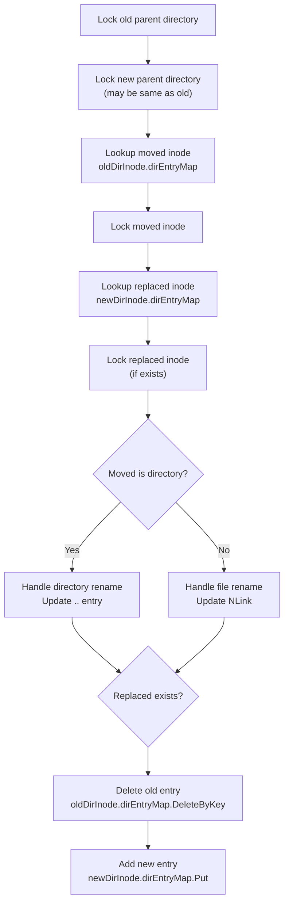

**commonRename** ([examples/fission-ramfs/callbacks.go:2288-2494]()) handles multiple complex scenarios:

**Directory Rename** ([examples/fission-ramfs/callbacks.go:2399-2446]()):
- If replacing an existing directory, verifies it's empty (`Len() == 2`)
- Decrements old parent `NLink`, increments new parent `NLink`
- Updates `..` entry in moved directory using `dirEntryMap.PatchByKey([]byte(".."), newDirInode.attr.Ino)`
- Deletes replaced directory from `inodeMap` immediately

**File Rename** ([examples/fission-ramfs/callbacks.go:2446-2468]()):
- If replacing an existing file (not directory), returns `EISDIR` error
- Decrements replaced file's `NLink`, removes from `inodeMap` if `NLink == 0`
- No parent `NLink` changes for regular files

**Common Steps**:
1. Removes entry from old directory
2. Adds entry to new directory (same inode number)
3. Handles self-rename case (`oldDirNodeID == newDirNodeID`)

**Sources:** [examples/fission-ramfs/callbacks.go:798-801](), [examples/fission-ramfs/callbacks.go:2261-2264](), [examples/fission-ramfs/callbacks.go:2288-2494]()

## Extended Attributes

Extended attributes (xattrs) are stored per-inode in a `sortedmap.LLRBTree` with byte slice keys and values:

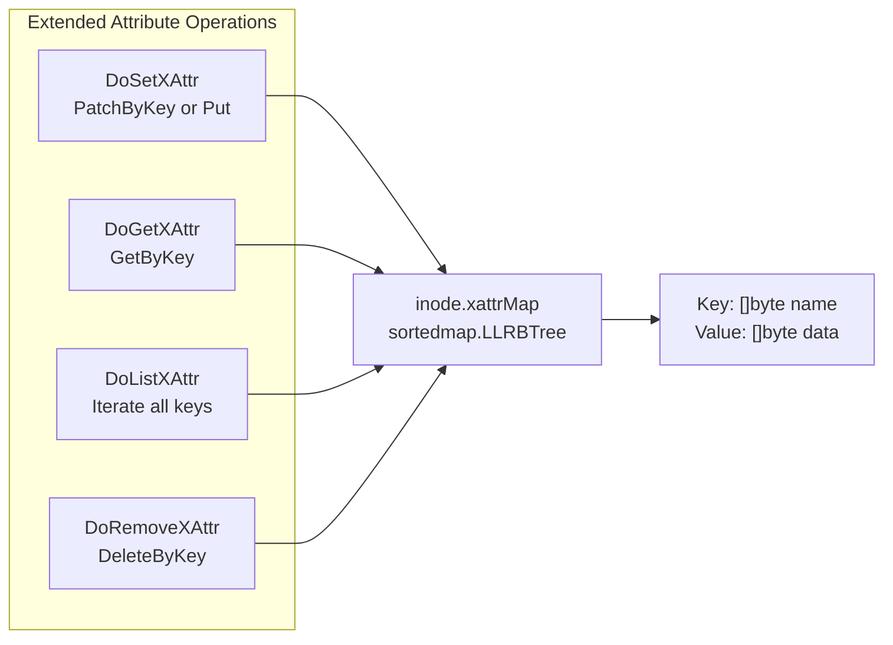

### Setting Extended Attributes

**DoSetXAttr** ([examples/fission-ramfs/callbacks.go:1228-1277]()) implements upsert semantics:

1. **Lock Inode**: Acquires lock on target inode, releases global lock
2. **Try Patch**: Attempts `xattrMap.PatchByKey(setXAttrIn.Name, setXAttrIn.Data)`
3. **Fallback Put**: If patch fails (key doesn't exist), calls `xattrMap.Put()`
4. **No Flags**: Ignores XATTR_CREATE and XATTR_REPLACE flags (always succeeds)

### Retrieving Extended Attributes

**DoGetXAttr** ([examples/fission-ramfs/callbacks.go:1279-1346]()) supports size-query mode:

- **Size Query**: If `getXAttrIn.Size == 0`, returns only `GetXAttrOut.Size` with empty data
- **Normal Retrieval**: Returns attribute value if `Size >= len(data)`, else `ERANGE` error
- **Missing Attribute**: Returns `ENODATA` if key not found
- **Data Cloning**: Uses `cloneByteSlice()` to prevent buffer sharing

**DoListXAttr** ([examples/fission-ramfs/callbacks.go:1348-1428]()) enumerates all attribute names:

- **Iteration**: Loops through `xattrMap.GetByIndex(xattrIndex)` for all entries
- **Size Calculation**: Accumulates `len(name) + 1` for each attribute (null terminator included)
- **Size Query Mode**: If `listXAttrIn.Size == 0`, returns total size without names
- **Range Check**: Returns `ERANGE` if accumulated size exceeds `listXAttrIn.Size`
- **Name Array**: Returns `ListXAttrOut.Name` as `[][]byte` of attribute names

**DoRemoveXAttr** ([examples/fission-ramfs/callbacks.go:1430-1472]()) deletes attributes:

- Calls `xattrMap.DeleteByKey(removeXAttrIn.Name)`
- Returns `ENOENT` if key not found
- No validation of attribute name format or prefix

**Sources:** [examples/fission-ramfs/callbacks.go:1228-1277](), [examples/fission-ramfs/callbacks.go:1279-1346](), [examples/fission-ramfs/callbacks.go:1348-1428](), [examples/fission-ramfs/callbacks.go:1430-1472]()

## Inode Lifecycle Management

The inode lifecycle demonstrates POSIX reference counting semantics:

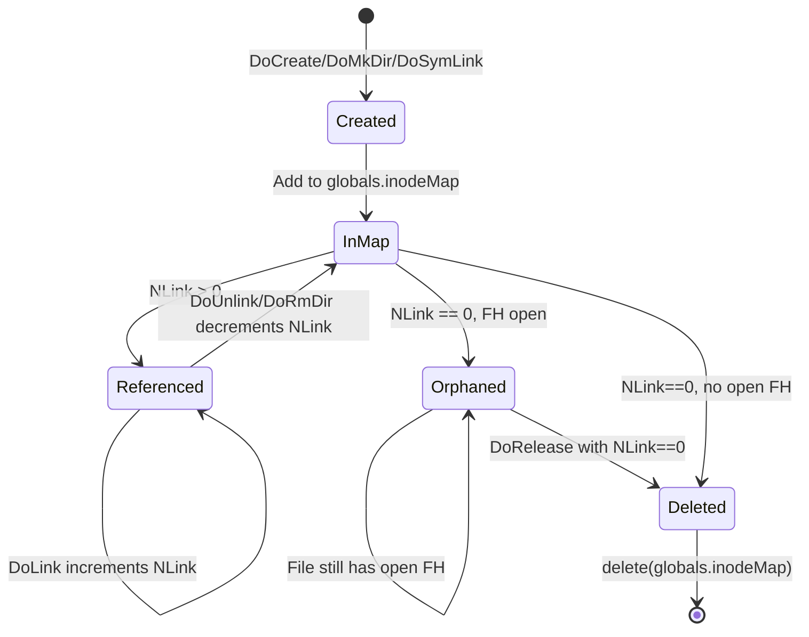

### NLink Tracking Rules

| Inode Type | Initial NLink | Increment On | Decrement On |
|------------|---------------|--------------|--------------|
| Regular File | 1 | `DoLink` creates hard link | `DoUnlink` removes directory entry |
| Directory | 2 | Child directory created (for `..` entry) | Child directory removed, self removed via `DoRmDir` |
| Symbolic Link | 1 | Never (hard links to symlinks not supported) | `DoUnlink` |

### Garbage Collection Points

**Inode deletion occurs at**:

1. **DoUnlink** ([examples/fission-ramfs/callbacks.go:690-692]()): If `NLink` reaches 0 after removing directory entry
2. **DoRmDir** ([examples/fission-ramfs/callbacks.go:790]()): Always deletes directory immediately (ignores `NLink`)
3. **DoRelease** ([examples/fission-ramfs/callbacks.go:1182-1184]()): If file's `NLink == 0` when last FH is closed
4. **DoReleaseDir** ([examples/fission-ramfs/callbacks.go:1740-1742]()): If directory's `NLink == 0` when last FH is closed

### File Handle Tracking

The `globals.fhMap` maintains open file handles:

- **Key**: `uint64` file handle number from `globals.lastFH++`
- **Value**: `uint32` open flags (`FOpenRequestRDONLY`, `FOpenRequestWRONLY`, `FOpenRequestAPPEND`, etc.)
- **Lifecycle**: Allocated in `DoCreate`/`DoOpen`, freed in `DoRelease`
- **Validation**: Read/write operations check FH exists and has appropriate flags

This enables the "unlink while open" pattern where an inode persists in memory with `NLink == 0` until all file handles are released, at which point it's garbage collected.

**Sources:** [examples/fission-ramfs/callbacks.go:690-692](), [examples/fission-ramfs/callbacks.go:790](), [examples/fission-ramfs/callbacks.go:1182-1184](), [examples/fission-ramfs/callbacks.go:1740-1742]()

## Operation Implementation Summary

The following table summarizes the implementation status of all FUSE operations:

| Operation | Implementation | Return Value | Notes |
|-----------|----------------|--------------|-------|
| `DoLookup` | Full | Entry + Attr | Name→inode resolution |
| `DoForget` | No-op | void | Reference counting handled internally |
| `DoGetAttr` | Full | Attr | Returns cached inode attributes |
| `DoSetAttr` | Full | Attr | Supports mode, size, times, uid/gid |
| `DoReadLink` | Full | Data | Returns symlink target path |
| `DoSymLink` | Full | Entry + Attr | Creates symbolic link |
| `DoMkNod` | Stub | ENOSYS | Device files not supported |
| `DoMkDir` | Full | Entry + Attr | Creates directory with `.` and `..` |
| `DoUnlink` | Full | void | Removes file, decrements NLink |
| `DoRmDir` | Full | void | Removes empty directory |
| `DoRename` | Full | void | Moves/renames entries |
| `DoLink` | Full | Entry + Attr | Creates hard link |
| `DoOpen` | Full | FH + Flags | Opens file, allocates FH |
| `DoRead` | Full | Data | Reads from fileData slice |
| `DoWrite` | Full | Size | Writes to fileData slice |
| `DoStatFS` | Stub | KStatFS | Returns zeros (TODO) |
| `DoRelease` | Full | void | Closes file, frees FH |
| `DoFSync` | No-op | void | All writes are synchronous |
| `DoSetXAttr` | Full | void | Sets extended attribute |
| `DoGetXAttr` | Full | Data | Gets extended attribute |
| `DoListXAttr` | Full | Names | Lists attribute names |
| `DoRemoveXAttr` | Full | void | Deletes attribute |
| `DoFlush` | No-op | void | Per-open synchronization |
| `DoInit` | Full | InitOut | Negotiates FUSE protocol |
| `DoOpenDir` | Full | FH | Opens directory (FH unused) |
| `DoReadDir` | Full | DirEnt[] | Lists directory entries |
| `DoReleaseDir` | Full | void | Closes directory |
| `DoFSyncDir` | No-op | void | Directory sync |
| `DoGetLK` | Stub | ENOSYS | POSIX locks not supported |
| `DoSetLK` | Stub | ENOSYS | POSIX locks not supported |
| `DoSetLKW` | Stub | ENOSYS | POSIX locks not supported |
| `DoAccess` | Full | void | Permission checking |
| `DoCreate` | Full | Entry + FH | Creates and opens file |
| `DoInterrupt` | No-op | void | Request cancellation |
| `DoBMap` | Stub | ENOSYS | Block mapping not supported |
| `DoDestroy` | Stub | ENOSYS | Filesystem shutdown |
| `DoPoll` | Stub | ENOSYS | Poll/select not supported |
| `DoBatchForget` | No-op | void | Batch reference release |
| `DoFAllocate` | Stub | ENOSYS | Preallocation not supported |
| `DoReadDirPlus` | Full | DirEntPlus[] | Directory listing with attributes |
| `DoRename2` | Full | void | Extended rename with flags |
| `DoLSeek` | Stub | ENOSYS | Seek not supported |
| `DoStatX` | Stub | ENOSYS | Extended stat not supported |

**Sources:** [examples/fission-ramfs/callbacks.go:1-2495]()

---

