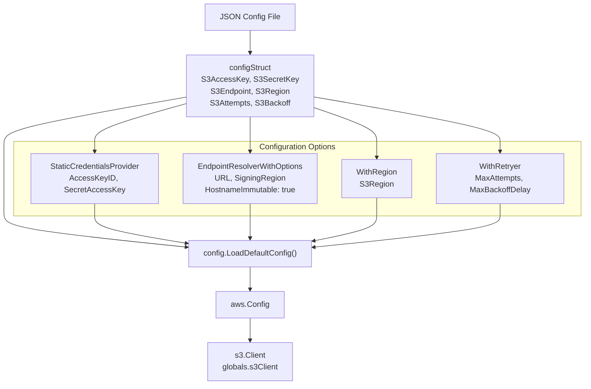
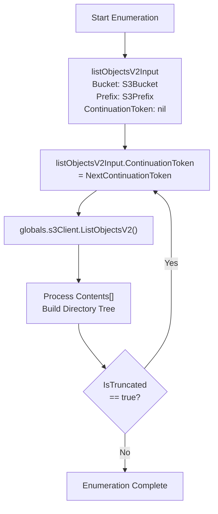
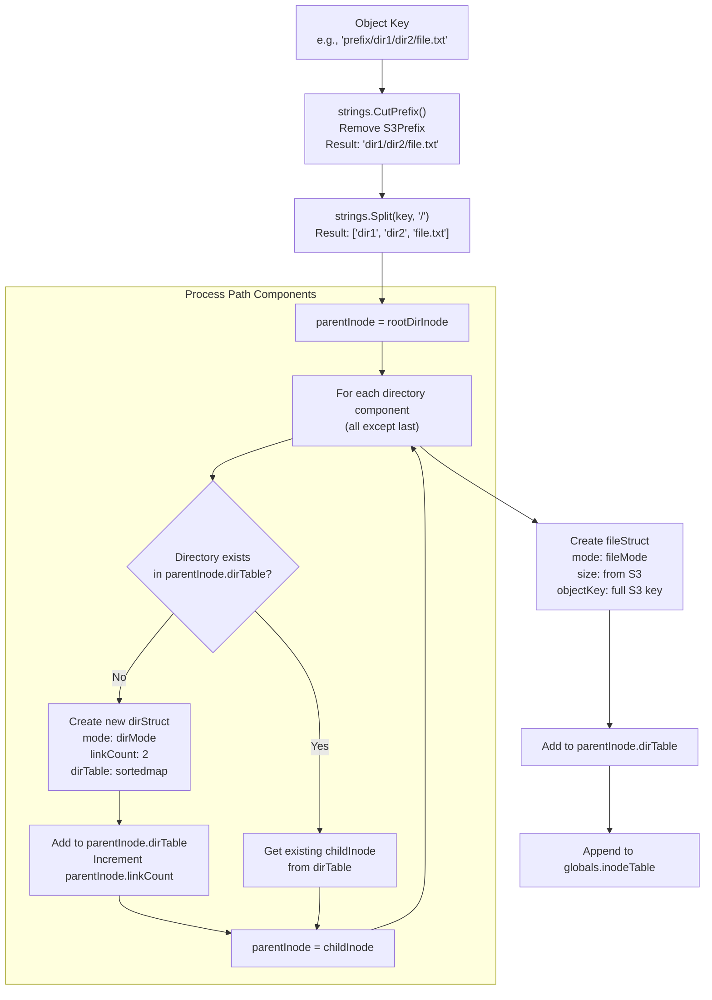
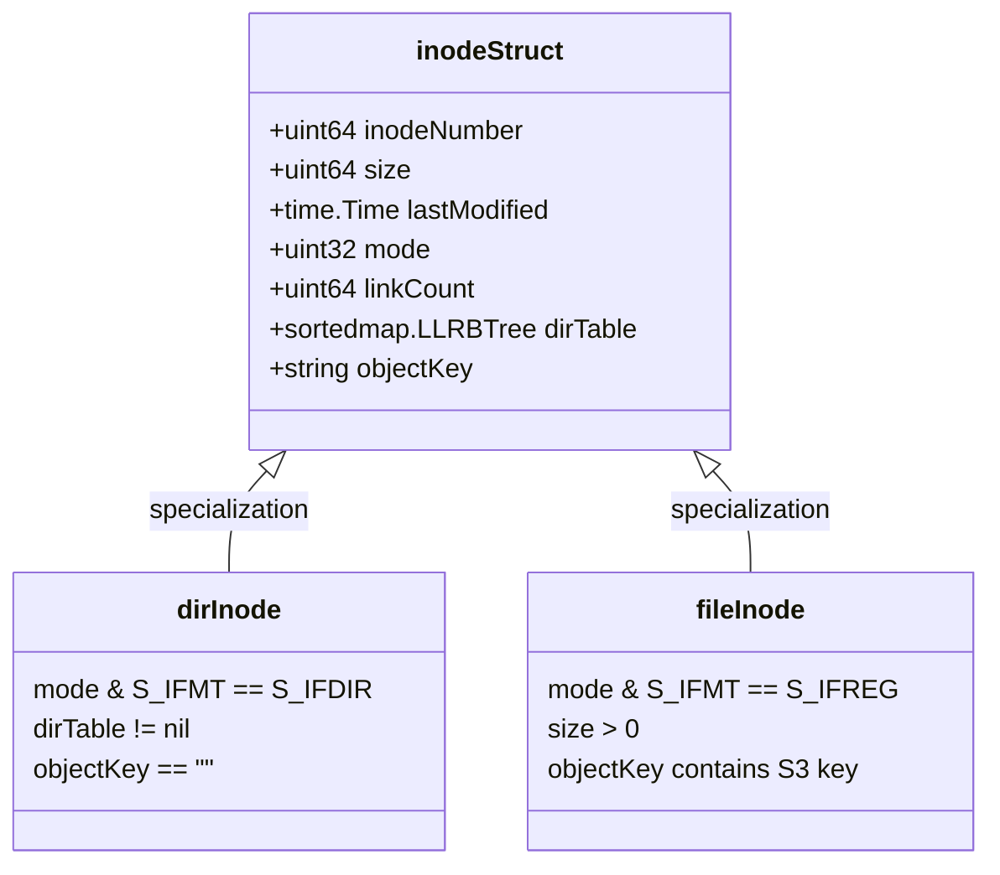
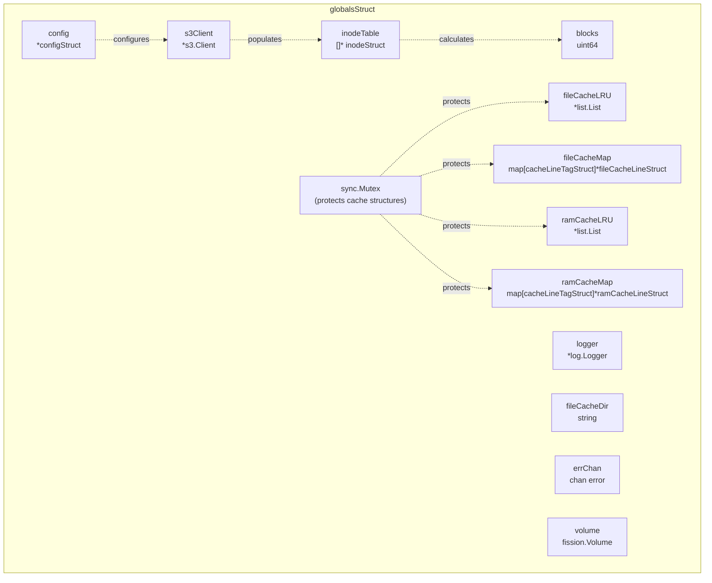
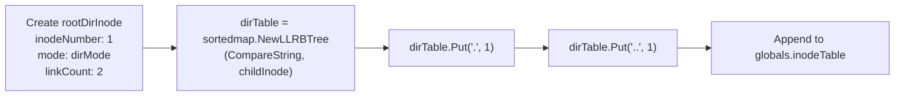
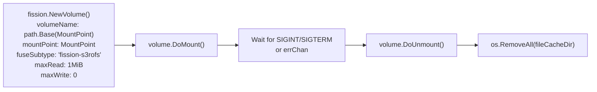

<!-- source: DeepWiki mcp.deepwiki.com · repo NVIDIA/fission · extra page S3 Integration and Filesystem Setup · fetched 2026-10-26 -->

# S3 Integration and Filesystem Setup

<details>
<summary>Relevant source files</summary>

The following files were used as context for generating this wiki page:

- [examples/fission-s3rofs/main.go](examples/fission-s3rofs/main.go)
- [go.mod](go.mod)
- [go.sum](go.sum)

</details>


## Purpose and Scope

This document explains how the `fission-s3rofs` example filesystem integrates with Amazon S3 using AWS SDK v2, including client configuration, credential management, and the initialization process that enumerates all S3 objects to construct an in-memory directory tree at mount time. For information about the two-tier caching strategy used to optimize S3 data access, see [S3RO Caching Strategy](#3.2.2).

## Configuration Structure

The filesystem configuration is loaded from a JSON file and parsed into the `configStruct` type defined in [examples/fission-s3rofs/main.go:82-98](). The configuration contains S3 connection parameters, retry settings, and cache sizing:

| Field | Type | Purpose | Default |
|-------|------|---------|---------|
| `MountPoint` | string | Target directory for FUSE mount | required |
| `S3AccessKey` | string | AWS access key ID | from `S3AccessKey` env var |
| `S3SecretKey` | string | AWS secret access key | from `S3SecretKey` env var |
| `S3Endpoint` | string | S3-compatible endpoint URL | required |
| `S3Region` | string | AWS region identifier | `"us-east-1"` |
| `S3Attempts` | uint64 | Maximum retry attempts | `5` |
| `S3Backoff` | uint64 | Maximum backoff delay (seconds) | `60` |
| `S3Bucket` | string | Target S3 bucket name | required |
| `S3Prefix` | string | Object key prefix filter | required |
| `FileCacheLines` | uint64 | Disk cache size (lines) | `0` (disabled) |
| `RAMCacheLines` | uint64 | RAM cache size (lines) | required > 0 |
| `CacheLineSize` | uint64 | Size of each cache line (bytes) | required > 0 |

The configuration parsing includes credential masking for security. If credentials are not provided in the JSON file, they are read from environment variables [examples/fission-s3rofs/main.go:215-227]().

**Sources:** [examples/fission-s3rofs/main.go:82-227]()

## AWS SDK v2 Client Initialization

### Configuration Loading

The S3 client is initialized using the AWS SDK v2 `config.LoadDefaultConfig` function with several custom configuration options [examples/fission-s3rofs/main.go:289-313]():



**Diagram: AWS SDK v2 Configuration Pipeline**

### Credential Provider

Static credentials are configured using `credentials.StaticCredentialsProvider` [examples/fission-s3rofs/main.go:291-296]():

```go
config.WithCredentialsProvider(credentials.StaticCredentialsProvider{
    Value: aws.Credentials{
        AccessKeyID:     globals.config.s3AccessKey,
        SecretAccessKey: globals.config.s3SecretKey,
    },
})
```

This bypasses the default AWS credential chain (environment variables, shared credentials file, IAM role) and uses explicit credentials from the configuration file.

### Endpoint Resolver

The endpoint resolver allows connecting to S3-compatible storage services (not just AWS S3) by specifying a custom endpoint URL [examples/fission-s3rofs/main.go:297-304]():

```go
config.WithEndpointResolverWithOptions(aws.EndpointResolverWithOptionsFunc(
    func(_, _ string, _ ...interface{}) (aws.Endpoint, error) {
        return aws.Endpoint{
            URL:               globals.config.S3Endpoint,
            SigningRegion:     globals.config.S3Region,
            HostnameImmutable: true,
        }, nil
    }))
```

Setting `HostnameImmutable: true` prevents the SDK from rewriting the hostname, which is necessary for S3-compatible services that don't follow AWS hostname conventions.

### Retry Configuration

The retry strategy uses `retry.AddWithMaxAttempts` and `retry.AddWithMaxBackoffDelay` to customize the exponential backoff behavior [examples/fission-s3rofs/main.go:306-308]():

```go
config.WithRetryer(func() aws.Retryer {
    return retry.AddWithMaxBackoffDelay(
        retry.AddWithMaxAttempts(
            retry.NewStandard(), 
            int(globals.config.S3Attempts)
        ), 
        time.Duration(int(globals.config.S3Backoff))*time.Second
    )
})
```

This ensures that transient network errors or S3 throttling don't immediately fail operations.

### Client Creation

After configuration loading completes, the S3 client is instantiated with `s3.NewFromConfig` [examples/fission-s3rofs/main.go:313]() and stored in the global state as `globals.s3Client`.

**Sources:** [examples/fission-s3rofs/main.go:289-313](), [go.mod:7-10]()

## S3 Object Enumeration

### ListObjectsV2 Pagination

At mount time, the filesystem enumerates all objects in the specified bucket with the given prefix using `ListObjectsV2` [examples/fission-s3rofs/main.go:315-330](). The pagination loop handles buckets with more than 1,000 objects:



**Diagram: S3 Object Enumeration Flow**

The enumeration uses continuation tokens to handle pagination automatically:

1. Initialize `listObjectsV2Input` with bucket name and prefix [examples/fission-s3rofs/main.go:315-318]()
2. Initialize `listObjectsV2Output` with `IsTruncated: true` to enter the loop [examples/fission-s3rofs/main.go:319-322]()
3. Loop while `IsTruncated` is true [examples/fission-s3rofs/main.go:324]()
4. Set continuation token from previous response [examples/fission-s3rofs/main.go:325]()
5. Call `ListObjectsV2` [examples/fission-s3rofs/main.go:327-330]()
6. Process each object in `Contents` slice [examples/fission-s3rofs/main.go:332]()

### Object Processing

For each S3 object returned, the following metadata is extracted from the `s3types.Object` structure [examples/fission-s3rofs/main.go:332-333]():

- `Key`: Full S3 object key (string pointer)
- `Size`: Object size in bytes (int64)
- `LastModified`: Modification timestamp (time.Time pointer)

**Sources:** [examples/fission-s3rofs/main.go:315-333]()

## Directory Tree Construction

### Object Key Parsing Algorithm

The directory tree construction algorithm converts flat S3 object keys into a hierarchical filesystem structure [examples/fission-s3rofs/main.go:335-425](). The algorithm handles object keys as filesystem paths with `/` separators:



**Diagram: Directory Tree Construction Algorithm**

### Path Component Processing

The algorithm iterates through path components in stages [examples/fission-s3rofs/main.go:335-425]():

1. **Prefix Removal**: Remove `S3Prefix` from object key using `strings.CutPrefix` [examples/fission-s3rofs/main.go:335-338]()
2. **Path Splitting**: Split the remaining key by "/" into components [examples/fission-s3rofs/main.go:340]()
3. **Directory Traversal**: Process all components except the last (the filename) [examples/fission-s3rofs/main.go:342-397]()
4. **File Creation**: Create file inode for the last component [examples/fission-s3rofs/main.go:399-423]()

### Directory Inode Creation

For each directory component, the code checks if it already exists in the parent's `dirTable` [examples/fission-s3rofs/main.go:345-348](). If not, a new directory `inodeStruct` is created [examples/fission-s3rofs/main.go:358-381]():

- `inodeNumber`: Assigned sequentially as `len(globals.inodeTable) + 1`
- `lastModified`: Set to filesystem launch time
- `mode`: Set to `dirMode` (S_IFDIR with read/execute permissions)
- `linkCount`: Initially 2 (for "." and "..")
- `dirTable`: New `sortedmap.LLRBTree` for child entries

The directory is added to its parent's `dirTable` with the component name as the key [examples/fission-s3rofs/main.go:385-391](), and the parent's `linkCount` is incremented [examples/fission-s3rofs/main.go:383]().

### File Inode Creation

The final path component becomes a file inode [examples/fission-s3rofs/main.go:401-408]():

- `inodeNumber`: Sequential assignment
- `size`: From S3 object metadata
- `lastModified`: From S3 object metadata
- `mode`: Set to `fileMode` (S_IFREG with read-only permissions)
- `linkCount`: 1 (files have no hard links)
- `objectKey`: Full S3 key including prefix (used for GetObject requests)

The file is added to its parent directory's `dirTable` [examples/fission-s3rofs/main.go:415-420]() and appended to `globals.inodeTable` [examples/fission-s3rofs/main.go:423]().

### Block Accounting

For each file inode, the total filesystem block count is updated [examples/fission-s3rofs/main.go:410-413]():

```go
fileInodeBlocks = childInode.size + (uint64(attrBlkSize) - 1)
fileInodeBlocks /= uint64(attrBlkSize)
globals.blocks += fileInodeBlocks
```

This rounds up to the nearest 512-byte block and accumulates the total across all files.

**Sources:** [examples/fission-s3rofs/main.go:335-425]()

## Data Structures

### inodeStruct

The `inodeStruct` type [examples/fission-s3rofs/main.go:100-108]() represents both directories and files, using the `mode` field to distinguish them:



**Diagram: inodeStruct Type Variants**

| Field | Directory Inode | File Inode |
|-------|----------------|------------|
| `inodeNumber` | Unique identifier | Unique identifier |
| `size` | Not used | S3 object size |
| `lastModified` | Launch time | S3 LastModified |
| `mode` | `dirMode` (S_IFDIR) | `fileMode` (S_IFREG) |
| `linkCount` | 2 + subdirectory count | Always 1 |
| `dirTable` | sortedmap of children | Not used |
| `objectKey` | Empty string | Full S3 key |

### globalsStruct

The `globalsStruct` [examples/fission-s3rofs/main.go:129-143]() maintains all filesystem state:



**Diagram: globalsStruct Organization**

The `inodeTable` is a slice indexed by `inodeNumber - 1`, providing O(1) inode lookups [examples/fission-s3rofs/main.go:133](). All inodes are allocated contiguously during initialization.

**Sources:** [examples/fission-s3rofs/main.go:100-143]()

## Root Directory Initialization

Before object enumeration begins, the root directory inode is created [examples/fission-s3rofs/main.go:262-287]():



**Diagram: Root Directory Setup**

The root directory's `dirTable` is initialized with:
- `"."` entry pointing to itself (inode 1)
- `".."` entry pointing to itself (inode 1, since it's the root)

Both entries use the root's own inode number because there is no parent directory above the mount point [examples/fission-s3rofs/main.go:271-285]().

**Sources:** [examples/fission-s3rofs/main.go:262-287]()

## Cache Initialization

After directory tree construction completes, the cache structures are initialized [examples/fission-s3rofs/main.go:427-443]():

### File Cache (Disk-Backed)

If `FileCacheLines > 0`, a temporary directory is created using `os.MkdirTemp` with the pattern `"fission-s3rofs_cache"` [examples/fission-s3rofs/main.go:428-431](). The file cache structures are then initialized:

- `fileCacheLRU`: `list.New()` for LRU ordering
- `fileCacheMap`: `make(map[cacheLineTagStruct]*fileCacheLineStruct)` for O(1) lookups

If file caching is disabled (`FileCacheLines == 0`), these fields remain `nil` [examples/fission-s3rofs/main.go:436-439]().

### RAM Cache

The RAM cache is always enabled and initialized unconditionally [examples/fission-s3rofs/main.go:442-443]():

- `ramCacheLRU`: `list.New()` for LRU ordering  
- `ramCacheMap`: `make(map[cacheLineTagStruct]*ramCacheLineStruct)` for O(1) lookups

**Sources:** [examples/fission-s3rofs/main.go:427-443]()

## Volume Mounting

After all initialization completes, the FUSE volume is created and mounted [examples/fission-s3rofs/main.go:445-452]():



**Diagram: Volume Lifecycle**

The `maxWrite` parameter is set to `0` to indicate the volume is read-only [examples/fission-s3rofs/main.go:52](). After mounting, the main goroutine blocks waiting for a termination signal or an error from the FUSE reader loop [examples/fission-s3rofs/main.go:454-463]().

On unmount, the temporary file cache directory (if created) is removed [examples/fission-s3rofs/main.go:470-474]().

**Sources:** [examples/fission-s3rofs/main.go:445-476]()

---

