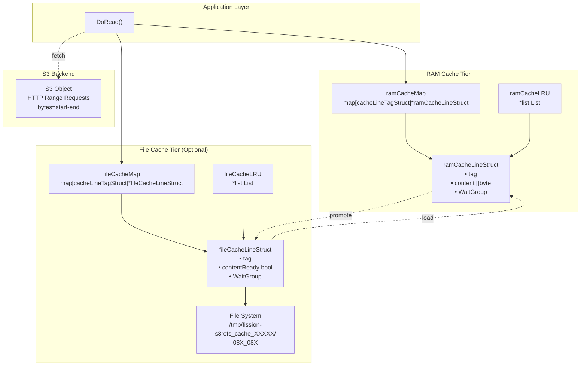
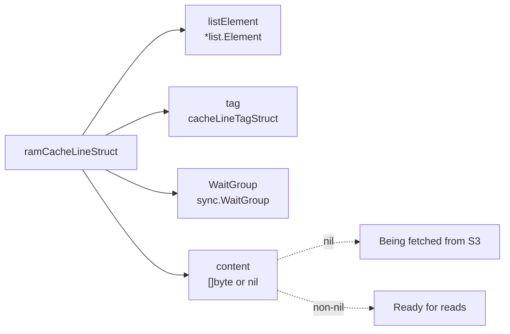
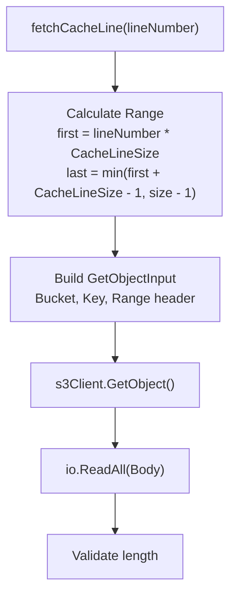
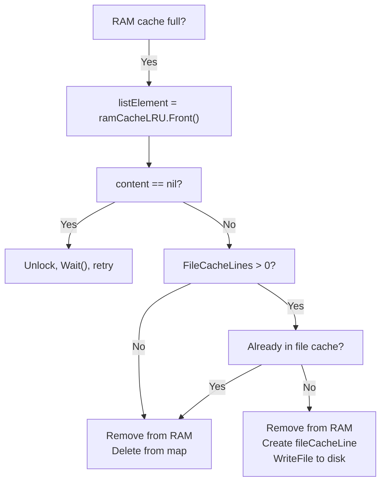
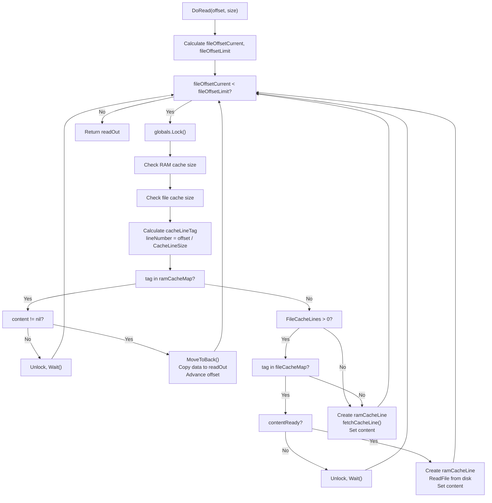
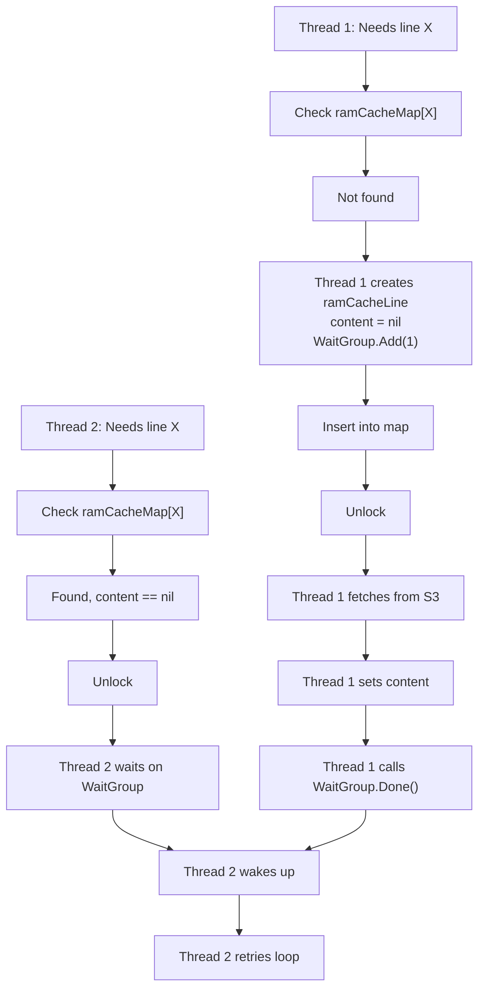

<!-- source: DeepWiki mcp.deepwiki.com · repo NVIDIA/fission · extra page S3RO Caching Strategy · fetched 2026-10-26 -->

# S3RO Caching Strategy

<details>
<summary>Relevant source files</summary>

The following files were used as context for generating this wiki page:

- [examples/fission-s3rofs/callbacks.go](examples/fission-s3rofs/callbacks.go)
- [examples/fission-s3rofs/main.go](examples/fission-s3rofs/main.go)

</details>


## Purpose and Scope

This document describes the two-tier caching system implemented in `fission-s3rofs`, the S3-backed read-only filesystem example. The caching strategy optimizes S3 access by maintaining cache lines in RAM and optionally on disk, using LRU eviction to manage memory and disk space. For information about S3 client setup and object enumeration, see [S3 Integration and Filesystem Setup](#3.2.1).

## Cache Architecture Overview

The `fission-s3rofs` implementation uses a two-tier cache hierarchy to minimize expensive S3 `GetObject` requests. Data flows from S3 → File Cache (optional) → RAM Cache → Application.



**Sources:** [examples/fission-s3rofs/main.go:129-143](), [examples/fission-s3rofs/callbacks.go:258-477]()

## Data Structures

### Cache Line Tag

The `cacheLineTagStruct` uniquely identifies a cache line by combining the inode number and line offset within that file.

| Field | Type | Description |
|-------|------|-------------|
| `inodeNumber` | `uint64` | Inode number of the file |
| `lineNumber` | `uint64` | Line index (offset / CacheLineSize) |

**Sources:** [examples/fission-s3rofs/main.go:110-113]()

### RAM Cache Line



| Field | Type | Purpose |
|-------|------|---------|
| `listElement` | `*list.Element` | Position in `ramCacheLRU` for LRU tracking |
| `tag` | `cacheLineTagStruct` | Cache line identifier |
| `WaitGroup` | `sync.WaitGroup` | Signals when `content` becomes non-nil |
| `content` | `[]byte` | Cache line data; `nil` during fetch |

**Sources:** [examples/fission-s3rofs/main.go:122-127]()

### File Cache Line

| Field | Type | Purpose |
|-------|------|---------|
| `listElement` | `*list.Element` | Position in `fileCacheLRU` for LRU tracking |
| `tag` | `cacheLineTagStruct` | Cache line identifier |
| `WaitGroup` | `sync.WaitGroup` | Signals when file is written or evicted |
| `contentReady` | `bool` | `true` when file exists at expected path |

The file path format is `fmt.Sprintf("%s/%08X_%08X", globals.fileCacheDir, tag.inodeNumber, tag.lineNumber)`.

**Sources:** [examples/fission-s3rofs/main.go:115-120](), [examples/fission-s3rofs/callbacks.go:340-343]()

## Configuration Parameters

The cache behavior is controlled by three configuration parameters:

| Parameter | Type | Requirement | Description |
|-----------|------|-------------|-------------|
| `CacheLineSize` | `uint64` | Must be > 0 | Maximum bytes per cache line |
| `RAMCacheLines` | `uint64` | Must be > 0 | Maximum cache lines in RAM |
| `FileCacheLines` | `uint64` | Optional | Maximum cache lines on disk; 0 disables file cache |

**Sources:** [examples/fission-s3rofs/main.go:82-98](), [examples/fission-s3rofs/main.go:241-247]()

## Cache Line Fetching from S3

### Fetch Implementation

The `fetchCacheLine()` method issues HTTP Range requests to S3 to retrieve only the required portion of an object:



The Range header uses the format `bytes=rangeOffsetFirst-rangeOffsetLast`, which allows fetching partial objects efficiently.

**Sources:** [examples/fission-s3rofs/callbacks.go:219-256]()

### Range Calculation

```
rangeOffsetFirst = lineNumber * globals.config.CacheLineSize
rangeOffsetLast = rangeOffsetFirst + globals.config.CacheLineSize - 1

if rangeOffsetLast > (fileInode.size - 1) {
    rangeOffsetLast = fileInode.size - 1
}
```

This ensures the last cache line of a file doesn't request bytes beyond EOF.

**Sources:** [examples/fission-s3rofs/callbacks.go:227-231]()

## LRU Eviction Strategy

### RAM Cache Eviction

The RAM cache uses a doubly-linked list (`globals.ramCacheLRU`) to track access order:

| Position | Meaning |
|----------|---------|
| Front | Least Recently Used (LRU) - eviction candidate |
| Back | Most Recently Used (MRU) - just accessed |

When `len(globals.ramCacheMap) > globals.config.RAMCacheLines`:



**Sources:** [examples/fission-s3rofs/callbacks.go:305-355]()

### File Cache Eviction

When `len(globals.fileCacheMap) > globals.config.FileCacheLines` and file caching is enabled:

1. Get front element from `fileCacheLRU` (LRU candidate)
2. If `contentReady == false`, unlock and wait for write completion
3. Set `contentReady = false` to prevent reads during removal
4. Remove file using `os.Remove()`
5. Remove from map and list

**Sources:** [examples/fission-s3rofs/callbacks.go:359-386]()

## Read Operation Flow

The `DoRead()` implementation orchestrates cache lookups, evictions, and S3 fetches:



**Sources:** [examples/fission-s3rofs/callbacks.go:258-477]()

### Cache Lookup Priority

The read path follows this priority:

1. **RAM Cache Hit**: Content available in `ramCacheMap` → Copy directly
2. **File Cache Hit**: Content on disk → Read file, promote to RAM
3. **Cache Miss**: Fetch from S3 → Store in RAM (and file cache if evicted)

### Data Copy Logic

When a cache line is found in RAM:

```
ramCacheLineContentOffset = fileOffsetCurrent - (lineNumber * CacheLineSize)
ramCacheLineContentRemaining = len(content) - ramCacheLineContentOffset

if ramCacheLineContentRemaining > (fileOffsetLimit - fileOffsetCurrent) {
    ramCacheLineContentLimit = ramCacheLineContentOffset + (fileOffsetLimit - fileOffsetCurrent)
} else {
    ramCacheLineContentLimit = len(content)
}

readOut.Data = append(readOut.Data, content[ramCacheLineContentOffset:ramCacheLineContentLimit]...)
fileOffsetCurrent += (ramCacheLineContentLimit - ramCacheLineContentOffset)
```

This handles partial cache line reads when the request spans multiple cache lines.

**Sources:** [examples/fission-s3rofs/callbacks.go:400-408]()

## Concurrency Control

### Global Lock Protection

A single `sync.Mutex` (embedded in `globalsStruct`) protects all cache data structures:

- `ramCacheMap` and `ramCacheLRU`
- `fileCacheMap` and `fileCacheLRU`

The lock is held during:
- Cache lookups
- LRU list manipulations (`MoveToBack`, `Remove`, `PushBack`)
- Map insertions and deletions

The lock is released during:
- S3 API calls
- Disk I/O operations
- WaitGroup waits

**Sources:** [examples/fission-s3rofs/main.go:129-143](), [examples/fission-s3rofs/callbacks.go:301-473]()

### Duplicate Fetch Prevention

Each cache line struct embeds a `sync.WaitGroup` to coordinate concurrent readers:



This pattern ensures only one thread fetches a given cache line from S3, while other threads wait for the result.

**Sources:** [examples/fission-s3rofs/callbacks.go:412-427](), [examples/fission-s3rofs/callbacks.go:393-396]()

### File Cache Write Coordination

When a RAM cache line is evicted to disk:

1. Create `fileCacheLineStruct` with `contentReady = false`
2. Add WaitGroup count: `fileCacheLine.Add(1)`
3. Insert into `fileCacheMap` and `fileCacheLRU`
4. Unlock global mutex
5. Write file to disk
6. Re-lock, set `contentReady = true`, unlock
7. Call `fileCacheLine.Done()`

Any thread checking the file cache during this window will wait on the WaitGroup before accessing the file.

**Sources:** [examples/fission-s3rofs/callbacks.go:332-348]()

## Cache Initialization

During startup, the cache structures are initialized:

```
if globals.config.FileCacheLines > 0 {
    globals.fileCacheDir = os.MkdirTemp("", "fission-s3rofs_cache")
    globals.fileCacheLRU = list.New()
    globals.fileCacheMap = make(map[cacheLineTagStruct]*fileCacheLineStruct)
} else {
    globals.fileCacheDir = ""
    globals.fileCacheLRU = nil
    globals.fileCacheMap = nil
}

globals.ramCacheLRU = list.New()
globals.ramCacheMap = make(map[cacheLineTagStruct]*ramCacheLineStruct)
```

During shutdown, the temporary cache directory is removed with `os.RemoveAll(globals.fileCacheDir)`.

**Sources:** [examples/fission-s3rofs/main.go:427-443](), [examples/fission-s3rofs/main.go:470-475]()

---

