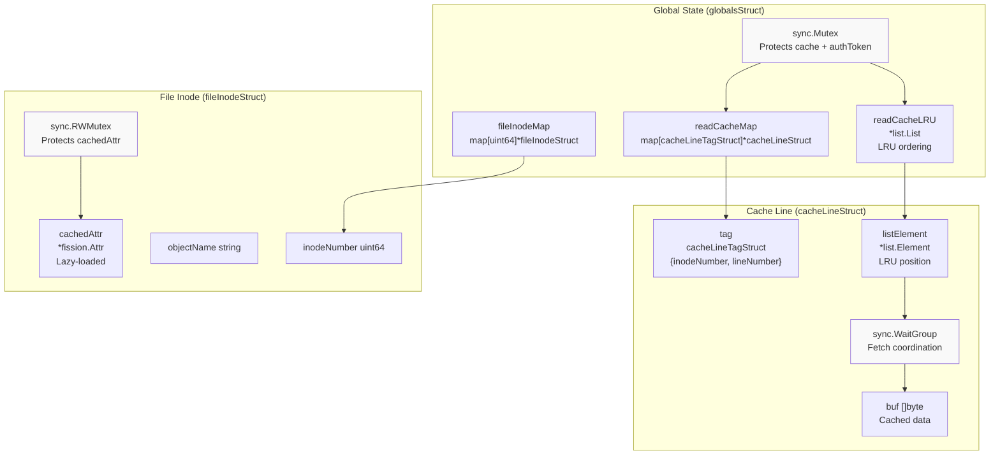
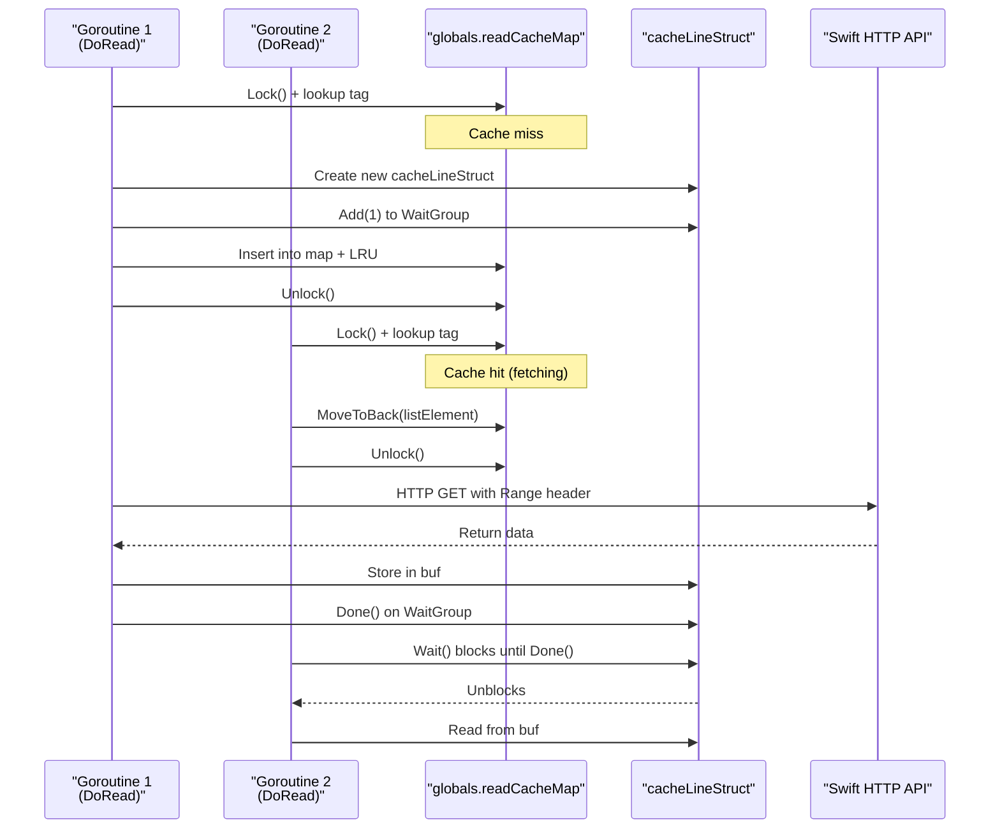
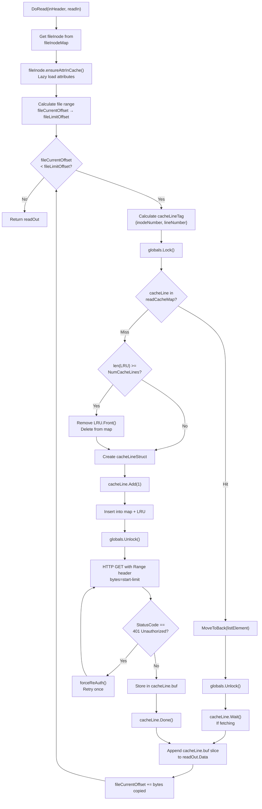
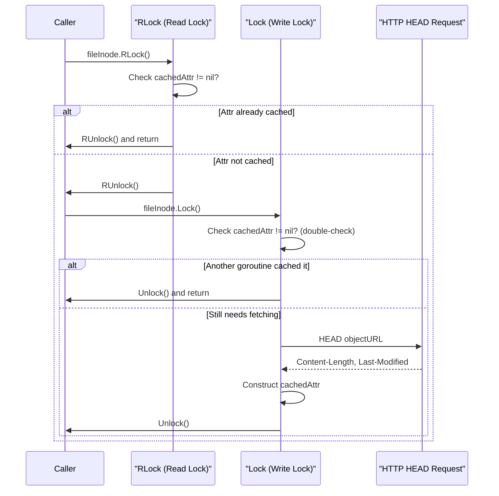
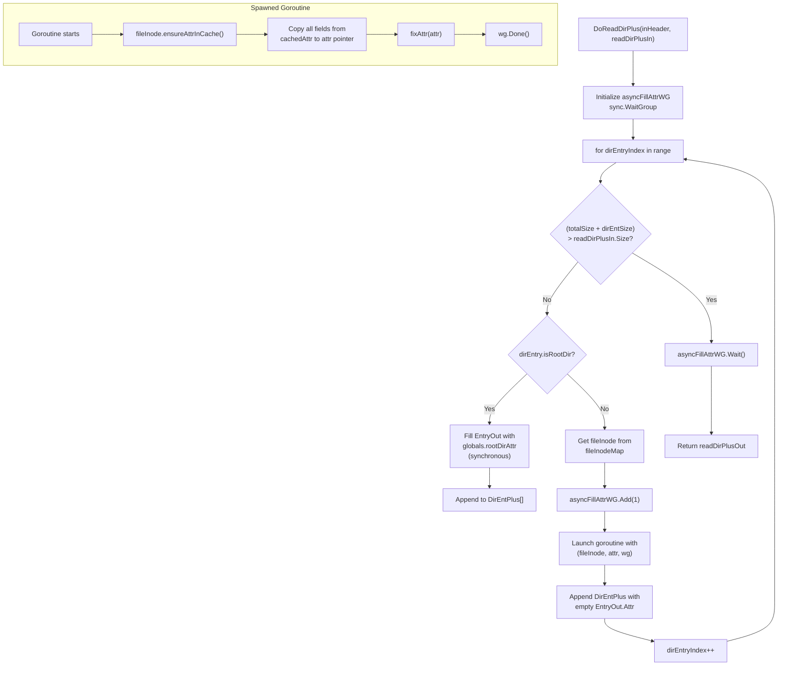

<!-- source: DeepWiki mcp.deepwiki.com · repo NVIDIA/fission · extra page SwiftFS Cache and Concurrent Operations · fetched 2026-10-26 -->

# SwiftFS Cache and Concurrent Operations

<details>
<summary>Relevant source files</summary>

The following files were used as context for generating this wiki page:

- [examples/fission-swiftfs/callbacks.go](examples/fission-swiftfs/callbacks.go)
- [examples/fission-swiftfs/main.go](examples/fission-swiftfs/main.go)

</details>


## Purpose and Scope

This document describes the single-tier RAM caching system and concurrent operation patterns implemented in `fission-swiftfs`. The SwiftFS filesystem uses an LRU-based cache to minimize HTTP requests to Swift object storage, and employs WaitGroup-based coordination to prevent duplicate fetches. The page covers cache line management, attribute lazy-loading patterns, and concurrent attribute fetching during directory enumeration.

For authentication token management and retry patterns, see [Swift Authentication and Token Management](#3.3.1). For a comparison with the two-tier caching strategy used in S3, see [S3RO Caching Strategy](#3.2.2).

---

## Cache Architecture Overview

SwiftFS implements a **single-tier RAM cache** with LRU eviction. Unlike `fission-s3rofs` which uses both RAM and disk caches, SwiftFS keeps all cached data in memory for simplicity and performance.

**Diagram: SwiftFS Cache Architecture**



**Sources:** [examples/fission-swiftfs/main.go:88-118]()

---

## Cache Data Structures

The cache system uses three primary data structures defined in `globalsStruct`:

| Structure | Type | Purpose | Protected By |
|-----------|------|---------|--------------|
| `readCacheMap` | `map[cacheLineTagStruct]*cacheLineStruct` | Fast O(1) lookup of cache lines by tag | `globals.Mutex` |
| `readCacheLRU` | `*list.List` | Doubly-linked list maintaining LRU order | `globals.Mutex` |
| `fileInodeMap` | `map[uint64]*fileInodeStruct` | Maps inode numbers to file metadata | Read-only after mount |

### Cache Line Tag Structure

Each cache line is uniquely identified by a `cacheLineTagStruct`:

```go
type cacheLineTagStruct struct {
    inodeNumber uint64  // Which file
    lineNumber  uint64  // Which cache line within the file
}
```

The `lineNumber` is calculated as `fileOffset / CacheLineSize`, allowing efficient range mapping.

**Sources:** [examples/fission-swiftfs/main.go:88-91](), [examples/fission-swiftfs/main.go:100-118]()

---

## Cache Line Lifecycle and WaitGroup Coordination

Each `cacheLineStruct` embeds a `sync.WaitGroup` to coordinate concurrent access during fetches. This prevents duplicate HTTP requests when multiple goroutines request the same cache line simultaneously.

**Diagram: Cache Line Fetch Coordination**



**Key Pattern:** The WaitGroup is incremented (`Add(1)`) before releasing the lock, ensuring subsequent lookups see the cache line in a "fetching" state. The first goroutine performs the HTTP fetch, calls `Done()`, and all waiting goroutines proceed.

**Sources:** [examples/fission-swiftfs/callbacks.go:391-428](), [examples/fission-swiftfs/callbacks.go:462-492]()

---

## LRU Eviction Policy

The cache uses a **least-recently-used (LRU) eviction policy** implemented with Go's `container/list`:

| List Position | Meaning | Operation |
|---------------|---------|-----------|
| **Back** (tail) | Most recently used (MRU) | `PushBack()` on new inserts, `MoveToBack()` on hits |
| **Front** (head) | Least recently used (LRU) | `Remove()` when evicting |

### Eviction Algorithm

[examples/fission-swiftfs/callbacks.go:406-416]()

```
1. Check: if len(readCacheLRU) >= NumCacheLines
2. Get front element (LRU victim)
3. Remove from LRU list
4. Delete from readCacheMap
5. Insert new cache line at back (MRU position)
```

On cache hit, the accessed cache line is moved to the back of the LRU list [callbacks.go:400](), ensuring frequently accessed data remains cached.

**Sources:** [examples/fission-swiftfs/callbacks.go:395-428]()

---

## Concurrent Read Operations

The `DoRead()` callback implements the core read logic with cache integration. Multiple reads can proceed concurrently, with coordination at the cache line level.

**Diagram: DoRead Flow with Cache Lookup**



**Key Observations:**

1. **Cache lookup is O(1)** via map access [callbacks.go:397]()
2. **LRU update happens under lock** [callbacks.go:400]()
3. **HTTP fetches happen outside the lock** to prevent blocking other readers
4. **Range requests** use `bytes=start-limit` header format [callbacks.go:454]()
5. **Authentication retry** on 401 status with `retryAfterReAuthAttempted` flag

**Sources:** [examples/fission-swiftfs/callbacks.go:344-512]()

---

## Attribute Caching with RWMutex

File attributes (size, timestamps, permissions) are **lazy-loaded** on first access and cached in `fileInodeStruct.cachedAttr`. The implementation uses a **double-checked locking pattern** with `RWMutex`:

**Diagram: ensureAttrInCache Double-Check Pattern**



### Implementation Pattern

[examples/fission-swiftfs/callbacks.go:26-145]()

```
1. Acquire RLock (read lock)
2. If cachedAttr != nil, return immediately
3. Release RLock
4. Acquire Lock (write lock)
5. Double-check cachedAttr != nil (another goroutine may have filled it)
6. If still nil:
   - Issue HTTP HEAD request
   - Parse Content-Length and Last-Modified headers
   - Construct fission.Attr
   - Store in cachedAttr
7. Release Lock
```

**Rationale:** The RWMutex allows multiple concurrent readers when attributes are already cached (common case), while serializing the expensive HTTP HEAD requests during cache misses.

**Sources:** [examples/fission-swiftfs/callbacks.go:26-145](), [examples/fission-swiftfs/main.go:81-86]()

---

## Concurrent Attribute Fetching in DoReadDirPlus

The `DoReadDirPlus()` callback implements an **optimized directory listing** that fetches file attributes concurrently using goroutines. This significantly improves performance when listing directories with many files.

**Diagram: DoReadDirPlus Concurrent Execution**



### Goroutine Launch Pattern

[examples/fission-swiftfs/callbacks.go:915-940]()

For each file entry:
1. **Add to WaitGroup** before launching goroutine
2. **Launch anonymous goroutine** with closure capturing:
   - `fileInode` pointer
   - `attr` pointer (from `DirEntPlus` slice)
   - `wg` pointer (the shared WaitGroup)
3. **Goroutine independently calls** `ensureAttrInCache()` (may issue HTTP HEAD)
4. **Copies cached attributes** to the pre-allocated `DirEntPlus.EntryOut.Attr`
5. **Signals completion** via `wg.Done()`

The main goroutine continues appending entries, then **blocks on `Wait()`** [callbacks.go:944]() until all attribute fetches complete.

### Concurrency Benefits

| Scenario | Sequential Fetch | Concurrent Fetch |
|----------|------------------|------------------|
| 100 files, 50ms HEAD latency | 5000ms | ~50ms (parallel) |
| Network round-trips | 100 × RTT | 1 × RTT (if parallel) |
| CPU utilization | Single core | Multi-core |

**Sources:** [examples/fission-swiftfs/callbacks.go:790-953]()

---

## Cache Configuration Parameters

The cache behavior is controlled by two configuration parameters:

| Parameter | Type | Purpose | Typical Value |
|-----------|------|---------|---------------|
| `NumCacheLines` | `uint64` | Maximum number of cache lines in RAM | 1000-10000 |
| `CacheLineSize` | `uint64` | Size of each cache line in bytes | 65536 (64 KiB) |

**Total Cache Size** = `NumCacheLines × CacheLineSize`

Example: 1000 lines × 64 KiB = 64 MiB total cache

The cache line size determines the granularity of HTTP Range requests. Larger cache lines reduce request overhead but increase memory usage and potential waste when reading small files.

**Sources:** [examples/fission-swiftfs/main.go:62-73]()

---

## Comparison with S3RO Caching

| Feature | SwiftFS | S3RO |
|---------|---------|------|
| **Tiers** | Single (RAM only) | Two (RAM + Disk) |
| **Data Structure** | `container/list` + map | `container/list` + map (both tiers) |
| **Eviction** | LRU on RAM | LRU on both RAM and disk independently |
| **Persistence** | Volatile (lost on unmount) | Disk tier survives restarts |
| **WaitGroup Use** | Per cache line | Per cache line (both tiers) |
| **Coordination Lock** | `globals.Mutex` | `globals.Lock` |
| **Attribute Caching** | Lazy with RWMutex | Eager at mount time |

**Key Architectural Difference:** SwiftFS uses lazy attribute loading with double-checked locking, while S3RO enumerates all objects and caches attributes at mount time. This makes SwiftFS faster to mount but slower on first directory listing.

**Sources:** [examples/fission-swiftfs/callbacks.go:26-145](), [examples/fission-s3rofs/callbacks.go:26-92]()

---

## Thread Safety Summary

| Component | Synchronization Primitive | Protected Resources |
|-----------|---------------------------|---------------------|
| `globalsStruct` | `sync.Mutex` | `authToken`, `readCacheMap`, `readCacheLRU` |
| `fileInodeStruct` | `sync.RWMutex` | `cachedAttr` |
| `cacheLineStruct` | `sync.WaitGroup` | Fetch completion status |
| `authWG` | `sync.WaitGroup` | Token fetch completion |

**Concurrency Model:** SwiftFS uses **coarse-grained locking** for cache operations (single global mutex) but **fine-grained coordination** for individual fetches (per-line WaitGroups). This balances simplicity with concurrency, as cache map operations are fast while HTTP requests are slow.

**Sources:** [examples/fission-swiftfs/main.go:100-118](), [examples/fission-swiftfs/main.go:81-86](), [examples/fission-swiftfs/main.go:93-98]()

---

