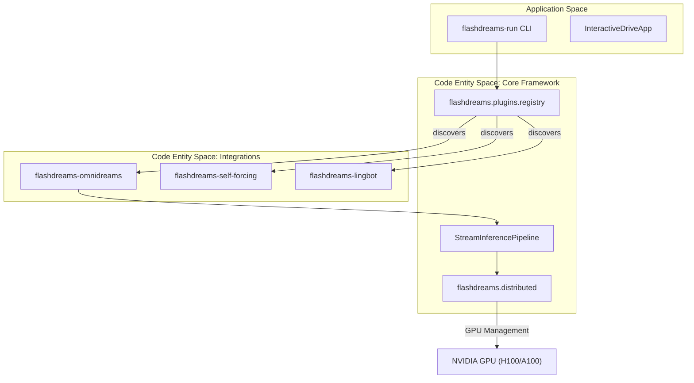
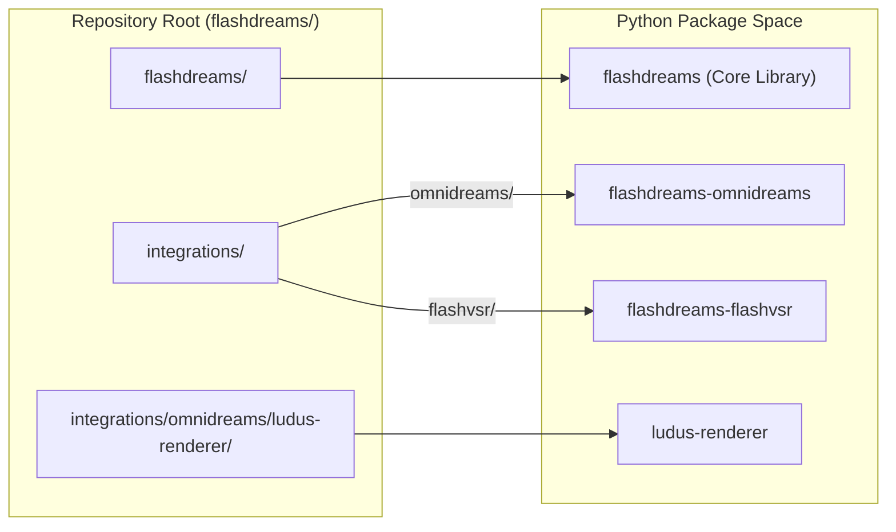

<!-- source: DeepWiki mcp.deepwiki.com · repo NVIDIA/flashdreams · page 1 FlashDreams Overview · fetched 2026-10-26 -->

# FlashDreams Overview

Relevant source files

The following files were used as context for generating this wiki page:

- [.github/workflows/ci.yml](.github/workflows/ci.yml)
- [.github/workflows/doc.yml](.github/workflows/doc.yml)
- [.pre-commit-config.yaml](.pre-commit-config.yaml)
- [README.md](README.md)
- [docs/README.md](docs/README.md)
- [docs/source/_static/custom.css](docs/source/_static/custom.css)
- [docs/source/_templates/sidebar/brand.html](docs/source/_templates/sidebar/brand.html)
- [docs/source/conf.py](docs/source/conf.py)
- [docs/source/index.rst](docs/source/index.rst)
- [flashdreams/PYPI_README.md](flashdreams/PYPI_README.md)
- [flashdreams/flashdreams/__init__.py](flashdreams/flashdreams/__init__.py)
- [flashdreams/flashdreams/_version.py](flashdreams/flashdreams/_version.py)
- [flashdreams/flashdreams/configs/runner_configs.py](flashdreams/flashdreams/configs/runner_configs.py)
- [flashdreams/pyproject.toml](flashdreams/pyproject.toml)
- [integrations/causal_forcing/pyproject.toml](integrations/causal_forcing/pyproject.toml)
- [integrations/cosmos_predict2/pyproject.toml](integrations/cosmos_predict2/pyproject.toml)
- [integrations/fastvideo_causal_wan22/pyproject.toml](integrations/fastvideo_causal_wan22/pyproject.toml)
- [integrations/flashvsr/pyproject.toml](integrations/flashvsr/pyproject.toml)
- [integrations/hy_worldplay/pyproject.toml](integrations/hy_worldplay/pyproject.toml)
- [integrations/lingbot/pyproject.toml](integrations/lingbot/pyproject.toml)
- [integrations/omnidreams/ludus-renderer/examples/render_mirror_augmented.py](integrations/omnidreams/ludus-renderer/examples/render_mirror_augmented.py)
- [integrations/omnidreams/ludus-renderer/pyproject.toml](integrations/omnidreams/ludus-renderer/pyproject.toml)
- [integrations/omnidreams/omnidreams/config.py](integrations/omnidreams/omnidreams/config.py)
- [integrations/omnidreams/pyproject.toml](integrations/omnidreams/pyproject.toml)
- [integrations/self_forcing/pyproject.toml](integrations/self_forcing/pyproject.toml)
- [integrations/wan21/pyproject.toml](integrations/wan21/pyproject.toml)
- [integrations/wan22/pyproject.toml](integrations/wan22/pyproject.toml)
- [pyproject.toml](pyproject.toml)
- [uv.lock](uv.lock)

**FlashDreams** is a high-performance inference and serving library designed for interactive autoregressive video and world models [README.md:18-23](). Originally developed as the runtime backbone for the NVIDIA OmniDreams closed-loop simulation at GTC 2026, it provides a general-purpose platform for real-time applications in gaming, autonomous vehicles, and robotics [docs/source/index.rst:32-37]().

Unlike one-shot video generation systems that return a finished file, FlashDreams maintains a persistent interactive session where model state, GPU inference, and streaming output evolve continuously based on user input [docs/source/index.rst:89-93]().

### High-Level Architecture

The system is built on a "bottom-up" design philosophy to minimize latency and maximize throughput during autoregressive generation [docs/source/index.rst:162-165]().

#### System Context Diagram
This diagram illustrates how the core library interacts with external plugins and the hardware layer.

**Sources:** [flashdreams/pyproject.toml:65-69](), [flashdreams/pyproject.toml:117-119](), [integrations/omnidreams/pyproject.toml:102-105]().

### Key Capabilities

*   **Streaming Inference:** Continuous generation using a rolling KV cache and frame-by-frame or chunk-wise decoding [docs/source/index.rst:117-123]().
*   **Low Latency Serving:** Optimized for interactive loops (e.g., driving or camera control) where conditioning changes at every step [docs/source/index.rst:109-111]().
*   **Distributed Execution:** Support for multi-GPU setups using context parallelism (CP) and sharded state [README.md:85-86]().
*   **Native Acceleration:** JIT-compiled CUDA/C++ extensions for optimized DiT and VAE kernels [integrations/omnidreams/pyproject.toml:36-38]().

### Repository Organization

The repository is structured as a `uv` monorepo, containing the core library and a collection of standalone integration packages [pyproject.toml:1-12]().

#### Workspace Layout Diagram
This diagram maps the physical repository structure to the primary Python packages.

**Sources:** [uv.lock:21-35](), [pyproject.toml:1-12]().

| Component | Path | Description |
| :--- | :--- | :--- |
| **Core Framework** | `flashdreams/` | Contains the `StreamInferencePipeline`, distributed infra, and base model recipes [flashdreams/pyproject.toml:21-23](). |
| **Integrations** | `integrations/` | Specialized plugins for models like Wan 2.1, Cosmos, and OmniDreams [README.md:81-84](). |
| **Ludus Renderer** | `integrations/omnidreams/ludus-renderer/` | A GPU-native software rasterizer for HDMap conditioning [integrations/omnidreams/pyproject.toml:32](). |

### Major Subsystems

1.  **[Getting Started](#1.1)**: Installation via `uv`, environment requirements (NVIDIA GPU 80GB+), and running your first world model [README.md:29-61]().
2.  **[CLI and Plugin Registry](#1.2)**: The `flashdreams-run` entry point and how it uses Python entry points to discover runners across the workspace [flashdreams/pyproject.toml:65-69]().
3.  **[Repository Structure and Workspace](#1.3)**: Detailed breakdown of the `uv` workspace, dependency management, and the PyPI publishing strategy [pyproject.toml:1-12]().

**Sources:** [README.md:18-23](), [README.md:29-39](), [README.md:81-97](), [pyproject.toml:1-12](), [flashdreams/pyproject.toml:21-47](), [docs/source/index.rst:32-37]().

---

