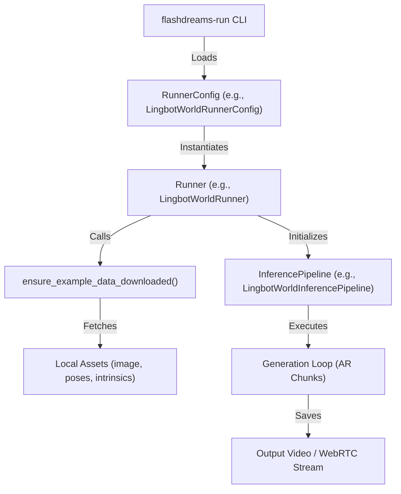
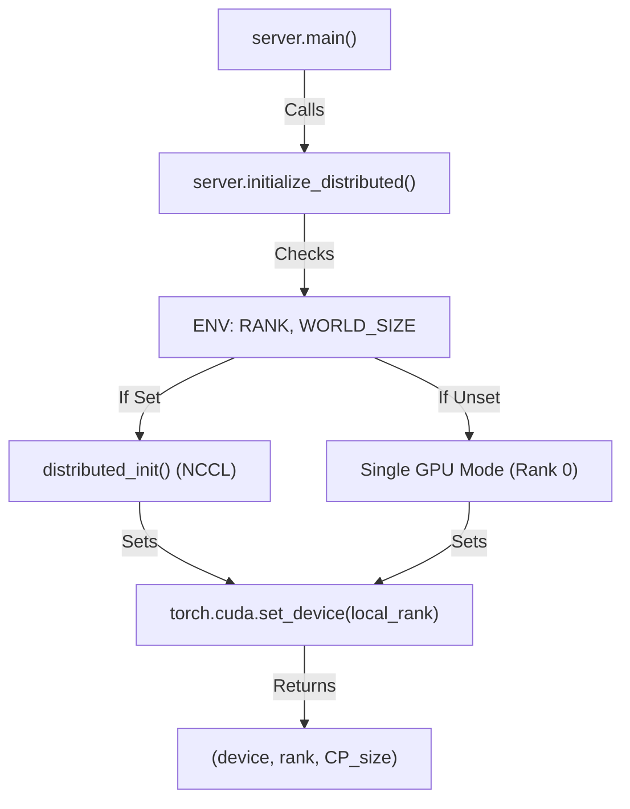

<!-- source: DeepWiki mcp.deepwiki.com · repo NVIDIA/flashdreams · page 1.1 Getting Started · fetched 2026-10-26 -->

# Getting Started

<details>
<summary>Relevant source files</summary>

The following files were used as context for generating this wiki page:

- [DEV.md](DEV.md)
- [docker/Dockerfile](docker/Dockerfile)
- [docker/README.md](docker/README.md)
- [docker/build_with_docker.sh](docker/build_with_docker.sh)
- [docs/source/quickstart/first_world_model.rst](docs/source/quickstart/first_world_model.rst)
- [docs/source/quickstart/installation.rst](docs/source/quickstart/installation.rst)
- [flashdreams/flashdreams/core/log_filters.py](flashdreams/flashdreams/core/log_filters.py)
- [flashdreams/tests/test_log_filters.py](flashdreams/tests/test_log_filters.py)
- [integrations/lingbot/lingbot/runner.py](integrations/lingbot/lingbot/runner.py)
- [integrations/lingbot/tests/test_distributed_server_main.py](integrations/lingbot/tests/test_distributed_server_main.py)
- [tests/README.md](tests/README.md)
- [tests/run_tests_docker.sh](tests/run_tests_docker.sh)
- [tests/run_tests_local.sh](tests/run_tests_local.sh)

</details>


This page provides instructions for setting up the FlashDreams environment, installing dependencies, and running your first world model inference. FlashDreams is designed as a high-performance monorepo using `uv` for workspace management, with support for both local and Docker-based execution.

## Installation

FlashDreams can be consumed either as a library or as a development workspace for running and extending world models.

### Using as a Library
To integrate FlashDreams primitives into an existing project, install the core package from PyPI or directly from the repository [docs/source/quickstart/installation.rst:21-34]():

```bash
# From PyPI
pip install flashdreams

# From GitHub main branch
pip install "git+https://github.com/NVIDIA/flashdreams.git"
```

### Development Workspace Setup
For running the provided model recipes and integrations, we recommend using the `uv` package manager. This setup configures the monorepo workspace and installs the unified `flashdreams-run` CLI [docs/source/quickstart/installation.rst:38-54]().

```bash
git clone https://github.com/NVIDIA/flashdreams.git
cd flashdreams

# Synchronize the workspace and install dev/runner extras
uv sync --extra dev --extra runners
```

### Environment Variables
Most models require Hugging Face authentication to download weights. Ensure your environment is configured [docs/source/quickstart/installation.rst:58-67]():

```bash
export HF_TOKEN=<your-hf-token>
export HF_HOME=~/.cache/huggingface  # Optional: defaults to ~/.cache/huggingface
```

## Docker Environment

For a consistent environment across different hardware (AMD64 and ARM64), FlashDreams provides a multi-arch Docker container based on `nvidia/cuda:13.2.1-cudnn-devel-ubuntu24.04` [docker/Dockerfile:16-16]().

### Build and Run
The container includes Python 3.12, `ffmpeg`, `libnccl-dev`, and `uv` [docker/Dockerfile:23-46]().

**Local Build:**
```bash
docker build -t flashdreams:local -f docker/Dockerfile .
```

**Multi-Arch Build & Push:**
The `build_with_docker.sh` script uses Docker Buildx to produce images for both `linux/arm64` and `linux/amd64` [docker/build_with_docker.sh:87-93]().

```bash
bash docker/build_with_docker.sh <your-registry>/flashdreams:<tag>
```

### Data Flow: Docker Host-to-Container Mapping
The testing and execution scripts use bind-mounts to persist caches across container runs [tests/run_tests_docker.sh:52-61]().

**Container Volume Mapping**
| Host Path | Container Path | Purpose |
| :--- | :--- | :--- |
| `REPO_ROOT` | `/workspace/flashdreams` | Codebase access |
| `~/.cache/uv` | `/root/.cache/uv` | Python package cache |
| `~/.cache/huggingface` | `/root/.cache/huggingface` | Model weights |
| `~/.cache/triton` | `/root/.cache/triton` | Compiled Triton kernels |

Sources: [docker/Dockerfile:1-59](), [docker/build_with_docker.sh:1-94](), [tests/run_tests_docker.sh:42-69]()

## Running Your First World Model

FlashDreams uses a unified entry point, `flashdreams-run`, to launch different model configurations (runners).

### 1. Batch Inference (Self-Forcing T2V)
Launch an offline Text-to-Video inference run using the Wan 2.1 1.3B model with TAEHV. The first run will perform Triton autotuning and CUDA graph warmup [docs/source/quickstart/first_world_model.rst:31-46]().

```bash
uv run --project integrations/self_forcing \
    flashdreams-run self-forcing-wan2.1-t2v-1.3b-taehv \
    --total-blocks 7
```
The output is saved to `outputs/self-forcing-wan2.1-t2v-1.3b-taehv.mp4`.

### 2. Interactive Serving (LingBot-World)
Launch an interactive WebRTC server. This allows for real-time camera control and video generation [docs/source/quickstart/first_world_model.rst:48-59]().

```bash
uv run --project integrations/lingbot \
    flashdreams-run lingbot-world-fast \
    --example-data True \
    --total-blocks 21
```

### System Interaction: CLI to Runner Logic
The following diagram illustrates how the `flashdreams-run` CLI interacts with the `Runner` and `InferencePipeline` classes to execute a model.

**Execution Data Flow**

Sources: [integrations/lingbot/lingbot/runner.py:113-165](), [docs/source/quickstart/first_world_model.rst:31-59]()

## Development and Testing

### Testing Infrastructure
The repository provides two primary test runners located in `tests/` [tests/README.md:5-9]():
*   `run_tests_local.sh`: For environments where dependencies are already installed.
*   `run_tests_docker.sh`: Spawns a container, installs dependencies, and runs tests.

To run tests:
```bash
# Local
./tests/run_tests_local.sh

# Docker (requires GPU)
./tests/run_tests_docker.sh
```

### Distributed Initialization
For multi-GPU or interactive serving, the system uses `initialize_distributed` to set up the NCCL process group and CUDA device affinity [integrations/lingbot/tests/test_distributed_server_main.py:66-104]().

**Distributed Setup Logic**

Sources: [integrations/lingbot/tests/test_distributed_server_main.py:53-138](), [tests/run_tests_local.sh:1-30]()

### Versioning
FlashDreams uses a single source of truth for versioning located in `flashdreams/flashdreams/_version.py`. All integration packages in the monorepo are kept in sync automatically via pre-commit hooks [DEV.md:3-13]().

Sources: [DEV.md:1-57](), [flashdreams/tests/test_log_filters.py:10-111]()

---

