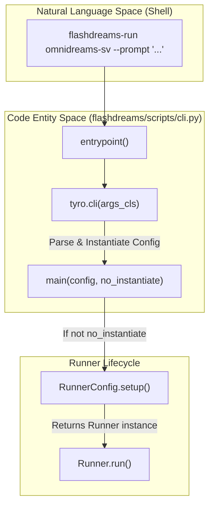
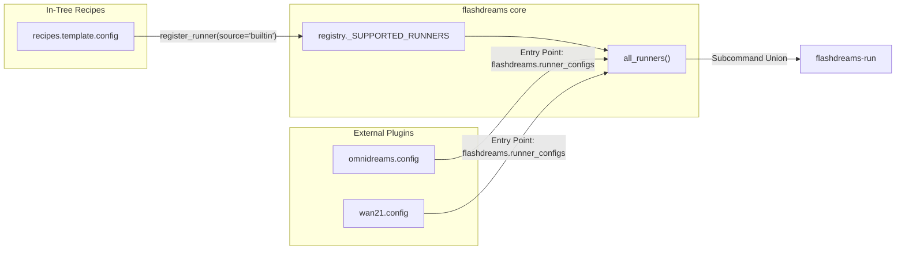

<!-- source: DeepWiki mcp.deepwiki.com · repo NVIDIA/flashdreams · page 1.2 CLI and Plugin Registry · fetched 2026-10-26 -->

# CLI and Plugin Registry

<details>
<summary>Relevant source files</summary>

The following files were used as context for generating this wiki page:

- [.github/workflows/ci.yml](.github/workflows/ci.yml)
- [.pre-commit-config.yaml](.pre-commit-config.yaml)
- [docs/source/_static/diagrams/cli-screen-shot.png](docs/source/_static/diagrams/cli-screen-shot.png)
- [docs/source/api/cli.rst](docs/source/api/cli.rst)
- [flashdreams/flashdreams/configs/runner_configs.py](flashdreams/flashdreams/configs/runner_configs.py)
- [flashdreams/flashdreams/infra/runner.py](flashdreams/flashdreams/infra/runner.py)
- [flashdreams/flashdreams/scripts/cli.py](flashdreams/flashdreams/scripts/cli.py)
- [flashdreams/pyproject.toml](flashdreams/pyproject.toml)
- [flashdreams/tests/test_recipe_configs.py](flashdreams/tests/test_recipe_configs.py)
- [integrations/causal_forcing/tests/test_smoke.py](integrations/causal_forcing/tests/test_smoke.py)
- [integrations/fastvideo_causal_wan22/tests/test_smoke.py](integrations/fastvideo_causal_wan22/tests/test_smoke.py)
- [integrations/lingbot/tests/test_smoke.py](integrations/lingbot/tests/test_smoke.py)
- [integrations/omnidreams/ludus-renderer/examples/render_mirror_augmented.py](integrations/omnidreams/ludus-renderer/examples/render_mirror_augmented.py)
- [integrations/omnidreams/ludus-renderer/pyproject.toml](integrations/omnidreams/ludus-renderer/pyproject.toml)
- [integrations/omnidreams/omnidreams/config.py](integrations/omnidreams/omnidreams/config.py)
- [integrations/omnidreams/tests/test_recipe_configs.py](integrations/omnidreams/tests/test_recipe_configs.py)
- [integrations/self_forcing/tests/test_smoke.py](integrations/self_forcing/tests/test_smoke.py)
- [integrations/wan21/tests/test_smoke.py](integrations/wan21/tests/test_smoke.py)
- [pyproject.toml](pyproject.toml)
- [uv.lock](uv.lock)

</details>


The `flashdreams-run` CLI serves as the unified entry point for the entire framework, providing a consistent interface to execute diverse world models and video diffusion pipelines. It leverages a decentralized plugin registry that allows both in-tree recipes and external integration packages to register "runner slugs" that appear as subcommands.

## Unified CLI: flashdreams-run

The CLI is powered by `tyro`, which automatically generates a command-line interface from a union of `RunnerConfig` dataclasses [flashdreams/flashdreams/scripts/cli.py:42-47](). Every field in a model's configuration becomes a CLI flag, allowing users to override specific hyperparameters (e.g., `--prompt`, `--total-blocks`, or `--pipeline.diffusion_model.transformer.num_views`) directly from the terminal [flashdreams/flashdreams/scripts/cli.py:16-30]().

### Core Commands

| Command | Description |
|:---|:---|
| `flashdreams-run --help` | Lists all registered runner slugs and their descriptions [flashdreams/flashdreams/scripts/cli.py:25](). |
| `flashdreams-run <slug> --help` | Inspects all overridable fields for a specific model [flashdreams/flashdreams/scripts/cli.py:26](). |
| `flashdreams-run <slug> [flags]` | Executes the runner on a single GPU [flashdreams/flashdreams/scripts/cli.py:27](). |
| `torchrun ... flashdreams-run <slug>` | Executes the runner in distributed mode (Multi-GPU) [flashdreams/flashdreams/scripts/cli.py:35](). |
| `--no-instantiate` | Resolves the final configuration and prints it without loading weights or starting inference [flashdreams/flashdreams/scripts/cli.py:50-60](). |

### Data Flow: CLI to Execution

The following diagram illustrates how a string-based CLI command is transformed into a live `Runner` instance.

**CLI Resolution and Execution Flow**

Sources: [flashdreams/flashdreams/scripts/cli.py:50-107](), [flashdreams/flashdreams/infra/runner.py:1-10]()

## Plugin Registry and Discovery

FlashDreams uses a hybrid registration system. In-tree recipes are registered via explicit imports, while external integrations (located in `integrations/*`) are discovered via Python entry points.

### Registration Mechanism
The central registry is managed in `flashdreams.configs.registry`. It maintains a mapping of slugs to `RunnerConfig` instances [flashdreams/flashdreams/configs/runner_configs.py:56-60]().

1.  **Built-in Runners**: In-tree integrations (like the template) call `register_runner(..., source="builtin")` during module import [flashdreams/flashdreams/configs/runner_configs.py:33-42]().
2.  **Plugin Discovery**: The `all_runners()` function calls `discover_runners()`, which scans the environment for packages advertising the `flashdreams.runner_configs` entry-point group [flashdreams/flashdreams/configs/runner_configs.py:72-83]().
3.  **Conflict Resolution**: Built-in runners always take precedence over plugins with the same slug. Collisions are logged, and the plugin version is skipped [flashdreams/flashdreams/configs/runner_configs.py:72-79]().

### Integration Structure
External integrations, such as `flashdreams-omnidreams`, define their runners in their own `pyproject.toml` files. This allows `flashdreams-run` to find them even if they are installed as separate packages.

**Example Entry Point Registration**
```toml
# integrations/omnidreams/pyproject.toml (Conceptual)
[project.entry-points."flashdreams.runner_configs"]
omnidreams-sv = "omnidreams.config:RUNNER_SV_CONFIG"
```
Sources: [integrations/omnidreams/omnidreams/config.py:18-24](), [flashdreams/flashdreams/configs/runner_configs.py:16-31]()

## System Architecture: Registry Aggregation

This diagram shows how the `flashdreams-run` tool aggregates configurations from disparate sources.

**Registry Aggregation Logic**

Sources: [flashdreams/flashdreams/configs/runner_configs.py:65-83](), [flashdreams/flashdreams/configs/registry.py:1-60](), [flashdreams/flashdreams/scripts/cli.py:46-47]()

## Environment Backdoor: FLASHDREAMS_RUNNER_CONFIGS

For development and rapid prototyping, the framework supports the `FLASHDREAMS_RUNNER_CONFIGS` environment variable. This acts as a "backdoor" to inject runner configurations without formal entry-point registration or modifying in-tree code.

*   **Mechanism**: `discover_runners()` checks this variable for a colon-separated list of import paths (e.g., `my_module.config:MY_RUNNER`).
*   **Priority**: Runners loaded via this environment variable are treated similarly to plugins but are useful for one-off experiments or CI/CD testing of new integrations.

Sources: [flashdreams/flashdreams/plugins/registry.py:1-30](), [flashdreams/flashdreams/configs/runner_configs.py:72-83]()

## Configuration Validation

To maintain a consistent CLI experience, the framework enforces several constraints on registered runners via smoke tests in `tests/test_recipe_configs.py`:

*   **Slug Parity**: The dictionary key in the registry must match the `runner_name` field within the `RunnerConfig` [flashdreams/tests/test_recipe_configs.py:39-48]().
*   **Pipeline Alignment**: By convention, `runner_name` must equal the `pipeline.name` to ensure the CLI command accurately reflects the underlying pipeline being executed [flashdreams/tests/test_recipe_configs.py:79-93]().
*   **Documentation**: Every runner must provide a non-empty `description` string, which `tyro` uses to populate the help menu [flashdreams/tests/test_recipe_configs.py:95-102]().

Sources: [flashdreams/tests/test_recipe_configs.py:16-103]()

---

