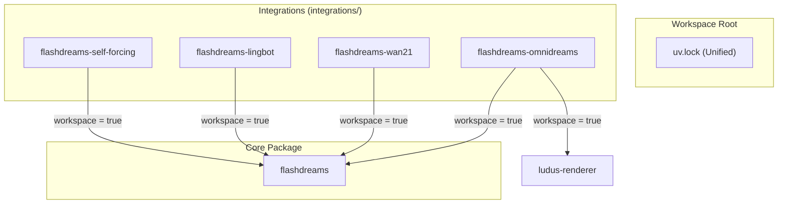
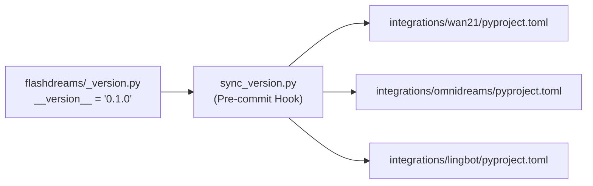

<!-- source: DeepWiki mcp.deepwiki.com · repo NVIDIA/flashdreams · page 1.3 Repository Structure and Workspace · fetched 2026-10-26 -->

# Repository Structure and Workspace

<details>
<summary>Relevant source files</summary>

The following files were used as context for generating this wiki page:

- [.github/copy-pr-bot.yaml](.github/copy-pr-bot.yaml)
- [.github/renovate.json](.github/renovate.json)
- [.github/scripts/sync_version.py](.github/scripts/sync_version.py)
- [DEV.md](DEV.md)
- [flashdreams/flashdreams/_version.py](flashdreams/flashdreams/_version.py)
- [integrations/causal_forcing/pyproject.toml](integrations/causal_forcing/pyproject.toml)
- [integrations/cosmos_predict2/pyproject.toml](integrations/cosmos_predict2/pyproject.toml)
- [integrations/fastvideo_causal_wan22/pyproject.toml](integrations/fastvideo_causal_wan22/pyproject.toml)
- [integrations/flashvsr/pyproject.toml](integrations/flashvsr/pyproject.toml)
- [integrations/hy_worldplay/pyproject.toml](integrations/hy_worldplay/pyproject.toml)
- [integrations/lingbot/pyproject.toml](integrations/lingbot/pyproject.toml)
- [integrations/omnidreams/pyproject.toml](integrations/omnidreams/pyproject.toml)
- [integrations/self_forcing/pyproject.toml](integrations/self_forcing/pyproject.toml)
- [integrations/self_forcing/tests/baseline_fastvideo/.gitignore](integrations/self_forcing/tests/baseline_fastvideo/.gitignore)
- [integrations/self_forcing/tests/baseline_fastvideo/README.md](integrations/self_forcing/tests/baseline_fastvideo/README.md)
- [integrations/self_forcing/tests/baseline_fastvideo/changes.patch](integrations/self_forcing/tests/baseline_fastvideo/changes.patch)
- [integrations/self_forcing/tests/baseline_fastvideo/pyproject.toml](integrations/self_forcing/tests/baseline_fastvideo/pyproject.toml)
- [integrations/self_forcing/tests/baseline_fastvideo/run.sh](integrations/self_forcing/tests/baseline_fastvideo/run.sh)
- [integrations/self_forcing/tests/baseline_fastvideo/uv.lock](integrations/self_forcing/tests/baseline_fastvideo/uv.lock)
- [integrations/wan21/pyproject.toml](integrations/wan21/pyproject.toml)
- [integrations/wan22/pyproject.toml](integrations/wan22/pyproject.toml)

</details>


This page details the monorepo architecture of the FlashDreams project, focusing on its `uv` workspace layout, the relationship between the core package and integrations, and the versioning and distribution strategy.

## Monorepo Layout and Workspace

FlashDreams is structured as a **uv monorepo**. This allows for a single lockfile at the repository root while maintaining distinct, modular packages for the core framework and various model-specific integrations.

### Core vs. Integrations
The repository is split into two primary areas:
1.  **Core Package (`flashdreams/`)**: Contains the foundational infrastructure, including streaming inference pipelines, distributed execution logic, and shared serving abstractions.
2.  **Integrations (`integrations/`)**: Contains specialized plugins for specific models (e.g., Wan 2.1, Cosmos) or applications (e.g., OmniDreams). Each integration is a standalone Python package with its own `pyproject.toml`.

### Dependency Management
The `uv` workspace ensures that integration packages can depend on the core `flashdreams` package using the `{ workspace = true }` directive [integrations/omnidreams/pyproject.toml:56-57](). This enables local development where changes in the core package are immediately reflected in all integrations without requiring a re-install.

| Component | Path | Description |
| :--- | :--- | :--- |
| **Workspace Root** | `/` | Contains `uv.lock` and global configuration. |
| **Core Framework** | `flashdreams/` | The `flashdreams` package. |
| **Integrations** | `integrations/*` | Model-specific plugins (e.g., `flashdreams-wan21`). |
| **External Renderer** | `ludus-renderer/` | GPU-native rasterizer used by OmniDreams. |

### Workspace Dependency Flow
The following diagram illustrates how the `uv` workspace resolves dependencies between the core package and various integrations.

**Workspace Dependency Graph**

Sources: [integrations/omnidreams/pyproject.toml:56-59](), [integrations/wan21/pyproject.toml:32-33](), [integrations/lingbot/pyproject.toml:35-36](), [DEV.md:46-57]().

---

## Versioning Strategy

FlashDreams employs a "single source of truth" versioning system to ensure consistency across the monorepo.

### Canonical Version
The version for the entire monorepo is defined in a single file: `flashdreams/flashdreams/_version.py` [flashdreams/flashdreams/_version.py:16-16]().

### Synchronization Mechanism
To prevent version drift, a synchronization script (`.github/scripts/sync_version.py`) is triggered as a pre-commit hook [DEV.md:12-14](). This script:
1.  Reads the `__version__` string from the core package.
2.  Updates the `version` field in every `pyproject.toml` file within the `integrations/` directory to match.

**Versioning Data Flow**

Sources: [flashdreams/flashdreams/_version.py:16-16](), [DEV.md:5-21]().

---

## Publishing and Distribution

The project uses a tiered publishing strategy, distinguishing between the core framework and the model-specific integrations.

### PyPI Strategy
Only the core `flashdreams` package is published to PyPI [DEV.md:24-24](). It is distributed as a pure-Python wheel. During the initial development phase, it is published to **test.pypi.org** [DEV.md:26-29]().

### Git-Installable Integrations
Integration packages (e.g., `flashdreams-omnidreams`, `flashdreams-wan21`) are **not** published to PyPI [DEV.md:33-33](). They are intended to be installed directly from the GitHub repository using the `subdirectory` fragment.

**Example Installation:**
```bash
pip install "flashdreams-wan21 @ git+https://github.com/NVIDIA/flashdreams.git#subdirectory=integrations/wan21"
```
[DEV.md:37-38]()

### Plugin Registration via Entry Points
Integrations register themselves with the core `flashdreams-run` CLI using `project.entry-points` [integrations/omnidreams/pyproject.toml:102-105](). Specifically, they use the `flashdreams.runner_configs` group. This allows the CLI to discover and instantiate specific model runners (e.g., `wan21-t2v-1.3b-480p`) without the core package having explicit knowledge of every integration [integrations/wan21/pyproject.toml:44-46]().

| Integration | Entry Point Group | Key Config Symbol |
| :--- | :--- | :--- |
| `omnidreams` | `flashdreams.runner_configs` | `RUNNER_SV_2STEPS_CHUNK2_LOC6_LIGHTVAE_LIGHTTAE` |
| `flashvsr` | `flashdreams.runner_configs` | `RUNNER_FLASHVSR_V1_1_SPARSE_2_0` |
| `lingbot` | `flashdreams.runner_configs` | `RUNNER_LINGBOT_WORLD_FAST` |
| `wan21` | `flashdreams.runner_configs` | `RUNNER_WAN21_T2V_1PT3B_480P` |

Sources: [integrations/omnidreams/pyproject.toml:102-105](), [integrations/flashvsr/pyproject.toml:56-60](), [integrations/lingbot/pyproject.toml:48-51](), [integrations/wan21/pyproject.toml:44-46](), [DEV.md:31-45]().

---

