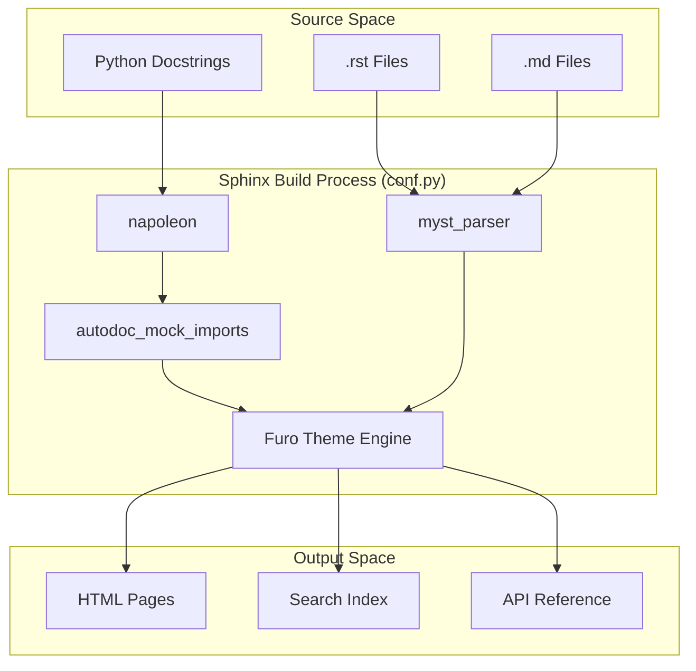

<!-- source: DeepWiki mcp.deepwiki.com · repo NVIDIA/flashdreams · page 10 Documentation System · fetched 2026-10-26 -->

# Documentation System

Relevant source files

The following files were used as context for generating this wiki page:

- [.github/workflows/doc.yml](.github/workflows/doc.yml)
- [README.md](README.md)
- [docs/README.md](docs/README.md)
- [docs/source/_static/custom.css](docs/source/_static/custom.css)
- [docs/source/_templates/base.html](docs/source/_templates/base.html)
- [docs/source/_templates/layout.html](docs/source/_templates/layout.html)
- [docs/source/_templates/sidebar/brand.html](docs/source/_templates/sidebar/brand.html)
- [docs/source/api/core.rst](docs/source/api/core.rst)
- [docs/source/api/index.rst](docs/source/api/index.rst)
- [docs/source/conf.py](docs/source/conf.py)
- [docs/source/developer_guides/config_system.rst](docs/source/developer_guides/config_system.rst)
- [docs/source/developer_guides/index.rst](docs/source/developer_guides/index.rst)
- [docs/source/developer_guides/interactive_serving.rst](docs/source/developer_guides/interactive_serving.rst)
- [docs/source/developer_guides/new_integration.rst](docs/source/developer_guides/new_integration.rst)
- [docs/source/developer_guides/usage_patterns.rst](docs/source/developer_guides/usage_patterns.rst)
- [docs/source/index.rst](docs/source/index.rst)
- [docs/source/models/causal_forcing.rst](docs/source/models/causal_forcing.rst)
- [docs/source/models/causal_wan22.rst](docs/source/models/causal_wan22.rst)
- [docs/source/models/cosmos_predict2.rst](docs/source/models/cosmos_predict2.rst)
- [docs/source/models/flashvsr.rst](docs/source/models/flashvsr.rst)
- [docs/source/models/lingbot_world.rst](docs/source/models/lingbot_world.rst)
- [docs/source/models/omnidreams.rst](docs/source/models/omnidreams.rst)
- [docs/source/models/self_forcing.rst](docs/source/models/self_forcing.rst)
- [docs/source/models/wan21.rst](docs/source/models/wan21.rst)
- [flashdreams/PYPI_README.md](flashdreams/PYPI_README.md)
- [flashdreams/flashdreams/__init__.py](flashdreams/flashdreams/__init__.py)
- [flashdreams/flashdreams/core/distributed/__init__.py](flashdreams/flashdreams/core/distributed/__init__.py)

The FlashDreams documentation system is designed to provide high-fidelity, versioned technical guidance for a high-performance inference library. It leverages **Sphinx** with the **Furo** theme to produce a modern, responsive static site that integrates deep API references with hand-written developer guides and interactive performance visualizations.

## Sphinx Build Architecture

The documentation build process transforms reStructuredText (`.rst`) and Markdown (`.md`) sources into a cross-referenced HTML site.

### Core Components
*   **Theme**: Uses `furo` for a clean, navigation-focused layout [docs/source/conf.py:68-68]().
*   **Parsers**: `myst_parser` is used to enable rich Markdown support alongside traditional Sphinx directives [docs/source/conf.py:51-51]().
*   **Extensions**:
    *   `sphinx.ext.napoleon`: Parses Google-style and NumPy-style docstrings into formatted documentation [docs/source/conf.py:43-43]().
    *   `sphinx.ext.autodoc`: Automatically generates documentation from Python source code [docs/source/conf.py:44-44]().
    *   `sphinx.ext.viewcode`: Adds links to the highlighted source code for documented entities [docs/source/conf.py:47-47]().
    *   `sphinx_copybutton`: Adds a "copy" button to code blocks, with logic to strip Python/shell prompts (`>>>`, `$`) [docs/source/conf.py:49-49](), [docs/source/conf.py:96-98]().

### GPU-Free Documentation Builds
A critical feature of the FlashDreams doc system is the ability to build the site on standard CPU-only CI runners (e.g., GitHub Actions) despite the library's heavy dependence on CUDA and GPU-specific libraries. This is achieved via `autodoc_mock_imports`, which prevents the build from failing when C-extensions or hardware-specific drivers are missing [docs/source/conf.py:113-121]().

**Documentation Data Flow**

Sources: [docs/source/conf.py:42-52](), [docs/source/conf.py:113-121](), [docs/source/conf.py:68-68]()

## Performance Visualization

FlashDreams includes a custom JavaScript-based visualization tool, `benchmark_chart.js`, to render performance data directly within the documentation.

### benchmark_chart.js
This component allows model pages (e.g., Wan2.1, FlashVSR) to display interactive charts by referencing external Markdown-based performance data [docs/source/models/wan21.rst:141-146](), [docs/source/models/flashvsr.rst:144-149]().

*   **Implementation**: It targets a `div` with the `benchmark-figure` class and uses `data-benchmark-md-url` to fetch raw performance numbers [docs/source/models/flashvsr.rst:143-149]().
*   **Styling**: Series colors are defined via the `data-benchmark-series` attribute (e.g., `#76B900` for FlashDreams) [docs/source/models/flashvsr.rst:147-147]().

**Natural Language to Code Entity Mapping: Performance Visualization**

| Concept | Code Entity / File Path |
| :--- | :--- |
| **Chart Logic** | `docs/source/_static/js/benchmark_chart.js` |
| **Data Source** | `data-benchmark-md-url` [docs/source/models/wan21.rst:143-143]() |
| **CSS Styling** | `docs/source/_static/custom.css` |
| **Chart Injection** | `
` [docs/source/models/flashvsr.rst:145-145]() |

Sources: [docs/source/models/wan21.rst:139-158](), [docs/source/models/flashvsr.rst:142-158]()

## Deployment and Versioning

The documentation is hosted via **GitHub Pages** and follows a versioned deployment strategy managed by GitHub Actions.

### Deployment Workflow
The `doc.yml` workflow automates the generation and publishing of the site.
1.  **Environment Setup**: Uses `uv` to synchronize dependencies [README.md:58-58]().
2.  **Build**: Executes the Sphinx build using the configuration in `docs/source/conf.py`.
3.  **Publishing**: Deploys the resulting static files to the `gh-pages` branch.
4.  **Versioning**: Documentation is served under paths corresponding to the git branch or tag (e.g., `/main/` for the latest development version) [README.md:15-15]().

### Version Information
The version displayed in the documentation is dynamically pulled from the package metadata using `importlib.metadata`. If the package is not installed, it defaults to `v0.0.0` [docs/source/conf.py:23-30]().

Sources: [docs/source/conf.py:23-30](), [README.md:15-15](), [.github/workflows/doc.yml]()

## Contributing to Documentation

Contributors are encouraged to update documentation alongside code changes.

### Documentation Structure
*   **Developer Guides**: Located in `docs/source/developer_guides/`, covering topics like the config system and interactive serving [docs/source/developer_guides/index.rst]().
*   **Model Gallery**: Located in `docs/source/models/`, containing specific instructions and benchmarks for each integrated model family [README.md:98-100]().
*   **API Reference**: Automatically updated via `autodoc` by scanning the `flashdreams/` core package [docs/source/conf.py:11-15]().

### Local Preview
To build and preview the documentation locally:
1.  Sync the environment with development extras: `uv sync --extra dev` [README.md:111-111]().
2.  Navigate to the `docs/` directory.
3.  Run the build command (typically `make html` or a sphinx-build wrapper).

Sources: [README.md:111-111](), [docs/source/conf.py:11-15](), [docs/README.md]()

---

