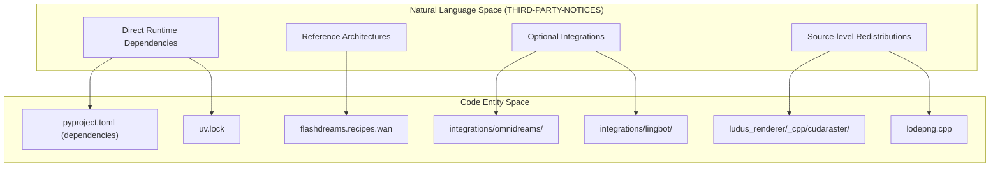

<!-- source: DeepWiki mcp.deepwiki.com · repo NVIDIA/flashdreams · page 11 Open-Source Governance and Licensing · fetched 2026-10-26 -->

# Open-Source Governance and Licensing

<details>
<summary>Relevant source files</summary>

The following files were used as context for generating this wiki page:

- [.github/workflows/reuse-lint.yml](.github/workflows/reuse-lint.yml)
- [CODE_OF_CONDUCT.md](CODE_OF_CONDUCT.md)
- [CONTRIBUTING.md](CONTRIBUTING.md)
- [LICENSE](LICENSE)
- [LICENSES/BSD-3-Clause.txt](LICENSES/BSD-3-Clause.txt)
- [LICENSES/Zlib.txt](LICENSES/Zlib.txt)
- [NOTICE](NOTICE)
- [REUSE.toml](REUSE.toml)
- [SECURITY.md](SECURITY.md)
- [THIRD-PARTY-NOTICES](THIRD-PARTY-NOTICES)
- [agentic/skills/maintaining-oss-state/SKILL.md](agentic/skills/maintaining-oss-state/SKILL.md)
- [docs/source/api/integrations.rst](docs/source/api/integrations.rst)
- [docs/source/community/contribute.rst](docs/source/community/contribute.rst)
- [docs/source/community/discord.rst](docs/source/community/discord.rst)
- [docs/source/developer_guides/inference_pipeline_overview.rst](docs/source/developer_guides/inference_pipeline_overview.rst)
- [docs/source/models/index.rst](docs/source/models/index.rst)
- [integrations/omnidreams/omnidreams_singleview/patches/cutlass/include/cute/atom/detail/tma_descriptor_pool.hpp](integrations/omnidreams/omnidreams_singleview/patches/cutlass/include/cute/atom/detail/tma_descriptor_pool.hpp)
- [integrations/omnidreams/omnidreams_singleview/patches/cutlass/sm120-tma-pool.patch](integrations/omnidreams/omnidreams_singleview/patches/cutlass/sm120-tma-pool.patch)
- [integrations/omnidreams/omnidreams_singleview/thirdparty_sources.json](integrations/omnidreams/omnidreams_singleview/thirdparty_sources.json)

</details>


This page documents the governance model, licensing structure, and compliance workflows for the FlashDreams project. It details how the project maintains its open-source status while managing complex dependencies, third-party code redistributions, and community contributions.

## Licensing Model

FlashDreams is released under the **Apache License, Version 2.0** [LICENSE:35-37](). The project follows a multi-license posture to accommodate specific high-performance components that are physically present in the repository [LICENSE:3-20]().

### License Distribution
| Component | License | Path |
| :--- | :--- | :--- |
| **Core Framework** | Apache-2.0 | Root and all first-party directories |
| **CUDA Rasterizer** | BSD-3-Clause | `integrations/omnidreams/ludus-renderer/ludus_renderer/_cpp/cudaraster/` |
| **LodePNG Codec** | Zlib | `.../cudaraster/framework/3rdparty/lodepng/` |

The project uses **REUSE 3.3** compliance to manage these overlapping licenses [LICENSE:22-26](). This ensures that every file in the repository has a machine-readable copyright and license statement, either via an inline SPDX header or the `REUSE.toml` manifest [REUSE.toml:1-5]().

**Sources:** [LICENSE:1-32](), [NOTICE:1-20](), [REUSE.toml:1-5]()

## REUSE 3.3 Compliance and SPDX Headers

FlashDreams enforces a strict "Inline SPDX" policy for all first-party source files. This is validated by the `reuse-lint` CI workflow [agentic/skills/maintaining-oss-state/SKILL.md:85-88]().

### Header Specification
First-party files (Python, C++, CUDA, Shell, Protobuf) must contain the following header within the first 20 lines [agentic/skills/maintaining-oss-state/SKILL.md:90-107]():

```python
# SPDX-FileCopyrightText: Copyright (c) 2026 NVIDIA CORPORATION & AFFILIATES. All rights reserved.
# SPDX-License-Identifier: Apache-2.0
```

The CI workflow `reuse-lint.yml` performs a "Source-level redistribution" check, ensuring that vendored code (like `cudaraster`) retains its original BSD-3-Clause headers while first-party code remains under Apache-2.0 [.github/workflows/reuse-lint.yml:93-137]().

**Sources:** [agentic/skills/maintaining-oss-state/SKILL.md:83-112](), [.github/workflows/reuse-lint.yml:22-26](), [.github/workflows/reuse-lint.yml:93-137]()

## Governance and Contribution Process

FlashDreams is maintained by NVIDIA's Simulation & Imitation Learning group but operates under a public governance model designed to transition toward community ownership [CONTRIBUTING.md:52-63]().

### DCO vs. CLA
FlashDreams uses the **Developer Certificate of Origin (DCO) 1.1** instead of a Contributor License Agreement (CLA) [CONTRIBUTING.md:91-97]().
*   **Mechanism:** Contributors attest to their right to submit code by adding a `Signed-off-by` line to commit messages [CONTRIBUTING.md:148-155]().
*   **Enforcement:** Commits without `-s` (sign-off) are automatically blocked from merging by the CI pipeline [CONTRIBUTING.md:138-139]().

### Maintainer Path
The project uses a `CODEOWNERS` file as the source of truth for review responsibility [CONTRIBUTING.md:65-68](). External contributors who demonstrate sustained judgment and high-quality contributions can be invited to become maintainers with merge rights [CONTRIBUTING.md:75-78]().

**Sources:** [CONTRIBUTING.md:50-84](), [CONTRIBUTING.md:91-139](), [CONTRIBUTING.md:148-163]()

## Third-Party Notices and Dependency Management

The project maintains a `THIRD-PARTY-NOTICES` file that serves as the comprehensive attribution document for four categories of software [THIRD-PARTY-NOTICES:4-22]().

### Dependency Structure Diagram
This diagram maps the relationship between the `THIRD-PARTY-NOTICES` manifest and the actual code entities.

**Code Entity to License Mapping**


### Native Acceleration Third-Party Management
For the `omnidreams_singleview` native extension, dependencies are managed via a JIT-managed manifest `thirdparty_sources.json` [integrations/omnidreams/omnidreams_singleview/thirdparty_sources.json:1-3]().
*   **Pinned Dependencies:** Includes `cutlass`, `SageAttention`, and `SpargeAttn` [integrations/omnidreams/omnidreams_singleview/thirdparty_sources.json:5-36]().
*   **Patching:** The build system applies local patches, such as the `sm120-tma-pool.patch` for Blackwell architecture support in CUTLASS [integrations/omnidreams/omnidreams_singleview/thirdparty_sources.json:12-17]().

**Sources:** [THIRD-PARTY-NOTICES:25-139](), [integrations/omnidreams/omnidreams_singleview/thirdparty_sources.json:1-44](), [agentic/skills/maintaining-oss-state/SKILL.md:49-57]()

## OSRB Process and Security

### OSRB Compliance
FlashDreams is released under NVIDIA OSRB Bug **6107043** [agentic/skills/maintaining-oss-state/SKILL.md:8-9](). Any addition of a new direct runtime dependency requires reopening this OSRB bug to amend the approved dependency list in Section 14 of the filing [agentic/skills/maintaining-oss-state/SKILL.md:58-63]().

### Security Reporting
Security vulnerabilities should not be reported via public GitHub issues. Instead, they must be reported to **psirt@nvidia.com** according to the NVIDIA Global PSIRT policy.

### Compliance CI Workflow
The `reuse-lint` workflow acts as the final gate for all licensing and governance rules.

**Compliance Logic Flow**
```mermaid
flowchart TD
    PR["Pull Request Submitted"] --> DCO["Check git commit -s (Sign-off)"]
    DCO -- "Fail" --> Reject["Block Merge"]
    DCO -- "Pass" --> Lint["Run .github/workflows/reuse-lint.yml"]
    
    subgraph "reuse-lint.yml logic"
        L1["Check OSRB Collateral (LICENSE, NOTICE, etc.)"]
        L2["Check Inline SPDX (First 20 lines)"]
        L3["Check Apache-2.0 Sentinels"]
        L4["Check for Proprietary Banners"]
    end
    
    Lint --> L1 & L2 & L3 & L4
    L1 & L2 & L3 & L4 -- "All Pass" --> Success["Ready for Review"]
    L1 | L2 | L3 | L4 -- "Any Fail" --> Reject
```

**Sources:** [agentic/skills/maintaining-oss-state/SKILL.md:1-21](), [.github/workflows/reuse-lint.yml:1-155](), [CONTRIBUTING.md:138-139]()

---

