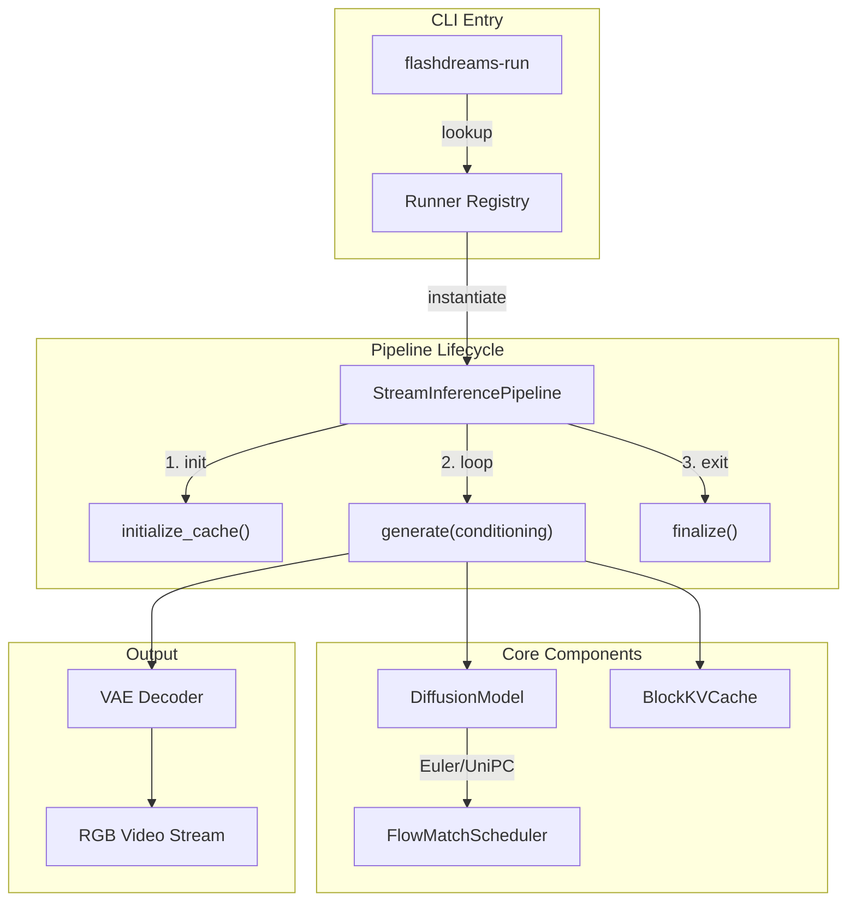
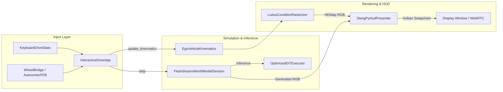

<!-- source: DeepWiki mcp.deepwiki.com · repo NVIDIA/flashdreams · page 12 Glossary · fetched 2026-10-26 -->

# Glossary

Relevant source files

The following files were used as context for generating this wiki page:

- [.github/workflows/ci.yml](.github/workflows/ci.yml)
- [.github/workflows/doc.yml](.github/workflows/doc.yml)
- [.pre-commit-config.yaml](.pre-commit-config.yaml)
- [README.md](README.md)
- [THIRD-PARTY-NOTICES](THIRD-PARTY-NOTICES)
- [docs/README.md](docs/README.md)
- [docs/source/_static/custom.css](docs/source/_static/custom.css)
- [docs/source/_templates/sidebar/brand.html](docs/source/_templates/sidebar/brand.html)
- [docs/source/api/integrations.rst](docs/source/api/integrations.rst)
- [docs/source/conf.py](docs/source/conf.py)
- [docs/source/developer_guides/inference_pipeline_overview.rst](docs/source/developer_guides/inference_pipeline_overview.rst)
- [docs/source/index.rst](docs/source/index.rst)
- [docs/source/models/causal_forcing.rst](docs/source/models/causal_forcing.rst)
- [docs/source/models/causal_wan22.rst](docs/source/models/causal_wan22.rst)
- [docs/source/models/cosmos_predict2.rst](docs/source/models/cosmos_predict2.rst)
- [docs/source/models/flashvsr.rst](docs/source/models/flashvsr.rst)
- [docs/source/models/index.rst](docs/source/models/index.rst)
- [docs/source/models/lingbot_world.rst](docs/source/models/lingbot_world.rst)
- [docs/source/models/omnidreams.rst](docs/source/models/omnidreams.rst)
- [docs/source/models/self_forcing.rst](docs/source/models/self_forcing.rst)
- [docs/source/models/wan21.rst](docs/source/models/wan21.rst)
- [flashdreams/PYPI_README.md](flashdreams/PYPI_README.md)
- [flashdreams/flashdreams/__init__.py](flashdreams/flashdreams/__init__.py)
- [flashdreams/flashdreams/_version.py](flashdreams/flashdreams/_version.py)
- [flashdreams/flashdreams/configs/runner_configs.py](flashdreams/flashdreams/configs/runner_configs.py)
- [flashdreams/flashdreams/core/attention/kvcache.py](flashdreams/flashdreams/core/attention/kvcache.py)
- [flashdreams/flashdreams/core/attention/rope.py](flashdreams/flashdreams/core/attention/rope.py)
- [flashdreams/flashdreams/core/distributed/__init__.py](flashdreams/flashdreams/core/distributed/__init__.py)
- [flashdreams/flashdreams/recipes/wan/transformer/impl/modules.py](flashdreams/flashdreams/recipes/wan/transformer/impl/modules.py)
- [flashdreams/flashdreams/recipes/wan/transformer/impl/network.py](flashdreams/flashdreams/recipes/wan/transformer/impl/network.py)
- [flashdreams/pyproject.toml](flashdreams/pyproject.toml)
- [flashdreams/tests/test_attention.py](flashdreams/tests/test_attention.py)
- [flashdreams/tests/test_kvcache.py](flashdreams/tests/test_kvcache.py)
- [flashdreams/tests/test_wan_context_parallel.py](flashdreams/tests/test_wan_context_parallel.py)
- [integrations/causal_forcing/README.md](integrations/causal_forcing/README.md)
- [integrations/causal_forcing/pyproject.toml](integrations/causal_forcing/pyproject.toml)
- [integrations/cosmos_predict2/README.md](integrations/cosmos_predict2/README.md)
- [integrations/cosmos_predict2/pyproject.toml](integrations/cosmos_predict2/pyproject.toml)
- [integrations/fastvideo_causal_wan22/README.md](integrations/fastvideo_causal_wan22/README.md)
- [integrations/fastvideo_causal_wan22/pyproject.toml](integrations/fastvideo_causal_wan22/pyproject.toml)
- [integrations/flashvsr/README.md](integrations/flashvsr/README.md)
- [integrations/flashvsr/pyproject.toml](integrations/flashvsr/pyproject.toml)
- [integrations/hy_worldplay/pyproject.toml](integrations/hy_worldplay/pyproject.toml)
- [integrations/lingbot/README.md](integrations/lingbot/README.md)
- [integrations/lingbot/pyproject.toml](integrations/lingbot/pyproject.toml)
- [integrations/omnidreams/ludus-renderer/examples/render_mirror_augmented.py](integrations/omnidreams/ludus-renderer/examples/render_mirror_augmented.py)
- [integrations/omnidreams/ludus-renderer/pyproject.toml](integrations/omnidreams/ludus-renderer/pyproject.toml)
- [integrations/omnidreams/omnidreams/config.py](integrations/omnidreams/omnidreams/config.py)
- [integrations/omnidreams/omnidreams/interactive_drive/README.md](integrations/omnidreams/omnidreams/interactive_drive/README.md)
- [integrations/omnidreams/omnidreams/interactive_drive/app.py](integrations/omnidreams/omnidreams/interactive_drive/app.py)
- [integrations/omnidreams/omnidreams/interactive_drive/cli.py](integrations/omnidreams/omnidreams/interactive_drive/cli.py)
- [integrations/omnidreams/omnidreams/interactive_drive/config.py](integrations/omnidreams/omnidreams/interactive_drive/config.py)
- [integrations/omnidreams/omnidreams/interactive_drive/demo.py](integrations/omnidreams/omnidreams/interactive_drive/demo.py)
- [integrations/omnidreams/omnidreams/interactive_drive/simulation/ground_snap.py](integrations/omnidreams/omnidreams/interactive_drive/simulation/ground_snap.py)
- [integrations/omnidreams/omnidreams/interactive_drive/streaming_presenter.py](integrations/omnidreams/omnidreams/interactive_drive/streaming_presenter.py)
- [integrations/omnidreams/omnidreams/native/__init__.py](integrations/omnidreams/omnidreams/native/__init__.py)
- [integrations/omnidreams/omnidreams/native/acceleration.py](integrations/omnidreams/omnidreams/native/acceleration.py)
- [integrations/omnidreams/omnidreams/native/omnidreams_singleview.py](integrations/omnidreams/omnidreams/native/omnidreams_singleview.py)
- [integrations/omnidreams/omnidreams_singleview/README.md](integrations/omnidreams/omnidreams_singleview/README.md)
- [integrations/omnidreams/omnidreams_singleview/patches/cutlass/include/cute/atom/detail/tma_descriptor_pool.hpp](integrations/omnidreams/omnidreams_singleview/patches/cutlass/include/cute/atom/detail/tma_descriptor_pool.hpp)
- [integrations/omnidreams/omnidreams_singleview/patches/cutlass/sm120-tma-pool.patch](integrations/omnidreams/omnidreams_singleview/patches/cutlass/sm120-tma-pool.patch)
- [integrations/omnidreams/omnidreams_singleview/src/native_primitives_cuda.cu](integrations/omnidreams/omnidreams_singleview/src/native_primitives_cuda.cu)
- [integrations/omnidreams/omnidreams_singleview/src/omnidreams_singleview_ext.cpp](integrations/omnidreams/omnidreams_singleview/src/omnidreams_singleview_ext.cpp)
- [integrations/omnidreams/omnidreams_singleview/thirdparty_sources.json](integrations/omnidreams/omnidreams_singleview/thirdparty_sources.json)
- [integrations/omnidreams/omnidreams_singleview/tools/native_build.py](integrations/omnidreams/omnidreams_singleview/tools/native_build.py)
- [integrations/omnidreams/pyproject.toml](integrations/omnidreams/pyproject.toml)
- [integrations/omnidreams/tests/test_omnidreams_singleview_native.py](integrations/omnidreams/tests/test_omnidreams_singleview_native.py)
- [integrations/self_forcing/README.md](integrations/self_forcing/README.md)
- [integrations/self_forcing/pyproject.toml](integrations/self_forcing/pyproject.toml)
- [integrations/wan21/README.md](integrations/wan21/README.md)
- [integrations/wan21/pyproject.toml](integrations/wan21/pyproject.toml)
- [integrations/wan22/pyproject.toml](integrations/wan22/pyproject.toml)
- [pyproject.toml](pyproject.toml)
- [uv.lock](uv.lock)

This page provides a technical glossary of the terms, abbreviations, and domain concepts used throughout the FlashDreams codebase. It is designed to help onboarding engineers map high-level concepts to their specific implementations and data structures.

## Core System Concepts

### Autoregressive World Model
A model that learns to generate and evolve an environment over time by predicting the next state (usually video frames) based on previous states and conditioning signals (e.g., actions, HDMaps). Unlike one-shot video generation, FlashDreams focuses on continuous, stateful evolution [README.md:18-23](), [docs/source/index.rst:85-94]().

### StreamInferencePipeline
The primary lifecycle manager for world-model inference. It orchestrates the flow from `initialize_cache` through repeated `generate` steps to a final `finalize` call. It manages the composition of encoders, diffusion models, and decoders [docs/source/developer_guides/inference_pipeline_overview.rst:132-134]().

### Runner Slug
A unique string identifier (e.g., `omnidreams-sv-2steps-chunk2-loc6-lightvae-lighttae-perf`) used by the `flashdreams-run` CLI to look up a specific model configuration and pipeline implementation [docs/source/models/omnidreams.rst:62-72](), [integrations/omnidreams/pyproject.toml:102-104]().

### KV Cache (Block-based)
A mechanism for storing key-value pairs of previous tokens to avoid re-computation. FlashDreams uses a specialized `BlockKVCache` that supports "sink tokens" (fixed initial context) and "rolling windows" (fixed-size buffer for recent context) to maintain constant memory usage during long-running streaming sessions [flashdreams/flashdreams/core/attention/kvcache.py:1-50]().

---

## Code Entity Mapping: Inference Lifecycle

The following diagram maps the conceptual "Streaming Loop" to the specific classes and methods in the `flashdreams` core and integration layers.

**Diagram: Inference Pipeline Data Flow**

**Sources:** [flashdreams/flashdreams/core/attention/kvcache.py:1-20](), [docs/source/developer_guides/inference_pipeline_overview.rst:132-134](), [integrations/omnidreams/pyproject.toml:98-104]().

---

## Technical Terms & Abbreviations

| Term | Definition | Relevant Files |
| :--- | :--- | :--- |
| **CP (Context Parallel)** | Distributed attention mechanism (e.g., Ring or Ulysses) used to shard the temporal/spatial sequence across multiple GPUs. | [flashdreams/flashdreams/core/distributed/__init__.py:1-10]() |
| **HDMap** | High-Definition Map data (lanes, boundaries, intersections) used as conditioning for driving world models like OmniDreams. | [integrations/omnidreams/omnidreams/interactive_drive/README.md:10-11]() |
| **I2V** | Image-to-Video. A task where the model generates a video sequence starting from a single initial frame. | [docs/source/models/lingbot_world.rst:26-27]() |
| **T2V** | Text-to-Video. A task where the model generates video based on a text prompt. | [docs/source/models/self_forcing.rst:67-73]() |
| **Ludus** | A GPU-native software rasterizer used to render HDMap conditioning views in real-time. | [integrations/omnidreams/ludus-renderer/pyproject.toml:1-35]() |
| **SlangPy** | A Python binding for the Slang shading language, used in the `interactive-drive` demo for Vulkan-based windowing and HUD rendering. | [integrations/omnidreams/omnidreams/interactive_drive/demo.py:139-141]() |
| **TAEHV** | Tiny Autoencoder for Hunyuan Video. A lightweight VAE decoder used to reduce latency in streaming pipelines. | [docs/source/models/lingbot_world.rst:100-102]() |
| **uv** | The Python package and project manager used for the FlashDreams monorepo workspace. | [pyproject.toml:1-12](), [uv.lock:1-35]() |

---

## OmniDreams Interactive Architecture

The `interactive-drive` system bridges the world model with a real-time user interface. It involves complex interop between CUDA (inference) and Vulkan (display).

**Diagram: Interactive Drive System Components**

**Sources:** [integrations/omnidreams/omnidreams/interactive_drive/demo.py:129-150](), [integrations/omnidreams/omnidreams/interactive_drive/app.py:1-50](), [integrations/omnidreams/omnidreams/interactive_drive/cli.py:12-24](), [integrations/omnidreams/omnidreams/interactive_drive/README.md:1-26]().

---

## Performance & Infrastructure Terms

### CUDA Graph Capture
A technique to reduce CPU launch overhead by recording a sequence of GPU kernels into a graph that can be replayed. Used primarily in the "steady-state" phase of streaming inference [docs/source/models/lingbot_world.rst:125-127]().

### Native Acceleration
C++/CUDA extensions located in `integrations/omnidreams/omnidreams/native/` that provide optimized kernels for DiT (Diffusion Transformer) and VAE operations, often utilizing FP8 precision or specialized attention backends [integrations/omnidreams/omnidreams/native/omnidreams_singleview.py:1-30]().

### JIT Extension Loading
The process where `flashdreams` compiles C++ extensions at runtime using `torch.utils.cpp_extension.load`. This ensures the binary matches the local GPU architecture (e.g., SM90 for H100) [integrations/omnidreams/omnidreams/native/__init__.py:1-20](), [.github/workflows/ci.yml:106-116]().

### WebRTC / gRPC Serving
The infrastructure for streaming world-model output to remote clients. `WebRTCSessionManager` handles SDP negotiation, while `BufferedVideoTrack` manages the frame timing for low-latency delivery [integrations/omnidreams/pyproject.toml:27-35](), [docs/source/models/lingbot_world.rst:172-181]().

**Sources:** [integrations/omnidreams/omnidreams/native/omnidreams_singleview.py:1-30](), [docs/source/models/lingbot_world.rst:125-127](), [integrations/omnidreams/pyproject.toml:27-35]().