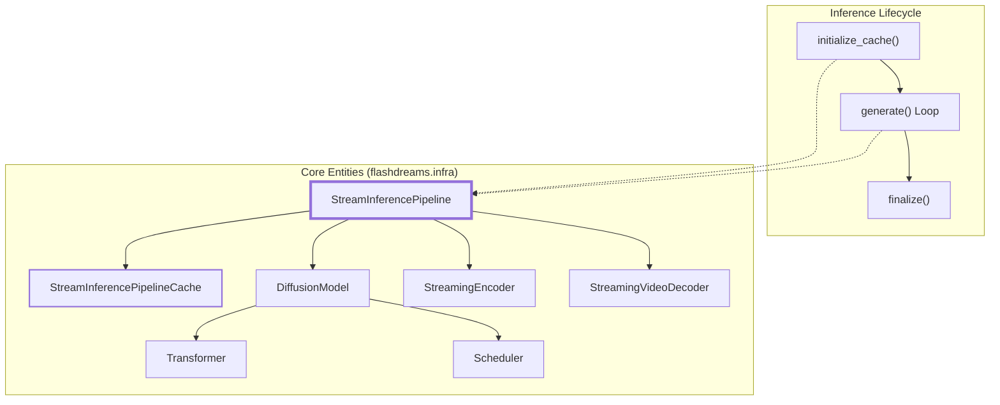
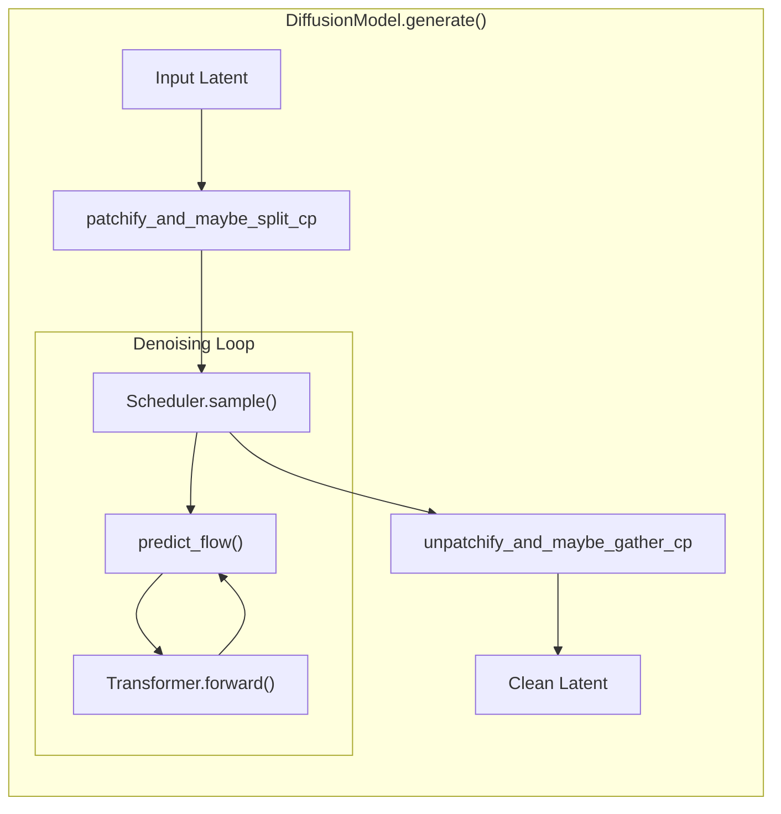

<!-- source: DeepWiki mcp.deepwiki.com · repo NVIDIA/flashdreams · page 2 Core Framework Architecture · fetched 2026-10-26 -->

# Core Framework Architecture

Relevant source files

The following files were used as context for generating this wiki page:

- [THIRD-PARTY-NOTICES](THIRD-PARTY-NOTICES)
- [docs/source/api/integrations.rst](docs/source/api/integrations.rst)
- [docs/source/developer_guides/inference_pipeline_overview.rst](docs/source/developer_guides/inference_pipeline_overview.rst)
- [docs/source/models/index.rst](docs/source/models/index.rst)
- [flashdreams/flashdreams/core/attention/native.py](flashdreams/flashdreams/core/attention/native.py)
- [flashdreams/flashdreams/infra/diffusion/model/base.py](flashdreams/flashdreams/infra/diffusion/model/base.py)
- [flashdreams/flashdreams/infra/diffusion/scheduler/base.py](flashdreams/flashdreams/infra/diffusion/scheduler/base.py)
- [flashdreams/flashdreams/infra/diffusion/transformer/base.py](flashdreams/flashdreams/infra/diffusion/transformer/base.py)
- [flashdreams/flashdreams/infra/encoder/base.py](flashdreams/flashdreams/infra/encoder/base.py)
- [flashdreams/flashdreams/recipes/wan/pipeline.py](flashdreams/flashdreams/recipes/wan/pipeline.py)
- [flashdreams/tests/test_wan_pipeline.py](flashdreams/tests/test_wan_pipeline.py)
- [integrations/omnidreams/omnidreams_singleview/patches/cutlass/include/cute/atom/detail/tma_descriptor_pool.hpp](integrations/omnidreams/omnidreams_singleview/patches/cutlass/include/cute/atom/detail/tma_descriptor_pool.hpp)
- [integrations/omnidreams/omnidreams_singleview/patches/cutlass/sm120-tma-pool.patch](integrations/omnidreams/omnidreams_singleview/patches/cutlass/sm120-tma-pool.patch)
- [integrations/omnidreams/omnidreams_singleview/thirdparty_sources.json](integrations/omnidreams/omnidreams_singleview/thirdparty_sources.json)

The FlashDreams core framework provides a modular, streaming-first architecture for autoregressive video generation and world modeling. It is designed to bridge the gap between high-quality offline video models (like Wan 2.1 or Cosmos) and low-latency interactive applications.

The architecture is built on four pillars: a **Streaming Inference Pipeline** that manages the autoregressive lifecycle, a **Diffusion Infrastructure** for modular denoising, **Attention Primitives** optimized for long-context KV caching, and a **Distributed Execution** layer for multi-GPU scaling.

### System Overview Diagram
The following diagram illustrates how the natural language concepts of the generation loop map to the primary code entities in `flashdreams.infra`.

**Sources:** [docs/source/developer_guides/inference_pipeline_overview.rst:29-67](), [flashdreams/flashdreams/infra/pipeline.py:38-42]()

---

## 2.1 Streaming Inference Pipeline
The `StreamInferencePipeline` is the central orchestrator for the framework. It defines a rigid 3-stage lifecycle for each autoregressive (AR) step: `initialize_cache` for global context (text/first frame), `generate` for the denoising and decoding hot-path, and `finalize` for KV cache maintenance and state updates [docs/source/developer_guides/inference_pipeline_overview.rst:57-63]().

The pipeline uses an `InstantiateConfig` pattern via `StreamInferencePipelineConfig`, allowing users to swap encoders, transformers, and decoders without modifying the core loop [flashdreams/flashdreams/infra/pipeline.py:76-125]().

For details, see [Streaming Inference Pipeline](#2.1).

**Sources:** [docs/source/developer_guides/inference_pipeline_overview.rst:29-128](), [flashdreams/flashdreams/infra/pipeline.py:98-132]()

---

## 2.2 Attention Mechanisms and KV Cache
To support long-duration streaming, FlashDreams implements specialized attention primitives. The framework centers on the `BlockKVCache`, which supports "sink tokens" for stable attention and "rolling windows" to manage memory during infinite generation.

Positioning is handled by `RotaryPositionEmbedding3D` (3D RoPE), which decouples temporal, height, and width frequencies to maintain spatial consistency across AR chunks. Distributed attention is supported via Context Parallelism (CP), utilizing both Ring and Ulysses sharding strategies.

For details, see [Attention Mechanisms and KV Cache](#2.2).

**Sources:** [flashdreams/flashdreams/infra/diffusion/transformer/base.py:30-35](), [flashdreams/flashdreams/core/attention/native.py:1-20]()

---

## 2.3 Diffusion Schedulers
The `DiffusionModel` class encapsulates the relationship between a `Transformer` (the flow predictor) and a `Scheduler` (the denoising loop) [flashdreams/flashdreams/infra/diffusion/model/base.py:73-105](). FlashDreams primarily utilizes the Flow-Matching family of schedulers.

*   **`FlowMatchScheduler`**: Implements standard Euler-based ODE solving.
*   **`FlowMatchUniPCScheduler`**: An order-2 predictor-corrector for higher quality at lower step counts.

Schedulers are shape-agnostic and operate on the `initial_noise` provided by the model [flashdreams/flashdreams/infra/diffusion/scheduler/base.py:67-90]().

For details, see [Diffusion Schedulers](#2.3).

**Sources:** [flashdreams/flashdreams/infra/diffusion/model/base.py:48-105](), [flashdreams/flashdreams/infra/diffusion/scheduler/base.py:45-110]()

---

## 2.4 Distributed Execution and Multi-GPU
FlashDreams is built for high-performance multi-GPU environments. The `RankCoordinator` orchestrates execution across NCCL process groups. The framework utilizes Context Parallelism (CP) to shard the temporal dimension of video latents across GPUs, enabling the generation of high-resolution video that exceeds the memory of a single card.

The infrastructure also includes low-level optimizations such as CUDA L2 fetch granularity tuning and CPU affinity management via `pynvml` to minimize host-to-device bottlenecks.

For details, see [Distributed Execution and Multi-GPU](#2.4).

**Sources:** [flashdreams/flashdreams/infra/diffusion/model/base.py:163-175](), [THIRD-PARTY-NOTICES:35-41]()

---

## 2.5 CUDA Graph Capture and Performance Infrastructure
To achieve interactive latencies, the framework utilizes `CUDAGraphWrapper` to capture the "steady-state" of the denoising loop. This eliminates Python launch overhead during the generation of subsequent video chunks.

The performance stack also includes:
*   **`EventProfiler`**: For fine-grained GPU timing of DiT blocks.
*   **`CudaHostPrefetch`**: Overlaps GPU-to-host transfers of the decoded video with the computation of the next latent chunk.

For details, see [CUDA Graph Capture and Performance Infrastructure](#2.5).

**Sources:** [docs/source/developer_guides/inference_pipeline_overview.rst:60-63](), [integrations/omnidreams/omnidreams_singleview/patches/cutlass/sm120-tma-pool.patch:42-61]()

---

### Code Mapping: Data Flow
The diagram below maps the internal data flow of a `DiffusionModel` during a single `generate()` call.

**Sources:** [flashdreams/flashdreams/infra/diffusion/model/base.py:144-190](), [flashdreams/flashdreams/infra/diffusion/scheduler/base.py:67-75]()

---

