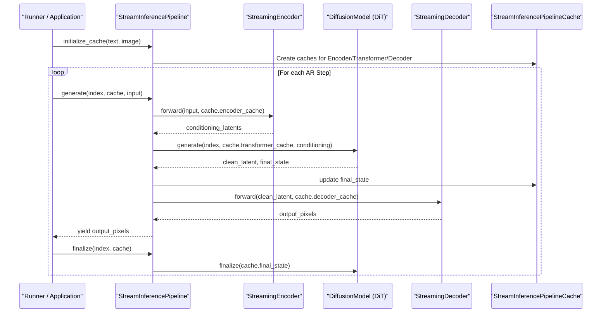
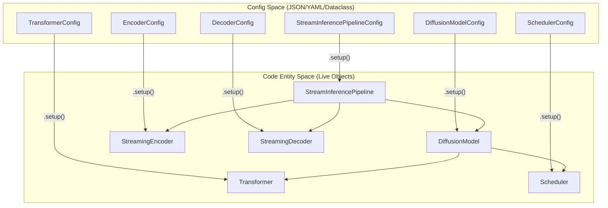

<!-- source: DeepWiki mcp.deepwiki.com · repo NVIDIA/flashdreams · page 2.1 Streaming Inference Pipeline · fetched 2026-10-26 -->

# Streaming Inference Pipeline

Relevant source files

The following files were used as context for generating this wiki page:

- [THIRD-PARTY-NOTICES](THIRD-PARTY-NOTICES)
- [docs/source/api/integrations.rst](docs/source/api/integrations.rst)
- [docs/source/developer_guides/inference_pipeline_overview.rst](docs/source/developer_guides/inference_pipeline_overview.rst)
- [docs/source/models/index.rst](docs/source/models/index.rst)
- [flashdreams/flashdreams/core/attention/native.py](flashdreams/flashdreams/core/attention/native.py)
- [flashdreams/flashdreams/core/checkpoint/remap.py](flashdreams/flashdreams/core/checkpoint/remap.py)
- [flashdreams/flashdreams/core/io/hf.py](flashdreams/flashdreams/core/io/hf.py)
- [flashdreams/flashdreams/infra/config/base.py](flashdreams/flashdreams/infra/config/base.py)
- [flashdreams/flashdreams/infra/diffusion/model/base.py](flashdreams/flashdreams/infra/diffusion/model/base.py)
- [flashdreams/flashdreams/infra/diffusion/scheduler/base.py](flashdreams/flashdreams/infra/diffusion/scheduler/base.py)
- [flashdreams/flashdreams/infra/diffusion/transformer/base.py](flashdreams/flashdreams/infra/diffusion/transformer/base.py)
- [flashdreams/flashdreams/infra/encoder/base.py](flashdreams/flashdreams/infra/encoder/base.py)
- [flashdreams/flashdreams/infra/encoder/image/clip.py](flashdreams/flashdreams/infra/encoder/image/clip.py)
- [flashdreams/flashdreams/infra/encoder/text/cosmos_reason1.py](flashdreams/flashdreams/infra/encoder/text/cosmos_reason1.py)
- [flashdreams/flashdreams/infra/encoder/text/umt5.py](flashdreams/flashdreams/infra/encoder/text/umt5.py)
- [flashdreams/flashdreams/infra/pipeline/base.py](flashdreams/flashdreams/infra/pipeline/base.py)
- [flashdreams/flashdreams/recipes/wan/pipeline.py](flashdreams/flashdreams/recipes/wan/pipeline.py)
- [flashdreams/tests/test_distributed_logging.py](flashdreams/tests/test_distributed_logging.py)
- [flashdreams/tests/test_hf_io.py](flashdreams/tests/test_hf_io.py)
- [flashdreams/tests/test_wan_pipeline.py](flashdreams/tests/test_wan_pipeline.py)
- [integrations/omnidreams/omnidreams_singleview/patches/cutlass/include/cute/atom/detail/tma_descriptor_pool.hpp](integrations/omnidreams/omnidreams_singleview/patches/cutlass/include/cute/atom/detail/tma_descriptor_pool.hpp)
- [integrations/omnidreams/omnidreams_singleview/patches/cutlass/sm120-tma-pool.patch](integrations/omnidreams/omnidreams_singleview/patches/cutlass/sm120-tma-pool.patch)
- [integrations/omnidreams/omnidreams_singleview/thirdparty_sources.json](integrations/omnidreams/omnidreams_singleview/thirdparty_sources.json)

The `StreamInferencePipeline` is the central orchestration layer of FlashDreams. It manages the lifecycle of an autoregressive (AR) generation rollout by composing an **Encoder**, a **Diffusion Model** (Transformer + Scheduler), and a **Decoder**. It is designed to handle persistent state across AR steps via a unified cache object, enabling low-latency streaming of video or world-model frames.

## Pipeline Lifecycle

The execution of a streaming pipeline follows a strict three-stage lifecycle for every rollout. This separation allows for performance optimizations, such as offloading non-critical path KV cache updates to background threads.

1.  **`initialize_cache`**: Consumes one-shot global conditions (e.g., text prompts, initial frames) and allocates the persistent state for the rollout [docs/source/developer_guides/inference_pipeline_overview.rst:45-49]().
2.  **`generate`**: The "hot path" that executes the per-step logic. It encodes control inputs, runs the diffusion denoising loop, and decodes the resulting latent chunk into pixels [flashdreams/flashdreams/infra/pipeline/base.py:194-200]().
3.  **`finalize`**: Handles post-generation state updates and KV cache maintenance that are not required for the immediate output [flashdreams/flashdreams/infra/pipeline/base.py:255-260]().

### Autoregressive Loop Flow

The following diagram illustrates the relationship between the pipeline components and the state management during a rollout.

**Diagram: Pipeline Component Interaction**

Sources: `[docs/source/developer_guides/inference_pipeline_overview.rst:52-63]()`, `[flashdreams/flashdreams/infra/pipeline/base.py:111-133]()`, `[flashdreams/flashdreams/infra/diffusion/model/base.py:144-162]()`.

---

## Key Classes and Data Flow

### StreamInferencePipeline
The `StreamInferencePipeline` class [flashdreams/flashdreams/infra/pipeline/base.py:111-118]() serves as the `nn.Module` container. It holds the sub-modules and provides the top-level API. It is generic over the cache types of its constituents to ensure type safety across different model architectures.

### StreamInferencePipelineCache
This dataclass acts as the container for all persistent state [flashdreams/flashdreams/infra/pipeline/base.py:86-109](). It typically contains:
*   `transformer_cache`: Long-lived AR cache for the DiT [flashdreams/flashdreams/infra/pipeline/base.py:91-92]().
*   `encoder_cache`: Cache for streaming encoders (e.g., HDMap or camera encoders) [flashdreams/flashdreams/infra/pipeline/base.py:94-95]().
*   `decoder_cache`: Cache for streaming VAE decoders (e.g., TAEHV) [flashdreams/flashdreams/infra/pipeline/base.py:97-98]().
*   `final_state`: A `DiffusionModel.FinalState` object stashed during `generate` to be used by `finalize` [flashdreams/flashdreams/infra/pipeline/base.py:100-102]().

### Internal Data Flow in `generate()`
Inside the `generate` call, data flows through the pipeline as follows:
1.  **Control Encoding**: If a `StreamingEncoder` is present, the per-step `input` is transformed into model conditioning [docs/source/developer_guides/inference_pipeline_overview.rst:76-81]().
2.  **Denoising Loop**: The `DiffusionModel` takes the conditioning and the `transformer_cache` to run a multi-step denoising process (e.g., Flow Matching) [flashdreams/flashdreams/infra/diffusion/model/base.py:144-162]().
3.  **Decoding**: The resulting clean latent is passed to the `StreamingDecoder` to produce the final output (e.g., RGB frames) [docs/source/developer_guides/inference_pipeline_overview.rst:95-99]().

Sources: `[flashdreams/flashdreams/infra/pipeline/base.py:16-47]()`, `[flashdreams/flashdreams/infra/diffusion/model/base.py:73-85]()`.

---

## The InstantiateConfig Pattern

FlashDreams uses a recursive configuration system based on `InstantiateConfig` [flashdreams/flashdreams/infra/config/base.py](). This allows complex pipelines to be defined as static data structures and instantiated with a single `.setup()` call.

**Diagram: Configuration to Entity Mapping**

Sources: `[flashdreams/flashdreams/infra/pipeline/base.py:50-83]()`, `[flashdreams/flashdreams/infra/diffusion/model/base.py:48-71]()`, `[docs/source/developer_guides/inference_pipeline_overview.rst:107-128]()`.

---

## Concrete Implementation: WanInferencePipeline

The `WanInferencePipeline` [flashdreams/flashdreams/recipes/wan/pipeline.py:98-104]() is a reference implementation that supports both Text-to-Video (T2V) and Image-to-Video (I2V) tasks.

*   **One-shot Encoders**: Unlike streaming encoders, Wan uses `UMT5TextEncoder` and `CLIPImageEncoder` which are run once during `initialize_cache` [flashdreams/flashdreams/recipes/wan/pipeline.py:136-141]().
*   **Context Management**: It includes logic to `release_oneshot_encoders` after initialization to free up VRAM for the transformer during the AR rollout [flashdreams/flashdreams/recipes/wan/pipeline.py:193-195]().
*   **Cache Specialization**: It uses `WanInferencePipelineCache`, which extends the base cache to include first-frame pixel tensors for I2V tasks [flashdreams/flashdreams/recipes/wan/pipeline.py:57-72]().

### Initialization Parameters
| Parameter | Role | Source |
| :--- | :--- | :--- |
| `text` | List of prompts for the batch. | [flashdreams/flashdreams/recipes/wan/pipeline.py:182]() |
| `image` | First-frame pixels (I2V only). | [flashdreams/flashdreams/recipes/wan/pipeline.py:183]() |
| `height`/`width` | Latent dimensions (derived from image in I2V). | [flashdreams/flashdreams/recipes/wan/pipeline.py:189-191]() |

Sources: `[flashdreams/flashdreams/recipes/wan/pipeline.py:16-53]()`, `[flashdreams/flashdreams/infra/encoder/text/umt5.py:58-67]()`.

---

