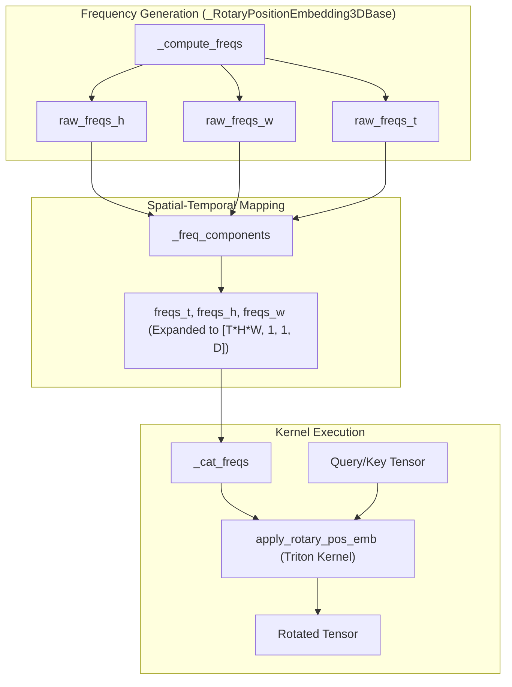
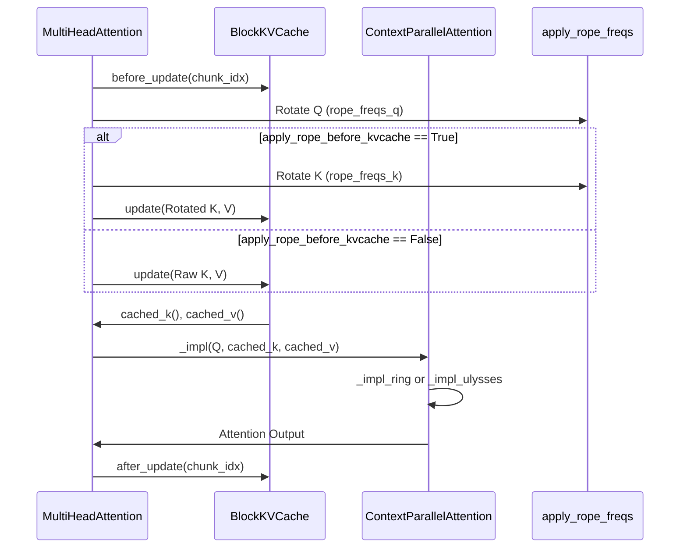

<!-- source: DeepWiki mcp.deepwiki.com · repo NVIDIA/flashdreams · page 2.2 Attention Mechanisms and KV Cache · fetched 2026-10-26 -->

# Attention Mechanisms and KV Cache

Relevant source files

The following files were used as context for generating this wiki page:

- [flashdreams/flashdreams/core/attention/__init__.py](flashdreams/flashdreams/core/attention/__init__.py)
- [flashdreams/flashdreams/core/attention/cp.py](flashdreams/flashdreams/core/attention/cp.py)
- [flashdreams/flashdreams/core/attention/kvcache.py](flashdreams/flashdreams/core/attention/kvcache.py)
- [flashdreams/flashdreams/core/attention/rope.py](flashdreams/flashdreams/core/attention/rope.py)
- [flashdreams/flashdreams/core/attention/rope_kernel.py](flashdreams/flashdreams/core/attention/rope_kernel.py)
- [flashdreams/flashdreams/recipes/wan/transformer/impl/modules.py](flashdreams/flashdreams/recipes/wan/transformer/impl/modules.py)
- [flashdreams/flashdreams/recipes/wan/transformer/impl/network.py](flashdreams/flashdreams/recipes/wan/transformer/impl/network.py)
- [flashdreams/tests/perf_rope.py](flashdreams/tests/perf_rope.py)
- [flashdreams/tests/test_attention.py](flashdreams/tests/test_attention.py)
- [flashdreams/tests/test_kvcache.py](flashdreams/tests/test_kvcache.py)
- [flashdreams/tests/test_wan_context_parallel.py](flashdreams/tests/test_wan_context_parallel.py)
- [integrations/omnidreams/omnidreams/transformer/impl/modules.py](integrations/omnidreams/omnidreams/transformer/impl/modules.py)
- [integrations/omnidreams/omnidreams/transformer/impl/network.py](integrations/omnidreams/omnidreams/transformer/impl/network.py)

This page documents the core attention primitives and KV cache infrastructure in FlashDreams. The framework implements a high-performance, CUDA-graph compatible streaming attention system designed for long-sequence video DiTs (Diffusion Transformers). Key components include a rolling window block KV cache, 3D Rotary Position Embeddings (RoPE), and context-parallel attention strategies.

## BlockKVCache

The `BlockKVCache` class [flashdreams/flashdreams/core/attention/kvcache.py:26-57]() provides a fixed-size local window cache for causal attention. It is designed to be CUDA-graph compatible by pre-allocating static buffers and using in-place updates.

### Architecture and Data Flow

The cache maintains two logical regions within its physical buffer:
1.  **Sink Tokens**: A fixed number of initial tokens (`sink_size`) that are never evicted, preserving global context [flashdreams/flashdreams/core/attention/kvcache.py:74-75]().
2.  **Rolling Window**: A local attention window (`window_size`) that rolls left as new chunks are added once the cache reaches capacity [flashdreams/flashdreams/core/attention/kvcache.py:71-72]().

### Lifecycle Phases
The cache operates in two distinct phases:
*   **Filling Phase**: The cache is not yet full. Tokens are written contiguously, and `cached_k()`/`cached_v()` return only the valid prefix [flashdreams/flashdreams/core/attention/kvcache.py:40-41]().
*   **Steady-State Phase**: The cache is full. Each new chunk triggers a left-roll of the local window via `_roll_local_window_left()`, and the new data overwrites the rightmost positions [flashdreams/flashdreams/core/attention/kvcache.py:42-44]().

### Cache Update Sequence
The standard per-step usage follows this sequence:
1.  `before_update(chunk_idx)`: Prepares the buffer (rolls the window if in steady-state) [flashdreams/flashdreams/core/attention/kvcache.py:53]().
2.  `update(k, v)`: Writes the new chunk's tensors into the pre-allocated buffer [flashdreams/flashdreams/core/attention/kvcache.py:54]().
3.  `cached_k()` / `cached_v()`: Returns the tensors for attention computation [flashdreams/flashdreams/core/attention/kvcache.py:55]().
4.  `after_update(chunk_idx)`: Updates internal bookkeeping and increments cached token counts [flashdreams/flashdreams/core/attention/kvcache.py:56]().

**Sources:**
* [flashdreams/flashdreams/core/attention/kvcache.py:26-129]()
* [flashdreams/tests/test_kvcache.py:40-117]() (Baseline comparison logic)

---

## 3D Rotary Position Embeddings (RoPE)

FlashDreams uses 3D RoPE to handle the spatio-temporal nature of video tokens (Time, Height, Width). The head dimension is typically split into H/W/T sub-dimensions in a 2:2:2 ratio [flashdreams/flashdreams/core/attention/rope.py:102-103]().

### RoPE Implementations

| Class | Purpose |
| :--- | :--- |
| `RotaryPositionEmbedding3D` | Standard 3D RoPE where keys are rotated **before** being written to the KV cache [flashdreams/flashdreams/core/attention/rope.py:179-183](). |
| `KVCacheRelativeRotaryPositionEmbedding3D` | Relative 3D RoPE where keys in the cache are stored **un-rotated**. Rotation is applied at query time relative to the current window [flashdreams/flashdreams/core/attention/rope.py:233-238](). |

### Triton RoPE Kernel
FlashDreams includes a custom Triton kernel for applying rotary embeddings. It supports both interleaved and non-interleaved frequency layouts and provides an A/B benchmark against Transformer Engine's implementation [flashdreams/tests/perf_rope.py:16-22](). The kernel is invoked via `apply_rotary_pos_emb` [flashdreams/flashdreams/core/attention/rope_kernel.py]().

### Entity Mapping: RoPE Logic to Code
The following diagram illustrates how spatial and temporal dimensions are mapped to frequency components and applied to QKV tensors.

**3D RoPE Frequency Generation and Application**

**Sources:**
* [flashdreams/flashdreams/core/attention/rope.py:41-176]()
* [flashdreams/flashdreams/core/attention/rope_kernel.py]()
* [flashdreams/tests/perf_rope.py:89-115]()

---

## Context-Parallel Attention

To support extremely long sequences across multiple GPUs, FlashDreams implements `ContextParallelAttention` [flashdreams/flashdreams/core/attention/cp.py:61](). This class wraps native SDPA primitives and supports two primary strategies:

### Parallelization Strategies
1.  **Ring Attention**: All-gathers KV tensors across CP ranks and merges outputs using Log-Sum-Exp (LSE) [flashdreams/flashdreams/core/attention/cp.py:104-105](). It supports `convert_to_fp32` for stable LSE accumulation [flashdreams/flashdreams/core/attention/cp.py:141-142]().
2.  **Ulysses Attention**: Uses all-to-all collectives to redistribute tokens such that each GPU has all heads for a subset of the sequence, performs local attention, and then redistributes back [flashdreams/flashdreams/core/attention/cp.py:162-163]().

### Integration with Transformer Blocks
Transformer blocks like `MultiHeadAttention` in the Wan recipe [flashdreams/flashdreams/recipes/wan/transformer/impl/modules.py:146]() utilize these primitives. They support `set_context_parallel_group()` to configure the underlying `attn_op` [flashdreams/flashdreams/recipes/wan/transformer/impl/modules.py:193-195]().

### Entity Mapping: Attention Data Flow
The following diagram shows how a `MultiHeadAttention` module interacts with the `BlockKVCache` and `ContextParallelAttention` during an inference step.

**Attention Inference Step Data Flow**

**Sources:**
* [flashdreams/flashdreams/core/attention/cp.py:61-186]()
* [flashdreams/flashdreams/recipes/wan/transformer/impl/modules.py:146-248]()
* [flashdreams/tests/test_attention.py:34-109]()

---

## Performance and Precision

FlashDreams prioritizes numerical stability and speed in its attention implementation:
*   **LSE Merging**: In Ring CP, LSE is promoted to `float32` during the merge step to prevent overflow/underflow when combining attention results from different ranks [flashdreams/flashdreams/core/attention/cp.py:147-155]().
*   **SDPA Backends**: Supports both `cudnn` and `flash` attention backends via `torch.ops.aten` calls [flashdreams/flashdreams/core/attention/cp.py:29-58]().
*   **Layout Support**: Native support for both `bhsd` (batch, head, seq, dim) and `bshd` layouts [flashdreams/flashdreams/core/attention/cp.py:66]().

**Sources:**
* [flashdreams/flashdreams/core/attention/cp.py:141-160]()
* [flashdreams/flashdreams/core/attention/native.py]()

---

