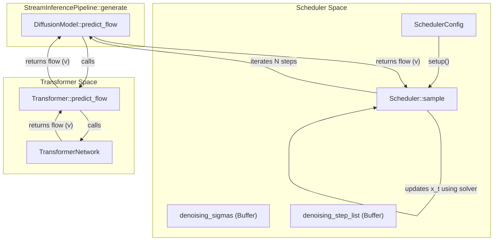
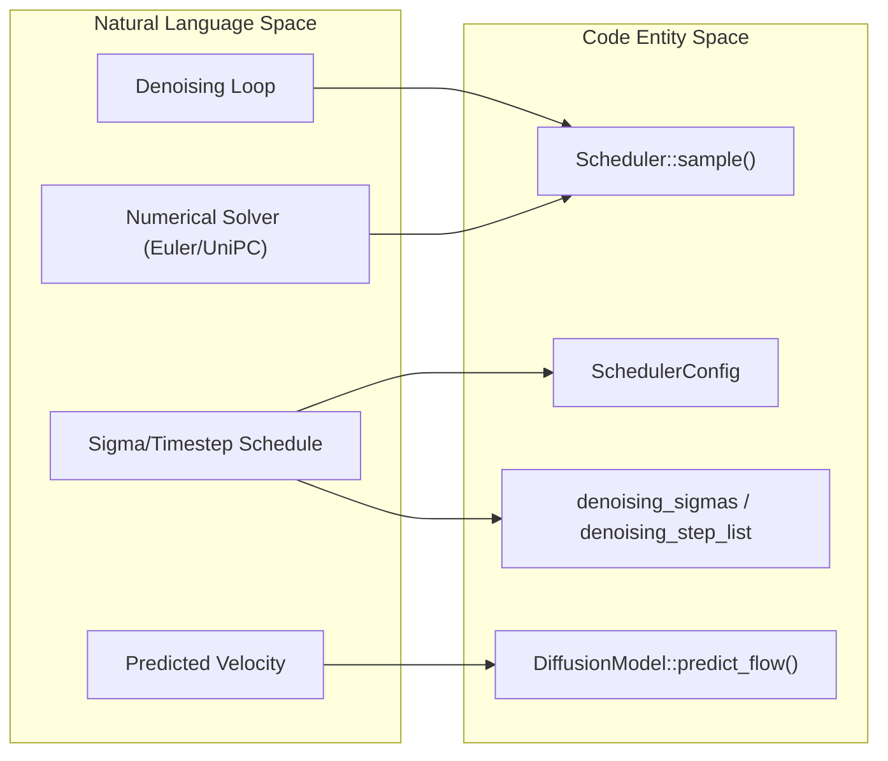

<!-- source: DeepWiki mcp.deepwiki.com · repo NVIDIA/flashdreams · page 2.3 Diffusion Schedulers · fetched 2026-10-26 -->

# Diffusion Schedulers

<details>
<summary>Relevant source files</summary>

The following files were used as context for generating this wiki page:

- [flashdreams/flashdreams/infra/diffusion/scheduler/__init__.py](flashdreams/flashdreams/infra/diffusion/scheduler/__init__.py)
- [flashdreams/flashdreams/infra/diffusion/scheduler/fm.py](flashdreams/flashdreams/infra/diffusion/scheduler/fm.py)
- [flashdreams/flashdreams/infra/diffusion/scheduler/fm_euler.py](flashdreams/flashdreams/infra/diffusion/scheduler/fm_euler.py)
- [flashdreams/flashdreams/infra/diffusion/scheduler/fm_unipc.py](flashdreams/flashdreams/infra/diffusion/scheduler/fm_unipc.py)
- [flashdreams/flashdreams/recipes/cosmos/pipeline.py](flashdreams/flashdreams/recipes/cosmos/pipeline.py)
- [flashdreams/flashdreams/recipes/cosmos/transformer/__init__.py](flashdreams/flashdreams/recipes/cosmos/transformer/__init__.py)
- [flashdreams/flashdreams/recipes/cosmos/transformer/impl/modules.py](flashdreams/flashdreams/recipes/cosmos/transformer/impl/modules.py)
- [flashdreams/flashdreams/recipes/cosmos/transformer/impl/network.py](flashdreams/flashdreams/recipes/cosmos/transformer/impl/network.py)
- [flashdreams/flashdreams/recipes/wan/__init__.py](flashdreams/flashdreams/recipes/wan/__init__.py)
- [flashdreams/tests/test_scheduler_fm_euler.py](flashdreams/tests/test_scheduler_fm_euler.py)
- [integrations/cosmos_predict2/cosmos_predict2/config.py](integrations/cosmos_predict2/cosmos_predict2/config.py)
- [integrations/cosmos_predict2/cosmos_predict2/runner.py](integrations/cosmos_predict2/cosmos_predict2/runner.py)
- [integrations/cosmos_predict2/tests/parity_check/README.md](integrations/cosmos_predict2/tests/parity_check/README.md)

</details>


Diffusion schedulers in FlashDreams manage the iterative denoising process, converting pure noise into structured latents. The framework focuses on the **Flow-Matching** family of schedulers, providing optimized implementations of Euler and UniPC (multistep) methods. These schedulers are designed to work seamlessly with `DiffusionModel` and `StreamInferencePipeline`, supporting advanced features like schedule warping (shifting), Karras-style sigma schedules, and self-forcing renoising.

## Scheduler Architecture

FlashDreams defines a base `Scheduler` protocol that abstracts the sampling loop from the specific numerical solver. Schedulers are initialized via `InstantiateConfig` patterns, allowing them to be easily swapped in pipeline configurations.

### Data Flow and Integration
The following diagram illustrates how the `Scheduler` interacts with the `DiffusionModel` and the underlying `Transformer` (e.g., `CosmosTransformer` or `Wan21Transformer`) during the sampling process.

**Scheduler and DiffusionModel Interaction**

**Sources:** [flashdreams/flashdreams/infra/diffusion/scheduler/base.py:18-34](), [flashdreams/flashdreams/infra/diffusion/model.py:21-45](), [flashdreams/flashdreams/infra/pipeline.py:30-34]()

## Flow-Matching Scheduler Family

FlashDreams provides several implementations optimized for different model families (Wan, Cosmos).

### 1. FlowMatchScheduler (Euler with Renoising)
The `FlowMatchScheduler` implements a flow-matching solver with an optional self-forcing renoising path, commonly used in the Wan model family. It supports a "schedule warp" (shift) to redistribute timesteps towards higher or lower noise levels.

*   **Implementation:** `FlowMatchScheduler` [flashdreams/flashdreams/infra/diffusion/scheduler/fm.py:88-121]()
*   **Key Logic:**
    *   **Warping:** Uses the formula `shift * s / (1 + (shift - 1) * s)` to adjust the sigma schedule [flashdreams/flashdreams/infra/diffusion/scheduler/fm.py:33-35]().
    *   **Loop:** For each step, it predicts the flow $v$, estimates $x_0 = x_t - \sigma(t) \cdot v$, and then re-noises to $x_{t+1}$ [flashdreams/flashdreams/infra/diffusion/scheduler/fm.py:95-100]().

### 2. FlowMatchUniPCScheduler (Order-2 Multistep)
The `FlowMatchUniPCScheduler` is a sophisticated multistep predictor-corrector scheduler. It is the default for **Cosmos-Predict2** [integrations/cosmos_predict2/cosmos_predict2/config.py:60-65](). It achieves high-quality results with fewer steps (e.g., 35 steps) by using information from previous iterations.

*   **Implementation:** `FlowMatchUniPCScheduler` [flashdreams/flashdreams/infra/diffusion/scheduler/fm_unipc.py:16-31]()
*   **Mathematical Pre-computation:** The scheduler pre-bakes per-step coefficients (`a_pred`, `b_pred_m0`, `b_pred_dprev`, etc.) using `_build_per_step_coefs` to minimize overhead during the sampling loop [flashdreams/flashdreams/infra/diffusion/scheduler/fm_unipc.py:34-163]().
*   **Solver Phases:**
    1.  **Warmup:** Step 0 uses an order-1 Euler-style predictor.
    2.  **Multistep:** Subsequent steps use an order-2 predictor and an order-2 corrector to refine the latent [flashdreams/flashdreams/infra/diffusion/scheduler/fm_unipc.py:61-101]().

### 3. FlowMatchEulerDiscreteScheduler
A standard discrete Euler scheduler used for distilled models like **HY-WorldPlay**. It supports `fixed_timesteps` to match specific distillation schedules [flashdreams/tests/test_scheduler_fm_euler.py:32-41]().

**Sources:** [flashdreams/flashdreams/infra/diffusion/scheduler/fm.py:16-35](), [flashdreams/flashdreams/infra/diffusion/scheduler/fm_unipc.py:16-163](), [flashdreams/flashdreams/infra/diffusion/scheduler/fm_euler.py:1-46]()

## Schedule Warp and Sigma Management

Schedulers in FlashDreams use specific techniques to manage the noise schedule ($\sigma$):

| Feature | Description | Code Reference |
| :--- | :--- | :--- |
| **Shift (Warp)** | Adjusts the density of timesteps. Higher values shift steps toward the high-noise end ($t \to 1$). | `_warp` in [flashdreams/flashdreams/infra/diffusion/scheduler/fm.py:33-35]() |
| **Karras Sigma** | Uses a non-linear sigma distribution (often used in Cosmos). | `use_kerras_sigma` in [flashdreams/flashdreams/infra/diffusion/scheduler/fm_unipc.py:223-230]() |
| **Buffer Pinning** | Schedule buffers (`denoising_sigmas`, `denoising_step_list`) are pinned to `float32` to prevent precision loss if the model is cast to `bfloat16`. | `register_buffer` in [flashdreams/flashdreams/infra/diffusion/scheduler/fm.py:173-182]() |

**Sources:** [flashdreams/flashdreams/infra/diffusion/scheduler/fm.py:49-60](), [flashdreams/flashdreams/infra/diffusion/scheduler/fm_unipc.py:223-230]()

## Code Entity Mapping

This diagram maps the abstract concepts of the diffusion process to the specific classes and methods implemented in the `flashdreams` codebase.

**Diffusion Logic to Code Entity Mapping**

**Sources:** [flashdreams/flashdreams/infra/diffusion/scheduler/base.py:18-34](), [flashdreams/flashdreams/infra/diffusion/scheduler/fm.py:88-115](), [flashdreams/flashdreams/infra/diffusion/model.py:21-45]()

## Implementation Details: UniPC Coefficients
The `FlowMatchUniPCScheduler` performs complex scalar math in `float64` to pre-calculate coefficients, then downcasts them to `float32` for GPU execution. This ensures numerical stability for the order-2 coefficients `rks_p` (predictor) and `rks_c` (corrector) [flashdreams/flashdreams/infra/diffusion/scheduler/fm_unipc.py:59-101]().

**Predictor Coefficient Calculation:**
```python
# Predictor at step i: x_{i+1} = a * x_i - alpha_t * h_phi_1 * (m0 + 0.5/rks_p * (m_prev - m0))
h_p = (log_alpha_t_p - log_sigma_t_p) - (log_alpha_s0_p - log_sigma_s0_p)
h_phi_1_p = np.expm1(-h_p)
b_pred_m0 = -alpha_t_p * h_phi_1_p
```
**Sources:** [flashdreams/flashdreams/infra/diffusion/scheduler/fm_unipc.py:61-87]()

---

