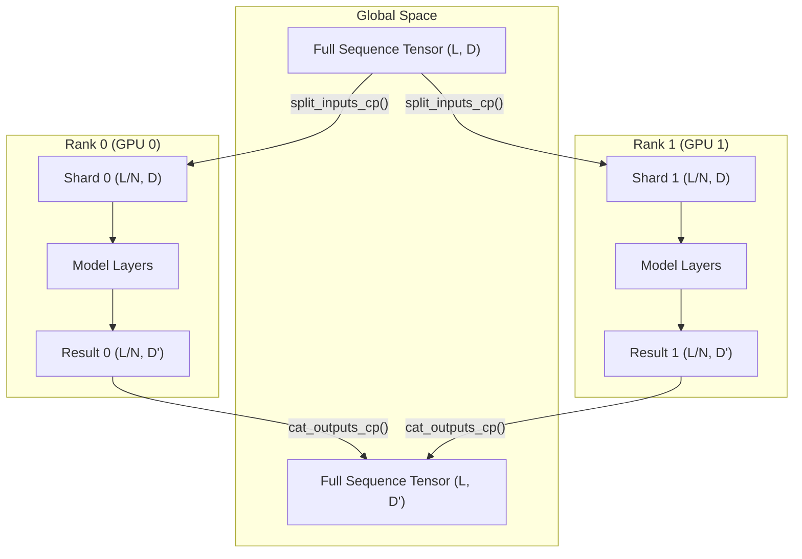
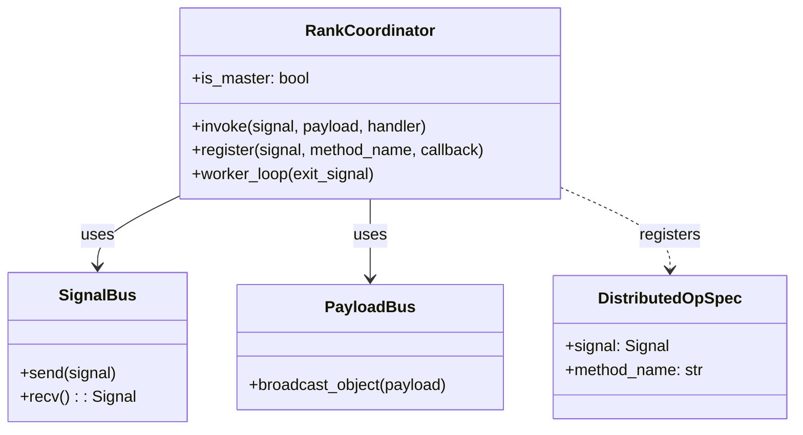

<!-- source: DeepWiki mcp.deepwiki.com · repo NVIDIA/flashdreams · page 2.4 Distributed Execution and Multi-GPU · fetched 2026-10-26 -->

# Distributed Execution and Multi-GPU

Relevant source files

The following files were used as context for generating this wiki page:

- [docs/source/models/causal_forcing.rst](docs/source/models/causal_forcing.rst)
- [docs/source/models/causal_wan22.rst](docs/source/models/causal_wan22.rst)
- [docs/source/models/cosmos_predict2.rst](docs/source/models/cosmos_predict2.rst)
- [docs/source/models/flashvsr.rst](docs/source/models/flashvsr.rst)
- [docs/source/models/lingbot_world.rst](docs/source/models/lingbot_world.rst)
- [docs/source/models/omnidreams.rst](docs/source/models/omnidreams.rst)
- [docs/source/models/self_forcing.rst](docs/source/models/self_forcing.rst)
- [docs/source/models/wan21.rst](docs/source/models/wan21.rst)
- [flashdreams/flashdreams/_pytest_plugins/__init__.py](flashdreams/flashdreams/_pytest_plugins/__init__.py)
- [flashdreams/flashdreams/core/distributed/__init__.py](flashdreams/flashdreams/core/distributed/__init__.py)
- [flashdreams/flashdreams/core/distributed/context_parallel.py](flashdreams/flashdreams/core/distributed/context_parallel.py)
- [flashdreams/flashdreams/core/distributed/rank_orchestration.py](flashdreams/flashdreams/core/distributed/rank_orchestration.py)

FlashDreams provides a robust infrastructure for multi-GPU inference, specifically optimized for the high-throughput requirements of streaming world models. The framework handles process initialization, hardware-aware CPU affinity, context-parallel (CP) sharding for long-sequence attention, and rank orchestration to ensure synchronized execution across distributed nodes.

## Distributed Initialization and Hardware Tuning

The entry point for multi-GPU execution is the `distributed.init()` function [flashdreams/flashdreams/core/distributed/__init__.py:135-176](). This function orchestrates the setup of the NCCL backend and applies several low-level optimizations to maximize interconnect performance.

### CPU Affinity via pynvml
To minimize latency and prevent cross-socket bottlenecks, FlashDreams uses `pynvml` to query the ideal CPU affinity for each GPU [flashdreams/flashdreams/core/distributed/__init__.py:108-133](). The `Device` class binds to an NVML handle and retrieves a bitmask of CPUs physically closest to the device. The process then calls `os.sched_setaffinity` to pin itself to those cores [flashdreams/flashdreams/core/distributed/__init__.py:141-147]().

### CUDA L2 Fetch Granularity
A specific optimization for bandwidth-heavy DiT (Diffusion Transformer) models is the adjustment of the CUDA L2 fetch granularity. `distributed.init()` uses `ctypes` to interface with `libcudart.so` and sets `cudaLimitMaxL2FetchGranularity` (limit ID `0x05`) to 128 bytes [flashdreams/flashdreams/core/distributed/__init__.py:170-174](). This tuning can improve effective memory bandwidth during the large-scale tensor operations common in video generation.

### Process Group Management
FlashDreams configures standard PyTorch distributed environment variables, setting `TORCH_NCCL_BLOCKING_WAIT` to `0` and `TORCH_NCCL_ASYNC_ERROR_HANDLING` to `1` [flashdreams/flashdreams/core/distributed/__init__.py:148-149](). It also registers an `atexit` handler, `_safe_destroy_pg`, to ensure that `dist.destroy_process_group()` is called upon interpreter exit, preventing common NCCL "leaked group" warnings [flashdreams/flashdreams/core/distributed/__init__.py:41-55]().

Sources: [flashdreams/flashdreams/core/distributed/__init__.py:41-176]()

## Context Parallelism (CP) Sharding

FlashDreams supports Context Parallelism to handle long video sequences that exceed the memory capacity of a single GPU. Unlike Pipeline Parallelism, CP shards the sequence dimension across ranks.

### Tensor Sharding Primitives
The `context_parallel.py` module provides two primary functions for tensor manipulation:
*   `split_inputs_cp`: Slices a tensor along a specified `seq_dim` based on the rank's position within the `cp_group` [flashdreams/flashdreams/core/distributed/context_parallel.py:30-65]().
*   `cat_outputs_cp`: Uses `dist.all_gather` to collect shards from all ranks and concatenates them back into a full sequence [flashdreams/flashdreams/core/distributed/context_parallel.py:68-96]().

### Object Sharding Primitives
For non-tensor data (such as lists of frame metadata or conditioning objects), the framework provides `split_inputs_cp_object_list` and `cat_outputs_cp_object_list` [flashdreams/flashdreams/core/distributed/context_parallel.py:102-156](). These utilize `dist.all_gather_object` to synchronize Python objects across the CP group.

**Sequence Sharding Data Flow**
The following diagram illustrates how a sequence is sharded and re-assembled during a distributed forward pass.

Sources: [flashdreams/flashdreams/core/distributed/context_parallel.py:16-156]()

## Rank Orchestration

In interactive or complex serving scenarios, the master rank (Rank 0) often needs to drive worker ranks through specific state transitions (e.g., "start generation", "process new input", "exit"). The `RankCoordinator` class facilitates this command-and-control pattern.

### Components of Orchestration
1.  **SignalBus**: Broadcasts lightweight `IntEnum` signals from the master to workers [flashdreams/flashdreams/core/distributed/rank_orchestration.py:47-85](). It includes a `_counter` to ensure signals are processed in strict order [flashdreams/flashdreams/core/distributed/rank_orchestration.py:62-68]().
2.  **PayloadBus**: Broadcasts picklable Python objects (like generation configs or prompts) using `dist.broadcast_object_list` [flashdreams/flashdreams/core/distributed/rank_orchestration.py:87-99]().
3.  **RankCoordinator**: The high-level manager that wraps the buses. It allows workers to enter a `worker_loop` where they block until a signal is received, then execute a registered callback [flashdreams/flashdreams/core/distributed/rank_orchestration.py:108-194]().

### Distributed Operations
The `@distributed_op` decorator allows methods to be marked as distributed [flashdreams/flashdreams/core/distributed/rank_orchestration.py:195-204](). When Rank 0 calls a decorated method, the `RankCoordinator` automatically sends the corresponding signal and broadcasts the method's arguments as a payload to all workers, who then execute the same method locally.

**Orchestration Code Entities**
This diagram maps the orchestration concepts to their implementation classes.

Sources: [flashdreams/flashdreams/core/distributed/rank_orchestration.py:16-204]()

## Multi-GPU Usage Patterns

Multi-GPU inference is typically invoked via `torchrun`. Most recipes in the repository support multi-GPU execution by simply increasing the `--nproc_per_node` count.

| Context | Usage Command |
| :--- | :--- |
| **Standard CLI** | `torchrun --nproc_per_node=4 --no-python flashdreams-run <slug> ...` |
| **Interactive Serving** | `torchrun --nproc_per_node=4 -m <integration>.webrtc.server ...` |

### Performance Considerations
While per-block steady-state inference is significantly faster on multiple GPUs (e.g., ~2x faster on 4 GPUs for certain Wan 2.1 configs), there is an initial overhead for NCCL initialization and Triton kernel autotuning on every rank [docs/source/models/self_forcing.rst:134-144](). For very short video generations (e.g., < 10 blocks), a single GPU may be faster due to lower setup overhead. Multi-GPU configurations are recommended for long rollouts (60+ blocks) or high-resolution models like Cosmos 14B or Wan 14B [docs/source/models/self_forcing.rst:141-144](), [docs/source/models/wan21.rst:90-91]().

Sources: [docs/source/models/self_forcing.rst:88-144](), [docs/source/models/wan21.rst:58-91](), [docs/source/models/flashvsr.rst:71-87]()

---

