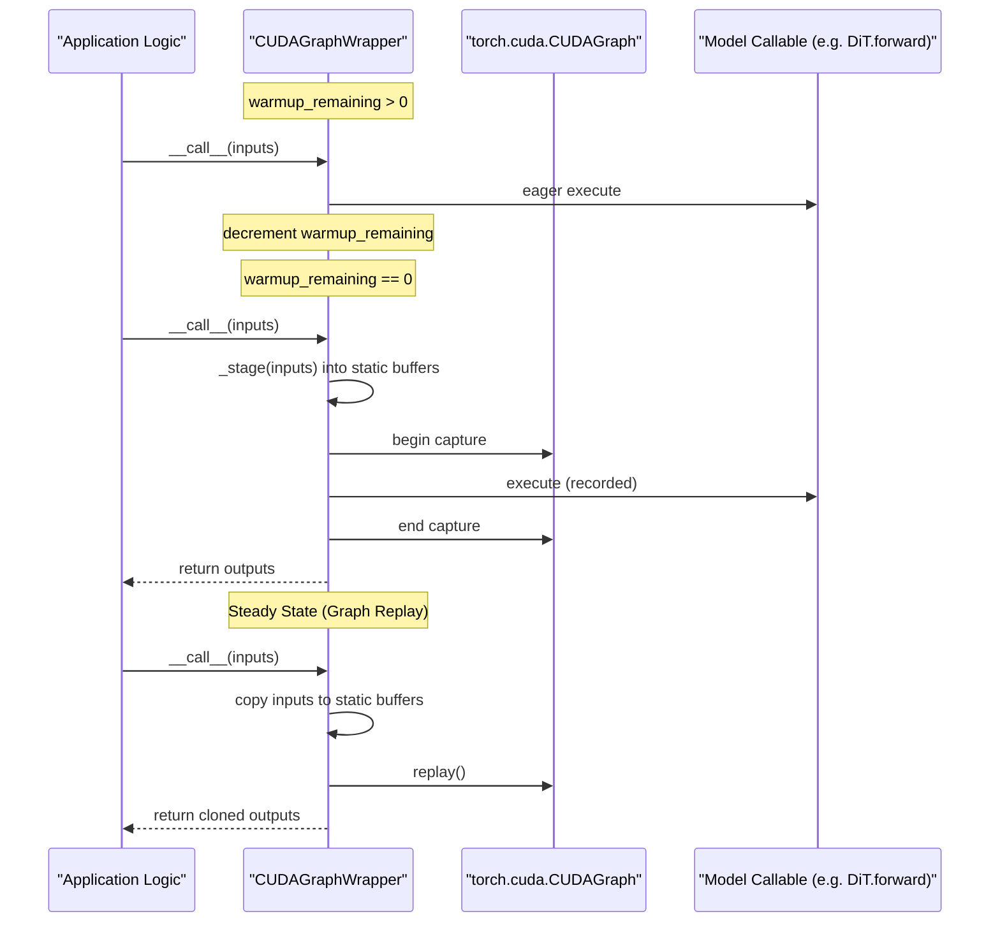
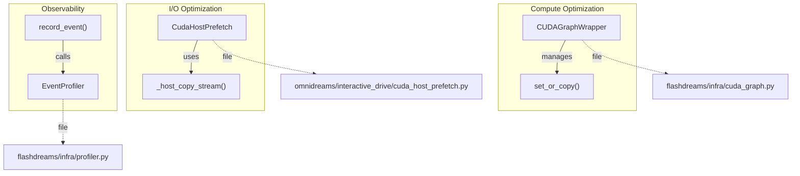

<!-- source: DeepWiki mcp.deepwiki.com · repo NVIDIA/flashdreams · page 2.5 CUDA Graph Capture and Performance Infrastructure · fetched 2026-10-26 -->

# CUDA Graph Capture and Performance Infrastructure

Relevant source files

The following files were used as context for generating this wiki page:

- [flashdreams/flashdreams/core/checkpoint/load.py](flashdreams/flashdreams/core/checkpoint/load.py)
- [flashdreams/flashdreams/infra/cuda_graph.py](flashdreams/flashdreams/infra/cuda_graph.py)
- [flashdreams/flashdreams/infra/profiler.py](flashdreams/flashdreams/infra/profiler.py)
- [flashdreams/tests/test_cuda_graph.py](flashdreams/tests/test_cuda_graph.py)
- [integrations/omnidreams/omnidreams/interactive_drive/cuda_host_prefetch.py](integrations/omnidreams/omnidreams/interactive_drive/cuda_host_prefetch.py)

This section documents the performance infrastructure used in FlashDreams to achieve low-latency streaming inference. It focuses on the `CUDAGraphWrapper` for accelerating stateful model calls, the `EventProfiler` for precise GPU timing, and the `CudaHostPrefetch` mechanism for overlapping compute with I/O.

## CUDA Graph Management

The `CUDAGraphWrapper` class provides a reusable infrastructure for capturing stateful CUDA callables into replayable graphs. This is critical for streaming inference where the overhead of launching many small kernels (e.g., in a DiT or VAE loop) can dominate execution time [flashdreams/flashdreams/infra/cuda_graph.py:16-17]().

### Capture Lifecycle

The wrapper follows a "warmup then capture" lifecycle to ensure that the CUDA allocator stabilizes and any JIT kernels (like those from `torch.compile`) are fully loaded before capture begins [flashdreams/flashdreams/infra/cuda_graph.py:51-54]().

1.  **Warmup Phase**: The callable runs eagerly for a configurable number of iterations (`warmup_iters`) [flashdreams/flashdreams/infra/cuda_graph.py:97-98]().
2.  **Capture Phase**: The wrapper creates static input buffers. It records the callable's execution into a `torch.cuda.CUDAGraph` [flashdreams/flashdreams/infra/cuda_graph.py:54-55]().
3.  **Steady State**: For subsequent calls with the same tensor shapes, the wrapper copies inputs into the static buffers, replays the graph, and returns clones of the captured output buffers [flashdreams/flashdreams/infra/cuda_graph.py:55-57]().

### Implementation Details

*   **Pointer Stability**: `CUDAGraphWrapper` requires stable storage addresses for captured kernels. The helper function `set_or_copy` is used to manage stateful buffers (like KV caches) by using `copy_` once shapes stabilize [flashdreams/flashdreams/infra/cuda_graph.py:26-42]().
*   **Input Staging**: Only top-level tensor arguments are staged into static buffers. Non-tensor arguments (ints, strings, `None`) are passed through verbatim to avoid breaking in-place semantics of complex state containers [flashdreams/flashdreams/infra/cuda_graph.py:65-70]().
*   **Automatic Reset**: If the staged-tensor signature (shape or dtype) changes, the wrapper automatically calls `reset()`, drops the existing graph, and restarts the warmup process [flashdreams/flashdreams/infra/cuda_graph.py:72-74]().

### Interaction with torch.compile

When using `torch.compile` (Inductor), the first call for a new shape triggers autotuning, which is illegal during CUDA graph capture. The `drain` method allows callers to run the eager path to exhaust these autotunes before attempting capture [flashdreams/flashdreams/infra/cuda_graph.py:76-80]().

#### CUDA Graph Capture Flow
The following diagram illustrates how `CUDAGraphWrapper` manages the transition from eager execution to graph replay.

Sources: [flashdreams/flashdreams/infra/cuda_graph.py:50-93](), [flashdreams/flashdreams/infra/cuda_graph.py:105-120](), [flashdreams/flashdreams/infra/cuda_graph.py:161-185]()

## Event Profiling

The `EventProfiler` provides a high-resolution timing mechanism based on `torch.cuda.Event`. Unlike standard Python timers, it measures actual GPU execution time by recording events on the CUDA stream [flashdreams/flashdreams/infra/profiler.py:16-24]().

| Method | Description |
| :--- | :--- |
| `__init__` | Initializes a start event and records it after a `torch.cuda.synchronize()` [flashdreams/flashdreams/infra/profiler.py:40-47](). |
| `record(stage)` | Creates and records a new event for the specified stage name [flashdreams/flashdreams/infra/profiler.py:49-54](). |
| `elapsed_ms()` | Returns a dictionary of stage names to durations (in milliseconds) without blocking the CPU [flashdreams/flashdreams/infra/profiler.py:56-63](). |
| `sync_and_summarize()` | Synchronizes the GPU and then returns the elapsed times for all stages [flashdreams/flashdreams/infra/profiler.py:65-68](). |

The utility function `record_event` is used throughout the pipeline to optionally log performance data if a profiler instance is provided [flashdreams/flashdreams/infra/profiler.py:71-75]().

Sources: [flashdreams/flashdreams/infra/profiler.py:23-68]()

## CUDA Host Prefetching

The `CudaHostPrefetch` class is designed to overlap GPU-to-Host transfers with subsequent GPU computation. This is particularly useful in interactive applications like `OmniDreams` where generated frames must be transferred to the CPU for WebRTC streaming [integrations/omnidreams/omnidreams/interactive_drive/cuda_host_prefetch.py:15-16]().

### Mechanism

*   **Pinned Memory**: It allocates a destination buffer in CPU pinned memory (`pin_memory=True`), which allows for faster, non-blocking asynchronous copies [integrations/omnidreams/omnidreams/interactive_drive/cuda_host_prefetch.py:40-45]().
*   **Dedicated Stream**: Transfers are executed on a dedicated CUDA stream (`_HOST_COPY_STREAMS`) to avoid blocking the main compute stream [integrations/omnidreams/omnidreams/interactive_drive/cuda_host_prefetch.py:74-82]().
*   **Synchronization**: The `start()` method initiates the transfer. The `to_numpy()` method synchronizes with a `torch.cuda.Event` to ensure the copy is complete before converting the buffer to a NumPy array [integrations/omnidreams/omnidreams/interactive_drive/cuda_host_prefetch.py:64-71]().

#### Performance Entity Mapping
The following diagram maps the performance infrastructure components to their specific code entities and data flows.

Sources: [flashdreams/flashdreams/infra/cuda_graph.py:50-51](), [flashdreams/flashdreams/infra/profiler.py:23-24](), [integrations/omnidreams/omnidreams/interactive_drive/cuda_host_prefetch.py:15-16]()

---

