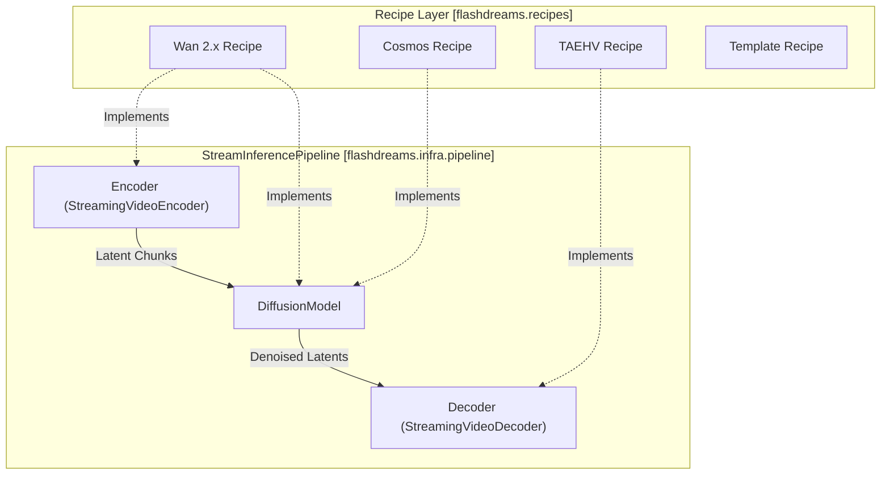

<!-- source: DeepWiki mcp.deepwiki.com · repo NVIDIA/flashdreams · page 3 Model Recipes · fetched 2026-10-26 -->

# Model Recipes

<details>
<summary>Relevant source files</summary>

The following files were used as context for generating this wiki page:

- [agentic/skills/flashdreams-recipes/SKILL.md](agentic/skills/flashdreams-recipes/SKILL.md)
- [flashdreams/flashdreams/core/io/s3_filesystem.py](flashdreams/flashdreams/core/io/s3_filesystem.py)
- [flashdreams/flashdreams/core/io/s3_sync.py](flashdreams/flashdreams/core/io/s3_sync.py)
- [flashdreams/flashdreams/recipes/taehv/__init__.py](flashdreams/flashdreams/recipes/taehv/__init__.py)
- [flashdreams/flashdreams/recipes/taehv/checkpoint.py](flashdreams/flashdreams/recipes/taehv/checkpoint.py)
- [flashdreams/flashdreams/recipes/taehv/impl.py](flashdreams/flashdreams/recipes/taehv/impl.py)
- [flashdreams/flashdreams/recipes/template/README.md](flashdreams/flashdreams/recipes/template/README.md)
- [flashdreams/flashdreams/recipes/template/config.py](flashdreams/flashdreams/recipes/template/config.py)
- [flashdreams/flashdreams/recipes/template/decoder.py](flashdreams/flashdreams/recipes/template/decoder.py)
- [flashdreams/flashdreams/recipes/template/encoder.py](flashdreams/flashdreams/recipes/template/encoder.py)
- [flashdreams/flashdreams/recipes/template/transformer/__init__.py](flashdreams/flashdreams/recipes/template/transformer/__init__.py)
- [flashdreams/flashdreams/recipes/template/transformer/network.py](flashdreams/flashdreams/recipes/template/transformer/network.py)
- [flashdreams/flashdreams/recipes/wan/autoencoder/vae.py](flashdreams/flashdreams/recipes/wan/autoencoder/vae.py)
- [flashdreams/tests/test_model_instantiation.py](flashdreams/tests/test_model_instantiation.py)
- [flashdreams/tests/test_rope_kernel.py](flashdreams/tests/test_rope_kernel.py)
- [flashdreams/tests/test_template.py](flashdreams/tests/test_template.py)
- [flashdreams/tests/test_vae.py](flashdreams/tests/test_vae.py)
- [integrations/omnidreams/omnidreams/runner.py](integrations/omnidreams/omnidreams/runner.py)

</details>


The `recipes/` layer in FlashDreams contains concrete implementations of world models and diffusion pipelines. These recipes compose the low-level primitives defined in `flashdreams.core` and `flashdreams.infra` into functional model architectures like **Wan 2.x**, **Cosmos**, and **TAEHV**. 

Each recipe typically encapsulates:
1.  **Network Architecture**: A `Transformer` subclass (e.g., `WanDiTNetwork` or `CosmosDiTNetwork`) that manages the denoising backbone.
2.  **Autoencoders**: Streaming causal `Encoder` and `Decoder` implementations for latent projection.
3.  **Caching Logic**: Specialized `StreamingEncoderCache` and `StreamingDecoderCache` objects that maintain temporal context across chunks.
4.  **Configurations**: Pre-defined `StreamInferencePipelineConfig` literals for common variants (e.g., 1.3B vs 14B, T2V vs I2V).

### Model Recipe Composition

Recipes follow a standardized pattern of wiring together the four pillars of the `StreamInferencePipeline`: the **Encoder**, **Diffusion Model** (Transformer + Scheduler), and **Decoder**.


**Sources:** [flashdreams/flashdreams/infra/pipeline.py:43-46](), [flashdreams/flashdreams/recipes/template/README.md:18-55]()

---

### Shipped Recipes

#### Wan 2.x Recipe (Transformer and VAE)
The Wan recipe provides a high-performance implementation of the Wan 2.1 and 2.2 architectures. It features a streaming causal VAE (`WanVAE`) capable of processing video chunks with minimal temporal artifacts by maintaining a 1-frame causal context. The recipe supports multiple DiT scales, including the 1.3B and 14B variants, and handles the architectural shifts between Wan 2.1 (standard downsampling) and Wan 2.2 (residual-based `AvgDown3D`/`DupUp3D`).

For details, see [Wan 2.x Recipe (Transformer and VAE)](#3.1).

**Sources:** [flashdreams/flashdreams/recipes/wan/autoencoder/vae.py:16-25](), [flashdreams/tests/test_model_instantiation.py:129-168]()

#### TAEHV Recipe (Tiny Autoencoder for Hunyuan Video)
TAEHV is a lightweight, streaming-optimized decoder designed to replace the heavy Wan VAE decoder for low-latency inference. It uses `MemBlock` modules to maintain a 1-frame temporal-left memory slot, allowing for frame-by-frame or chunk-by-chunk decoding without re-encoding previous frames. It is particularly effective for real-time interactive applications like OmniDreams.

For details, see [TAEHV Recipe (Tiny Autoencoder for Hunyuan Video)](#3.2).

**Sources:** [flashdreams/flashdreams/recipes/taehv/impl.py:16-107](), [flashdreams/flashdreams/recipes/taehv/__init__.py:82-90]()

#### Cosmos-Predict2 Recipe
The Cosmos recipe implements the transformer architecture used in the Cosmos-Predict2 world model. It integrates advanced features such as AdaLN-LoRA for conditioning, shuffle/padding mask fusion for performance, and specialized first-frame injection for Image-to-Video (I2V) tasks. It typically pairs with the `FlowMatchUniPCScheduler` for high-quality, few-step generation.

For details, see [Cosmos-Predict2 Recipe](#3.3).

**Sources:** [integrations/omnidreams/omnidreams/runner.py:42-47](), [integrations/omnidreams/omnidreams/runner.py:146-153]()

#### Template Recipe and Adding New Models
The `template` recipe serves as a minimal, well-documented scaffold for adding new model families to FlashDreams. It exercises the full `flashdreams.infra` contract, including `BlockKVCache` management, Context Parallelism (CP), and `CUDAGraphWrapper` integration. Developers should use this as a reference when integrating a new DiT or VAE.

For details, see [Template Recipe and Adding New Models](#3.4).

**Sources:** [flashdreams/flashdreams/recipes/template/README.md:18-55](), [flashdreams/flashdreams/recipes/template/config.py:42-79]()

---

### Code Entity Space: Recipe Lifecycle

The following diagram maps the logical model components to the specific classes and methods that manage their lifecycle within a recipe.

```mermaid
graph LR
    subgraph "Initialization"
        Config["InstantiateConfig"] -->|setup()| Instance["Recipe Instance"]
        Instance -->|initialize_cache()| Cache["RecipeCache"]
    end

    subgraph "Execution Loop"
        Cache -->|start(ar_idx)| Transformer["Transformer.forward()"]
        Transformer -->|finalize(ar_idx)| Cache
    end

    subgraph "Entities"
        direction TB
        T1["WanDiTNetwork [wan]"]
        T2["TemplateDiT [template]"]
        D1["TeahvVAEDecoder [taehv]"]
        C1["WanVAECache [wan]"]
    end

    Instance --- T1
    Instance --- T2
    Instance --- D1
    Cache --- C1
```
**Sources:** [flashdreams/flashdreams/recipes/template/transformer/__init__.py:76-94](), [flashdreams/flashdreams/recipes/taehv/impl.py:184-193](), [flashdreams/flashdreams/recipes/wan/autoencoder/vae.py:147-162]()

### Recipe Component Comparison

| Feature | Wan 2.x | TAEHV | Template |
| :--- | :--- | :--- | :--- |
| **Primary Class** | `WanDiTNetwork` | `TeahvVAEDecoder` | `TemplateTransformer` |
| **Cache Type** | `WanVAECache` | `TAEHVCache` | `TemplateTransformerCache` |
| **Temporal Context** | Causal 3D Conv | 1-Frame MemBlock | `BlockKVCache` (Sliding) |
| **CP Support** | Yes (Ring/Ulysses) | N/A (Decoder) | Yes (Ring/Ulysses) |
| **Compilation** | `torch.compile` | `torch.compile` | `CUDAGraphWrapper` |

**Sources:** [flashdreams/flashdreams/recipes/wan/autoencoder/vae.py:147-162](), [flashdreams/flashdreams/recipes/taehv/impl.py:39-48](), [flashdreams/flashdreams/recipes/template/transformer/__init__.py:46-70](), [flashdreams/flashdreams/recipes/template/README.md:23-55]()

---

