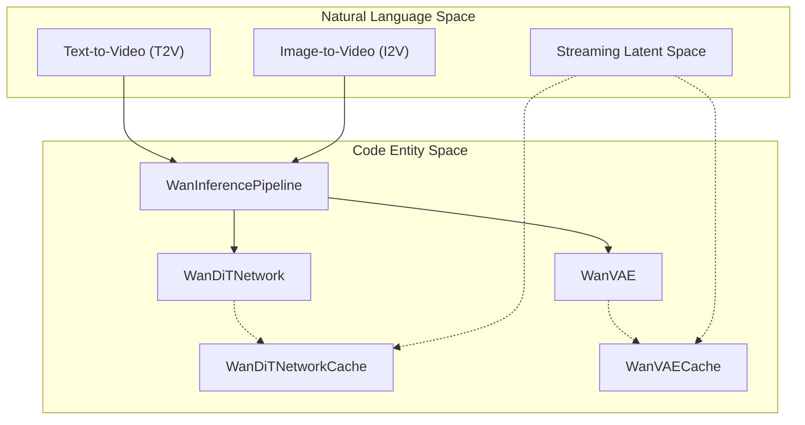
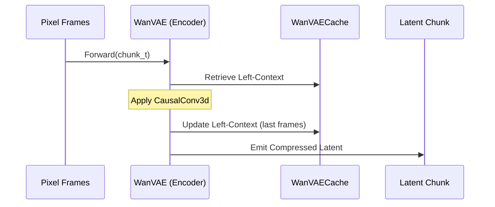

<!-- source: DeepWiki mcp.deepwiki.com · repo NVIDIA/flashdreams · page 3.1 Wan 2.x Recipe (Transformer and VAE) · fetched 2026-10-26 -->

# Wan 2.x Recipe (Transformer and VAE)

Relevant source files

The following files were used as context for generating this wiki page:

- [agentic/skills/flashdreams-recipes/SKILL.md](agentic/skills/flashdreams-recipes/SKILL.md)
- [flashdreams/flashdreams/core/attention/kvcache.py](flashdreams/flashdreams/core/attention/kvcache.py)
- [flashdreams/flashdreams/core/attention/native.py](flashdreams/flashdreams/core/attention/native.py)
- [flashdreams/flashdreams/core/attention/rope.py](flashdreams/flashdreams/core/attention/rope.py)
- [flashdreams/flashdreams/core/io/s3_filesystem.py](flashdreams/flashdreams/core/io/s3_filesystem.py)
- [flashdreams/flashdreams/core/io/s3_sync.py](flashdreams/flashdreams/core/io/s3_sync.py)
- [flashdreams/flashdreams/infra/decoder/base.py](flashdreams/flashdreams/infra/decoder/base.py)
- [flashdreams/flashdreams/infra/diffusion/model/base.py](flashdreams/flashdreams/infra/diffusion/model/base.py)
- [flashdreams/flashdreams/infra/diffusion/scheduler/base.py](flashdreams/flashdreams/infra/diffusion/scheduler/base.py)
- [flashdreams/flashdreams/infra/diffusion/transformer/base.py](flashdreams/flashdreams/infra/diffusion/transformer/base.py)
- [flashdreams/flashdreams/infra/encoder/base.py](flashdreams/flashdreams/infra/encoder/base.py)
- [flashdreams/flashdreams/recipes/taehv/__init__.py](flashdreams/flashdreams/recipes/taehv/__init__.py)
- [flashdreams/flashdreams/recipes/taehv/checkpoint.py](flashdreams/flashdreams/recipes/taehv/checkpoint.py)
- [flashdreams/flashdreams/recipes/taehv/impl.py](flashdreams/flashdreams/recipes/taehv/impl.py)
- [flashdreams/flashdreams/recipes/wan/autoencoder/i2v.py](flashdreams/flashdreams/recipes/wan/autoencoder/i2v.py)
- [flashdreams/flashdreams/recipes/wan/autoencoder/vae.py](flashdreams/flashdreams/recipes/wan/autoencoder/vae.py)
- [flashdreams/flashdreams/recipes/wan/pipeline.py](flashdreams/flashdreams/recipes/wan/pipeline.py)
- [flashdreams/flashdreams/recipes/wan/transformer/impl/modules.py](flashdreams/flashdreams/recipes/wan/transformer/impl/modules.py)
- [flashdreams/flashdreams/recipes/wan/transformer/impl/network.py](flashdreams/flashdreams/recipes/wan/transformer/impl/network.py)
- [flashdreams/flashdreams/recipes/wan/transformer/wan21.py](flashdreams/flashdreams/recipes/wan/transformer/wan21.py)
- [flashdreams/flashdreams/recipes/wan/transformer/wan22.py](flashdreams/flashdreams/recipes/wan/transformer/wan22.py)
- [flashdreams/tests/test_attention.py](flashdreams/tests/test_attention.py)
- [flashdreams/tests/test_kvcache.py](flashdreams/tests/test_kvcache.py)
- [flashdreams/tests/test_model_instantiation.py](flashdreams/tests/test_model_instantiation.py)
- [flashdreams/tests/test_rope_kernel.py](flashdreams/tests/test_rope_kernel.py)
- [flashdreams/tests/test_vae.py](flashdreams/tests/test_vae.py)
- [flashdreams/tests/test_wan_context_parallel.py](flashdreams/tests/test_wan_context_parallel.py)
- [flashdreams/tests/test_wan_pipeline.py](flashdreams/tests/test_wan_pipeline.py)
- [integrations/omnidreams/omnidreams/runner.py](integrations/omnidreams/omnidreams/runner.py)

The Wan 2.x recipe provides a high-performance, streaming implementation of the Wan video generation models. This page documents the architectural components of the Wan family, including the `WanDiTNetwork` (Diffusion Transformer), the causal streaming `WanVAE`, and the structural differences between Wan 2.1 and Wan 2.2.

## Architectural Overview

The Wan architecture is built on a Diffusion Transformer (DiT) backbone that operates in a latent space compressed by a Video Autoencoder (VAE). FlashDreams implements these components with a focus on **streaming causal inference**, where the VAE and Transformer maintain internal state to process video chunks sequentially without re-encoding past frames.

### System Mapping: Code Entities to Concepts

The following diagram maps high-level generation concepts to the specific classes and files implementing them in the Wan recipe.

**Wan Concept Mapping**

**Sources:** [flashdreams/flashdreams/recipes/wan/pipeline.py:98-128](), [flashdreams/flashdreams/recipes/wan/autoencoder/vae.py:146-162](), [flashdreams/flashdreams/recipes/wan/transformer/impl/network.py:43-63]()

---

## WanDiTNetwork (Transformer)

The `WanDiTNetwork` is the core backbone for both Wan 2.1 and 2.2. It supports varying scales (1.3B, 5B, 14B) and conditioning modes (T2V, I2V).

### Key Components
- **Patchification:** The network consumes latents via a `patch_embedding` which can be either a `Linear` layer (flattened) or a `Conv3d` (strided) [flashdreams/flashdreams/recipes/wan/transformer/impl/network.py:176-188]().
- **Adaptive Layer Norm (AdaLN):** Used in the `Head` and `Block` modules to modulate hidden states based on the timestep embedding [flashdreams/flashdreams/recipes/wan/transformer/impl/modules.py:76-143]().
- **Context Parallelism (CP):** The network supports `ring` or `ulysses` methods to shard the sequence dimension across multiple GPUs [flashdreams/flashdreams/recipes/wan/transformer/impl/network.py:104-105]().

### Configuration Variants
| Feature | Wan 2.1 (1.3B) | Wan 2.1 (14B) | Wan 2.2 (5B TI2V) |
| :--- | :--- | :--- | :--- |
| **Hidden Dim** | 1536 | 5120 | 3072 |
| **Layers** | 30 | 40 | 30 |
| **Heads** | 12 | 40 | 24 |
| **In/Out Dim** | 16 | 16 | 48 |
| **Image Cross-Attn**| No | Yes (CLIP) | No (Latent Injection) |

**Sources:** [flashdreams/flashdreams/recipes/wan/transformer/impl/network.py:108-149]()

---

## WanVAE: Streaming Causal Autoencoder

The `WanVAE` implements a causal video autoencoder. Unlike standard 3D VAEs that require the full video context, `WanVAE` uses `CausalConv3d` to process frames with a "left-only" temporal context, enabling real-time streaming [flashdreams/flashdreams/recipes/wan/autoencoder/vae.py:16-25]().

### CausalConv3d and Caching
The `CausalConv3d` module extends `nn.Conv3d` by applying manual temporal padding and maintaining a streaming left-context slot [flashdreams/flashdreams/recipes/wan/autoencoder/vae.py:169-198]().
- **Filling Phase:** The cache accumulates frames until the temporal kernel size is met.
- **Steady-State Phase:** The cache maintains a rolling window of `(kernel_size - 1)` frames to provide context for the next chunk.

### WanVAECache
The `WanVAECache` class manages the state for both the encoder and decoder rollouts, using module IDs as keys to store per-block temporal buffers [flashdreams/flashdreams/recipes/wan/autoencoder/vae.py:146-162]().

**Data Flow: Video Frame to Latent Chunk**

**Sources:** [flashdreams/flashdreams/recipes/wan/autoencoder/vae.py:169-200](), [flashdreams/flashdreams/recipes/wan/autoencoder/vae.py:146-162]()

---

## Wan 2.1 vs 2.2 Architectural Differences

While both versions share the core DiT/VAE philosophy, Wan 2.2 introduces significant changes for high-resolution TI2V (Text-and-Image to Video).

### VAE: PixelShuffle and Residuals
- **Wan 2.1:** Uses standard 8x spatial and 4x temporal compression with 16 latent channels [flashdreams/flashdreams/recipes/wan/autoencoder/vae.py:18-21]().
- **Wan 2.2 (5B):** Introduces a 16x-spatial, 48-channel residual VAE. It utilizes `AvgDown3D` for downsampling and `DupUp3D` for upsampling, combined with `patchify`/`unpatchify` wraps to handle the increased channel depth [flashdreams/flashdreams/recipes/wan/autoencoder/vae.py:19-25]().

### Transformer: First-Frame Conditioning
- **Wan 2.1 14B I2V:** Uses a CLIP image encoder and a dedicated cross-attention branch (`cross_attn_enable_img=True`) [flashdreams/flashdreams/recipes/wan/transformer/impl/network.py:119-127]().
- **Wan 2.2 5B TI2V:** Removes the CLIP branch. Instead, it conditions on the first frame via a clean VAE-latent seed and a per-token `t=0` timestep injection on the initial frames of the first AR chunk [flashdreams/flashdreams/recipes/wan/transformer/impl/network.py:129-149]().

---

## Implementation Details

### Patchify and Unpatchify
The transformer does not operate on raw 3D volumes. It uses `patchify` to flatten spatial and temporal dimensions into a sequence of tokens [flashdreams/flashdreams/recipes/wan/transformer/impl/network.py:176-188]().
- `patch_size`: Typically `(1, 2, 2)` (T, H, W), meaning temporal resolution is preserved while spatial resolution is halved per dimension [flashdreams/flashdreams/recipes/wan/transformer/impl/network.py:71-72]().

### KV Cache and RoPE
The `Wan21TransformerCache` and `Wan22TransformerCache` manage the self-attention KV state.
- **BlockKVCache:** Implements a fixed-size local window with optional "sink" tokens to prevent eviction of initial context [flashdreams/flashdreams/core/attention/kvcache.py:26-57]().
- **3D RoPE:** Rotary Position Embeddings are applied to the 3D grid (T, H, W). In streaming mode, the `rope_adapter` shifts the temporal frequencies for each new AR step [flashdreams/flashdreams/recipes/wan/transformer/wan21.py:66-86]().

**Sources:** [flashdreams/flashdreams/core/attention/kvcache.py:26-57](), [flashdreams/flashdreams/recipes/wan/transformer/wan21.py:50-86](), [flashdreams/flashdreams/recipes/wan/transformer/impl/network.py:71-105]()

---

