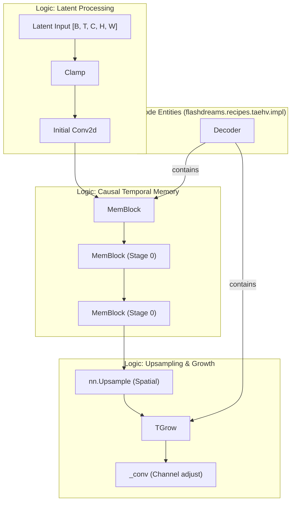
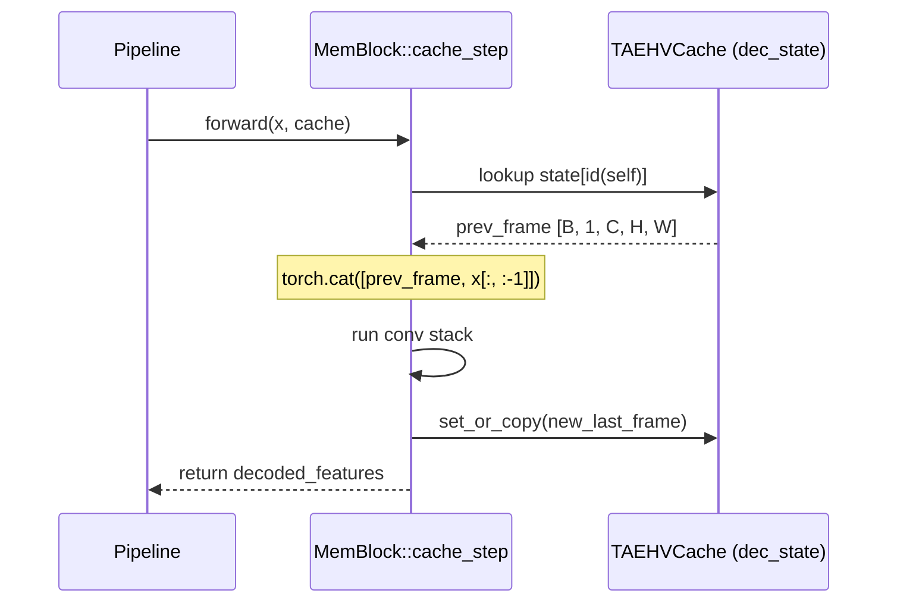

<!-- source: DeepWiki mcp.deepwiki.com · repo NVIDIA/flashdreams · page 3.2 TAEHV Recipe (Tiny Autoencoder for Hunyuan Video) · fetched 2026-10-26 -->

# TAEHV Recipe (Tiny Autoencoder for Hunyuan Video)

Relevant source files

The following files were used as context for generating this wiki page:

- [agentic/skills/flashdreams-recipes/SKILL.md](agentic/skills/flashdreams-recipes/SKILL.md)
- [flashdreams/flashdreams/core/io/s3_filesystem.py](flashdreams/flashdreams/core/io/s3_filesystem.py)
- [flashdreams/flashdreams/core/io/s3_sync.py](flashdreams/flashdreams/core/io/s3_sync.py)
- [flashdreams/flashdreams/infra/decoder/__init__.py](flashdreams/flashdreams/infra/decoder/__init__.py)
- [flashdreams/flashdreams/infra/encoder/__init__.py](flashdreams/flashdreams/infra/encoder/__init__.py)
- [flashdreams/flashdreams/recipes/taehv/__init__.py](flashdreams/flashdreams/recipes/taehv/__init__.py)
- [flashdreams/flashdreams/recipes/taehv/checkpoint.py](flashdreams/flashdreams/recipes/taehv/checkpoint.py)
- [flashdreams/flashdreams/recipes/taehv/impl.py](flashdreams/flashdreams/recipes/taehv/impl.py)
- [flashdreams/flashdreams/recipes/wan/autoencoder/vae.py](flashdreams/flashdreams/recipes/wan/autoencoder/vae.py)
- [flashdreams/tests/test_model_instantiation.py](flashdreams/tests/test_model_instantiation.py)
- [flashdreams/tests/test_rope_kernel.py](flashdreams/tests/test_rope_kernel.py)
- [flashdreams/tests/test_vae.py](flashdreams/tests/test_vae.py)
- [integrations/omnidreams/omnidreams/runner.py](integrations/omnidreams/omnidreams/runner.py)

The **TAEHV (Tiny AutoEncoder for Hunyuan Video)** recipe provides a high-performance, low-latency streaming decoder designed to replace full-scale VAE decoders (like Wan 2.x) in real-time inference pipelines. It utilizes a causal architecture with 1-frame temporal memory to enable frame-by-frame or chunk-by-chunk decoding with minimal overhead.

## Architecture Overview

TAEHV is structured as a sequence of residual blocks and upsampling layers. Unlike traditional 3D convolutional VAEs that require large temporal windows, TAEHV uses **MemBlock** units to maintain a rolling temporal context of exactly one frame.

### Key Components

*   **`MemBlock`**: The core building block. It concatenates the current frame with a 1-step time-shifted "past" frame along the channel dimension before applying a 2D convolution stack [flashdreams/flashdreams/recipes/taehv/impl.py:62-82]().
*   **`TGrow`**: A stateless temporal upsampling module that expands channels and reshapes them to increase the frame count [flashdreams/flashdreams/recipes/taehv/impl.py:110-121]().
*   **`TAEHVCache`**: A dataclass that stores the `dec_state` (the last input frame of the previous chunk) for each `MemBlock`, keyed by the module's ID [flashdreams/flashdreams/recipes/taehv/impl.py:40-49]().
*   **`TeahvVAEDecoder`**: The top-level wrapper that implements the `StreamingVideoDecoder` interface, handling latent scaling and integration into the `StreamInferencePipeline` [flashdreams/flashdreams/recipes/taehv/__init__.py:82-115]().

### Natural Language to Code Entity Space: Decoder Structure

The following diagram maps the logical stages of the TAEHV decoding process to the specific code entities in `impl.py`.

Sources: `[flashdreams/flashdreams/recipes/taehv/impl.py:55-168]()`

## Streaming Data Flow

TAEHV operates in a "streaming causal" mode. During the `forward` pass of a `MemBlock`, the module retrieves the previous chunk's final frame from the `TAEHVCache`, prepends it to the current chunk's sequence, and then updates the cache with the new final frame for the next step.

### MemBlock Cache Lifecycle

The `cache_step` function is the primary entry point for streaming execution. It ensures that the compiled decoder remains a stable CUDA graph across transitions by pre-allocating state buffers.

Sources: `[flashdreams/flashdreams/recipes/taehv/impl.py:87-108]()`, `[flashdreams/flashdreams/infra/cuda_graph.py:42-42]()`

## Checkpoint Remapping and Transforms

TAEHV checkpoints (such as `lighttae`) often require remapping to fit the internal `flashdreams` layout. This is handled via the `StateDictTransform` functional pattern.

| Function | Purpose |
| :--- | :--- |
| `legacy_to_blocks_keys` | Renames keys from `decoder.<i>` to `decoder.blocks.<i>` to match the `nn.Sequential` container [flashdreams/flashdreams/recipes/taehv/checkpoint.py:36-54](). |
| `truncate_oversize_tgrow_weights` | Clips `TGrow` weights if the checkpoint was trained with a different temporal stride than the live model [flashdreams/flashdreams/recipes/taehv/checkpoint.py:57-99](). |
| `compose` | Chains multiple transforms into a single pre-load operation [flashdreams/flashdreams/recipes/taehv/checkpoint.py:141-154](). |

The `TeahvVAEDecoderConfig` defaults to using the `lighttae` weights and its associated transform [flashdreams/flashdreams/recipes/taehv/__init__.py:57-70]().

Sources: `[flashdreams/flashdreams/recipes/taehv/checkpoint.py:16-154]()`, `[flashdreams/flashdreams/recipes/taehv/__init__.py:47-55]()`

## Integration and Performance

TAEHV is designed to be a drop-in replacement for the `WanVAEDecoder`. In the `StreamInferencePipeline`, it provides significant latency improvements for video generation tasks like **FlashVSR** or **OmniDreams**.

### Configuration Parameters

The `TeahvVAEDecoder` is configured via `TeahvVAEDecoderConfig`, which controls:
*   **`use_cuda_graph`**: When `True`, the decoder forward pass is captured into a CUDA graph to eliminate Python-to-GPU launch overhead [flashdreams/flashdreams/recipes/taehv/__init__.py:75-76]().
*   **`use_compile`**: Applies `torch.compile` with `max-autotune-no-cudagraphs` for kernel fusion [flashdreams/flashdreams/recipes/taehv/__init__.py:78-79]().
*   **Latent Scaling**: If `lighttae` is detected, the decoder automatically applies per-channel `mean` and `std` scaling to the latents before decoding [flashdreams/flashdreams/recipes/taehv/__init__.py:121-143]().

### Latent Normalization (LightTAE)
For the default `lighttae` checkpoint, the following statistics are used:
*   **Mean**: `[-0.7571, -0.7089, ..., -0.2921]` (16 channels) [flashdreams/flashdreams/recipes/taehv/__init__.py:101-107]().
*   **Std**: `[2.8184, 1.4541, ..., 1.9160]` (16 channels) [flashdreams/flashdreams/recipes/taehv/__init__.py:109-115]().

Sources: `[flashdreams/flashdreams/recipes/taehv/__init__.py:16-184]()`, `[flashdreams/flashdreams/recipes/taehv/impl.py:131-168]()`

---

