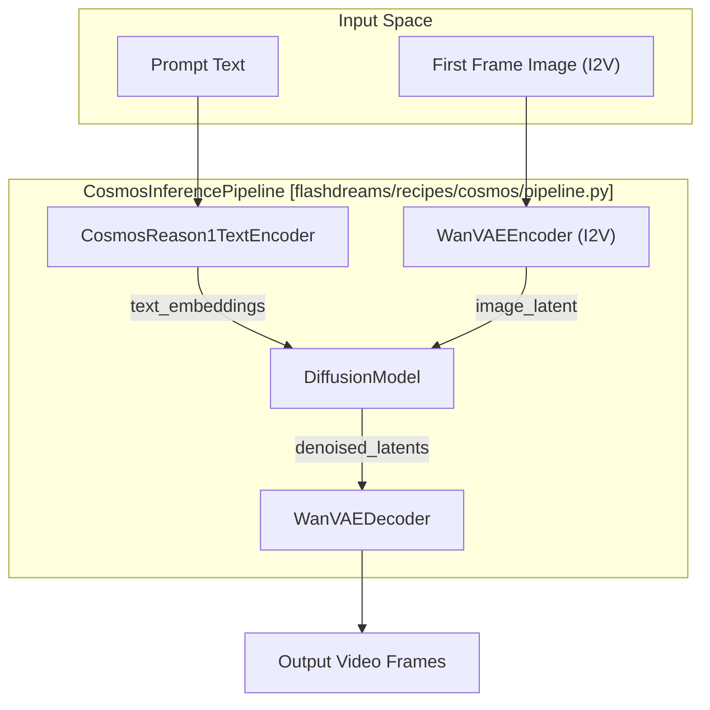
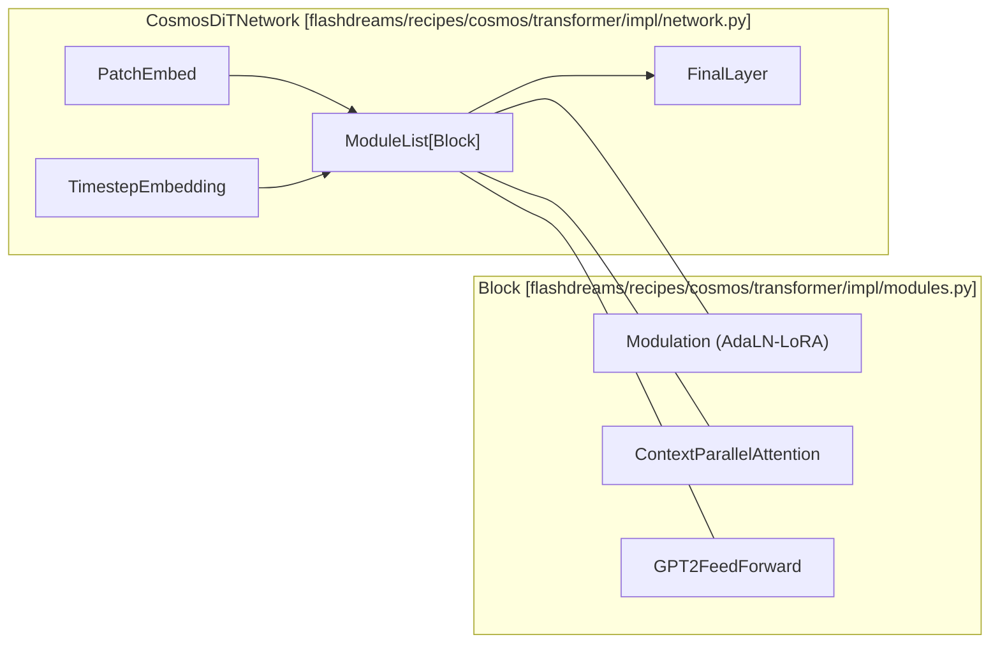

<!-- source: DeepWiki mcp.deepwiki.com · repo NVIDIA/flashdreams · page 3.3 Cosmos-Predict2 Recipe · fetched 2026-10-26 -->

# Cosmos-Predict2 Recipe

Relevant source files

The following files were used as context for generating this wiki page:

- [flashdreams/flashdreams/infra/diffusion/scheduler/fm.py](flashdreams/flashdreams/infra/diffusion/scheduler/fm.py)
- [flashdreams/flashdreams/infra/diffusion/scheduler/fm_unipc.py](flashdreams/flashdreams/infra/diffusion/scheduler/fm_unipc.py)
- [flashdreams/flashdreams/recipes/cosmos/pipeline.py](flashdreams/flashdreams/recipes/cosmos/pipeline.py)
- [flashdreams/flashdreams/recipes/cosmos/transformer/__init__.py](flashdreams/flashdreams/recipes/cosmos/transformer/__init__.py)
- [flashdreams/flashdreams/recipes/cosmos/transformer/impl/modules.py](flashdreams/flashdreams/recipes/cosmos/transformer/impl/modules.py)
- [flashdreams/flashdreams/recipes/cosmos/transformer/impl/network.py](flashdreams/flashdreams/recipes/cosmos/transformer/impl/network.py)
- [integrations/cosmos_predict2/cosmos_predict2/config.py](integrations/cosmos_predict2/cosmos_predict2/config.py)
- [integrations/cosmos_predict2/cosmos_predict2/runner.py](integrations/cosmos_predict2/cosmos_predict2/runner.py)
- [integrations/cosmos_predict2/tests/baseline_fastvideo/README.md](integrations/cosmos_predict2/tests/baseline_fastvideo/README.md)
- [integrations/cosmos_predict2/tests/baseline_fastvideo/changes.patch](integrations/cosmos_predict2/tests/baseline_fastvideo/changes.patch)
- [integrations/cosmos_predict2/tests/baseline_fastvideo/run.sh](integrations/cosmos_predict2/tests/baseline_fastvideo/run.sh)
- [integrations/cosmos_predict2/tests/parity_check/README.md](integrations/cosmos_predict2/tests/parity_check/README.md)
- [integrations/cosmos_predict2/tests/parity_check/changes.patch](integrations/cosmos_predict2/tests/parity_check/changes.patch)
- [integrations/cosmos_predict2/tests/parity_check/run.sh](integrations/cosmos_predict2/tests/parity_check/run.sh)

The Cosmos-Predict2 recipe implements the inference logic for NVIDIA's Cosmos-Predict2.5 world models. This recipe supports both Text-to-Video (T2V) and Image-to-Video (I2V) modalities within a unified `CosmosInferencePipeline`. It leverages a Diffusion Transformer (DiT) backbone optimized for autoregressive generation and a high-order Flow-Matching scheduler.

## Pipeline Architecture

The `CosmosInferencePipeline` manages the lifecycle of a video generation rollout. It coordinates the text encoder, an optional image encoder (for I2V), the `CosmosTransformer`, and the VAE decoder.

### System Data Flow
The following diagram illustrates the data flow from input prompts and images through the pipeline components to the final video output.

**Cosmos-Predict2 Data Flow**

Sources: [flashdreams/recipes/cosmos/pipeline.py:88-123](), [flashdreams/recipes/cosmos/pipeline.py:143-168]()

### Key Components
*   **CosmosInferencePipeline**: The top-level container that inherits from `StreamInferencePipeline`. It handles cache initialization and coordinates the `generate` and `finalize` phases [flashdreams/recipes/cosmos/pipeline.py:88-94]().
*   **CosmosReason1TextEncoder**: A specialized text encoder used to project prompts into the transformer's latent space [flashdreams/recipes/cosmos/pipeline.py:125-129]().
*   **WanVAEEncoder/Decoder**: Reused from the Wan recipe, providing the spatial compression and decompression for latents [flashdreams/recipes/cosmos/pipeline.py:41-44]().

## CosmosTransformer and DiT Network

The `CosmosTransformer` encapsulates the `CosmosDiTNetwork`, which is the core backbone of the model. It implements a block-causal attention mechanism suitable for autoregressive streaming.

### Network Topology
The `CosmosDiTNetwork` is composed of multiple transformer blocks featuring AdaLN-LoRA modulation and 3D Rotary Position Embeddings (RoPE).

**Cosmos DiT Network Space**

Sources: [flashdreams/recipes/cosmos/transformer/impl/network.py:148-202](), [flashdreams/recipes/cosmos/transformer/impl/modules.py:190-201]()

### Technical Implementation Details
*   **AdaLN-LoRA**: The network uses a low-rank factorization for AdaLN modulation, reducing parameter count while maintaining modulation expressivity. This is toggled via `use_adaln_lora` in `CosmosDiTNetworkConfig` [flashdreams/recipes/cosmos/transformer/impl/network.py:127-131]().
*   **Shuffle Fusion & Patchify**: Input latents are patchified into tokens. The `PatchEmbed` module expects post-patchified flattened inputs where the dimension includes temporal and spatial patch sizes [flashdreams/recipes/cosmos/transformer/impl/modules.py:118-132]().
*   **Padding Mask Fusion**: If `concat_padding_mask` is enabled, an additional channel is concatenated to the input latent to represent padding, which is then processed by the `PatchEmbed` layer [flashdreams/recipes/cosmos/transformer/impl/network.py:161-163]().
*   **I2V First-Frame Injection**: For I2V tasks, the first-frame latent is encoded and injected into the transformer's noise stream at the start of the rollout [flashdreams/recipes/cosmos/transformer/__init__.py:66-68]().

## Flow-Matching UniPC Scheduler

Cosmos-Predict2 utilizes the `FlowMatchUniPCScheduler`, a multi-step predictor-corrector scheduler designed for flow-matching models.

### Scheduler Logic
The scheduler implements an order-2 UniPC algorithm to solve the probability flow ODE. It pre-computes coefficients for predictors and correctors based on the sigma schedule to minimize per-step overhead.

| Coefficient | Purpose |
| :--- | :--- |
| `a_pred` | Predictor coefficient applied to the current sample $x_i$ |
| `b_pred_m0` | Predictor coefficient for the current $x_0$ estimate |
| `b_corr_dt` | Corrector coefficient for the difference between current and previous $x_0$ estimates |

Sources: [flashdreams/flashdreams/infra/diffusion/scheduler/fm_unipc.py:34-57]()

### Configuration
The scheduler is configured via `FlowMatchUniPCSchedulerConfig`, which defines the number of inference steps and the schedule `shift`. It supports the Kerras sigma schedule for improved sampling quality [integrations/cosmos_predict2/cosmos_predict2/config.py:60-65]().

## Runner Configurations

The recipe provides pre-defined configurations for common use cases, such as 720p T2V and I2V.

*   **T2V (cosmos2-t2v-2b-720p)**: Configured for 24-frame chunks with a guidance scale of 8.0 and 35 inference steps [integrations/cosmos_predict2/cosmos_predict2/config.py:40-67]().
*   **I2V (cosmos2-i2v-2b-720p)**: Adds a `WanVAEEncoderConfig` to the pipeline to process the conditioning first-frame image [integrations/cosmos_predict2/cosmos_predict2/config.py:75-102]().

### State Dict Transformation
Since training checkpoints often contain extra state (e.g., optimizer accumulators or Transformer-Engine internals), the recipe includes a `state_dict_transform` function to strip these keys and map them to the inference layout [flashdreams/recipes/cosmos/transformer/impl/network.py:65-72]().

Sources: [integrations/cosmos_predict2/cosmos_predict2/config.py:110-113](), [flashdreams/recipes/cosmos/transformer/impl/network.py:47-62]()

---

