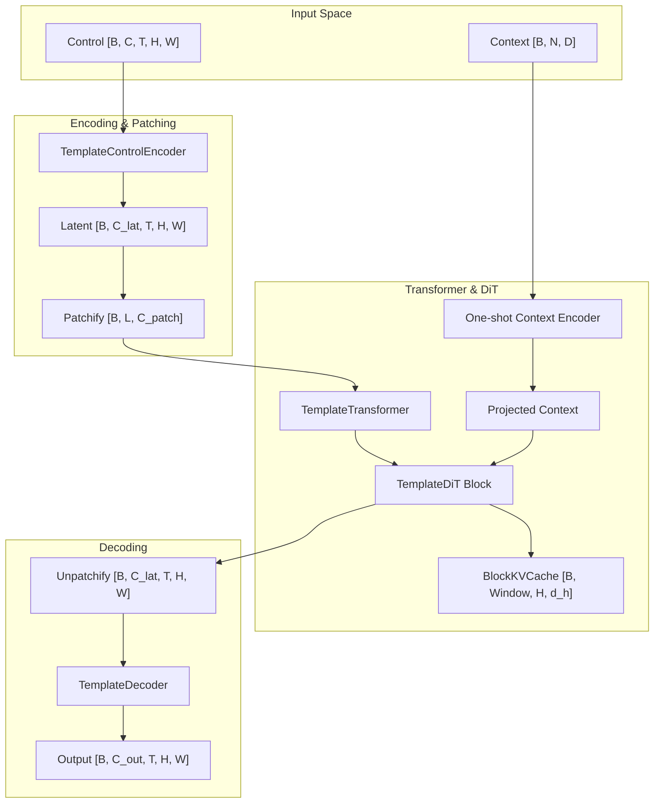
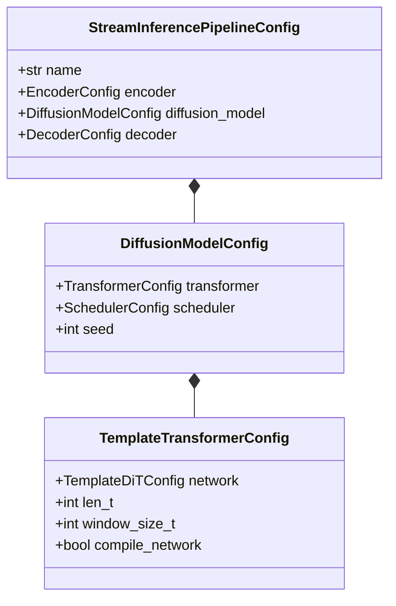
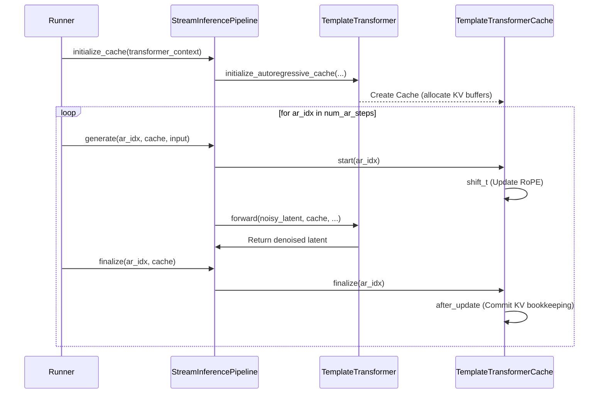

<!-- source: DeepWiki mcp.deepwiki.com · repo NVIDIA/flashdreams · page 3.4 Template Recipe and Adding New Models · fetched 2026-10-26 -->

# Template Recipe and Adding New Models

<details>
<summary>Relevant source files</summary>

The following files were used as context for generating this wiki page:

- [agentic/skills/python-docstring-style/SKILL.md](agentic/skills/python-docstring-style/SKILL.md)
- [docs/source/api/core.rst](docs/source/api/core.rst)
- [docs/source/api/index.rst](docs/source/api/index.rst)
- [docs/source/developer_guides/config_system.rst](docs/source/developer_guides/config_system.rst)
- [docs/source/developer_guides/index.rst](docs/source/developer_guides/index.rst)
- [docs/source/developer_guides/interactive_serving.rst](docs/source/developer_guides/interactive_serving.rst)
- [docs/source/developer_guides/new_integration.rst](docs/source/developer_guides/new_integration.rst)
- [docs/source/developer_guides/usage_patterns.rst](docs/source/developer_guides/usage_patterns.rst)
- [flashdreams/flashdreams/core/experimental/kvcache.py](flashdreams/flashdreams/core/experimental/kvcache.py)
- [flashdreams/flashdreams/recipes/template/README.md](flashdreams/flashdreams/recipes/template/README.md)
- [flashdreams/flashdreams/recipes/template/config.py](flashdreams/flashdreams/recipes/template/config.py)
- [flashdreams/flashdreams/recipes/template/decoder.py](flashdreams/flashdreams/recipes/template/decoder.py)
- [flashdreams/flashdreams/recipes/template/encoder.py](flashdreams/flashdreams/recipes/template/encoder.py)
- [flashdreams/flashdreams/recipes/template/transformer/__init__.py](flashdreams/flashdreams/recipes/template/transformer/__init__.py)
- [flashdreams/flashdreams/recipes/template/transformer/network.py](flashdreams/flashdreams/recipes/template/transformer/network.py)
- [flashdreams/tests/test_template.py](flashdreams/tests/test_template.py)

</details>


The **Template Recipe** serves as the canonical scaffold for integrating new world models into the FlashDreams framework. It exercises the full lifecycle of the `StreamInferencePipeline`, including autoregressive (AR) cache management, context parallelism, and classifier-free guidance (CFG). This page details how to use the template as a blueprint and the architectural patterns required to wire new components into the system.

## The Template Recipe Scaffold

The template recipe (located in `flashdreams/recipes/template/`) provides a minimal, functional implementation of every core contract. It is designed to be bit-identical across eager, compiled, and context-parallel (CP) execution modes [flashdreams/recipes/template/README.md:20-22]().

### Core Components
The template defines a set of dummy components that mirror the requirements of real-world models like Wan or Cosmos:

| Component | Code Entity | Role |
| :--- | :--- | :--- |
| **Encoder** | `TemplateControlEncoder` | Transforms raw control inputs (e.g., [B, C, T, H, W]) into the latent space [flashdreams/recipes/template/encoder.py:1-40](). |
| **Transformer** | `TemplateTransformer` | Manages the DiT network, 3D RoPE adapters, and the AR cache lifecycle [flashdreams/recipes/template/transformer/__init__.py:177-180](). |
| **Network** | `TemplateDiT` | A single-block DiT that implements the actual attention and FFN logic [flashdreams/recipes/template/transformer/network.py:91-96](). |
| **Decoder** | `TemplateDecoder` | Projects latents back to the output space (e.g., RGB frames) [flashdreams/recipes/template/decoder.py:1-40](). |

### Data Flow and Tensor Shapes
The template follows a standardized shape convention to ensure compatibility with core infrastructure like `BlockKVCache` and `ContextParallelAttention`.

Title: Template Recipe Data Flow

Sources: [flashdreams/recipes/template/README.md:78-83](), [flashdreams/recipes/template/transformer/network.py:114-144]().

---

## Adding a New Model

FlashDreams encourages a "standalone repository" approach where new methods depend on `flashdreams` and override specific components [docs/source/developer_guides/new_integration.rst:21-24]().

### 1. Component Implementation
New models typically implement a `Transformer` subclass and a corresponding `TransformerAutoregressiveCache`.

*   **Transformer:** Must implement `initialize_autoregressive_cache` to allocate buffers and `forward` to execute the denoising step [flashdreams/infra/diffusion/transformer.py:35-39]().
*   **Cache:** Manages state that persists across AR steps, such as `BlockKVCache` for KV tokens and `RotaryPositionEmbedding3D` for position tracking [flashdreams/recipes/template/transformer/__init__.py:46-60]().

### 2. Wiring the Pipeline
The `StreamInferencePipeline` composes these components via a `StreamInferencePipelineConfig`.

Title: Pipeline Configuration Hierarchy

Sources: [flashdreams/recipes/template/config.py:42-79](), [flashdreams/infra/pipeline.py:43-46]().

### 3. Registering the Runner
To make the new model accessible via the `flashdreams-run` CLI, it must be registered as an entry point in `pyproject.toml` [docs/source/developer_guides/new_integration.rst:146-148]().

```python
# In customized_method/config.py
CUSTOMIZED_METHOD_RUNNER = CustomizedMethodRunnerConfig(
    runner_name="my-new-model",
    pipeline=CUSTOMIZED_PIPELINE_CONFIG,
)

# In pyproject.toml
[project.entry-points."flashdreams.runner_configs"]
my-new-model = "customized_method.config:CUSTOMIZED_METHOD_RUNNER"
```
Sources: [docs/source/developer_guides/new_integration.rst:80-105](), [flashdreams/recipes/template/config.py:189-191]().

---

## Agentic Recipe Authoring (SKILL.md)

The repository includes an agentic guide (`SKILL.md`) that defines the "house style" for authoring new recipes. This ensures that AI-generated or human-contributed code remains consistent with the core framework.

### Key Documentation Standards
*   **SPDX Headers:** Every file must start with the SPDX copyright block [agentic/skills/python-docstring-style/SKILL.md:15-31]().
*   **Google-Style Docstrings:** Functions must use `Args`, `Returns`, and `Raises` sections [agentic/skills/python-docstring-style/SKILL.md:78-80]().
*   **Imperative Summaries:** The first sentence of a docstring must be an imperative command (e.g., "Slice a tensor...") [agentic/skills/python-docstring-style/SKILL.md:101-101]().
*   **Inventory Headers:** Module docstrings should provide a short, concrete inventory of the symbols they define [agentic/skills/python-docstring-style/SKILL.md:51-56]().

Sources: [agentic/skills/python-docstring-style/SKILL.md:1-125]().

---

## Execution Patterns: Eager vs. Compiled

The template demonstrates how to support both debug-friendly eager execution and high-performance compiled execution using `torch.compile` and `CUDAGraphWrapper`.

### The `derive_config` Pattern
Variants are created using `derive_config` to override specific fields of a base configuration. This is used to create the `TEMPLATE_AUTOREGRESSIVE_COMPILED` variant from the base AR config [flashdreams/recipes/template/config.py:114-126]().

### Lifecycle of a Generation Step
The `StreamInferencePipeline` follows a strict `initialize_cache` -> `generate` -> `finalize` sequence.

Title: Pipeline Execution Lifecycle

Sources: [flashdreams/tests/test_template.py:151-192](), [flashdreams/recipes/template/transformer/__init__.py:76-94](), [flashdreams/infra/pipeline.py:43-46]().

---

