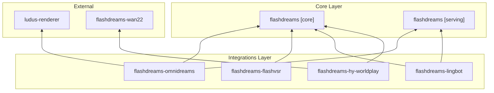

<!-- source: DeepWiki mcp.deepwiki.com · repo NVIDIA/flashdreams · page 4 Integration Plugins · fetched 2026-10-26 -->

# Integration Plugins

<details>
<summary>Relevant source files</summary>

The following files were used as context for generating this wiki page:

- [flashdreams/flashdreams/_version.py](flashdreams/flashdreams/_version.py)
- [flashdreams/flashdreams/infra/runner.py](flashdreams/flashdreams/infra/runner.py)
- [flashdreams/tests/test_recipe_configs.py](flashdreams/tests/test_recipe_configs.py)
- [integrations/causal_forcing/README.md](integrations/causal_forcing/README.md)
- [integrations/causal_forcing/pyproject.toml](integrations/causal_forcing/pyproject.toml)
- [integrations/causal_forcing/tests/test_smoke.py](integrations/causal_forcing/tests/test_smoke.py)
- [integrations/cosmos_predict2/README.md](integrations/cosmos_predict2/README.md)
- [integrations/cosmos_predict2/pyproject.toml](integrations/cosmos_predict2/pyproject.toml)
- [integrations/fastvideo_causal_wan22/README.md](integrations/fastvideo_causal_wan22/README.md)
- [integrations/fastvideo_causal_wan22/pyproject.toml](integrations/fastvideo_causal_wan22/pyproject.toml)
- [integrations/fastvideo_causal_wan22/tests/test_smoke.py](integrations/fastvideo_causal_wan22/tests/test_smoke.py)
- [integrations/flashvsr/README.md](integrations/flashvsr/README.md)
- [integrations/flashvsr/pyproject.toml](integrations/flashvsr/pyproject.toml)
- [integrations/hy_worldplay/pyproject.toml](integrations/hy_worldplay/pyproject.toml)
- [integrations/lingbot/README.md](integrations/lingbot/README.md)
- [integrations/lingbot/pyproject.toml](integrations/lingbot/pyproject.toml)
- [integrations/lingbot/tests/test_smoke.py](integrations/lingbot/tests/test_smoke.py)
- [integrations/omnidreams/pyproject.toml](integrations/omnidreams/pyproject.toml)
- [integrations/omnidreams/tests/test_recipe_configs.py](integrations/omnidreams/tests/test_recipe_configs.py)
- [integrations/self_forcing/README.md](integrations/self_forcing/README.md)
- [integrations/self_forcing/pyproject.toml](integrations/self_forcing/pyproject.toml)
- [integrations/self_forcing/tests/test_smoke.py](integrations/self_forcing/tests/test_smoke.py)
- [integrations/wan21/README.md](integrations/wan21/README.md)
- [integrations/wan21/pyproject.toml](integrations/wan21/pyproject.toml)
- [integrations/wan21/tests/test_smoke.py](integrations/wan21/tests/test_smoke.py)
- [integrations/wan22/pyproject.toml](integrations/wan22/pyproject.toml)

</details>


The `integrations/` directory contains a collection of specialized packages that extend the core FlashDreams framework. Each integration implements a specific model family or application (e.g., OmniDreams, FlashVSR, LingBot) by composing core primitives into a standardized `StreamInferencePipeline` lifecycle.

These plugins are designed as standalone, git-installable packages within the `uv` workspace, allowing them to maintain their own dependency sets and entry points while sharing the core `flashdreams` engine.

## Plugin Architecture Pattern

Every integration follows a consistent structural contract to ensure compatibility with the `flashdreams-run` CLI and the internal registry.

### The Three-Tier Structure
1.  **`config.py`**: Defines the `InstantiateConfig` objects for the pipeline and the runner. It acts as the "source of truth" for hyperparameters and model paths.
2.  **`runner.py`**: Implements a `BaseRunner` subclass (often `InferenceRunner`) that handles data loading, loop orchestration, and result saving.
3.  **`pipeline.py`**: Defines the `StreamInferencePipeline` composition, wiring together the specific `Encoder`, `DiffusionModel` (Transformer + Scheduler), and `Decoder`.

### Runner Registration
Integrations register their "slugs" (unique string identifiers) via Python entry points in their respective `pyproject.toml` files. The discovery layer in `flashdreams.plugins.registry` scans the `flashdreams.runner_configs` group at startup [integrations/omnidreams/pyproject.toml:98-102]().

| Integration | Entry Point Group | Example Slug |
| :--- | :--- | :--- |
| **OmniDreams** | `flashdreams.runner_configs` | `omnidreams-sv-2steps-chunk2-loc6-lightvae-lighttae` |
| **FlashVSR** | `flashdreams.runner_configs` | `flashvsr-v1.1-sparse-ratio-2.0` |
| **LingBot** | `flashdreams.runner_configs` | `lingbot-world-fast` |
| **Self-Forcing** | `flashdreams.runner_configs` | `self-forcing-wan2.1-t2v-1.3b` |

### System Mapping: Natural Language to Code Entities

The following diagram illustrates how high-level integration concepts map to specific code entities and registration mechanisms.

**Plugin Discovery and Execution Flow**
```mermaid
graph TD
    subgraph "CLI Space"
        CLI["flashdreams-run [slug]"]
    end

    subgraph "Registry Space"
        REG["discover_runners()"]
        EP["project.entry-points"]
    end

    subgraph "Integration Plugin (e.g., LingBot)"
        CFG["lingbot.config:RUNNER_LINGBOT_WORLD_FAST"]
        RUN["lingbot.runner:LingbotRunner"]
        PIPE["lingbot.pipeline:LingbotPipeline"]
    end

    CLI -->|1. Lookup| REG
    REG -->|2. Scan| EP
    EP -->|3. Import| CFG
    CFG -->|4. setup()| RUN
    RUN -->|5. run()| PIPE
```
Sources: [integrations/lingbot/pyproject.toml:48-50](), [integrations/omnidreams/pyproject.toml:98-105](), [flashdreams/flashdreams/infra/runner.py:1-20]()

---

## Major Integrations

### OmniDreams Integration
OmniDreams is a world model conditioned on HDMaps (via the Ludus renderer). It supports single-view (SV) and multi-view (MV) configurations. It includes specialized `omnidreams-prepare` scripts for staging USDZ scenes and Cosmos-Reason1 text encoders.
*   **Key Components**: `OmnidreamsRunner`, `OmnidreamsPipelineConfig`.
*   **For details, see [OmniDreams Integration](#4.1)**.

### Self-Forcing and Causal-Forcing
These integrations implement distilled streaming techniques for Wan 2.1. They allow for both chunkwise and framewise inference, utilizing streaming KV-cache configurations with specific window and sink sizes to maintain temporal consistency.
*   **Key Components**: `RUNNER_WAN21_T2V_1PT3B_SINK5_WINDOW7_REROPE`.
*   **For details, see [Self-Forcing and Causal-Forcing (Wan 2.1 Streaming)](#4.2)**.

### FlashVSR (Video Super-Resolution)
FlashVSR provides 2x-4x video upscaling by combining a Low-Resolution (LR) projector with a distilled Wan 2.1 DiT backbone. It features a gRPC uplift server for real-time streaming applications.
*   **Key Components**: `Causal_LQ4x_Proj`, `flashvsr-grpc-server`.
*   **For details, see [FlashVSR Integration (Video Super-Resolution)](#4.3)**.

### LingBot-World (Camera-Control I2V)
LingBot enables interactive Image-to-Video generation with explicit camera trajectory control. It includes a WebRTC server implementation that maps browser-based keyboard inputs to 3D camera poses in real-time.
*   **Key Components**: `CamCtrlInput`, `lingbot.webrtc.server`.
*   **For details, see [LingBot-World Integration (Camera-Control I2V)](#4.4)**.

### HY-WorldPlay and Wan 2.1/2.2
This section covers the standard T2V and I2V integrations for the Wan model family, including the 14B MoE (Mixture of Experts) variants and the interactive `hy_worldplay` baseline.
*   **Key Components**: `RUNNER_HY_WORLDPLAY_WAN_I2V_5B`, `fastvideo_causal_wan22`.
*   **For details, see [HY-WorldPlay and Wan 2.1/2.2 Integrations](#4.5)**.

---

## Integration Dependency Graph

The following diagram shows how integration packages relate to the core `flashdreams` library and external serving requirements.

**Integration Package Dependencies**

Sources: [integrations/omnidreams/pyproject.toml:26-38](), [integrations/flashvsr/pyproject.toml:26-33](), [integrations/lingbot/pyproject.toml:26-33](), [integrations/hy_worldplay/pyproject.toml:37-46]()

---

