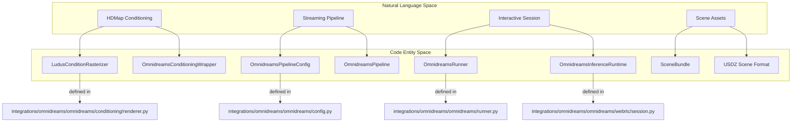
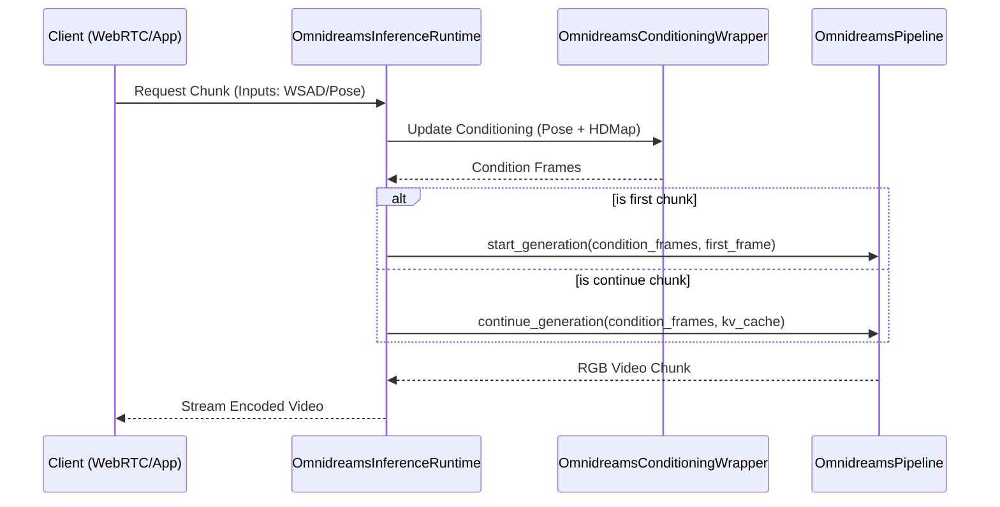

<!-- source: DeepWiki mcp.deepwiki.com · repo NVIDIA/flashdreams · page 4.1 OmniDreams Integration · fetched 2026-10-26 -->

# OmniDreams Integration

Relevant source files

The following files were used as context for generating this wiki page:

- [.github/workflows/ci.yml](.github/workflows/ci.yml)
- [.pre-commit-config.yaml](.pre-commit-config.yaml)
- [flashdreams/flashdreams/configs/runner_configs.py](flashdreams/flashdreams/configs/runner_configs.py)
- [flashdreams/pyproject.toml](flashdreams/pyproject.toml)
- [integrations/omnidreams/README.md](integrations/omnidreams/README.md)
- [integrations/omnidreams/ludus-renderer/examples/render_mirror_augmented.py](integrations/omnidreams/ludus-renderer/examples/render_mirror_augmented.py)
- [integrations/omnidreams/ludus-renderer/pyproject.toml](integrations/omnidreams/ludus-renderer/pyproject.toml)
- [integrations/omnidreams/omnidreams/config.py](integrations/omnidreams/omnidreams/config.py)
- [integrations/omnidreams/omnidreams/hf_org.py](integrations/omnidreams/omnidreams/hf_org.py)
- [integrations/omnidreams/omnidreams/interactive_drive/configs/example_world_model.yaml](integrations/omnidreams/omnidreams/interactive_drive/configs/example_world_model.yaml)
- [integrations/omnidreams/omnidreams/interactive_drive/scene_loader.py](integrations/omnidreams/omnidreams/interactive_drive/scene_loader.py)
- [integrations/omnidreams/omnidreams/pipeline.py](integrations/omnidreams/omnidreams/pipeline.py)
- [integrations/omnidreams/omnidreams/prepare.py](integrations/omnidreams/omnidreams/prepare.py)
- [integrations/omnidreams/omnidreams/scenes.py](integrations/omnidreams/omnidreams/scenes.py)
- [integrations/omnidreams/omnidreams/webrtc/server.py](integrations/omnidreams/omnidreams/webrtc/server.py)
- [integrations/omnidreams/omnidreams/webrtc/session.py](integrations/omnidreams/omnidreams/webrtc/session.py)
- [integrations/omnidreams/tests/test_omnidreams_pipeline.py](integrations/omnidreams/tests/test_omnidreams_pipeline.py)
- [integrations/omnidreams/tests/test_webrtc_runtime.py](integrations/omnidreams/tests/test_webrtc_runtime.py)
- [pyproject.toml](pyproject.toml)
- [uv.lock](uv.lock)

The OmniDreams integration provides a high-fidelity, HDMap-conditioned world model capable of generating interactive driving simulations. It leverages the `flashdreams` core framework to perform streaming video diffusion, conditioned on static map geometry (lanes, boundaries) and dynamic actor states.

## Architecture Overview

OmniDreams extends the standard `StreamInferencePipeline` to include HDMap conditioning via the `Ludus` renderer and specialized DiT architectures.

### System Mapping: Natural Language to Code Entities

The following diagram maps high-level OmniDreams concepts to their concrete implementation classes and configuration structures.

**OmniDreams Component Mapping**

Sources: [integrations/omnidreams/omnidreams/config.py:35-45](), [integrations/omnidreams/omnidreams/webrtc/session.py:20-25](), [integrations/omnidreams/omnidreams/interactive_drive/scene_loader.py:41-48]()

## Pipeline Configurations

OmniDreams uses a composition-based configuration system defined in `omnidreams.config`. Configurations are categorized by view count (Single-View/Multi-View), step count, and performance mode.

### Configuration Composition
The `OmnidreamsPipelineConfig` [integrations/omnidreams/omnidreams/config.py:90-136]() aggregates:
*   **Text Encoder**: Typically `CosmosReason1TextEncoderConfig` [integrations/omnidreams/omnidreams/config.py:92]().
*   **Image/Video Encoder**: Wan-VAE variants (e.g., `lightvae`) [integrations/omnidreams/omnidreams/config.py:93-99]().
*   **Decoder**: `TeahvVAEDecoderConfig` (LightTAE) for low-latency or `WanVAEDecoderConfig` [integrations/omnidreams/omnidreams/config.py:100-102]().
*   **Diffusion Model**: `CosmosTransformerConfig` with `additional_concat_ch=16` to accommodate the HDMap conditioning branch [integrations/omnidreams/omnidreams/config.py:106-109]().

### Performance Modes
| Mode | `use_compile` | `use_cuda_graph` | Native Acceleration |
| :--- | :--- | :--- | :--- |
| **Base** | `False` | `False` | `disabled` |
| **Perf** | `True` | `True` | `disabled` |
| **Native Perf** | `False` | `False` | `required` (FP8 VAE) |

Sources: [integrations/omnidreams/omnidreams/config.py:145-156](), [integrations/omnidreams/omnidreams/config.py:158-179]()

## Scene Staging and Format

OmniDreams utilizes a specialized USDZ-based scene format to bundle map data and initial visual state.

### USDZ Scene Structure
A standard OmniDreams scene (e.g., `clipgt-<uuid>.usdz`) contains:
*   **Map Data**: Parquet files for `lane_line`, `calibration_estimate`, and `egomotion_estimate` [integrations/omnidreams/omnidreams/interactive_drive/scene_loader.py:172-180]().
*   **Visual Seeds**: Ground-truth frames in `frames/<camera>/<ts>.jpeg` or a fallback `first_image.png` [integrations/omnidreams/omnidreams/webrtc/session.py:140-167]().
*   **Prompts**: `prompt.txt` or variant-specific prompts like `prompt2.txt` (snow) and `prompt3.txt` (rain) [integrations/omnidreams/omnidreams/scenes.py:80-86]().

### Scene Preparation CLI
The `omnidreams-prepare` tool [integrations/omnidreams/omnidreams/prepare.py]() handles:
1.  Downloading assets from the `nvidia/omni-dreams-scenes` Hugging Face repository [integrations/omnidreams/omnidreams/scenes.py:96-102]().
2.  Unpacking USDZ archives into the local cache (defaulting to `~/.cache/flashdreams/omnidreams-scenes`) [integrations/omnidreams/omnidreams/scenes.py:8-20]().
3.  Pre-warming heavy models like the Cosmos-Reason1 text encoder [integrations/omnidreams/README.md:52-56]().

Sources: [integrations/omnidreams/omnidreams/scenes.py:4-40](), [integrations/omnidreams/omnidreams/webrtc/session.py:170-210]()

## Interactive Runtime and Serving

OmniDreams supports both a desktop-native demo and a WebRTC-based streaming server.

### OmnidreamsInferenceRuntime
The `OmnidreamsInferenceRuntime` manages the generation loop and state transition between the initial chunk and subsequent autoregressive steps.

**Inference Data Flow**

### WebRTC Integration
The `OmnidreamsWebRTCSessionManager` [integrations/omnidreams/omnidreams/webrtc/session.py:24]() orchestrates the connection. It uses `KeyboardResampler` to transform client-side WSAD inputs into trajectory segments for the `CameraPoseIntegrator` [integrations/omnidreams/omnidreams/webrtc/session.py:57-61]().

Key functions in `OmnidreamsInferenceRuntime`:
*   `_generate_one_chunk_sync`: Dispatches to `start_generation` for the first block and `continue_generation` for all subsequent blocks [integrations/omnidreams/tests/test_webrtc_runtime.py:122-145]().
*   `_prepare_clipgt_dir`: Normalizes scene parquet filenames for the Ludus renderer [integrations/omnidreams/tests/test_webrtc_runtime.py:172-195]().

Sources: [integrations/omnidreams/omnidreams/webrtc/session.py:106-120](), [integrations/omnidreams/omnidreams/webrtc/server.py:42-116](), [integrations/omnidreams/tests/test_webrtc_runtime.py:53-104]()

---

