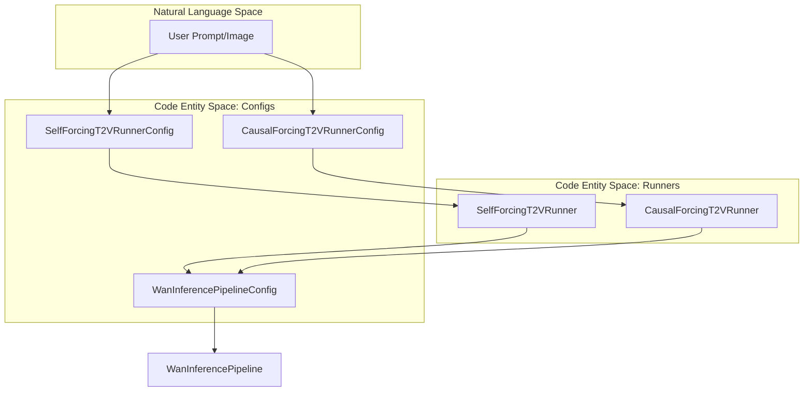
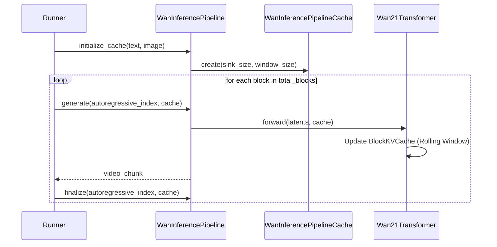

<!-- source: DeepWiki mcp.deepwiki.com · repo NVIDIA/flashdreams · page 4.2 Self-Forcing and Causal-Forcing (Wan 2.1 Streaming) · fetched 2026-10-26 -->

# Self-Forcing and Causal-Forcing (Wan 2.1 Streaming)

Relevant source files

The following files were used as context for generating this wiki page:

- [docs/benchmarks/benchmark_results.json](docs/benchmarks/benchmark_results.json)
- [docs/source/_static/performance/lingbot_world/perf-0521.md](docs/source/_static/performance/lingbot_world/perf-0521.md)
- [docs/source/_static/performance/wan21/perf-0521.md](docs/source/_static/performance/wan21/perf-0521.md)
- [docs/source/api/serving.rst](docs/source/api/serving.rst)
- [flashdreams/flashdreams/core/io/download.py](flashdreams/flashdreams/core/io/download.py)
- [integrations/causal_forcing/causal_forcing/config.py](integrations/causal_forcing/causal_forcing/config.py)
- [integrations/causal_forcing/causal_forcing/runner.py](integrations/causal_forcing/causal_forcing/runner.py)
- [integrations/fastvideo_causal_wan22/fastvideo_causal_wan22/config.py](integrations/fastvideo_causal_wan22/fastvideo_causal_wan22/config.py)
- [integrations/fastvideo_causal_wan22/fastvideo_causal_wan22/runner.py](integrations/fastvideo_causal_wan22/fastvideo_causal_wan22/runner.py)
- [integrations/flashvsr/flashvsr/runner.py](integrations/flashvsr/flashvsr/runner.py)
- [integrations/lingbot/lingbot/config.py](integrations/lingbot/lingbot/config.py)
- [integrations/lingbot/tests/parity_check/pyproject.toml](integrations/lingbot/tests/parity_check/pyproject.toml)
- [integrations/lingbot/tests/parity_check/uv.lock](integrations/lingbot/tests/parity_check/uv.lock)
- [integrations/self_forcing/self_forcing/config.py](integrations/self_forcing/self_forcing/config.py)
- [integrations/self_forcing/self_forcing/runner.py](integrations/self_forcing/self_forcing/runner.py)
- [integrations/self_forcing/tests/parity_check/.gitignore](integrations/self_forcing/tests/parity_check/.gitignore)
- [integrations/self_forcing/tests/parity_check/README.md](integrations/self_forcing/tests/parity_check/README.md)
- [integrations/self_forcing/tests/parity_check/changes.patch](integrations/self_forcing/tests/parity_check/changes.patch)
- [integrations/self_forcing/tests/parity_check/pyproject.toml](integrations/self_forcing/tests/parity_check/pyproject.toml)
- [integrations/self_forcing/tests/parity_check/uv.lock](integrations/self_forcing/tests/parity_check/uv.lock)
- [integrations/wan21/wan21/config.py](integrations/wan21/wan21/config.py)
- [integrations/wan21/wan21/runner.py](integrations/wan21/wan21/runner.py)

This page documents the integration of Self-Forcing and Causal-Forcing distillation techniques within the FlashDreams framework. These methods enable high-quality video generation with significantly fewer denoising steps (typically 4 steps) by leveraging distilled versions of the Wan 2.1 model family. The integration focuses on streaming autoregressive rollouts, efficient KV-cache management, and specialized runner configurations for low-latency performance.

## Overview of Distillation Techniques

Self-Forcing and Causal-Forcing are distillation methods applied to large-scale Diffusion Transformers (DiTs). In FlashDreams, these are implemented as specialized `Runner` and `Pipeline` configurations that utilize the Wan 2.1 architecture.

| Feature | Self-Forcing | Causal-Forcing |
| :--- | :--- | :--- |
| **Base Model** | Wan 2.1 1.3B [integrations/self_forcing/self_forcing/config.py:62-63]() | Wan 2.1 1.3B / 14B [integrations/causal_forcing/causal_forcing/runner.py:16-17]() |
| **Inference Steps** | 4 Steps [integrations/self_forcing/self_forcing/config.py:86]() | Variable (optimized for few-step) |
| **Primary Goal** | Efficient T2V/I2V Distillation | Causal consistency in long rollouts |
| **Scheduler** | `FlowMatchScheduler` [integrations/self_forcing/self_forcing/config.py:85]() | `FlowMatchScheduler` |

### System Architecture and Code Entities

The following diagram illustrates how the distillation integrations bridge Natural Language Space (prompts) to the Code Entity Space (runners and configs).

**Distillation Integration Map**

Sources: [integrations/self_forcing/self_forcing/runner.py](), [integrations/causal_forcing/causal_forcing/runner.py:133-141](), [integrations/self_forcing/self_forcing/config.py:96-100]()

## Self-Forcing Implementation

The Self-Forcing integration targets the Wan 2.1 1.3B model. It uses a specialized `state_dict_transform` to handle the specific naming conventions of distilled checkpoints, such as stripping `generator_ema` or `_fsdp_wrapped_module` prefixes [integrations/self_forcing/self_forcing/config.py:40-58]().

### Configuration Variants
1.  **Standard T2V**: Uses the default Wan VAE decoder and 4-step Flow Matching [integrations/self_forcing/self_forcing/config.py:62-95]().
2.  **TAEHV Optimized**: Replaces the Wan VAE with the `TeahvVAEDecoder` for reduced latency [integrations/self_forcing/self_forcing/config.py:104-111]().
3.  **Streaming (Sink/Window)**: Configures a rolling KV-cache with `sink_size_t=5` and `window_size_t=7` to support long-duration video generation [integrations/self_forcing/self_forcing/config.py:120-137]().

### Runner Logic
The `SelfForcingT2VRunner` (and its Causal-Forcing counterparts) manages the lifecycle of the generation process:
-   **Prompt Resolution**: Handles inline strings or `.txt` file paths [integrations/causal_forcing/causal_forcing/runner.py:145-156]().
-   **Cache Initialization**: Sets up the `WanInferencePipelineCache` with correct latent dimensions based on spatial compression ratios [integrations/causal_forcing/causal_forcing/runner.py:158-176]().
-   **Rollout Loop**: Executes the `pipeline.generate` call for the requested number of `total_blocks` [integrations/causal_forcing/causal_forcing/runner.py:188-193]().

Sources: [integrations/self_forcing/self_forcing/config.py:40-156](), [integrations/causal_forcing/causal_forcing/runner.py:133-194]()

## Causal-Forcing and Streaming KV-Cache

Causal-Forcing emphasizes temporal consistency. The FlashDreams implementation utilizes the `WanInferencePipeline` to perform autoregressive generation where each chunk depends on the KV-cache of previous frames.

### Streaming Configuration
To prevent memory exhaustion during long rollouts, the KV-cache is configured with windowing and sinks:
-   **Window Size (`window_size_t`)**: The number of recent latent frames kept in the attention context.
-   **Sink Size (`sink_size_t`)**: The number of initial frames (usually the first chunk) kept permanently to provide a global anchor for the video [integrations/self_forcing/self_forcing/config.py:129]().

**KV-Cache Data Flow**

Sources: [integrations/causal_forcing/causal_forcing/runner.py:178-194](), [integrations/self_forcing/self_forcing/config.py:120-137]()

## FastVideo Causal Wan 2.2

The `fastvideo_causal_wan22` variant represents an evolution of the streaming architecture, supporting the Wan 2.2 model family. It maintains parity with the distillation techniques but adapts to the architectural changes in Wan 2.2 (such as different patch embedding or downsampling layers).

-   **Runner**: `FastVideoCausalWan22Runner`
-   **Config**: Leverages `WanDiTNetwork` with updated configurations for the 2.2 backbone.

Sources: [integrations/fastvideo_causal_wan22/fastvideo_causal_wan22/runner.py](), [integrations/fastvideo_causal_wan22/fastvideo_causal_wan22/config.py]()

## Parity Checks and Benchmarking

The `integrations/self_forcing/tests/parity_check/` directory contains infrastructure to ensure that the FlashDreams implementation matches the numerical output of the original research codebases.

-   **Isolated Environment**: Uses a dedicated `pyproject.toml` and `uv.lock` to avoid dependency drift [integrations/self_forcing/tests/parity_check/pyproject.toml:1-22]().
-   **Baseline Comparison**: Compares generated latents against reference implementations like `FastVideo` or the official `Self-Forcing` repo.

| Benchmark | Device | FlashDreams Latency | Official Latency |
| :--- | :--- | :--- | :--- |
| Wan 2.1 1.3B (4-step) | H100 | ~629ms | ~1950ms |
| Wan 2.1 1.3B (4-step) | GB200 | ~449ms | ~1113ms |

Sources: [integrations/self_forcing/tests/parity_check/pyproject.toml](), [docs/source/_static/performance/lingbot_world/perf-0521.md:1-8]()

---

